# Why AI Changes Study and Work {#sec-ch01}

<!-- Status: REVISION v2 (2026-10-17) after four independent reviews (docs/editorial/ch01-dev-memo.md).
Characters per docs/characters.md (D11). Not marked done: awaiting the author's final voice edit
and confirmation of the From the Field draft (D13). Figures: figures/out/color (EPUB/web) and figures/out/gray (print). -->

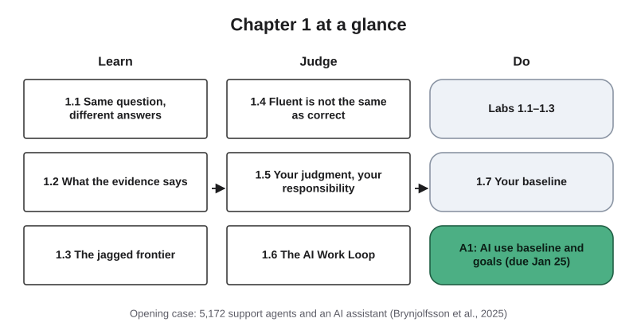{#fig-1-1 fig-alt="Chapter map with three columns: Learn (sections 1.1 to 1.3), Judge (1.4 to 1.6) and Do (labs, baseline, assignment A1)."}

**Chapter 1 at a glance.** Artificial intelligence (AI) tools now write, summarize and answer questions in seconds, in every field from accounting and nursing to engineering and the arts. Studies of real and realistic work tasks show that these tools can make people faster and better. Not everyone gains the same amount, and on some tasks the tools make work worse.

This chapter shows you where the gains come from and where the tools fail. It also gives you a five-step method for working with them, which you will use for the rest of the course: the AI Work Loop. You finish by recording where you start, so you can see later how far you have come.

**Time:** about 35–50 minutes for the Core reading, plus 20–30 minutes if you do the Your Turn activities at home. Some of them are done in the Thursday lab.

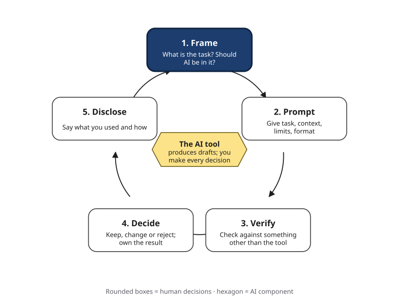{#fig-1-2a fig-alt="The AI Work Loop: five rounded boxes in a circle (Frame, Prompt, Verify, Decide, Disclose) around a hexagon labeled The AI tool; Frame is highlighted."}

## Opening Case: 5,172 Support Agents and an AI Assistant {.unnumbered}

Picture a customer-support center for a large software company. Agents answer chat messages from business customers all day. Some agents have worked there for years and can solve almost any problem. Others started last month and are still learning which questions are simple and which are difficult.

The company is a Fortune 500 firm, which means it is one of the 500 largest companies in the United States by revenue. It sells business-process software, and it decided to give its agents an AI assistant. During each chat, the assistant generated suggested replies that the agent could use, change or ignore.

The company did not switch the assistant on for everyone at once. It reached agents a few at a time over several months, because training sessions were limited. That gave three economists, Erik Brynjolfsson, Danielle Li and Lindsey Raymond, an unusual chance.

They could compare agents who had the assistant with similar agents who did not have it yet, during the same weeks. Because both groups faced the same busy seasons during the same weeks, a difference between them is good evidence of the tool's effect (Brynjolfsson et al., 2025).

The study followed 5,172 agents. On average, access to the assistant raised the number of issues an agent resolved per hour by 15%. That average hides the most interesting part.

Less experienced and lower-skilled agents improved by about 30% and also improved the quality of their work. The most experienced and highest-skilled agents gained only a little speed, and the quality of their work dropped slightly (Brynjolfsson et al., 2025).

There were other changes. Customers were more polite and less likely to ask to speak to a manager, although overall customer satisfaction scores did not change significantly. The researchers also found signs that the assistant helped agents learn, and that agents' written English improved, especially for international agents (Brynjolfsson et al., 2025).

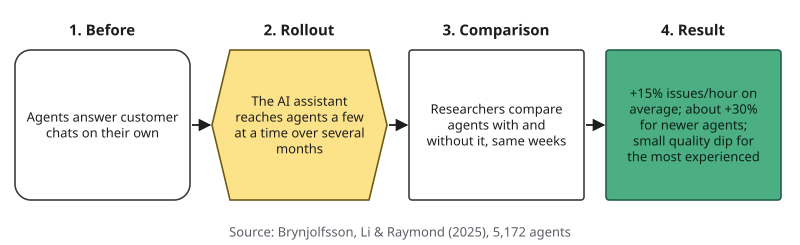{#fig-1-8 fig-alt="Four-step storyboard: agents answer chats alone; the assistant reaches agents a few at a time over several months; researchers compare agents with and without it in the same weeks; result: plus 15 percent on average, about plus 30 percent for newer agents, small quality dip for the most experienced."}

So here is a puzzle. The same tool, given to the same team, helped the newest people a lot and the most skilled people hardly at all. Why?

And if a tool helps beginners most at work, what does that mean for you, a beginner in many subjects, while you are still learning? Keep both questions in mind. You will have answers by the end of this chapter.

## Learning Objectives {.unnumbered}

LO1–LO7 are the seven course learning outcomes; section 1.7 lists them in plain language. Framework tags refer to the UNESCO (United Nations Educational, Scientific and Cultural Organization) AI Competency Framework for Students and the AI Fluency framework.

After this chapter you will be able to:

- **O1 — Explain** how a generative AI system produces an answer, how that differs from looking something up (including tools that search first and then generate), and why the same prompt can give different answers. *(LO1 · UNESCO: AI techniques and applications, Understand)*
- **O2 — Explain** why measured gains from AI at work were uneven across workers and tasks, using evidence from three studies. *(LO1 · UNESCO: human-centred mindset, Understand)*
- **O3 — Judge** whether AI is fit for a given task by testing its output and telling a fluent answer from a correct one. *(LO1 · AI Fluency: Delegation, Discernment)*
- **O4 — Judge** whether a use of AI is assistance or outsourcing under this course's three-zone policy, and justify your judgment. *(LO4 · UNESCO: ethics of AI, Apply)*
- **O5 — Apply** the AI Work Loop (Frame → Prompt → Verify → Decide → Disclose) to a task from your own major. *(LO4 · AI Fluency: Description, Diligence)*
- **O6 — Produce** an AI use baseline: three real tasks, their results, one documented failure and two personal goals, with an AI Use Declaration. *(LO4, LO7 · AI Fluency: Diligence)*

::: {.callout-note title="Warm-up (ungraded)"}
Answer from what you know today. There are no wrong answers. You will come back to these in the Chapter Summary.

1. The last time an AI tool gave you an answer, where did that answer come from?
2. Name one task you think AI does badly. Why do you think so?
3. In this course, is using AI allowed? Write down your guess before you read section 1.5.
:::

::: {.callout-note title="How to use the boxes in this chapter"}
**Check Yourself** boxes are short recall questions at the end of each section. **Worked examples** show every step; **faded examples** leave some steps for you; **Your Turn** boxes ask you to try it yourself. None of these are graded. They are practice for the exams and for your portfolio. Answers to odd-numbered end-of-chapter questions are in Appendix E; Compass (optional, free and ungraded) offers feedback on Check Yourself questions.
:::

::: {.callout-note title="Meet the students"}
Five fictional students appear throughout this book: Lucía (accounting), Marcus (nursing), Elif (psychology), Sam (mechanical engineering) and Hana (arts and technology). They are invented composites, used to show the same skills in different fields. You met them in "Meet the Students" at the front of the book.
:::

## 1.1 Same Question, Different Answers {#sec-1-1 .unnumbered}

[Core]{.path}

Try a small experiment. Type the same question into two different AI tools: "What are three good study strategies for a chemistry exam?" Then read both answers side by side. @fig-1-3 shows what happened when I did this with two models from the same provider on the same day.

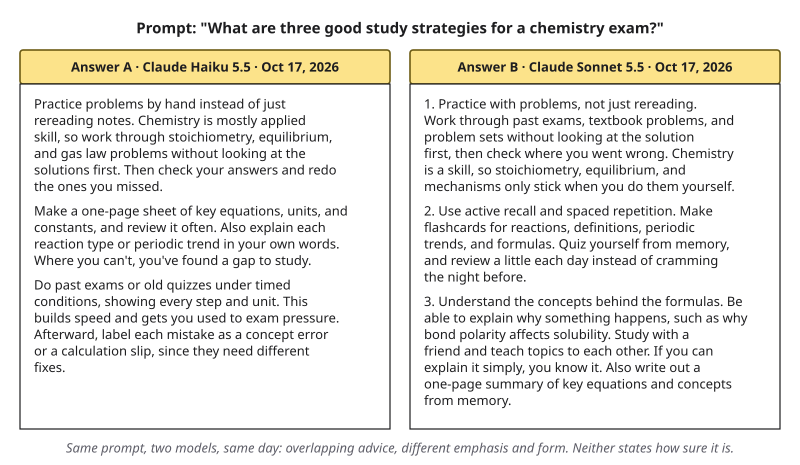{#fig-1-3 fig-alt="Two answer panels to the same chemistry study question, from Claude Haiku 5.5 and Claude Sonnet 5.5 on October 17, 2026; the advice overlaps but differs in emphasis and form."}

*These are real, unedited outputs from two models made by the same company (Anthropic), collected on October 17, 2026. Both were also asked to answer in at most 120 words. The full text is in the figure's long description.*

The two answers overlap, but they are not the same. Both suggest practicing problems. Only one suggests flashcards and spaced review; only the other suggests timed practice exams.

Both sound confident. Neither says how sure it is.

This is your first clue about what these tools are. Let's name the parts, one at a time.

- A **generative AI system** is software that produces new content, such as text, images or code, in response to an input.
- The input you give it is a **prompt**.
- What comes back is the **output**.
- A **model** is the trained mathematical function inside an AI system that turns a prompt into an output. Its internal settings were adjusted by training on huge amounts of existing text, and then tuned further to follow instructions and give answers people prefer. Chapter 2 shows how training works; Chapter 3 shows what happens inside a language model.

Now the key idea. When you ask a generative model a question, it does not look up a stored answer. It produces text one small piece at a time.

A piece is usually a word or part of a word. Each piece is chosen because it is a likely continuation of what came before, given patterns in the training text and in your prompt.

Why did the two answers differ? There are two reasons. If you ask the **same** tool twice, the answers usually differ because the tool picks each piece with some chance (Chapter 3 explains this sampling step). If you ask two **different** tools, they also differ because they run different models, trained on different data and given different hidden instructions.

### Search, generation, and tools that do both {.unnumbered}

Compare this with a classic search engine. A search engine takes your words, finds documents that match, and shows you a ranked list of links. The documents already existed. You decide which one to open, and you can see who wrote it.

A generative model works differently. It generates text for your prompt, usually in new wording. Sometimes it can repeat passages from its training data almost word for word. Either way, the model is producing likely text, not checking whether the text is true.

As of October 2026, many tools do both. They search the web first, then generate an answer that includes links to the pages they retrieved. This is useful, but the answer text is still generated. The links show which pages the tool retrieved.

They do not prove that each sentence matches its page. In a 2023 study of generative search engines, only about half of the generated sentences were fully supported by their citations (Liu et al., 2023). Many search engines now also show an AI-generated summary above the links. That summary belongs in the third category, not the first.

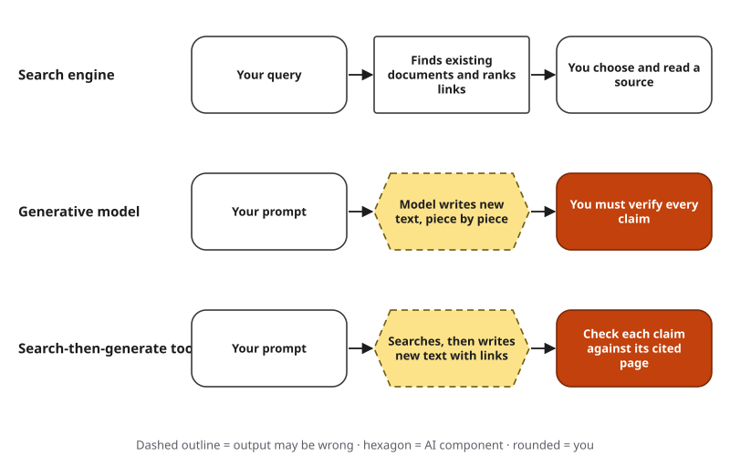{#fig-1-4 fig-alt="Three rows: a search engine returns existing documents for you to choose; a generative model writes new text you must verify; a search-then-generate tool writes text with links, and you check each claim against its cited page."}

| Tool type | What you must still check |
|---|---|
| Search engine (list of links) | Whether the source you open is reliable |
| Generative model (no search) | Every claim, because no human author stands behind the words |
| Search-then-generate tool, including AI summaries on search pages | Whether each claim matches the page it links to |

A common comparison is that a generative model is "like autocomplete on your phone, but much bigger." The comparison holds for the basic step: both predict what comes next. It breaks on scale. A large model is trained on vastly more text, uses far more of the conversation as context, and receives extra training to follow instructions. That lets the same prediction step produce summaries, explanations and code that phone autocomplete never could.

So a generative model is not a library of stored answers, and it is not a source of guaranteed truth. It is a powerful producer of likely text. In other words, *likely* is not the same as *true*. That makes it useful for drafting, explaining and brainstorming, and risky whenever something has to be exactly right.

::: {.callout-tip title="Check Yourself 1.1"}
1. Give the two reasons why answers to the same prompt can differ.
2. A tool gives you an answer with three links underneath. What do the links show, and what do they not show?
3. Why is "the AI looked it up" misleading for a model answering without web search, and only partly true for a tool that searches first?
:::

Different answers are one surprise. The next is that these tools, used at work, help some people much more than others.

## 1.2 What the Evidence Says About AI at Work {#sec-1-2 .unnumbered}

[Core]{.path}

You will hear many claims about AI and jobs. In this course you will treat such claims the way a scientist treats any claim: you will ask for evidence. Here is the pattern to look for in three studies of real or realistic work: **the gains were real, and the people who started lower gained more.**

### Study 1: Customer support {.unnumbered}

You already know this study from the Opening Case. **Productivity** had a precise meaning here: issues resolved per hour. Access to the assistant raised it by 15% on average, and by about 30% for less experienced and lower-skilled agents (Brynjolfsson et al., 2025).

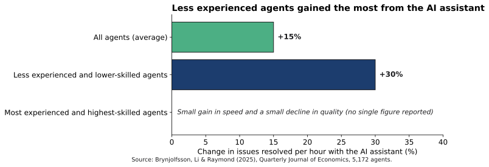{#fig-1-5 fig-alt="Bar chart: average gain plus 15 percent; less experienced and lower-skilled agents plus 30 percent; most experienced agents show a small speed gain and a small quality decline, with no single figure reported."}

Why would that happen? The assistant had been trained on past chat transcripts, with extra weight given to chats handled by the company's top performers (Brynjolfsson et al., 2025). Its suggestions often carried the habits of skilled agents: how they worded an offer to help, or when they asked a clarifying question.

A new agent who received those suggestions got a shortcut to experience. The researchers describe their results as consistent with this idea rather than proof of it. For the most experienced agents, the researchers suggest that they already worked this way, so suggestions added little and could sometimes distract them.

::: {.callout-note title="Worked Example: Reading the Evidence"}
**Question:** Look at @fig-1-5. Which group gained most, by how much, and how do we know the tool caused it?

**Step 1 — The measure.** Productivity was measured as issues resolved per hour.

**Step 2 — The comparison.** Agents who had just received the assistant were compared with similar agents who did not have it yet, over the same weeks.

**Step 3 — The groups.** The average gain was 15%. Less experienced and lower-skilled agents gained about 30%. The most experienced gained little speed and lost a little quality.

**Answer:** Less experienced agents gained most, about twice the average. The same-weeks comparison is what lets the researchers attribute the gain to the tool.
:::

### Study 2: Professional writing {.unnumbered}

Economists Shakked Noy and Whitney Zhang (2023) gave college-educated professionals writing tasks like those in their jobs: press releases, short reports, analysis plans and delicate emails. The tasks were realistic, but they were designed for the experiment. Participants were **randomly assigned**: chance decided who got access to ChatGPT, a chatbot built on a large language model, and who did not.

Random assignment makes the two groups alike, on average, in everything except the tool. With access, the time taken fell by about 40%, and graders rated quality about 18% higher. The gap between weaker and stronger writers also narrowed (Noy & Zhang, 2023).

Notice a limit. Graders scored overall quality, writing quality, content quality and originality; the study did not separately measure factual accuracy. It shows the drafts were faster and rated better. It does not show they were more accurate.

::: {.callout-note title="Faded Example: Same Steps, Your Turn to Finish"}
**Question:** In the writing study, what was found, and what is one limit?

**Step 1 — The measure:** time taken, and graders' quality ratings.

**Step 2 — The comparison:** How were the two groups formed? _______________________

**Step 3 — The result and one limit:** _______________________

*Try it without looking back at the text.*
:::

### Study 3: Management consulting {.unnumbered}

The third study involved 758 consultants at the consulting firm Boston Consulting Group (BCG), split between two experiments (Dell'Acqua et al., 2023, 2026). In the first, 385 consultants worked on realistic tasks designed by the researchers, such as designing a new shoe for an underserved market, segmenting the market and drafting a press release. Some were randomly given GPT-4, a large language model; others had no AI. Those without the tool formed the **control group**: the comparison group.

On these tasks, which the researchers judged to be within the AI's capability, consultants with AI completed more tasks, worked faster and produced work that human graders rated more than 40% higher in quality. Compared with their own earlier scores, consultants who started below average improved by 43%; those above average improved by 17% (Dell'Acqua et al., 2023).

| Study | Who | Task | Measured as | Who gained most |
|---|---|---|---|---|
| Brynjolfsson et al. (2025) | 5,172 support agents | Real customer chats | Issues resolved per hour: +15% | Less experienced and lower-skilled agents (about +30%) |
| Noy & Zhang (2023) | Professionals | Designed writing tasks | Time −40%; rated quality +18% | Weaker writers (gap narrowed) |
| Dell'Acqua et al. (2023) | 385 consultants (inside-frontier tasks) | Designed consulting tasks | Quality rated by human graders: more than +40% | Below-average performers (+43% vs. +17%, against their own baseline) |

The three studies measured different things, so their numbers cannot be compared directly. What they share is the pattern: real gains, unevenly spread.

### Working faster is not the same as learning {.unnumbered}

Here you need to be careful. If AI helps beginners most at work, you might conclude that you, as a beginner, should lean on it as much as possible while you study. That conclusion does not follow.

At work, the goal of a support chat is to solve the customer's problem. If the suggestion solves it, the job is done. In a course, the goal of an assignment is different.

It exists so that you build a skill you can use without the tool: on an exam, in an interview, or when the tool gives you something wrong. If the tool produces the reasoning you were meant to do, the assignment is done but the learning is not.

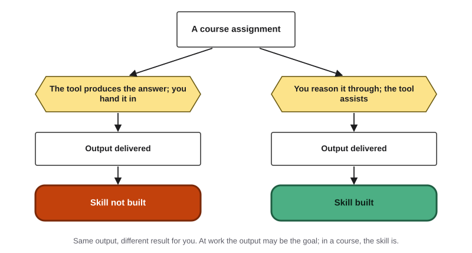{#fig-1-13 fig-alt="Two paths from a course assignment: when the tool produces the answer and you hand it in, output is delivered but the skill is not built; when you reason it through and the tool assists, the skill is built."}

There is evidence for this difference. In a study of high school mathematics students in Türkiye, students who practiced with unrestricted access to a chatbot did better during practice. On an exam without the tool at the end of the session, they did worse than students who had practiced with their books and notes instead.

A version designed to give hints instead of answers avoided that harm, although it did not raise exam scores above those of the comparison group (Bastani et al., 2025). You will study this in Chapter 7.

::: {.callout-important title="Your Turn"}
Suggest one alternative explanation for why the most experienced support agents gained little. What evidence would help you choose between your explanation and the researchers' explanation?
:::

::: {.callout-tip title="Check Yourself 1.2"}
1. In the support study, what exactly did "productivity" mean?
2. What is a control group, and why does random assignment matter?
3. Why does "AI helps beginners most at work" not mean "beginners should let AI do their coursework"?
:::

All three studies measured gains on tasks the AI handled well. The next section is about tasks it does not handle well.

## 1.3 The Jagged Frontier {#sec-1-3 .unnumbered}

[Core]{.path}

Go back to the consultants. In the second experiment, 373 consultants worked on a task the researchers designed to be outside what the AI could do reliably at the time: a brand-growth recommendation for a hypothetical company. The spreadsheet looked complete, but interview notes held details that changed the right answer.

About 85% of consultants without AI reached the correct answer, compared with about 60% to 70% of those with AI, a drop of roughly 19 **percentage points** (Dell'Acqua et al., 2023). A percentage point is the simple difference between two percentages, such as 85% minus 66%.

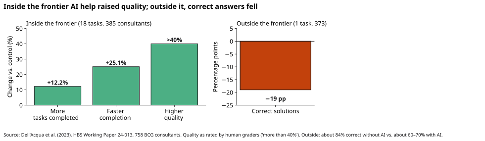{#fig-1-6 fig-alt="Two panels. Inside the frontier on 18 tasks: more tasks completed plus 12.2 percent, faster plus 25.1 percent, higher quality more than 40 percent. Outside the frontier on one task: correct solutions minus 19 percentage points."}

The tool did not just fail to help. It made results worse. The authors found that consultants who did worse tended to adopt the AI's output without questioning it. This result comes from a single task, so treat it as a warning sign rather than a precise measurement.

The researchers described this with an image: a **jagged technological frontier**. Imagine all the tasks you could give an AI tool, arranged by how hard they look to a person. You might expect a smooth line, with easy tasks inside the tool's ability and hard tasks outside. The real boundary is not smooth.

It zigzags. Some tasks that look hard sit inside the frontier. Some that look easy sit outside. In other words, how hard a task looks to you tells you little about how well the tool will do it.

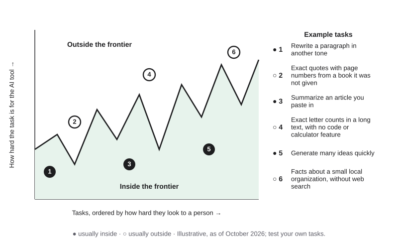{#fig-1-7 fig-alt="Schematic jagged line separating inside the frontier from outside it, with six numbered example tasks, illustrative as of October 2026: three usually inside (rewriting tone, summarizing a pasted article, generating ideas) and three usually outside (exact quotes from a book not given, exact letter counts without a calculator feature, local facts without web search)."}

Here are patterns you are likely to meet, as of late 2026. Each depends on the tool, so test before you rely on it.

| Often inside the frontier | Often outside the frontier |
|---|---|
| Summarizing an article you paste in | Exact quotations with page numbers from a book the tool was not given |
| Rewriting a paragraph in a different tone | Recent events, when the tool does not search the web |
| Drafting an outline on a familiar topic | Counting items or letters exactly in a long text, or long calculations, when the tool has no calculator or code feature |
| Explaining a standard concept in simpler words | Facts about small organizations, local rules or niche topics |
| Generating many ideas quickly | Details that depend on information the tool was never given |

You may hear that newer models "can handle everything" now. Testing like the examples in this section keeps finding new edges. Newer models move the frontier, but it stays jagged: a new model can fix one failure and still miss another task that looks easier. Three things move the frontier for you:

- **The task.** Summarizing an article you paste in is usually fine. Summarizing one from memory often is not.
- **The tool.** Different models, and tools that can search or calculate, have different frontiers.
- **The date.** Models and tools are updated often.

So the only reliable way to find the frontier for your task is to **test it**. Give the tool a version of the task where you already know the right answer. If it gets that right, try a harder version. If it fails, you have found an edge.

::: {.callout-note title="Worked Example: One Change, Two Results"}
**Field:** Arts and humanities. *Featuring Hana (arts and technology, history minor).*

Hana wants three exact quotations, with page numbers, from an essay for a history paper. *(Constructed example for teaching.)* They test the same request twice, changing only one thing: what the tool is given.

**Test A — essay pasted into the prompt.** Request: "Give me three direct quotations from this essay, with page numbers." They search the essay for each quotation. All three appear; one page number is off by one. **Verdict:** inside the frontier, with checking.

**Test B — essay named but not given.** Same request, but they only name the essay. Two quotations do not appear anywhere in it. The third exists, but the page number is wrong. **Verdict:** outside the frontier for this tool, on this date.

**Rule:** when only one thing changed, you know what made the difference. Here, giving the tool the source moved the task inside the frontier.
:::

::: {.callout-note title="Faded Example: Design the Test"}
**Field:** Engineering. *Featuring Sam (mechanical engineering), who checks units on everything since one bad lab grade.*

**Task:** "A pump moves 450 liters per minute. How many gallons per hour is that?"

**Test (partly done):** Find the liters-to-gallons conversion factor in an official source. Hint: which gallon? US and imperial gallons differ. Then multiply by 60 to go from minutes to hours.

**Compare:** Does the tool's answer match yours? _______________________

**Verdict:** If it matches, does one correct answer prove the tool is reliable for this kind of problem? What would you test next? _______________________
:::

::: {.callout-important title="Your Turn"}
List three tasks from your own week: one you expect to be inside the frontier, one outside, and one you are unsure about. For each, write a test that would show which side it is on. **Bring this list to the Thursday lab; it is the task list for Lab 1.2.**
:::

::: {.callout-tip title="Check Yourself 1.3"}
1. What happened to accuracy on the consulting task outside the frontier, and why is one task not enough for a precise conclusion?
2. Name the three things that move the frontier for you.
3. Why is testing on a case where you already know the answer better than memorizing a list of what AI can do?
:::

Testing tells you whether a tool can do a task. But how do you notice a failure in the first place, when every answer sounds equally sure? That is the next skill.

## 1.4 Fluent Is Not the Same as Correct {#sec-1-4 .unnumbered}

[Core]{.path}

In this book, **fluent** means smooth, confident and well organized: text that sounds like an expert wrote it. Fluent text is easy to trust. That is exactly the problem.

Read these two answers to the same question, "How much water should an adult drink per day?"

> **Answer A.** Guidance gives reference values for total water from drinks and food, for example about 2.7 liters a day for women and 3.7 for men from the U.S. National Academies, but needs vary with body size, activity, climate and diet. Check a current guideline from a health authority in your country.
>
> **Answer B.** According to a 2019 study by the Global Hydration Institute, adults should drink exactly 3.2 liters of water per day, regardless of climate or activity level.

*Constructed example written for teaching. Not a real model output, and not health advice. Answer A's reference values: Institute of Medicine (2005).*

Answer B sounds more precise. It has a year, an organization and one exact figure for everyone. It is also the one you should trust less. Look for the red flags:

- **Exact numbers for things that vary.** "Exactly 3.2 liters" for every adult.
- **Words that remove all conditions.** "Regardless of climate or activity."
- **A source you cannot find.** Search for the "Global Hydration Institute." If you cannot find it, the claim fails its first test.

Answer A also gives numbers, but it names a real source, states the conditions and tells you where to check. Those are good signs.

This is the most important habit in this chapter: **fluency is not evidence.** A generative model was trained to produce likely text and then tuned to give answers people rate highly. Neither step checks whether the answer is true, so a confident tone is not evidence of accuracy.

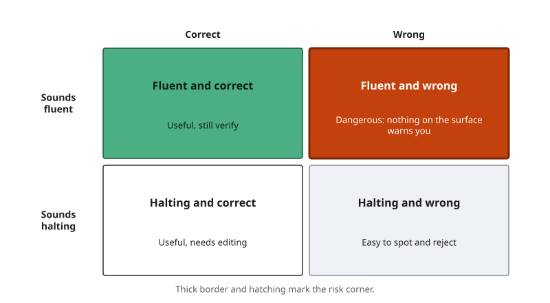{#fig-1-9 fig-alt="Two-by-two grid: fluent and correct (useful, still verify); fluent and wrong (dangerous, nothing on the surface warns you); halting and correct (useful, needs editing); halting and wrong (easy to spot)."}

The dangerous corner of @fig-1-9 is "fluent and wrong," because nothing on the surface warns you. Professionals have been caught there. In 2023, a federal judge in New York sanctioned, meaning penalized, two lawyers and their firm.

They had filed a brief (a written legal argument) citing court decisions that ChatGPT had made up, and they kept defending them when questioned (*Mata v. Avianca, Inc.*, 2023). You will study that case in Chapter 8.

You do not need a full catalog of failures yet; Chapter 4 provides one. Start with three terms:

- **Hallucination:** fluent output that is not supported by the model's input or by facts. Some researchers use the word *confabulation* for some of these errors (Farquhar et al., 2024); this book uses *hallucination* because it is more common.
- **Outdated information:** output that was once correct but no longer is, because the model's training data ends at a cutoff date and the tool did not search for newer information, or found old pages.
- **Overconfidence:** output stated with more certainty than the evidence supports, as in Answer B.

::: {.callout-note title="Worked Example: Tracing a Confident Statistic"}
**Field:** Psychology and social science. *Featuring Elif (psychology).*

For a class discussion, Elif asks an AI tool whether working from home affects productivity. The output says: "A Stanford study found remote workers are 13% more productive." *(Constructed example for teaching.)*

**Step 1 — Isolate the claim.** One number (13%), one source (a Stanford study), one direction (more productive).

**Step 2 — Find the original.** Elif searches and finds a study led by Stanford economist Nicholas Bloom: a randomized experiment at a large Chinese travel company, where call-center employees who volunteered were assigned by chance to work from home or in the office for nine months (Bloom et al., 2015).

**Step 3 — Compare what was measured.** The 13% was an increase in the performance of those call-center employees, mostly from working more minutes per shift and partly from handling more calls per minute (Bloom et al., 2015). It was one company, one kind of job and one period.

**Step 4 — Decide.** Elif rewrites the claim: "In a nine-month experiment with call-center staff at one Chinese travel company, working from home raised performance by 13% (Bloom et al., 2015)."

**Rule:** a statistic is only as good as your ability to find where it came from and what it measured.
:::

::: {.callout-note title="Faded Example: Find the Error"}
**Field:** Natural science. *Featuring Lucía, studying for her general-education science course.*

*Constructed AI-style output:* "Seasons happen because Earth is closer to the Sun in summer and farther away in winter."

**Step 1 — Isolate the claim:** Seasons are caused by Earth's distance from the Sun.

**Step 2 — How would you check it?** _______________________ (Hint: when is it summer in the Northern Hemisphere, and when in the Southern Hemisphere?)

**Step 3 — Corrected statement:** _______________________
:::

::: {.callout-important title="Your Turn"}
Take one full output you saved in Lab 1.1. Mark each sentence as *checked and correct*, *checked and wrong*, or *not checked*. How many sentences could you not check at all?
:::

::: {.callout-tip title="Check Yourself 1.4"}
1. What does "fluent" mean in this book, and why is fluency not evidence?
2. Name two red flags in Answer B.
3. Why is the "fluent and wrong" corner of @fig-1-9 the most dangerous?
:::

You now know that AI output can be uneven, fluent and wrong. So when is it acceptable to use it at all, especially in a course? That is a question of judgment, and of rules.

## 1.5 Your Judgment, Your Responsibility {#sec-1-5 .unnumbered}

[Core]{.path}

Students arrive in this course with two opposite worries. Some think any use of AI is cheating. Others think anything is fine as long as the result is good. Both are wrong, and this course replaces them with a clear policy.

The principle: **AI use is not prohibited; unacknowledged, unverified or intellectually outsourced AI use is not acceptable.** In practice, uses fall into three zones.

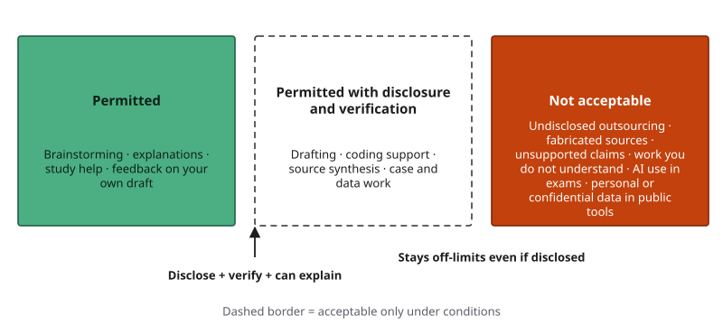{#fig-1-11 fig-alt="Three zones: permitted (brainstorming, explanations, study help, feedback on your draft); permitted with disclosure and verification (drafting, coding support, source synthesis, case and data work); not acceptable (undisclosed outsourcing, fabricated sources, unsupported claims, work you do not understand, AI use in exams, personal or confidential data in public tools)."}

| Permitted | Permitted with disclosure and verification | Not acceptable |
|---|---|---|
| Brainstorming, explanations of concepts, study help, feedback on your own draft, formatting, testing prompts | Drafting, coding support, source synthesis, case analysis, data and decision work, provided you disclose, verify and can explain the result | Undisclosed outsourcing; fabricated sources; unsupported claims; submitting work you do not understand; any AI use during examinations; entering personal or confidential data (yours or anyone else's) into a public AI tool (course guidance) |

Four ideas sit behind this table.

**Assistance versus outsourcing.** Assistance helps you do the thinking. Outsourcing replaces it. Asking a tool to explain a concept that you then use in your own words is assistance.

Pasting its answer in as your own work is outsourcing, even if the answer is correct. The test is what you can do afterward: if you cannot explain, defend or redo the work without the tool, you outsourced it.

**Where drafting ends and outsourcing begins.** Drafting is in the middle zone, but it depends on the purpose of the assignment. If the assignment exists to build a skill in writing or reasoning itself, such as a reflection essay or an argument, then having AI draft it is outsourcing, unless your instructor explicitly allows it. If the writing serves another purpose, such as a newsletter that accompanies your project, AI drafting with disclosure and verification can be acceptable.

**Disclosure.** Every major artifact in this course carries an **AI Use Declaration**. It states the tools you used and for what purpose, which outputs you accepted, rejected or revised, how you verified them, and where your own judgment shaped the work. Middle-zone uses must be described in detail.

Permitted-zone uses, such as brainstorming or grammar feedback, are listed briefly. Disclosure is a professional habit, like a scientist reporting methods. It is not a confession.

**Some uses stay off-limits.** Disclosure does not make everything acceptable. Fabricated sources remain unacceptable even if you admit them. AI use during an exam is not allowed, because the exam exists to show what you can do yourself. Personal and confidential data, such as a patient's case or a classmate's work, never goes into a public tool; Chapter 15 explains why in detail.

Recall the support agents. At work, the goal was to solve the customer's problem, and the assistant helped. In a course, the "customer" is your future self, who needs the skill. That is why the same tool can be useful at work and a bad shortcut in a course.

::: {.callout-note title="Worked Example: Sorting Uses into the Three Zones"}
**Field:** Education. *(A one-off example; not one of the recurring students.)*

A student teacher uses AI in four ways while preparing a lesson.

| Use | Zone | Why |
|---|---|---|
| Asks for five ways to explain fractions to ten-year-olds, then picks and adapts one | Permitted | Brainstorming; the student does the choosing and adapting |
| Has the tool draft a parent newsletter, then edits it and checks the dates | Permitted with disclosure and verification | Drafting for a practical purpose; must disclose and verify |
| Has the tool write the reflection essay her teaching course requires and submits it unchanged | Not acceptable | The essay exists to build her own reflection; this is outsourcing |
| Asks for feedback on her own reflection draft, then revises it herself | Permitted | Feedback on her own draft |
:::

::: {.callout-note title="Faded Example: Sort Two Yourself"}
**Field:** Health. *Featuring Marcus (nursing).*

| Use | Zone | Why |
|---|---|---|
| Marcus asks AI to quiz him on drug classes before an exam | Permitted | Study help |
| Asks AI to explain a lab value, then checks it in his textbook | Permitted | Explanation, verified against a source |
| Uses AI to summarize three research articles for a literature review, then checks each summary against the article and discloses it | _______ | _______ |
| Pastes a real patient's case from his clinical placement into a public AI tool to get a care plan | _______ | _______ |
:::

::: {.callout-important title="Your Turn"}
Sort these five uses into the three zones and give one reason each:
(a) an accounting student asks AI to explain depreciation;
(b) a music student asks AI for feedback on the structure of program notes she wrote, then revises them herself;
(c) an engineering student has AI write the reflection section of a lab report and submits it as his own;
(d) a history student asks AI for sources and cites two he never opened;
(e) a psychology student uses AI to suggest a clearer structure for her own essay and lists this in her declaration.
:::

::: {.callout-tip title="Check Yourself 1.5"}
1. State the course's AI principle in your own words.
2. Why does disclosure not make fabricated sources acceptable?
3. When does AI drafting become outsourcing?
:::

You now have the pieces: what the tools produce, where they help, where they fail, and what the rules are. The next section puts the pieces into one method.

## 1.6 The AI Work Loop {#sec-1-6 .unnumbered}

[Core]{.path}

Every time you use AI on a task that matters, you make five decisions, whether you notice them or not. This book names them so you can make them on purpose. Together they form the **AI Work Loop**.

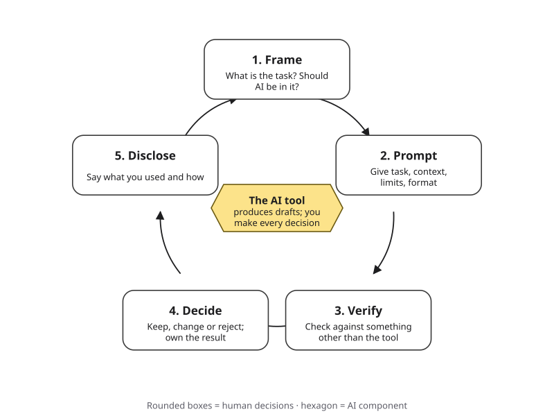{#fig-1-2 fig-alt="The AI Work Loop: Frame, Prompt, Verify, Decide, Disclose arranged in a circle with arrows, around a hexagon labeled The AI tool that produces drafts while you make every decision."}

1. **Frame.** Decide what the task really is, what a good result looks like, and whether AI belongs in it at all. Is the task likely inside the frontier? What would you lose by delegating it?
2. **Prompt.** Give the tool what it needs: the task, the context, the limits, the format you want. Chapter 5 is devoted to this step.
3. **Verify.** Check the output against something other than the tool: a source, a calculation, your own knowledge, an expert. Fluency is not evidence.
4. **Decide.** Choose what to keep, change or reject, and take responsibility for the result. The tool produces options; you decide.
5. **Disclose.** Say what you used and how, in the way your context requires: an AI Use Declaration in this course, a note to a manager or client at work.

The loop is drawn as a circle because the steps feed each other. Verification often sends you back to framing ("this task is outside the frontier; I need another approach") or to prompting ("I left out the key limit").

Each chapter of this book opens with the loop and highlights the step that chapter strengthens. This chapter highlights **Frame**, because the first decision is whether and how to use AI at all.

::: {.callout-note title="Worked Example: The AI Work Loop on an Upset Customer's Email"}
**Field:** Business. *Featuring Lucía, who works part-time in customer support. Here you take her place.*

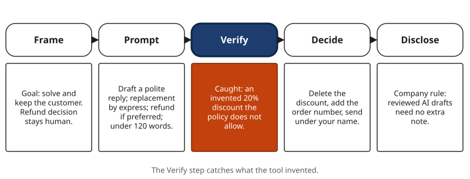{#fig-1-12 fig-alt="Five steps for a customer email: Frame the goal; Prompt for a polite reply; Verify catches an invented 20 percent discount; Decide deletes it and sends; Disclose follows the company rule."}

**The situation.** A customer writes that her order arrived broken, for the second time. She is angry and asks for a refund.

**Frame.** The goal is to solve the problem and keep the customer. A good reply apologizes, states the fix clearly and follows company policy. Drafting a calm reply is likely inside the frontier. Deciding the refund is not the tool's job; it depends on policy and on this customer's history.

**Prompt.** "Draft a short, polite reply to a customer whose order arrived broken for the second time. Apologize, offer a replacement shipped by express at no cost, and say a refund is also available if she prefers. Do not promise anything else. Keep it under 120 words." *(The policy details come from the employee, not the tool.)*

**Verify.** The draft is good, but it promises "a 20% discount on your next order." The prompt did not ask for that, and policy does not allow it. That sentence is invented.

**Decide.** Delete the discount line. Add the order number. Send it under your own name, because you are responsible for what it says.

**Disclose.** The company's rule says AI-drafted customer messages are fine if a person reviews them, so no further note is needed. Another company might have a different rule, so you check.
:::

::: {.callout-note title="Faded Example: The Loop on a Patient Leaflet"}
**Field:** Health sciences. *Featuring Marcus (nursing), during a clinical placement.*

**Situation.** Marcus's unit asks him to turn a hospital leaflet about a new medication into plain language for patients. Put yourself in his place.

**Frame.** Rewriting for readability is likely inside the frontier. Medical accuracy is not negotiable, so every changed sentence must still be correct.

**Prompt.** "Rewrite this leaflet at a sixth-grade reading level. Keep every dose, warning and side effect exactly as written. Do not add advice." *(The leaflet text is pasted in; it contains no patient data.)*

**Verify:** How will you check that nothing medical changed? _______________________

**Decide:** What would make you reject the rewrite entirely? _______________________

**Disclose:** Who should be told that AI helped, and how? _______________________
:::

::: {.callout-important title="Your Turn"}
Choose a task from your own major that you might do with AI this month. Write one or two sentences for each step of the loop. Mark the step where you think a mistake is most likely.
:::

::: {.callout-tip title="Check Yourself 1.6"}
1. Name the five steps of the AI Work Loop in order.
2. In the customer email example, which step caught the error, and what was it?
3. Why is the loop drawn as a circle rather than a straight line?
:::

One step remains: recording where you are starting from.

## 1.7 Your Baseline: Where You Start {#sec-1-7 .unnumbered}

[Studio]{.path}

*Studio sections are hands-on work for the Thursday lab and your weekly assignment.*

Athletes record their starting times so they can see their progress. You will do the same with AI. Your first **studio artifact**, the weekly assignment for your course portfolio, is A1: an AI use baseline. It combines two things: how you use AI today, and a first structured test you run in Lab 1.2.

**How it is graded.** A1 is graded for completeness and for the quality of your process: clear tasks, honest records, a real test. It is never graded on how much you used AI before, or on whether your past use was "acceptable." The baseline is not used for any academic-integrity purpose. The course policy applies from this course forward.

**If you have not used AI before,** that is a good starting point. Write "I have not used AI yet" for current habits, and run your three tasks for the first time in Lab 1.2. If you prefer not to use AI at all, use the alternative assignment at the end of this chapter.

Your baseline has four parts:

1. **Three real tasks:** the three from your 1.3 Your Turn list (one inside, one outside, one unsure).
2. **What happened:** what you asked, what came back, what you did with it.
3. **One documented failure:** an output that was wrong, misleading or unhelpful, and the test that showed it. Keep it: it will be the first entry in your Failure Diary in Chapter 4.
4. **Two personal goals** for the course, each tied to one of the course learning outcomes below.

::: {.callout-note title="The seven course learning outcomes (LO1–LO7), in plain language"}
- **LO1** Explain what generative and agentic AI systems are, how they work in outline, and how and why they fail.
- **LO2** Frame a task for AI and improve the results through careful, documented iteration.
- **LO3** Verify AI-generated claims, sources and outputs, and record what is still uncertain.
- **LO4** Tell responsible assistance apart from overreliance, hidden outsourcing and academic misconduct.
- **LO5** Apply privacy, security, fairness, transparency and human-oversight principles to AI-assisted work.
- **LO6** Design an AI-assisted workflow for a task in your own field, and defend it to a non-specialist.
- **LO7** Present your work as a portfolio that an employer or graduate program will recognize.
:::

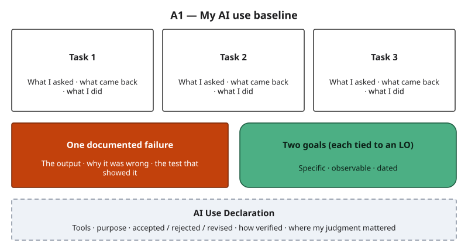{#fig-1-14 fig-alt="Template with boxes for three tasks, one documented failure, two goals tied to learning outcomes, and an AI Use Declaration."}

### Writing a useful goal {.unnumbered}

A useful goal is specific, observable and tied to a learning outcome. Compare:

| Weak goal | Stronger goal |
|---|---|
| "Get better at AI." | "By the midterm, check every statistic an AI tool gives me against an original source before I use it (LO3)." |
| "Use AI more for my major." | "By April, design one AI-assisted workflow for a real task in my nursing courses, with a step where I verify medical facts (LO6)." |

::: {.callout-note title="Worked Example: A Sample Baseline"}
*Elif's baseline (a sample written for teaching).*

| Task | What I asked | What came back | What I did |
|---|---|---|---|
| Summarize a 20-page reading for my sociology class (expected inside) | "Summarize this article" (text pasted) | A clear one-page summary | Compared it with my notes; it left out the author's main limitation, so I added it |
| Find statistics on international students in the US (unsure) | "How many international students study in the US?" | A precise number with no source | Could not find the number in any official source; did not use it |
| Count how many times a keyword appears in a 30-page report (expected outside) | "How many times does 'equity' appear in this report?" | A number | Counted with my word processor's search; the tool's number was wrong |

**Documented failure:** the keyword count was wrong, and the search function showed it.

**Goals:** (1) By the midterm, never use a statistic I have not traced to its source (LO3). (2) By the final portfolio, write an AI Use Declaration for every major assignment without being reminded (LO4).

**AI Use Declaration:** I used a free chatbot (model and date recorded in my log, January 2027) for the three tasks above. I revised the summary, rejected the statistic and rejected the keyword count. I verified the summary against my notes, searched for the statistic's source, and counted the keyword with the search function. My own judgment decided what to keep.
:::

::: {.callout-note title="Faded Example: Write the Declaration"}
A chemistry student used an AI tool to (a) explain a reaction mechanism she found confusing, (b) generate practice problems, and (c) check her lab report's grammar. She found that one practice problem had a wrong answer key.

Complete her declaration using these sentence frames:

- I used ________ (tool, date) to ________.
- I accepted ________. I revised ________. I rejected ________.
- I checked the results by ________.
- My own judgment mattered when ________.
:::

::: {.callout-important title="Your Turn"}
Start your own baseline now with the template in @fig-1-14. You will finish it in Lab 1.2 and submit it as A1.
:::

::: {.callout-tip title="Check Yourself 1.7"}
1. What are the four parts of the baseline?
2. Why is an honest baseline more useful to you than an impressive one?
:::

## Deep 1.A: How Economists Measure AI's Effect at Work {#sec-1-deep-a .unnumbered}

[Deep]{.path}

*Deep sections are optional and not on the exams.*

How can anyone know that an AI assistant *caused* a 15% gain, and not something else, such as a busy season or a new manager? The support-center study used the way the tool was introduced.

The assistant did not reach every agent on the same day; agents received it a few at a time over several months, so the rollout was **staggered**. At any given moment, some agents had the tool and similar agents did not yet. The analysis compares the change in performance for agents who just received the tool with the change, over the same weeks, for agents still waiting.

This is a **difference-in-differences** comparison. Anything that affected everyone, like a seasonal rush, shows up in both groups and cancels out.

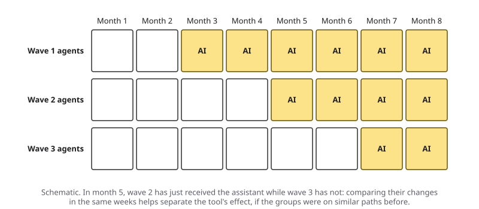{#fig-1-16 fig-alt="Grid of three waves of agents over eight months; each wave receives the AI assistant two months after the previous one, so recently treated and not-yet-treated groups can be compared in the same months."}

The comparison works only if one assumption holds: without the tool, the two groups would have moved in parallel. Researchers check this by confirming that the groups were on similar paths before the tool arrived. That check matters here, because managers chose which agents attended each training session.

The authors report several checks, including similar effects across groups that started at different times and a small randomized pilot with similar results (Brynjolfsson et al., 2025). Other limits are worth knowing:

- One company, one kind of job and one tool were studied. Results may not carry over to other settings.
- Productivity was measured as issues resolved per hour. A different measure, such as long-term customer loyalty, might tell a different story.

The writing and consulting studies used random assignment, which makes the groups alike on average in everything except the tool. Even so, their tasks were designed for the experiment and may differ from real jobs.

When you read any claim about AI and productivity, ask three questions: *Compared with whom? Measured how? In what setting?*

## Deep 1.B: AI Literacy as an Employer Duty {#sec-1-deep-b .unnumbered}

[Deep]{.path}

In the European Union, the regulation known as the EU AI Act includes an article on **AI literacy**: the skills and understanding that let people use AI systems knowingly and see their opportunities and risks. Article 4, which applied from February 2, 2025, originally required organizations that provide or deploy AI systems "to ensure, to their best extent, a sufficient level of AI literacy" among their staff (Regulation (EU) 2024/1689). In 2026 an amending regulation softened this duty: organizations now have to take steps that help their staff build AI literacy, without guaranteeing any particular level (Regulation (EU) 2026/1744). This summary is as of October 2026.

This is a duty placed on organizations, not a requirement for students. But it tells you something about your future workplace: employers that provide or deploy AI systems covered by the Act must take measures to support their staff's AI literacy, though the law does not require any guaranteed level. The skills in this book are the kind of AI literacy such policies describe. Chapter 18 returns to AI law and governance.

## Hands-on Labs {.unnumbered}

The labs describe what to do, not which buttons to press. Full lab sheets are on eLearning; step-by-step instructions for current tools are in Compass, which is optional and ungraded. [COMPASS: lab pages ch01-lab1 to ch01-lab3] Use only free or university-provided tools, and never enter personal or confidential data.

### Lab 1.1: Same Question, Two Answers (Compare · 20 minutes · Tuesday, in class) {.unnumbered}

*(O1 · LO1 · Analyze)*

1. Choose three questions: one factual, one practical and one from your major.
2. Ask each question in two different tools, or twice in one tool using new conversations.
3. For each pair, record what is the same, what differs, whether either gives sources, and how certain each sounds.
4. Save the full outputs. You will use them in section 1.4.

**If this doesn't work:** with only one tool, run each question three times in new conversations. If you prefer not to use AI, compare the two sample outputs on eLearning.

### Lab 1.2: Your Baseline (Explore and Reflect · 45 minutes · Thursday lab) {.unnumbered}

*(O3, O5, O6 · LO4, LO7 · Apply)*

1. Bring your three tasks from the 1.3 Your Turn.
2. **Frame:** write what a good result would look like for each, before using AI.
3. Run each task. Save what you asked and what came back.
4. **Verify** each output with a test: your notes, a source, a calculation, or a classmate who knows the topic.
5. Document at least one failure. If everything worked, make one task harder until something fails.
6. If time allows, share one surprise with your group. Then start your A1 draft.

**If this doesn't work:** use the dated sample outputs on eLearning for your three tasks and design the tests.

### Lab 1.3: Find the Edge (Break It · 30 minutes · optional) {.unnumbered}

*(O3 · LO1 · Evaluate)*

Find one output that looks right but is wrong. Record the prompt, the output, the test that exposed the error, the tool and the date. Save each one: it becomes an entry in your Failure Diary (Chapter 4, section 4.8).

**If this doesn't work:** use the dated sample outputs on eLearning and find the error with a test.

## Case Study: The Support Center, Revisited {.unnumbered}

**Context.** A Fortune 500 company selling business-process software introduced an AI chat assistant for its customer-support agents. The study does not name the company, and neither does this book (Brynjolfsson et al., 2025).

**Timeline.** The assistant reached groups of agents at different times. Researchers compared agents with and without the tool over the same weeks (see Deep 1.A).

**What the AI did.** It generated suggested replies during live chats. It had been trained on past chat transcripts, with extra weight on chats handled by top performers (Brynjolfsson et al., 2025).

**What humans did.** Agents chose what to send and remained responsible for each conversation. Managers decided who received the tool and when.

**Failure label.** None in the usual sense. The lesson is about *uneven benefit*.

**Consequences (documented).** Issues resolved per hour rose 15% on average and about 30% for less experienced and lower-skilled agents. The most experienced agents gained a little speed and lost a little quality. Customers were more polite and less likely to ask for a manager, while customer satisfaction scores did not change significantly.

The researchers found evidence of worker learning and better written English, especially among international agents. Gains were largest for moderately rare problems: those the agents had seen too seldom to master, but that the system still had enough past examples to handle (Brynjolfsson et al., 2025).

**A better workflow.** For a new agent, the Verify step matters most, because a new agent is less able to spot a suggestion that is subtly wrong. For an experienced agent, the Frame step matters: the study suggests the assistant adds most on moderately rare problems. Ignoring routine suggestions that do not help an expert is our inference from the findings, not a result the study tested.

**Short case 1: Professional writing (Noy & Zhang, 2023).** Professionals with ChatGPT finished realistic writing tasks faster, with higher rated quality, and the gap between weaker and stronger writers narrowed. The study did not separately measure factual accuracy.

**Short case 2: Consultants at the frontier (Dell'Acqua et al., 2023).** Consultants with AI did better on tasks inside the frontier and worse on a task outside it. Chapter 12 examines this study in full.

## Ethics Lens: Who Gains, and Who Should Know? {.unnumbered}

If an AI tool lifts the performance of newer workers most, two questions follow.

**Who captures the gain?** In the support study, the assistant had been trained on past chats, with extra weight on the top performers' chats. The authors present suggestive evidence that part of what it spread to newer agents was the know-how of the best agents. Should those agents share in the value their experience created?

Should newer agents be paid for output they could not yet produce alone? There is no settled answer, but you should notice the question.

**Who should be told?** The customers in the study were chatting with people who had AI help. Should customers know that? In some settings, such as a condolence message, a medical explanation or a graded essay, the use of AI changes what the reader thinks they are receiving.

Disclosure is how you respect that. Chapter 10 returns to this with a case where an AI-written message damaged trust.

## Career Connection {.unnumbered}

The National Association of Colleges and Employers (NACE), an association of colleges and employers, treats the ability to use technology well as part of being career-ready. It lists Technology among its eight career readiness competencies, described as understanding and using technologies ethically to work more efficiently and reach goals (NACE, n.d.). Here is what this chapter's ideas look like in three jobs. These are illustrations of the method, not survey findings.

| Role | Where AI might help | Where the frontier is a risk | The Work Loop step that matters most |
|---|---|---|---|
| Customer-support specialist | Drafting replies, finding documentation | Promises policy does not allow; rare technical faults | Verify, then Decide |
| School or university teacher | Generating practice questions, adapting reading levels | Wrong answer keys; examples that do not fit the students in the room | Frame, then Verify |
| Laboratory research assistant | Summarizing papers, drafting methods text | Made-up citations; small errors in procedures | Verify, then Disclose |

## From the Field {.unnumbered}

<!-- Based on the author's published article (Şeker, 2023); approved by the author 2026-10-18 (D13). -->

The support-center study is about a large company with thousands of agents and its own AI team. Most of my industry work has been with the opposite: small and medium-sized firms in Türkiye. In 2023 I wrote about a problem I kept running into there (Şeker, 2023). A firm with five or ten employees usually cannot hire an AI specialist, decide which tasks to give that person, or check whether the work is right. For those firms, I argued, ready-made software is a more realistic path than custom AI projects, at least for now.

The software I described in that article starts from data almost every small firm already has: its invoices. Document number, date, customer, product, quantity and price are enough to estimate which customers may be slipping away, which products stand out and how sales are changing. In that work, many of the hard problems were about the data itself rather than the algorithm: discipline in recording it, its quality, and access to it.

The lesson connects to this chapter. Gains from AI are uneven not only between new and experienced workers, but between firms that have AI specialists and firms that do not. And even a simple tool needs a person who frames the question, checks the output against what they know about their customers, and decides what to do.

*Disclosure: I have a commercial interest in software of this kind. See "How This Book Was Written."*

## Chapter Summary {.unnumbered}

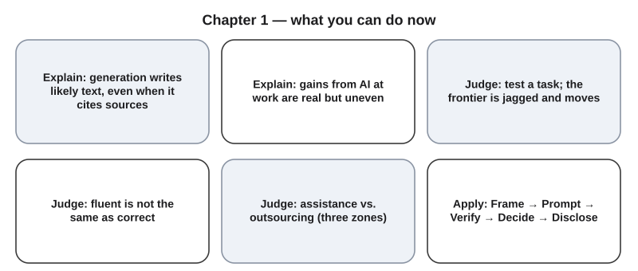{#fig-1-15 fig-alt="Six cards summarizing what you can do now: explain generation, explain uneven gains, judge tasks by testing, tell fluent from correct, judge assistance versus outsourcing, apply the AI Work Loop."}

Return to the puzzle from the Opening Case. The authors' evidence suggests that the assistant helped new agents most because it carried the habits of top performers to people who did not have them yet. The most experienced agents already worked that way, so they gained little, and their quality dipped slightly. The answer to the second question matters just as much.

At work, a faster result can be the goal. In a course, the goal is the skill. A tool that helps beginners produce better output does not automatically help them learn.

**Revisit your Warm-up.** Look at your three answers from the start of the chapter. Where did your last AI answer really come from? Is your "task AI does badly" a fixed fact, or something you could test? And what did you guess about the course policy?

You can now:

- **Explain** that a generative AI system produces likely text rather than looking up a stored answer, why the same prompt can give different outputs, and why a cited source does not prove a generated claim.
- **Explain** why gains from AI at work have been real but uneven, using three studies.
- **Judge** whether AI is fit for a task by testing it, remembering that the frontier is jagged and moves with the task, the tool and the date, and that fluency is not evidence.
- **Judge** whether a use is assistance or outsourcing under the three-zone policy.
- **Apply** the AI Work Loop: Frame, Prompt, Verify, Decide, Disclose.
- **Produce** an honest baseline of your own AI use, with a declaration and two specific goals.

### Key Terms {.unnumbered}

AI Use Declaration · AI Work Loop · assistance · baseline · control group · difference-in-differences (Deep) · fluent · frontier (jagged technological frontier) · generative AI system · hallucination · model · output · outsourcing · overconfidence · percentage point · productivity · prompt · random assignment · staggered rollout (Deep)

## End-of-Chapter Package {.unnumbered}

<!-- Each item: objective · LO · revised Bloom level. Odd-numbered answers → appendix/answers.md (Appendix E); even-numbered → private/ch01-answers-even.md. -->

### Review Questions A: Terms and Concepts {.unnumbered}

1. *(O1 · LO1 · Understand)* A classmate pastes the same prompt into two tools and gets two different study plans. Which explanation is best?\
   (a) One of the tools is broken.\
   (b) One tool looked up a better stored answer than the other.\
   (c) The tools run different models and each picks words with some chance.\
   (d) The second tool corrected the first tool's mistakes.
2. *(O1 · LO1 · Understand)* An AI summary at the top of a search page links to three websites. What can you conclude?\
   (a) Every sentence in the summary is supported by those websites.\
   (b) The tool retrieved those pages; each claim still needs checking against them.\
   (c) The authors of those websites wrote the summary.\
   (d) The summary is more reliable than any single website.
3. *(O1 · LO1 · Remember)* Define *prompt* and *output* in one sentence each.
4. *(O2 · LO1 · Understand)* Which statement about the support-center study is accurate?\
   (a) All agents improved by about 15%.\
   (b) The most experienced agents gained the most in quality.\
   (c) Less experienced agents gained about twice the average.\
   (d) Customer satisfaction scores rose sharply.
5. *(O2 · LO1 · Understand)* Why is comparing agents with and without the tool *in the same weeks* more convincing than comparing agents' performance before and after the tool arrived?
6. *(O2 · LO1 · Understand)* In an experiment, what does random assignment do, and why does it matter?
7. *(O3 · LO1 · Understand)* Which description of the jagged frontier is most accurate?\
   (a) A fixed list of tasks AI can do.\
   (b) A boundary that newer models will soon remove.\
   (c) An uneven, shifting boundary that you find by testing.\
   (d) The line between tasks that are easy and hard for people.
8. *(O3 · LO1 · Apply)* An AI tool gives you an exact sales figure for a small local competitor. What test would you run first, and why?
9. *(O3 · LO1 · Understand)* On one task outside the frontier, consultants with AI were 19 percentage points less likely to be correct. What does this suggest about when to trust AI, and what is one limit of this evidence?
10. *(O3 · LO1 · Understand)* Which is the best reason to trust a claim in an AI answer?\
    (a) It names a study and a year.\
    (b) It gives an exact figure without any hedging.\
    (c) A second AI tool gave the same answer.\
    (d) It matches a source you checked yourself.
11. *(O3 · LO1 · Remember)* Define *hallucination* in one sentence.
12. *(O4 · LO4 · Understand)* During a take-home exam where AI is not allowed, a student uses an AI tool and adds a note disclosing it. Under the course policy, this is:\
    (a) acceptable, because it was disclosed.\
    (b) not acceptable; AI use in an exam stays off-limits even when disclosed.\
    (c) not acceptable, because any use of AI in a course is cheating.\
    (d) acceptable, if the student verified the answers.
13. *(O4 · LO4 · Understand)* Match each use to a zone: P (permitted), D (permitted with disclosure and verification), N (not acceptable). Zones may be used more than once.\
    (i) Asking for an explanation of a concept you then write up in your own words.\
    (ii) An AI-drafted club newsletter that you verified and disclosed.\
    (iii) Citing a source you never opened.\
    (iv) Grammar feedback on your own essay.\
    (v) Entering a friend's medical details into a public chatbot.\
    (vi) An AI-drafted reflection essay, submitted with a declaration, when the instructor has not allowed AI drafting.
14. *(O5 · LO4 · Remember)* List the five steps of the AI Work Loop in order.

### Review Questions B: Case Questions {.unnumbered}

1. *(O1 · LO1 · Analyze)* A classmate says, "I asked the same question twice and got two different answers, so the tool must be broken." Explain what is happening and what your classmate should do instead.
2. *(O2 · LO1 · Analyze)* A manager reads the support-center study and decides to give the AI assistant only to new hires. Give one argument for and one against this decision, using the evidence.
3. *(O3 · LO1 · Evaluate)* A marketing intern must produce (a) ten slogan ideas, (b) last quarter's exact sales figures for a small competitor and (c) a polished email to a client. For each, judge whether AI is likely inside or outside the frontier, and name the test you would run.
4. *(O4 · LO4 · Evaluate)* A student's course requires a personal reflection essay. The instructor has not allowed AI drafting. The student has AI write the first draft, edits two sentences, and submits it with an AI Use Declaration. Is this assistance or outsourcing? Justify your answer.
5. *(O5 · LO4 · Apply)* A pharmacy student must explain a drug interaction to patients in a plain-language handout. Walk through the five steps of the AI Work Loop for this task.

### Review Questions C: Interpretive Questions {.unnumbered}

1. *(O2 · LO1 · Evaluate)* "If AI helps beginners most, experience will soon stop mattering." Take a position and defend it using at least two studies from this chapter.
2. *(O4 · LO4 · Evaluate)* Is it fair that disclosure makes some uses acceptable but not others? Argue for or against the three-zone policy, using an example from your own major.
3. *(O3 · LO1 · Evaluate)* "Models improve every few months, so testing tasks yourself is a waste of time; just wait for the next model." Agree or disagree, and justify your answer.

### Spaced Review {.unnumbered}

Come back to these a few days after reading, without looking back.

1. *(O3 · LO1 · Apply)* A friend says the newest model "never makes mistakes with numbers." What would you ask them to do before believing it?
2. *(O1 · LO1 · Understand)* Why can an AI summary on a search page cite a real source and still be wrong?
3. *(O2 · LO1 · Understand)* What happened to the quality of work of the most experienced support agents, and why does it matter?
4. *(O1, O3 · LO1 · Analyze)* A tool gives a confident answer about a niche local topic, with no links. Which two ideas from sections 1.1–1.3 apply, and what would you do next?

### Discussion Questions {.unnumbered}

1. *(Ethics · O2 · LO1 · Evaluate)* The authors present suggestive evidence that the assistant spread the know-how of the best agents. Should those agents share in the value that know-how created? How?
2. *(Career · O3 · LO1 · Analyze)* Think of a job you might want. Which of its tasks do you expect to be inside the frontier, and which outside? What does that mean for the skills you should build now?
3. *(Interdisciplinary · O5 · LO4 · Analyze)* How would a historian, a nurse and an engineer each define a "correct" answer? What does that mean for the Verify step in each field?
4. *(Learning · O4 · LO4 · Evaluate)* When does help from AI make you better at something, and when does it make you depend on it? Use an example from your own experience.
5. *(Society · O2 · LO1 · Evaluate)* If AI narrows the gap between weaker and stronger workers, is that good news, bad news or both? For whom?

### Application Assignment: A1 — AI Use Baseline and Personal Goals {.unnumbered}

**Due:** Monday, January 25, 2027, 11:59 p.m., on eLearning. *(O6 · LO4, LO7 · Create)*

**What to submit (1–2 pages):**

1. Three real tasks (from your 1.3 Your Turn list), what you asked, what came back, and what you did with it.
2. One documented failure: the output, why it was wrong or unhelpful, and the test that showed it.
3. Two personal goals for the course, each specific, observable and tied to a learning outcome (LO1–LO7, listed in section 1.7).
4. An AI Use Declaration for the baseline itself.

**Rubric (10 points)**

| Criterion (points) | Exemplary | Proficient | Developing | Beginning |
|---|---|---|---|---|
| **Task (3)** | 3: three real, varied tasks (inside / outside / unsure), each clearly described | 2: three real tasks, described, but similar in kind | 1: fewer than three tasks, or tasks vague | 0: no real tasks |
| **Process evidence (3)** | 3: for every task, the prompt, the output and what you did are all visible | 2: visible for two tasks | 1: visible for one task | 0: no process evidence |
| **Verification (2)** | 2: a real failure documented with the specific test that exposed it | 1.5: failure documented; the test is vague | 1: failure claimed without a test | 0: no failure documented |
| **Declaration (1)** | 1: all five elements (tools, purpose, accepted/rejected/revised, how verified, your judgment) | 0.75: four elements | 0.5: two or three elements | 0: missing |
| **Goals (1)** | 1: two goals, each specific, observable and tied to an LO | 0.75: two goals, one vague or untied | 0.5: one usable goal | 0: no usable goal |

**Grading note.** A1 is graded on completeness and the quality of your process, never on how much AI you used before. It is not used for any academic-integrity purpose.

**Alternative assignment** (for students with little access to AI tools or who prefer not to use them). Interview someone working in a field you are interested in about how they use, or avoid, AI. Then analyze one dated AI output provided on eLearning. Same rubric, read this way:

- **Task:** three tasks from the interview where AI is or could be used.
- **Process evidence:** your interview notes and your analysis steps.
- **Verification:** the failure you found in the provided output, with your test.
- **Declaration and Goals:** as above.

### Case Study Questions {.unnumbered}

1. *(O2 · LO1 · Understand)* Why did comparing agents with and without the assistant in the same weeks make the support study more convincing than a simple before-and-after comparison?
2. *(O2 · LO1 · Analyze)* The study found the largest gains on moderately rare problems. Why might very common and very rare problems show smaller gains?
3. *(O2 · LO1 · Analyze)* The most experienced agents showed small declines in quality. Propose two possible reasons.
4. *(O4 · LO4 · Evaluate)* If you managed this support center, would you tell customers that agents use an AI assistant? Justify your decision.
5. *(O3 · LO1 · Evaluate)* What would you want to know before applying this study's results to a hospital's patient-support line?

## Further Reading and Compass Links {.unnumbered}

- Brynjolfsson, Li and Raymond (2025): the full support-center study. The introduction is readable without economics training.
- Dell'Acqua et al. (2023, 2026): the consulting experiment and the origin of the "jagged frontier" image (working paper and Organization Science version).
- Bastani et al. (2025): AI tutoring with and without guardrails, previewing Chapter 7.
- Noy and Zhang (2023): a short experimental study of AI-assisted professional writing.
- Reading R2: Anthropic Academy, *AI Fluency: Framework & Foundations*, module 1, "Introduction to AI Fluency" (Anthropic, n.d.).
- [COMPASS: interactive AI Work Loop (@fig-1-2) and Jagged Frontier Map (@fig-1-7); Chapter 1 quiz; Lab 1.1–1.3 pages]

## References {.unnumbered}

Anthropic. (n.d.). *AI fluency: Framework & foundations* [Online course]. Anthropic Academy. https://anthropic.skilljar.com/ai-fluency-framework-foundations

Bastani, H., Bastani, O., Sungu, A., Ge, H., Kabakcı, Ö., & Mariman, R. (2025). Generative AI without guardrails can harm learning: Evidence from high school mathematics. *Proceedings of the National Academy of Sciences, 122*(26), Article e2422633122. https://doi.org/10.1073/pnas.2422633122

Bloom, N., Liang, J., Roberts, J., & Ying, Z. J. (2015).

Does working from home work? Evidence from a Chinese experiment. *The Quarterly Journal of Economics, 130*(1), 165–218. https://doi.org/10.1093/qje/qju032

Brynjolfsson, E., Li, D., & Raymond, L. (2025). Generative AI at work. *The Quarterly Journal of Economics, 140*(2), 889–942. https://doi.org/10.1093/qje/qjae044

Dell'Acqua, F., McFowland, E., III, Mollick, E., Lifshitz-Assaf, H., Kellogg, K. C., Rajendran, S., Krayer, L., Candelon, F., & Lakhani, K. R.

(2023). *Navigating the jagged technological frontier: Field experimental evidence of the effects of AI on knowledge worker productivity and quality* (Harvard Business School Working Paper No. 24-013). https://ssrn.com/abstract=4573321

Dell'Acqua, F., McFowland, E., III, Mollick, E., Lifshitz, H., Kellogg, K. C., Rajendran, S., Krayer, L., Candelon, F., & Lakhani, K. R.

(2026). Navigating the jagged technological frontier: Field experimental evidence of the effects of artificial intelligence on knowledge worker productivity and quality. *Organization Science, 37*(2), 403–423. https://doi.org/10.1287/orsc.2025.21838

Farquhar, S., Kossen, J., Kuhn, L., & Gal, Y. (2024). Detecting hallucinations in large language models using semantic entropy. *Nature, 630*, 625–630. https://doi.org/10.1038/s41586-024-07421-0

Institute of Medicine. (2005). *Dietary reference intakes for water, potassium, sodium, chloride, and sulfate*. The National Academies Press. https://doi.org/10.17226/10925

Liu, N. F., Zhang, T., & Liang, P. (2023).

Evaluating verifiability in generative search engines. In *Findings of the Association for Computational Linguistics: EMNLP 2023* (pp. 7001–7025). https://doi.org/10.18653/v1/2023.findings-emnlp.467

*Mata v. Avianca, Inc.*, 678 F. Supp. 3d 443 (S.D.N.Y. 2023) (No. 1:22-cv-01461-PKC) (opinion and order on sanctions, June 22, 2023).

National Association of Colleges and Employers. (n.d.). *What is career readiness?* Retrieved October 17, 2026, from https://www.naceweb.org/career-readiness/competencies/career-readiness-defined/

Noy, S., & Zhang, W. (2023). Experimental evidence on the productivity effects of generative artificial intelligence. *Science, 381*(6654), 187–192. https://doi.org/10.1126/science.adh2586

Şeker, Ş. E. (2023). KOBİ'lere özel basit yapay zekâ çözümü: Kolay.AI [A simple artificial intelligence solution for SMEs: Kolay.AI]. *YBS Ansiklopedi, 11*(1), 24–46.

Regulation (EU) 2024/1689 of the European Parliament and of the Council of 13 June 2024 laying down harmonised rules on artificial intelligence and amending Regulations (EC) No 300/2008, (EU) No 167/2013, (EU) No 168/2013, (EU) 2018/858, (EU) 2018/1139 and (EU) 2019/2144 and Directives 2014/90/EU, (EU) 2016/797 and (EU) 2020/1828 (Artificial Intelligence Act). *Official Journal of the European Union*, L, 2024/1689. http://data.europa.eu/eli/reg/2024/1689/oj

Regulation (EU) 2026/1744 of the European Parliament and of the Council amending Regulation (EU) 2024/1689 (Digital Omnibus on AI). *Official Journal of the European Union*, L, July 2026. https://eur-lex.europa.eu/eli/reg/2026/1744/oj
