# How Machines Learn from Data {#sec-ch02}

<!-- Status: v2 (2026-10-18): revised after four independent reviews (docs/editorial/ch02-dev-memo.md). From blueprint v0.2 (approved). Characters per docs/characters.md.
Computed numbers come only from data/ch02_*.csv (figures/scripts/ch02_experiments.py). -->

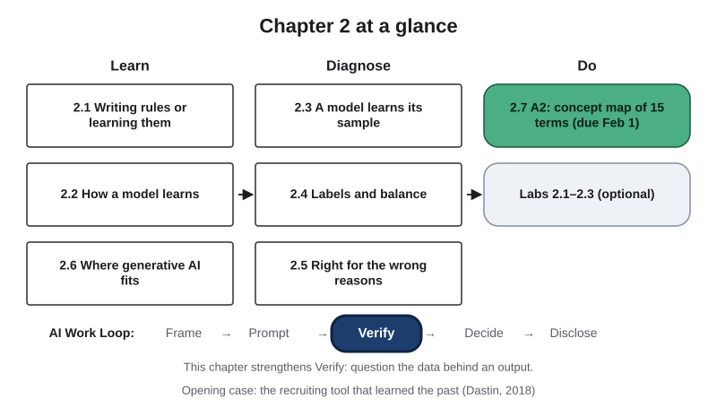{#fig-2-1 fig-alt="Chapter map: Learn (2.1, 2.2, 2.6), Diagnose (2.3–2.5), Do (A2, labs); AI Work Loop strip with Verify highlighted."}

**Chapter 2 at a glance.** In Chapter 1 you saw what artificial intelligence (AI) tools can and cannot do. This chapter looks one level inside. You will see how a machine learns from examples, why the examples matter more than almost anything else, and how a model can score well for the wrong reasons. Chapter 3 then looks inside the language models behind today's chat tools.

**Time:** about 30 minutes of Core reading (longer if English is not your first language), plus about 15 minutes for the paper task at the end of section 2.5. This week you also read Chapter 3, so the Core path is deliberately short. The boxes work as in Chapter 1: a worked example shows every step, a faded example leaves some steps for you, and Your Turn and Check Yourself boxes are ungraded practice. Answers to odd-numbered end-of-chapter questions are in Appendix E. Core sections are for everyone, Studio sections are hands-on work, and Deep sections are optional.

**The question of this chapter:** *Does the machine really learn, or does it only find the easiest way to get the right answer?* Keep it in mind. The Chapter Summary answers it.

## Opening Case: The Recruiting Tool That Learned the Past {.unnumbered}

In 2014, a team at Amazon began building a tool to help with hiring. The company was hiring fast and wanted to mechanize the search for top talent (Dastin, 2018). The idea was simple. Train the system on the résumés the company had received, let it find patterns in them, and have it score new applicants from one to five stars, the way shoppers rate products (Dastin, 2018).

The tool learned from about ten years of résumés sent to the company. Most of those résumés came from men, a reflection of male dominance across the tech industry (Dastin, 2018). By 2015, the team noticed a problem. The system was not rating candidates for technical roles in a gender-neutral way. It gave lower scores to résumés that contained the word "women's," as in "women's chess club captain," and to graduates of two all-women's colleges (Dastin, 2018).

Amazon edited the programs so that they would treat those particular terms neutrally. That did not guarantee that the system would not find other ways to sort candidates unfairly. By early 2017 the team behind the project had been disbanded. People familiar with the project told Reuters that recruiters looked at the tool's recommendations but never relied on them alone. Amazon said the tool was never used by its recruiters to evaluate candidates (Dastin, 2018).

Here is the puzzle. Nobody wrote a rule saying "prefer men," and nobody told the model to prefer men. So where did the pattern come from?

The case is not really about one company. Any system that learns from past examples can pick up patterns that nobody chose. To understand how, you need three ideas from this chapter: how a model learns from examples, why the examples it learns from may not represent the world, and how the answers attached to those examples can carry the past with them. By the end of the chapter you will be able to name the stages where things most likely went wrong, and the questions that could have caught them.

## Learning Objectives {.unnumbered}

Framework tags refer to the UNESCO (United Nations Educational, Scientific and Cultural Organization) AI Competency Framework for Students, the AI4K12 initiative's "Five Big Ideas in AI" for teaching AI in schools and the AI Fluency framework.

After this chapter you will be able to:

- **O1 — Classify** a system as rule-based or learned from examples, and place generative AI and language models within the family of machine-learning approaches. *(LO1 · UNESCO: AI techniques and applications, Understand · AI4K12: Learning)*
- **O2 — Explain** how a supervised model learns: predict, measure the error, adjust its settings, repeat. *(LO1 · AI4K12: Learning)*
- **O3 — Diagnose** a data problem (sampling bias, a proxy, noisy labels, biased labels, class imbalance or a shortcut clue) from its symptoms, and name a remedy, including documenting the data. *(LO1, LO5 · AI4K12: Learning · AI Fluency: Discernment)*
- **O4 — Judge** whether a model's reported performance can be trusted, using held-out testing, overfitting and the score on the smallest class. *(LO3 · AI Fluency: Discernment)*
- **O5 — Produce** a concept map of 15 core terms with labeled links and worked definitions (assignment A2). *(LO1 · UNESCO: AI techniques and applications, Understand)*

::: {.callout-note title="Warm-up (ungraded)"}
1. Does an AI system follow rules that programmers wrote? Yes, no or sometimes?
2. Is more data always better data?
3. A model is 99.9% accurate. Is it a good model?

You will revisit your answers in the Chapter Summary.
:::

## 2.1 Writing Rules or Learning Them {#sec-2-1 .unnumbered}

[Core]{.path}

Almost every field has a sorting task. A clinic sorts patients by urgency, a bank sorts transactions into normal and suspicious, and your inbox sorts mail. Let's take the spam filter in your email. One way to build it is to write rules. If the subject line contains "free money," mark it as spam. If there are five exclamation marks in a row, mark it as spam. If the attachment is a program file from an unknown sender, mark it as spam.

Rules like these work for a while. Then spammers change their wording, and someone has to write new rules. Soon there are thousands of them. Some contradict each other. Nobody remembers why rule 2,317 exists. And every new trick needs a human expert to notice it first.

Machine learning works the other way around. Instead of writing the rules, people collect examples, such as thousands of emails, each one marked "spam" or "not spam." The machine then finds the rules itself, in the form of patterns that separate the two groups.

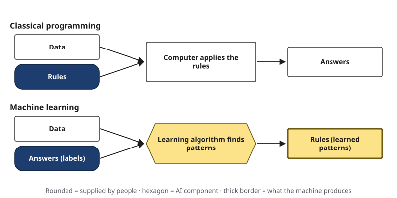{#fig-2-2 fig-alt="Two lanes. Programming: data plus rules in, answers out. Machine learning: data plus answers in, rules out."}

In other words, in classical programming people write the rules and the computer applies them. In machine learning, people supply the answers and the computer finds the rules.

Computer scientist Tom Mitchell gave a definition of learning that is still used today. A program learns when its performance on a task, measured in some way, gets better with experience (Mitchell, 1997). That gives you three questions to ask about any learning system:

- **Task (T):** What task does it perform? For example, sort emails into spam and not spam.
- **Performance measure (P):** How do we know how well it does it? For example, the share of emails sorted correctly.
- **Experience (E):** What does it learn from? For example, emails that people have already labeled.

Notice that the definition says nothing about understanding or thinking. It is about measurable improvement on a task. That will matter when we answer the chapter's question.

So does an AI system follow rules that programmers wrote? Some do: these are **rule-based systems**. They make sense where every decision must follow a written policy exactly, such as a company's rules for approving expense claims. But the systems behind today's AI tools mostly follow patterns found in data. No programmer wrote a rule that marked down "women's" in the recruiting tool. The pattern came from the data.

::: {.callout-note title="Worked Example: Rules or Examples?"}
**Task:** Decide whether an email is spam.

**Rule-based approach.** Rule 1: subject contains "free money." Rule 2: more than three exclamation marks. Rule 3: attachment is a program file. **Where it fails:** a spammer writes "fr3e m0ney," uses one exclamation mark and sends a link instead of a file. All three rules miss it.

**Learning approach.** Collect 50,000 emails that people have already labeled spam or not spam. Let the system find the patterns. **Where it fails:** it can only learn patterns that appear in its examples, and it may pick up patterns that should not matter, which you will see in section 2.5.

**Rule of thumb:** rules are clear but break easily when something new appears; learned patterns are flexible but only as good as their examples.
:::

::: {.callout-note title="Faded Example: Lucía's Support Tickets"}
*Featuring Lucía, who works part-time in customer support.*

Her company routes each incoming support ticket to one of three teams: billing, technical or account access.

**Rule 1 (done for you):** if the ticket contains "refund" or "charge," send it to billing. **Where it fails:** "I can't log in to request my refund" goes to billing, but it is an account-access problem.

**Rule 2 (your turn):** write a rule for technical tickets: _______________________

**Name one ticket your Rule 2 would send to the wrong team:** _______________________

**What examples would you need to train a learning system instead?** _______________________
:::

::: {.callout-important title="Your Turn"}
Pick one task from your major or job. Would you solve it with rules or with examples? Name its task, performance measure and experience (T, P, E).
:::

::: {.callout-tip title="Check Yourself 2.1"}
1. In one sentence each, describe classical programming and machine learning.
2. Name the task, performance measure and experience for a spam filter.
3. Why can a rule-based system be easier to explain than a learned one?
:::

Once a machine learns rules from examples, the next question is how it does that.

## 2.2 How a Model Learns {#sec-2-2 .unnumbered}

[Core]{.path}

*Featuring Sam, who is building a parts sorter for the robotics club.*

Sam's robotics club spends too much time sorting hardware. Bolts, nuts and washers (small metal parts that hold machines together) arrive mixed in one box. Sam wants a camera and a small program that sort each photographed part into the right group. He takes 60 photos of each kind of part, labels each photo, and trains a model.

Each photo is an **example**, and all the examples a model learns from are its **training data** (also called the **training set**). The model's **input** is the photo, turned into numbers. Each measurable piece of an input, such as the brightness of one pixel, or a house's size and age, is a **feature**. The correct answer attached to each example, here "bolt," "nut" or "washer," is its **label**, and each possible answer is called a **class**. When every training example comes with its correct answer, the learning is called **supervised learning**.

Now you can give **model** the precise meaning promised in Chapter 1. A model is a set of learned settings that turns an input into an output. People choose the kind of model; training adjusts its settings, which are also called **parameters**. The "rules" a machine finds in section 2.1 are stored in these settings. Before training, the settings carry no useful pattern (in many models they start random), and the model's guesses are no better than chance.

Here is how the adjusting works, in four steps that repeat:

1. **Predict.** The model receives a photo and produces a guess: "nut."
2. **Measure the error.** The label says "bolt." The **error** is how far the guess was from the label, and it can be measured.
3. **Adjust.** The training procedure changes the settings slightly, in the direction that would have made the right answer more likely.
4. **Repeat** with the next photo, thousands of times.

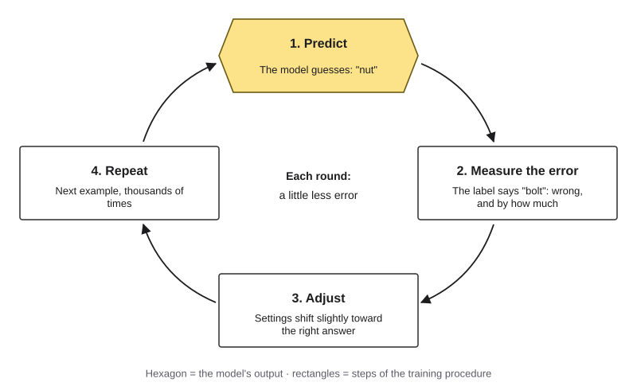{#fig-2-3 fig-alt="Loop of four steps: predict, measure the error against the label, adjust the settings, repeat."}

In other words, learning here is not sudden understanding. It is a great many small corrections toward less error. The steps are small for a reason: a big change made to fit one photo would undo what the settings had picked up from all the others. Deep 2.B shows one such correction with numbers. This loop describes neural networks and many other models. Some methods, such as the decision trees in section 2.5, build their rules differently, but all of them reduce the error on their training examples.

When training is done, Sam's settings are fixed. Showing the model a new photo and getting an answer is called **inference**. Chapter 3 uses these two words, training and inference, a great deal.

It helps to see the whole journey from raw data to a prediction in one picture. This book calls it the **Data-to-Prediction Pipeline**, and you will see it again in Chapter 11 and later chapters.

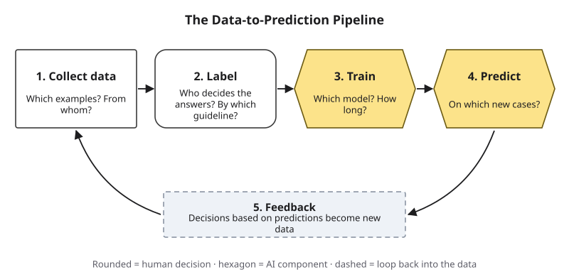{#fig-2-4 fig-alt="Pipeline: collect data, label, train, predict, and feedback that turns decisions into new data."}

Each stage involves human choices: which photos to take, who labels them, how long to train, what to do with the model's answers. The last stage, feedback, closes the loop: decisions based on a model's predictions often become new data for the next model. Each choice can help the model or quietly mislead it. The rest of this chapter follows those choices.

Not all learning is supervised. For reference, here are the main kinds. You do not need to memorize this table.

| Kind of learning | What it learns from | Example |
|---|---|---|
| Supervised | Examples with correct answers (labels) | Sam's parts sorter; spam filters |
| Unsupervised | Examples without answers; it looks for structure | Grouping customers with similar buying habits |
| Self-supervised | Examples whose answer is hidden in the data itself, such as the next word in a sentence | How language models are first trained (Chapter 3) |
| Reinforcement | Rewards and penalties for actions | Game-playing systems; robot control |

::: {.callout-note title="Worked Example: One Round of the Loop"}
Let's take one round. Sam's untrained model receives photo 17, which is labeled "bolt."

**Predict:** "nut." The model gives each class a score, and here "bolt" gets only 41%. **Measure:** the answer was "bolt," so the model is penalized; the lower the score it gave to "bolt," the bigger the error. **Adjust:** the settings shift slightly so that photos like this one look more like "bolt" next time. **Repeat:** photo 18.

After a few hundred rounds, the model gets most photos right. It has not been told what a bolt is. It has been corrected until its guesses match the labels.
:::

::: {.callout-note title="Faded Example: A House-Price Model"}
A real-estate company trains a model to predict the sale price of a house from its size, location and age. Here the output is a number, not a category.

**Predict:** the model says $310,000. **Measure:** the house actually sold for $350,000. The error is _______. **Adjust:** _______________________. **Repeat:** _______________________.
:::

::: {.callout-important title="Your Turn"}
Draw the four-step loop for a task in your major. Label what the model predicts, what the correct answer is, and where that answer comes from.
:::

::: {.callout-tip title="Check Yourself 2.2"}
1. What is a label, and what is supervised learning?
2. Describe the four steps of the learning loop.
3. Why does training adjust settings in small steps instead of all at once?
:::

The loop finds patterns in the examples. So what happens if the examples are not a fair picture of the world?

## 2.3 A Model Learns Its Sample {#sec-2-3 .unnumbered}

[Core]{.path}

In 1936, a popular American magazine called the *Literary Digest* ran an enormous poll on the presidential election. It mailed about ten million ballots and got back nearly 2.4 million. Its prediction: the challenger, Alf Landon, would beat President Franklin D. Roosevelt. Roosevelt won by a very large margin (Squire, 1988).

How can nearly 2.4 million answers be so wrong? The usual explanation is that the magazine drew many names from telephone directories and car registrations, which in 1936 overrepresented wealthier voters. Later research shows the story is more complicated. The people who chose to send their ballots back also differed from those who did not. Squire (1988) found that the mailing list and the non-response were both biased and together caused the error; Lusinchi (2012) argues that non-response was the main cause.

Either way, the lesson is the same: **big data is not the same as the right data.**

Every dataset is a **sample**: the examples we actually have. The **population** is everything the model will meet in the real world. A model learns its sample, not the world. Many errors in real use come from the gap between the two. For example, a voice assistant trained mostly on adult voices may struggle with children's voices, and a medical model trained in one hospital may struggle in another.

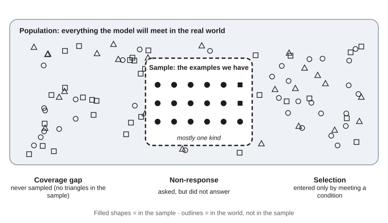{#fig-2-5 fig-alt="Population of mixed shapes; a dashed sample box with mostly one shape; three gaps: coverage, non-response, selection."}

Three gaps cause most of the trouble:

- **Coverage gap:** part of the population was never sampled. Sam photographed parts from one supplier; parts from another supplier look different.
- **Non-response:** not everyone who was asked answered, and those who answered may differ, as in the 1936 poll.
- **Selection:** data entered the sample only by meeting a condition. Résumés from people who applied are not the same as résumés from people who could do the job.

Selection can hide in surprising places. During the Second World War, the statistician Abraham Wald worked with damage data from aircraft that came back from missions. Aircraft hit in the most dangerous places were less likely to come back, so their damage was missing from the data, and Wald's methods took that into account (Mangel & Samaniego, 1984).

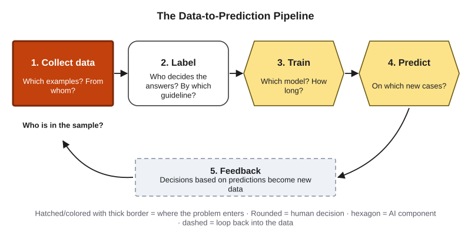{#fig-2-4b fig-alt="The pipeline with the collect-data stage highlighted and the note 'Who is in the sample?'"}

Now return to the recruiting tool. Its sample was ten years of résumés from people who had applied to one company, mostly men. Here is the most likely answer to the opening puzzle. A model does not need to be told anyone's gender. It can find other clues that are linked to gender. Reuters reported that the tool marked down the word "women's" and two all-women's colleges; this book reads those as such clues. A clue that stands in for something else is called a **proxy**. Removing a sensitive piece of information, such as a gender field, does not remove the bias if proxies remain. Chapter 11 returns to proxies in decision-making.

This also gives a partial answer to a puzzle from Chapter 1: why is the frontier jagged? One reason, though not the only one, is that models tend to do better on tasks well covered by their training data and worse on tasks it covered thinly.

::: {.callout-note title="Worked Example: Who Is Missing?"}
A hospital trains a model to predict which patients will miss appointments, using two years of records from its downtown clinic.

**Population:** all patients the hospital will serve, including those at its new suburban clinic. **Sample:** downtown patients only. **Gap:** coverage; suburban patients have different transport, work hours and distances. **Symptom to expect:** the model works well downtown and poorly in the suburbs. **Check:** test the model separately on suburban records before using it there.
:::

::: {.callout-note title="Faded Example: A Campus Survey"}
A student group surveys campus food by placing a link on the dining hall's social media page. 1,200 students respond.

**Population:** _______. **Sample:** _______. **Gap(s):** _______. **One check you would run:** _______.
:::

::: {.callout-important title="Your Turn"}
Name one dataset from your field. Who or what do you think is missing from it, and how would that show up in a model's errors?
:::

::: {.callout-tip title="Check Yourself 2.3"}
1. Why did nearly 2.4 million ballots fail to predict the 1936 election? Give both explanations.
2. Why could counting the damage on aircraft that returned mislead you about where aircraft are most vulnerable?
3. Why can a model be biased even when the sensitive information is removed?
:::

A sample can be the wrong shape. The answers attached to it, the labels, can also be wrong. That is the next problem.

## 2.4 Labels and Balance {#sec-2-4 .unnumbered}

[Core]{.path}

Before you read on, make a prediction. A model is trained on examples, and one fifth of all the training labels are wrong. How much accuracy does it lose? About 5 points? About 15? More than 20? Write your guess down.

A **label** is the correct answer attached to an example. Where do labels come from? Many labels are human decisions: someone decides that a photo shows a bolt, that an email is spam, or that a job candidate was successful, usually by following a written guideline. People applying the same guideline can still disagree. Other labels are recorded outcomes, such as the price a house sold for or whether a customer left. Both kinds carry the habits of whoever made or recorded them, often in the past.

Labels go wrong in two very different ways:

- **Noisy labels** are wrong at random. A tired labeler clicks the wrong button; a guideline is unclear about borderline cases. The errors point in no particular direction.
- **Biased labels** are wrong in one consistent direction. They often come from past decisions. Reuters did not report exactly what the recruiting tool's label was. But suppose "successful candidate" meant "someone the company hired before," and past hiring had favored men. Then every label would carry the same lean toward men.

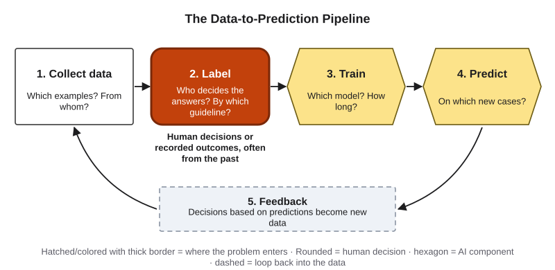{#fig-2-4c fig-alt="The pipeline with the labeling stage highlighted."}

### What our experiment showed {.unnumbered}

To answer your prediction honestly, this book ran an experiment rather than quoting a number. A simple model (logistic regression) learned to tell apart handwritten 3s, 5s and 8s from a public collection of digit images (Alpaydin & Kaynak, 1998). Each training set had 60 examples of each digit, 180 in all. We ran the experiment 30 times, each time with a different random split into training and test examples. In each run, all four conditions used the same kind of model and the same test examples, with about equal numbers of each digit. Only the training data changed. The code and results come with the book's online materials.

| Training data | Accuracy on all test examples | Accuracy on the 8s |
|---|---|---|
| Balanced, correct labels | 98.0% | 98.5% |
| Imbalanced: only 10 examples of 8, 60 of each other digit | 91.7% | 77.3% |
| 20% of all labels wrong **at random** (36 of 180, spread across all digits) | 91.9% | 89.9% |
| 20% of all labels wrong **in one direction** (36 of the 60 eights labeled "3") | 74.7% | 24.3% |

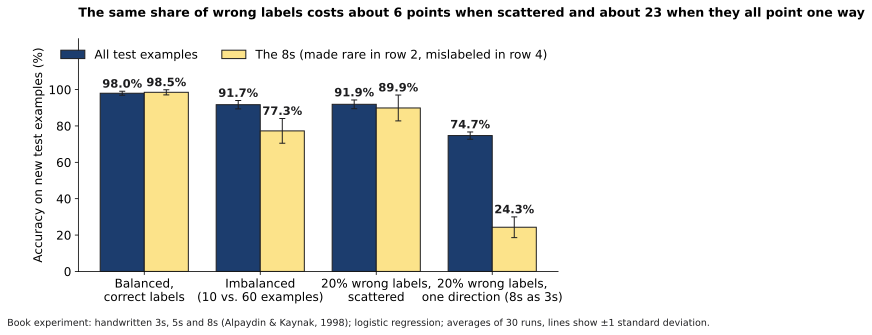{#fig-2-9 fig-alt="Bars for four training conditions: overall and 8s accuracy; one-direction errors drop the 8s to 24%."}

So the answer to your prediction is: **it depends on how the labels are wrong.** Scattered errors cost about 6 points. With scattered errors, each digit still had mostly correct labels, about four in five, so the right pattern still won. The same number of wrong labels pointing one way cost about 23 points. In that condition most 8s carried the label "3," so the model learned to call 8s "3," and it labeled only about a quarter of them correctly.

In our experiment, errors that all pointed one way did far more damage than scattered errors. Errors that come from past decisions often point one way, which is why they deserve special suspicion. In real data the harm may be less visible: it often shows up as unfair treatment of one group rather than as lower overall accuracy. If you try Lab 2.2, you will likely see a similar pattern with your own photos; if not, try to explain why.

### Class imbalance and the 99.9% trap {.unnumbered}

The second row of the table shows another problem. When one class has far fewer training examples, guessing one of the bigger classes lowers the error most of the time, so the model ends up favoring them. Our test set had about equal numbers of each digit, so the overall score still dropped. In real use, the test data is usually as imbalanced as the training data, and then the overall number hides the problem even better.

Now take it to the extreme. Imagine 100,000 card transactions, of which 100 are fraud. A model that says "not fraud" every single time is right 99,900 times out of 100,000. That is 99.9% accuracy, and it catches no fraud at all. *(Illustrative numbers.)*

The case you care about is often the rare one: fraud, a disease, a broken part, a customer about to leave. That is exactly the class a model most easily misses. In other words, the more a case matters, the less you can trust a single overall score. The remedy starts with measurement: always check the score on the smallest class. For a single class, this score, the share of its real cases the model catches, is called **recall** (Deep 2.C adds a second number, precision).

::: {.callout-note title="Worked Example: The 99.9% Fraud Model"}
A bank's new fraud model reports 99.9% accuracy on last month's transactions.

**Step 1 — Ask about balance.** How many transactions were fraud? Answer: 0.1%. **Step 2 — Ask for the small-class score.** Of the real fraud cases, how many did the model catch? Answer: none. **Step 3 — Diagnose.** Class imbalance; predicting "not fraud" every time gives the lowest error on almost all examples. **Step 4 — Remedy.** Report the fraud-catching rate separately, and train with methods that give the rare class more weight.
:::

::: {.callout-tip title="Check Yourself 2.4"}
1. What is the difference between noisy labels and biased labels?
2. Why can a model be 99.9% accurate and still useless?
3. In our experiment, why did one-directional errors hurt the 8s so much more than random errors?
:::

Even with a good sample and good labels, a model can still score well for the wrong reasons. That is the next trap.

## 2.5 Right for the Wrong Reasons {#sec-2-5 .unnumbered}

[Core]{.path}

*Featuring Sam again.*

Sam's parts sorter worked beautifully in testing: almost every photo sorted correctly. Then he set up the camera above the club's workbench. It failed badly.

The problem took Sam an evening to find. He had photographed all the bolts on his desk at home, with its brown wood. The nuts and washers had been photographed on a white table at the club. The model had found a much easier pattern than "bolt-shaped means bolt": **brown background means bolt.** It was right in testing, because the test photos came from the same desk and table. It was right for the wrong reason.

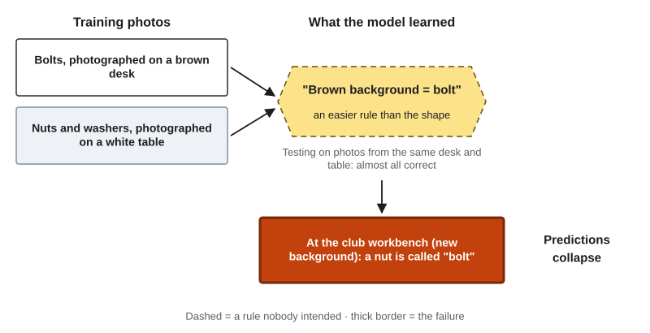{#fig-2-7 fig-alt="Bolts shot on a brown desk, other parts on a white table; model learns 'brown means bolt'; fails at a new workbench."}

This is called a **shortcut**: a clue that happens to go with the label in the training data but has nothing to do with the task. Researchers have found shortcuts in many published systems, such as image classifiers that relied on backgrounds or textures instead of the objects themselves (Geirhos et al., 2020). The remedy is variety: train and test under the different conditions the model will meet in the real world. The proxy in the recruiting tool is a close cousin of a shortcut: a clue that went with the label in the data, but not one anyone wanted the model to use. Unlike Sam's background, a proxy does not stop working in a new setting, so testing in new conditions will not reveal it; you have to look for it. In other words, a shortcut breaks when conditions change, while a proxy keeps working and keeps doing harm.

### Testing on examples the model has never seen {.unnumbered}

How do we know whether a model has learned something useful? We hold some labeled examples back. The model trains on the **training set** and is then scored on a **test set** it has never seen. This matters because a model with enough settings can fit its training examples almost perfectly, including their accidents.

Here is a second result from this book's experiment. We trained models of increasing complexity on all ten handwritten digits and measured accuracy on the training examples and on new test examples. These models were decision trees, which learn by splitting the examples with a series of yes-or-no questions; "more complex" means more questions in a row.

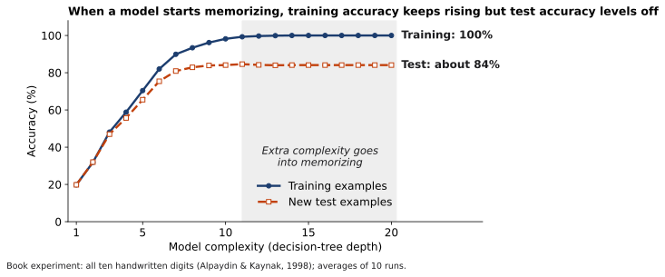{#fig-2-10 fig-alt="Lines: training accuracy rises to 100% as complexity grows; test accuracy rises, then stays near 84%."}

As the models grew more complex, training accuracy climbed all the way to 100%. Test accuracy rose too, then stopped at about 84%. The extra complexity went into fitting the particular training examples, not into getting better at new ones. This is **overfitting**. It is like a student who memorizes last year's exam answers: perfect on the practice questions, no better on a new exam. A growing gap between training and test accuracy is the warning sign; in some cases test accuracy even falls.

This also corrects a common belief, with one caution. Most models, including the ones in this chapter, keep learned settings, not a copy of their examples to look up. An overfitted model's settings fit its examples so tightly that they act almost like memorized answers. Some models can memorize more directly: large language models sometimes repeat pieces of their training text word for word (Carlini et al., 2021). Chapter 3 returns to this.

So when someone reports a model's accuracy, three questions protect you:

1. **Was it measured on examples the model never saw during training?**
2. **Do the test examples look like the real situations where it will be used?**
3. **What is the score on the smallest or most important class?**

::: {.callout-note title="Worked Example: The 97% Art-Style Detector"}
*Featuring Hana, who is skeptical of a new app.*

An app claims to tell whether an illustration was made by a human or by AI, with "97% accuracy." Hana applies the three questions.

**Q1:** Was it tested on new examples? The app's page does not say. **Q2:** Do the test images look like real use? They came from one image generator and one art website. Hana's own work, hand-drawn and scanned, looks nothing like either. **Q3:** What about the most important class? For Hana, the costly mistake is calling human work AI-made. How often does that happen? Unknown. Detectors for AI-written text have been found to flag writing by non-native English speakers as AI-generated far more often (Liang et al., 2023), so this is not a small worry. **Verdict:** the 97% may be real for that test set and say little about Hana's illustrations. Before trusting it on a client's work, they would test it on drawings whose origin they know.
:::

::: {.callout-note title="Faded Example: A Résumé Screener's Claim"}
A vendor says its résumé-screening model "predicts job success with 92% accuracy."

**Q1 (done for you):** Was the 92% measured on applicants the model never saw in training?

**Q2:** _______________________ **Q3:** _______________________

What answer to Q2 would make you most worried, given the Opening Case? _______________________
:::

::: {.callout-important title="Your Turn"}
Find a performance claim about an AI system in the news or on a product page (or use one from the dated claim bank on eLearning). Apply the three questions. What would you need to know before trusting it?
:::

### Putting it together: diagnose the data {.unnumbered}

Sections 2.3 to 2.5 described six data problems. Each tends to leave a different symptom.

| Problem | What it means | Typical symptom | First remedy |
|---|---|---|---|
| Sampling bias | The sample does not represent the population | Works in testing, fails in the field | Ask who is missing; test on the missing group |
| Proxy | A clue stands in for a sensitive attribute | Unfair to one group even without that attribute in the data | Look for proxies; compare results group by group |
| Noisy labels | Some labels are wrong at random | Unstable, contradictory predictions | Clearer guideline; label twice and compare |
| Biased labels | Labels are wrong in one direction, often from past decisions | Consistently unfair to one group | Ask what the label really measures |
| Class imbalance | One class is rare | High overall accuracy, small class missed | Score the small class separately (recall) |
| Shortcut clue | A clue linked to the label but irrelevant to the task | Success that collapses when conditions change | Vary the conditions and retest |

One more remedy applies to all of them: **document the data.** Researchers have proposed that every dataset come with a **datasheet** that answers questions such as why it was created, who and what is in it, how it was collected and labeled, and what it should not be used for (Gebru et al., 2021). Lab 2.3 asks you to write one.

::: {.callout-important title="Paper Task: Diagnose It (Core, about 15 minutes, ungraded)"}
This task gives everyone the reasoning of the optional build-and-break labs, without any software. Write your answers; they prepare you for the week's concept check. Answers to items 1, 3 and 5 are in Appendix E.

For each scenario, name **one or more** problems from the table above, or **none**, and a first remedy.

1. A speech-to-text tool trained mostly on one accent works poorly for others.
2. A skin-condition classifier is 97% accurate overall, but rare conditions are almost never detected.
3. Two very similar product reviews get opposite sentiment labels from the labeling team.
4. A loan model trained on decades of past approvals approves one neighborhood far less often, even though no address is in the data.
5. A plant-disease app was trained on leaf photos taken in a lab on a white background. In farmers' fields it fails.
6. A model trained on 5% fraud and 95% normal transactions, with extra weight for the rare class, catches 85% of fraud cases in testing on new data. Is there a problem?
:::

::: {.callout-tip title="Check Yourself 2.5"}
1. What is a shortcut, and what was Sam's?
2. Why must a model be tested on examples it never saw in training?
3. In our experiment, what happened to training and test accuracy as the models grew more complex? Why?
:::

You now know how a model learns and where it goes wrong. One question remains from Chapter 1: where do today's generative AI tools fit in all this?

## 2.6 Where Generative AI Fits {#sec-2-6 .unnumbered}

[Core]{.path}

In news stories, job ads and product pages, the words "artificial intelligence," "machine learning," "deep learning" and "generative AI" are often used as if they meant the same thing. They do not. They fit inside each other, like nested boxes.

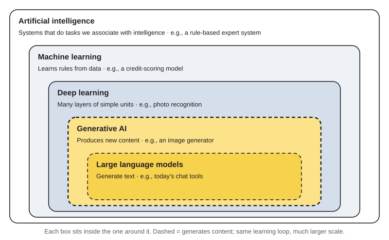{#fig-2-11 fig-alt="Nested boxes: AI, machine learning, deep learning, generative AI, large language models, each with an example."}

- **Artificial intelligence (AI)** is the broadest term: any system that performs tasks we associate with intelligence. Rule-based expert systems count.
- **Machine learning** is the part of AI that learns rules from data, as in this chapter. A credit-scoring model is an example.
- **Deep learning** is machine learning with many layers of simple computing units stacked on each other. "Deep" refers to the number of layers, not to any mysterious depth. In an image model, early layers respond to simple features, such as edges in a photo; later layers combine them into parts and whole objects (Goodfellow et al., 2016).
- **Generative AI** produces new content: text, images, audio or code. Today's generative AI is built almost entirely with deep learning. (Simpler generative methods exist outside deep learning, so the boxes show today's tools, not a strict rule.)
- **Large language models** are generative models that produce text. They power today's chat tools.

The key point is that generative AI is not a different kind of thing. It learns from data through the same predict-measure-adjust loop, at a vastly larger scale. Its answers come mostly from the data itself. During its first training, a language model predicts the next word of real text, and the real next word serves as the label (the self-supervised learning in section 2.2). It inherits every problem in this chapter: who is in the sample, how the data was labeled or filtered, and which shortcuts the training data allows.

There is a surprising connection, too. Sam's parts sorter scores three possible answers. A language model, as Chapter 3 shows, scores every possible next piece of text, from tens or hundreds of thousands of options, picks one, and repeats. In other words, generating text is a long chain of choices, each made by scoring options much as Sam's model scores its three.

::: {.callout-tip title="Check Yourself 2.6"}
1. Put these in order from broadest to narrowest: deep learning, AI, large language models, machine learning, generative AI.
2. What does "deep" mean in deep learning?
3. Why does generative AI share the data problems of this chapter?
:::

## 2.7 Map the Terms (A2) {#sec-2-7 .unnumbered}

[Studio]{.path}

*Studio sections are hands-on work for the Thursday lab and your weekly assignment.*

This week's studio artifact, A2, is a concept map of 15 terms from Chapters 2 and 3. A concept map is not a list of definitions. It is a set of terms connected by **labeled links**, so that each pair of terms and its link reads as a true sentence. You start it this week with at least 7 terms from this chapter and finish it after Chapter 3.

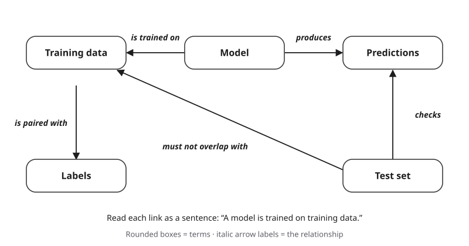{#fig-2-12 fig-alt="Five terms linked by labeled arrows, e.g., model 'is trained on' training data; test set 'checks' predictions."}

::: {.callout-note title="Worked Example: A Five-Term Mini-Map"}
**Terms:** training data, label, model, prediction, test set.

**Links (each reads as a sentence):** training data → *is paired with* → labels · model → *is trained on* → training data · model → *produces* → predictions · test set → *checks* → predictions · test set → *must not overlap with* → training data.

**One worked definition:** *Test set:* labeled examples kept away from training and used only to score the model. Example: photos of parts that Sam held back from training to check his sorter.
:::

::: {.callout-note title="Faded Example: Label Three Links"}
Add a labeled link between each pair: proxy → _______ → sensitive attribute · class imbalance → _______ → smallest class · overfitting → _______ → training data.
:::

::: {.callout-important title="Your Turn"}
Start A2: choose at least 7 terms from this chapter's term pool (end of chapter), write a worked definition for each in your own words with one example, and draw at least 6 labeled links. A **worked definition** is a definition in your own words plus one concrete example, like the one above. A table of terms and labeled links is an equally good format.
:::

::: {.callout-tip title="Check Yourself 2.7"}
1. What makes a concept map different from a glossary?
2. Why should every link read as a true sentence?
:::

## Deep 2.A: Why Now? Three Waves of AI {#sec-2-deep-a .unnumbered}

[Deep]{.path}

*Deep sections are optional and not on the exams.*

The term "artificial intelligence" appeared in a 1955 proposal for a summer research workshop at Dartmouth College, held in 1956 (McCarthy et al., 1955/2006). The first wave relied mainly on rules and logic written by people, which led to the expert systems of the 1970s and 1980s (Russell & Norvig, 2021). Separately, in 1997 IBM's Deep Blue defeated world chess champion Garry Kasparov through very fast search and hand-tuned chess knowledge, not modern machine learning (Campbell et al., 2002).

The second wave came from deep learning. In 2012, a deep network won a major image-recognition competition by a wide margin (Krizhevsky et al., 2012). AlphaGo combined deep networks, learning from human and self-play games, and search (Silver et al., 2016). In March 2016 it beat Lee Sedol, one of the world's top Go players, 4 games to 1 (Silver et al., 2017).

The third wave is generative. A 2017 paper introduced the Transformer architecture, which underlies most of today's large language models as of 2026 (Vaswani et al., 2017). In November 2022, ChatGPT made a conversational language model available to the public, and generative AI moved into everyday use (OpenAI, 2022).

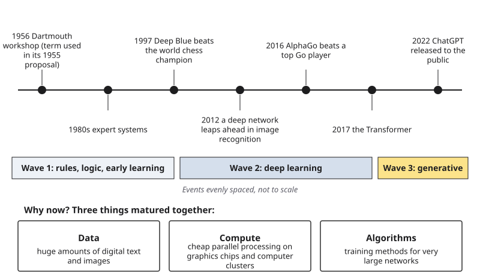{#fig-2-13 fig-alt="Timeline 1956 to 2022 in three waves, plus three factors that matured together: data, compute, algorithms."}

Why now? Many of the core ideas are decades old. Most accounts point to three things maturing together (Goodfellow et al., 2016): huge amounts of digital data, cheap parallel computing on graphics processors and large clusters of computers, and training methods that made very large networks practical.

## Deep 2.B: One Learning Step, with Numbers {#sec-2-deep-b .unnumbered}

[Deep]{.path}

Let's take the simplest possible model: predicting a price as *price = w × size*, with one setting, *w*. Suppose a 100-square-meter apartment sold for 300 (in thousands of dollars). If *w* is 2, the model predicts 200, so the prediction is 100 too low.

To learn, the training procedure measures how the error changes when *w* changes, and moves *w* a small step in the direction that reduces the error. Picture the error as a valley over all possible values of *w*. Each step goes a little downhill. This procedure is called **gradient descent**. Large models do the same thing with billions of settings at once.

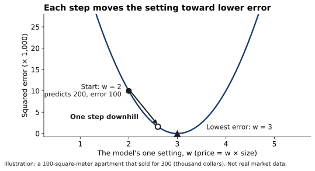{#fig-2-14 fig-alt="U-shaped error curve over the setting w; a step from w = 2 toward the lowest error at w = 3."}

The step size, called the **learning rate**, matters. Too small, and learning takes a very long time. Too large, and each step jumps past the bottom of the valley. Appendix F works through the calculation.

## Deep 2.C: Two Families of Models, and Two Better Numbers {#sec-2-deep-c .unnumbered}

[Deep]{.path}

**Discriminative and generative models.** Sam's sorter learns the boundary between classes: "Is this closer to a bolt or a nut?" It is a **discriminative** model. A **generative** model learns what the data itself looks like, well enough to produce new examples: "Draw me a bolt." To tell things apart you need a boundary; to generate them you need a model of the whole data.

**Precision and recall.** The score on the smallest class, recall, is one of two standard numbers. **Recall** asks: of all the real fraud cases, what share did the model catch? **Precision** asks: of all the cases the model flagged as fraud, what share really were fraud? A model can raise one by lowering the other. Chapter 8 uses both when judging AI outputs.

## Hands-on Labs {.unnumbered}

These three labs are optional and recommended; do them at home or in Compass, which is optional and ungraded. They describe what to do, not which buttons to press; the Compass pages list current free tools. [COMPASS: lab pages ch02-lab1 to ch02-lab3] Use a free, no-code tool that trains an image classifier in the browser. Photograph objects only: no people, no faces, no personal documents.

### Lab 2.1: Train a Classifier (Build · 25 minutes · optional) {.unnumbered}

*(O2 · LO1 · Apply)*

1. Choose three everyday objects that are easy to confuse, such as a pen, a pencil and a marker.
2. Take about 30 photos of each, from different angles, on the same background.
3. Train a three-class model in the tool. Note how many examples each class has.
4. Test it on 10 **new** photos per object that you did not use in training. Record how many it gets right for each class.
5. Write two sentences: what did the model seem to learn, and where did it go wrong?

**If this doesn't work:** use the printed card version on eLearning. Sort the cards first by rules you write, then by "examples" from a provided training pile, and compare.

### Lab 2.2: Break It with Data (Break It · 25 minutes · optional) {.unnumbered}

*(O3 · LO1, LO5 · Analyze)*

Retrain your Lab 2.1 model several times, changing only the training data. Use the same test photos each time.

| Run | Change to the training data (30 photos per object) | Overall correct | Correct on the changed object |
|---|---|---|---|
| 1 | Balanced, correct labels (Lab 2.1) | | |
| 2 | Imbalanced: keep only 5 photos of one object | | |
| 3 | Scattered errors: move 6 photos of each object into a wrong class, chosen at random (18 of 90 labels wrong) | | |
| 4 | One-directional errors: move 18 photos of one object into one other class (the same 18 wrong labels, all pointing one way) | | |
| 5 | Background: retake the training photos of one object on a new background, and test on the old one | | |

Compare your table with the table in section 2.4. Small datasets and different tools vary, so your numbers will differ from the book's. You will likely see a similar pattern; if not, try to explain why. If you have time, repeat one run to see how much the results change by chance.

**If this doesn't work:** use the provided results table on eLearning and answer the same questions. A screen-reader route uses a provided tabular dataset in an accessible spreadsheet.

### Lab 2.3: Write a Datasheet (Audit · 20 minutes · optional) {.unnumbered}

*(O3 · LO5 · Apply)*

For your Lab 2.1 dataset, answer six questions in a few lines each: Why was it created? What is in it, and what is missing? How was it collected? Who labeled it, and how? What should it not be used for? Who looks after it? Then answer a seventh: **Where did my photos go, and who can see them?** Look in the tool's settings or help pages for where photos are stored.

**If this doesn't work:** write the datasheet for the provided card dataset on eLearning.

## Case Study: The Recruiting Tool, Revisited {.unnumbered}

**Context.** Amazon was growing fast: its global workforce had more than tripled between June 2015 and mid-2018, to 575,700 people (Dastin, 2018). In 2014 a team began building a tool to score job applicants automatically (Dastin, 2018).

**Timeline.** 2014: work begins. 2015: the team finds that ratings for technical roles are not gender-neutral. Then: Amazon edits the programs to treat particular terms neutrally. By early 2017: the team is disbanded. October 2018: Reuters reports the story (Dastin, 2018).

**What the AI did.** It scored résumés from one to five stars. It had learned from about ten years of résumés submitted to the company.

**What humans did.** People chose the training data and set the tool's goal; Reuters did not report how a good candidate was defined. The company found the problem and edited the programs. People familiar with the project told Reuters that recruiters looked at the tool's recommendations but never relied on them alone; Amazon said the tool was never used by its recruiters to evaluate candidates (Dastin, 2018).

**Failure label.** Most likely a chain of problems at three stages of the pipeline. The reporting confirms the first and the pattern in the third; the second is this book's reasoning about how such a tool usually works.

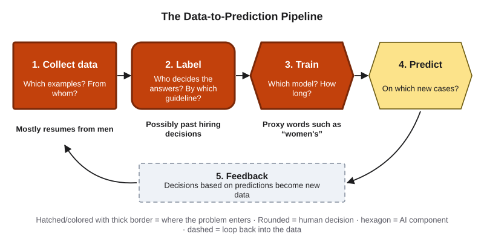{#fig-2-4d fig-alt="Pipeline with three stages marked: mostly men's résumés; labels possibly from past hiring; proxy words such as 'women's'."}

1. **Collect data.** Most résumés came from men, a reflection of male dominance across the tech industry (Dastin, 2018). Women were an under-represented group in the sample (section 2.3). This is not class imbalance in the section 2.4 sense, because gender was not the label.
2. **Label.** Reuters did not report what the tool treated as the right answer. If the label was based on past applications and hiring outcomes, and those favored men, the labels carried that lean (biased labels, section 2.4).
3. **Train.** During training, the word "women's" and the names of two all-women's colleges became clues linked to lower scores (Dastin, 2018). In this book's reading, they acted as **proxies** for gender (section 2.3). Removing those particular words did not guarantee that other proxies were gone.

**Consequences (documented).** According to people familiar with the project, the team was disbanded by early 2017. Reuters reported that a much-reduced version was kept for simple tasks, such as removing duplicate candidate profiles, and that a new team was formed to try automated screening again with a focus on diversity (Dastin, 2018). The public record says little more about how the original scores were used. *This book does not claim that any candidate was rejected because of it.*

**A better workflow.** The AI Work Loop applies to the team that builds a tool, not just to its users. *Frame:* what should "a good candidate" mean, and does the past data measure it? *Verify:* test the scores separately for different groups before use, and search for proxies, not only for a gender field. *Decide:* keep a human decision with a reason that can be explained. *Disclose:* tell applicants when automated scoring is used.

**Short case 1: The 1936 poll.** The *Literary Digest* mailed about 10 million ballots, received nearly 2.4 million back, and still predicted the wrong winner by a wide margin. Squire (1988) found the mailing lists and the non-response jointly to blame; Lusinchi (2012) argues that non-response was the main cause. Lesson: a huge sample can still be the wrong sample.

**Short case 2: The missing aircraft.** During the Second World War, the statistician Abraham Wald worked on estimating how likely aircraft were to survive hits in different places. The data came from aircraft that returned. Wald's methods took into account that aircraft hit in the most dangerous places were less likely to return, so their damage was missing from the data (Mangel & Samaniego, 1984). Lesson: before asking what the data shows, ask what never made it into the data.

## Ethics Lens: Who Labels the Data, and Whose Past Becomes the Rule? {.unnumbered}

Every supervised model depends on labels, and many labels are human work. Much of that work is done by people hired through online platforms, task by task, to tag images, transcribe audio or rate content. Researchers have called this "ghost work": essential to many AI products, yet largely invisible to the people who use them, and often done with unpredictable pay and little job security (Gray & Suri, 2019). When you use an AI tool, part of what you are using is the judgment of people you will never see.

A second question comes from the Opening Case. When a model learns from past decisions, it treats the past as the right answer. Sometimes that is roughly what we want: past fraud cases really were fraud, although even those labels cover only the fraud someone caught. Sometimes the past is exactly what we are trying to change, as in hiring, lending or school admissions. In those cases, learning to copy the past can make an old unfairness look like an objective score.

Two questions to carry with you:

- Who labeled the data behind a tool you use, and under what conditions?
- In your future field, which past decisions should *not* become future rules?

Chapter 16 returns to bias and fairness in detail; Chapter 11 looks at hidden assumptions in data work.

## Career Connection {.unnumbered}

Every stage of the Data-to-Prediction Pipeline is someone's job. The descriptions below are general illustrations of these roles, not survey findings; titles and duties vary by employer.

| Role | Where in the pipeline | A question this person asks |
|---|---|---|
| Data engineer | Collecting and moving data | Is the data complete, and does it arrive correctly every day? |
| Data steward | Rules for using data | Who may use this data, for what, and how long do we keep it? |
| Annotation specialist (data labeler) | Labeling | Is the guideline clear enough that two people would give the same label? |
| Data analyst | Exploring and reporting | Who is in this data, and who is missing? |
| Machine learning engineer | Training and testing | Does the model work on examples it has never seen, for every group? |
| Chief data officer | Strategy and governance | Is our data an asset we can trust, and are we using it responsibly? |

You do not need any of these titles to use the chapter's ideas. A nurse who asks whether a risk score was tested on patients like theirs, or an accountant who asks how a fraud model treats rare cases, is doing the Verify step of the AI Work Loop.

## From the Field {.unnumbered}

<!-- Based on the author's published article (Şeker, 2016), within the facts of that article; connections to this chapter are marked as such. Disclosure as in D13. -->

In 2016 I wrote a short encyclopedia article on customer churn analysis, the study of customers leaving a business (Şeker, 2016). Churn matters most in subscription businesses such as telecom, banking and insurance, where keeping a customer usually costs less than winning a new one.

The article illustrated the basic calculation with a simple example: a firm starts the month with 5,000 customers and ends it with 4,500, a monthly churn rate of 10%. Read that example with this chapter in mind. If you built a model to predict who will leave in such a month, nine out of ten examples would belong to the class "stayed." A model that predicts "stays" for everyone would be 90% accurate and useless, the same trap as the fraud model in section 2.4.

The article also separated two kinds of churn. *Voluntary* churn is when customers choose to move to a competitor. *Involuntary* churn has other causes, such as a customer moving to another country, or illness. As I noted then, churn-prediction tools generally leave involuntary churn out of their individual predictions, mainly because it cannot be prevented, although many analyses still forecast its overall rate. Seen through this chapter, that is a labeling decision: before any model learns anything, someone decides what counts as "churn."

Finally, the data. Prediction models in this area combine past records with signals collected along the way, such as complaints to customer service, returns from technical support, satisfaction surveys and billing disputes. Each of those sources has its own sample and its own gaps, so the questions in this chapter apply to all of them.

*Disclosure: I am a founder of OptiWisdom, which develops software for businesses, including AI tools. See "How This Book Was Written."*

## Chapter Summary {.unnumbered}

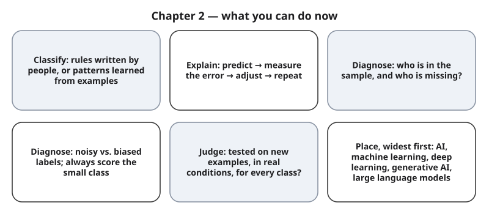{#fig-2-15 fig-alt="Six cards: classify, explain the loop, diagnose the sample, diagnose labels, judge a claim, place generative AI."}

**The chapter's question:** *Does the machine really learn, or does it only find the easiest way to get the right answer?* The answer is both. In Mitchell's sense, a model really learns: its performance on a task improves with experience. But training keeps whatever pattern makes the error smallest on the examples it was given. If a brown desk, a word like "women's" or always guessing the bigger class lowers the error, the model ends up using it. Nothing in the training process can tell which pattern you meant.

**Return to the Opening Case.** Nobody told the recruiting tool to prefer men. It most likely picked up gender-linked patterns from a sample made mostly of men's résumés, possibly from labels based on past decisions, and through proxy words. The problems began in the data, before any prediction was made.

**Revisit your Warm-up.** (1) Do AI systems follow rules that programmers wrote? *Sometimes:* rule-based systems do, but today's AI tools mostly use patterns learned from data. (2) Is more data always better data? *No:* a larger sample from the wrong source is still the wrong sample. (3) Is a 99.9% accurate model good? *Not necessarily:* check the score on the smallest class.

You can now:

- **Classify** a system as rule-based or learned from examples, and place generative AI inside machine learning.
- **Explain** the learning loop: predict, measure the error, adjust the settings, repeat.
- **Diagnose** sampling bias, proxies, noisy labels, biased labels, class imbalance and shortcut clues from their symptoms, and name a first remedy, including a datasheet.
- **Judge** a performance claim with three questions: tested on new examples, under real conditions, and scored on the smallest class?
- **Produce** a concept map with labeled links (A2).

### Key Terms {.unnumbered}

biased labels · class · class imbalance · datasheet · deep learning · discriminative model (Deep) · error · example · feature · generative AI · gradient descent (Deep) · inference · label · large language model · learning rate (Deep) · machine learning · model · noisy labels · overfitting · parameter · population · precision (Deep) · proxy · recall · rule-based system · sample · sampling bias · self-supervised learning · shortcut · supervised learning · test set · training data (training set)

## End-of-Chapter Package {.unnumbered}

<!-- Each item: objective · LO · revised Bloom level. Odd-numbered answers → appendix/answers.md (Appendix E); even-numbered → private/ch02-answers-even.md. Review A distractors draw on M1–M7. -->

### Review Questions A: Terms and Concepts {.unnumbered}

1. *(O1 · LO1 · Understand)* Which description fits machine learning best?\
   (a) Programmers write every rule the system follows.\
   (b) People supply examples with answers, and the system finds patterns that connect them.\
   (c) Experts write rules and then test them on a few examples.\
   (d) The system understands the task the way a person does.
2. *(O1 · LO1 · Understand)* A tax program applies the rule "if income is below the threshold, the rate is 10%." Is it rule-based or learned? Explain in one sentence.
3. *(O2 · LO1 · Remember)* Put the steps of the learning loop in order: adjust the settings, measure the error, predict, repeat.
4. *(O2 · LO1 · Remember)* Define *model* as this chapter uses the word.
5. *(O3 · LO1 · Understand)* A company collects ten times more data from the same source as before. What is the most accurate statement?\
   (a) The model will now be fair, because the sample is larger.\
   (b) The model may become more reliable about the same kinds of people, and still miss anyone the source leaves out.\
   (c) Bias shrinks in proportion to the size of the sample.\
   (d) A larger sample from one source represents the whole population.
6. *(O3 · LO1 · Remember)* In the book's experiment, one fifth of all the labels were wrong in two different ways. Which statement matches the results?\
   (a) All label errors cost about the same.\
   (b) A few wrong labels never matter.\
   (c) Errors in one direction cost far more than scattered errors.\
   (d) Scattered errors cost more, because they are harder to find.
7. *(O3 · LO5 · Understand)* A team removes the gender field from its data. Why might the model still treat genders differently?
8. *(O3 · LO1 · Remember)* What is the difference between a *sample* and a *population*?
9. *(O4 · LO3 · Understand)* A model scores 100% on its training examples and 84% on new examples, and more complexity no longer helps on new examples. Which term describes this?\
   (a) Class imbalance.\
   (b) Overfitting.\
   (c) Sampling bias.\
   (d) Noisy labels.
10. *(O2 · LO1 · Understand)* Which statement fits most trained models, including those in this chapter?\
    (a) They keep every training example and answer by looking up the closest one.\
    (b) They keep learned settings, which can fit the training examples too closely.\
    (c) They follow rules written by their programmers.\
    (d) They store the correct answer for every possible input.
11. *(O4 · LO3 · Apply)* A disease-screening model is "98% accurate." The disease affects 2% of the people tested. Why is the 98% not enough to judge it, and what one extra number would you ask for?
12. *(O1 · LO1 · Understand)* Which statement about generative AI is most accurate?\
    (a) It is a different kind of technology from machine learning.\
    (b) Today it is almost always built with deep learning, a part of machine learning.\
    (c) It follows rules written by experts.\
    (d) It retrieves stored passages instead of learning patterns.
13. *(O1 · LO1 · Remember)* What does "deep" mean in *deep learning*?
14. *(O3 · LO1 · Understand)* A team's model tells wolves from huskies with high accuracy on its test photos. Then a tester notices that most wolf photos in its training data had snow in the background. What is the most likely problem?\
    (a) Noisy labels.\
    (b) Class imbalance.\
    (c) A shortcut clue.\
    (d) Too few test examples.
15. *(O3 · LO5 · Apply)* Name two datasheet questions that would most likely have flagged the recruiting tool's data before training, and explain why.

### Review Questions B: Case Questions {.unnumbered}

1. *(O1 · LO1 · Apply)* A city library wants to recommend books to readers. Describe a rule-based version and a learned version. Name one weakness of each.
2. *(O2 · LO1 · Apply)* A model predicts the time a delivery will take. It predicts 30 minutes; the delivery takes 45. Walk through one round of the learning loop for this example.
3. *(O3 · LO1, LO5 · Analyze)* A crop-yield model is trained on ten years of data from farms in a region with plenty of rain. A company now sells it to farmers in a much drier region. Name the most likely data problem, the symptom you would expect, and a first remedy.
4. *(O4 · LO3 · Evaluate)* A vendor says its plant-disease app "identifies 40 diseases with 95% accuracy." Write the three questions you would ask, and say which answer would worry you most and why.

### Review Questions C: Interpretive Questions {.unnumbered}

1. *(O3 · LO5 · Evaluate)* "If a model copies past decisions, it is objective, because it applies the same rule to everyone." Agree or disagree, using the Opening Case.
2. *(O4 · LO3 · Evaluate)* Should a company be allowed to advertise a model's accuracy without reporting its score on the smallest class? Take a position.
3. *(O1, O2 · LO1 · Evaluate)* Answer the chapter's question in your own words: does the machine really learn? Use Mitchell's definition and one example from the chapter.

### Spaced Review {.unnumbered}

Come back to these a few days after reading, without looking back. They connect Chapter 2 to Chapter 1.

1. *(Chapter 1 · LO4 · Remember)* What are the three zones of the course AI policy? In which zone is asking an AI tool to brainstorm ideas?
2. *(O4 · LO3 · Apply)* Apply the Verify step from Chapter 1 to the "97% accurate" art-style detector. What would you check first?
3. *(O3 · LO1 · Analyze)* Is the 99.9% fraud model "fluent but wrong" in the Chapter 1 sense? Explain what is similar and what is different.
4. *(O3 · LO5 · Analyze)* Which step of the AI Work Loop would most likely have caught the recruiting tool's problem, and how?
5. *(O2 · LO1 · Understand)* Chapter 1 described how a generative AI system produces an answer. How does this chapter's idea of a model as learned settings connect to that description?

### Discussion Questions {.unnumbered}

1. *(Ethics · O3 · LO5 · Evaluate)* Should the people who label data for AI products be named, credited or paid more? What would change if they were?
2. *(Career · O3 · LO5 · Analyze)* In the job you want, which data would a model learn from, and who would be missing from it?
3. *(Interdisciplinary · O3 · LO1 · Analyze)* A psychologist, an engineer and a historian each work with samples. What does "the sample is not the population" mean in each field?
4. *(Society · O3 · LO5 · Evaluate)* In which areas of life should past decisions never be used to train a model? Where is it acceptable?
5. *(Learning · O4 · LO3 · Evaluate)* Memorizing last year's exam is like overfitting. What study habits help you do well on new questions instead?

### Application Assignment: A2 — Concept Map of 15 Terms {.unnumbered}

**Due:** Monday, February 1, 2027, 11:59 p.m., on eLearning. *(O5 · LO1 · Create)* A2 has two parts. **Part 1** (at home, after this chapter): at least 7 Chapter 2 terms with worked definitions and links. **Part 2** (started in Thursday's "Probe the model" lab, section 3.6): at least 5 Chapter 3 terms, linked to your Chapter 2 terms. Expect about 45–60 minutes in all outside class. One rubric (below) scores the finished map.

**What to submit:**

1. A concept map, or an equally valid table of terms and labeled links, with **15 terms**: at least 7 from the Chapter 2 pool and at least 5 from the Chapter 3 pool. A term that appears in both pools counts once, for either chapter.
2. For each term, a **worked definition**: a definition in your own words, with one concrete example.
3. **Labeled links**: every term has at least one link, and there are at least 14 links in all. Each link reads as a true sentence (term → link → term), such as "a model *is trained on* training data."
4. **Verification:** for each definition, note where you checked it (the chapter's own definition or a cited source). Then take **one AI-generated definition**, either your own (save the prompt and output) or the dated one provided on eLearning, and correct it, explaining what was wrong or missing.
5. An **AI Use Declaration** (tools, purpose, what you accepted, rejected or revised, how you verified it, and where your judgment mattered) and two sentences on which link was hardest to label and why.

**Term pool, Chapter 2:** rule-based system · machine learning · training data · example · feature · label · class · model · parameter · supervised learning · error · inference · sample · population · sampling bias · proxy · noisy labels · biased labels · class imbalance · recall · shortcut · overfitting · test set · deep learning · generative AI. Any other Core Key Term of Chapter 2 also counts. **Chapter 3:** listed at the end of Chapter 3.

**Rubric (10 points)**

| Criterion (points) | Exemplary | Proficient | Developing | Beginning |
|---|---|---|---|---|
| **Task (3)** | 3: 15 terms from the pools, with at least 7 from Chapter 2 and 5 from Chapter 3 | 2: 15 terms, but the chapter split is not met or one or two terms are outside the pools | 1: 10–14 terms | 0: fewer than 10 terms |
| **Links (1.5)** | 1.5: every term linked; at least 14 labeled links, all true sentences | 1: at least 14 links; one or two incorrect, or one term unlinked | 0.5: 7–13 links, or several incorrect | 0: no labeled links |
| **Definitions (1.5)** | 1.5: every definition in your own words with a fitting example | 1: 12–14 definitions meet this | 0.5: 7–11 definitions meet this | 0: fewer than 7 |
| **Verification (2)** | 2: every definition checked with a named source; one AI definition corrected with a clear explanation | 1.5: most definitions checked; correction present but thin | 1: few checks, or no AI correction | 0: no verification |
| **Declaration and judgment (2)** | 2: all five declaration elements and a specific reflection on the hardest link | 1.5: all five elements; general reflection | 1: two to four elements, or reflection missing | 0: missing |

**Formats.** A hand-drawn or digital map, or a structured table with columns *term*, *definition*, *example*, *linked to*, *link label*. Both are scored the same way. A map tool is not required.

**Alternative assignment** (for students who prefer not to use AI tools, or for whom drawing a map is a barrier). Audit the dated, AI-generated glossary of pool terms provided on eLearning. For 15 of its entries, mark each definition correct, incomplete or wrong, write a corrected worked definition in your own words with an example, and add a table of at least 14 labeled links. Same rubric, read this way:

- **Task:** 15 audited terms, with the same chapter split.
- **Links:** your links table.
- **Definitions:** your corrected worked definitions.
- **Verification:** the source for each correction, with one correction explained in detail.
- **Declaration and judgment:** as above.

### Mini-Project (optional): Audit a Public Dataset {.unnumbered}

*(O3 · LO5 · Evaluate)* Over the next three weeks, choose one public dataset from your field (your instructor or the eLearning list can suggest one). Write its datasheet using the questions in section 2.5, name the two data problems you think are most likely, and say how you would test for each. The audit can become a piece of your term portfolio (Chapter 20).

### Case Study Questions {.unnumbered}

1. *(O3 · LO1 · Remember)* At which three stages of the Data-to-Prediction Pipeline did the recruiting tool's problems most likely begin, and what was the likely problem at each?
2. *(O3 · LO5 · Understand)* Why was editing particular terms not enough to guarantee fairness?
3. *(O3 · LO1 · Analyze)* The 1936 poll and the recruiting tool both drew large samples from a skewed source. What do their failures have in common, and how do they differ?
4. *(O3 · LO1 · Analyze)* In the aircraft case, what data was missing, and why did that matter for the conclusion?
5. *(O4 · LO3, LO5 · Evaluate)* If you led the recruiting tool's team in 2015, what tests would you require before any recruiter saw a score?

## Further Reading and Compass Links {.unnumbered}

- Reading R1: Wolfram (2023), the sections on what a model is and on neural nets (about 15 minutes).
- Gebru et al. (2021): the original "datasheets for datasets" proposal, with the full list of questions.
- Geirhos et al. (2020): a readable review of shortcut learning, with many examples.
- Gray and Suri (2019): the people behind data labeling and other on-demand AI work.
- Squire (1988): a short, readable account of why the 1936 poll failed.
- Mitchell (1997), chapter 1: the classic definition of learning from experience, with examples.
- [COMPASS: interactive Data-to-Prediction Pipeline (@fig-2-4); Chapter 2 quiz; Lab 2.1–2.3 pages]

## References {.unnumbered}

Alpaydin, E., & Kaynak, C. (1998). *Optical recognition of handwritten digits* [Data set]. UCI Machine Learning Repository. https://doi.org/10.24432/C50P49

Campbell, M., Hoane, A. J., Jr., & Hsu, F.-h. (2002). Deep Blue. *Artificial Intelligence, 134*(1–2), 57–83. https://doi.org/10.1016/S0004-3702(01)00129-1

Carlini, N., Tramèr, F., Wallace, E., Jagielski, M., Herbert-Voss, A., Lee, K., Roberts, A., Brown, T., Song, D., Erlingsson, Ú., Oprea, A., & Raffel, C. (2021). Extracting training data from large language models. In *Proceedings of the 30th USENIX Security Symposium* (pp. 2633–2650). USENIX Association.

Dastin, J. (2018, October 10). Amazon scraps secret AI recruiting tool that showed bias against women. *Reuters*. https://www.reuters.com/article/us-amazon-com-jobs-automation-insight-idUSKCN1MK08G

Gebru, T., Morgenstern, J., Vecchione, B., Vaughan, J. W., Wallach, H., Daumé, H., III, & Crawford, K. (2021). Datasheets for datasets. *Communications of the ACM, 64*(12), 86–92. https://doi.org/10.1145/3458723

Geirhos, R., Jacobsen, J.-H., Michaelis, C., Zemel, R., Brendel, W., Bethge, M., & Wichmann, F. A. (2020). Shortcut learning in deep neural networks. *Nature Machine Intelligence, 2*(11), 665–673. https://doi.org/10.1038/s42256-020-00257-z

Goodfellow, I., Bengio, Y., & Courville, A. (2016). *Deep learning*. MIT Press. https://www.deeplearningbook.org

Gray, M. L., & Suri, S. (2019). *Ghost work: How to stop Silicon Valley from building a new global underclass*. Houghton Mifflin Harcourt.

Krizhevsky, A., Sutskever, I., & Hinton, G. E. (2012). ImageNet classification with deep convolutional neural networks. In *Advances in Neural Information Processing Systems 25* (pp. 1097–1105). https://papers.nips.cc/paper/4824-imagenet-classification-with-deep-convolutional-neural-networks

Liang, W., Yuksekgonul, M., Mao, Y., Wu, E., & Zou, J. (2023). GPT detectors are biased against non-native English writers. *Patterns, 4*(7), Article 100779. https://doi.org/10.1016/j.patter.2023.100779

Lusinchi, D. (2012). "President" Landon and the 1936 *Literary Digest* poll: Were automobile and telephone owners to blame? *Social Science History, 36*(1), 23–54. https://doi.org/10.1215/01455532-1461650

Mangel, M., & Samaniego, F. J. (1984). Abraham Wald's work on aircraft survivability. *Journal of the American Statistical Association, 79*(386), 259–267. https://doi.org/10.1080/01621459.1984.10478038

McCarthy, J., Minsky, M. L., Rochester, N., & Shannon, C. E. (2006). A proposal for the Dartmouth summer research project on artificial intelligence, August 31, 1955. *AI Magazine, 27*(4), 12–14. https://doi.org/10.1609/aimag.v27i4.1904 (Original work written 1955)

Mitchell, T. M. (1997). *Machine learning*. McGraw-Hill.

OpenAI. (2022, November 30). *Introducing ChatGPT*. https://openai.com/index/chatgpt/

Şeker, Ş. E. (2016). Müşteri kayıp analizi [Customer churn analysis]. *YBS Ansiklopedi, 3*(1), 26–29. https://ybsansiklopedi.com/wp-content/uploads/2016/06/musteri_kayip.pdf

Russell, S., & Norvig, P. (2021). *Artificial intelligence: A modern approach* (4th ed.). Pearson.

Silver, D., Huang, A., Maddison, C. J., Guez, A., Sifre, L., van den Driessche, G., Schrittwieser, J., Antonoglou, I., Panneershelvam, V., Lanctot, M., Dieleman, S., Grewe, D., Nham, J., Kalchbrenner, N., Sutskever, I., Lillicrap, T., Leach, M., Kavukcuoglu, K., Graepel, T., & Hassabis, D. (2016). Mastering the game of Go with deep neural networks and tree search. *Nature, 529*(7587), 484–489. https://doi.org/10.1038/nature16961

Silver, D., Schrittwieser, J., Simonyan, K., Antonoglou, I., Huang, A., Guez, A., Hubert, T., Baker, L., Lai, M., Bolton, A., Chen, Y., Lillicrap, T., Hui, F., Sifre, L., van den Driessche, G., Graepel, T., & Hassabis, D. (2017). Mastering the game of Go without human knowledge. *Nature, 550*(7676), 354–359. https://doi.org/10.1038/nature24270

Squire, P. (1988). Why the 1936 *Literary Digest* poll failed. *Public Opinion Quarterly, 52*(1), 125–133. https://doi.org/10.1086/269085

Vaswani, A., Shazeer, N., Parmar, N., Uszkoreit, J., Jones, L., Gomez, A. N., Kaiser, Ł., & Polosukhin, I. (2017). Attention is all you need. In *Advances in Neural Information Processing Systems 30* (pp. 5998–6008).

Wolfram, S. (2023). *What is ChatGPT doing … and why does it work?* Wolfram Media.
