# Inside Large Language Models {#sec-ch03}

<!-- Status: v2 (2026-10-18): revised after four independent reviews (docs/editorial/ch03-dev-memo.md), plus a light Mode B voice pass. v1 draft kept in build/ch03/ch03-v1-prereview.qmd. From blueprint v0.2 (approved under D18, D19). Characters per docs/characters.md (Elif main; Hana they/them).
Computed numbers come only from data/ch03_*.csv (figures/scripts/ch03_tokens.py, tiktoken 0.8.0); published values in data/ch03_lost_middle.csv and data/ch03_reversal.csv. Next-token scores are illustrative (no local open model; see data/ch03_tokens_meta.txt). -->

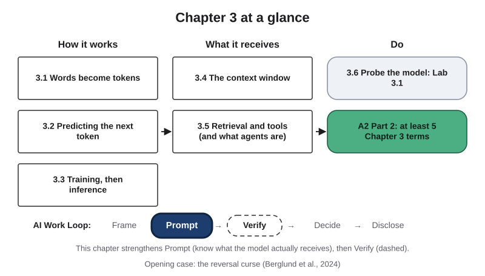{#fig-3-1 fig-alt="Chapter map: How it works (3.1–3.3), What it receives (3.4–3.5), Do (3.6, Lab 3.1, A2 Part 2); Work Loop with Prompt highlighted."}

**Chapter 3 at a glance.** Chapter 2 showed how a machine learns from examples. This chapter looks inside the large language models (LLMs) behind today's artificial intelligence (AI) chat tools. You will follow one response from start to finish: how your text becomes tokens, how the model scores every possible next token, why the scores stop changing after training, what fits in one turn, and what search and other tools add.

**Time:** about 25–30 minutes for the Core sections 3.1–3.5, and about 50 minutes to read the whole Core package (the Opening Case, section 3.6, the Case Study, the Summary and the end-of-chapter questions), plus time to answer them. Allow longer if English is not your first language. In Tuesday's class you will also see a short demonstration of a tokenizer and of one question asked several times. The boxes work as before: worked examples show every step, faded examples leave some steps for you, and Your Turn and Check Yourself boxes are ungraded practice. Reading R1 (Wolfram, 2023) is recommended this week, not required. Answers to odd-numbered end-of-chapter questions are in Appendix E.

**The question of this chapter:** *Does a language model know things, or does it predict text?* Keep it in mind. The Chapter Summary answers it.

## Opening Case: The Model That Could Not Reverse a Fact {.unnumbered}

In September 2023, a team of researchers posted a short, surprising result. They tested language models from two companies, OpenAI's GPT-3 and GPT-4 (2023) and Meta's openly released Llama-1, and found the same gap in all of them (Berglund et al., 2024). The paper appeared at a major machine-learning conference in 2024. The researchers called the gap the **reversal curse**.

The first test used made-up facts, so no model could have seen them before. The researchers **fine-tuned** the models, which means they gave already trained models extra training on a small, new set of texts. The new texts stated invented facts of the form "A is B" (three sets of 30), each written in 30 different ways. One said that a made-up person, Daphne Barrington, was the director of a made-up film. After fine-tuning, the largest GPT-3 model often completed the facts in the direction it was trained on. Asked the other way round (who directed that film?), it gave the right name in essentially none of the tests (Berglund et al., 2024). Its scores for the right name were no higher than for a random name.

The second test used real people. The researchers took 1,000 popular celebrities from a film database and asked GPT-4 for each one's mother and father. GPT-4 named the right parent in 79% of these mother and father questions, which gave 1,573 child–parent pairs. Then they turned all 1,573 pairs around and asked for a child of each parent. Even with up to ten tries per question, GPT-4 named the famous child only 33% of the time. Llama-1 models showed the same gap (Berglund et al., 2024).

The gap had a clear limit. When the fact "A is B" was written in the prompt itself, the models could answer "B is A" (Berglund et al., 2024). The problem was with facts that came only from training.

Here is the puzzle. If a model "knows" that a person's mother is a certain woman, why can it not name that woman's son?

We tend to expect that anyone who can answer one direction can answer the other. The result suggests that the model is not consulting a store of facts. By the end of section 3.3 you will be able to explain the gap, as the researchers suggest, with two ideas: how a model produces each piece of text, and what its training text contains. A caution before you test it yourself: newer models and tools that search may answer both directions, and the paper's best-known example is now repeated widely online. Test a less famous pair from the list on eLearning; if your tool answers both ways, record that as evidence (section 3.6).

## Learning Objectives {.unnumbered}

Framework tags refer to the UNESCO (United Nations Educational, Scientific and Cultural Organization) AI Competency Framework for Students, the AI4K12 initiative's "Five Big Ideas in AI" for teaching AI in schools, and the AI Fluency framework.

After this chapter you will be able to:

- **O1 — Explain** how a large language model produces a response: text becomes tokens, the model scores every possible next token, one is picked, and the loop repeats inside a context window. *(LO1 · UNESCO: AI techniques and applications, Understand · AI4K12: Representation and reasoning)*
- **O2 — Explain** the difference between training and inference, and its consequences: a knowledge cutoff, and no learning from your conversation. *(LO1 · UNESCO: AI techniques and applications, Understand · AI4K12: Learning · AI Fluency: Delegation)*
- **O3 — Judge** what an answer from a tool that searches or runs software still requires you to check. *(LO1, LO3 · AI Fluency: Discernment · UNESCO: AI techniques and applications, Understand)*
- **O4 — Test** a model's behavior with a simple probe (prediction, prompt, result, conclusion) and record the evidence. *(LO1, LO3 · AI Fluency: Discernment)*
- **O5 — Complete** Part 2 of assignment A2: at least 5 Chapter 3 terms with worked definitions, labeled links to Chapter 2 terms, and verification, including one corrected AI-generated definition. *(LO1 · UNESCO: AI techniques and applications, Understand)*

::: {.callout-note title="Warm-up (ungraded)"}
1. Does a language model receive the letters of your words, the way you see them on the screen?
2. If you correct a chat tool today, will the model behind it give the corrected answer to everyone tomorrow?
3. If a tool searched the web before answering, is its answer correct?

You will revisit your answers in the Chapter Summary.
:::

## 3.1 Words Become Tokens {#sec-3-1 .unnumbered}

[Core]{.path}

*Featuring Elif, a first-year psychology student from İzmir.*

Every field has its own long words, from drug names to species names. How a model handles them starts with a step most users never see.

Before you read on, make a prediction. Take one English paragraph and the same paragraph in Turkish, or in another language you know. Which version will cost a language model more pieces of text to process? Write your guess down.

A language model does not receive letters or words the way you see them. A program called a **tokenizer** first splits the text into **tokens**. A token is a unit of text (a word, part of a word, or a symbol) that a language model receives and produces. Each token has a number, and the model works only with those numbers.

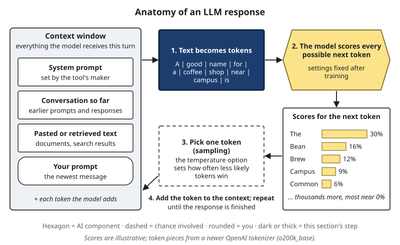{#fig-3-3a fig-alt="Anatomy of an LLM response, step 1 highlighted: the prompt split into ten tokens: A, good, name, for, a, coffee, shop, near, campus, is."}

Most tokenizers are built from large amounts of text before the model is trained. A common method starts with single characters and keeps merging the pairs that appear together most often (Sennrich et al., 2016). Frequent words end up as one token; rare words are split into pieces. For example, a widely used newer tokenizer has about 200,000 tokens in its list. In it, " strawberry" is one token, while the drug name " hydroxychloroquine" becomes four pieces: " hydro", "xy", "chl" and "oroquine". Notice the spaces: a token often includes the space in front of a word. The same word can split differently depending on what comes before it; at the very start of a text, "hydroxychloroquine" becomes five pieces.

Four practical consequences follow.

- **Letters are not directly visible.** A model that receives " strawberry" as one number does not receive its letters one by one. This is one commonly given reason why models have miscounted letters. A 2024 preprint (a study not yet peer reviewed) found more to the story: many models could identify the letters in a word but still miscounted them, especially letters that appear more than twice (Fu et al., 2024).
- **Rare names split into odd pieces.** At the start of a text, Elif's hometown, "İzmir," becomes three pieces: "İ," "z" and "mir." After a space it becomes two: " İz" and "mir."
- **Length limits and cost are counted in tokens.** The amount of text a tool can handle at once, and the price of many paid services, are measured in tokens, not words (Petrov et al., 2023).
- **The same text costs different amounts in different languages.** That is the answer to your prediction, as the next example and @fig-3-2 show.

::: {.callout-note title="Worked Example: Elif's Abstract in Two Languages"}
Elif writes a short abstract for her research-methods class in English and in Turkish. *(Constructed example: the abstract describes an invented study; the Turkish translation is the book's.)*

**Step 1 — Count words.** English: 59 words. Turkish: 51 words. Turkish adds many endings to one word, so it needs fewer words.

**Step 2 — Count tokens.** With a newer tokenizer, the English version is 68 tokens and the Turkish version is 110 tokens. With an older tokenizer from the same company, the counts are 67 and 155.

**Step 3 — Compare.** The Turkish version has fewer words but about 1.6 times as many tokens with the newer tokenizer, and about 2.3 times as many with the older one.

**Step 4 — What follows.** If a tool charges per token, the Turkish version costs more. If a tool can take a fixed number of tokens, less Turkish text fits. And the result depends on the tokenizer, so name it whenever you report a count.
:::

The pattern holds for longer texts. @fig-3-2 shows the full Universal Declaration of Human Rights, which exists in many languages, run through the same two tokenizers.

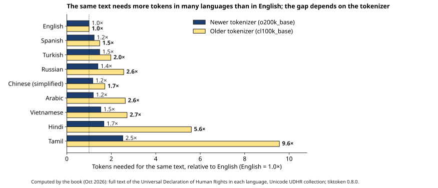{#fig-3-2 fig-alt="Bars: tokens for the same text relative to English in nine languages; older tokenizer up to 9.6× (Tamil), newer up to 2.5×."}

With the older tokenizer, the Tamil version needs 9.6 times as many tokens as the English one, and the Hindi version 5.6 times. The newer tokenizer narrows the gaps to 2.5 and 1.7 times, but it does not close them. Researchers who compared many tokenizers on 2,000 sentences translated into 200 languages found gaps of up to 15 times (Petrov et al., 2023). The Ethics Lens and Short case 2 return to what that means for people who work in those languages.

::: {.callout-note title="Faded Example: A Drug Name"}
*A health example (no patient information involved).*

A pharmacy student asks a chat tool how many letters "hydroxychloroquine" has. After a space, the newer tokenizer splits it into " hydro", "xy", "chl" and "oroquine"; at the start of a text, into five pieces.

**Step 1 (done for you):** Either way, the model receives a few numbers, not 18 letters.

**Step 2:** Why might a letter count go wrong? _______________________

**Step 3:** Name one way to check the count without trusting the model: _______________________
:::

::: {.callout-important title="Your Turn"}
Open any free tokenizer page (current links are in Compass). Paste one sentence in your strongest language other than English, then its English translation. Record both token counts and the tokenizer's name. Which costs more, and by how much? (Lab 3.2 extends this to a paragraph and two tokenizers.)
:::

::: {.callout-tip title="Check Yourself 3.1"}
1. What is a token, and what does a tokenizer do?
2. Why does a rare name often become several tokens?
3. Why can the same text cost more tokens in one language than in another?
:::

Once the text is a row of numbers, the model has one job: produce scores for what comes next.

## 3.2 Predicting the Next Token {#sec-3-2 .unnumbered}

[Core]{.path}

Like Sam's parts sorter in Chapter 2, a language model scores possible answers, but at a much larger scale. Every token of a response is produced in four steps:

1. **Split the text into tokens** (section 3.1).
2. **Score every possible next token.** Given the tokens so far, the model produces a score for **every** token in its list, tens or hundreds of thousands of them. The scores are then turned into a **probability distribution**: a set of chances for all possible outcomes (here, every possible next token) that add up to 100%. In this chapter, "scores" and "chances" describe the same thing.
3. **Pick one token.** Picking a token according to these chances is called **sampling**.
4. **Add it and repeat.** The picked token is added to the end of the text, and steps 2–4 run again on the longer text.

A response is a long chain of these steps, one token at a time. This is **next-token prediction**. Some tools first produce extra "reasoning" tokens, sometimes hidden from you, before the answer. These are made in the same way, and they also take up space in the context and count toward cost (OpenAI, 2024, n.d.).

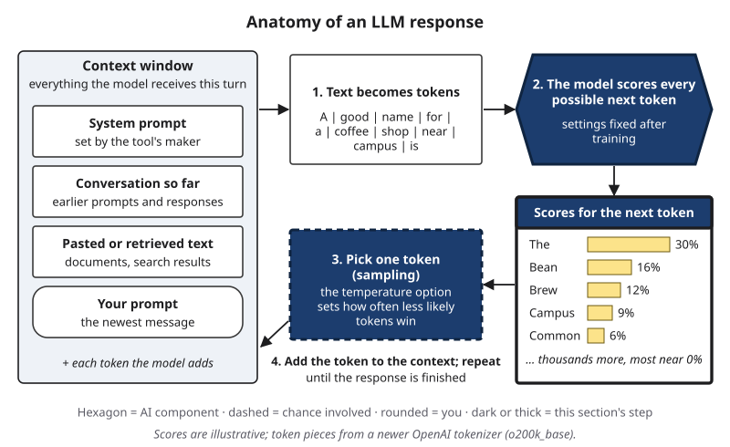{#fig-3-3b fig-alt="Anatomy of an LLM response, steps 2–3 highlighted: the model scores next tokens (The 30%, Bean 16%...), one is picked, then added."}

::: {.callout-note title="Worked Example: Naming a Coffee Shop"}
Prompt: "A good name for a coffee shop near campus is". *(Illustrative scores chosen by the book, not output from a real model.)*

**Step 2 — Score.** " The" 30%, " Bean" 16%, " Brew" 12%, " Campus" 9%, " Common" 6%, " Java" 5%, " Grounds" 4%. In this illustration, twenty other tokens share the remaining 18%; a real model also gives tiny chances to thousands more.

**Step 3 — Pick.** The tool picks one token with these chances. " The" is the most likely single pick, but it is picked only about three times in ten.

**Step 4 — Add and repeat.** Suppose " Bean" was picked. The text is now "… near campus is Bean", and the model scores every possible next token again.

**Why two runs differ.** Run the same prompt again and a different token may win at step 3. Every later step then starts from different text. In other words, small chances at each step add up to different answers.
:::

This answers a question from Chapter 1: different answers to the same prompt are not a fault. Unless a tool always takes the top-scoring token, picking with some chance is how text is produced.

Many developer tools, and some apps, offer an option called **temperature** that changes how often less likely tokens are picked (Wolfram, 2023). It does not change the model's settings, only how a token is picked. A low temperature makes the top tokens even more likely. A high temperature spreads the chances out. With the book's illustrative scores, " The" is picked 61% of the time at a temperature of 0.5, and 18% of the time at 1.5. The book also simulated ten picks at each temperature. At 0.5, " The" came up eight times. At 1.5, eight different tokens came up, including " Fox" and " Perk" from the twenty others.

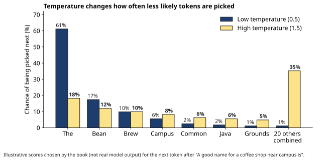{#fig-3-4 fig-alt="Paired bars for eight token options at temperature 0.5 and 1.5; token “The” drops from 61% to 18%; other tokens combined rise from 1% to 35%."}

Now the most important consequence. The scores reflect which tokens tend to follow similar text in the training data and, after later training stages, what people rated as good responses (section 3.3). Nothing in these steps checks whether the result is true. So a fluent, confident sentence can still be false. Chapter 4 explains how such failures happen, and Chapter 8 shows how to check.

::: {.callout-warning title="Two Meanings of Sampling"}
In **Chapter 2**, a *sample* is the set of examples a dataset contains, and *sampling* means choosing which examples go into it. In **this chapter**, *sampling* means picking the next token according to the model's scores. Same word, two different ideas. In your A2 map, use one sense per term and say which.
:::

::: {.callout-note title="Faded Example: Finishing a Lab Report Sentence"}
Prompt: "The first section of a lab report should". *(Illustrative scores.)* " state" 35%, " describe" 25%, " explain" 15%, " include" 10%, all others 15%.

**Step 3 (done for you):** The tool picks one token. Suppose it picks " describe".

**Step 4:** What text does the model receive when the steps repeat? _______________________

**Temperature:** If the temperature were lowered, which token would be picked more often? _______________________
:::

::: {.callout-important title="Your Turn"}
Before Thursday's lab, write two prompts from your field: one you expect to vary a lot across runs and one you expect to vary little, and say why. Test them in Lab 3.1 (probe 2) or Lab 3.3.
:::

::: {.callout-tip title="Check Yourself 3.2"}
1. Name the four steps that produce each token of a response.
2. Why can the same prompt produce different answers?
3. Why can a token with a high score still lead to a false sentence?
:::

So far the scores have simply existed. Where do they come from, and why do they not change while you chat?

## 3.3 Training, Then Inference {#sec-3-3 .unnumbered}

[Core]{.path}

Every language model goes through two very different phases. Chapter 2 named them: **training**, when the model's settings change, and **inference**, when a trained model produces outputs for new inputs. These settings are the **parameters** from Chapter 2: the learned values inside the model. In this chapter, "settings" always means these learned values. Controls you can change, such as temperature or search on or off, are called **options**.

Training for a chat model has several stages. The first, **pretraining**, is self-supervised learning (Chapter 2) on very large collections of text. The model is shown text up to a point and scores every possible next token; the settings are then adjusted so that the real next token gets a higher score. The real text provides the label, so no person has to label anything. After pretraining, the model continues text, but it does not reliably follow instructions.

Further stages often follow. In the best-known recipe (Ouyang et al., 2022), **instruction tuning** trains the model further on prompts paired with good responses written by people. Then, in **learning from human feedback**, people rank several responses, a separate scoring model is trained on their rankings, and the settings move toward responses that score higher. Newer recipes also use examples and feedback produced by AI models (Bai et al., 2022).

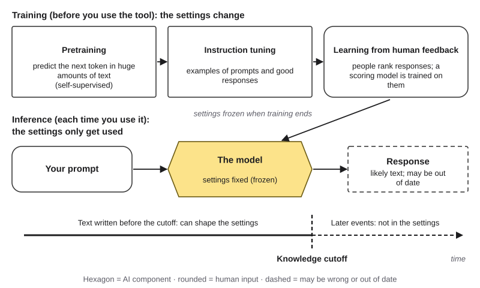{#fig-3-5 fig-alt="Training: pretraining, instruction tuning, human feedback; frozen settings used at inference (prompt, model, response); knowledge cutoff timeline."}

Then training ends, and the settings are fixed. Every time you use the tool, that is inference. Three consequences follow.

**1. A knowledge cutoff.** The **knowledge cutoff** is the date after which no text was collected for training. Events after it are not reflected in the settings, unless a tool adds them to what the model receives (section 3.5). The cutoff is also not a clean line. Researchers have found that a model's effective cutoff can differ from the one its developer reports, and can differ from one data source to another (Cheng et al., 2024). So a model's coverage is not "complete up to" its cutoff.

**2. No learning from your chat.** Correcting a model in a conversation does not change its settings. Your correction stays in the conversation, so it can shape later responses in that chat (section 3.4). Some products also offer a **memory** feature that saves notes about you, or draws on past chats, and adds them to later conversations (as of October 2026). It adds text to what the model receives; it does not train the model. Separately, some providers may use conversations to train **future** versions of a model, depending on your account and options (as of October 2026; current details are in Compass). That can change a later model, never the one you are talking to. Chapter 15 returns to what this means for privacy.

**3. Patterns, not a fact store.** The settings hold patterns from the training text, not a table of facts. Why would training work in one direction only? During training, the model always scores what comes **after** the text before it. A sentence of the form "A's mother is B" raises the score for "B" after "A's mother is"; it gives no practice at producing "A" after "a child of B is." For the real-world test, the researchers suggest that training text more often names the celebrity first and the parent second (Berglund et al., 2024). A second factor they mention is tuning GPT-4 to avoid giving information about individuals. This book notes that it cannot explain why untuned Llama-1 base models showed the same gap. As Chapter 2 noted, a model can also repeat training text almost word for word (Carlini et al., 2021); that is still producing likely tokens, not looking up a record.

::: {.callout-note title="Worked Example: Last Week's News"}
Elif asks a chat tool, with the search option turned off, who won a student-government election on her campus last week.

**Step 1 — Training or inference?** Inference: the settings are fixed. **Step 2 — Cutoff.** The election happened after any cutoff, so no training text described it. **Step 3 — Expected output.** Still a fluent answer, possibly a plausible but invented name, or a statement that it has no information. **Step 4 — Fix.** Use a source with current information, or a tool that searches and shows its sources, and check them (section 3.5).
:::

::: {.callout-note title="Faded Example: Which Questions Need Current Information?"}
(a) How does a bill become law in the United States? (b) What is today's exchange rate between the dollar and the Turkish lira? (c) Who chairs your department this semester?

**(a) (done for you):** stable for decades, so training text likely covers it, but still check a source before you rely on it.

**(b):** _______________________ **(c):** _______________________
:::

::: {.callout-important title="Your Turn"}
List three questions from your field: one that training text likely covers well, one that needs current information, and one about your own campus or workplace. For each, say what you would check.
:::

::: {.callout-tip title="Check Yourself 3.3"}
1. What changes during training, and what stays fixed during inference?
2. Why does correcting a model in a chat not fix the model for everyone?
3. Use training text to explain why a model can name a celebrity's mother but often not the mother's famous child.
:::

The settings are fixed, but the response still depends on what the model receives. The next section looks at that.

## 3.4 The Context Window {#sec-3-4 .unnumbered}

[Core]{.path}

A student pastes a long reading; an analyst pastes a report. When you send a message, the model does not receive only that message. It receives a whole package of text, rebuilt at every turn. The **context window** is the space for everything the model receives in one turn, measured in tokens; the response the model writes also counts toward it. It usually holds four kinds of text:

- a **system prompt**: instructions from the tool's provider or developer, which you usually do not see;
- the **conversation so far**: your earlier prompts and the earlier responses;
- **pasted or retrieved text**: documents you added, or passages a tool found (section 3.5);
- **your prompt**: the newest message.

When a tool adds tool results or memory notes, they go into the same window.

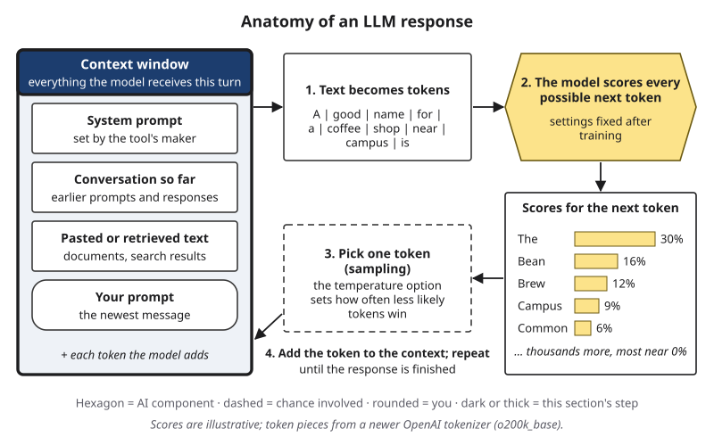{#fig-3-3c fig-alt="Anatomy of an LLM response, context window highlighted: system prompt, conversation so far, pasted or retrieved text, your prompt."}

Every window has a size limit. When a conversation grows past it, tools handle the overflow differently, for example by dropping or shortening older parts. Sizes and methods change often, so current numbers are in Compass.

A common belief is that if text fits in the window, the model uses all of it equally well. A 2023 study tested that directly (Liu et al., 2024). Researchers gave models a question and 20 retrieved passages, only one of which held the answer, and moved that passage from first to last. With GPT-3.5-Turbo, 75.8% of questions were answered correctly when the answer was first, 63.2% when it was last, and 53.8% when it was in the middle. That middle score was lower than the 56.1% the model reached with no passages at all, answering from its training alone.

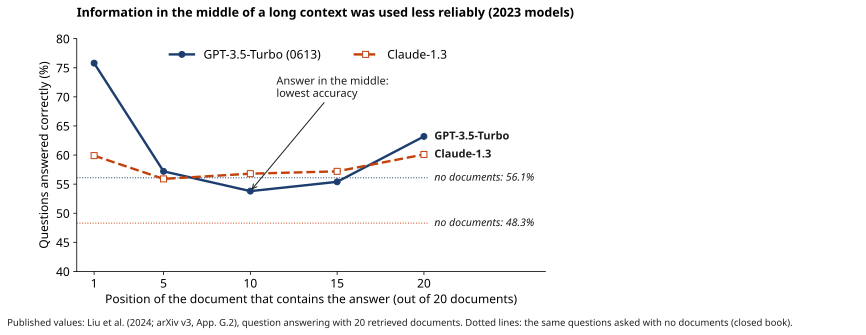{#fig-3-6 fig-alt="Two lines over answer positions 1–20: GPT-3.5-Turbo 75.8% first, 53.8% middle, 63.2% last; Claude-1.3 flatter; dotted no-document lines."}

These were 2023 models, and newer ones may do better. Treat the result as a pattern to test, not a law. The practical habit is a diagnostic one: before you rely on a long input, predict which parts are most likely to be missed, then check those parts. Designing the context well is the subject of Chapter 6.

::: {.callout-note title="Worked Example: Hana's Long Document"}
*Featuring Hana (they/them), who minors in history.*

Let's take a long document and test it the diagnostic way. Hana pastes a long public-domain document, a digitized county history from the 1890s, into a chat tool. They plan three questions: one about a fact on the second page, one from the middle, and one from the last page.

**Step 1 — Predict.** Hana predicts that the middle question is most at risk. **Step 2 — Ask.** They ask all three, each in a new chat with the full document. **Step 3 — Check.** Hana checks each answer against the page itself. *(Constructed result:* the first and last answers match the text; the middle answer gives a date from a different chapter of the history.) **Step 4 — Conclude.** One run is weak evidence. Hana repeats the middle question twice and asks for a supporting quotation, then searches the document for it. A quotation that is not in the document counts as a miss.
:::

::: {.callout-note title="Faded Example: A Long Support Thread"}
*Featuring Lucía, who works part-time in customer support. Constructed, anonymized example.*

Lucía has a 60-message support thread. In message 31, the customer changed the email address on their account. She asks a tool to draft a reply that confirms the new email address.

**Step 1 (done for you):** The email change sits in the middle of a long input, so it is the detail most at risk.

**Step 2:** How would you check the draft? _______________________

**Step 3:** What should Lucía confirm before pasting customer messages into any AI tool? _______________________ (Chapter 15 covers privacy.)
:::

::: {.callout-tip title="Check Yourself 3.4"}
1. Name the four kinds of text a context window usually holds.
2. In Liu et al.'s 2023 test, where in a long input was information used least reliably?
3. Why is "it fits in the window" not enough to trust that the model used it?
:::

Search and other tools work by adding text to this same window. That is the last piece of the anatomy.

## 3.5 Retrieval and Tools (and What Agents Are) {#sec-3-5 .unnumbered}

[Core]{.path}

Many AI tools now do more than predict from their settings. A common belief is that if a tool searched, its answer is correct. To see why that does not follow, look at what search and other tools actually add. Two additions matter most.

**Retrieval** means that the system searches a collection, such as the web, a course website or a company's files, and adds the passages it finds to the context window. A model then produces its response with those passages in front of it. The approach is often called **retrieval-augmented generation (RAG)** (Lewis et al., 2020). This is the search-then-generate lane from Chapter 1.

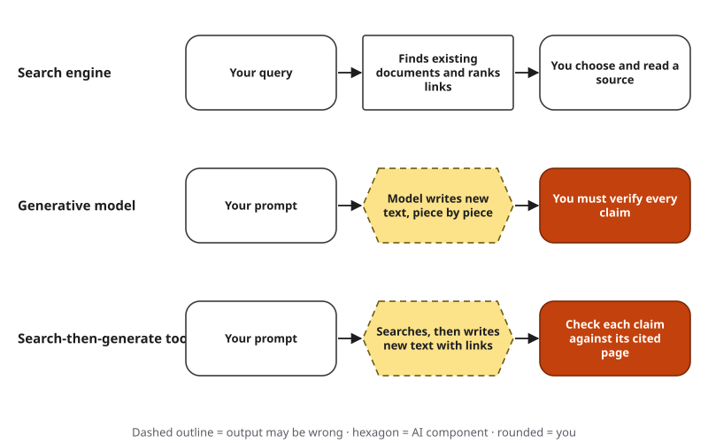{#fig-1-4-ch3 fig-alt="Three rows: search returns documents; a generative model writes new text to verify; a search-then-generate tool writes text with links to check."}

**Tool use** means that the model can produce a request to run other software, such as a calculator, a calendar or a search engine (Schick et al., 2023); code interpreters work the same way. The system runs the tool and adds the result to the context. For example, instead of producing the digits of a large multiplication token by token, the model can request the calculation and receive the exact result.

Here is the key point. Neither retrieval nor tools change the model's settings or how it predicts. Both change **what the model receives**. In other words, search and tools change the input, not the machine. The response is still produced token by token, so each addition fixes some problems and leaves others.

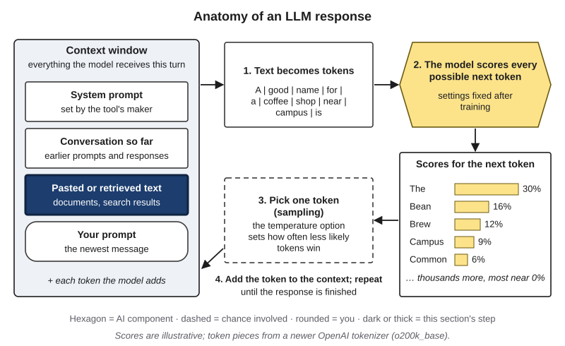{#fig-3-3d fig-alt="Anatomy of an LLM response with the pasted or retrieved text slot highlighted inside the context window."}

| Addition | What it adds | What you still check |
|---|---|---|
| Retrieval (search) | Current or specific passages in the context | Are the passages reliable and current? Do they say what the response claims? Were the right passages found? |
| Calculator or code tool | Exact results of a calculation the model requests | Was the right calculation requested, with the right numbers? Is the result used correctly in the text? |
| Pasted documents | Your own material in the context | Was all of it used (section 3.4)? Does the response go beyond it? |

Chapters 8 and 9 teach full methods for checking citations and sources. Here, the habit is simpler: for each claim, ask whether it came from the added text, from a tool's result, or from the model's settings alone.

**What agents are.** Some systems repeat these steps on their own: the model requests a tool, receives the result, produces the next request, and continues toward a goal. Anthropic (2024) calls a system an **agent** when the model directs its own steps and tool use, and a *workflow* when people fixed the steps in advance. Agents are covered in Chapter 14.

::: {.callout-note title="Worked Example: A Search-Then-Generate Answer"}
Elif asks a tool that searches: "What grade point average (GPA) do I need to keep my international student scholarship, and how many semesters are left if I have 45 of 120 credits and take 15 per semester?" *(Constructed example.)*

The response says: (1) "You need a 3.0 GPA" [link 1, the scholarship office page]; (2) "You must take at least 12 credits per semester" [link 2, a 2019 student forum post]; (3) "You can appeal a lost scholarship within 30 days" [no link]; (4) "You have 5 semesters left" [calculator tool: (120 − 45) ÷ 15 = 5].

**Marking** (with the five verdicts this book uses; Chapter 8 explains them fully): *supported*, the evidence says what the claim says; *partly supported*, part of the claim holds, part does not or is missing; *unsupported*, no evidence found either way at the stage you reached; *contradicted*, the evidence says otherwise; *cannot verify*, no source you can reach. (1) supported, if the page says 3.0 and is current. (2) unsupported for now: the only source is a 2019 student forum post, old and unofficial; check the official page. (3) unsupported: no source; ask the office. (4) supported for the arithmetic: (120 − 45) ÷ 15 = 5; but it assumes Elif keeps taking 15 credits, and the tool did only the arithmetic it was given.
:::

::: {.callout-note title="Faded Example: Marking a Retrieved Answer"}
A tool answers a question about a city's recycling rules, with two links. *(Constructed example.)* Claims: (1) "Glass is collected every other Monday" [city page, updated this year]; (2) "Pizza boxes are not accepted" [a news article from 2018]; (3) "Fines start at $50" [no link].

**(1) (done for you):** supported, if the city page says so; it is current and official.

**(2):** _______________________ **(3):** _______________________
:::

::: {.callout-important title="Your Turn"}
Use the dated, retrieved answer with sources provided on eLearning. Give each claim one of the five verdicts, and name one problem that neither search nor a calculator could have fixed (for example, a question that was framed wrongly).
:::

::: {.callout-tip title="Check Yourself 3.5"}
1. What do retrieval and tools change, and what do they not change?
2. Name two reasons an answer with sources can still be wrong.
3. What makes a system an agent rather than a workflow?
:::

## 3.6 Probe the Model (A2 Part 2) {#sec-3-6 .unnumbered}

[Studio]{.path}

*Studio sections are hands-on work for the Thursday lab and your weekly assignment.*

You now have a model of how a language model works. A **probe** turns that model into a test. A probe has four parts:

1. **Prediction:** what you expect the model to do, and why, using this chapter.
2. **Prompt:** the exact text you send, with the tool, the model name if shown, the options used (for example, search on or off) and the date.
3. **Result:** what came back, copied exactly.
4. **Conclusion:** what the result shows, and what it does not show.

Any result is evidence. If the model gets right something you predicted it would get wrong, record that too. It tells you about this tool on this date. One result is a single data point, so repeat a probe before you draw a strong conclusion.

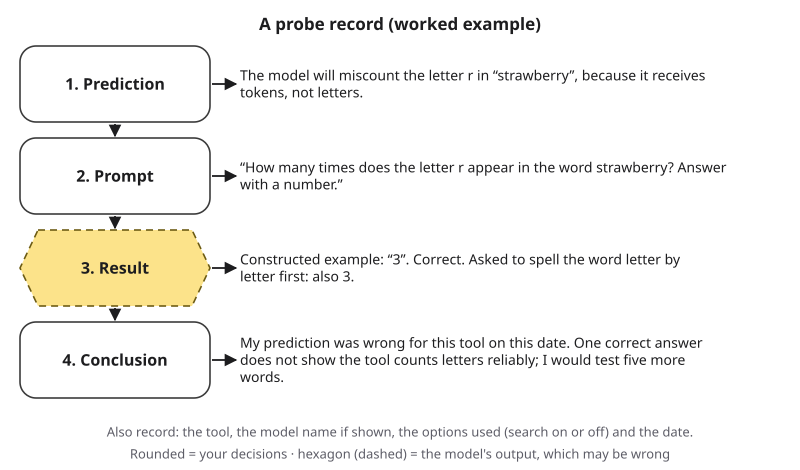{#fig-3-8 fig-alt="Probe record: prediction (miscount r in strawberry), prompt, constructed result (3, correct), conclusion (prediction wrong; test more words)."}

In words, the worked probe record in @fig-3-8 reads: **Prediction:** the model will miscount the letter r in "strawberry," because it receives tokens, not letters. **Prompt:** "How many times does the letter r appear in the word strawberry? Answer with a number." **Result** *(constructed example)*: "3," which is correct; asked to spell the word letter by letter first, it also said 3. **Conclusion:** the prediction was wrong for this tool on this date; one correct answer does not show that the tool counts letters reliably, so test five more words.

::: {.callout-note title="Faded Example: A Context Probe"}
**Prediction (done for you):** In a 3,000-word text, a fact placed in the middle will be missed more often than the same kind of fact at the start or the end, as in Liu et al. (2024).

**Prompt:** _______________________ **Result:** _______________________

**Conclusion:** _______________________ (What would change your mind?)
:::

### From probes to your concept map {.unnumbered}

Your probes become evidence for **A2 Part 2**. The finished A2 map has 15 terms: at least 7 from Chapter 2 (Part 1, started at home) and at least 5 from Chapter 3 (Part 2). Each Chapter 3 term needs a worked definition, at least one labeled link to a Chapter 2 term, and a note on how you verified it. The whole A2 needs one corrected AI-generated definition, in either part. **Bring your Part 1 draft to Thursday's lab.** Chapter 2, section 2.7, explains the map format.

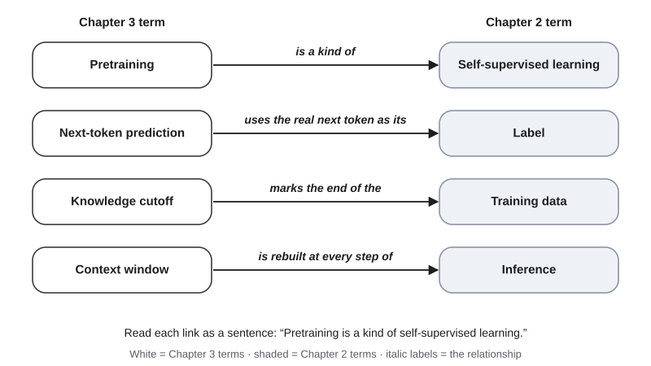{#fig-3-9 fig-alt="Links from Chapter 3 to Chapter 2 terms: pretraining–self-supervised learning, next-token prediction–label, cutoff–training data, context–inference."}

::: {.callout-note title="Worked Example: One Term, Two Links, One Correction"}
**Worked definition.** *Token:* a unit of text (a word, part of a word, or a symbol) that a language model receives and produces. Example: after a space, " hydroxychloroquine" becomes four tokens.

**Two labeled links to Chapter 2.** pretraining → *is a kind of* → self-supervised learning · inference → *uses fixed* → parameters.

**One corrected AI definition.** A chat tool defined *context window* as "the amount of information the model remembers from all your past conversations." *(Constructed example.)* Correction: the context window is the space for everything the model receives **in one turn**. The model itself keeps nothing between turns; the system resends the conversation, and a memory feature, if it is on, adds saved notes or passages from past chats. Evidence: sections 3.3 and 3.4, plus a quick check: in a new chat with memory off, ask about something you said in an earlier chat.
:::

::: {.callout-note title="Faded Example: Label and Correct"}
Add a labeled link from each Chapter 3 term to a Chapter 2 term:

- knowledge cutoff → *marks the end of the* → training data *(done for you)*
- instruction tuning → _______ → supervised learning
- temperature → _______ → inference

Correct this AI-generated definition: "Temperature is how sure the model is that its answer is true." Start: *Temperature is an option that changes how often less likely tokens are picked. It does not* _______________________
:::

::: {.callout-important title="Your Turn"}
In Thursday's lab, write at least three worked definitions and labeled links from your probes. At home, finish at least five Chapter 3 terms for A2 Part 2, and write two sentences on which link was hardest to label and why (see the Application Assignment).
:::

::: {.callout-tip title="Check Yourself 3.6"}
1. Name the four parts of a probe.
2. Why is a result that proves your prediction wrong still useful?
:::

## Deep 3.A: Attention in Plain Words {#sec-3-deep-a .unnumbered}

[Deep]{.path}

*Deep sections are optional and not on the exams.*

How does the model use the whole context when it scores the next token? Most of today's language models are built on the **Transformer** architecture (Vaswani et al., 2017; as of October 2026, some newer designs mix in other parts). Its central part is called **attention**. At every layer, the representation of each token is updated with a weighted mix of the representations of the tokens **before it**. In the chat models in this book, a token cannot draw on tokens that come later: the model is built that way, which matches how it produces text, one token after another. The weights are computed from the model's settings and the tokens themselves, so they change from one text to the next.

Take a sentence from a well-known test of everyday reasoning: "The trophy doesn't fit in the brown suitcase because it's too big" (Levesque et al., 2012). When the model reaches "big," attention lets that position draw strongly on "trophy" (and on "it's," not shown in the figure). Change "big" to "small," and the strongest link from "small" should now go to "suitcase." The words after "it's" decide what "it" refers to, so the link can only be formed there.

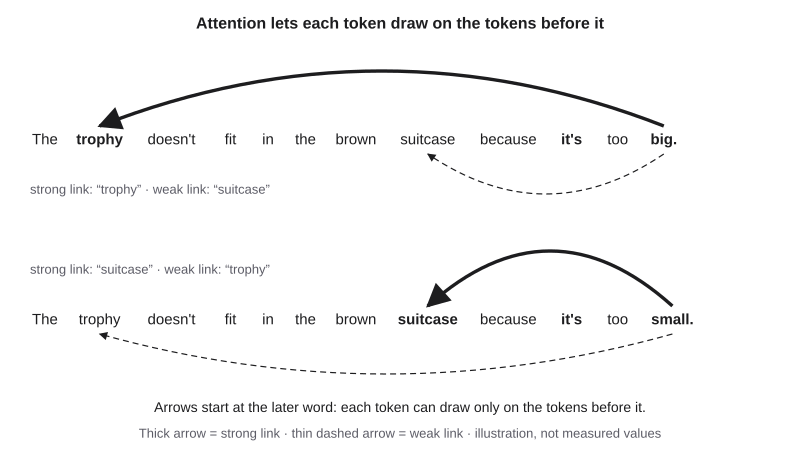{#fig-3-10 fig-alt="Two sentences; arrows start at 'big' (strong link back to 'trophy') and at 'small' (strong link back to 'suitcase'); illustration."}

The figure is an illustration, not measured weights. Real models have many attention layers and many attention "heads" per layer, and individual weights are hard to interpret. Chapter 17 returns to the difficulty of explaining what happens inside a model.

## Deep 3.B: Why Scale Changed Things {#sec-3-deep-b .unnumbered}

[Deep]{.path}

Why did language models improve so much between about 2018 and 2023? One part of the answer is scale. In 2020, researchers at OpenAI and Johns Hopkins University reported that the prediction error of language models fell in a smooth, predictable way as models, datasets and computing budgets grew, with some trends spanning more than seven orders of magnitude (Kaplan et al., 2020). In other words, each tenfold increase cut the error by about the same percentage, as long as nothing else held it back.

Two years later, a team at DeepMind refined the recipe. For a fixed computing budget, they found that model size and the amount of training text should grow together. Their 70-billion-parameter model, Chinchilla, trained on 1.4 trillion tokens, outperformed several larger models trained on less text (Hoffmann et al., 2022). Since about 2024, OpenAI has reported gains from later training stages and from letting models produce more reasoning tokens before they answer (OpenAI, 2024).

Lower prediction error is not the same as more truthful output. A model can become very good at predicting likely text and still produce confident errors. Why confident errors persist is the subject of Chapters 4 and 8.

## Hands-on Labs {.unnumbered}

Lab 3.1 is Thursday's in-class lab. Labs 3.2 and 3.3 are optional and can be done at home or in Compass, which is optional and ungraded. The labs describe what to do, not which buttons to press. Never put personal or confidential information into a prompt.

**Starting a fresh chat (no Compass needed).** Most chat tools have a "new chat" button; a new chat does not include your earlier conversation. Many tools also offer a temporary or private chat that is not saved, and a memory option in their menus that you can switch off. If you cannot find these, say so in your probe record, or use the dated sample outputs on eLearning.

### Lab 3.1: Probe the Model (Studio · 45 minutes · in class) {.unnumbered}

*(O1, O2, O3, O4, O5 · LO1, LO3 · Apply)* Teams of 3–4; every write-up is individual. Each team member runs one probe (a jigsaw: each person does one part, then the team puts the parts together). Bring your A2 Part 1 draft.

| Minutes | Step |
|---|---|
| 0–5 | Briefing. Each member takes one probe. Teams of three skip probe 2 (sampling), which you practiced in Tuesday's demonstration and can try in Lab 3.3. |
| 5–20 | Run your probe: write the prediction, run the prompt, record the result and your conclusion (@fig-3-8). |
| 20–27 | Pool the probe records and agree on one sentence per probe. |
| 27–30 | Quick debrief: which result surprised your team, and which section explains it? |
| 30–43 | Individually, write at least 3 worked definitions and labeled links for A2 Part 2 from the probes. |
| 43–45 | Exit step: write down one link you are unsure of. **Save one surprising probe result for your Failure Diary (Chapter 4).** |

**Probe 1 — Tokens.** Ask the model to count a letter in a long word or name. Then ask it to spell the word letter by letter first and count again. Record whether the tool showed a reasoning step before answering. "The model got it right" is a valid result; explain why it might (section 3.1).

**Probe 2 — Sampling.** Send one open prompt from your field five times, each in a new chat. Mark what stays the same and what changes (section 3.2).

**Probe 3 — Context.** Use the provided long public-domain text with one fact placed near the start, one in the middle and one near the end. Ask about each fact in a new chat (section 3.4).

**Probe 4 — Cutoff and search.** Use the provided list of dated events. Ask about them with the search option off and, if your tool allows it, with search on. Do not rely on the model's own statement of its cutoff (sections 3.3 and 3.5).

**Extension (if time).** Test the reversal curse with a less famous parent–child pair from the list on eLearning: ask in both directions, in new chats.

**Output.** The team's probe records (shared) and your own A2 Part 2 draft (individual).

**If this doesn't work, or you prefer not to use AI tools:** analyze the dated sample outputs on eLearning for every probe instead of running prompts. In the paper version of probe 2, you roll dice to pick tokens from a printed score table (each score is a range of dice numbers). The probe record template is available as a screen-reader-friendly table.

### Lab 3.2: Tokens Across Languages (15 minutes · optional) {.unnumbered}

*(O1 · LO1 · Apply)* Extends the 3.1 Your Turn. On a free tokenizer page, paste a full paragraph in a language you know, or use the provided translations, then its English version. Record the token counts, the tokenizer's name and the date. If the page offers a second tokenizer, repeat. Compare your ratios with @fig-3-2, and explain why a single sentence can give a different ratio from a paragraph.

### Lab 3.3: Same Prompt, Five Answers (15 minutes · optional) {.unnumbered}

*(O1 · LO1 · Analyze)* Use the two prompts from the 3.2 Your Turn, or choose a prompt with one correct answer (a date or a definition) and a prompt with many good answers (a name or a slogan). Run each five times in new chats. Where do the answers vary more, and why? Connect your answer to the four steps in section 3.2.

## Case Study: The Reversal Curse, Revisited {.unnumbered}

**Context.** By 2023, many people were asking chat tools factual questions. A team of seven researchers asked a simple question: if a language model is trained on "A is B," can it answer "B is A"? (Berglund et al., 2024).

**Timeline.** September 2023: the paper is posted online. June 2023 is the access date of the celebrity list used in the second test. 2024: the paper appears in the proceedings of the International Conference on Learning Representations (ICLR), a major machine-learning conference (Berglund et al., 2024).

**What the AI did.** In the first test, fine-tuned GPT-3 and Llama-1 models often completed the invented facts (three sets of 30) in the trained direction, but almost never in the reverse direction. In the second test, GPT-4 named the right parent in 79% of the mother and father questions about 1,000 celebrities, which gave 1,573 child–parent pairs. Asked for a child of each parent, it named the famous child only 33% of the time, even with up to ten tries per question. Llama-1 models showed the same gap. When the fact was given in the prompt, the models could reverse it (Berglund et al., 2024).

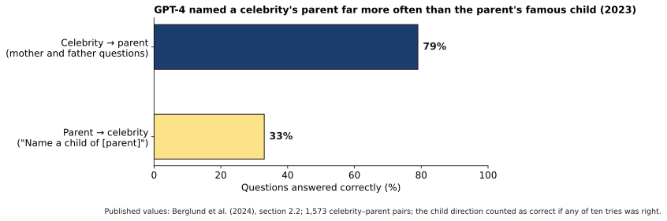{#fig-3-13 fig-alt="Two bars: celebrity to parent 79% correct; parent to celebrity 33% correct (GPT-4, 2023; Berglund et al., 2024)."}

**What humans did.** The researchers designed both tests, chose invented facts so that no model could have seen them, and checked whether the right answer was more likely than a random name. The paper gives 33% in its text and 28% in a figure note; this book uses 33%.

**Through the anatomy of a response.** The case touches three parts of @fig-3-3. *Training (section 3.3):* in the first test, the fine-tuning raised the scores for continuations in the trained direction only; for the real-world test, the researchers suggest the same cause. *Scores (section 3.2):* at inference, the score for the right name in the reverse direction was no higher than for a random name. The *context window* (section 3.4) explains the limit: once the fact was in the prompt, the reversal worked.

**What kind of failure?** In plain words: the models failed to give the right answer in the reverse direction, even though they could give it in the other direction. The paper does not say how many of the wrong answers were invented names rather than no answer. Chapter 4 gives failures like this one names and sorts them into kinds.

**Consequences (documented).** This is a research finding, not an incident; no harm to any person was reported. The study tested models available in 2023. Newer models and tools that search were not part of it, which is why the Opening Case asks you to test your own tool.

**A better workflow.** *Frame:* a reverse lookup ("whose mother is this person?") is a task where a model may fail even when it succeeds in the other direction. *Prompt:* if you have the source fact, put it in the prompt. *Verify:* ask in both directions, and check the answer against a reliable source. *Decide* and *Disclose* as usual.

**Short case 1: Lost in the middle.** Liu et al. (2024) gave 2023 models a question and 20 retrieved passages, one of which held the answer, and moved that passage from first to last. Accuracy formed a U shape: highest when the answer was first or last, lowest in the middle. For GPT-3.5-Turbo, the middle score (53.8%) fell below the score with no passages at all (56.1%). Lesson: a long input is not the same as a well-used input.

**Short case 2: Tokenizers and language unfairness.** Petrov et al. (2023) measured how many tokens a range of tokenizers needed for the same 2,000 sentences in up to 200 languages. The tokenizer used by ChatGPT and GPT-4 at the time needed about 1.6 times as many tokens for Italian as for English, 2.6 times for Bulgarian and 3 times for Arabic, and up to 15 times for Shan, a language of Myanmar. Ratios vary with the text: the book's own measurement with the same older tokenizer gives 2.6 times for Arabic (@fig-3-2). The authors list three consequences: higher cost, slower processing and less text fitting into a fixed context. Lesson: a design choice made before training can treat languages unequally.

## Ethics Lens: Whose Language Costs More? {.unnumbered}

Elif writes in English, but she thinks in Turkish. Section 3.1 showed that her Turkish abstract needed 1.6 to 2.3 times as many tokens as the English one, depending on the tokenizer. For a student who pays per token, or who works with a tool that limits how much text it takes, that is a real difference. For a speaker of Tamil or Shan, the difference can be several times larger (Petrov et al., 2023).

The book's own measurement shows both sides of the story. A newer tokenizer narrowed the gap for every language in @fig-3-2. Yet even the newer one needed 2.5 times as many tokens for Tamil as for English. Token cost is only one part of fairness. Quality can also differ between languages; Chapter 16 looks at fairness and bias in depth.

A second question sits behind every model: whose text trained it? Pretraining uses enormous collections of writing. Whether the people who wrote that text agreed, and whether they should have been asked, are questions Chapter 18 takes up with copyright and the law. Hana, who draws by hand and worries about artists' work being used without consent, cares about them a great deal.

Two questions to carry with you:

- When a tool works less well, or costs more, in your language, who should pay for the difference?
- Should people be able to keep their writing out of training data? What would that change?

## Career Connection {.unnumbered}

Each part of the anatomy is someone's daily work. The descriptions below are general illustrations of these roles, not survey findings; titles and duties vary by employer.

| Role | Part of the anatomy | A question this person asks |
|---|---|---|
| Knowledge-base manager (customer support) | Retrieval | Are the articles a tool retrieves current, correct and clearly written? |
| Technical writer | Context and system prompt | Are the instructions given to a tool short, clear and placed where they will be used? |
| Localization specialist | Tokens and languages | Does the tool cost more, or work worse, in the languages we serve? |
| Data analyst | Tool use | Did the tool run the right calculation on the right data, and does the text describe the result correctly? |
| Training and onboarding lead | Training vs. inference | Do employees know that correcting a tool in a chat does not fix it for everyone? |

You do not need any of these titles to use the chapter's ideas. A nurse who asks whether a tool's drug information is current, or a teacher who checks whether a summary used the middle of a long reading, is applying this chapter.

## From the Field {.unnumbered}

<!-- Based on Şeker & Nizam-Özoğur (2026), Electrica 26, article 0033 (doi:10.5152/electrica.2026.25033; full text read 2026-10-18), and its earlier unpublished version (Şeker, 2024; Drive 1yPpN_rmplzKfjhJs7yXyE8YTBATr0_db; build/ch03/manuscript.md). Facts limited to what both say, except where a detail is attributed to the earlier version. Present-day connections marked as such. Product not named in the text (style sheet §4, D13 precedent); its name appears in the article title in the references. Disclosure per D16. Author approval pending (handoff). -->

In 2026, my colleague Hatice Nizam-Özoğur and I published a case study of a software project in which large language models generated much of the routine code (Şeker & Nizam-Özoğur, 2026). An earlier version was a 2024 manuscript of mine (Şeker, 2024). The project built a web platform that helps small and medium-sized businesses analyze their sales, customers and finances. Work was split into modules. A language model was prompted to generate the code for one module at a time, and people then reviewed, tested and integrated it. Several code-generation tools were used, including ChatGPT and GitHub Copilot.

Both versions record three problems that this chapter can now explain.

- **Inconsistent code.** The generated code was not consistent across modules, so it needed manual work before the modules fitted together. The earlier version describes differences in style, naming and structure, even with detailed prompts.
- **Plausible but incorrect code.** The tools sometimes produced code that looked right but was wrong. The earlier version gives examples: functions that did not exist, incorrect method signatures (the way a function must be called), and references to libraries the project did not actually use.
- **Lost project decisions.** Over a long project, the generated code often did not follow project-wide decisions and rules, so developers had to restate them in structured prompts again and again. The earlier version links this to the limited context window.

*A present-day connection, read with this chapter:* the first problem is what sampling predicts (section 3.2); the same request can follow different paths. The second is what scoring likely tokens predicts: code that follows common patterns in training text, whether or not it fits this project. The third is the context window (section 3.4). Anything not in the context in a given turn is not received, and the model's settings did not change as the project grew (section 3.3).

The remedies fit the same picture: small modules, a shared library of structured prompts, restating key project decisions in new prompts, automated tests, and human review of critical code. The article reports that development time fell by 30–40% and errors by about 30% compared with traditional methods. The article itself notes that its findings rest largely on the developer's own reflections, so these are one project's figures, not results of a controlled study. Its conclusion was that language models sped up development but did not replace human oversight.

*Disclosure: I am a founder of OptiWisdom, which develops software for businesses, including AI tools. See "How This Book Was Written."*

## Chapter Summary {.unnumbered}

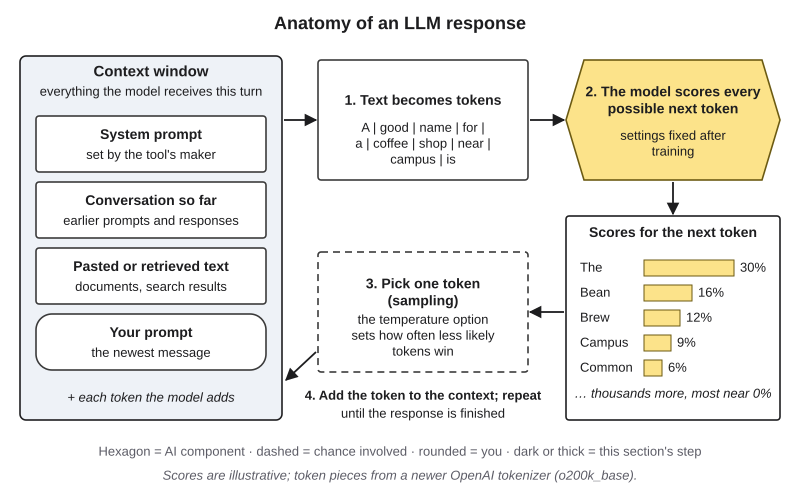{#fig-3-3 fig-alt="Complete anatomy: context window (system prompt, conversation, retrieved text, prompt) → tokens → model scores → sampling → loop back."}

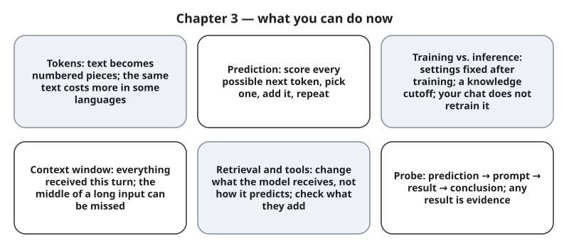{#fig-3-12 fig-alt="Six cards: tokens, prediction, training vs. inference, context window, retrieval and tools, probes."}

**The chapter's question:** *Does a language model know things, or does it predict text?* Mechanically, it predicts text, one token at a time, in four steps: split the text into tokens, score every possible next token, pick one, add it and repeat. Its scores come from settings adjusted during training, applied to whatever is in the context window. What looks like knowledge comes from patterns in the training text, from the context and from tools. Whether that adds up to "knowing" is a real debate, taken up in Chapter 23.

**Return to the Opening Case.** The reversal curse fits this picture. In the test with invented facts, training raised the scores in the trained direction only. For real celebrities, the researchers suggest the same cause: training text more often runs from celebrity to parent, so GPT-4 could often name a celebrity's mother but often not her famous child. Once the fact was in the context, the reverse question could be answered.

**Revisit your Warm-up.** (1) Does a model receive letters? *No:* it receives tokens, each a number. (2) Will your correction fix the model for everyone? *No:* inference does not change the settings; a correction stays in your conversation, and memory features only add text to later conversations. Some providers may use conversations to train a future version, depending on your account and options; that never changes the model you are talking to. (3) Is a searched answer correct? *Not necessarily:* retrieval changes what the model receives, and the sources and their use can still be wrong.

You can now:

- **Explain** how a response is produced: split into tokens, score every possible next token, pick one, add it and repeat, inside a context window.
- **Explain** training versus inference, the knowledge cutoff and why your chat does not retrain the model.
- **Judge** what a retrieved or tool-assisted answer still requires you to check.
- **Test** a model with a probe and record the evidence.
- **Complete** A2 Part 2 with Chapter 3 terms linked to Chapter 2.

### Key Terms {.unnumbered}

agent · attention (Deep) · context window · fine-tuning · inference (Ch. 2) · instruction tuning · knowledge cutoff · large language model · learning from human feedback · memory (product feature) · next-token prediction · option · pretraining · probability distribution · probe · reasoning tokens · retrieval (retrieval-augmented generation, RAG) · reversal curse · sampling (of tokens) · system prompt · temperature · token · tokenizer · tool use · Transformer (Deep)

## End-of-Chapter Package {.unnumbered}

<!-- Each item: objective · LO · revised Bloom level. Odd-numbered answers → Appendix E (handoff file); even-numbered → private/ch03-answers-even.md. Review A distractors draw on M1–M6 and the two meanings of sampling. -->

### Review Questions A: Terms and Concepts {.unnumbered}

1. *(O1 · LO1 · Understand)* How does a language model receive the word "strawberry" in a prompt?\
   (a) As ten letters, one after another.\
   (b) As one or more tokens, each represented by a number.\
   (c) As its letters, grouped into syllables.\
   (d) As a whole word that it looks up in a stored list of facts.
2. *(O1 · LO1 · Remember)* Define *token* and *tokenizer* in one sentence each.
3. *(O1 · LO1 · Understand)* Elif's Turkish abstract had fewer words than the English version but more tokens. Which explanation fits best?\
   (a) Turkish words are longer, so each one takes more time to process.\
   (b) The model receives Turkish text letter by letter, so every letter is a token.\
   (c) The tokenizer splits many Turkish words into several pieces, so the same content needs more tokens.\
   (d) Token counts are random and differ every time.
4. *(O1 · LO1 · Remember)* Put the four steps that produce each token in order: pick one token; score every possible next token; add the token and repeat; split the text into tokens.
5. *(O1 · LO1 · Understand)* You send the same prompt twice and get two different answers. Which statement is most accurate?\
   (a) The model malfunctioned the second time.\
   (b) The model used the first answer to improve the second.\
   (c) The model looked up the answer in two different databases.\
   (d) At each step a token is picked with some chance, so the two runs can follow different paths.
6. *(O1 · LO1 · Understand)* In one sentence each, explain what *sampling* means in Chapter 2 and in Chapter 3.
7. *(O1 · LO1 · Understand)* What does lowering the temperature option most likely do?\
   (a) It makes the highest-scoring tokens get picked more often.\
   (b) It makes the answer more accurate.\
   (c) It makes the model consider fewer facts.\
   (d) It makes the context window smaller.
8. *(O2 · LO1 · Remember)* What is a knowledge cutoff?
9. *(O2 · LO1 · Understand)* You correct a chat tool's mistake. A week later, in a new chat with memory turned off, it makes the same mistake. Why?\
   (a) The correction trained the model, but a new chat starts from an older copy.\
   (b) The model stored your correction as a fact, but only for your account.\
   (c) Correcting a model during inference does not change its settings.\
   (d) The model's knowledge is complete up to its cutoff, so it cannot accept new facts.
10. *(O1 · LO1 · Understand)* Which statement about the context window matches Liu et al. (2024)?\
    (a) In 2023 tests, information in the middle of a long input was used less reliably than information at the start or end.\
    (b) Anything that fits in the window is used equally well.\
    (c) Models skip the text in the middle of an input.\
    (d) In 2023 tests, versions with a larger window removed the problem.
11. *(O3 · LO3 · Understand)* A tool searched the web and shows two links. Which statement is most accurate?\
    (a) The answer is correct because it was searched.\
    (b) Retrieval retrained the model on the two pages, so the answer now reflects them exactly.\
    (c) The response copies the pages word for word.\
    (d) Retrieval changed what the model received; the pages, and the way the response uses them, can still be wrong.
12. *(O2 · LO1 · Understand)* Why is pretraining called self-supervised?
13. *(O3 · LO1 · Remember)* What does a calculator tool change in an AI system, and what does it not change?
14. *(O1 · LO1 · Remember)* Which of these is **not** usually part of the context window in a turn?\
    (a) The system prompt from the tool's provider.\
    (b) Your earlier prompts and the earlier responses in this chat.\
    (c) The model's settings (parameters).\
    (d) Text you pasted or a tool retrieved.
15. *(O2 · LO1 · Understand)* What does instruction tuning add after pretraining, and where do its examples come from?

### Review Questions B: Case Questions {.unnumbered}

1. *(O1 · LO1 · Apply)* A small company pays per token to translate and summarize its English help pages into Spanish, Turkish and Hindi with an AI tool. Using @fig-3-2, which language will likely cost the most for the same content, and why? What one number should the company check before choosing a tool?
2. *(O2 · LO1 · Apply)* A museum's chatbot, with no search, is asked about an exhibit that opened last month. It gives a confident description. Explain, using training and inference, what is likely happening and what the museum should change.
3. *(O3 · LO1, LO3 · Evaluate)* A search-then-generate tool tells a student: "The deadline to drop a course without a W (a withdrawal mark on the transcript) is the 12th class day [link: registrar's page]; most students drop by the 5th week [no link]; the late fee is $50 [link: a 2017 blog post]." Give each claim one of the five verdicts (supported, partly supported, unsupported, contradicted, cannot verify) and say what the student should do before acting.
4. *(O4 · LO1, LO3 · Apply)* Design a probe that tests whether a tool uses information in the middle of a long document. Write the prediction, the prompt plan and what result would change your mind.

### Review Questions C: Interpretive Questions {.unnumbered}

1. *(O3 · LO3 · Evaluate)* "If an AI tool shows its sources, I do not need to check its answer." Agree or disagree, using sections 3.4 and 3.5.
2. *(O1, O2 · LO1 · Evaluate)* Answer the chapter's question in your own words: does a language model know things, or does it predict text? Use the reversal curse in your answer.
3. *(O1 · LO1 · Evaluate)* Should AI providers charge the same price for the same content in every language, even though token counts differ? Take a position.

### Spaced Review {.unnumbered}

Come back to these a few days after reading, without looking back. They connect Chapter 3 to Chapters 1 and 2.

1. *(Chapter 1 · LO1 · Remember)* Name the three lanes from Chapter 1. Which lane matches retrieval in section 3.5?
2. *(Chapter 1 · LO1 · Understand)* Chapter 1 said that fluent is not the same as correct. Which of the four steps in section 3.2 explains why?
3. *(Chapter 2 · LO1 · Remember)* What is the difference between a *sample* and a *population*?
4. *(Chapter 2 · LO1 · Understand)* Chapter 2 described self-supervised learning. Where does it appear in this chapter, and what plays the role of the label?
5. *(Chapter 2 · LO1 · Understand)* Chapter 2 warned that large language models can repeat pieces of their training text. How does that fit with "a model is learned settings, not a store of facts"?

### Discussion Questions {.unnumbered}

1. *(Ethics · O1 · LO1 · Evaluate)* Token costs differ by language. Is that a technical detail or a fairness issue? Who is affected in your community?
2. *(Career · O3 · LO3 · Analyze)* In the job you want, which tasks would use a tool with retrieval, and what would you need to check every time?
3. *(Interdisciplinary · O2 · LO1 · Analyze)* A historian, a nurse and an accountant all need current information. How does the knowledge cutoff matter differently in each field?
4. *(Society · O1 · LO1 · Evaluate)* Should chat tools show users when they are sampling with a high temperature, or when a response comes only from the model's settings? What would change?
5. *(Learning · O4 · LO3 · Evaluate)* A probe that proves you wrong is still useful. Where else in your studies could a "prediction, test, conclusion" habit help you?

### Application Assignment: A2 Part 2 — Chapter 3 Terms {.unnumbered}

*(O5 · LO1 · Create)* **A2 lives in Chapter 2.** Its brief, its term pool for Chapter 2 and its single 10-point rubric are in Chapter 2's Application Assignment. Use that rubric; there is no second rubric here. **Due:** Monday, February 1, 2027, 11:59 p.m., on eLearning.

**Part 2 guidance (this chapter).** The finished map has **15 terms: at least 7 from Chapter 2** (Part 1) **and at least 5 from Chapter 3** (Part 2); the remaining terms may come from either pool. Bring your Part 1 draft to Thursday's lab. For each Chapter 3 term:

1. Write a **worked definition**: your own words plus one concrete example, as in section 3.6.
2. Draw at least one **labeled link to a Chapter 2 term**, such as "pretraining *is a kind of* self-supervised learning" or "inference *uses fixed* parameters." Each link must read as a true sentence.
3. **Verify** each definition against this chapter or a cited source, and note where you checked it.

Then, for the map as a whole:

4. The whole A2 needs **one corrected AI-generated definition**, in either part. If yours is a Chapter 3 term, use the chapter or a probe result as evidence.
5. Write **two sentences on which link was hardest to label and why** (start from the link you wrote down in the lab's exit step).
6. Update your **AI Use Declaration** (tools, purpose, what you accepted, rejected or revised, how you verified it, and where your judgment mattered).

**Term pool, Chapter 3** (the list of terms you may choose from): token · tokenizer · next-token prediction · probability distribution · sampling (of tokens) · temperature · pretraining · instruction tuning · learning from human feedback · knowledge cutoff · context window · system prompt · retrieval · tool use · agent. Any other Core Key Term of this chapter also counts. A term in both pools (for example, inference, a Chapter 2 term listed in this chapter's Key Terms) counts once. **Pool note:** use one sense per term; "sample" in Chapter 2 is not "sampling" in this chapter.

**Time:** about 20–30 minutes at home after Thursday's lab, within the 45–60 minutes A2 takes in all.

**Alternative assignment.** If you are doing Chapter 2's alternative (auditing the dated, AI-generated glossary on eLearning), that glossary includes the Chapter 3 pool terms. Audit at least 5 of them with the same steps, using your probe records or this chapter as the source for each correction. The same rubric applies.

### Mini-Project (optional): A Probe Diary {.unnumbered}

*(O4 · LO1, LO3 · Evaluate)* Over the next three weeks, run one probe a week on a tool you use for coursework: tokens, sampling, context, or cutoff and search. Record each probe in the four-part format, with the tool, model name and date. At the end, write half a page: what did your probes show about where this tool is reliable, and what changed over the three weeks? The diary can become a piece of your term portfolio (Chapter 20).

### Case Study Questions {.unnumbered}

1. *(O2 · LO1 · Remember)* In the reversal-curse study, what were the two tests, and what was the main result of each?
2. *(O2 · LO1 · Understand)* Why did the researchers use invented facts in the first test?
3. *(O1 · LO1 · Analyze)* Which parts of the anatomy of a response (@fig-3-3) explain the reversal curse, and which part explains why the reversal worked when the fact was in the prompt?
4. *(O1 · LO1 · Analyze)* The reversal curse and "lost in the middle" both involve information the model did not use. What is different about where the information was?
5. *(O3, O4 · LO3 · Evaluate)* Design a short check you would run before relying on a chat tool for a reverse lookup in your field (for example, "which drug has this brand name?").

## Further Reading and Compass Links {.unnumbered}

- Reading R1 (recommended this week): Wolfram (2023), the section "It's Just Adding One Word at a Time" (about 10 to 15 minutes).
- Berglund et al. (2024): the reversal-curse paper; the introduction and the celebrity test are readable without the mathematics.
- Liu et al. (2024): "Lost in the middle," with clear figures of the U-shaped pattern.
- Petrov et al. (2023): how tokenizers treat languages unequally, with a table for many languages.
- Ouyang et al. (2022): how instruction tuning and human feedback turned a text-continuing model into an assistant.
- Vaswani et al. (2017): the original Transformer paper (Deep; technical).
- *In Compass (optional): interactive Anatomy of an LLM Response (@fig-3-3); token explorer; Chapter 3 quiz; Lab 3.1–3.3 pages.*

## References {.unnumbered}

Anthropic. (2024, December 19). *Building effective agents*. https://www.anthropic.com/engineering/building-effective-agents

Bai, Y., Kadavath, S., Kundu, S., Askell, A., Kernion, J., Jones, A., Chen, A., Goldie, A., Mirhoseini, A., McKinnon, C., Chen, C., Olsson, C., Olah, C., Hernandez, D., Drain, D., Ganguli, D., Li, D., Tran-Johnson, E., Perez, E., … Kaplan, J. (2022). *Constitutional AI: Harmlessness from AI feedback* (arXiv:2212.08073). arXiv. https://arxiv.org/abs/2212.08073

Berglund, L., Tong, M., Kaufmann, M., Balesni, M., Stickland, A. C., Korbak, T., & Evans, O. (2024). The reversal curse: LLMs trained on "A is B" fail to learn "B is A". In *The Twelfth International Conference on Learning Representations (ICLR 2024)*. https://arxiv.org/abs/2309.12288

Carlini, N., Tramèr, F., Wallace, E., Jagielski, M., Herbert-Voss, A., Lee, K., Roberts, A., Brown, T., Song, D., Erlingsson, Ú., Oprea, A., & Raffel, C. (2021). Extracting training data from large language models. In *Proceedings of the 30th USENIX Security Symposium* (pp. 2633–2650). USENIX Association. https://www.usenix.org/conference/usenixsecurity21/presentation/carlini-extracting

Cheng, J., Marone, M., Weller, O., Lawrie, D., Khashabi, D., & Van Durme, B. (2024). Dated data: Tracing knowledge cutoffs in large language models. In *Proceedings of the Conference on Language Modeling (COLM 2024)*. https://arxiv.org/abs/2403.12958

Fu, T., Ferrando, R., Conde, J., Arriaga, C., & Reviriego, P. (2024). *Why do large language models (LLMs) struggle to count letters?* (arXiv:2412.18626). arXiv. https://arxiv.org/abs/2412.18626

Hoffmann, J., Borgeaud, S., Mensch, A., Buchatskaya, E., Cai, T., Rutherford, E., de Las Casas, D., Hendricks, L. A., Welbl, J., Clark, A., Hennigan, T., Noland, E., Millican, K., van den Driessche, G., Damoc, B., Guy, A., Osindero, S., Simonyan, K., Elsen, E., … Sifre, L. (2022). Training compute-optimal large language models. In *Advances in Neural Information Processing Systems 35*. https://arxiv.org/abs/2203.15556

Kaplan, J., McCandlish, S., Henighan, T., Brown, T. B., Chess, B., Child, R., Gray, S., Radford, A., Wu, J., & Amodei, D. (2020). *Scaling laws for neural language models* (arXiv:2001.08361). arXiv. https://arxiv.org/abs/2001.08361

Levesque, H. J., Davis, E., & Morgenstern, L. (2012). The Winograd schema challenge. In *Proceedings of the Thirteenth International Conference on Principles of Knowledge Representation and Reasoning (KR 2012)*. AAAI Press. https://aaai.org/ocs/index.php/KR/KR12/paper/view/4492

Lewis, P., Perez, E., Piktus, A., Petroni, F., Karpukhin, V., Goyal, N., Küttler, H., Lewis, M., Yih, W., Rocktäschel, T., Riedel, S., & Kiela, D. (2020). Retrieval-augmented generation for knowledge-intensive NLP tasks. In *Advances in Neural Information Processing Systems 33*. https://papers.nips.cc/paper/2020/hash/6b493230205f780e1bc26945df7481e5-Abstract.html

Liu, N. F., Lin, K., Hewitt, J., Paranjape, A., Bevilacqua, M., Petroni, F., & Liang, P. (2024). Lost in the middle: How language models use long contexts. *Transactions of the Association for Computational Linguistics, 12*, 157–173. https://doi.org/10.1162/tacl_a_00638

OpenAI. (2024, September 12). *Learning to reason with LLMs*. https://openai.com/index/learning-to-reason-with-llms/

OpenAI. (n.d.). *Reasoning models* [API documentation]. Retrieved October 18, 2026, from https://developers.openai.com/api/docs/guides/reasoning

Ouyang, L., Wu, J., Jiang, X., Almeida, D., Wainwright, C. L., Mishkin, P., Zhang, C., Agarwal, S., Slama, K., Ray, A., Schulman, J., Hilton, J., Kelton, F., Miller, L., Simens, M., Askell, A., Welinder, P., Christiano, P., Leike, J., & Lowe, R. (2022). Training language models to follow instructions with human feedback. In *Advances in Neural Information Processing Systems 35*. https://arxiv.org/abs/2203.02155

Petrov, A., La Malfa, E., Torr, P. H. S., & Bibi, A. (2023). Language model tokenizers introduce unfairness between languages. In *Advances in Neural Information Processing Systems 36*. https://arxiv.org/abs/2305.15425

Schick, T., Dwivedi-Yu, J., Dessì, R., Raileanu, R., Lomeli, M., Hambro, E., Zettlemoyer, L., Cancedda, N., & Scialom, T. (2023). Toolformer: Language models can teach themselves to use tools. In *Advances in Neural Information Processing Systems 36*. https://arxiv.org/abs/2302.04761

Şeker, Ş. E. (2024). *Experiences and challenges in AI-driven modular software development using large language models for code generation* [Unpublished manuscript; earlier version of Şeker & Nizam-Özoğur, 2026]. Faculty of Computer and Information Technologies, Istanbul University.

Şeker, Ş. E., & Nizam-Özoğur, H. (2026). Enhancing software development with large language models: A case study of Kolay.ai. *Electrica, 26*, Article 0033, 1–10. https://doi.org/10.5152/electrica.2026.25033

Sennrich, R., Haddow, B., & Birch, A. (2016). Neural machine translation of rare words with subword units. In *Proceedings of the 54th Annual Meeting of the Association for Computational Linguistics (Volume 1: Long Papers)* (pp. 1715–1725). https://doi.org/10.18653/v1/P16-1162

United Nations. (1948). *Universal Declaration of Human Rights* [Translations in the Unicode UDHR collection, via the NLTK udhr2 corpus]. https://www.ohchr.org/en/human-rights/universal-declaration/translations

Vaswani, A., Shazeer, N., Parmar, N., Uszkoreit, J., Jones, L., Gomez, A. N., Kaiser, Ł., & Polosukhin, I. (2017). Attention is all you need. In *Advances in Neural Information Processing Systems 30* (pp. 5998–6008). https://papers.nips.cc/paper/2017/hash/3f5ee243547dee91fbd053c1c4a845aa-Abstract.html

Wolfram, S. (2023). *What is ChatGPT doing … and why does it work?* Wolfram Media.
