# Framing Tasks and Iterating Prompts {#sec-ch05}

<!-- Status: v2 (2026-10-18), chapter agent, stage 5 (revision after four independent reviews; see docs/editorial/ch05-dev-memo.md). From blueprint v0.2 (approved under D19). Featured student: Lucía only (docs/characters.md); other people are unnamed. Figures: figures/scripts/ch05_figures.py (Signatures 6 and 7 introduced here) and ch05_charts.py (published values in data/ch05_wording.csv and data/ch05_delegation.csv). All of Lucía's prompts and outputs are constructed examples. Klarna facts carry attribution tiers: confirmed (Klarna's own documents), reported (named outlet), inferred (the book's reading). -->

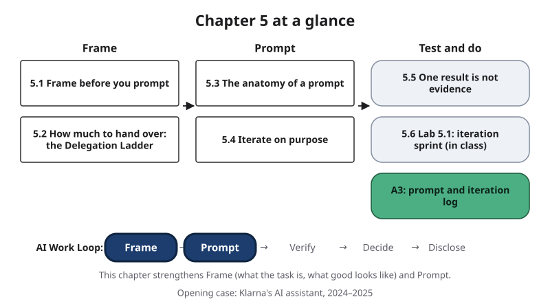{#fig-5-1 fig-alt="Chapter map: Frame (5.1, 5.2), Prompt (5.3, 5.4), Test and do (5.5, Lab 5.1, A3); Work Loop strip with Frame and Prompt highlighted."}

**Chapter 5 at a glance.** Part I of this book explained what artificial intelligence (AI) tools are and how they work. Part II is about working with them.

This chapter covers the first two decisions of the AI Work Loop from Chapter 1. **Frame:** what is the task, what does a good result look like, and which parts should AI do at all? **Prompt:** what does the tool need to receive, and how do you improve a prompt on purpose instead of by luck?

**Time:** at 150 words per minute, about 32 minutes for the Core sections (5.1 to 5.5) and about 53 minutes for the whole Core package (adding section 5.6, the Opening Case, the Summary, the Lab 5.1 page and the A3 brief); longer if English is not your first language. Assignment A3 then takes about 60 to 70 minutes at home (see its brief), and the Your Turn in 5.3 about 5 minutes; the Your Turns in 5.1 and 5.2 are done in the Lab 5.1 session. The AI Fluency course module in Further Reading is recommended, not required. Worked examples show every step, faded examples leave some steps for you (each has a hint; answers are in Appendix E), and Your Turn and Check Yourself boxes are ungraded practice.

**The question of this chapter:** *Is getting good results from AI mainly a matter of finding the right words?* Keep your answer in mind. The Chapter Summary returns to it.

## Opening Case: By Klarna's Own Measures {.unnumbered}

Klarna is a Swedish payments company. It offers "buy now, pay later" plans, which let shoppers pay for a purchase in several smaller payments. Its customers contact it with questions about payments, refunds and returns. In February 2024 it launched an AI assistant, built with OpenAI's technology, to answer customer-service chats.

On February 27, 2024, the company announced the assistant's first month. According to Klarna, the assistant had handled 2.3 million conversations, two-thirds of all its customer-service chats. The company said this was the work of 700 full-time agents, meaning human customer-service staff.

It said customers now solved their problems in under 2 minutes instead of 11, and that their satisfaction scores were about the same as with human agents. It also said the assistant resolved problems more accurately, which it said led to 25% fewer repeat questions. It expected the assistant to improve its profit by about $40 million in 2024, and customers could still choose to talk to a person (Klarna, 2024).

Read those numbers carefully. Every one of them is the company's own, and no independent study of them is cited here. A press release reports what a company chose to measure and chose to share.

That does not make the numbers false. It means you know whose measures they are.

By the measures Klarna chose (volume, speed, cost, a satisfaction score, and a claim of more accurate resolution shown by fewer repeat questions), the assistant worked. Here is the question this chapter asks: **were those the right measures?**

About fifteen months later, the company's account changed. In May 2025, Klarna's chief executive, Sebastian Siemiatkowski, gave an interview to Bloomberg. As a customer-service trade publication reported it, he said that cost had been too dominant a factor when the company organized this work, and that the result was lower quality (Fisher, 2025).

Another outlet reported him saying that customers must know they can always reach a human if they want one, and that Klarna was hiring people for customer service in fully remote roles (Shibu, 2025). These statements are reported second-hand; the interview itself is behind a paywall. <!-- Bloomberg not read (paywall); statements attributed to Fisher (2025) and Shibu (2025), which were read. -->

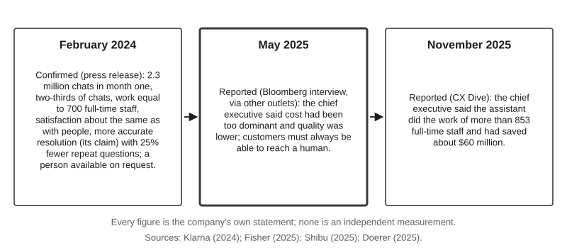{#fig-5-5 fig-alt="Three dated panels: Feb 2024 company figures; May 2025 chief executive, as reported: cost too dominant, lower quality; Nov 2025 savings claims."}

Notice what did not change. Nothing in the 2024 announcement says the assistant failed at what it was set up to do. It answered chats, quickly, in large numbers. What changed was the company's own account of what "working" should have meant.

That is the puzzle. If a system does what it was set up to do, and the people who set it up later say the result was not good enough, where did things go wrong? By the end of section 5.2 you will be able to answer with two ideas: how a task's **success criteria** are chosen, and **where the human check sits** when a task is handed to AI. The Case Study returns to Klarna with both ideas and with what was reported later in 2025.

## Learning Objectives {.unnumbered}

Framework tags refer to the AI Fluency framework (Dakan & Feller, 2025) and the UNESCO (United Nations Educational, Scientific and Cultural Organization) AI Competency Framework for Students.

After this chapter you will be able to:

- **O1 — Apply** the Frame step to a real task: its goal, its audience, three to five checkable success criteria, its limits, and what stays with you. *(LO2 · AI Fluency: Delegation, Description · UNESCO: Human-centred mindset, Apply)*
- **O2 — Justify** which way of working with AI (automation, augmentation, agency) or no AI at all fits each part of a task. *(LO2 · AI Fluency: Delegation · UNESCO: Human-centred mindset, Apply)*
- **O3 — Construct** a prompt from the parts its task needs: role, task, context, constraints, in-context examples and output format. *(LO2 · AI Fluency: Description · UNESCO: AI techniques and applications, Apply)*
- **O4 — Diagnose** a weak output by tracing it to a missing or unclear part of the prompt or of the frame. *(LO2 · AI Fluency: Description, Discernment)*
- **O5 — Judge** whether the evidence supports the claim "this prompt works." *(LO2, LO3 · AI Fluency: Discernment · UNESCO: AI techniques and applications, Apply)*
- **O6 — Produce** assignment A3, a documented prompt and iteration log. *(LO2, LO4 · AI Fluency: Diligence, Description)*

::: {.callout-note title="Warm-up (ungraded)"}
1. Have you ever reworded a prompt until it "worked"? How did you know it worked?
2. Does saying *please* to a chat tool change the quality of its answers?
3. If a prompt gives you a good answer once, will it give you a good answer again?

You will revisit your answers in the Chapter Summary.
:::

## 5.1 Frame Before You Prompt {#sec-5-1 .unnumbered}

[Core]{.path}

*Featuring Lucía, an accounting sophomore.*

Whether the task is a lab report, a marketing post, a lesson plan or a budget, most people start using AI by typing. Start one step earlier. Before the first prompt, write a **task frame**: a short statement of a task's goal, audience, success criteria, limits and what stays with you, written before the first prompt.

The frame matters because of one part in particular. **Success criteria** are checks, written in advance, that an output must pass to count as good; each can be scored met, partly met or not met. Without them, "it worked" means "it looked fine to me at the time." With them, every version of a prompt can be scored against the same checks.

AI providers' own guides agree. One assumes you have defined success, and a way to test for it, before you write a prompt (Anthropic, n.d.-b); another recommends tests that measure a prompt's behavior as you change it (OpenAI, n.d.).

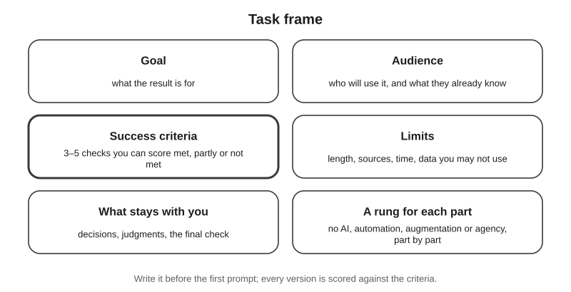{#fig-5-2 fig-alt="Six boxes: goal, audience, success criteria (3–5 checkable checks), limits, what stays with you, and a rung for each part (added in 5.2)."}

A good criterion is **checkable**. "Under 350 words" is: you can count. "Clear" is not, until you say clear to whom. Three to five criteria are usually enough; with more, you will stop scoring them.

The sixth box in the figure, a *rung* for each part, comes from section 5.2: it records which parts of the task you hand to AI, and in which way. The lowest level, the *floor*, means doing a part without AI.

Now return to the Opening Case. This book reads Klarna's story as a framing problem, a reading Klarna itself has not offered. The company announced volume, speed, cost and one satisfaction score that it reported itself (Klarna, 2024). It also claimed more accurate resolution, citing fewer repeat questions, but published no direct count of problems actually solved, or of customers who wanted a person and reached one.

In 2025, the chief executive was reported as saying cost had been too dominant and quality had suffered (Fisher, 2025). In other words, the success criteria a team chooses decide what "the system worked" means. A criterion nobody wrote down is a criterion nobody checks.

::: {.callout-note title="Worked Example: Lucía Frames a Handout"}
**Field:** Business and accounting. *Constructed example.*

The accounting students' association asks Lucía to prepare a one-page handout for a 30-minute workshop on budgeting for first-year students. The request, as she received it, was "something about budgeting for freshmen" (first-year students).

**Her task frame:**

- **Goal:** help first-year students draft their first monthly budget during the workshop.
- **Audience:** first-year university students. Many are managing money alone for the first time; some work part-time; some are international students.
- **Success criteria:** (C1) fits one page, under 350 words; (C2) every number in the example comes from the figures the association gave, and the totals add up; (C3) plain language a first-year student can follow without a dictionary; (C4) one worked example as a table with a total row; (C5) no product, bank or app is named.
- **Limits:** no statistics unless they come from a source she supplies; use the association's constructed example figures; no information about any real student.
- **What stays with her:** choosing what first-year students need to know, checking every number, the final edit, and deciding whether the association hands it out.

"Freshmen" became a described audience, and "good" became five checks she can score.
:::

::: {.callout-note title="Faded Example: A Lab-Safety Summary"}
**Field:** Natural science (biology).

A biology student who leads a research lab group must give two new members a summary of the lab's safety rules before their first session.

- **Goal:** new members know the rules that apply in their first week.
- **Audience:** two undergraduates who have taken intro biology but have never worked in this lab.
- **Success criteria:** (C1) every rule in the summary appears in the lab's official safety sheet; (C2) _______________________; (C3) _______________________.
- **Limits:** _______________________
- **What stays with the student:** _______________________

*Hint:* look at Lucía's C1 (length) and C4 (format), and ask what the student must still decide or check personally.
:::

::: {.callout-important title="Your Turn"}
In Lab 5.1 (step 2) you will write a frame card for a task from your major that you might do with AI this month: goal, audience, three to five checkable criteria, limits, and what stays with you. Choose the task now, and mark any criterion you could not actually check.
:::

::: {.callout-tip title="Check Yourself 5.1"}
1. What are the five parts of a task frame (before the rung is added in 5.2)?
2. Rewrite "the summary should be clear" as a criterion you could check.
3. Why should success criteria be written before the first prompt, not after?
:::

## 5.2 How Much to Hand Over: The Delegation Ladder {#sec-5-2 .unnumbered}

[Core]{.path}

A frame also says which parts of a task AI should do, and how. The AI Fluency framework by two professors, Rick Dakan and Joseph Feller, calls this competency **Delegation**: deciding when and how to use AI, and in which way. The framework's competencies start from whether to use AI at all (Dakan & Feller, 2025). The framework identifies three ways, which it calls modalities, of working with AI:

- **Automation**: working with AI in which the AI carries out a task you define, and you check the output. Emails and summaries are typical.
- **Augmentation**: working with AI in which you and the AI shape and carry out the task together, turn by turn. Essays and research papers developed with AI as a thinking partner are typical.
- **Agency**: working with AI in which you configure it to carry out future tasks on your behalf, including for other people. Course chatbots and tutors that others will use are typical. (*Agency* here means acting on someone's behalf, not a marketing agency.)

This book draws the three as a **Delegation Ladder**. It is the book's arrangement of three ways of working with AI over a floor of no AI, ordered by how hard it is to check what the AI contributed before it takes effect. The order follows the framework's own numbering, but the ladder, its floor and its axis are this book's construction.

The framework ranks none of the modalities and notes that real work often mixes them. It also warns that agency needs a good grasp of what AI can and cannot do (Dakan & Feller, 2025).

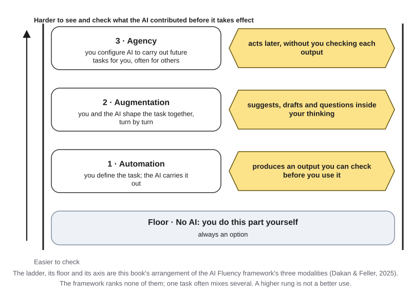{#fig-5-3 fig-alt="Delegation Ladder: floor no AI; rungs automation, augmentation, agency; arrow: harder to check what the AI contributed before it takes effect."}

Why that axis? With automation, the output is a separate thing, such as an email, that you can check before you use it. With augmentation, the AI's suggestions enter your thinking turn by turn, so it is harder to say afterward which ideas were yours.

With agency, the AI acts later, often for other people, and by default nobody sees each output before it reaches them. A higher rung is not a more advanced use; it needs more checking.

**Where the human check sits** means the point at which a person looks at an AI output before it takes effect: before an email is sent, or before a customer reads an answer. At the automation rung, the check usually sits with you. At the agency rung, there is none unless someone designs one. A design can add such a check, which Chapter 14 calls an *approval gate*, without changing the rung: the AI still acts on your behalf, but a person sees each output first.

**Hand over parts, not whole tasks.** The framework's Delegation competency includes "Goal and Task Awareness": breaking a task into AI, human and collaborative parts (Dakan & Feller, 2025). Most real tasks have parts that belong on different rungs, and some parts that belong on the floor.

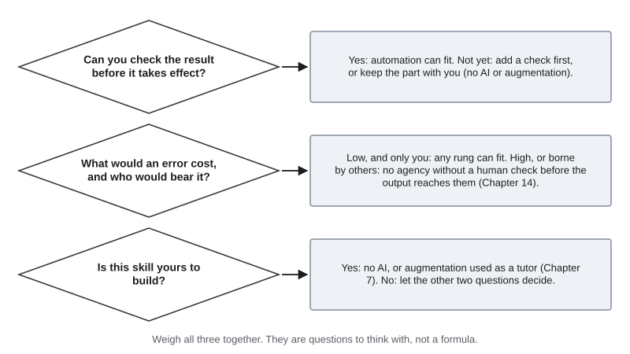{#fig-5-4 fig-alt="Three questions: can you check it first; what would an error cost and who bears it; is this skill yours to build. Each points to rungs."}

Three questions help you place a part:

1. **Can you check the result before it takes effect?** If yes, automation can fit. If not yet, add a check first, or keep the part with you.
2. **What would an error cost, and who would bear it?** If an error is cheap and only you bear it, any rung can fit. If it is costly, or borne by other people, do not use agency without a human check before the output reaches them.
3. **Is this skill yours to build?** If the point of the task is that you learn to do it, as in most coursework, keep it on the floor or use augmentation in a tutor style (Chapter 7). Otherwise, let the other two questions decide.

::: {.callout-warning title="Agency is not an agent"}
In the AI Fluency framework, *agency* is a way of working: you configure AI to carry out future tasks on your behalf (Dakan & Feller, 2025). An **agent** is a kind of system: one in which the model directs its own steps and tool use (Anthropic, 2024; Chapter 3). A course chatbot that answers questions from a fixed set of instructions is agency without being an agent. Sections 6.5 and 7.5, and Chapter 14, come back to this difference.
:::

::: {.callout-note title="Worked Example: Lucía's Handout, Part by Part"}
**Field:** Business and accounting. *Constructed example.*

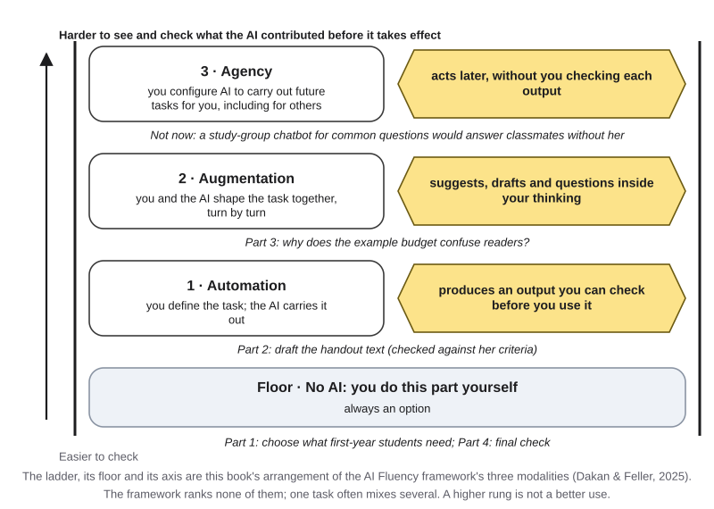{#fig-5-3b fig-alt="Ladder with Lucía's parts: floor, choose content and final check; automation, draft; augmentation, why the example confuses; agency, not now."}

- **Part 1, choose what first-year students need to know: floor.** It is her judgment about her audience.
- **Part 2, draft the handout text: automation.** She can check the draft against her criteria before anyone sees it.
- **Part 3, work out why the example budget confuses readers: augmentation.** She talks it through with a tool, turn by turn, and keeps the decision.
- **Part 4, final check: floor.** She checks every number herself.

A committee member also suggests a study-group FAQ (frequently asked questions) chatbot that would answer classmates' money questions at any hour. That would be **agency**: it would answer other people later, with no check before each answer, and they would bear any error. She decides "not now" until there is a fixed source of answers and a way to check them (Chapter 14).
:::

::: {.callout-note title="Faded Example: An Archive Visit Report"}
**Field:** History.

A history student writes a report on a visit to a city archive, for a seminar.

- (a) Type up handwritten notes from the visit: **automation**, because each typed line can be compared with the notes.
- (b) Decide which three documents matter for the argument: **floor**, because choosing evidence is the skill the seminar assesses.
- (c) Find a clearer way to explain why a 1910 letter contradicts a newspaper report: _______________________ because _______________________.
- (d) The archive asks whether students would help set up a public chatbot that answers visitors' questions: _______________________ because _______________________.

*Hint:* for (c), ask whether the student keeps the thinking; for (d), ask who would bear an error.
:::

::: {.callout-important title="Your Turn"}
In Lab 5.1 (step 2), split the task you chose into three or four parts and place each on the ladder, or on the floor, with one reason from the three questions.
:::

::: {.callout-tip title="Check Yourself 5.2"}
1. A nursing student wants AI to turn her own lecture notes into flashcards for an exam. Place this part on the ladder and give your reason from one of the three questions.
2. Why does this book place agency at the top of the ladder? Answer with the ladder's axis, not with "more advanced."
3. Why is a configured course chatbot an example of agency but not necessarily an agent?
:::

## 5.3 The Anatomy of a Prompt {#sec-5-3 .unnumbered}

[Core]{.path}

Now you can write the prompt. The **anatomy of a prompt** is the book's six-part description of what a prompt can contain: role, task, context, constraints, in-context examples and output format. Google's prompting guide for its workplace tools, for example, names persona, task, context and format, and notes that you do not need all of them every time (Google, 2024).

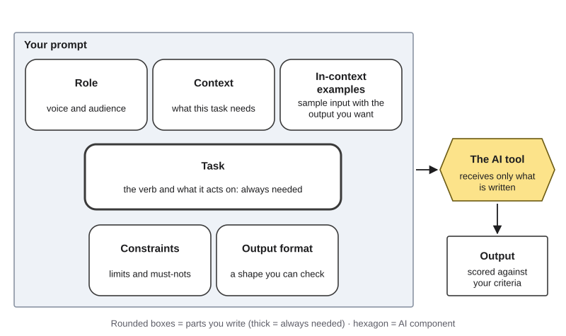{#fig-5-6 fig-alt="Six rounded boxes in Your prompt: role, context, in-context examples, task (thick), constraints, output format; arrow to AI tool, then output."}

- **Task**: what you want done, an action and what it acts on. It is the one part every prompt needs: "Draft a one-page handout," "Rewrite this question," "List the three main risks."
- **Role**: the voice or perspective the output takes, such as "write as a peer mentor." Who will read the output belongs in the context. A role shapes tone and vocabulary, but do not expect it to make answers more accurate. One study tested four families of openly released models on 2,410 factual questions. Adding a persona to the system prompt, such as "you are a helpful assistant" or an occupational role, did not improve accuracy overall compared with no persona (Zheng et al., 2024).
- **Context**: the background a task needs that the tool cannot otherwise receive, such as figures, readers or source text. Recall Chapter 3: the **context window** is the space for everything a language model receives in one turn. What is in your head, or in last week's chat, is not there unless you put it there. A **memory** feature can also add text without your seeing it: a product feature that saves notes about a user, or draws on past chats, and adds them to later conversations. Chapter 6 covers choosing and arranging context.
- **Constraints**: a limit or a must-not in a prompt, such as a length, a source rule or an excluded topic. A "do not" line is still text the model receives. In one study published in 2023, a prompt telling a chatbot not to say a particular sentence was followed by output containing that sentence, to the surprise of the people who wrote it (Zamfirescu-Pereira et al., 2023). Where you can, say what to do as well as what not to do, and check the result.
- **In-context examples**: an **in-context example** is a sample input with the output you want, placed in a prompt to show the pattern. For instance: "Question: *Don't you agree the fee is unfair?* → Neutral version: *How fair or unfair do you find the fee?*" A model can follow a pattern shown this way without any change to its parameters, the learned settings from Chapter 2. No retraining is involved (Brown et al., 2020). Chapter 6 covers choosing and testing in-context examples.
- **Output format**: the shape the output should take, such as a table, a list or a word limit, chosen so it can be checked against your criteria.

**More is not always better.** Each part should serve the task. Irrelevant material can make results worse: a published test found that adding unrelated sentences to math word problems lowered models' accuracy (Shi et al., 2023; Chapter 6 gives the numbers). Leave out parts the task does not need.

::: {.callout-note title="Two meanings: example and context"}
In Chapter 2, an **example** is one item in a dataset, such as one photo or one email. In this chapter, an **in-context example** is a sample input with its desired output, placed in a prompt. In Chapter 3, the **context window** is everything the model receives in one turn.

In this chapter, **context** is one part of your prompt: the background this task needs. Your context is one of the things inside the context window.
:::

::: {.callout-note title="Worked Example: Lucía's First and Final Prompts"}
**Field:** Business and accounting. *Constructed example.*

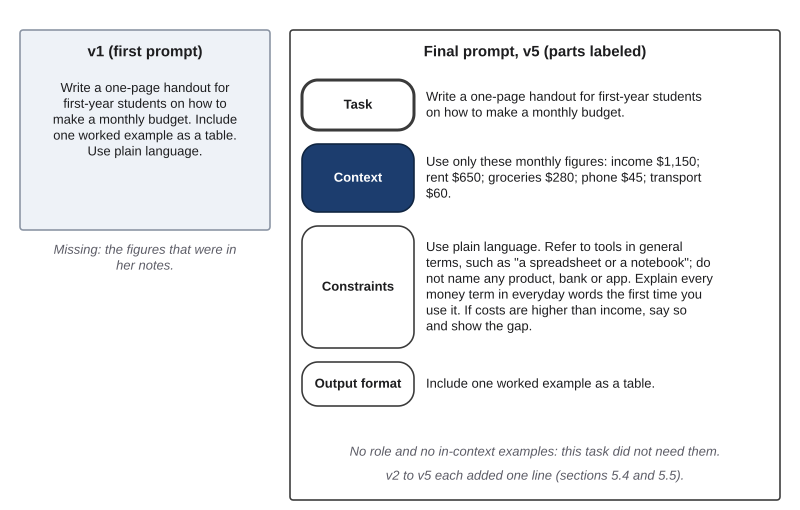{#fig-5-7 fig-alt="Left: v1, a three-sentence prompt. Right: her final prompt, v5, with labeled parts: task, context with the figures, constraints, output format."}

**v1**, Lucía's first prompt, written from her frame card:

```
Write a one-page handout for first-year students on how to make a
monthly budget. Include one worked example as a table. Use plain language.
```

It has a task, a format and a length. But two runs produced an example budget with income and rent figures she never gave, and a total row that did not match its items.

Here is her **final prompt (v5)**, with its parts labeled. Sections 5.4 and 5.5 show how she got there, one change at a time.

```
Task: Write a one-page handout for first-year students on how to make
a monthly budget.
Context: Use only these monthly figures: income $1,150; rent $650;
groceries $280; phone $45; transport $60.
Constraints: Use plain language. Refer to tools in general terms, such
as "a spreadsheet or a notebook"; do not name any product, bank or app.
Explain every money term in everyday words the first time you use it.
If costs are higher than income, say so and show the gap.
Output format: Include one worked example as a table.
```

Two parts are missing on purpose. She has no **role** line, because the handout's voice needed no special setting. She has no **in-context examples**, because the format line already shows the shape and she has no sample handout she wants copied.
:::

::: {.callout-note title="Faded Example: A Lab-Report Abstract"}
**Field:** Engineering.

```
Role: Write as the student team that ran the experiment.
Task: Draft a 150-word abstract of the attached lab report on beam
deflection.
Context: Readers are engineering faculty who will skim the abstract.
The report is pasted below; the key result is in Table 2.
Constraints: _______________________
Output format: _______________________
```

*Hint:* which number must the abstract get exactly right, and what shape lets a reader find it fast?
:::

::: {.callout-important title="Your Turn"}
Take a prompt you used this week. Label each sentence with its part. Then cross out one part the task did not need, and add one part it did need.
:::

::: {.callout-tip title="Check Yourself 5.3"}
1. Which part of a prompt is always needed, and why?
2. What did Zheng et al. (2024) find about adding a persona to prompts for factual questions?
3. Why does a fact "in your head" not reach the model? Use Chapter 3's idea of the context window.
:::

## 5.4 Iterate on Purpose {#sec-5-4 .unnumbered}

[Core]{.path}

Before you read on, make a prediction. Two prompts differ only in their first words: *Please answer the following question* and *I order you to answer the following question*. Each is used on 198 hard, multiple-choice science questions, and each question is asked 100 times.

Which prompt gets more questions right? Write your guess down.

A team from the Wharton School of the University of Pennsylvania ran this test with two OpenAI models released in 2024, GPT-4o and GPT-4o mini (Meincke et al., 2025a). The questions came from a **benchmark**, a standard test used to compare models; these were graduate-level questions in biology, physics and chemistry. For GPT-4o, *please* and *I order you* made no difference overall.

But on single questions the results changed a lot between the two wordings, in both directions. A follow-up report from the same team found that offering the model a tip, or threatening it, generally made no significant difference to benchmark scores either (Meincke et al., 2025c).

Wording can still matter a lot. In a study published in 2023, changing only the formatting of a prompt, such as spacing or punctuation, moved the accuracy of LLaMA-2-13B, a model whose settings Meta released openly, by up to 76 percentage points on some tasks. The effect remained in larger and instruction-tuned models (Sclar et al., 2024).

So wording effects are real, hard to predict, and different from question to question. Do not trust a trick. Test.

**Iteration** is improving a prompt by changing one thing at a time, predicting the effect, rerunning and scoring the result against your success criteria. It has seven steps.

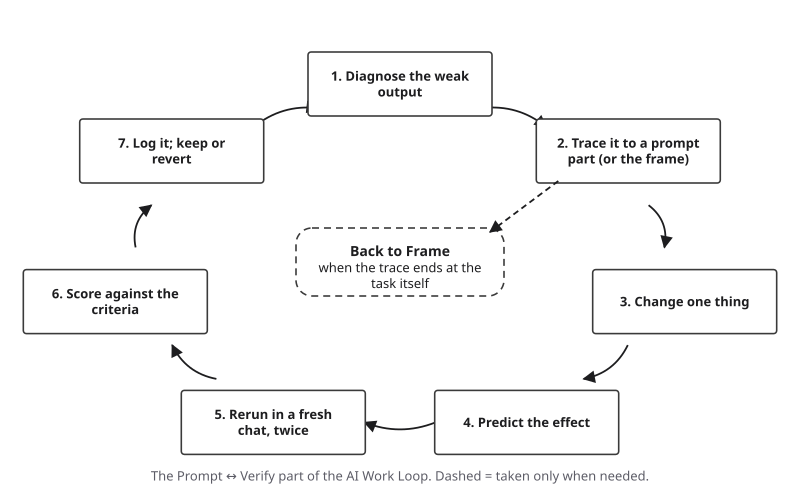{#fig-5-8 fig-alt="Seven steps in a loop: diagnose, trace to a part or the frame, change one thing, predict, rerun twice, score, log; dashed exit back to Frame."}

1. **Diagnose** the weak output: which criterion did it miss?
2. **Trace** the miss to a part of the prompt, or to the frame.
3. **Change one thing.** If you change three things and the output improves, you will not know which change helped.
4. **Predict** the effect before you run it.
5. **Rerun** at least twice, each time in a **fresh, temporary chat**: a new conversation that carries no earlier messages and, where the tool allows, is not saved to memory. Outputs vary from run to run (Chapter 3). A follow-up in the same chat keeps earlier turns in the context window, so it is not a clean test.
6. **Score** each output against your criteria.
7. **Log** it, then keep the change or revert it.

**Ask "why?" more than once.** The first answer is often only a symptom. If the trace ends at the task itself (an unclear goal, an undecided audience), go back to Frame instead of rewording. Sometimes the honest answer is that this part belongs on the floor.

::: {.callout-note title="Worked Example: Tracing Lucía's v1"}
**Field:** Business and accounting. *Constructed example.*

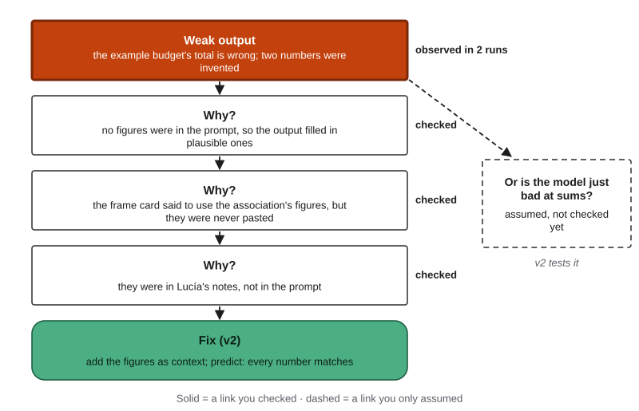{#fig-5-9 fig-alt="Chain: wrong total and invented numbers → no figures in prompt → frame said use them → left in notes → fix v2. Dashed side: bad at sums?"}

Let's take Lucía's v1. It missed C2 in both runs: invented numbers and a wrong total.

Why? No figures were in the prompt, so the output filled in plausible ones. Why?

Her frame card said to use the association's figures, but she never pasted them. Why? They were in her notes, not in the prompt.

She checked each link: the prompt really had no figures, and the frame card really said to use them.

A second explanation, "the model is just bad at sums," was only an assumption. Her v2 tests it: if the totals are still wrong when the figures are given, that explanation gains weight.

**Her log** (each row is one change; the template is in section 5.6):

- **v2 = v1 + the figures.** Changed: context (pasted "Use only these monthly figures: …"). Prediction: every number matches. Result: run 1 met all five criteria; run 2 used the right numbers but named a budgeting app (C5 not met). Keep.
- **v3 = v2 + a product rule.** Changed: a constraint ("Refer to tools in general terms … do not name any product, bank or app"). Prediction: no product named, nothing else changes. Result: run 1 met all five; run 2 met four and partly met C3, using "discretionary spending" without explaining it. Keep.

Section 5.5 shows the rest: a change to the frame itself, v4 and v5.
:::

::: {.callout-note title="Faded Example: A Museum Exhibit Label"}
**Field:** Arts. *Constructed example.*

A student intern drafts a wall label for a painting. Criteria: (C1) under 60 words; (C2) only facts from the curator's notes; (C3) readable for visitors aged 12 and up.

- **v2.** Changed: context (pasted the curator's notes). Prediction: no invented facts. Result: run 1 met all; run 2 added "restored in 1987," which is not in the notes (C2 not met). Keep, and fix C2 next.
- **v3.** Changed: a constraint ("Use only facts in the notes; if something is not in them, leave it out"). Prediction: C2 met. Result: C2 met in both runs; both labels were about 85 words (C1 not met). Keep.
- **v4.** Changed: _______________________ Prediction: _______________________

*Hint:* C1 is now the only miss. Which part of the prompt controls length?
:::

::: {.callout-important title="Your Turn"}
In Lab 5.1 you will write v1 to v3 of your own prompt, one change at a time, with a prediction before each run. If you miss the lab, write v1 and v2 from your 5.1 frame card now and run each twice.
:::

::: {.callout-tip title="Check Yourself 5.4"}
1. Why should each new version change only one thing?
2. What did the 2025 test find when *Please answer…* and *I order you to answer…* were compared on GPT-4o, overall and on single questions?
3. When should a trace send you back to Frame instead of to the prompt?
:::

## 5.5 One Result Is Not Evidence {#sec-5-5 .unnumbered}

[Core]{.path}

When can you say a prompt works? In a study published in 2023, researchers at the University of California, Berkeley, Georgia Tech and Cornell asked ten people new to prompt design to improve a chatbot. The chatbot guided a home cook through a recipe, step by step (Zamfirescu-Pereira et al., 2023). It ran on an OpenAI model of the time, GPT-3 (text-davinci-002). The participants were mostly professionals and graduate students in science and technology, not a representative sample, as the authors note.

They worked by trial and error, without a plan for testing. Many stopped as soon as they saw the behavior they wanted once; some gave up after one or two failures and concluded the chatbot could not do it. They rarely checked whether a later change brought back a problem they had fixed, and they often wrote instructions as if to a person (Zamfirescu-Pereira et al., 2023).

So use a stricter standard. A prompt works when it meets your criteria across **repeated runs** and across **test inputs**: a small set of different inputs a prompt is tried on (typical, different, edge) to see whether it works beyond one case. A **typical** input is the case you expect most often, a **different** input changes something that matters, and an **edge** input is unusual but possible, the case most likely to break the prompt. After each change, rerun the earlier inputs too, because a fix can break something that used to work.

*A note on words:* these are test inputs, not a test set. In Chapter 2, a test set was labeled examples kept away from training and used only to score the model. The idea is related: you judge something on cases it was not shaped around. So once you change a prompt to pass an input, add at least one new input before you stop.

**How strict is "works"?** The 2025 test in section 5.4 scored each question two ways. Under a **strict standard**, a question counted as right only if all 100 runs gave the correct answer; under a **majority standard**, if at least 51 did. With four answer options, random guessing gets 25% of questions right, so the chart shows each wording's score above or below that level.

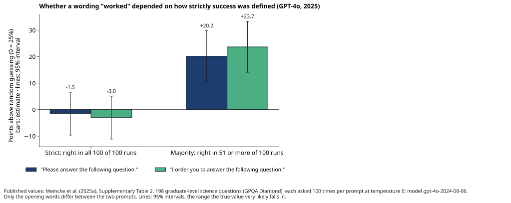{#fig-5-10 fig-alt="Please and I order you, GPT-4o: 1.5 and 3 points below random guessing under the strict standard; 20 and 24 points above under majority."}

Under the strict standard, neither wording did clearly better than guessing; under the majority standard, both did, by about 20 and 24 points (Meincke et al., 2025a). The answers were the same; only the definition of success changed. They also varied across the 100 runs, even with temperature, an option that changes how often less likely tokens are picked (Chapter 3), set to zero. These were 2024 models on very hard questions, and results may not carry over to others.

The last check needs another person. In a **peer swap test**, someone else runs your prompt without your explanation and scores the output against your criteria, to reveal what was in your head but not in the prompt. You cannot easily see your own missing context, because you always read the prompt with it.

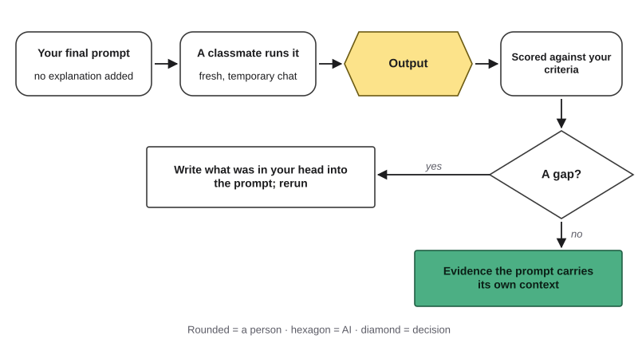{#fig-5-12 fig-alt="Flow: your latest prompt → a classmate runs it in a fresh chat → output → scored against your criteria → gap? yes: add it to prompt; no: evidence."}

::: {.callout-note title="Worked Example: Is Lucía's Prompt Done?"}
**Field:** Business and accounting. *Constructed example.*

**Peer swap on v3 (in the lab).** A classmate runs Lucía's v3 and marks C3 only partly met. The handout explains *net pay* (the money you actually receive after deductions) as "gross pay minus withholdings," and the classmate does not know that *withholdings* are amounts, such as taxes, that an employer keeps back from a paycheck. Lucía, an accounting major, had not noticed: her sense of "plain" was in her head.

- **Frame row.** C3 becomes "every money term is explained in everyday words." Prompt unchanged; rescored, the v3 outputs partly meet C3.
- **v4 = v3 + an explain-terms rule.** Changed: a constraint ("Explain every money term in everyday words the first time you use it"). Prediction: C3 met. Result: met in both runs. Keep.

**Test inputs for v4.** She swaps the figures in the context line. **Typical:** the association's figures.

**Different:** tutoring income that changes from month to month. **Edge:** costs higher than income.

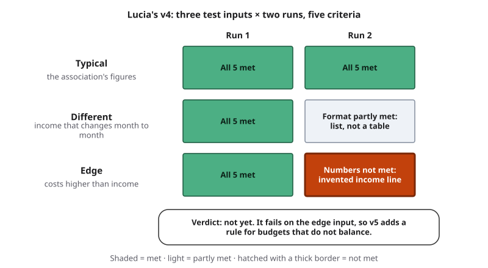{#fig-5-11 fig-alt="Grid for Lucía's v4: three inputs by two runs; one partly met (different input), one not met (edge input); verdict: not yet."}

Four of six runs meet every criterion. One run on the different input gives the worked example as a list, not a table (C4 partly met). One run on the edge input "balances" the budget by inventing an "other income" line (C2 not met). Verdict: not yet.

- **v5 = v4 + a gap rule.** Changed: a constraint ("If costs are higher than income, say so and show the gap"). Prediction: C2 met on the edge input. Result: she reruns all three inputs, and all six runs meet all five criteria. Keep.

Because v5 was shaped to pass the edge input, she adds one new input: a month with a one-time $120 textbook cost. Both runs meet all criteria, and she stops. In other words, she has evidence for this task, tool and date, not proof that the prompt always works.
:::

::: {.callout-note title="Faded Example: A Survey Question"}
**Field:** Social science (psychology and sociology). *Constructed example.*

A student's prompt: "Rewrite this survey question so it is neutral: *Don't you agree that the new parking fee is unfair?*" Three runs gave:

1. "Do you agree or disagree that the new parking fee is fair?"
2. "How fair or unfair do you find the new parking fee?"
3. "Don't you think the parking fee is too high?"

The student concludes, "It works: two out of three are neutral."

- Output 3 fails because it still pushes the reader toward one answer ("Don't you think…") and adds a new claim ("too high").
- Is "two out of three" enough evidence? _______________________
- Which test is missing? _______________________

*Hint:* how many different questions was the prompt tried on, and were the criteria written down?
:::

::: {.callout-important title="Your Turn"}
In Lab 5.1, swap your latest prompts with a partner and score each other's outputs against the owner's criteria. If your prompt fails in a way you did not expect, write it down. **Save this for your Failure Diary (Chapter 4).**
:::

::: {.callout-tip title="Check Yourself 5.5"}
1. Name the three kinds of test inputs and give an example of each for a task in your field.
2. In the 2025 test, why did the same results look like failure under one standard and success under another?
3. Why does a peer swap test find problems that you miss when you test your own prompt?
:::

## 5.6 The Iteration Sprint (A3) {#sec-5-6 .unnumbered}

[Studio]{.path}

*Studio sections are hands-on work for the lab session and the chapter's assignment.*

Lab 5.1 turns sections 5.1 to 5.5 into a record: your **iteration log**, a record of each prompt version: what changed, the prediction, the results of each run and the decision to keep or revert. The log is the core of assignment A3 (brief and rubric at the end of this chapter).

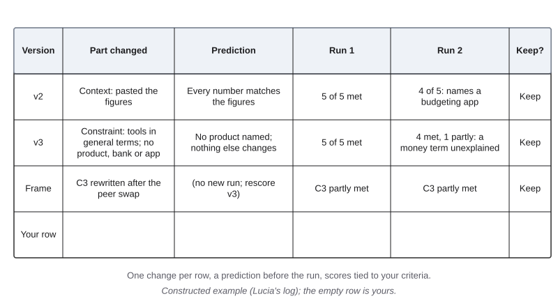{#fig-5-13 fig-alt="Log table: version, part changed, prediction, run 1, run 2, keep. Rows v2 (figures), v3 (product rule), a frame row; an empty row for you."}

**What a strong log shows.** Each row makes one change and names the prompt part it changes, or says "frame." Each row has a prediction written before the run.

Each result is scored against the criteria from your frame card, not against a feeling. Each row ends with a decision: keep or revert. Lucía's rows in sections 5.4 and 5.5 are a condensed example.

**What a weak log looks like.** Four rewordings of the same sentence, no criteria, results described as "better" or "worse," one run each. It may end with a good prompt, but it gives no evidence that the prompt is good, or why.

**Where v1 comes from.** Your v1 is the first prompt you write from your frame card, an honest first attempt. Do not write a deliberately weak v1 so that later versions look better.

**How many runs are enough?** Two runs per version is a minimum that catches large swings; it does not prove a prompt works. For A3, "enough" means every version run twice, the final version also tried on a different and an edge input, and one peer swap. That is evidence for your task, your tool and your date.

**When to stop.** Stop when every criterion is met across your runs and test inputs, including one input you did not shape the prompt around, and the peer swap found no new gap. If the trace keeps ending at the frame, the next step is to reframe, or to keep that part of the task for yourself.

::: {.callout-note title="Faded Example: Finish the Log"}
*Constructed example.* An education major is writing practice questions for a fifth-grade unit on fractions.

**Frame card (given):** goal, five practice questions with an answer key; audience, fifth graders in their second week of fractions; criteria: (C1) every answer in the key is correct; (C2) no question needs a calculator; (C3) the questions use everyday objects; (C4) the key shows one line of working for each answer.

- **v1 (given):** "Write five fraction practice questions for fifth graders with an answer key." Result: two runs; one key had a wrong answer (C1 not met); no working shown (C4 not met).
- **v2 (given):** Changed: output format ("For each answer, show one line of working"). Prediction: C4 met; the working line may expose wrong answers. Result: C4 met in both runs; one wrong answer remained in run 2, now easy to spot.
- **v3:** Changed: _______________________ Prediction: _______________________
- **Test inputs for the final version:** typical _______________ · different _______________ · edge _______________

*Hint:* C1 is the costly miss. Can a prompt change alone guarantee a correct key, or does part of C1 stay with the student?
:::

::: {.callout-tip title="Check Yourself 5.6"}
1. What should every row of an iteration log contain?
2. Why should v1 be an honest first attempt rather than a deliberately weak prompt?
:::

## Deep 5.A: Techniques Beyond the Six Parts {#sec-5-deep-a .unnumbered}

[Deep]{.path}

*Deep sections are optional and not examinable.*

The six parts cover most everyday prompts. Researchers have named many more techniques. One systematic review of the research literature collected a vocabulary of 33 terms and a list of 58 prompting techniques for text alone (Schulhoff et al., 2024). Three are worth knowing, each with its limits.

**Step-by-step prompting.** In 2022, a team at Google reported that showing a model a few worked examples whose answers included the intermediate reasoning steps, not only the final answer, improved the performance of large models on arithmetic, commonsense and symbolic reasoning tasks (Wei et al., 2022). They called this *chain-of-thought prompting*.

Since then, some models have been built to produce intermediate steps before an answer without being asked; providers often call them reasoning models. In a 2025 test, asking for step-by-step reasoning gave other models a small average gain, smaller for those that already produce steps unasked, and made their answers more variable; it gave reasoning models only marginal gains while taking 20% to 80% more time (Meincke et al., 2025b). Whether to ask for steps is something to test on your own task, with your own criteria.

**Asking what the tool needs.** Before the task, you can ask the tool to list the information it would need to do the task well, then supply what is missing. This book suggests it as a framing aid, not as a tested technique: the list is itself an output to judge, and it can include things you do not need or should not share.

**Splitting a task into steps.** Some tasks work better as a fixed sequence of smaller prompts, with a person checking between steps. Chapter 6 (section 6.7) covers these *prompt chains*.

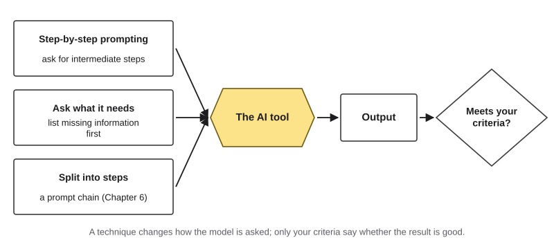{#fig-5-16 fig-alt="Three techniques (step-by-step, ask what it needs, split into steps) feed the AI tool; its output goes to a decision: meets your criteria?"}

None of these replaces the frame. A technique changes how the model is asked; only your criteria say whether the result is good.

::: {.callout-tip title="Check Yourself Deep 5.A"}
1. What did Wei et al. (2022) show in the in-context examples they gave the model, besides the final answers?
2. Why does this book call "ask what the tool needs" a framing aid rather than a tested technique?
:::

## Deep 5.B: How People Actually Delegate {#sec-5-deep-b .unnumbered}

[Deep]{.path}

How much of real AI use is automation, and how much is collaboration? One AI provider, Anthropic, publishes analyses of how its own users work, using a model to classify large samples of conversations while keeping their contents private. Its definitions are its own.

It counts a conversation as *automation* when the person mostly directs the output or relays feedback such as error messages, and as *augmentation* when the person iterates on a task with the model, learns from it or asks it to check their work (Handa et al., 2025). These are not the same as the AI Fluency modalities in section 5.2, so read the numbers as a related measure, not as a count of rungs.

Its first report, on chat conversations from late 2024 and early 2025, classified 57% as augmentation and 43% as automation (Handa et al., 2025). A September 2025 report used August 2025 data. On the chat service, 49% of conversations showed automation patterns. In traffic from businesses that connect their own software to the provider's models through an application programming interface (API), a channel through which software, not a person, sends requests, 77% of transcripts showed automation patterns and 12% augmentation (Appel et al., 2025).

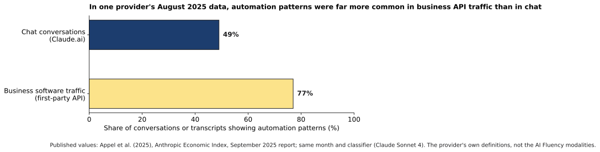{#fig-5-14 fig-alt="Two bars, August 2025, same month and method: chat conversations 49% automation patterns; business API traffic 77%."}

Read the comparison with care. API records are single exchanges sent by software, so part of the gap comes from the format of the data itself. As of October 2026, newer reports exist.

A January 2026 report, on November 2025 data and using a newer classifier model, found that 52% of chat conversations were classified as augmentation and 45% as automation, while about three-quarters of API interactions were classified as automation (Appel et al., 2026); a further report followed in March 2026. Because the classifier changed between reports, this book draws no trend from them and compares only figures from the same month and method.

The pattern still fits section 5.2: when a business builds AI into its own software, the person often drops out of the turn-by-turn loop, which is exactly when the place of the human check needs to be designed rather than assumed. These are one provider's users, classified by that provider's own model, so they describe that platform, not AI use in general.

::: {.callout-tip title="Check Yourself Deep 5.B"}
1. Why does this book draw no trend from the provider's reports?
2. Give one reason, other than how people delegate, why API traffic shows more automation patterns than chat.
:::

## Hands-on Labs {.unnumbered}

Lab 5.1 is the in-class lab and starts A3. Labs 5.2 and 5.3 are optional and can be done at home or in Compass, which is optional and ungraded. The labs say what to do, not which buttons to press.

Every run uses a **fresh, temporary chat**: start a new conversation, and where the tool offers a temporary or private mode that is not saved to memory, use it, so earlier chats cannot shape the test. Current steps for each tool are in Compass. Never put personal or confidential information into a prompt.

### Lab 5.1: Prompt Iteration Sprint (Studio · 75 minutes · in class) {.unnumbered}

*(O1–O6 · LO2 · Apply, Analyze, Evaluate)* Teams of three or four; every log is individual.

1. **Briefing (10 min).** Open the log template (on your course site, or @fig-5-13). Your instructor pairs you for the peer swap. If you have no task of your own, pick one from the task bank on your course site.
2. **Frame (10 min).** Write your frame card with a rung for each part. A teammate reads your criteria and marks any they could not score.
3. **Versions 1 to 3 (20 min).** Write v1 from your frame card. Run it once in a fresh, temporary chat and score it. Write v2 and v3, one change each, with a prediction before each run.
4. **Peer swap (15 min).** Run your partner's v3 in a fresh chat, without asking them anything, and score the output against their criteria. Tell them what was missing. **This swap counts as the A3 peer swap**: record what it revealed and the change it led to. Swapping your final prompt again is optional.
5. **Share and critique (15 min).** Each team shows the one change that mattered most and one that did not.
6. **Exit (5 min).** Finish the sentence: "My prompt works for … but I have not tested …"

**At home (A3):** second runs of v1 to v3, v4 with two runs, one run each on a different and an edge input, then the verification note, reflection and declaration. **If it does not work:** if a tool refuses or errors, record that as a result and try a smaller task; if you cannot use a tool, start the alternative assignment's audit with the provided dated sample log.

### Lab 5.2: Same Task, Two Rungs (Compare · 30 minutes · optional) {.unnumbered}

*(O2 · LO2 · Evaluate)* Use a short reading you have already read for a course. Once as **automation**, ask a tool to produce a summary and check it against the reading. Once as **augmentation**, ask the tool to help you find the three main claims by asking you questions, without writing the summary, and write the summary yourself. Compare: what did you learn each time, how long did checking take, and which parts of the result were yours?

### Lab 5.3: Test a "Magic" Phrase (Break It · 40 minutes · optional) {.unnumbered}

*(O4, O5 · LO2 · Evaluate)* Choose one popular prompting "trick", a phrase some people believe always improves answers, such as a politeness phrase, an expert role or an offered tip. Write a short task with three criteria and two test inputs.

Run the prompt three times with the trick and three times without, on each input (12 runs), each in a fresh chat, and score every output. Write a conclusion limited to your test, such as "for this task and tool, on this date, the phrase made no visible difference." Your instructor may pool the class's results, because a few runs cannot show a small effect. If the trick makes an output worse in a way you did not expect, **save this for your Failure Diary (Chapter 4).**

## Case Study: Klarna, Revisited {.unnumbered}

This case marks each fact by how it is known: **confirmed** (in Klarna's own documents), **reported** (by a named outlet) or **inferred** (this book's reading).

**Context.** Klarna, a Swedish payments company, offers "buy now, pay later" plans. Its customers contact customer service about payments, refunds and returns.

In February 2024 it launched an AI assistant built with OpenAI's technology to answer those chats (confirmed: Klarna, 2024). Before and alongside the assistant, human agents, many of them employed through outside service providers, handled customer chats (reported: Fisher, 2025; Engelking, 2025).

**Timeline.**

- **February 27, 2024** (confirmed): Klarna reports the assistant's first month: 2.3 million conversations, two-thirds of customer-service chats, work it equates to 700 full-time agents, resolution time under 2 minutes instead of 11, customer satisfaction about the same as with human agents, more accurate problem resolution (as the company described it) leading to 25% fewer repeat questions, an expected $40 million profit improvement, and a live-agent option for customers who want one (Klarna, 2024).
- **January 24, 2025** (confirmed): in a draft registration statement filed with the U.S. Securities and Exchange Commission (SEC) before its stock listing, Klarna says the assistant has handled 60% of customer-service chats since launch, with no drop in customer satisfaction according to its internal surveys. It also says the assistant resolved issues more accurately than human agents and cut repeat inquiries by 25%, counted before and after launch (Klarna Group, 2025).
- **May 2025** (reported): in a Bloomberg interview, the chief executive says cost had been too dominant a factor and the result was lower quality (Fisher, 2025); that customers must know they can always reach a human (Shibu, 2025); and that Klarna will test hiring its own agents in a flexible, remote "Uber-type" setup (Fisher, 2025), which a German technology outlet described as a small pilot (Engelking, 2025). The same outlet reported that he remained enthusiastic about AI (Engelking, 2025).
- **November 2025** (reported): CX Dive reported that the chief executive said the assistant could now do the work of more than 853 full-time agents and had saved the company about $60 million, and that the company described satisfaction with the assistant as about the same as with human agents (Doerer, 2025).

**Where the case sits on the ladder** (inferred). By the AI Fluency framework's definition, Klarna's assistant is **agency**: the company configured an AI system to carry out future tasks, answering customers, on its behalf (Dakan & Feller, 2025). So, by the same definition, was the assistant in Chapter 1's support-center study, which a company set up for its agents (Brynjolfsson et al., 2025).

Both are agency. They differ in whether the design kept a human check before each output took effect.

- In Chapter 1's study, the assistant suggested replies to human agents, who could use, change or ignore them before the customer saw anything (Brynjolfsson et al., 2025). A person checked each output before it took effect, like an approval gate (Chapter 14).
- At Klarna, as the company described it in 2024, the assistant answered customers directly, and customers could ask for a person (Klarna, 2024). There was no human check before each answer reached the customer; the human was an option the customer had to choose.

This book reads the 2025 statements in that light: when nobody checks an output before it takes effect, the measures that judge the system carry more weight. Volume and speed measure how much the assistant did. A company-reported satisfaction score measures how customers rated it. Neither, nor a company claim of "more accurate" resolution without a published method, directly measures problems left unsolved, or customers who gave up.

**Company claims and independent evidence.** Every number in this case comes from Klarna or its chief executive. They are claims about the company's own operations, made by a company with an interest in how they are received.

An analyst quoted by CX Dive in November 2025 said Klarna had leaned too far toward cutting costs, and reported customer complaints that the assistant gave generic answers to complex questions (Doerer, 2025). That is one analyst's view, not an independent measurement either. The honest summary is that the public record shows what the company chose to measure and later chose to say, not how many customers were well or badly served.

**A better workflow (AI Work Loop, for the team setting it up).** *Frame:* write quality criteria (problems actually solved, customers who wanted a person and got one) next to volume and cost, before launch. *Prompt and configure:* decide which kinds of question the assistant answers alone and which go to a person. *Verify:* sample conversations and score them against the quality criteria, not only the speed criteria. *Decide:* place a human check before outputs that are costly to get wrong. *Disclose:* tell customers they are talking to an AI and how to reach a person.

### Short case 1: Why people new to prompting stop too early {.unnumbered}

In the study in section 5.5, ten people improved a recipe chatbot built on GPT-3 (Zamfirescu-Pereira et al., 2023). Read their habits against the iteration loop (@fig-5-8).

They often skipped *score*: many stopped when they saw the behavior they wanted once. They skipped *rerun earlier inputs*: later changes could bring back problems they had fixed. And their *diagnose* step was shaped by talking to people: they expected the chatbot to understand their instructions, and few used in-context examples, even after being shown that examples helped. The authors drew a design lesson for tool builders and a literacy lesson for everyone else, which is the subject of this chapter.

### Short case 2: Small changes, big swings {.unnumbered}

Two studies point the same way. Researchers changed only the formatting of prompts that included a few in-context examples (spacing, separators, capital letters) and found accuracy differences of up to 76 points for LLaMA-2-13B; they recommended reporting a range of results across plausible formats instead of one number (Sclar et al., 2024). In 2025, another team asked each of 198 questions 100 times and found that whether a model looked better than guessing depended more on the scoring standard than on whether the prompt said *please* or *I order you* (Meincke et al., 2025a).

The common lesson: "this prompt works" is a claim about a measurement. Say how you measured.

## Ethics Lens: Who Pays for a Badly Framed Delegation? {.unnumbered}

Framing looks like a private, technical step. It is also a decision about other people.

**Success criteria carry values.** A criterion such as "resolution time under two minutes" says speed matters. A criterion such as "customers who want a person can reach one" says choice matters.

Neither is neutral, and whoever writes the criteria decides whose interests are counted. In the Klarna case, the chief executive's own later account, as reported, was that cost had been too dominant a factor (Fisher, 2025).

**The higher the rung, the more people carry the risk.** At the automation rung, a bad output costs you a rewrite. At the agency rung, it reaches classmates, customers or patients who did not choose the tool and may not know it is there. That is why the second question in section 5.2 asks who would bear an error, not only what it would cost.

**Telling people.** If an AI system speaks to people on your behalf, they deserve to know, and to know how to reach a person. Chapter 10 covers disclosing AI use at work, Chapter 17 discusses transparency, and Chapter 18 discusses the rules that increasingly require it.

**What goes into a prompt.** Context makes prompts better, and it is also where private information leaks. Lucía used constructed figures, not real students' finances. In this book's work, personal or confidential data does not go into public AI tools; Chapter 15 explains why.

## Career Connection {.unnumbered}

| Occupation | Where framing and prompting show up | A question a professional asks |
|---|---|---|
| Marketing or communications specialist | A creative brief already has a role, a task, an audience, constraints and a format | Would someone outside my team produce the right thing from this brief alone? |
| Accountant or auditor | Framing an analysis request; keeping the judgment about what the numbers mean | Which part of this analysis can I check before it goes to the client? |
| Teacher | Generating practice items with constraints and a key | Did I check every answer in the key, on more than one set of items? |
| Software tester or quality analyst | Test inputs, edge cases and re-running old tests after a change are everyday work | What is the edge case most likely to break this? |
| Nurse educator | Patient materials with must-not constraints (no new advice, exact doses) | Who checks every medical statement before a patient reads it? |
| Operations manager | Deciding which parts of a process to automate and where the human check sits | If this runs without us, who sees its mistakes, and when? |

## From the Field {.unnumbered}

<!-- Based on the author's encyclopedia entry (Şeker, 2014), "Beş Neden Yöntemi (5 Whys)", YBS Ansiklopedi 1(4), read from Drive 1DrAi2SG_C_WyYCC5xminYeMS0uoMl7zJ on 2026-10-18; translated and paraphrased from Turkish. Facts limited to the entry; present-day connections marked as such. Registry: docs/production/ftf-sources.md. No commercial interest: no disclosure (D16 not applicable). -->

In 2014 I wrote a short encyclopedia entry on the "5 Whys," a method for finding what lies behind a problem (Şeker, 2014). It is used in quality work, usually with experts or the people inside a process, though it can also work with customers or suppliers. The method is simple: ask "why?" about a problem five times in a row.

The entry used a common example. A car will not start. Why? The battery is dead.

Why? The alternator, the part that recharges the battery, may not have charged it. Why?

The alternator is broken. Why? It had reached the end of its service life and was not replaced at the last service.

Why? The car may not have been properly maintained by the service shop. A general problem, a car that will not start, turns out to rest on a detail: neglect during maintenance.

The entry also reported criticisms of the method, citing Toyota's global purchasing manager, Teruyuki Minoura. The method can stay at the level of symptoms, and it cannot go beyond what the investigator and the people answering already know. "Why" questions can lead the investigator in the wrong direction.

Its results are not repeatable: different people, at different times and places, can reach different answers. And having to answer "why" again and again can scatter the focus instead of finding the main cause. In response, the entry noted, people developed refinements, such as confirming that each answer is true, and discussing how much it really matters, before asking the next "why."

*Present-day connections, read with this chapter:* asking "why does this task exist, and for whom?" before writing a prompt is the Frame step. "It cannot go beyond what you already know" applies to a frame too: Lucía could not see her own jargon until a classmate ran her prompt. "Not repeatable" is why section 5.5 runs a prompt more than once and on more than one input. And "confirm each answer before the next why" is the discipline of changing one thing at a time and checking the result before moving on.

## Chapter Summary {.unnumbered}

{#fig-5-6s fig-alt="Six rounded boxes in Your prompt: role, context, in-context examples, task (thick), constraints, output format; arrow to AI tool, then output."}

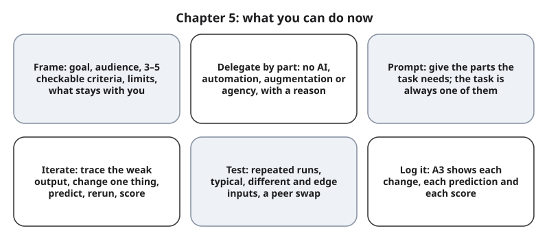{#fig-5-15 fig-alt="Six cards: frame, delegate by part, prompt parts, iterate, test, log it."}

**The chapter's question:** *Is getting good results from AI mainly a matter of finding the right words?* Mostly no, as far as the evidence in this chapter goes. Results depend first on framing: what the task is for, what a good result looks like, and which parts to hand over in which way.

Then they depend on giving the tool what the task needs, and on testing deliberately. Wording does matter, sometimes a lot, but in ways that are hard to predict and that change from question to question; the studies here used particular models and tasks, and newer ones may differ. That is why you test instead of trusting a trick.

**Return to the Opening Case.** Klarna's assistant did what it was set up to do, by the measures the company chose: volume, speed, cost, a satisfaction score it reported itself, and a claim of more accurate resolution shown by fewer repeat questions. In 2025 the chief executive was reported as saying cost had been too dominant and quality had suffered. Read with this chapter, the story is about success criteria and about where the human check sits, not about wording.

**Revisit your Warm-up.** (1) How did you know a prompt worked? *A strong answer:* it met criteria written in advance, across more than one run and more than one input. (2) Does *please* help? *In one large 2025 test, not overall for GPT-4o*, though single questions changed both ways; test it on your own task. (3) Will a good answer come again? *Not guaranteed:* outputs vary between runs, so one good answer is not evidence.

You can now:

- **Apply** the Frame step: goal, audience, checkable criteria, limits and what stays with you.
- **Justify** a rung, or the floor, for each part of a task.
- **Construct** a prompt from the parts its task needs.
- **Diagnose** a weak output by tracing it to the prompt or to the frame.
- **Judge** whether the evidence supports "this prompt works."
- **Produce** an iteration log for A3.

### Key Terms {.unnumbered}

agency (mode of working with AI) · agent (Ch. 3) · anatomy of a prompt · augmentation · automation · benchmark · constraint · context (prompt part) · context window (Ch. 3) · Delegation Ladder · example (Ch. 2) · in-context example · iteration · iteration log · output format · peer swap test · role (prompt part) · success criteria · task (prompt part) · task frame · test inputs

## End-of-Chapter Package {.unnumbered}

<!-- Each item: objective · LO · revised Bloom level. Odd-numbered answers → Appendix E (docs/production/handoff/ch05.md); even-numbered → private/ch05-answers-even.md. Review A distractors draw on M1–M6; MC keys rotated (a: A2, A10; b: A9, A12; c: A4, A14; d: A7, A11). -->

### Review Questions A: Terms and Concepts {.unnumbered}

1. *(O1 · LO2 · Remember)* Name the five parts of a task frame.
2. *(O1 · LO2 · Understand)* Which of these is a checkable success criterion for a one-page handout?\
   (a) "Every number in the example comes from the figures provided."\
   (b) "It should be engaging and interesting for first-year students."\
   (c) "It should sound professional, confident and friendly to readers."\
   (d) "The tool should work out what I mean and do its best on every part."
3. *(O2 · LO2 · Remember)* In one sentence each, say what you do in automation, augmentation and agency.
4. *(O2 · LO2 · Understand)* Why does this book place agency at the top of the Delegation Ladder?\
   (a) It is the most advanced and efficient way to use AI, so experienced users aim for it.\
   (b) The AI Fluency framework ranks it as the highest and most demanding of its three modalities.\
   (c) By default nobody checks each output before it takes effect.\
   (d) Agency is the only way of working in which the model can use tools such as web search.
5. *(O2 · LO2 · Understand)* Explain the difference between agency (a way of working) and an agent (a kind of system). Give one example of agency that is not an agent.
6. *(O3 · LO2 · Remember)* Which part of a prompt is always needed, and what does it contain?
7. *(O3 · LO2 · Understand)* A student starts every prompt with "You are a world-class physicist" to get more accurate physics answers. Which statement best fits the evidence in section 5.3?\
   (a) The role reliably makes factual answers more accurate, so it is worth adding to every prompt.\
   (b) The model takes on a physicist's knowledge and judgment for the rest of that chat.\
   (c) A role has no effect on the output at all, not even on its tone or vocabulary.\
   (d) Personas did not improve factual accuracy overall; a role mainly sets tone.
8. *(O3 · LO2 · Understand)* In one sentence each, explain *example* in Chapter 2 and *in-context example* in this chapter.
9. *(O3 · LO2 · Understand)* Which statement about what to put in a prompt is most accurate?\
   (a) Adding everything you know about the topic usually improves the output, because the tool has more to work with.\
   (b) Each part should serve the task; irrelevant material can lower quality.\
   (c) Every prompt should contain all six parts, so that nothing the tool needs is missing.\
   (d) A strong role line matters more than the context, so the role should be the longest part.
10. *(O4 · LO2 · Understand)* You change the role, a constraint and the output format at the same time, and the output improves. What can you conclude?\
    (a) You cannot tell which change helped.\
    (b) All three changes helped, since the output improved after you made them.\
    (c) The role helped most, because a role makes the model more of an expert.\
    (d) The prompt now works, because it produced a better output this time.
11. *(O4 · LO2 · Understand)* In the 2025 test with GPT-4o described in section 5.4, what happened when *Please answer…* and *I order you to answer…* were compared?\
    (a) *Please* raised the overall score substantially, because politeness helps.\
    (b) *I order you* raised the overall score, because firm commands work better.\
    (c) The two wordings scored the same on every single question, in every run.\
    (d) No overall difference, though single questions changed both ways.
12. *(O5 · LO2 · Understand)* A prompt gave you a good answer once. What should you do before saying it works?\
    (a) Treat the good answer as enough evidence, because it shows the prompt can clearly do the task.\
    (b) Run it more than once on typical, different and edge inputs, and score each output.\
    (c) Conclude that the tool cannot do the task if the very next run fails your criteria.\
    (d) Ask the tool whether its own answer meets your criteria, and accept what it says.
13. *(O5 · LO2 · Remember)* What does a peer swap test reveal that testing your own prompt usually does not?
14. *(O5 · LO2 · Understand)* Which description fits an **edge** test input?\
    (a) The case you expect most often, which most users of the prompt will send.\
    (b) A typical input run a second time, to check that the result repeats.\
    (c) An unusual but possible case, the most likely to break the prompt.\
    (d) The input that produced the best output so far, so the prompt is shown at its best.

### Review Questions B: Case Questions {.unnumbered}

1. *(O1 · LO2 · Apply)* A nursing student wants AI to "make a study sheet on heart medications." Write a task frame: goal, audience, three checkable criteria, one limit, and what stays with the student. Include one criterion about safety.
2. *(O2 · LO2, LO5 · Evaluate)* A public library plans a chatbot, built from its own web pages, that answers patrons' questions about opening hours, fines and events. Place it on the Delegation Ladder, say where the human check sits in this plan, and propose one change that would put a check before the answers that matter most reach patrons.
3. *(O3, O4 · LO2 · Analyze)* A business student prompts: "Write a LinkedIn post about my internship." The output is 400 words of general praise and mentions a company award she never received. Label the prompt parts that are missing, trace the invented award with at least two "why" steps, and write v2 with one change and a prediction.
4. *(O5 · LO2, LO3 · Evaluate)* A teaching assistant writes a prompt that produces quiz answer keys. He tests it on one quiz, finds the key correct, and shares the prompt with five other assistants. Judge his evidence and write a better test plan: runs, typical, different and edge inputs, and a peer swap.

### Review Questions C: Interpretive Questions {.unnumbered}

1. *(O2 · LO2, LO5 · Evaluate)* "Klarna's assistant worked; the company simply changed its mind." Agree or disagree, using success criteria and where the human check sits.
2. *(O5 · LO2 · Evaluate)* "Prompting is a passing skill: soon models will produce what we want without careful prompts." Take a position, using the evidence in sections 5.4 and 5.5 and what framing adds that wording cannot.
3. *(O1 · LO4 · Evaluate)* For AI-assisted coursework, who should write the success criteria: the student, the instructor, or both? Defend your answer.

### Spaced Review {.unnumbered}

Come back to these a few days after reading, without looking back.

1. *(Chapter 3 · LO1 · Understand)* Why can the same prompt give different outputs on two runs? Which step of the iteration loop in section 5.4 allows for this?
2. *(Chapter 3 · LO1 · Understand)* Lucía's figures were "in her notes, not in the prompt." Use the definition of the context window to explain why that mattered.
3. *(Chapter 3 · LO1 · Understand)* A student corrects a chat tool during a long conversation, then reuses the original prompt in a fresh chat. Why might the correction no longer apply?
4. *(Chapter 2 · LO1 · Understand)* How are this chapter's test inputs like a test set in Chapter 2, and how are they different?
5. *(Chapter 1 · LO4 · Remember)* Name the five steps of the AI Work Loop. Which two did this chapter strengthen?

### Discussion Questions {.unnumbered}

1. *(Ethics · O2 · LO5 · Evaluate)* Who should decide the success criteria for an AI system that answers the public: the company, its staff, its customers, a regulator? What would each group want measured?
2. *(Career · O2 · LO2 · Apply)* Think of a job you might hold in five years. Which parts of it would you keep on the floor, and why?
3. *(Interdisciplinary · O4 · LO2 · Analyze)* Many fields have a method for finding causes, such as root-cause analysis in engineering, differential diagnosis in medicine, or source criticism in history. How is it like tracing a weak output in section 5.4, and how is it different?
4. *(O3 · LO2 · Evaluate)* Do you say *please* to chat tools? Is your reason about the output, about yourself, or about habit?
5. *(O2 · LO2, LO6 · Create)* Describe one use of agency in your field that would help people. Where would you put the human check?

### Application Assignment: A3 — Prompt and Iteration Log {.unnumbered}

**Due:** when your instructor sets it. *(O6 · LO2, LO4 · Create)* Started in the Lab 5.1 session (frame card, v1 to v3 with one run each, the peer swap).

**Time at home, counted from the requirements: about 60 to 70 minutes.** Second runs of v1 to v3 (3 runs) and v4 (2 runs), plus one run each on a different and an edge input (2 runs): 7 runs, about 10 minutes; scoring about 7 outputs against your criteria, about 20 minutes; writing v4 and its prediction, about 5 minutes; the verification note, about 10 minutes; the reflection and declaration, about 15 minutes.

**Choose a task:** a real task from your major, a job or daily life that you would actually use AI for. Use **no personal or confidential data**, yours or anyone else's, and no data from an employer unless you use that employer's approved tool under its rules. The task bank on your course site has options.

**What to submit:**

1. **Frame card:** goal, audience, three to five checkable success criteria, limits, what stays with you, and **a rung for each part** of the task (or the floor), with one reason each.
2. **At least four prompt versions.** v1 is the first prompt you write from your frame card, an honest first attempt. Each later version makes **one** change, names the prompt part it changes (or says "frame"), and states a prediction before the run.
3. **Test record:** run every version at least twice, each time in a fresh, temporary chat. Run the final version once more on a **different** and once on an **edge** input (your usual input counts as typical). Score each output against each criterion: met, partly met or not met. Save outputs or excerpts with the tool name and date. Two runs is a minimum; your results are evidence for your task, tool and date, not proof.
4. **Peer swap test:** the in-lab swap counts. Record what your classmate found when running your v3 without explanation, and the change it led to in a later version. Swapping your final prompt again is optional.
5. **Verification note:** for each number or fact you relied on in the final output, say how you checked it. At this point in the book that means: recompute every total; compare each fact with the source you supplied, your textbook or your course notes. Chapter 8 adds more methods.
6. **Reflection (3–5 sentences):** the change that mattered most and why, one change that did not help, and when and why you stopped.
7. **AI Use Declaration:** tools, purpose, what you accepted, rejected or revised, how you verified it, and where your own judgment shaped the result.

**Rubric (10 points)**

| Criterion (points) | Exemplary | Proficient | Developing | Beginning |
|---|---|---|---|---|
| **Task and frame (3)** | 3: a real task; all frame elements; 3–5 checkable criteria; a rung for each part, each with a reason | 2: all elements present, but one or two criteria cannot be checked, or the rung reasons are generic | 1: one or more elements missing, or criteria vague throughout | 0: no frame card |
| **Versions and changes (1.5)** | 1.5: at least four versions; each later version makes one named change with a prediction | 1: at least four versions; one or two rows change several things or lack a prediction | 0.5: two or three versions, or most rows change several things or lack predictions | 0: one version only |
| **Testing evidence (1.5)** | 1.5: every version run at least twice; the final version also run on a different and an edge input; every output scored against the criteria | 1: most versions run twice and scored, or the final version not run on both extra inputs | 0.5: mostly single runs, or scores not tied to the criteria | 0: no test record |
| **Verification (2)** | 2: peer swap recorded with what it revealed and the change it led to; every relied-on number or fact checked with a named method | 1.5: peer swap recorded; most numbers and facts checked | 1: peer swap record or claim checks missing | 0: neither |
| **Declaration and judgment (2)** | 2: all five declaration elements; reflection names the most and least useful change, with reasons and a stopping decision | 1.5: all five elements; a general reflection | 1: two to four elements, or no reflection | 0: missing, or only one element |

**Formats.** A table with the columns of @fig-5-13 or the template on your course site. Saved text is enough; screenshots are optional. Compass offers the same template (optional and ungraded).

**Alternative assignment: an iteration audit** (for students who prefer not to use AI tools, who have no suitable device, or for whom the peer swap is a barrier). Use the provided dated log (on your course site): six versions of one prompt with real outputs, model names and dates.

1. Write your own frame card for its task, with a rung for each part.
2. Label each change by prompt part, and say whether it changed one thing or several.
3. Score every provided output against your criteria.
4. Choose the version you would use and write a v7 with a prediction.
5. Propose a typical, a different and an edge input for v7, and say what result on each would show that v7 works.
6. A classmate, or the instructor in office hours, reads your v7 without explanation and lists what they would need to ask. Record it and the change you would make.
7. Check the numbers and facts in the version you chose; write the AI Use Declaration ("no AI tools used" where true) and the reflection.

| Criterion (points) | Exemplary | Proficient | Developing | Beginning |
|---|---|---|---|---|
| **Task and frame (3)** | 3: all frame elements for the provided task; 3–5 checkable criteria; a rung for each part with a reason | 2: all elements, but one or two criteria cannot be checked, or rung reasons generic | 1: one or more elements missing, or criteria vague | 0: no frame card |
| **Versions and changes (1.5)** | 1.5: all six changes labeled correctly (single or several); v7 makes one named change with a prediction | 1: one or two labels wrong, or v7 lacks a prediction | 0.5: several labels wrong, or no v7 | 0: no labeling |
| **Testing evidence (1.5)** | 1.5: every provided output scored against every criterion; typical, different and edge inputs proposed for v7, each with a pass result | 1: most outputs scored, or inputs proposed without pass results | 0.5: few outputs scored, or no proposed inputs | 0: no scoring |
| **Verification (2)** | 2: reader test recorded with the change it suggests; every number and fact in the chosen version checked with a named method | 1.5: reader test recorded; most numbers and facts checked | 1: reader test or checks missing | 0: neither |
| **Declaration and judgment (2)** | 2: all five declaration elements; reflection on which change mattered most in the provided log and why | 1.5: all five elements; general reflection | 1: two to four elements, or no reflection | 0: missing, or only one element |

### Mini-Project (optional): One Task, Three Weeks {.unnumbered}

*(O1, O2, O4 · LO2, LO7 · Evaluate)* Pick one task you do every week, such as reading notes, lab write-ups or work emails. For three weeks, write a frame card and an iteration-log entry each time you use AI on it. At the end, write half a page: did your criteria or your rungs change, and why? The record can become revision evidence in your portfolio (Chapter 20).

### Case Study Questions {.unnumbered}

1. *(O1 · LO2 · Analyze)* List the measures Klarna announced in February 2024. For each, say what it measures and what it cannot tell you.
2. *(O2 · LO2 · Analyze)* Using the framework's definition, explain why both Klarna's assistant and Chapter 1's support tool count as agency, and describe where the human check sat in each.
3. *(O5 · LO3 · Evaluate)* Which statements in the case are confirmed, which are reported, and which are the book's inference? What evidence would change your view of the case?
4. *(O2 · LO2, LO5 · Create)* Write three success criteria Klarna could have announced alongside speed and cost in 2024. Make each one checkable.
5. *(O4 · LO2 · Analyze)* Apply three "why" steps to the 2025 statement that quality had suffered. Mark each link as checked (from the record) or assumed.

## Further Reading and Compass Links {.unnumbered}

- Anthropic Academy, *AI Fluency: Framework & Foundations*, module 2, "The AI Fluency Framework" (Anthropic, n.d.-a), recommended. Suggested next: modules 4 (Delegation) and 5 (Description).
- Dakan and Feller (2025): the AI Fluency framework itself, version 1.1, a short document of about ten pages with the three modalities and the 4D competencies.
- Zamfirescu-Pereira et al. (2023): "Why Johnny can't prompt," a readable study of how people new to prompting work, with many quoted prompts.
- Meincke et al. (2025a): a short report on how much prompt wording and scoring standards matter, with clear figures.
- Schulhoff et al. (2024): a long survey of prompting techniques; useful as a reference, not to read end to end (Deep).
- Providers' own prompting guides (Anthropic, n.d.-b; Google, 2024; OpenAI, n.d.); they change often, so check the date.
- Chapter 6 (Deep): context, in-context examples, templates and reusable workflows.
- *In Compass (optional): interactive Anatomy of a Prompt (@fig-5-6) and Delegation Ladder (@fig-5-3); Chapter 5 quiz; Lab 5.1–5.3 pages; A3 template.*

## References {.unnumbered}

Anthropic. (n.d.-a). *AI fluency: Framework & foundations* [Online course]. Anthropic Academy. https://anthropic.skilljar.com/ai-fluency-framework-foundations

Anthropic. (n.d.-b). *Prompt engineering overview*. Claude Docs. Retrieved October 18, 2026, from https://platform.claude.com/docs/en/build-with-claude/prompt-engineering/overview

Anthropic. (2024, December 19). *Building effective agents*. https://www.anthropic.com/engineering/building-effective-agents

Appel, R., Massenkoff, M., McCrory, P., McCain, M., Heller, R., Neylon, T., & Tamkin, A. (2026, January 15). *Anthropic Economic Index report: Economic primitives*. Anthropic. https://www.anthropic.com/research/anthropic-economic-index-january-2026-report

Appel, R., McCrory, P., Tamkin, A., McCain, M., Neylon, T., & Stern, M. (2025, September 15). *Anthropic Economic Index report: Uneven geographic and enterprise AI adoption*. Anthropic. https://www.anthropic.com/research/anthropic-economic-index-september-2025-report

Brown, T. B., Mann, B., Ryder, N., Subbiah, M., Kaplan, J., Dhariwal, P., Neelakantan, A., Shyam, P., Sastry, G., Askell, A., Agarwal, S., Herbert-Voss, A., Krueger, G., Henighan, T., Child, R., Ramesh, A., Ziegler, D. M., Wu, J., Winter, C., . . . Amodei, D. (2020). Language models are few-shot learners. *Advances in Neural Information Processing Systems, 33*, 1877–1901.

Brynjolfsson, E., Li, D., & Raymond, L. (2025). Generative AI at work. *The Quarterly Journal of Economics, 140*(2), 889–942. https://doi.org/10.1093/qje/qjae044

Dakan, R., & Feller, J. (2025, December). *The AI Fluency Framework: A descriptive and normative model of human-AI interaction for higher education* (Version 1.1). Higher Education Authority. https://hub.teachingandlearning.ie/wp-content/uploads/2025/12/hea-genai-fluency-framework.pdf (CC BY-SA 4.0)

Doerer, K. (2025, November 20). Klarna says its AI agent is doing the work of 853 employees. *CX Dive*. https://www.customerexperiencedive.com/news/klarna-says-ai-agent-work-853-employees/805987/

Engelking, N. J. (2025, May 11). After AI offensive: Klarna focuses more on human customer service again. *heise online*. https://heise.de/-10379419

Fisher, R. (2025, May 12). Klarna grapples with AI-led customer service, pivots to an "Uber type of setup." *CX Today*. https://www.cxtoday.com/contact-center/klarna-grapples-with-ai-led-customer-service-pivots-to-an-uber-type-of-setup/

Google. (2024, April). *Prompting guide 101: A quick-start handbook for effective prompts* (Gemini for Google Workspace). Archived March 5, 2026, at http://web.archive.org/web/20260305110408/https://services.google.com/fh/files/misc/gemini-for-google-workspace-prompting-guide-101.pdf

Handa, K., Tamkin, A., McCain, M., Huang, S., Durmus, E., Heck, S., Mueller, J., Hong, J., Ritchie, S., Belonax, T., Troy, K. K., Amodei, D., Kaplan, J., Clark, J., & Ganguli, D. (2025). *Which economic tasks are performed with AI? Evidence from millions of Claude conversations* (arXiv:2503.04761). arXiv. https://arxiv.org/abs/2503.04761

Klarna. (2024, February 27). *Klarna AI assistant handles two-thirds of customer service chats in its first month* [Press release]. https://www.klarna.com/international/press/klarna-ai-assistant-handles-two-thirds-of-customer-service-chats-in-its-first-month/

Klarna Group plc. (2025, January 24). *Draft registration statement* (Form DRS/A). U.S. Securities and Exchange Commission. https://www.sec.gov/Archives/edgar/data/2003292/000162827925000026/filename1.htm

Meincke, L., Mollick, E., Mollick, L., & Shapiro, D. (2025a). *Prompting science report 1: Prompt engineering is complicated and contingent* (arXiv:2503.04818). arXiv. https://arxiv.org/abs/2503.04818

Meincke, L., Mollick, E., Mollick, L., & Shapiro, D. (2025b). *Prompting science report 2: The decreasing value of chain of thought in prompting* (arXiv:2506.07142). arXiv. https://arxiv.org/abs/2506.07142

Meincke, L., Mollick, E., Mollick, L., & Shapiro, D. (2025c). *Prompting science report 3: I'll pay you or I'll kill you — but will you care?* (arXiv:2508.00614). arXiv. https://arxiv.org/abs/2508.00614

OpenAI. (n.d.). *Prompt engineering*. OpenAI API documentation. Retrieved October 18, 2026, from https://developers.openai.com/api/docs/guides/prompt-engineering

Schulhoff, S., Ilie, M., Balepur, N., Kahadze, K., Liu, A., Si, C., Li, Y., Gupta, A., Han, H., Schulhoff, S., Dulepet, P. S., Vidyadhara, S., Ki, D., Agrawal, S., Pham, C., Kroiz, G., Li, F., Tao, H., Srivastava, A., . . . Resnik, P. (2024). *The prompt report: A systematic survey of prompt engineering techniques* (arXiv:2406.06608). arXiv. https://arxiv.org/abs/2406.06608

Sclar, M., Choi, Y., Tsvetkov, Y., & Suhr, A. (2024). Quantifying language models' sensitivity to spurious features in prompt design or: How I learned to start worrying about prompt formatting. In *The Twelfth International Conference on Learning Representations (ICLR 2024)*. https://arxiv.org/abs/2310.11324

Şeker, Ş. E. (2014). Beş neden yöntemi (5 whys) [The 5 Whys method]. *YBS Ansiklopedi, 1*(4), 5. <!-- Pages as in the entry's own printed citation line; the issue contents list p. 5 (author-only item in the handoff). -->

Shi, F., Chen, X., Misra, K., Scales, N., Dohan, D., Chi, E. H., Schärli, N., & Zhou, D. (2023). Large language models can be easily distracted by irrelevant context. *Proceedings of the 40th International Conference on Machine Learning, PMLR 202*, 31210–31227.

Shibu, S. (2025, May 9). Klarna is hiring customer service agents after AI couldn't cut it on calls, according to the company's CEO. *Entrepreneur*. https://www.entrepreneur.com/business-news/klarna-ceo-reverses-course-by-hiring-more-humans-not-ai/491396

Wei, J., Wang, X., Schuurmans, D., Bosma, M., Ichter, B., Xia, F., Chi, E., Le, Q. V., & Zhou, D. (2022). Chain-of-thought prompting elicits reasoning in large language models. *Advances in Neural Information Processing Systems, 35*, 24824–24837.

Zamfirescu-Pereira, J. D., Wong, R. Y., Hartmann, B., & Yang, Q. (2023). Why Johnny can't prompt: How non-AI experts try (and fail) to design LLM prompts. In *Proceedings of the 2023 CHI Conference on Human Factors in Computing Systems* (Article 437). ACM. https://doi.org/10.1145/3544548.3581388

Zheng, M., Pei, J., Logeswaran, L., Lee, M., & Jurgens, D. (2024). When "a helpful assistant" is not really helpful: Personas in system prompts do not improve performances of large language models. In *Findings of the Association for Computational Linguistics: EMNLP 2024* (pp. 15126–15154). Association for Computational Linguistics.
