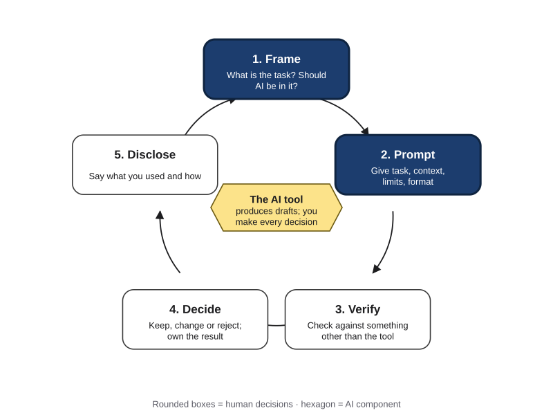

# Framing Tasks and Iterating Prompts {#sec-ch05}

<!-- Status: v1 draft (2026-10-18), chapter agent, stages 2-3. From blueprint v0.2 (approved under D19). Featured student: Lucía only (docs/characters.md); other people are unnamed. Figures: figures/scripts/ch05_figures.py (Signatures 6 and 7 introduced here) and ch05_charts.py (published values in data/ch05_wording.csv and data/ch05_delegation.csv). All of Lucía's prompts and outputs are constructed examples. -->

{#fig-5-1 fig-alt="Chapter map: Frame (5.1, 5.2), Prompt (5.3, 5.4), Test and do (5.5, Lab 5.1, A3); Work Loop strip with Frame and Prompt highlighted."}

**Chapter 5 at a glance.** Part I of this book explained what AI tools are and how they work. Part II is about working with them. This chapter covers the first two decisions of the AI Work Loop from Chapter 1. **Frame:** what is the task, what does a good result look like, and which parts should AI do at all? **Prompt:** what does the tool need to receive, and how do you improve a prompt on purpose instead of by luck?

**Time:** about 30 minutes of Core reading at 150 words per minute (longer if English is not your first language). The boxes work as before: worked examples show every step, faded examples leave some steps for you, and Your Turn and Check Yourself boxes are ungraded practice. Thursday's lab (section 5.6) starts assignment A3. Answers to odd-numbered end-of-chapter questions are in Appendix E.

**The question of this chapter:** *Is getting good results from AI mainly a matter of finding the right words?* Keep your answer in mind. The Chapter Summary returns to it.

## Opening Case: By Klarna's Own Measures {.unnumbered}

Klarna is a Swedish company that lets shoppers pay for purchases in installments. Its customers contact it with questions about payments, refunds and returns. In early 2024 it added an AI assistant, built with OpenAI's technology, to answer customer-service chats.

On February 27, 2024, the company announced the assistant's first month. According to Klarna, the assistant had handled 2.3 million conversations, two-thirds of all its customer-service chats. The company said this was the work of 700 full-time agents. It said customers now resolved their errands in under 2 minutes instead of 11, that satisfaction scores were on par with those for human agents, and that repeat questions had dropped by 25%. It expected the assistant to improve its profit by about $40 million in 2024. Customers could still choose to talk to a person (Klarna, 2024).

Read those numbers carefully. Every one of them is the company's own. No independent study checked them, and a press release reports what a company chose to measure and chose to share. That does not make the numbers false. It means you know whose measures they are.

By the measures Klarna chose (volume, speed, cost and a satisfaction score), the assistant worked. Here is the question this chapter asks: **were those the right measures?**

About fifteen months later, the story changed. In May 2025, Klarna's chief executive, Sebastian Siemiatkowski, gave an interview to Bloomberg. As other outlets reported it, he said that cost had weighed too heavily as the company judged its AI push, and that the result was lower quality. He said customers would always be able to reach a human if they wanted to, and Klarna began recruiting people for customer service on a flexible, remote model. He also said the company remained committed to AI (Entrepreneur, 2025, reporting Bloomberg, 2025). <!-- [VERIFY] Bloomberg (May 8, 2025) is paywalled; wording confirmed through Entrepreneur (May 9, 2025) and CX Dive (Nov 20, 2025). -->

{#fig-5-5 fig-alt="Three dated panels: Feb 2024 company figures; May 2025 CEO says cost weighed too heavily; Nov 2025 CEO claims work of 853 agents."}

Notice what did not change. Nothing in the 2024 announcement says the assistant failed at what it was set up to do. It answered chats, quickly, in large numbers. What changed was the company's own account of what "working" should have meant.

That is the puzzle. If a system does what it was set up to do, and the people who set it up later say the result was not good enough, where did things go wrong? By the end of section 5.2 you will be able to answer with two ideas: how a task's **success criteria** are chosen, and **where the human check sits** when a task is handed to AI. The Case Study returns to Klarna with both ideas and with what the company said later in 2025.

## Learning Objectives {.unnumbered}

Framework tags refer to the AI Fluency framework (Dakan & Feller, 2025) and the UNESCO (United Nations Educational, Scientific and Cultural Organization) AI Competency Framework for Students.

After this chapter you will be able to:

- **O1 — Apply** the Frame step to a real task: its goal, its audience, three to five checkable success criteria, its limits, and what stays with you. *(LO2 · AI Fluency: Delegation, Description · UNESCO: Human-centred mindset, Apply)*
- **O2 — Justify** which way of working with AI (automation, augmentation, agency) or no AI at all fits each part of a task. *(LO2 · AI Fluency: Delegation · UNESCO: Human-centred mindset, Apply)*
- **O3 — Construct** a prompt from the parts its task needs: role, task, context, constraints, in-context examples and output format. *(LO2 · AI Fluency: Description · UNESCO: AI techniques and applications, Apply)*
- **O4 — Diagnose** a weak output by tracing it to a missing or unclear part of the prompt or of the frame. *(LO2 · AI Fluency: Description, Discernment)*
- **O5 — Judge** whether the evidence supports the claim "this prompt works." *(LO2, LO3 · AI Fluency: Discernment · UNESCO: AI techniques and applications, Apply)*
- **O6 — Produce** assignment A3, a documented prompt and iteration log. *(LO2, LO4 · AI Fluency: Diligence, Description)*

::: {.callout-note title="Warm-up (ungraded)"}
1. Have you ever reworded a prompt until it "worked"? How did you know it worked?
2. Does saying *please* to a chat tool change the quality of its answers?
3. If a prompt gives you a good answer once, will it give you a good answer again?

You will revisit your answers in the Chapter Summary.
:::

## 5.1 Frame Before You Prompt {#sec-5-1 .unnumbered}

[Core]{.path}

*Featuring Lucía, an accounting sophomore.*

{#fig-5-1b fig-alt="The AI Work Loop with Frame and Prompt highlighted; Verify, Decide and Disclose follow; the AI tool sits in the middle."}

Most people start using AI by typing. This section asks you to start one step earlier. Before the first prompt, write a **task frame**: a short statement of a task's goal, audience, success criteria, limits and what stays with you, written before the first prompt.

The frame matters because of one part in particular. **Success criteria** are checks, written in advance, that an output must pass to count as good; each can be scored met, partly met or not met. Without them, "it worked" means "it looked fine to me at the time." With them, every version of a prompt can be scored against the same checks.

AI providers' own guides agree. One assumes you have defined success, and a way to test for it, before you write a prompt (Anthropic, n.d.); another recommends tests that measure a prompt's behavior as you change it (OpenAI, n.d.).

{#fig-5-2 fig-alt="Six boxes: goal, audience, success criteria (3–5 checkable checks), limits, what stays with you, a rung for each part."}

A good criterion is **checkable**. "Under 350 words" is: you can count. "Clear" is not, until you say clear to whom. Three to five criteria are usually enough; with more, you will stop scoring them.

Now return to the Opening Case. This book reads Klarna's story as a framing problem, a reading Klarna itself has not offered. The measures the company announced in 2024 were volume, speed and cost. In 2025, its chief executive said cost had weighed too heavily and quality had suffered (Entrepreneur, 2025). In the language of this section, the success criteria a team chooses decide what "the system worked" means. A criterion nobody wrote down is a criterion nobody checks.

::: {.callout-note title="Worked Example: Lucía Frames a Handout"}
**Field:** Business and accounting. *Constructed example.*

The accounting students' association asks Lucía to prepare a one-page handout for a 30-minute workshop on budgeting for first-year students. The request, as she received it, was "something about budgeting for freshmen."

**Her task frame:**

- **Goal:** help first-year students draft their first monthly budget during the workshop.
- **Audience:** first-year university students. Many are managing money alone for the first time; some work part-time; some are international students.
- **Success criteria:** (C1) fits one page, under 350 words; (C2) every number in the example comes from the figures the association gave, and the totals add up; (C3) plain language a first-year student can follow without a dictionary; (C4) one worked example as a table with a total row; (C5) no product, bank or app is named.
- **Limits:** no statistics unless they come from a source she supplies; use the association's constructed example figures; no information about any real student.
- **What stays with her:** choosing what first-year students need to know, checking every number, the final edit, and deciding whether the association hands it out.

"Freshmen" became a described audience, and "good" became five checks she can score.
:::

::: {.callout-note title="Faded Example: A Lab-Safety Summary"}
**Field:** Natural science (biology).

A biology student who leads a research lab group must give two new members a summary of the lab's safety rules before their first session.

- **Goal:** new members know the rules that apply in their first week.
- **Audience:** two undergraduates who have taken intro biology but have never worked in this lab.
- **Success criteria:** (C1) every rule in the summary appears in the lab's official safety sheet; (C2) _______________________; (C3) _______________________.
- **Limits:** _______________________
- **What stays with the student:** _______________________
:::

::: {.callout-important title="Your Turn"}
Choose a task from your major that you might do with AI this month. Write its frame: goal, audience, three to five checkable criteria, limits, and what stays with you. Mark any criterion you could not actually check.
:::

::: {.callout-tip title="Check Yourself 5.1"}
1. What are the five parts of a task frame?
2. Rewrite "the summary should be clear" as a criterion you could check.
3. Why should success criteria be written before the first prompt, not after?
:::

## 5.2 How Much to Hand Over: The Delegation Ladder {#sec-5-2 .unnumbered}

[Core]{.path}

A frame also says which parts of a task AI should do, and how. The AI Fluency framework, by the professors Rick Dakan and Joseph Feller, names four competencies: Delegation, Description, Discernment and Diligence (Dakan et al., 2025). This section is about **Delegation**: knowing when and how to use AI, and in which way (Dakan & Feller, 2025).

The framework identifies three ways, which it calls modalities, of working with AI (Dakan & Feller, 2025):

- **Automation**: working with AI in which the AI carries out a task you define, and you check the output. Drafting an email or summarizing a document are typical.
- **Augmentation**: working with AI in which you and the AI shape and carry out the task together, turn by turn. Developing an essay or a research question with AI as a thinking partner is typical.
- **Agency**: working with AI in which you configure it to carry out future tasks on your behalf, often for other people. Setting up a course chatbot or a tutor that others will use is typical.

This book arranges the three as a ladder, the **Delegation Ladder**: the book's arrangement of three ways of working with AI (automation, augmentation, agency) over a floor of no AI, ordered by how hard it is to see and check what the AI contributed before it takes effect. The order follows the framework's own numbering of the modalities. The ladder, its floor and its single axis are this book's construction. The framework itself ranks none of the modalities and notes that real work often mixes them (Dakan & Feller, 2025).

{#fig-5-3 fig-alt="Delegation Ladder: floor no AI; rungs automation, augmentation, agency; arrow: harder to check what the AI contributed before it takes effect."}

Why that axis? With automation, the output is a separate thing, such as an email, that you can check before you use it. With augmentation, the AI's suggestions enter your thinking turn by turn, so it is harder to say afterward which ideas were yours. With agency, the AI acts later, often for other people, and you do not see each output before it reaches them. A higher rung is not a more advanced use; it needs more checking, set up in a different place.

**Hand over parts, not whole tasks.** The framework's Delegation competency includes "Goal and Task Awareness": breaking a task into AI, human and collaborative parts (Dakan & Feller, 2025). Most real tasks have parts that belong on different rungs, and some parts that belong on the floor.

{#fig-5-4 fig-alt="Three questions: can you check it first; what would an error cost and who bears it; is this skill yours to build. Each points to rungs."}

Three questions help you place a part:

1. **Can you check the result before it takes effect?** If yes, automation can fit. If not yet, add a check first, or keep the part with you.
2. **What would an error cost, and who would bear it?** If an error is cheap and only you bear it, any rung can fit. If it is costly, or borne by other people, do not use agency without a human check before the output reaches them. Chapter 14 calls such checks approval gates.
3. **Is this skill yours to build?** If the point of the task is that you learn to do it, as in most coursework, keep it on the floor or use augmentation in a tutor style (Chapter 7). Otherwise, let the other two questions decide.

::: {.callout-warning title="Agency is not an agent"}
In the AI Fluency framework, *agency* is a way of working: you configure AI to carry out future tasks on your behalf (Dakan & Feller, 2025). An **agent** is a kind of system: one in which the model directs its own steps and tool use (Anthropic, 2024; Chapter 3). A course chatbot that answers questions from a fixed set of instructions is agency without being an agent. Sections 6.5 and 7.5, and Chapter 14, come back to this difference.
:::

::: {.callout-note title="Worked Example: Lucía's Handout, Part by Part"}
**Field:** Business and accounting. *Constructed example.*

Lucía splits her handout into parts and places each one.

{#fig-5-3b fig-alt="Ladder with Lucía's parts: floor, choose content and final check; automation, draft; augmentation, why the example confuses; agency, not now."}

- **Part 1, choose what first-year students need to know: floor.** It is her judgment about her audience.
- **Part 2, draft the handout text: automation.** She can check the draft against her criteria before anyone sees it.
- **Part 3, work out why the example budget confuses readers: augmentation.** She talks it through with a tool, turn by turn, and keeps the decision.
- **Part 4, final check: floor.** She checks every number herself.

A committee member also suggests a study-group FAQ chatbot that would answer classmates' money questions at any hour. That would be **agency**: it would answer other people later, without Lucía checking each answer, and they would bear any error. She decides "not now" until there is a fixed source of answers and a way to check them (Chapter 14).
:::

::: {.callout-note title="Faded Example: An Archive Visit Report"}
**Field:** History.

A history student writes a report on a visit to a city archive, for a seminar.

- (a) Type up handwritten notes from the visit: **automation**, because each typed line can be compared with the notes.
- (b) Decide which three documents matter for the argument: **floor**, because choosing evidence is the skill the seminar assesses.
- (c) Find a clearer way to explain why a 1910 letter contradicts a newspaper report: _______________________ because _______________________.
- (d) The archive asks whether students would help set up a public chatbot that answers visitors' questions: _______________________ because _______________________.
:::

::: {.callout-important title="Your Turn"}
Take the task you framed in section 5.1. Split it into three or four parts and place each on the ladder, or on the floor, with one reason from the three questions.
:::

::: {.callout-tip title="Check Yourself 5.2"}
1. Name the three modalities of the AI Fluency framework and say what you do in each.
2. Why does this book place agency at the top of the ladder? Answer with the ladder's axis, not with "more advanced."
3. Why is a configured course chatbot an example of agency but not necessarily an agent?
:::

## 5.3 The Anatomy of a Prompt {#sec-5-3 .unnumbered}

[Core]{.path}

Now you can write the prompt. The **anatomy of a prompt** is the book's six-part description of what a prompt can contain: role, task, context, constraints, in-context examples and output format. Most guides list similar parts. Google's prompting guide for its workplace tools, for example, names persona, task, context and format, and notes that you do not need all of them in every prompt (Google, 2024).

{#fig-5-6 fig-alt="Six rounded boxes in Your prompt: role, context, in-context examples, task (thick), constraints, output format; arrow to AI tool, then output."}

- **Task**: what you want done, an action and what it acts on. It is the one part every prompt needs: "Draft a one-page handout," "Rewrite this question," "List the three main risks."
- **Role**: the voice, perspective or audience the output should be written for, such as "write as a peer mentor for first-year students." A role shapes tone and vocabulary. Do not expect it to make answers more accurate: in a test of four families of models on 2,410 factual questions, adding a persona, such as "you are a helpful assistant" or an occupational role, did not improve accuracy overall compared with no persona (Zheng et al., 2024).
- **Context**: the background a task needs that the tool cannot otherwise receive, such as figures, readers or source text. Recall Chapter 3: the model receives only what is in the context window. What is in your head, or in last week's chat, is not there unless you put it there. Choosing and arranging context in depth is the subject of Chapter 6.
- **Constraints**: a limit or a must-not in a prompt, such as a length, a source rule or an excluded topic. A "do not" line is still text the model receives. In one 2022 study, a prompt telling a chatbot not to say a particular sentence was followed by output containing that sentence, which surprised the people who wrote it (Zamfirescu-Pereira et al., 2023). Say what to do, and check the result.
- **In-context examples**: an **in-context example** is a sample input with the output you want, placed in a prompt to show the pattern. For instance: "Question: *Don't you agree the fee is unfair?* → Neutral version: *How fair or unfair do you find the fee?*" A model can follow a pattern shown this way without any change to its settings (Brown et al., 2020). Choosing, balancing and testing in-context examples is Chapter 6's topic.
- **Output format**: the shape the output should take, such as a table, a list or a word limit, chosen so it can be checked against your criteria.

**More is not always better.** Each part earns its place by serving the task. Irrelevant material can make results worse: a published test found that adding unrelated sentences to math word problems lowered models' accuracy (Shi et al., 2023; Chapter 6 gives the numbers). Leave out parts the task does not need.

::: {.callout-note title="Two meanings: example and context"}
In Chapter 2, an **example** is one item in a dataset, such as one photo or one email. In this chapter, an **in-context example** is a sample input with its desired output, placed in a prompt. In Chapter 3, the **context window** is everything the model receives in one turn. In this chapter, **context** is one part of your prompt: the background this task needs. Your context is one of the things inside the context window.
:::

::: {.callout-note title="Worked Example: Lucía's v1 and v2"}
**Field:** Business and accounting. *Constructed example.*

{#fig-5-7 fig-alt="Left: v1, a three-sentence prompt. Right: v2 with labeled parts: role, task, context with the figures, constraints, output format."}

**v1**, Lucía's first prompt written from her frame card:

```
Write a one-page handout for first-year students on how to make a
monthly budget. Include one worked example as a table. Use plain language.
```

It has a task, a format and a length. But two runs produced an example budget with income and rent figures she never gave, and a total row that did not match its items. One run also recommended a budgeting app by name. Section 5.4 traces why.

**v2** adds the parts the frame card held but v1 left out:

```
Role: Write as a peer from the accounting students' association.
Task: Draft a one-page handout that shows first-year students how to
make a monthly budget.
Context: Readers are first-year university students; many manage money
alone for the first time; some work part-time. Use only these monthly
figures: income $1,150; rent $650; groceries $280; phone $45;
transport $60.
Constraints: Under 350 words. Plain language. Do not name any product,
bank or app. Do not add numbers I did not give.
Output format: A title; three short sections (income, fixed costs,
flexible costs); the example as a table with a total row.
```

She left out **in-context examples** on purpose: the format line already shows the shape, and she has no sample handout she wants copied.
:::

::: {.callout-note title="Faded Example: A Lab-Report Abstract"}
**Field:** Engineering.

```
Role: Write for engineering faculty who will skim the abstract.
Task: Draft a 150-word abstract of the attached lab report on beam
deflection.
Context: The report is pasted below. The key result is in Table 2.
Constraints: _______________________
Output format: _______________________
```

Which criterion from a frame would each line you add help you check?
:::

::: {.callout-important title="Your Turn"}
Take a prompt you used this week. Label each sentence with its part. Then cross out one part the task did not need, and add one part it did need.
:::

::: {.callout-tip title="Check Yourself 5.3"}
1. Which part of a prompt is always needed, and why?
2. What did Zheng et al. (2024) find about adding a role or persona to prompts on factual questions?
3. Why does a fact "in your head" not reach the model, using Chapter 3's idea of the context window?
:::

## 5.4 Iterate on Purpose {#sec-5-4 .unnumbered}

[Core]{.path}

Before you read on, make a prediction. Two prompts differ only in their first words: *Please answer the following question* and *I order you to answer the following question*. Each is used on 198 hard, multiple-choice science questions, and each question is asked 100 times. Which prompt gets more questions right? Write your guess down.

A team from the Wharton School of the University of Pennsylvania ran this test in 2025 with two OpenAI models, GPT-4o and GPT-4o mini (Meincke et al., 2025a). The questions came from a benchmark, a fixed collection of questions used to compare AI systems; these were graduate-level questions in biology, physics and chemistry. The setting that controls randomness, temperature (Chapter 3), was set to zero. For GPT-4o, *please* and *I order you* made no meaningful difference overall. But individual questions swung widely between the two wordings, in both directions. And one change did matter: removing the line that told the model how to format its answer lowered the share of questions it got right in all 100 runs (Meincke et al., 2025a).

{#fig-5-10 fig-alt="Bars for four prompt wordings, two scoring standards: near zero above random for all 100 runs correct; about 20 to 24 points for most runs."}

The figure shows a second lesson. Judged by "right in all 100 runs," no wording scored clearly above random guessing; judged by "right in most runs," every wording did, by about 20 points. How you measure "it works" mattered more than the wording. Another research team found that changing only the formatting of a prompt, such as spacing or punctuation, moved one open model's accuracy (LLaMA-2-13B, tested in 2023) by up to 76 percentage points on some tasks (Sclar et al., 2024).

A follow-up report from the same team found that offering the model a tip, or threatening it, generally made no significant difference to benchmark scores either (Meincke et al., 2025c). Wording effects are real, but hard to predict, and they differ from question to question. So do not trust a trick. Test.

**Iteration** is improving a prompt by changing one thing at a time, predicting the effect, rerunning and scoring the result against your success criteria. It has seven steps.

{#fig-5-8 fig-alt="Seven steps in a loop: diagnose, trace to a part or the frame, change one thing, predict, rerun twice, score, log; dashed exit back to Frame."}

1. **Diagnose** the weak output: which criterion did it miss?
2. **Trace** the miss to a part of the prompt, or to the frame.
3. **Change one thing.** If you change three things and the output improves, you will not know which change helped.
4. **Predict** the effect before you run it.
5. **Rerun** in a fresh chat, at least twice. Outputs vary from run to run (Chapter 3). A fresh chat is a clean test; a follow-up in the same chat keeps earlier turns in the context window.
6. **Score** each output against your criteria.
7. **Log** it, then keep the change or revert it.

**Ask "why?" more than once.** The first answer is often only a symptom. If the trace ends at the task itself (an unclear goal, an undecided audience), go back to Frame instead of rewording. Sometimes the honest answer is that this part belongs on the floor.

::: {.callout-note title="Worked Example: Tracing Lucía's v1"}
**Field:** Business and accounting. *Constructed example.*

{#fig-5-9 fig-alt="Chain: wrong total and invented numbers → no figures in prompt → frame said use them → left in notes → fix v2. Dashed side: bad at sums?"}

Lucía's v1 missed C2 in both runs: invented numbers and a wrong total. Why? No figures were in the prompt, so the output filled in plausible ones. Why? Her frame card said to use the association's figures, but she never pasted them. Why? They were in her notes, not in the prompt. She checked each link: the prompt really had no figures, and the frame card really said to use them.

A second explanation, "the model is just bad at sums," was only an assumption. Her v2 tests it: if the totals are still wrong when the figures are given, that explanation gains weight.

**Her log so far:**

{#fig-5-13 fig-alt="Log table: version, part changed, prediction, run 1, run 2, keep. v2 added figures; v3 banned products; v4 row left empty."}

- **v2.** Changed: context (the figures). Prediction: every number matches. Result: run 1 met all five criteria; run 2 used the right numbers but named a budgeting app (C5). Keep.
- **v3.** Changed: a constraint ("Do not name any product, bank or app"). Prediction: no product named, nothing else changes. Result: run 1 met all five; run 2 met four and partly met C3, using "discretionary spending" without explaining it. Keep.
- **v4.** Changed: a constraint ("Explain each money term in a few plain words the first time you use it"). Prediction: C3 met in both runs. Result: met in both runs. Keep.
:::

::: {.callout-note title="Faded Example: A Museum Exhibit Label"}
**Field:** Arts. *Constructed example.*

A student intern drafts a wall label for a painting. Criteria: (C1) under 60 words; (C2) only facts from the curator's notes; (C3) readable for visitors aged 12 and up.

- **v2.** Changed: context (pasted the curator's notes). Prediction: no invented facts. Result: run 1 met all; run 2 added "restored in 1987," which is not in the notes (C2 not met). Keep, and fix C2 next.
- **v3.** Changed: a constraint ("Use only facts in the notes; if something is not in them, leave it out"). Prediction: C2 met. Result: C2 met in both runs; both labels were about 85 words (C1 not met). Keep.
- **v4.** Changed: _______________________ Prediction: _______________________
:::

::: {.callout-important title="Your Turn"}
In Lab 5.1 you will write v1 to v3 of your own prompt, one change at a time, with a prediction before each run.
:::

::: {.callout-tip title="Check Yourself 5.4"}
1. Why should each new version change only one thing?
2. In the 2025 test with GPT-4o, what made a bigger difference to the results: *please* versus *I order you*, or how strictly the answers were scored?
3. When should a trace send you back to Frame instead of to the prompt?
:::

## 5.5 One Result Is Not Evidence {#sec-5-5 .unnumbered}

[Core]{.path}

When can you say a prompt works? A 2022 study shows how people new to prompting tend to answer, and why that is risky.

Four researchers at the University of California, Berkeley, Georgia Tech and Cornell asked ten people with little or no prompt-design experience to improve a chatbot that walked a home cook through a recipe (Zamfirescu-Pereira et al., 2023). The chatbot ran on an OpenAI model of the time, GPT-3 (text-davinci-002). The participants were mostly professionals and graduate students in science and technology fields, and the authors say they were not a representative sample.

The participants worked opportunistically, not systematically. Most stopped as soon as they saw the behavior they wanted once, and moved on. Some gave up on an approach after one or two failures and concluded that the chatbot could not do it. They rarely checked whether a later change brought back a problem they had already fixed. And they often wrote instructions the way they would talk to a person, expecting the chatbot to understand what they meant (Zamfirescu-Pereira et al., 2023).

So use a stricter standard. A prompt works when it meets your criteria across **repeated runs** and across **test inputs**: a small set of different inputs a prompt is tried on (typical, different, edge) to see whether it works beyond one case. A **typical** input is the case you expect most often. A **different** input changes something that matters. An **edge** input is unusual but possible, the case most likely to break the prompt. After each change, rerun the earlier inputs too, because a fix can break something that used to work.

*A note on words:* these are test inputs, not a test set. In Chapter 2, a test set was labeled examples held back to score a trained model. The idea is related: in both cases you judge something on cases it was not shaped around.

{#fig-5-11 fig-alt="Grid for Lucía's v4: typical, different and edge inputs by two runs; one partly met, one not met on the edge input; verdict: not yet."}

The last check needs another person. In a **peer swap test**, someone else runs your prompt without your explanation and scores the output against your criteria, to reveal what was in your head but not in the prompt. You cannot easily see your own missing context, because you always read the prompt with it.

{#fig-5-12 fig-alt="Flow: your final prompt → a classmate runs it in a fresh chat → output → scored against your criteria → gap? yes: add it to the prompt; no: evidence."}

::: {.callout-note title="Worked Example: Is Lucía's Prompt Done?"}
**Field:** Business and accounting. *Constructed example.*

Lucía runs v4 twice on three test inputs. **Typical:** the association's figures. **Different:** a student whose tutoring income changes from month to month. **Edge:** a student whose costs are higher than her income.

Five of six runs meet every criterion. One run on the different input leaves out the table (C4 partly met). One run on the edge input "balances" the budget by inventing an "other income" line (C2 not met). Verdict: not yet. Her **v5** adds a constraint: "If costs are higher than income, say so and show the gap. Never add a number I did not give." She reruns all three inputs, not only the edge case. All six runs meet all five criteria.

Then a classmate runs v5 in a fresh chat and scores it. The classmate marks C3 only partly met: the handout explains "net pay" as "gross pay minus withholdings," and the classmate does not know what withholdings are. Lucía had not noticed, because she is an accounting major. Her sense of "plain" was in her head, not in the prompt. Her **v6** adds to the context: "Readers have never seen a pay stub; avoid accounting terms, or explain them with an everyday example." She also sharpens C3 to "every money term is explained in everyday words."

She stops at v6. Every criterion is met across runs and inputs, and the peer swap found no new gap. The rest is her own edit.
:::

::: {.callout-note title="Faded Example: A Survey Question"}
**Field:** Social science. *Constructed example.*

A sociology student's prompt: "Rewrite this survey question so it is neutral: *Don't you agree that the new parking fee is unfair?*" Three runs gave:

1. "Do you agree or disagree that the new parking fee is fair?"
2. "How fair or unfair do you find the new parking fee?"
3. "Don't you think the parking fee is too high?"

The student concludes, "It works: two out of three are neutral."

- Output 3 fails because _______________________.
- Is "two out of three" enough evidence? _______________________
- Which test is missing? _______________________
:::

::: {.callout-important title="Your Turn"}
In Lab 5.1, swap your latest prompts with a partner and score each other's outputs against the owner's criteria. If your prompt fails in a way you did not expect, write it down. **Save this for your Failure Diary (Chapter 4).**
:::

::: {.callout-tip title="Check Yourself 5.5"}
1. Name the three kinds of test inputs and give an example of each for a task in your field.
2. What two habits did the participants in the 2022 study show that make "it worked once" risky?
3. Why does a peer swap test find problems that you miss when you test your own prompt?
:::

## 5.6 The Iteration Sprint (A3) {#sec-5-6 .unnumbered}

[Studio]{.path}

*Studio sections are hands-on work for the Thursday lab and your weekly assignment.*

Thursday's lab turns sections 5.1 to 5.5 into a record: your **iteration log**, a record of each prompt version: what changed, the prediction, the results of each run and the decision to keep or revert. The log is the core of assignment A3 (brief and rubric at the end of this chapter).

**What a strong log shows.** Each row makes one change and names the prompt part it changes, or says "frame." Each row has a prediction written before the run. Each result is scored against the criteria from your frame card, not against a feeling. Each row ends with a decision: keep or revert. Lucía's log in section 5.4 is a condensed example.

**What a weak log looks like.** Four rewordings of the same sentence, no criteria, results described as "better" or "worse," one run each. It may end with a good prompt, but it gives no evidence that the prompt is good, or why.

**Where v1 comes from.** Your v1 is the first prompt you write from your frame card, an honest first attempt. Do not write a deliberately weak v1 so that later versions look better. Lucía's v1 included a task, a length and a format; it still missed what was in her notes.

**When to stop.** Stop when every criterion is met across your runs and test inputs and the peer swap finds no new gap, or when the trace keeps ending at the frame. Then the next step is to reframe, or to keep that part of the task for yourself.

::: {.callout-note title="Faded Example: Finish the Log"}
*Constructed example.* An education major is writing practice questions for a fifth-grade unit on fractions.

**Frame card (given):** goal, five practice questions with an answer key; audience, fifth graders in their second week of fractions; criteria: (C1) every answer in the key is correct; (C2) no question needs a calculator; (C3) the questions use everyday objects; (C4) the key shows one line of working for each answer.

- **v1 (given):** "Write five fraction practice questions for fifth graders with an answer key." Result: two runs; one key had a wrong answer (C1 not met); no working shown (C4 not met).
- **v2 (given):** Changed: output format ("For each answer, show one line of working"). Prediction: C4 met; the working line may expose wrong answers. Result: C4 met in both runs; one wrong answer remained in run 2, now easy to spot.
- **v3:** Changed: _______________________ Prediction: _______________________
- **Test inputs for the final version:** typical _______________ · different _______________ · edge _______________
:::

::: {.callout-tip title="Check Yourself 5.6"}
1. What four things should every row of an iteration log contain?
2. Why should v1 be an honest first attempt rather than a deliberately weak prompt?
:::

## Deep 5.A: Techniques Beyond the Six Parts {#sec-5-deep-a .unnumbered}

[Deep]{.path}

*Deep sections are optional and not examinable.*

The six parts cover most everyday prompts. Researchers have named many more techniques. One systematic review of the research literature collected a vocabulary of 33 terms and a list of 58 prompting techniques for text alone (Schulhoff et al., 2024). Three of them are worth knowing, each with its limits.

**Step-by-step prompting.** In 2022, a team at Google reported that showing a model a few worked examples whose answers included the intermediate reasoning steps, not only the final answer, improved the performance of large models on arithmetic, commonsense and symbolic reasoning tasks (Wei et al., 2022). They called this *chain-of-thought prompting*. Since then, some models have been built to produce intermediate steps before an answer without being asked; providers often call them reasoning models. In a 2025 test, asking for step-by-step reasoning gave models without that built-in behavior a modest average gain but made their answers more variable, and gave reasoning models only marginal gains while taking 20% to 80% more time (Meincke et al., 2025b). Whether to ask for steps is therefore something to test on your own task, with your own criteria.

**Asking what the tool needs.** Before the task, you can ask the tool to list the information it would need to do the task well, then supply what is missing. This book suggests it as a framing aid, not as a tested technique: the list is itself an output to judge, and it can include things you do not need or should not share.

**Splitting a task into steps.** Some tasks work better as a fixed sequence of smaller prompts, with a person checking between steps. Chapter 6 (section 6.7) covers these *prompt chains*.

None of these replaces the frame. A technique changes how the model is asked; only your criteria say whether the result is good.

## Deep 5.B: How People Actually Delegate {#sec-5-deep-b .unnumbered}

[Deep]{.path}

How much of real AI use is automation, and how much is collaboration? One AI provider, Anthropic, has published analyses of how its own users work, using a model to classify large numbers of conversations while keeping their contents private. Its definitions are its own. It counts a conversation as *automation* when the person mostly directs the output or relays feedback such as error messages, and as *augmentation* when the person iterates on a task with the model, learns from it or asks it to check their work (Handa et al., 2025). These are not the same as the AI Fluency modalities in section 5.2, so read the numbers as a related measure, not as a count of rungs.

In its first report, covering conversations on its chat service from late 2024 and early 2025, 57% of conversations were classified as augmentation and 43% as automation (Handa et al., 2025). A later report used August 2025 data and a newer classifier model (Appel et al., 2025). With that classifier, 49% of chat conversations showed automation patterns (45% when the same data was re-scored with the older classifier). In traffic from businesses that connect their own software to the provider's models through an application programming interface (API), 77% of transcripts showed automation patterns and 12% augmentation (Appel et al., 2025).

{#fig-5-14 fig-alt="Two bars, August 2025, same classifier: chat conversations 49% automation patterns; business API traffic 77%."}

Because the classifier changed between the two reports, this book draws no trend from them. The comparison within August 2025 is cleaner, and it fits section 5.2: when a business builds AI into its own software, the person often drops out of the turn-by-turn loop, which is exactly when the place of the human check needs to be designed rather than assumed. These are one provider's users, classified by that provider's own model, so they describe that platform, not AI use in general.

## Hands-on Labs {.unnumbered}

Lab 5.1 is Thursday's in-class lab and starts A3. Labs 5.2 and 5.3 are optional and can be done at home or in Compass, which is optional and ungraded. The labs say what to do, not which buttons to press; current tool steps, including how to open a fresh, temporary chat, are in Compass. [COMPASS: lab pages ch05-lab1 to ch05-lab3] Never put personal or confidential information into a prompt.

### Lab 5.1: Prompt Iteration Sprint (Studio · 75 minutes · in class) {.unnumbered}

*(O1–O6 · LO2 · Apply, Analyze, Evaluate)* Teams of three or four; every log is individual.

1. **Briefing (10 min).** Open the log template (eLearning or @fig-5-13). Your instructor pairs you for the peer swap. If you have no task of your own, pick one from the eLearning task bank.
2. **Frame (10 min).** Write your frame card with a rung for each part. A teammate reads your criteria and marks any they could not score.
3. **Versions 1 to 3 (20 min).** Write v1 from your frame card. Run it once in a fresh, temporary chat and score it. Write v2 and v3, one change each, with a prediction before each run. Second runs and v4 are done at home.
4. **Peer swap (15 min).** Run your partner's v3 in a fresh chat, without asking them anything, and score the output against their criteria. Tell them what was missing.
5. **Share and critique (15 min).** Each team shows the one change that mattered most and one that did not.
6. **Exit (5 min).** Finish the sentence: "My prompt works for … but I have not tested …"

**If it does not work:** if a tool refuses or errors, record that as a result and try a smaller task; if you cannot use a tool, start the alternative assignment's audit with the dated sample log on eLearning.

### Lab 5.2: Same Task, Two Rungs (Compare · 20 minutes · optional) {.unnumbered}

*(O2 · LO2 · Evaluate)* Pick one study task you would normally do yourself, such as a summary of a reading. Do it once as **automation** ("produce the summary") and once as **augmentation** ("help me work out the three main claims; ask me questions; do not write the summary"). Compare: what did you learn each time, how long did checking take, and which parts of the result were yours?

### Lab 5.3: Test a Magic Phrase (Break It · 25 minutes · optional) {.unnumbered}

*(O4, O5 · LO2 · Evaluate)* Choose one popular prompting "trick" (a politeness phrase, an expert role, an offered tip). Write a short task with three criteria and two test inputs. Run the prompt five times with the trick and five times without, on each input, in fresh chats, and score every output. Write a conclusion limited to your test, such as "for this task and tool, on this date, the phrase made no visible difference." If the trick makes an output worse in a way you did not expect, **save this for your Failure Diary (Chapter 4).**

## Case Study: Klarna, Revisited {.unnumbered}

**Context.** Klarna, a Swedish payments company, sells "buy now, pay later" installment plans. Its customers contact customer service about payments, refunds and returns. In early 2024 it launched an AI assistant built with OpenAI's technology to answer those chats (Klarna, 2024).

**Timeline.** February 27, 2024: Klarna reports the assistant's first month (2.3 million conversations; two-thirds of customer-service chats; work it equates to 700 full-time agents; resolution time under 2 minutes instead of 11; satisfaction on par with human agents; 25% fewer repeat inquiries; an expected $40 million profit improvement) (Klarna, 2024). May 2025: in a Bloomberg interview, as reported by other outlets, the chief executive says cost weighed too heavily, quality suffered, and customers will always be able to reach a person; Klarna recruits people for customer service on a flexible, remote model (Entrepreneur, 2025). November 2025: on the company's third-quarter earnings call, the chief executive says the assistant now does the work of more than 853 full-time agents and has saved about $60 million; the company says satisfaction with it is on par with human agents (Doerer, 2025).

**Where the case sits on the ladder.** From the company's side, the assistant is **agency** in the AI Fluency framework's sense: Klarna configured an AI system to carry out future tasks, answering customers, on its behalf (Dakan & Feller, 2025). So, from the company's side, was the assistant in Chapter 1's support-center study, which a company set up for its agents (Brynjolfsson et al., 2025). The two cases sit on the same rung. What differs is **where the human check sits**.

- In Chapter 1's study, the assistant suggested replies to human agents, who could use, change or ignore them before the customer saw anything (Brynjolfsson et al., 2025). A person checked each output before it took effect.
- At Klarna, as the company described it, the assistant answered customers directly, and customers could ask for a person (Klarna, 2024). The check before each answer took effect was removed; the human became an option the customer had to choose.

This book reads the 2025 statements in that light: when the check moves from before the output to after it, the measures that judge the system have to change too. Volume and speed measure how much the assistant did; they do not measure what happened to the customers it did not help. Chapter 14 calls a check placed before an output takes effect an *approval gate*.

**Company claims and independent evidence.** Every number in this case comes from Klarna or its chief executive. They are claims about the company's own operations, made by a company with an interest in how they are received. An analyst quoted in a trade publication in November 2025 said Klarna had over-pivoted toward cost containment (Doerer, 2025). That is one analyst's view, not an independent measurement either. The honest summary is that the public record shows what the company chose to measure and later chose to say, not how many customers were well or badly served.

**A better workflow (AI Work Loop, for the team setting it up).** *Frame:* write quality criteria (problems actually solved, customers who wanted a person and got one) next to volume and cost, before launch. *Prompt and configure:* decide which kinds of question the assistant answers alone and which go to a person. *Verify:* sample conversations and score them against the quality criteria, not only the speed criteria. *Decide:* place a human check before outputs that are costly to get wrong. *Disclose:* tell customers they are talking to an AI and how to reach a person.

### Short case 1: Why people new to prompting stop too early {.unnumbered}

In the 2022 study in section 5.5, ten people improved a recipe chatbot built on GPT-3 (Zamfirescu-Pereira et al., 2023). Read their habits against the iteration loop (@fig-5-8). They often skipped *score*: they stopped when they saw the behavior they wanted once. They skipped *rerun earlier inputs*: later changes could bring back problems they had fixed. And their *diagnose* step was shaped by talking to people: they expected the chatbot to understand their instructions, and few used in-context examples, even after being shown that examples helped. The authors drew a design lesson for tool builders and a literacy lesson for everyone else, which is the subject of this chapter.

### Short case 2: Small changes, big swings {.unnumbered}

Two studies, two years apart, point the same way. In 2023, researchers changed only the formatting of few-shot prompts (spacing, separators, capital letters) and found accuracy differences of up to 76 points for LLaMA-2-13B; they recommended reporting a range of results across plausible formats instead of one number (Sclar et al., 2024). In 2025, another team asked each of 198 questions 100 times and found that conclusions about a model depended on the scoring standard as much as on the prompt (Meincke et al., 2025a). The common lesson: "this prompt works" is a claim about a measurement. Say how you measured.

## Ethics Lens: Who Pays for a Badly Framed Delegation? {.unnumbered}

Framing looks like a private, technical step. It is also a decision about other people.

**Success criteria carry values.** A criterion such as "resolution time under two minutes" says speed matters. A criterion such as "customers who want a person can reach one" says choice matters. Neither is neutral, and whoever writes the criteria decides whose interests are counted. In the Klarna case, the company's own later account was that one kind of measure had weighed too heavily (Entrepreneur, 2025).

**The higher the rung, the more people carry the risk.** At the automation rung, a bad output costs you a rewrite. At the agency rung, it reaches classmates, customers or patients who did not choose the tool and may not know it is there. That is why the second question in section 5.2 asks who would bear an error, not only what it would cost.

**Telling people.** If an AI system speaks to people on your behalf, they deserve to know, and to know how to reach a person. Chapter 17 discusses transparency, and Chapter 18 discusses the rules that increasingly require it.

**What goes into a prompt.** Context makes prompts better, and it is also where private information leaks. Lucía used constructed figures, not real students' finances. In this course, personal or confidential data does not go into public AI tools (course guidance); Chapter 15 explains why.

## Career Connection {.unnumbered}

| Occupation | Where framing and prompting show up | A question a professional asks |
|---|---|---|
| Marketing or communications specialist | A creative brief already has a role, a task, an audience, constraints and a format | Would someone outside my team produce the right thing from this brief alone? |
| Accountant or auditor | Framing an analysis request; keeping the judgment about what the numbers mean | Which part of this analysis can I check before it goes to the client? |
| Teacher | Generating practice items with constraints and a key | Did I check every answer in the key, on more than one set of items? |
| Software tester or quality analyst | Test inputs, edge cases and re-running old tests after a change are everyday work | What is the edge case most likely to break this? |
| Nurse educator | Patient materials with must-not constraints (no new advice, exact doses) | Who checks every medical statement before a patient reads it? |
| Operations manager | Deciding which parts of a process to automate and where the human check sits | If this runs without us, who sees its mistakes, and when? |

## From the Field {.unnumbered}

<!-- Based on the author's encyclopedia entry (Şeker, 2014), "Beş Neden Yöntemi (5 Whys)", YBS Ansiklopedi 1(4), read from Drive 1DrAi2SG_C_WyYCC5xminYeMS0uoMl7zJ on 2026-10-18; translated and paraphrased from Turkish. Facts limited to the entry; present-day connections marked as such. Registry: docs/production/ftf-sources.md. No commercial interest: no disclosure (D16 not applicable). -->

In 2014 I wrote a short encyclopedia entry on the "5 Whys," a method for finding what lies behind a problem (Şeker, 2014). It is used in quality work, usually with experts or the people inside a process, though it can also work with customers or suppliers. The method is simple: ask "why?" about a problem five times in a row.

The entry used a common example. A car will not start. Why? The battery is dead. Why? The alternator may not have charged it. Why? The alternator is broken. Why? It had reached the end of its service life and was not replaced at the last service. Why? The car may not have been properly maintained by the service shop. A general problem, a car that will not start, turns out to rest on a detail: neglect during maintenance.

The entry also reported criticisms of the method, citing Toyota's global purchasing manager, Teruyuki Minoura. The method can stay at the level of symptoms. It cannot go beyond what the investigator and the people answering already know. "Why" questions can lead the investigator in the wrong direction. Its results are not repeatable: different people, at different times and places, can reach different answers. And having to answer "why" again and again can scatter the focus instead of finding the main cause. In response, the entry noted, people developed refinements, such as confirming that each answer is true, and discussing how much it really matters, before asking the next "why."

*Present-day connections, read with this chapter:* asking "why does this task exist, and for whom?" before writing a prompt is the Frame step. "It cannot go beyond what you already know" applies to a frame too: Lucía could not see her own jargon until a classmate ran her prompt. "Not repeatable" is why section 5.5 runs a prompt more than once and on more than one input. And "confirm each answer before the next why" is the discipline of changing one thing at a time and checking the result before moving on.

## Chapter Summary {.unnumbered}

{#fig-5-6s fig-alt="Six rounded boxes in Your prompt: role, context, in-context examples, task (thick), constraints, output format; arrow to AI tool, then output."}

{#fig-5-3s fig-alt="Delegation Ladder: floor no AI; rungs automation, augmentation, agency; arrow: harder to check what the AI contributed before it takes effect."}

{#fig-5-15 fig-alt="Six cards: frame, delegate by part, prompt parts, iterate, test, log it."}

**The chapter's question:** *Is getting good results from AI mainly a matter of finding the right words?* Mostly no. Results depend first on framing: what the task is for, what a good result looks like, and which parts to hand over in which way. Then they depend on giving the tool what the task needs, and on testing deliberately. Wording does matter, sometimes a lot, but in ways that are hard to predict and that change from question to question. That is why you test instead of trusting a trick.

**Return to the Opening Case.** Klarna's assistant did what it was set up to do, by the measures the company chose. In 2025, the company's own chief executive said one of those measures, cost, had weighed too heavily. Read with this chapter, the story is about success criteria and about where the human check sits, not about wording.

**Revisit your Warm-up.** (1) How did you know a prompt worked? *A strong answer:* it met criteria written in advance, across more than one run and more than one input. (2) Does *please* help? *In one large 2025 test, not overall for GPT-4o*, though single questions swung both ways; test it on your own task. (3) Will a good answer come again? *Not guaranteed:* outputs vary between runs, so one good answer is not evidence.

You can now:

- **Apply** the Frame step: goal, audience, checkable criteria, limits and what stays with you.
- **Justify** a rung, or the floor, for each part of a task.
- **Construct** a prompt from the parts its task needs.
- **Diagnose** a weak output by tracing it to the prompt or to the frame.
- **Judge** whether the evidence supports "this prompt works."
- **Produce** an iteration log for A3.

### Key Terms {.unnumbered}

agency (mode of working with AI) · agent (Ch. 3) · anatomy of a prompt · augmentation · automation · constraint · context (prompt part) · context window (Ch. 3) · Delegation Ladder · example (Ch. 2) · in-context example · iteration · iteration log · output format · peer swap test · role (prompt part) · success criteria · task (prompt part) · task frame · test inputs

## End-of-Chapter Package {.unnumbered}

<!-- Each item: objective · LO · revised Bloom level. Odd-numbered answers → Appendix E (docs/production/handoff/ch05.md); even-numbered → private/ch05-answers-even.md. Review A distractors draw on M1–M6. -->

### Review Questions A: Terms and Concepts {.unnumbered}

1. *(O1 · LO2 · Remember)* Name the five parts of a task frame.
2. *(O1 · LO2 · Understand)* Which of these is a checkable success criterion for a one-page handout?\
   (a) "It should be engaging."\
   (b) "Every number in the example comes from the figures provided."\
   (c) "It should sound professional."\
   (d) "The tool should do its best work."
3. *(O2 · LO2 · Remember)* In one sentence each, say what you do in automation, augmentation and agency.
4. *(O2 · LO2 · Understand)* Why does this book place agency at the top of the Delegation Ladder?\
   (a) It is the most advanced and efficient way to use AI.\
   (b) The AI acts later, often for other people, so what it contributed is hardest to check before it takes effect.\
   (c) The AI Fluency framework ranks it as the highest modality.\
   (d) Agency is the only modality in which the model can use tools.
5. *(O2 · LO2 · Understand)* Explain the difference between agency (a way of working) and an agent (a kind of system). Give one example of agency that is not an agent.
6. *(O3 · LO2 · Remember)* Which part of a prompt is always needed, and what does it contain?
7. *(O3 · LO2 · Understand)* A student starts every prompt with "You are a world-class physicist" to get more accurate physics answers. Which statement best fits the evidence in section 5.3?\
   (a) The role reliably makes factual answers more accurate.\
   (b) In a large test, personas did not improve accuracy on factual questions overall; a role mainly shapes voice and audience.\
   (c) Roles always make answers less accurate.\
   (d) The model takes on a physicist's knowledge for that chat.
8. *(O3 · LO2 · Understand)* In one sentence each, explain *example* in Chapter 2 and *in-context example* in this chapter.
9. *(O3 · LO2 · Understand)* Which statement about prompt length is most accurate?\
   (a) Adding everything you know about the topic usually improves the output.\
   (b) Each part should serve the task; irrelevant material can lower the quality of the output.\
   (c) A prompt should be one sentence long.\
   (d) Length matters only for image tools.
10. *(O4 · LO2 · Understand)* You change the role, a constraint and the output format at the same time, and the output improves. What can you conclude?\
    (a) All three changes helped.\
    (b) You cannot tell which change helped.\
    (c) The role helped most, because it comes first.\
    (d) The prompt is now finished.
11. *(O4 · LO2 · Understand)* In the 2025 test with GPT-4o described in section 5.4, what happened when *Please answer…* and *I order you to answer…* were compared?\
    (a) *Please* raised the score substantially.\
    (b) *I order you* raised the score substantially.\
    (c) Neither made a meaningful overall difference, although single questions swung in both directions.\
    (d) The wording of a prompt never affects results.
12. *(O5 · LO2 · Understand)* A prompt gave you a good answer once. What should you do before saying it works?\
    (a) Nothing; one good answer shows the prompt works.\
    (b) Conclude the tool cannot do the task if the next run fails.\
    (c) Run it more than once on typical, different and edge test inputs, and score each output against your criteria.\
    (d) Ask the tool whether the prompt works.
13. *(O5 · LO2 · Remember)* What does a peer swap test reveal that testing your own prompt usually does not?
14. *(O5 · LO2 · Understand)* Which description fits an **edge** test input?\
    (a) The case you expect most often.\
    (b) An input from a different tool.\
    (c) An unusual but possible case, the one most likely to break the prompt.\
    (d) The input that produced the best output so far.

### Review Questions B: Case Questions {.unnumbered}

1. *(O1 · LO2 · Apply)* A nursing student wants AI to "make a study sheet on heart medications." Write a task frame: goal, audience, three checkable criteria, one limit, and what stays with the student. Include one criterion about safety.
2. *(O2 · LO2, LO5 · Evaluate)* A public library plans a chatbot, built from its own web pages, that answers patrons' questions about opening hours, fines and events. Place it on the Delegation Ladder, say where the human check sits in this plan, and propose one change that would move a check before the answers reach patrons for the questions that matter most.
3. *(O3, O4 · LO2 · Analyze)* A business student prompts: "Write a LinkedIn post about my internship." The output is 400 words of general praise and mentions a company award she never received. Label the prompt parts that are missing, trace the invented award with at least two "why" steps, and write v2 with one change and a prediction.
4. *(O5 · LO2, LO3 · Evaluate)* A teaching assistant writes a prompt that produces quiz answer keys. He tests it on one quiz, finds the key correct, and shares the prompt with five other assistants. Judge his evidence and write a better test plan: runs, typical, different and edge inputs, and a peer swap.

### Review Questions C: Interpretive Questions {.unnumbered}

1. *(O2 · LO2, LO5 · Evaluate)* "Klarna's assistant worked; the company simply changed its mind." Agree or disagree, using success criteria and where the human check sits.
2. *(O5 · LO2 · Evaluate)* "Prompting is a passing skill: soon models will produce what we mean without careful prompts." Take a position, using the evidence in sections 5.4 and 5.5 and what framing adds that wording cannot.
3. *(O1 · LO4 · Evaluate)* For AI-assisted coursework, who should write the success criteria: the student, the instructor, or both? Defend your answer.

### Spaced Review {.unnumbered}

Come back to these a few days after reading, without looking back.

1. *(Chapter 3 · LO1 · Understand)* Why can the same prompt give different outputs on two runs? Which step of the iteration loop in section 5.4 allows for this?
2. *(Chapter 3 · LO1 · Understand)* Lucía's figures were "in her notes, not in the prompt." Use the definition of the context window to explain why that mattered.
3. *(Chapter 3 · LO1 · Understand)* A student corrects a chat tool during a long conversation, then reuses the original prompt in a fresh chat. Why might the correction no longer apply?
4. *(Chapter 2 · LO1 · Understand)* How are this chapter's test inputs like a test set in Chapter 2, and how are they different?
5. *(Chapter 1 · LO4 · Remember)* Name the five steps of the AI Work Loop. Which two did this chapter strengthen?

### Discussion Questions {.unnumbered}

1. *(Ethics · O2 · LO5 · Evaluate)* Who should decide the success criteria for an AI system that answers the public: the company, its staff, its customers, a regulator? What would each group want measured?
2. *(Career · O2 · LO2 · Apply)* Think of a job you might hold in five years. Which parts of it would you keep on the floor, and why?
3. *(Interdisciplinary · O4 · LO2 · Analyze)* Many fields have a method for finding causes, such as root-cause analysis in engineering, differential diagnosis in medicine, or source criticism in history. How is it like tracing a weak output in section 5.4, and how is it different?
4. *(O3 · LO2 · Evaluate)* Do you say *please* to chat tools? Is your reason about the output, about yourself, or about habit?
5. *(O2 · LO2, LO6 · Create)* Describe one use of agency in your field that would help people. Where would you put the human check?

### Application Assignment: A3 — Prompt and Iteration Log {.unnumbered}

**Due:** Monday, February 8, 2027, 11:59 p.m., on eLearning. *(O6 · LO2, LO4 · Create)* Started in Thursday's lab (v1 to v3); about 45–60 minutes at home for v4, second runs, the record and the declaration.

**Choose a task:** a real task from your major, a job or daily life that you would actually use AI for. Use **no personal or confidential data**, yours or anyone else's (course guidance), and no data from an employer unless you use that employer's approved tool under its rules. The eLearning task bank has options.

**What to submit:**

1. **Frame card:** goal, audience, three to five checkable success criteria, limits, what stays with you, and **a rung for each part** of the task (or the floor), with one reason each.
2. **At least four prompt versions.** v1 is the first prompt you write from your frame card, an honest first attempt. Each later version makes **one** change, names the prompt part it changes (or says "frame"), and states a prediction before the run.
3. **Test record:** run every version at least twice, each time in a fresh, temporary chat. Run the final version on three test inputs (typical, different, edge). Score each output against each criterion: met, partly met or not met. Save outputs or excerpts with the tool name and date.
4. **Peer swap test:** a classmate runs your final prompt in a fresh chat without your explanation and scores the output against your criteria. Record what they got, what was missing from your prompt, and what you changed.
5. **Verification note:** list each claim or number you relied on in the final output and how you checked it, or explain why the task had none.
6. **Reflection (3–5 sentences):** the change that mattered most and why, one change that did not help, and when and why you stopped.
7. **AI Use Declaration:** tools, purpose, what you accepted, rejected or revised, how you verified it, and where your own judgment shaped the result.

**Rubric (10 points)**

| Criterion (points) | Exemplary | Proficient | Developing | Beginning |
|---|---|---|---|---|
| **Task and frame (3)** | 3: a real task; all frame elements; 3–5 checkable criteria; a rung for each part, each with a reason | 2: all elements, but one or two criteria cannot be checked, or the rung reasons are generic | 1: two or more elements missing, or criteria vague throughout | 0: no frame card |
| **Versions and changes (1.5)** | 1.5: at least four versions; each later version makes one named change with a prediction | 1: four versions; one or two change several things at once or lack a prediction | 0.5: two or three versions, or changes not named | 0: one version |
| **Testing evidence (1.5)** | 1.5: every version run twice; final version on typical, different and edge inputs; every output scored against the criteria | 1: most versions run twice and scored; final version on one or two inputs | 0.5: single runs, or scores not tied to the criteria | 0: no test record |
| **Verification (2)** | 2: peer swap recorded with what it revealed and what changed; every relied-on claim checked with a named method | 1.5: peer swap recorded; most claims checked | 1: peer swap or claim checks missing | 0: neither |
| **Declaration and judgment (2)** | 2: all five declaration elements; reflection names the most and least useful change, with reasons and a stopping decision | 1.5: all five elements; a general reflection | 1: two to four elements, or no reflection | 0: missing |

**Formats.** A table with the columns of @fig-5-13 or the eLearning template. Saved text is enough; screenshots are optional. Compass offers the same template (optional and ungraded). [COMPASS: A3 template]

**Alternative assignment: an iteration audit** (for students who prefer not to use AI tools, who have no suitable device, or for whom the peer swap is a barrier). Use the dated log on eLearning: six versions of one prompt with real outputs, model names and dates. Write your own frame card for its task, with a rung for each part. Label each change by prompt part and say whether it changed one thing or several. Score every output against your criteria. Choose the version you would use and write a v7 with a prediction. Instead of a peer swap, a classmate or the instructor (in office hours) reads your v7 without explanation and lists what they would need to ask. Same rubric, read this way:

- **Task and frame:** your frame card for the provided task.
- **Versions and changes:** your labeling of the six changes, plus your v7 and its prediction.
- **Testing evidence:** your scoring of every provided output against your criteria.
- **Verification:** the reader test of v7 and a check of the claims in the version you chose.
- **Declaration and judgment:** as above; declare "no AI tools used" where that is true.

### Mini-Project (optional): One Task, Three Weeks {.unnumbered}

*(O1, O2, O4 · LO2, LO7 · Evaluate)* Pick one task you do every week, such as reading notes, lab write-ups or work emails. For three weeks, write a frame card and an iteration-log entry each time you use AI on it. At the end, write half a page: did your criteria or your rungs change, and why? The record can become revision evidence in your term portfolio (Chapter 20).

### Case Study Questions {.unnumbered}

1. *(O1 · LO2 · Analyze)* List the measures Klarna announced in February 2024. For each, say what it measures and what it cannot tell you.
2. *(O2 · LO2 · Analyze)* Using the framework's definition, explain why both Klarna's assistant and Chapter 1's support tool count as agency from the company's side, and describe where the human check sat in each.
3. *(O5 · LO3 · Evaluate)* Which statements in the case are company claims, which are an analyst's opinion, and which could be independently checked? What evidence would change your view of the case?
4. *(O2 · LO2, LO5 · Create)* Write three success criteria Klarna could have announced alongside speed and cost in 2024. Make each one checkable.
5. *(O4 · LO2 · Analyze)* Apply three "why" steps to the 2025 statement that quality had suffered. Mark each link as checked (from the record) or assumed.

## Further Reading and Compass Links {.unnumbered}

- Reading R2 (this week): Anthropic Academy, *AI Fluency: Framework & Foundations*, module 2, "The AI Fluency Framework." Recommended next: modules 4 (Delegation) and 5 (Description).
- Dakan and Feller (2025): the AI Fluency framework itself, version 1.1; eight pages, with the three modalities and the 4D competencies.
- Zamfirescu-Pereira et al. (2023): "Why Johnny can't prompt," a readable study of how people new to prompting work, with many quoted prompts.
- Meincke et al. (2025a): a six-page report on how much prompt wording and scoring standards matter, with clear figures.
- Schulhoff et al. (2024): a long survey of prompting techniques; useful as a reference, not to read end to end (Deep).
- Providers' own prompting guides (Anthropic, n.d.; Google, 2024; OpenAI, n.d.); they change often, so check the date.
- Chapter 6 (Deep): context, in-context examples, templates and reusable workflows.
- [COMPASS: interactive Anatomy of a Prompt (@fig-5-6) and Delegation Ladder (@fig-5-3); Chapter 5 quiz; Lab 5.1–5.3 pages; A3 template]

## References {.unnumbered}

Anthropic. (n.d.). *AI fluency: Framework & foundations* [Online course]. Anthropic Academy. https://anthropic.skilljar.com/ai-fluency-framework-foundations

Anthropic. (n.d.). *Prompt engineering overview*. Claude Docs. Retrieved October 18, 2026, from https://platform.claude.com/docs/en/build-with-claude/prompt-engineering/overview

Anthropic. (2024, December 19). *Building effective agents*. https://www.anthropic.com/engineering/building-effective-agents

Appel, R., McCrory, P., Tamkin, A., McCain, M., Neylon, T., & Stern, M. (2025, September 15). *Anthropic Economic Index report: Uneven geographic and enterprise AI adoption*. Anthropic. https://www.anthropic.com/research/anthropic-economic-index-september-2025-report

Bloomberg. (2025, May 8). *Klarna turns from AI to real person customer service*. Bloomberg News. https://www.bloomberg.com/news/articles/2025-05-08/klarna-turns-from-ai-to-real-person-customer-service

Brown, T. B., Mann, B., Ryder, N., Subbiah, M., Kaplan, J., Dhariwal, P., et al. (2020). Language models are few-shot learners. *Advances in Neural Information Processing Systems, 33*, 1877–1901.

Brynjolfsson, E., Li, D., & Raymond, L. (2025). Generative AI at work. *The Quarterly Journal of Economics, 140*(2), 889–942. https://doi.org/10.1093/qje/qjae044

Dakan, R., & Feller, J. (2025). *The AI Fluency Framework: A descriptive and normative model of human-AI interaction for higher education* (Version 1.1). Higher Education Authority. https://aifluencyframework.org/ (CC BY-SA 4.0)

Dakan, R., Feller, J., & Anthropic. (2025). *The AI Fluency Framework* [One-page summary]. Anthropic. https://www-cdn.anthropic.com/334975cdec18f744b4fa511dc8518bd8d119d29d.pdf (CC BY-NC-SA 4.0)

Doerer, K. (2025, November 20). Klarna says its AI agent is doing the work of 853 employees. *CX Dive*. https://www.customerexperiencedive.com/news/klarna-says-ai-agent-work-853-employees/805987/

Entrepreneur. (2025, May 9). Klarna is hiring customer service agents after AI couldn't cut it on calls, according to the company's CEO. *Entrepreneur*. https://www.entrepreneur.com/business-news/klarna-ceo-reverses-course-by-hiring-more-humans-not-ai/491396

Google. (2024). *Gemini for Google Workspace: Prompting guide 101*. https://services.google.com/fh/files/misc/gemini-for-google-workspace-prompting-guide-101.pdf

Handa, K., Tamkin, A., McCain, M., Huang, S., Durmus, E., Heck, S., et al. (2025). *Which economic tasks are performed with AI? Evidence from millions of Claude conversations* (arXiv:2503.04761). arXiv. https://arxiv.org/abs/2503.04761

Klarna. (2024, February 27). *Klarna AI assistant handles two-thirds of customer service chats in its first month* [Press release]. https://www.klarna.com/international/press/klarna-ai-assistant-handles-two-thirds-of-customer-service-chats-in-its-first-month/

Meincke, L., Mollick, E., Mollick, L., & Shapiro, D. (2025a). *Prompting science report 1: Prompt engineering is complicated and contingent* (arXiv:2503.04818). arXiv. https://arxiv.org/abs/2503.04818

Meincke, L., Mollick, E., Mollick, L., & Shapiro, D. (2025b). *Prompting science report 2: The decreasing value of chain of thought in prompting* (arXiv:2506.07142). arXiv. https://arxiv.org/abs/2506.07142

Meincke, L., Mollick, E., Mollick, L., & Shapiro, D. (2025c). *Prompting science report 3: I'll pay you or I'll kill you — but will you care?* (arXiv:2508.00614). arXiv. https://arxiv.org/abs/2508.00614

OpenAI. (n.d.). *Prompt engineering*. OpenAI API documentation. Retrieved October 18, 2026, from https://developers.openai.com/api/docs/guides/prompt-engineering

Schulhoff, S., Ilie, M., Balepur, N., Kahadze, K., Liu, A., Si, C., et al. (2024). *The prompt report: A systematic survey of prompt engineering techniques* (arXiv:2406.06608). arXiv. https://arxiv.org/abs/2406.06608

Sclar, M., Choi, Y., Tsvetkov, Y., & Suhr, A. (2024). Quantifying language models' sensitivity to spurious features in prompt design or: How I learned to start worrying about prompt formatting. In *The Twelfth International Conference on Learning Representations (ICLR 2024)*. https://arxiv.org/abs/2310.11324

Şeker, Ş. E. (2014). Beş neden yöntemi (5 whys) [The 5 Whys method]. *YBS Ansiklopedi, 1*(4), 5–6. <!-- [VERIFY] page range: the printed citation line says Kasım 2014, pp. 5–6; the issue is Aralık (December) 2014, vol. 1, no. 4. -->

Shi, F., Chen, X., Misra, K., Scales, N., Dohan, D., Chi, E. H., Schärli, N., & Zhou, D. (2023). Large language models can be easily distracted by irrelevant context. *Proceedings of the 40th International Conference on Machine Learning, PMLR 202*, 31210–31227.

Wei, J., Wang, X., Schuurmans, D., Bosma, M., Ichter, B., Xia, F., Chi, E., Le, Q. V., & Zhou, D. (2022). Chain-of-thought prompting elicits reasoning in large language models. *Advances in Neural Information Processing Systems, 35*, 24824–24837.

Zamfirescu-Pereira, J. D., Wong, R. Y., Hartmann, B., & Yang, Q. (2023). Why Johnny can't prompt: How non-AI experts try (and fail) to design LLM prompts. In *Proceedings of the 2023 CHI Conference on Human Factors in Computing Systems* (Article 437). ACM. https://doi.org/10.1145/3544548.3581388

Zheng, M., Pei, J., Logeswaran, L., Lee, M., & Jurgens, D. (2024). When "a helpful assistant" is not really helpful: Personas in system prompts do not improve performances of large language models. In *Findings of the Association for Computational Linguistics: EMNLP 2024* (pp. 15126–15154). Association for Computational Linguistics.
