# Context Engineering and Reusable Workflows {#sec-ch06}

<!-- Status: v2 (2026-10-18), chapter agent, stage 5 revision after four independent reviews (docs/editorial/ch06-dev-memo.md). From blueprint v0.2 (approved under D19). Deep chapter: not examinable (D20). Featured student: Sam only (docs/characters.md); other people are unnamed. Figures: figures/scripts/ch06_figures.py (Context Layers, new; imports llm_anatomy from ch03_figures and prompt_anatomy from ch05_figures) and ch06_charts.py (published values in data/ch06_*.csv). All of Sam's documents, prompts and outputs are constructed examples. -->

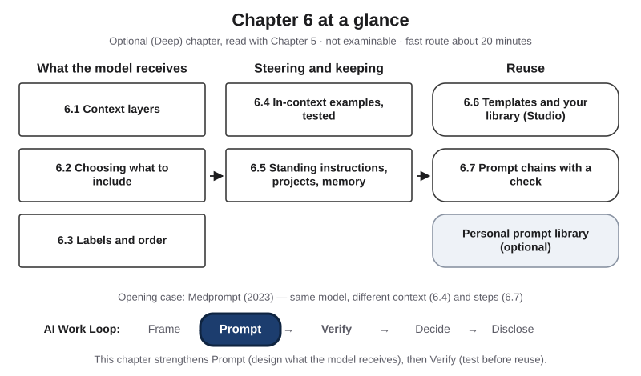{#fig-6-1 fig-alt="Chapter map: what the model receives (6.1–6.3), steering and keeping (6.4–6.5), reuse (6.6–6.7, library); Work Loop with Prompt highlighted."}

**Chapter 6 at a glance.** This is an optional chapter. You read it alongside Chapter 5, and nothing in it is on an exam. Chapter 5 taught you to frame a task and to improve one prompt on purpose. This chapter starts where Chapter 5 stops: what happens when you want the same good result again next week, on a new input, without starting from zero?

**Time, at 150 words per minute (longer if English is not your first language):**

- **Fast route, about 25 minutes:** this page, the Opening Case, section 6.1, section 6.6 with its recap box, and the Chapter Summary. It stands on its own.
- **Full route, about 65 minutes:** everything from this page through the Case Study, not counting the labs. About 75 minutes with the Ethics Lens, Career Connection, From the Field and Summary. Your Turn boxes and labs are extra.

If Chapter 5 already fills your time, a good plan is to read the fast route now and the rest before you start the workflow assignment (A11, Chapter 14), which builds on sections 6.6 and 6.7. Worked examples show every step, faded examples leave some steps for you, and Your Turn and Check Yourself boxes are ungraded practice. Answers to the faded examples and to odd-numbered end-of-chapter questions are in Appendix E.

::: {.callout-note title="Plain words for this chapter"}
- **Token:** a unit of text (a word, part of a word, or a symbol) that a language model receives and produces (Chapter 3).
- **Context window:** the space for everything a language model receives in one turn, measured in tokens; the response also counts toward it (Chapter 3).
- **Parameters and options:** a **parameter** is one of the learned settings inside a model; training adjusts parameters (Chapter 2). **Options** are the controls you can change in a tool, such as a memory switch, search or **temperature**, an option that changes how often less likely tokens are picked; it does not change the model's settings (Chapter 3).
- **Benchmark:** a standard test used to compare models.
- **Zero-shot:** asking a question with no in-context examples in the prompt.
- **Majority vote:** asking the same question several times and keeping the most common answer.
- **Edge input:** an unusual but possible input, the one most likely to break a prompt (Chapter 5).
- **Placeholder:** a marked slot in a template, such as {NOTES} or {DATE}, that you replace with new material each time you use it (section 6.6).
- **Version:** a numbered, dated state of a prompt, recorded with what changed (section 6.6).
- **Agent vs. agency:** an *agent* is a system in which the model directs its own steps and tool use toward a goal (Chapter 3); *agency* is a way of working in which you set AI up to act for you later (Chapter 5).
:::

**The question of this chapter:** *If the model is the same, why do two people get such different results from it?* Keep your answer in mind. The Chapter Summary returns to it.

## Opening Case: Same Model, Different Context {.unnumbered}

In November 2023, researchers at Microsoft, with one co-author from OpenAI, posted a study of GPT-4, a large language model (LLM) from OpenAI (Nori et al., 2023). They tested it on MedQA, a benchmark of multiple-choice questions in the style of the U.S. exam that doctors must pass to practice. The team did not retrain the model or change its parameters. They changed what the model received with each question, and how they asked.

In the paper's step-by-step chart, GPT-4 with a simple prompt and no examples (zero-shot) scored 81.7%. The team then added four things, one at a time, in this order (Nori et al., 2023):

1. **Five solved questions as in-context examples**, picked at random from a large set of practice questions.
2. **Worked reasoning for those examples.** Each example came with step-by-step reasoning that GPT-4 had written itself, in an earlier pass; the team kept it only when it led to the known correct answer. With these examples in front of it, GPT-4 also wrote out its own reasoning before answering each new question.
3. **Examples chosen by similarity.** Instead of five random examples, each question received the five most similar practice questions.
4. **Five runs and a vote.** The same question was asked five times, with the answer options in a new order each time and some randomness in each answer. The most common answer counted.

The combination, which the team called Medprompt, reached 90.2% on MedQA. It was the same model, not retrained, receiving different material and run a different way.

The authors were careful about what this shows. A multiple-choice benchmark is not the practice of medicine, and benchmark scores do not show that a tool works with real patients. They also could not rule out that some test questions had appeared in the model's training text (Nori et al., 2023). Read the result as a finding about exam-style questions, not about clinics.

Here is the puzzle. Nothing inside the model changed. So **what changed?** This chapter splits the answer into two kinds: what the model received (sections 6.2 to 6.4) and how the task was run (section 6.7). The Case Study puts numbers on both, and returns to Medprompt a year later, when the same team tried the same kind of technique on a newer model and found a surprise. If you take the fast route, the recap box in section 6.6 gives you the short version.

## Learning Objectives {.unnumbered}

Each objective names the book's learning outcome it serves: LO2 is the outcome on framing a task and improving results through documented iteration; LO3 is the outcome on verifying outputs. Framework tags refer to the AI Fluency framework (Dakan & Feller, 2025) and the UNESCO (United Nations Educational, Scientific and Cultural Organization) AI Competency Framework for Students.

After this chapter you will be able to:

- **O1 — Explain** the layers of context a model receives in a chat tool, and which of them you control. *(LO2 · AI Fluency: Description · UNESCO: AI techniques and applications, Understand)*
- **O2 — Construct** the context for a task from selected, labeled and ordered material. *(LO2 · AI Fluency: Description · UNESCO: AI techniques and applications, Apply)*
- **O3 — Judge**, from a with-and-without test on several test inputs, whether in-context examples improve an output. *(LO2, LO3 · AI Fluency: Discernment, Description)*
- **O4 — Evaluate** which information belongs in standing instructions, a project space, memory, or only the current chat. *(LO2 · AI Fluency: Diligence, Description)*
- **O5 — Create** a reusable prompt template with placeholders for a task you repeat. *(LO2 · AI Fluency: Description · UNESCO: AI techniques and applications, Create)*
- **O6 — Design** a two- or three-step prompt chain with a human check between steps. *(LO2 · AI Fluency: Delegation, Description · UNESCO: AI system design, Apply)*

::: {.callout-note title="Warm-up (ungraded)"}
1. When you type a message in a chat tool, what else might the model receive along with it?
2. If you paste a 50-page document into a chat, are all 50 pages used equally well?
3. If in-context examples improve today's answer, will a new chat tomorrow, without those examples, give the same improvement?

You will revisit your answers in the Chapter Summary.
:::

## 6.1 What the Model Actually Receives {#sec-6-1 .unnumbered}

[Deep]{.path}

*Deep sections are optional and not examinable. Featuring Sam, a mechanical engineering senior and captain of the student robotics club.*

Recall Chapter 3. The **context window** is the space for everything a language model receives in one turn, measured in tokens; the response also counts toward it. It usually holds four kinds of text: a system prompt from the tool's provider or developer, the conversation so far, pasted or retrieved text, and your prompt. The whole package is sent again at every turn; in long chats, a tool may shorten or summarize older turns to make room.

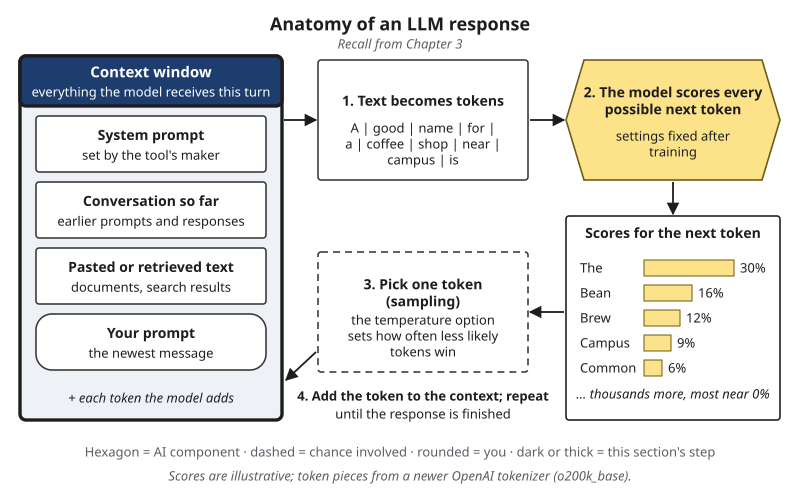{#fig-6-2 fig-alt="Anatomy of an LLM response, context window highlighted: system prompt, conversation so far, pasted or retrieved text, your prompt."}

Many chat tools now add text to that window **before you type a word**. Two kinds matter in this chapter.

- **Standing instructions**: instructions you write once, in a tool's options or a project, that the tool adds to every conversation in that scope. Example: "Always answer in American English."
- **Project files and memory notes**: files you attach to a project, and text a memory feature adds about you. Chapter 3 defined **memory (product feature)** as a product feature that saves notes about a user, or draws on past chats, and adds them to later conversations; it adds text and does not train the model. Example: a saved note that you are a nursing student.

Put these together and you get this book's picture of **context layers**: the separate sources of text that together fill a model's context window in one turn, each set by someone and at some time.

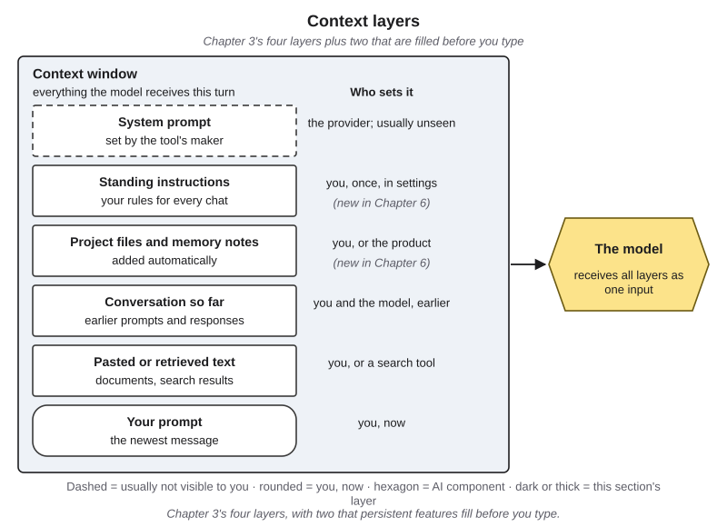{#fig-6-3 fig-alt="Context window with six layers: system prompt (dashed), standing instructions, project files and memory, conversation, pasted text, your prompt."}

Read @fig-6-3 from the top, one sentence per layer.

1. The **system prompt** is set by the tool's maker; you usually cannot see it.
2. Your **standing instructions** are set by you, once.
3. **Project files and memory notes** are set by you or by the product. A large project may add only the parts of its files that a search finds, depending on the product.
4. The **conversation so far** was produced by you and the model, earlier.
5. **Pasted or retrieved text** comes from you or from a search tool, which finds passages and adds them (Chapter 3).
6. **Your prompt** is the only layer you write right now.

The layers arrive as one long sequence of tokens. Hidden markers separate the provider's instructions, your turns and the model's earlier replies, and some models are trained to give the provider's instructions priority over yours (Wallace et al., 2024). But inside your own message, nothing separates your instructions from text you pasted, unless you label it (section 6.3).

::: {.callout-warning title="Two lists of six"}
This chapter's six context layers are not Chapter 5's six prompt parts (role, task, context, constraints, in-context examples, output format). The prompt parts describe one layer: your prompt. The layers describe everything the model receives.
:::

The system-prompt layer is real, even when it is invisible. At least two providers publish the system prompts of their chat apps: Anthropic since August 2024, with a log of later changes (Willison, 2024), and xAI, for its Grok chatbot, since May 2025, after it blamed an unauthorized change to its prompt for answers that kept raising an unrelated political topic (Wiggers, 2025). These prompts include instructions about tone, formatting and what the assistant should say it cannot do. Publishing is a choice each provider makes, so assume that a layer you did not write is shaping the output.

**Context engineering** is deciding what goes into a model's context window, from which layer, in what form and in what order, so that a task can be done well. The term spread in June 2025, when Shopify's chief executive, Tobi Lütke, and the AI researcher Andrej Karpathy said they preferred it to "prompt engineering" (Willison, 2025). This chapter uses it for everyday work in a chat tool.

**How the layers relate to the anatomy of a prompt.** Chapter 5's anatomy of a prompt describes your prompt, layer 6. Its **context** part, the background a task needs, can travel in your prompt, in a pasted document or in a project file. Its **in-context examples** part usually lives in your prompt or in a reusable template (section 6.6). The other layers are added by the tool or by features you switched on earlier.

::: {.callout-note title="Worked Example: Sam's Club Update"}
*Constructed example.* Every week Sam runs the robotics club's meeting and then writes an update email for members. This week he opens a chat tool inside a project he set up for the club and types: "Write this week's update from my notes," then pastes his notes.

**Step 1 — List every layer.** Sam lists what the model received:

| Layer | What was in it | Who set it | Could Sam see it? |
|---|---|---|---|
| System prompt | The provider's instructions | The provider | No |
| Standing instructions | "Write for first-year club members: plain words; every task gets an owner and a due date" | Sam, in the project's options, in January | Yes, in the options |
| Project files and memory notes | The club's meeting template (a file); a memory note: "Sam is on co-op at a manufacturing firm" | Sam (file); the product (note) | The file, yes; the note, only if he opens the memory list |
| Conversation so far | Nothing; a new chat | — | — |
| Pasted text | This week's notes | Sam | Yes |
| Your prompt | "Write this week's update from my notes" | Sam, now | Yes |

**Step 2 — Spot the surprise.** The draft ends with "Sam will share lessons from his co-op." A *co-op* is a paid work term at a company that counts toward a degree; Sam finished his co-op last year. The memory note is out of date, and it reached the output.

**Step 3 — Conclude.** The prompt was fine. A layer Sam had not looked at in months changed the result. Section 6.5 shows what he does about it.
:::

::: {.callout-note title="Faded Example: A Design Student's Style File"}
*Constructed example.* A graphic design student works inside a project that holds a client's brand-style file, which lists colors, tone and banned words. In her third message she typed a draft tagline of her own that used the banned word "cheap." Now, in her fourth message, she types: "Suggest three taglines for the spring sale." One suggestion uses "cheap."

**Done for you:** *System prompt:* the provider's, not visible. *Project files:* the brand-style file. *Your prompt:* the request for three taglines.

**Your turn:** What is in the conversation-so-far layer? _______________ Which layer most likely brought "cheap" back into the output? _______________ What would you change, and in which layer? _______________
:::

::: {.callout-important title="Your Turn"}
Think of the last conversation you had with an AI tool. Without copying any content, list its layers by type: was there a system prompt (assume yes), standing instructions, a project file, memory, earlier turns, pasted text? For each, write who set it and whether you could see it.
:::

::: {.callout-tip title="Check Yourself 6.1"}
1. Name the six context layers in @fig-6-3 and say who sets each one.
2. Why can an output change even when your prompt does not?
3. What separates your own instructions from text you pasted into the same message?
:::

## 6.2 Choosing What to Include {#sec-6-2 .unnumbered}

[Deep]{.path}

*Featuring Sam.*

A nursing student pastes a drug handbook, an engineer pastes a supplier catalog, a history student pastes an archive's worth of letters. In every field, the layer you control most directly is the one where you add material: pasted text, attached documents, retrieved passages. It is tempting to paste everything. The document is right there, and more information seems safer than less. This section shows why that habit often makes results worse.

**Make a prediction first.** Researchers took 100 math word problems at school level, from a public set called GSM8K. The model they tested could solve each of them with at least one prompting method. Then they added one sentence to each problem that had nothing to do with the answer. Does the model's accuracy go up, stay the same or go down? Write your guess before you read on.

Here is what happened. In a 2023 study, researchers built 58,052 versions of those 100 problems, each with one irrelevant sentence added, such as a detail about someone else's age or shopping, and tested a random 4,000 of them (Shi et al., 2023). The model was an older OpenAI model, code-davinci-002, used with step-by-step prompting. On the 100 original problems it scored 95.0%. On the versions with one irrelevant sentence it scored 72.4%. Adding an instruction to ignore irrelevant information brought it back up only to 77.8%. Each original problem had many distracted versions, and for only 6 of the 100 problems did the model answer every version correctly.

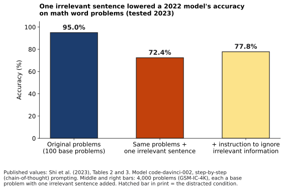{#fig-6-4 fig-alt="Bars: 95.0% on original math problems, 72.4% with one irrelevant sentence, 77.8% with an instruction to ignore it (code-davinci-002)."}

That model is older than the tools you use. The pattern has kept turning up, though. In 2025, a company that sells search and retrieval software tested 18 models, including several from that year, on deliberately simple tasks. It reported that performance became less reliable as the input grew longer, and that even one distracting sentence lowered results (Hong et al., 2025). That report is an industry technical report, not a peer-reviewed study, from a company with an interest in the topic. Chapter 3's "lost in the middle" study points the same way: information in the middle of a long input was used less reliably than information at the start or end (Liu et al., 2024).

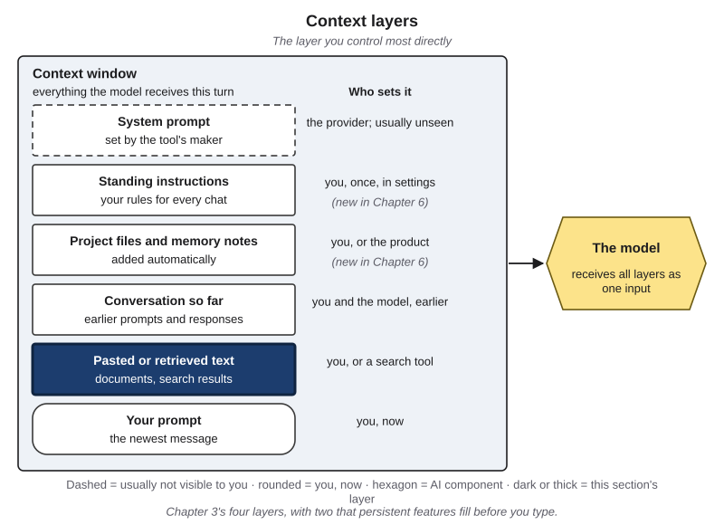{#fig-6-5 fig-alt="Context layers with the pasted or retrieved text layer highlighted; who sets it: you, or a search tool."}

The lesson is not "give the model less." It is **give it what the task needs, and little else.** In other words, every page you add should earn its place by serving the task. Four habits follow.

1. **Select excerpts, not whole documents.** Find the pages, rows or paragraphs the task depends on. If you cannot tell which parts matter, that is a sign the task needs more framing first (Chapter 5).
2. **Name each excerpt's source and date.** "Catalog, p. 14, 2027 price list" lets you, and the reader of the output, check where a claim came from. Undated material is a common source of outdated answers.
3. **Add a gap instruction**, a line in a prompt that says what to do when the material is not enough. For example: "If the answer is not in the material below, say so; do not fill the gap." This does not guarantee the output will follow it, but it gives your check something to test.
4. **Leave out what must not be shared.** Personal data, other people's information and confidential material do not belong in a prompt at all, however useful they seem. Chapter 15 covers privacy and what never to paste.

::: {.callout-note title="Worked Example: Sam's Parts Order"}
*Constructed example: the catalog, prices and rules are invented for teaching.* The robotics club needs two drive motors and four wheels. Sam has the supplier's 120-page catalog (PDF) and the club's 8-page budget rules. He wants a draft order with a total and a note on who must approve it.

**Step 1 — What does the task need?** The motor and wheel pages, the current prices, and the rule on approving purchases.

**Step 2 — Find it.** Motors are on catalog page 14 and wheels on page 52. The catalog contains two price lists, one from 2026 and one from 2027; he needs the 2027 one. In the budget rules, rule 3 on page 6 says orders over $250 need two officers' approval.

**Step 3 — Build the context.** He pastes the two catalog pages from the 2027 list and rule 3, each with its source and date. He leaves out the other 118 pages, the old price list and the rest of the rules.

**Step 4 — Add the gap instruction.** "If a part I ask for is not in these pages, say so."

**Why it is better.** A whole catalog would have put two price lists in front of the model. An order priced from the 2026 list would read smoothly and be wrong. By selecting, Sam removed the source of that error. He still checks each price against the page.
:::

::: {.callout-note title="Faded Example: Five Primary Sources"}
*Constructed example.* A history student is writing about how two newspapers in one city reported a 1918 influenza outbreak during the same week. She has five public-domain passages. A useful order for this task is by date, with each passage labeled by type: news report, editorial (the paper's opinion) or official notice.

**Done for you:** Passage A (newspaper 1, news report, 12 October 1918): *include, first:* it covers the week. Passage D (a memoir written in the 1950s): *exclude for this task:* it was written decades later and answers a different question.

**Your turn:** Passage B (newspaper 2, news report, 13 October 1918), Passage C (a city health notice from 1919) and Passage E (newspaper 1, editorial, 14 October 1918). Which do you include, in what order, and with what label? _______________ What gap instruction would you add? _______________
:::

::: {.callout-important title="Your Turn"}
*Business.* A customer asks: "I opened the headphones I bought 40 days ago. Can I still return them?" Here is the store's policy, in three sections:

> **§1 Shipping (updated 1 March 2026).** Orders ship within two business days. Shipping is free over $50.
> **§2 Returns (updated 1 March 2026).** Unopened items can be returned within 60 days. Opened items can be returned within 30 days, except headphones and earbuds, which cannot be returned once opened.
> **§3 Gift cards.** Gift cards cannot be returned or exchanged for cash.

Build the context: which section(s) do you include, with what labels, and what gap instruction? Then check: what should a correct answer say? Lab 6.2 extends this exercise.
:::

::: {.callout-tip title="Check Yourself 6.2"}
1. In Shi et al. (2023), what happened to accuracy when one irrelevant sentence was added, and how much did an instruction to ignore it help?
2. Why is "paste the whole document to be safe" often not safe?
3. Name two habits for choosing context and say what each protects against.
:::

## 6.3 Labels and Order {#sec-6-3 .unnumbered}

[Deep]{.path}

*Featuring Sam.*

Once you know what to include, how you arrange it matters too. Inside your own message, the model receives one stream of tokens. Nothing in that stream marks where your instructions end and a pasted document begins, unless the text itself shows it.

**Label the parts.** Put a short heading or a clear marker before each part: instructions, material, in-context examples, task. Plain labels work: "INSTRUCTIONS", "CATALOG p. 14 (2027 price list)", "TASK". Some people use lines of dashes or tags such as `<document>` and `</document>`. The exact marker matters less than using one consistently, so that you and anyone who reuses your prompt can see the structure.

**Keep instructions separate from material.** If a pasted email says "reply within one hour," is that a request to the model or part of the email? Labels make the difference visible to you, and reduce the chance that text from the material shapes the output as if it were an instruction. They do not remove that chance. Text inside a document can still act as an instruction, which is the mechanism behind prompt injection (Chapter 4, section 4.6) and the reason Chapter 15 covers defenses.

**Put the full task last.** This book's rule: put long material first and the full task last, right before the output begins; if you like, add one line at the very top saying what the task is. The evidence is mostly providers' own guidance, and the providers differ. Anthropic's guide for its models says to put long documents near the top and the question at the end, and reports that this improved response quality by up to 30% in its tests (Anthropic, n.d.). OpenAI's guide for its GPT-4.1 models says to put instructions both before and after long material, and, if only once, before it (OpenAI, n.d.). Research adds a caution. In the "lost in the middle" study, position mattered for where the *relevant information* sat; when the researchers repeated the question before and after the documents, it helped a simple lookup task a great deal but barely changed question answering (Liu et al., 2024). So treat "full task last" as a habit to test on your own task, not a law.

**Expect small format changes to matter.** Chapter 5's second short case showed that changing only spacing, separators or capital letters in a prompt's format changed accuracy a great deal for one model (Sclar et al., 2024). That is one more reason to keep a layout that works and reuse it, rather than rewriting it every time.

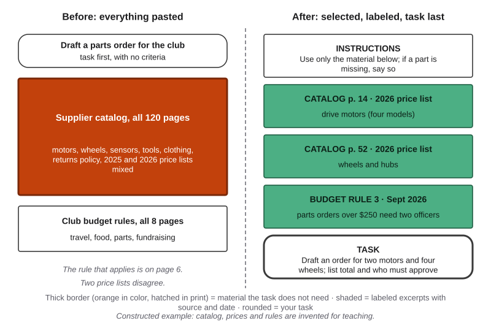{#fig-6-6 fig-alt="Left: task, whole 120-page catalog and 8-page rules. Right: task in brief, instructions, two labeled catalog pages, one rule, full task last."}

::: {.callout-note title="Worked Example: Sam's Order, Rebuilt"}
*Constructed example.* Sam's first version started with "Draft a parts order for the club" and then pasted everything. His rebuilt context (@fig-6-6, right) has six labeled parts:

```
TASK IN BRIEF: a parts order for the robotics club (details at the end).
INSTRUCTIONS: Use only the material below. If a part is missing, say so.
CATALOG p. 14 (2027 price list): [drive motors, four models]
CATALOG p. 52 (2027 price list): [wheels and hubs]
BUDGET RULE 3 (January 2027): Orders over $250 need two officers' approval.
TASK: Draft an order for two drive motors (model M-20) and four wheels (W-100).
List each line with its price, the total, and who must approve it.
```

**Why this order?** The one-line task at the top says what the material is for. The instruction about using only this material frames everything after it. The full task comes last, right before the output begins, and names exactly what to produce. Each excerpt carries its source and date, so Sam can check every price in the output against a page.

**Check.** Sam checks the draft line by line against pages 14 and 52, and confirms that the total is over $250, so two officers must approve.
:::

::: {.callout-note title="Faded Example: A Jumbled Context"}
*Constructed example.* A student pasted these parts, in this order: (1) "Make it under 200 words." (2) A lab handout excerpt on safety goggles. (3) "Summarize the safety rules for new lab members." (4) A second excerpt on chemical storage. (5) "Use a bulleted list."

**Done for you:** Labels: (2) and (4) become "HANDOUT §2 (goggles)" and "HANDOUT §5 (storage)", and they go first.

**Your turn:** Write the rest of the order so that instructions, material and the full task are separated and the full task comes last. Which two parts can be merged into one constraint line? _______________
:::

::: {.callout-important title="Your Turn"}
Take a prompt you used this week that included pasted material. Add labels and move the full task to the end. Run the old and new versions on the same input in fresh chats, **twice each**, and compare the outputs against one criterion you write in advance. Limit your conclusion to this input: one result is not evidence (Chapter 5).
:::

::: {.callout-tip title="Check Yourself 6.3"}
1. What do labels make visible, and which risk do they reduce but not remove?
2. Where does this section suggest putting the full task? What is the evidence, and what are its limits?
3. Why is it worth keeping a layout that works instead of rewording it every time?
:::

## 6.4 Choosing and Testing In-Context Examples {#sec-6-4 .unnumbered}

[Deep]{.path}

Chapter 5 defined an **in-context example** as a sample input with the output you want, placed in a prompt to show the pattern. It also noted that a model can follow a pattern shown this way without any change to its parameters (Brown et al., 2020). This section is about the next questions: which examples, how many, in what order, and whether to use any at all.

**Claim 1: examples steer format and pattern, inside that context only.** The 2020 paper that introduced GPT-3 showed that a model could carry out a new task from a few examples given as text, with no further training (Brown et al., 2020). Researchers call this *in-context learning*, but the word "learning" can mislead. The model's parameters do not change (Chapter 3). The examples are tokens in the context window, and they shape the output only while they are there. A new chat without them starts from the same parameters as before.

**Claim 2: which examples, and their order, change the results.** Two studies of GPT-3-era models showed how sensitive this can be. One found that the choice of examples, the prompt's format and even the order of the same examples could move accuracy from near guessing to near the best results of the time (Zhao et al., 2021). The authors traced this to the model favoring certain answers: those common among the examples, those placed near the end of the prompt, and those common in its training text. Another study found that reordering the same set of examples alone could make the difference between near-best performance and near random guessing (Lu et al., 2022). These were 2021–2022 models, so treat the findings as reasons to test, not as fixed rules.

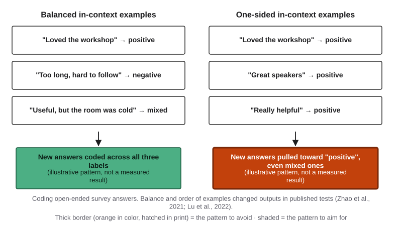{#fig-6-7 fig-alt="Balanced examples (positive, negative, mixed) give spread-out codes; three positive examples pull new answers toward positive."}

If this reminds you of Chapter 2, it should. **Class imbalance**, when one class has far fewer examples than the others in a training set, pushes a trained model toward the common class. One-sided in-context examples are a small, temporary version of the same problem, and Zhao et al. (2021) measured it: if all three examples carry the label "positive," the outputs lean that way. The fix is similar too: include each kind of case you expect, and think about order.

**Claim 3: so test with and without.** Examples do not always help. When the Medprompt team tried the same kind of technique, five solved examples, on a newer model built to reason step by step before answering, the examples lowered its MedQA score (Nori et al., 2024). The Case Study looks at this result. The practical rule for your own work: run the same test inputs with your examples and without them, and keep the examples only if they help.

Here is a short checklist for choosing in-context examples:

- **Cover the kinds of input you expect**: typical, different and edge, in Chapter 5's terms.
- **Balance the labels or outcomes**, unless the real inputs are truly one-sided and you want that.
- **Keep them short and in the exact format you want back.**
- **Try a second order** once during testing, to see whether order matters for your task.
- **Never use real people's data as examples.** Use constructed or public material.

::: {.callout-note title="Worked Example: Coding Survey Answers"}
*Constructed teaching example; the outputs are illustrative, not measured evidence.* A social science research assistant has 300 open-ended answers to the question "How was the orientation workshop?" She wants each coded as positive, negative or mixed.

**Version A (one-sided examples).** Her first three examples are all positive, because those were the first three answers in the file. On 20 test answers she has coded by hand, the outputs code most mixed answers as positive.

**Version B (balanced examples).** She picks one clear positive ("Loved it"), one clear negative ("Too long, hard to follow") and one mixed answer ("Useful, but the room was cold"). On the same 20 answers, the codes match her hand-coding more often, especially for mixed answers.

**Version C (no examples, clear definitions).** She removes the examples and writes one-line definitions of each code. On the same 20 answers, the result is close to Version B.

**Decision.** She keeps Version B, because it matched her hand-coding best on this test, and records that Version C was close. She will rerun both if she switches tools. She also checks a random sample of the 300 final codes by hand, because 20 test answers are a small test.
:::

::: {.callout-note title="Faded Example: Feedback Examples for a Teaching Assistant"}
*Constructed example.* A teaching assistant wants short, kind, specific feedback on lab reports, using three example comments. He has six candidates: (1) praise only, (2) a correction with a page reference, (3) a correction with no reason, (4) a question that prompts revision, (5) a long paragraph, (6) praise plus one specific next step.

**Done for you:** *Keep (2):* specific and checkable. *Keep (6):* kind, with a concrete next step. *Drop (5):* wrong length; the outputs would copy it.

**Your turn:** Choose the third example from (1), (3) and (4) so that the three together cover the kinds of feedback he wants. _______________ Predict one way the outputs would change if you chose (1) instead. _______________
:::

::: {.callout-important title="Your Turn"}
In Lab 6.2's with-and-without step, you run three test inputs with two in-context examples and without them, and decide from the results whether to keep the examples.
:::

::: {.callout-tip title="Check Yourself 6.4"}
1. Why is "the model learned from my examples" a misleading way to describe what in-context examples do?
2. How can one-sided in-context examples resemble class imbalance from Chapter 2?
3. Why does this section recommend testing with and without examples, rather than always adding them?
:::

## 6.5 Standing Instructions, Projects and Memory {#sec-6-5 .unnumbered}

[Deep]{.path}

*Featuring Sam.*

Sections 6.2 to 6.4 were about what you put in by hand, each time. This section is about the layers that fill themselves. For example, a marketing student may keep a brand's style rules in a project, and a nursing student may tell a tool once that she studies nursing. Many tools offer three features of this kind:

- **Standing instructions**: instructions you write once, in a tool's options or a project, that the tool adds to every conversation in that scope.
- **Project space**: a workspace in a tool where chosen files and instructions are added to every conversation started inside it. For large projects, some products add only the parts of the files that a search finds.
- **Memory (product feature)**: a product feature that saves notes about a user, or draws on past chats, and adds them to later conversations; it adds text and does not train the model (Chapter 3). Whether your conversations are used to train *future* models is a separate account option, covered in Chapter 15.

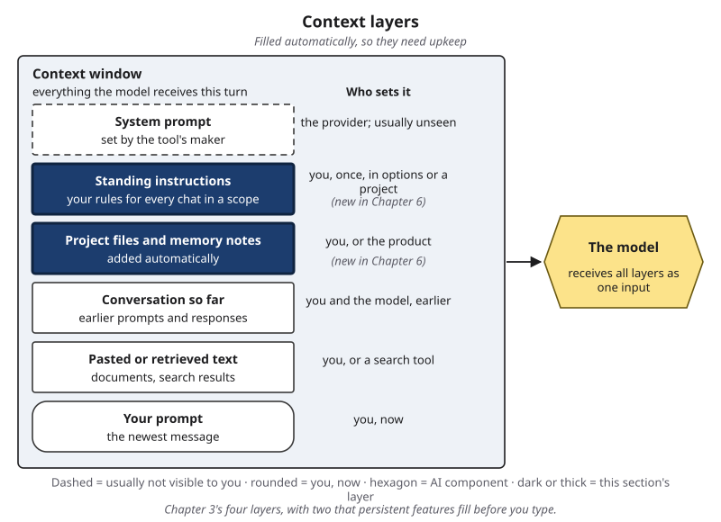{#fig-6-8 fig-alt="Context layers with standing instructions and project files and memory notes highlighted; both are filled before you type."}

::: {.callout-note title="Names for these features"}
Products use many names for the same ideas, and the names change. This book uses one term for each.

| What products may call it | This book's term |
|---|---|
| System prompt, system message, developer instructions | **system prompt** (Chapter 3) |
| Custom instructions, personalization, project instructions, saved info; instruction files that some coding tools read, such as AGENTS.md | **standing instructions** |
| Projects, notebooks, workspaces, custom assistants with uploaded files | **project space** |
| Memory, saved memories, reference to past chats | **memory** (product feature) |
| Few-shot examples, demonstrations, exemplars | **in-context examples** (Chapter 5) |
| Prompt chaining, multi-step prompting | **prompt chain** (section 6.7) |

Product names are examples as of October 2026, not recommendations; Chapter 12 covers choosing tools.
:::

All three features do the same thing in the end: they put text into the context window without you typing it. That brings two benefits and three costs.

**Benefits.** You stop repeating yourself, so outputs are more consistent. And you can share a set-up with others: a project with a style guide and a few files can give everyone on a team the same starting point.

**Cost 1: invisibility.** Text you do not see in the chat is easy to forget. Sam's out-of-date memory note in section 6.1 is a small example. A standing instruction written for one task ("answer in under 100 words") can quietly harm another.

**Cost 2: staleness.** Notes and files describe the world when they were saved. A price list, a deadline or a fact about you can stop being true while the feature keeps adding it.

**Cost 3: privacy.** Whatever these features store sits in the provider's systems and reaches the model in later chats. Memory can also store things you said in passing. What to keep out of these features, and how providers handle stored data, is covered in Chapter 15.

**Agency, not an agent.** Chapter 5's box "Agency is not an agent" applies here. Writing standing instructions, or setting up a project that classmates will use, is a step toward *agency* in the AI Fluency framework's sense: you configure AI to carry out future tasks on your behalf (Dakan & Feller, 2025). It does not make the tool an *agent*, a system in which the model directs its own steps and tool use toward a goal. The tool still answers one message at a time from what it receives.

::: {.callout-note title="As of October 2026: persistent features"}
Features like these have spread across providers since 2023. OpenAI announced a test of memory for ChatGPT in February 2024 (OpenAI, 2024) and, in April 2025, let it draw on users' past chats (Zeff, 2025). Anthropic introduced Projects, with their own instructions and files, in June 2024 (Anthropic, 2024a). Google announced Gems, saved custom instructions for its Gemini assistant, in May 2024 and made them available in August 2024 (Google, 2024). Names, availability on free tiers and options change often. Your institution's IT office may list the tools your institution provides or approves (for example, an enterprise chat assistant with data protection); check its pages for which persistent features each approved tool offers. Current steps for each tool, including how to view and delete stored memory, are in Compass.
:::

**A simple routine.** Once a month, or whenever outputs surprise you, open each persistent feature and ask four questions of every item: Is it still true? Is it still needed? Would I be comfortable if a classmate read it? Does it belong in every chat, or only in one project? Edit, move or delete accordingly. Check before you delete: in some tools, deleted notes or chats cannot be restored. If a tool draws on past chats rather than a list of notes, you cannot review it item by item; your choices are to turn that option off or to delete chats.

::: {.callout-note title="Worked Example: Sam Cleans Up"}
*Constructed example.* After the co-op surprise (section 6.1), Sam opens his tool's options.

**Standing instructions:** "Write for first-year club members: plain words; every task gets an owner and a due date." *Keep, but move:* it suits club emails, not his thermodynamics homework, where it makes explanations too simple. He moves it into the club project's instructions.

**Memory note:** "Sam is on co-op at a manufacturing firm." *Delete:* no longer true.

**Memory note:** "Sam's robotics club meets on Thursdays." *Keep:* still true, harmless.

**Project file:** the club's meeting template from last year. *Replace:* the club changed its meeting format in January.

**Result.** He reruns this week's update. The co-op line is gone, and the email follows the new meeting format.
:::

::: {.callout-note title="Faded Example: Where Does It Belong?"}
Sort eight items into **standing instructions**, **project file**, **this chat only** or **never store**.

**Done for you:** (1) "I am a nursing student; explain drug names in plain words" → standing instructions. (2) "This semester's lab schedule (PDF)" → project file for the course. (3) "My friend's medical history, to ask a question" → never store (and never paste; Chapter 15).

**Your turn:** (4) "Answer in Spanish today." (5) "My student ID number." (6) "The rubric for the history essay." (7) "Always show your sources as a list at the end." (8) "My draft cover letter, to polish once." _______________
:::

::: {.callout-important title="Your Turn"}
Lab 6.4: audit your own standing context, or a provided sample, and record item types and the action you took, never the contents.
:::

::: {.callout-tip title="Check Yourself 6.5"}
1. What do standing instructions, project spaces and memory have in common?
2. Name the three costs of persistent features and give an example of each.
3. Why is setting up standing instructions an example of agency but not of an agent?
:::

## 6.6 Reusable Prompts: Templates and Your Library {#sec-6-6 .unnumbered}

[Studio]{.path}

*Featuring Sam. This section builds the chapter's optional assignment, the personal prompt library.*

::: {.callout-note title="Recap for the fast route (sections 6.2 to 6.5 and 6.7 in brief)"}
**Choose (6.2):** give the model what the task needs and little else. Irrelevant material can lower accuracy, and long inputs are used unevenly. Select excerpts, name each one's source and date, and add a gap instruction saying what to do if the material is not enough. **Arrange (6.3):** label instructions, material, in-context examples and task; put long material first and the full task last, and test that habit on your own task. **Examples (6.4):** in-context examples steer format and pattern inside that context only; a new chat without them does not keep the effect. Their balance and order can change results, so test the same inputs with and without them. In the Opening Case, solved examples helped GPT-4 in 2023, but the same kind of examples lowered a newer model's score in 2024. **Persistent features (6.5):** standing instructions, project spaces and memory add text to every chat in their scope. They save effort, but they are invisible, can go out of date and raise privacy questions, so review them regularly. **Workflows (6.7):** a *workflow* is a fixed way of running a task: for example, a *prompt chain* of steps with your check between them, or asking the same question several times and taking a vote, as Medprompt did.
:::

Chapter 5 ended with a prompt that works: it meets your criteria across repeated runs and across **test inputs**, a small set of different inputs a prompt is tried on (typical, different, edge) to see whether it works beyond one case. That prompt was built for one task, on the inputs you tested. This section turns it into something you can reuse on inputs you have not seen yet.

A **prompt template** is a prompt written for a recurring task, with fixed parts that stay the same each time and placeholders for the parts that change. A **placeholder** is a marked slot in a template, such as {NOTES} or {DATE}, that you replace with new material each time you use it. Researchers use the same device. The Medprompt team published the templates they used, with placeholders in braces for the examples, the question and the answer choices (Nori et al., 2024).

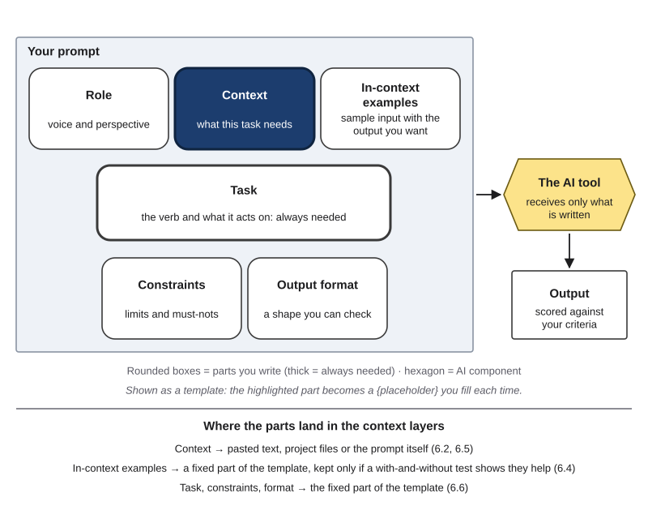{#fig-6-9 fig-alt="Anatomy of a prompt with the context part highlighted as a placeholder; notes map parts to context layers; examples fixed if tests show they help."}

A prompt becomes reusable when three things are true.

1. **It has placeholders** (in technical terms, it is *parameterized*). Separate what stays (task, audience, constraints, output format, and in-context examples if a test shows they help) from what changes (the material). In @fig-6-9, the highlighted context part is the one that usually becomes a placeholder.
2. **It is re-tested across inputs.** A template will meet inputs you never tested in Chapter 5. So test it again on new test inputs chosen for the task it will repeat: a typical input, a different input and an edge input. Rerun the earlier inputs after every change, because a fix can break something that used to work.
3. **It has versions.** Give each version a number and a date, and record the tool and model you tested it on and what changed since the last version. A **prompt version** is a numbered, dated state of a prompt or template, recorded with what changed and what it was tested on. The Case Study shows why the model matters: a technique that helped one model hurt another.

A **prompt library** is a personal or shared collection of tested prompt templates, each recorded with when to use it, what it was tested on and how it has changed. A good entry also says **when not to use it**. A template for club emails should not be used for a budget decision, even if it would save time.

::: {.callout-note title="Worked Example: Sam's Template, v1.0 to v1.1"}
*Constructed example.* Let's take Sam's weekly club update. He writes it every week, so he turns his prompt into a template.

**Step 1 — Fixed parts and placeholders.**

```
NOTES ({DATE}): {NOTES}
TASK: Write this week's update email for robotics club members.
AUDIENCE: first-year members; plain words.
CONSTRAINTS: Use only the notes above. Every task gets an owner (a role)
and a due date. Under 200 words.
FORMAT: three headings: Decisions, Tasks, Next meeting.
```

**Step 2 — Pass criteria.** (a) Every decision in the notes appears. (b) Nothing appears that is not in the notes. (c) Each task has an owner and a date.

**Step 3 — Test inputs.** *Typical:* a normal meeting with three decisions. *Different:* notes from two short meetings merged into one. *Edge:* a meeting where nothing was decided.

**Step 4 — Results (v1.0).** Typical and different: all three criteria met. Edge: the draft invents a decision ("The team agreed to order new wheels"). Criterion (b) fails; the other two are met.

**Step 5 — One change (v1.1).** He adds a line: "If no decisions were made, write 'No decisions this week.'" He reruns all three inputs; all criteria are met.

**Step 6 — Record it.** He saves the entry in his library, a plain text file, with the version, date, tool and model name, and the test record (@fig-6-10).
:::

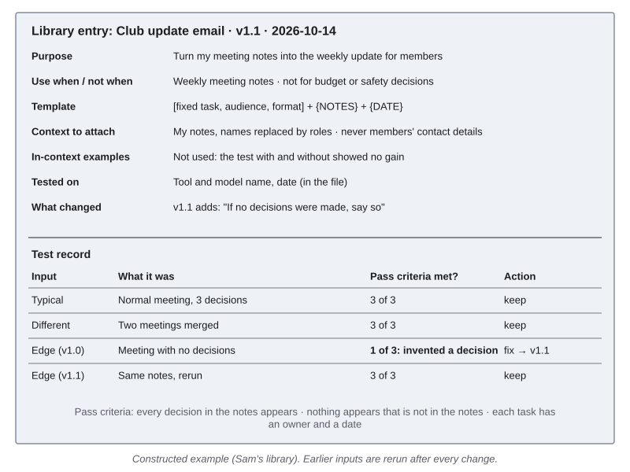{#fig-6-10 fig-alt="Library entry card for Sam's club update template v1.1 with fields and a four-row test record; the edge input failed one criterion in v1.0."}

Notice the in-context examples line on Sam's card. He tried two sample updates as examples. On his three test inputs, outputs with and without them met the same criteria, so he left them out and wrote down why. That is section 6.4's rule in practice: keep examples only when a test shows they help.

::: {.callout-note title="Faded Example: A Drug-Leaflet Summary Template"}
*Constructed example; public material only, never patient data.* A nursing student wants a template that turns a **public** drug information leaflet into a half-page study summary: the drug's class, what it is used for, and the leaflet's three most important warnings, copied, not reworded.

**Done for you:** *Placeholders:* {LEAFLET_TEXT}, {DRUG_NAME}. *Pass criteria:* (a) every warning matches the leaflet word for word; (b) nothing is added that the leaflet does not say; (c) half a page. *Typical input:* a common pain reliever's leaflet. Result: all criteria met.

**Your turn:** Choose a **different** input and an **edge** input for this template. _______________ Which criterion do you predict the edge input will break, and what one change would you try? _______________ When should this template *not* be used? _______________
:::

::: {.callout-important title="Your Turn"}
Lab 6.1 turns your final prompt from Chapter 5's assignment A3 (your prompt and iteration log) into a template and makes it the first entry in your library. The optional assignment at the end of the chapter grows the library to at least three entries over the term.
:::

::: {.callout-tip title="Check Yourself 6.6"}
1. Name the three things that make a prompt reusable.
2. Why does a template need new test inputs even if the prompt it came from already passed Chapter 5's tests?
3. What does a library entry record besides the template itself, and why?
:::

## 6.7 Simple Multi-Step Workflows {#sec-6-7 .unnumbered}

[Deep]{.path}

*Featuring Sam.*

Some tasks are easier to get right in pieces. A **prompt chain** is a fixed sequence of prompts that you run one after another, where each step's output becomes the next step's input and you check the result between steps. Chapter 5's first Deep section mentioned the idea; this section shows how to build one.

Why split a task? When one prompt does everything, an early mistake, such as a wrong date pulled from the notes, is buried inside a polished final text. You find it late, if at all. When the task is split, the mistake shows up in a short intermediate output, where it is easy to check and quick to fix. A 2022 study gave 20 participants a tool for building chains of prompts. Compared with a single prompt, chaining improved the quality of their results and made the system feel more transparent and controllable. Participants also checked each part of a chain on its own, which the authors compared to the software practice of "unit-testing" (Wu et al., 2022).

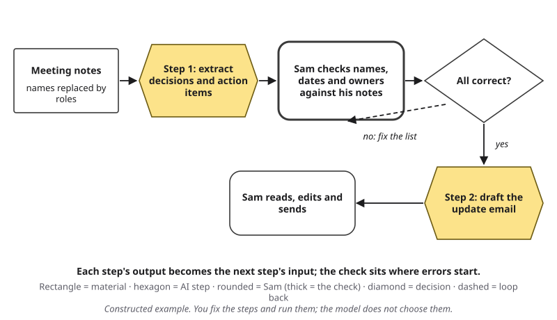{#fig-6-11 fig-alt="Chain: notes, AI extracts items, Sam checks names and dates, all correct? no loops back, yes goes to AI draft, Sam edits and sends."}

**Where to put the check.** Put it right after the step where errors are most likely and most costly, and before anything leaves your hands. A useful question: *after which step could I still fix a mistake quickly and cheaply?*

**When one prompt is enough.** Do not chain by habit. If a single prompt meets your criteria across your test inputs, it is simpler, faster and easier to reuse. Chain when a task has distinct stages that need different instructions, or when you need to check something in the middle.

**A second shape: repeat and compare.** A workflow can also run the same step more than once and compare the results. Medprompt's last step was a workflow of this kind: the same question asked five times, with the answer options in a new order each time and some randomness in each answer, then a vote (Nori et al., 2023). Shuffling the options also changes what the model receives; its purpose, though, is the vote. In other words, a workflow can be a chain of different steps or a repeat of the same step, and both are fixed before you start.

**Workflow or agent?** This book adapts the line from Anthropic (2024b), which describes workflows as systems where language models and tools run along paths that developers define in advance. In the prompt chains of this chapter, the steps are fixed before you start, and you run them. In an **agent**, a system in which the model directs its own steps and tool use toward a goal (Chapter 3), the model chooses what to do next. Chapter 14 covers agents, workflows built into software, and the approval gates that keep people in control of them.

| Question | Prompt chain (this chapter) | Agent (Chapter 14) |
|---|---|---|
| Who decides the next step? | You, in advance | The model, as it goes |
| Who runs each step? | You | The system |
| Where is the check? | Wherever you put it, between steps | Must be designed in as an approval gate |

::: {.callout-note title="Worked Example: Sam's Three-Step Chain"}
*Constructed example.* Sam's club update template works, but twice this term a wrong date appeared in the final email. He splits the task (@fig-6-11).

**Step 1 (prompt):** "From the notes below, list every decision and every action item, with its owner (a role) and due date, exactly as written in the notes. Do not add anything." Input: his notes, with classmates' names replaced by roles before pasting.

**Check (Sam):** He compares the list with his notes. This week, one due date reads "12 February" where the notes say "21 February." He corrects the list by hand.

**Step 2 (prompt):** His v1.1 template, with the corrected list pasted in place of the raw notes.

**Final step (Sam):** He reads the draft, edits one sentence and sends it.

**Why it works.** The date error showed up in a short list, where it took ten seconds to spot, instead of inside a finished email that sounded right.
:::

::: {.callout-note title="Faded Example: A Report-Summary Chain"}
*Constructed example.* A business student summarizes a public company's annual report for a class presentation. Her chain: Step 1, "Extract revenue, profit and number of employees for the last two years, with page numbers." Step 2, "Write a 150-word summary for classmates from these figures."

**Done for you:** The chain has no check. The riskiest step is Step 1: a misread number would flow into the summary.

**Your turn:** Insert the check. What exactly does she compare, and against what? _______________ Write one pass criterion for the check. _______________
:::

::: {.callout-important title="Your Turn"}
Lab 6.3 compares one prompt and a two-step chain on meeting notes with planted errors, each with an equal-time check, and asks where a check catches most.
:::

::: {.callout-tip title="Check Yourself 6.7"}
1. What is a prompt chain, and where does the person's check go?
2. Give one reason to split a task into steps and one reason not to.
3. In a prompt chain, who decides the next step? In an agent?
:::

## Hands-on Labs {.unnumbered}

All four labs are optional and can be done at home or in Compass, which is optional and ungraded. Lab 6.1 can also be started in the Lab 5.1 session by a team that finishes Chapter 5's sprint early. The labs say what to do, not which buttons to press; current tool steps, including how to open a fresh, temporary chat and where to find standing instructions and memory, are in Compass. Never put personal or confidential information into a prompt, a project or a memory feature. Each lab has a 10-minute version for busy weeks.

### Lab 6.1: Template Your Prompt (Studio · 30 minutes · optional) {.unnumbered}

*(O5 · LO2, LO3 · Create)* Individual. *10-minute version: steps 1–3 only.*

1. **Fixed and changing parts (5 min).** Take your final A3 prompt from Chapter 5, or the provided sample prompt. Mark what stays the same each time you would use it and what changes.
2. **Write the template (5 min).** Replace the changing parts with placeholders. Add one line on when *not* to use it.
3. **Write pass criteria (2 min).** Two or three criteria you can score met, partly met or not met. Reuse your A3 criteria if they still fit.
4. **Test (13 min).** Run the template in fresh chats on three test inputs it has not met before: typical, different and edge. Score each output against your criteria.
5. **Fix and version (5 min).** Make one change for one failure, rerun all three inputs, and save the result as v1.1 with a version note. This is the first entry in your library. If nothing failed, make your edge input harder until something does, and record that.

### Lab 6.2: Context A/B (Compare · 40 minutes · optional) {.unnumbered}

*(O2, O3 · LO2, LO3 · Evaluate)* *10-minute version: question 1 only, versions (a) and (c).* Use the three provided questions with answer keys and the provided store-policy document (in the book's companion files). Question 1 is the **typical** input (its answer is in a short, clear section); question 2 is **different** (it needs two sections); question 3 is the **edge** input (its answer sits in the middle of the document, in a footnote).

1. Ask each question three ways in fresh chats: (a) with no document; (b) with the whole document, which includes unrelated sections; (c) with the needed section(s), labeled, and the full task last. Score each answer against its key.
2. **With and without examples:** add the two provided in-context examples to version (c) and run the three questions again. Do the examples help, hurt or make no difference?
3. Write a conclusion limited to your test, with the tool, model and date.

### Lab 6.3: Two Steps or One? (Compare · 30 minutes · optional) {.unnumbered}

*(O6 · LO2, LO3 · Evaluate)* *10-minute version: Version 2 only, then compare with the provided sample output for Version 1.* Use the provided, constructed meeting notes, which contain planted errors, and give yourself the **same time to check** in both versions (5 minutes).

1. **Version 1:** one prompt writes the update email. Then check the final email against the notes for 5 minutes.
2. **Version 2:** a two-step chain: extract the items first, check that list against the notes for 5 minutes, then write the email from the corrected list.
3. **Count:** open the error key. For each planted error, mark whether it reached each final email. For each error that got through, ask: **was it in the notes, or introduced by the output?** Which check position caught more, and why?

Save this for your Failure Diary (Chapter 4): one error that got through.

### Lab 6.4: Audit Your Standing Context (Audit · 15 minutes · optional) {.unnumbered}

*(O4 · LO2 · Evaluate)* *10-minute version: memory or saved notes only.* Open the standing instructions, project files and memory list of a tool you use (Compass shows where). For each item ask: still true? still needed? fine for a classmate to read? needed in every chat? **Check before you delete:** in some tools, deleted items cannot be restored. Fix, move or delete at least one item. If your tool draws on past chats instead of a list, record whether that option is on and what you changed. **Record only the item types and the action taken** (for example, "memory note about a past job: deleted, outdated"), **never the contents.** No-feature route: audit the provided sample memory list (in the book's companion files).

## Case Study: Medprompt, Revisited {.unnumbered}

**Context.** MedQA is a public benchmark of multiple-choice questions in the style of the U.S. medical licensing exam, with four answer options each. In November 2023, Microsoft researchers asked how far a general model, GPT-4, could go on such questions without any special training, by changing only what it received and how it was asked (Nori et al., 2023).

**Prediction first.** Medprompt made two kinds of change: to **what GPT-4 received** (solved examples, then GPT-4's own reasoning for them, then examples chosen by similarity) and to **how the task was run** (five runs with shuffled answer options and a vote). Which kind do you predict added more? Write your guess, then read @fig-6-12.

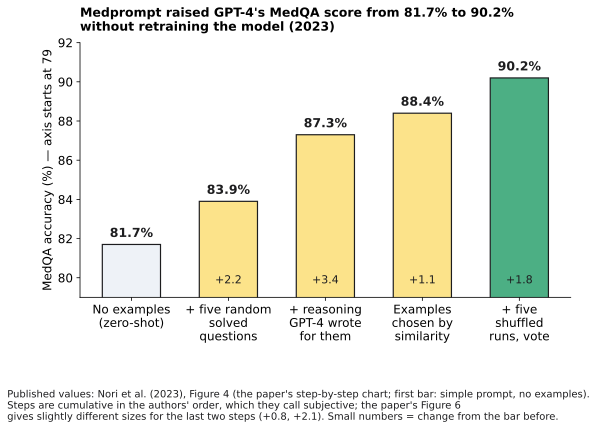{#fig-6-12 fig-alt="Bars for MedQA: 81.7% zero-shot, 83.9% random examples, 87.3% with reasoning, 88.4% similar examples, 90.2% with shuffled runs and vote."}

**What the paper reports.** The team added the components one at a time, in an order they chose (Nori et al., 2023, Figure 4). With a simple prompt and no examples, GPT-4 scored 81.7%. Five randomly chosen solved questions raised this to 83.9%. Adding the step-by-step reasoning GPT-4 had written for those examples raised it to 87.3%, the largest single step: with these examples, GPT-4 also wrote out its own reasoning before each answer. Choosing the examples by similarity gave 88.4%. Five shuffled runs and a vote gave 90.2%. So the changes to what the model received added about 6.7 points, and the workflow added about 1.8. The authors note that the components are not independent, so the size of each step depends on the order in which they were added, and they call their order subjective. Read the steps as rough shares, not exact amounts.

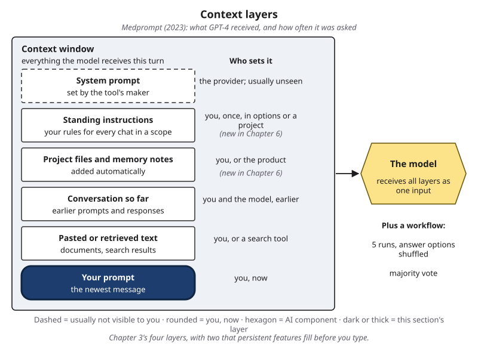{#fig-6-13 fig-alt="Context layers with your prompt highlighted for Medprompt's examples; side note: plus a workflow of five shuffled runs and a vote."}

**Traced on the context layers.** Three of the changes were context engineering: they changed what the model received in the prompt layer, namely the choice of in-context examples and the reasoning attached to them (@fig-6-13). The last change was mainly a workflow: the same question run five times, with the options reordered, and the answers combined (section 6.7). None of them retrained the model.

**A year later: the reversal.** In November 2024, the same lead author and colleagues tested o1-preview, an OpenAI model designed to produce reasoning before its final answer (Nori et al., 2024). With no examples and none of Medprompt's techniques, o1-preview scored about 95–96% on MedQA (the paper's summary table gives 96.0%; its chart of prompting methods shows slightly lower values). That is higher than the 90.2% of GPT-4 with Medprompt. Then the team tested Medprompt's parts one at a time. Five solved examples, given as question and answer only, *lowered* o1-preview's MedQA score. Across their benchmarks, examples were inconsistent and on average hurt. Running the question several times and voting still helped consistently, though at a higher cost. One reading the authors offer: o1-preview already produces reasoning before its answer, so examples add little to prompt it, and the examples may have confused the model (the authors' word). To address the worry about memorized test questions, the 2024 team also used a Japanese medical licensing exam given after the model's training data was collected.

**What the case teaches.** A context design belongs to a model and a date. The same kind of technique, five solved examples, that helped GPT-4 in 2023 lowered o1-preview's score in 2024. If you reuse a template, record what you tested it on, and test again when the tool or model changes. The benchmark caveats apply in both studies: these are exam-style questions, not patient care. The 2023 authors could not rule out that test questions had appeared in training text, and the 2024 authors noted that MedQA scores might have reached the most the benchmark can show, because some of its questions are flawed.

**Interests.** Both studies were written mostly by researchers at Microsoft about models made by OpenAI, and each includes one co-author from OpenAI (Nori et al., 2023, 2024). Microsoft is a major investor in OpenAI and offers OpenAI's models through its own cloud service (OpenAI, 2023), so its researchers have a business interest in these models doing well. Interests do not make findings wrong. They are a reason to read these as these authors' results on this benchmark, not as general facts about medicine, and to look for independent checks.

### Short case 1: The same examples, in a different order {.unnumbered}

In 2021 and 2022, two research teams studied how GPT-3-era models respond to in-context examples. One showed that the prompt's format, the choice of examples and their order could move accuracy from near guessing to near the best results of the time (Zhao et al., 2021). The other found that reordering the very same examples could change results from near-best to near random guessing (Lu et al., 2022). **Your task:** for a template you use, write the two orders you would test, and the criterion that would tell you which to keep.

### Short case 2: More text, less reliable use {.unnumbered}

Three studies from 2023 to 2025 point in one direction: irrelevant sentences lowered an older model's accuracy (Shi et al., 2023); information in the middle of long inputs was used less reliably by 2023 models (Liu et al., 2024); and a 2025 industry report found performance less reliable as inputs grew, across 18 models (Hong et al., 2025). When information in the input is not used, as in the middle-of-input and long-input results, Chapter 4 (section 4.4) calls it **context loss**: output that ignores information or instructions the model was given. The distraction result is a related but different problem: unrelated text changed the output. **Your task:** name one long document you use for study or work, and say which two excerpts a typical question about it would actually need.

## Ethics Lens: Invisible Instructions {.unnumbered}

When you read an AI-assisted email, report or chatbot answer, you see the output. You do not see the system prompt, the standing instructions, the project files or the memory notes that shaped it. This section asks who is responsible for those invisible layers.

**Transparency.** Providers decide how much of their own layer to show. Some publish their chat apps' system prompts (Willison, 2024; Wiggers, 2025), which shows that disclosure is possible; whether your tool does is something to check. The same question applies to you on a smaller scale. If your standing instructions say "write in a confident tone" or "always recommend option A," readers of your work cannot see that. Chapter 5's AI Use Declaration asks what tools you used and how; for work that others rely on, it is honest to mention standing instructions that shaped the result.

**Accountability for shared templates.** At work, a good template spreads quickly. A support team may answer hundreds of customers from one reply template, or a club from one email template. If the template produces a wrong answer, who answers for it: the person who wrote it, the person who used it, or the person who approved it? A library entry with a version, a test record and an owner makes that question answerable.

**Templates can carry bias.** A template applies the same framing to every input. If a screening template for job applications contains one-sided in-context examples, or an instruction that favors one kind of background, it repeats that bias on every application, the way Chapter 2's recruiting tool repeated a pattern in its data. Chapter 16 covers bias and fairness methods.

**Other people's data.** A project file or a memory note can hold information about other people: classmates' names, a customer's message, a patient's details. Putting it there shares it with a provider and with every future chat in that scope. Chapter 15 covers what never to store or paste.

*Discussion:* which of your own standing instructions, if any, would you disclose in an AI Use Declaration, and why?

## Career Connection {.unnumbered}

Reusable prompts and careful context are becoming ordinary parts of many jobs. The descriptions below are illustrations, not labor-market data.

| Occupation | How the chapter's ideas show up | A question to ask at work |
|---|---|---|
| Customer-support knowledge-base or operations specialist | Maintains reply templates tied to the current policy pages; decides which excerpts a support tool may draw on | Which version of the policy does this template use, and who checks it after a change? |
| Paralegal or legal-operations specialist | Builds checklists and libraries of standard contract clauses; selects the exact contract sections an AI-assisted review receives | Is everything this review depends on in the material, and is anything confidential that should not be? |
| Marketing or content specialist | Writes brand-style standing instructions and example posts for a team's shared project | Are our examples balanced, and when did we last test the template on a new campaign? |
| Quality or manufacturing engineer | Turns standard work instructions into templates for reports and inspections; adds checks between steps | Where in this chain would an error be cheapest to catch? |
| Instructional designer or teaching assistant | Builds rubric-based feedback templates; chooses example comments | Do the example comments cover every kind of feedback students need? |

## From the Field {.unnumbered}

In 2018 I wrote an encyclopedia article on CRISP-DM, which the article expands as "Cross Industry Standard Processing – Data Mining" (Şeker, 2018). It describes a standard process for data projects. The original guide was published by a group of companies in 2000 (Chapman et al., 2000). The process has six steps: understanding the business problem, understanding the data, preparing the data, modeling, evaluation and deployment.

The steps are not a straight line. The article describes loops: between understanding the problem and understanding the data, because what the data allows can change how the problem is defined; between preparation and modeling, because some models need data prepared in particular ways. The most important loop, the article says, runs from evaluation back to the very start, so that a project can go through all the steps again if its results do not meet the success criteria set at the beginning.

The article also reports what long use of the process in industry has taught practitioners. A data scientist starts with the problem and the business processes, and only then turns to the data. A question such as "what project can I make from this data?" is exactly what the method tries to prevent. The article warns against two roles: "data story tellers," who start from the data without a defined problem, and "data fortune tellers," who look for solutions to a problem without taking the data seriously. (In this book's words: telling stories about the data, or predicting with nothing under the prediction.) The article lists the job titles needed at most of the steps, from business analysts to software developers, and notes that data-mining tools such as SPSS Modeler build the six steps into the software and guide the user through them.

*Present-day connections, read with this chapter:* a library entry is a small process standard of its own. It fixes the steps that should not change, and its test record plays the role of CRISP-DM's evaluation loop: when a template fails on an edge input, you go back and change it. "Start from the problem, not the data" becomes "start from the task, not the tool": a template is worth building only for a task you have framed (Chapter 5) and actually repeat. And a standard that works across industries is not a standard answer; it is a standard way to get to an answer and check it.

*Disclosure: The article's printed affiliation is Bilkav Eğitim Danışmanlık, a company I founded.*

## Chapter Summary {.unnumbered}

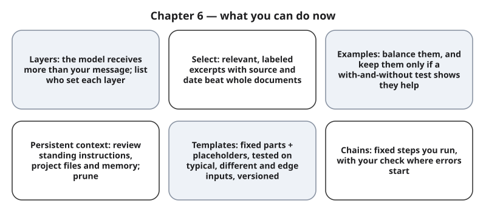{#fig-6-14 fig-alt="Six cards: layers, select, examples, persistent context, templates, chains."}

**The chapter's question:** *If the model is the same, why do two people get such different results from it?* Much of the difference lies outside the model: in what it receives (the layers of context someone builds, the material they select and label, the in-context examples they choose) and in how the task is run (the steps, the repeats, the checks). Medprompt raised one model's benchmark score by about eight and a half points without retraining it. But a design that helps is tied to a task, a model and a date. The same kind of technique, solved examples, that helped GPT-4 in 2023 lowered a newer model's score in 2024. So the second half of the answer is: whatever you build, test it, record it, and test it again when something changes.

**Return to the Opening Case.** What changed in Medprompt, if not the model? Two things that this chapter separates: what the model received in the prompt layer (solved questions, with reasoning, chosen by similarity) and the workflow (five runs with shuffled options and a vote). Neither retrained the model, and neither showed that the system was ready for clinical use.

**Revisit your Warm-up.** (1) What else might the model receive? *A system prompt, possibly standing instructions, project files, memory notes, the conversation so far and anything pasted or retrieved* (section 6.1). (2) Are all 50 pages used equally well? *Not reliably:* long inputs are used unevenly and irrelevant material can lower accuracy (section 6.2). (3) Will a new chat without the examples keep the improvement? *No:* in-context examples steer the output inside that context only; the model's parameters do not change (section 6.4 and the recap in 6.6).

You can now:

- **Explain** the context layers a model receives, and which you control.
- **Construct** a context from selected, labeled and ordered material.
- **Judge** from a with-and-without test whether in-context examples help.
- **Evaluate** what belongs in standing instructions, a project, memory or only this chat.
- **Create** a reusable template with placeholders, and record it in a library.
- **Design** a prompt chain with a check where errors start.

### Key Terms {.unnumbered}

agent (Ch. 3) · class imbalance (Ch. 2) · context engineering · context layers · context window (Ch. 3) · gap instruction · in-context example (Ch. 5) · memory (product feature, Ch. 3) · placeholder · project space · prompt chain · prompt library · prompt template · prompt version · standing instructions · system prompt (Ch. 3) · test inputs (Ch. 5)

## End-of-Chapter Package {.unnumbered}

<!-- Each item: objective · LO · revised Bloom level. Odd-numbered answers → Appendix E (docs/production/handoff/ch06.md); even-numbered → private/ch06-answers-even.md. Multiple-choice keys rotated (A2 d, A4 a, A7 c, A9 b, A10 d, A12 a, A14 c); distractors from M1–M6 (blueprint v0.2). Deep chapter: practice only, not examinable (D20). -->

This chapter is optional and not examinable. The questions below follow the exam's format, so they are good practice for the reasoning the exams do test.

### Review Questions A: Terms and Concepts {.unnumbered}

1. *(O1 · LO2 · Remember)* Match each layer to who usually sets it. Layers: (1) system prompt, (2) standing instructions, (3) memory notes, (4) your prompt. Setters: (a) you, now; (b) the provider; (c) the product, or you; (d) you, once, in the tool's options.
2. *(O1 · LO2 · Understand)* Sam's draft email mentions a co-op he finished last year, although his prompt says nothing about it. Which explanation fits section 6.1 best?\
   (a) The model's parameters were updated during his earlier chats, so the model now holds facts about Sam.\
   (b) Sam's prompt must have mentioned the co-op somewhere, since the model receives only what he typed.\
   (c) The memory feature keeps only facts that are still true, so the line about the co-op must be correct.\
   (d) A layer Sam did not write in this message, an out-of-date memory note, added the text.
3. *(O1 · LO2 · Understand)* In your own words, define context engineering and explain how it differs from writing one prompt.
4. *(O2 · LO2 · Understand)* A student pastes a 60-page student handbook to ask one question about the attendance rule. Which statement best fits section 6.2?\
   (a) The labeled excerpt is likely to serve better; unrelated pages can lower accuracy.\
   (b) Pasting all 60 pages gives the model more to draw on, so the answer is likely to be better.\
   (c) An added instruction to ignore unrelated pages will restore any accuracy those pages cost.\
   (d) Once the handbook fits in the context window, its middle pages are used as reliably as the rest.
5. *(O2 · LO2 · Apply)* Which two of section 6.2's four habits did Sam use in his parts order, and what error did each one prevent?
6. *(O2 · LO2 · Understand)* Section 6.3 suggests putting the full task last. What evidence supports the habit, and why does the section say to test it?
7. *(O3 · LO2 · Understand)* Three in-context examples improved today's outputs. Which statement is accurate?\
   (a) The examples updated the model, so tomorrow's chats will follow the pattern without them.\
   (b) Adding two more examples of the same kind is the most reliable next step.\
   (c) They steer outputs only while in the context; a new chat without them starts as before.\
   (d) Because the examples worked once, their order no longer needs to be tested.
8. *(O3 · LO2 · Understand)* Explain how three in-context examples that all carry the same label can act like class imbalance from Chapter 2.
9. *(O3 · LO2 · Remember)* In the 2024 study of o1-preview on MedQA, what happened when five solved examples were added?\
   (a) The score rose, as it had for GPT-4 in 2023.\
   (b) The score fell, unlike GPT-4's score in 2023.\
   (c) The score stayed about the same once examples were chosen by similarity.\
   (d) The score rose, because newer models make better use of examples.
10. *(O4 · LO2 · Apply)* Where does "this semester's course rubric (PDF)" belong, following section 6.5?\
    (a) In standing instructions, so that every chat receives it.\
    (b) In memory, so the tool can bring it up when it seems relevant.\
    (c) Pasted again in full into every chat about any of your courses.\
    (d) In a project space for that course.
11. *(O4 · LO2 · Apply)* A student's standing instructions say "Answer in under 50 words." The feedback she now gets on her history essay drafts is too short to use. Using section 6.5's routine, which question flags the problem, and what should she do?
12. *(O5 · LO2 · Apply)* A template passed all its tests last semester. You now use a newer model. What should you do?\
    (a) Rerun its test inputs on the new model and record the result.\
    (b) Keep using it as it is; its test record already shows that it works.\
    (c) Add in-context examples first, because examples helped GPT-4 in the Medprompt study.\
    (d) Keep it, but stop rerunning the earlier test inputs, since they passed before.
13. *(O5 · LO2 · Remember)* What is a placeholder in a prompt template? Give one example.
14. *(O6 · LO2 · Understand)* Which statement describes a prompt chain as this chapter uses the term?\
    (a) The model decides which step to run next, as it goes.\
    (b) Once the steps are fixed, they catch errors by themselves, so the check is optional.\
    (c) You fix the steps in advance, run them, and check the output between steps.\
    (d) Each extra step adds a check by itself, so a longer chain is a safer chain.

### Review Questions B: Case Questions {.unnumbered}

1. *(O1 · LO2 · Analyze)* A student writes in American English, but her chat tool keeps answering in formal British English. Her prompts say nothing about spelling. List the context layers that could explain this and say how she could check each one.
2. *(O2 · LO2 · Apply)* A pre-law student wants to know whether a city noise rule applies to a weekend street festival. She has the city code (300 pages) and a news article about last year's festival. Build the context: what she includes, how she labels it, the order, and a gap instruction.
3. *(O3 · LO2, LO3 · Evaluate)* A teaching assistant gives a tool three in-context examples of feedback, all written for essays that earned an A. The tool's feedback on new essays praises nearly everything. Diagnose the problem and design a with-and-without test on three test inputs.
4. *(O5 · LO2 · Create)* Write a template for a task you repeat (or for a weekly summary of a lab session for a lab partner). Mark the placeholders, write three pass criteria, and name a typical, a different and an edge test input.
5. *(O6 · LO2, LO5 · Create)* An intern turns job-interview notes into a hiring summary with scores, using one long prompt. Propose a two- or three-step chain, say where the human check goes and why, and name one kind of information that should never be in the context (Chapter 15).

### Review Questions C: Interpretive Questions {.unnumbered}

1. *(O5 · LO2 · Evaluate)* "Prompt libraries are a waste of time: the models change every few months." Take a position, using the Medprompt case and section 6.6.
2. *(O4 · LO2, LO5 · Evaluate)* Should memory features be on or off by default in tools that students use? Defend your answer with at least one benefit and one cost from section 6.5.
3. *(O6 · LO2, LO5 · Evaluate)* A manager says that every AI-assisted document the team sends to clients must be produced by a prompt chain with a human check. Agree or disagree, using section 6.7's reasons for and against chaining.

### Spaced Review {.unnumbered}

Come back to these a few days after reading, without looking back. Items 1 to 3 come from the chapters you read before this one; items 4 and 5 connect to Chapter 5, which you read alongside this one.

1. *(Chapter 3 · LO1 · Understand)* What does the context window contain, and what did the "lost in the middle" study find about long inputs?
2. *(Chapter 3 · LO1 · Understand)* Why does an in-context example in today's prompt not change tomorrow's answers in a new chat?
3. *(Chapter 2 · LO1 · Understand)* In Chapter 2, a model could be right for the wrong reasons (a shortcut). How could a template that passes on three test inputs still be right for the wrong reasons?
4. *(Chapter 5 · LO2 · Understand)* Which of the six parts of the anatomy of a prompt usually become placeholders in a template, and which usually stay fixed?
5. *(Chapter 5 · LO2 · Apply)* How could a peer swap test help before you share a template with a team?

### Discussion Questions {.unnumbered}

1. *(Ethics · O4 · LO2, LO4 · Evaluate)* Which of your standing instructions, if any, would you mention in an AI Use Declaration? Where is the line between a personal preference and something readers should know?
2. *(Ethics · O1 · LO2, LO5 · Evaluate)* "Users would be better off if every provider published its system prompts." What would a published system prompt tell you, and what would it not tell you?
3. *(Career · O5 · LO2 · Apply)* Name one task in a job you might hold in five years that would deserve a template. What would its edge input be?
4. *(Interdisciplinary · O6 · LO2 · Analyze)* Many fields use fixed procedures with checks between steps, such as lab protocols, the steps of closing a company's accounts at month end, or pre-flight checklists. What makes a step worth checking in your field, and does the same logic apply to prompt chains?
5. *(O4 · LO2 · Evaluate)* Do you want a tool to store notes about you between conversations? What would you allow it to store, and what not?
6. *(O5 · LO2 · Evaluate)* The From the Field article argues for starting from the problem, not the data. What is the equivalent mistake with AI tools, and have you made it?

### Application Assignment (optional): Personal Prompt Library {.unnumbered}

*(O5, O6 · LO2, LO3 · Create)* Optional and ungraded unless your instructor chooses to give feedback; it is not one of the book's numbered assignments (A1–A14). **Time:** about 2.5–3 hours, spread over the weeks between A3 (Chapter 5) and A11 (Chapter 14): about 40 minutes per entry (roughly nine fresh-chat runs and the record), about 25 minutes for the workflow card and about 15 minutes for the declaration. A good library is a strong starting point for the workflow blueprint (A11, Chapter 14) and the domain workflow prototype (A13, Chapter 19), and can serve as evidence in your final portfolio (Chapter 20).

**What to build:**

1. **At least three entries** for tasks you really repeat in study or work. Each entry has: name and purpose; when to use it and when not to; the template with placeholders; the context to attach, and what never to attach (Chapter 15); **in-context examples: used or not used, and the with-and-without test that decided**; a test record on three test inputs (typical, different, edge) with pass criteria and results; version number, date, and the tool and model it was tested on; what changed since the last version.
2. **One workflow card**: a two- or three-step prompt chain that names the check you perform between steps and its pass criterion.
3. **An AI Use Declaration** (tools, purpose, what you accepted, rejected or revised, how you verified it, and where your judgment mattered) and two sentences on which entry you would *not* reuse without retesting, and why.

**Rubric (10 points)**

| Criterion (points) | Exemplary | Proficient | Developing | Beginning |
|---|---|---|---|---|
| **Task (3)** | 3: at least 3 entries for real recurring tasks, every field complete, and a workflow card that names its check and pass criterion | 2: as Exemplary, but the workflow card lacks its check or criterion, or is missing | 1: at least 3 entries for real recurring tasks, with some fields missing | 0: fewer than 3 entries for real recurring tasks |
| **Process: tests (1.5)** | 1.5: every entry tested on typical, different and edge inputs, with its examples decision backed by a with-and-without run | 1: every entry tested on three inputs; one or two entries lack an edge input or a with-and-without run | 0.5: most entries tested on fewer than three inputs | 0: no test record |
| **Process: revision (1.5)** | 1.5: at least one entry revised after a failed test (an edge input made harder until it failed counts), with what changed and why, and the earlier test inputs rerun | 1: as Exemplary, but the earlier test inputs were not rerun | 0.5: a revision noted without a reason | 0: no revision |
| **Verification (2)** | 2: every test judged against stated pass criteria or a named source | 1.5: every test judged; criteria vague in one or two tests | 1: only some tests judged | 0: no tests judged |
| **Declaration and judgment (2)** | 2: all five declaration elements and a specific reason for the entry you would not reuse | 1.5: all five elements; a general reason | 1: two to four elements | 0: missing, or one element |

**Formats.** A plain text file, a document or a spreadsheet; one entry per page or row. No special tool is needed.

**Alternative assignment** (for students who prefer not to, or cannot, run AI tools). Repair the provided dated, constructed sample library (in the book's companion files). It has four flawed entries: no placeholders, a whole document pasted, one-sided in-context examples, and a field that asks for personal data. (1) Diagnose each flaw with this chapter's checklists. (2) Rewrite three entries. (3) For each, write a test plan: three test inputs (typical, different, edge), pass criteria, and the with-and-without comparison you would run. (4) Design a workflow card for the report-summary chain in section 6.7's faded example, naming the check and its pass criterion. (5) Write a declaration that states "no AI tools used," what you checked and how, and two sentences on which repaired entry you would least trust, and why. Scored on the same five criteria, with these descriptors:

| Criterion | Exemplary | Proficient | Developing | Beginning |
|---|---|---|---|---|
| Task (3) | Three repaired entries, every field complete, and the workflow card with its check and criterion | Workflow card missing its check or criterion | Some fields missing | Fewer than three repaired entries |
| Process: tests (1.5) | Every test plan names three inputs of the right types and a with-and-without comparison | One or two plans lack an edge input or the comparison | Most plans have fewer than three inputs | No test plans |
| Process: revision (1.5) | Every diagnosis names the flaw, the section that explains it, and what the rewrite changes | Diagnoses name the flaw and the change, without the section | Diagnoses name the flaw only | No diagnoses |
| Verification (2) | Every planned test has a stated pass criterion | Criteria vague in one or two plans | Criteria for some plans only | No criteria |
| Declaration and judgment (2) | "No AI tools used," what you checked and how, and a specific reason for the entry you would least trust | All of these; a general reason | Some elements missing | Missing |

### Mini-Project (optional): A Shared Library {.unnumbered}

*(O5, O6 · LO2, LO6 · Create)* Over three weeks, build a small shared library for a club, team or job: three templates, a version history for each, a change log, and one workflow card with a named owner for each check. At the end, write half a page on what broke and what you changed. The project feeds the workflow blueprint (A11) and the domain workflow prototype (A13).

### Case Study Questions {.unnumbered}

1. *(O3 · LO2 · Analyze)* Which of Medprompt's components changed the context the model received, and which changed how the task was run?
2. *(O3 · LO2, LO3 · Evaluate)* Why can you not say that GPT-4's self-written reasoning was "worth exactly 3.4 points"? Use the authors' own caveats.
3. *(O5 · LO2 · Create)* Write the library entry you would keep for Medprompt in 2023. Which fields would have warned you about the 2024 result?
4. *(O3 · LO3 · Evaluate)* Give two reasons, from the papers themselves, why a 90.2% MedQA score does not show that a tool is ready for clinical use.
5. *(O1 · LO3 · Evaluate)* How should the authors' affiliations and their company's interests affect how you read these results, and how should they not?

## Further Reading and Compass Links {.unnumbered}

- Nori et al. (2023): the Medprompt paper; Figure 4 and section 5.2 show the step-by-step results described in the Case Study.
- Nori et al. (2024): the follow-up with o1-preview; includes the prompt templates the team used.
- Anthropic (2024b): "Building effective agents," recommended; the workflow and agent patterns behind section 6.7 and Chapter 14.
- Anthropic (2025): "Effective context engineering for AI agents," for readers who want the software-engineering view.
- Wu, Terry and Cai (2022): the AI Chains study, with clear examples of chains and checks.
- Min et al. (2022) and Yoo et al. (2022): the first found that the correctness of in-context examples mattered surprisingly little; the second qualified that finding (Deep; for readers who want the research debate).
- Liu et al. (2024): "Lost in the middle," already met in Chapter 3.
- Chapman et al. (2000): the original CRISP-DM guide, for readers who liked From the Field.
- *In Compass (optional): interactive Context Layers (@fig-6-3); template tester; Lab 6.1–6.4 pages; persistent features by tool.*

## References {.unnumbered}

Anthropic. (n.d.). *Prompting best practices*. Claude Docs. Retrieved October 18, 2026, from https://platform.claude.com/docs/en/build-with-claude/prompt-engineering/claude-prompting-best-practices

Anthropic. (2024a, June 25). *Collaborate with Claude on Projects*. https://www.anthropic.com/news/projects

Anthropic. (2024b, December 19). *Building effective agents*. https://www.anthropic.com/engineering/building-effective-agents

Anthropic. (2025, September 29). *Effective context engineering for AI agents*. https://www.anthropic.com/engineering/effective-context-engineering-for-ai-agents

Brown, T. B., Mann, B., Ryder, N., Subbiah, M., Kaplan, J., Dhariwal, P., Neelakantan, A., Shyam, P., Sastry, G., Askell, A., Agarwal, S., Herbert-Voss, A., Krueger, G., Henighan, T., Child, R., Ramesh, A., Ziegler, D. M., Wu, J., Winter, C., . . . Amodei, D. (2020). Language models are few-shot learners. *Advances in Neural Information Processing Systems, 33*, 1877–1901.

Chapman, P., Clinton, J., Kerber, R., Khabaza, T., Reinartz, T., Shearer, C., & Wirth, R. (2000). *CRISP-DM 1.0: Step-by-step data mining guide*. SPSS.

Dakan, R., & Feller, J. (2025, December). *The AI Fluency Framework: A descriptive and normative model of human-AI interaction for higher education* (Version 1.1). Higher Education Authority. https://hub.teachingandlearning.ie/wp-content/uploads/2025/12/hea-genai-fluency-framework.pdf (CC BY-SA 4.0)

Google. (2024, August 28). *Customize Gemini (gemini.google.com) for your specific needs with Gems*. Google Workspace Updates. https://workspaceupdates.googleblog.com/2024/08/customize-gemini-with-gems.html

Hong, K., Troynikov, A., & Huber, J. (2025, July 14). *Context rot: How increasing input tokens impacts LLM performance* [Technical report]. Chroma. https://research.trychroma.com/context-rot

Liu, N. F., Lin, K., Hewitt, J., Paranjape, A., Bevilacqua, M., Petroni, F., & Liang, P. (2024). Lost in the middle: How language models use long contexts. *Transactions of the Association for Computational Linguistics, 12*, 157–173. https://doi.org/10.1162/tacl_a_00638

Lu, Y., Bartolo, M., Moore, A., Riedel, S., & Stenetorp, P. (2022). Fantastically ordered prompts and where to find them: Overcoming few-shot prompt order sensitivity. In *Proceedings of the 60th Annual Meeting of the Association for Computational Linguistics (Volume 1: Long Papers)* (pp. 8086–8098). Association for Computational Linguistics. https://doi.org/10.18653/v1/2022.acl-long.556

Min, S., Lyu, X., Holtzman, A., Artetxe, M., Lewis, M., Hajishirzi, H., & Zettlemoyer, L. (2022). Rethinking the role of demonstrations: What makes in-context learning work? In *Proceedings of the 2022 Conference on Empirical Methods in Natural Language Processing* (pp. 11048–11064). Association for Computational Linguistics. https://doi.org/10.18653/v1/2022.emnlp-main.759

Nori, H., Lee, Y. T., Zhang, S., Carignan, D., Edgar, R., Fusi, N., King, N., Larson, J., Li, Y., Liu, W., Luo, R., McKinney, S. M., Ness, R. O., Poon, H., Qin, T., Usuyama, N., White, C., & Horvitz, E. (2023). *Can generalist foundation models outcompete special-purpose tuning? Case study in medicine* (arXiv:2311.16452). arXiv. https://arxiv.org/abs/2311.16452

Nori, H., Usuyama, N., King, N., McKinney, S. M., Fernandes, X., Zhang, S., & Horvitz, E. (2024). *From Medprompt to o1: Exploration of run-time strategies for medical challenge problems and beyond* (arXiv:2411.03590). arXiv. https://arxiv.org/abs/2411.03590

OpenAI. (n.d.). *GPT-4.1 prompting guide*. OpenAI Cookbook. Retrieved October 18, 2026, from https://developers.openai.com/cookbook/examples/gpt4-1_prompting_guide

OpenAI. (2023, January 23). *OpenAI and Microsoft extend partnership*. https://openai.com/index/openai-and-microsoft-extend-partnership

OpenAI. (2024, February 13). *Memory and new controls for ChatGPT*. https://openai.com/index/memory-and-new-controls-for-chatgpt/

Sclar, M., Choi, Y., Tsvetkov, Y., & Suhr, A. (2024). Quantifying language models' sensitivity to spurious features in prompt design or: How I learned to start worrying about prompt formatting. In *The Twelfth International Conference on Learning Representations (ICLR 2024)*. https://arxiv.org/abs/2310.11324

Şeker, Ş. E. (2018). CRISP-DM: Endüstriler arası standart işleme – veri madenciliği için [CRISP-DM: Cross industry standard processing – data mining]. *YBS Ansiklopedi, 5*(2), 10–17. https://ybsansiklopedi.com/cilt-5-sayi-2-temmuz-2018/

Shi, F., Chen, X., Misra, K., Scales, N., Dohan, D., Chi, E. H., Schärli, N., & Zhou, D. (2023). Large language models can be easily distracted by irrelevant context. *Proceedings of the 40th International Conference on Machine Learning, PMLR 202*, 31210–31227.

Wallace, E., Xiao, K., Leike, R., Weng, L., Heidecke, J., & Beutel, A. (2024). *The instruction hierarchy: Training LLMs to prioritize privileged instructions* (arXiv:2404.13208). arXiv. https://arxiv.org/abs/2404.13208

Wiggers, K. (2025, May 15). xAI blames Grok's obsession with white genocide on an "unauthorized modification." *TechCrunch*. https://techcrunch.com/2025/05/15/xai-blames-groks-obsession-with-white-genocide-on-an-unauthorized-modification/

Willison, S. (2024, August 26). *Anthropic release notes: System prompts*. Simon Willison's Weblog. https://simonwillison.net/2024/Aug/26/anthropic-system-prompts/

Willison, S. (2025, June 27). *Context engineering*. Simon Willison's Weblog. https://simonwillison.net/2025/Jun/27/context-engineering/

Wu, T., Terry, M., & Cai, C. J. (2022). AI chains: Transparent and controllable human-AI interaction by chaining large language model prompts. In *Proceedings of the 2022 CHI Conference on Human Factors in Computing Systems* (pp. 1–22). ACM. https://doi.org/10.1145/3491102.3517582

Yoo, K. M., Kim, J., Kim, H. J., Cho, H., Jo, H., Lee, S.-W., Lee, S., & Kim, T. (2022). Ground-truth labels matter: A deeper look into input-label demonstrations. In *Proceedings of the 2022 Conference on Empirical Methods in Natural Language Processing* (pp. 2422–2437). Association for Computational Linguistics. https://doi.org/10.18653/v1/2022.emnlp-main.155

Zeff, M. (2025, April 10). OpenAI updates ChatGPT to reference your past chats. *TechCrunch*. https://techcrunch.com/2025/04/10/openai-updates-chatgpt-to-reference-your-other-chats/

Zhao, Z., Wallace, E., Feng, S., Klein, D., & Singh, S. (2021). Calibrate before use: Improving few-shot performance of language models. *Proceedings of the 38th International Conference on Machine Learning, PMLR 139*, 12697–12706.
