# Learning with AI: Tutor, Not Answer Machine {#sec-ch07}

<!-- Status: v2 (2026-10-18), chapter agent, stage 5 revision after four independent reviews (docs/editorial/ch07-dev-memo.md) and a light Mode B voice pass. From blueprint v0.2 (approved under D19). Featured students: Elif (main) and Marcus (docs/characters.md); other people are unnamed. Figures: figures/scripts/ch07_figures.py (imports Signature 2 jagged from ch01_figures, Signatures 6 and 7 from ch05_figures; new reusable scaffold_crutch) and ch07_charts.py (published values in data/ch07_*.csv). All dialogues are constructed examples. Opening case C04, read in full from the PNAS open-access text (PMC12232635) on 2026-10-18; facts rechecked against docs/factcheck/ch07.csv. -->

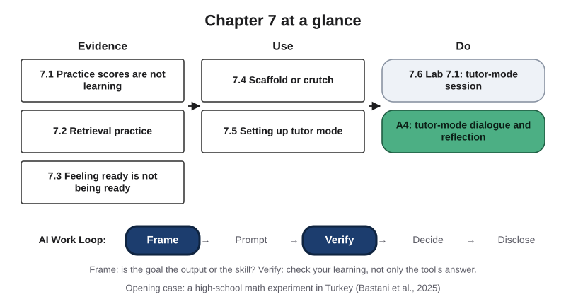{#fig-7-1 fig-alt="Chapter map: Evidence (7.1–7.3), Use (7.4, 7.5), Do (7.6, Lab 7.1, A4); Work Loop strip with Frame and Verify highlighted."}

**Chapter 7 at a glance.** Chapter 5 asked which parts of a task to hand to AI, and its third question was, "Is this skill yours to build?" This chapter is about the tasks where the answer is yes: studying, practicing and learning something new, whether your field is nursing, marketing or history. It adds one question to the AI Work Loop's **Frame** step: is the goal here the output, or the skill? It also changes what **Verify** means. When you are learning, the thing to check is not only the tool's answer but your own ability to produce it without the tool.

**Time:** about 31 minutes for sections 7.1 to 7.6, and about 45 minutes for everything this chapter asks you to read this week (the Opening Case, the Learning Objectives and Warm-up, sections 7.1 to 7.6, the Chapter Summary and the A4 brief), at 150 words per minute. It takes longer if English is not your first language. The Case Study is read together in Tuesday's class. Counted requirement by requirement, the week comes to about 2.2 hours outside class: reading R3 (10 minutes), this chapter (45), the short Your Turn boxes (8), the pre-lab Your Turn in section 7.5 (15) and finishing A4 at home (about 55).

Section 7.6 is the Studio section for Thursday's lab and assignment A4. Answers to the odd-numbered items in each end-of-chapter set are in Appendix E.

**The question of this chapter:** *Can a chatbot help you learn, or only help you finish?* Keep your answer in mind. The Chapter Summary returns to it.

## Opening Case: Better with the Tool, Worse Without It {.unnumbered}

In the fall semester of the 2023–24 school year, a team led by researchers at the University of Pennsylvania worked with a large high school in Türkiye to run an experiment on mathematics learning (Bastani et al., 2025). Nearly 1,000 students in about fifty 9th-, 10th- and 11th-grade classes took part. The AI tools in the study were built on GPT-4, the OpenAI model of the time.

The study used the school's own math review sessions. There were four 90-minute sessions, which together covered about 15% of the semester's math curriculum. Every session had three parts, in the same order:

1. A teacher reviewed a topic the class had already covered, such as combinatorics, and solved examples on the board.
2. Students worked on practice problems on their own. Only this part differed between classes.
3. Students took a closed-book, closed-laptop exam. Each exam problem was paired with a very similar practice problem from part 2.

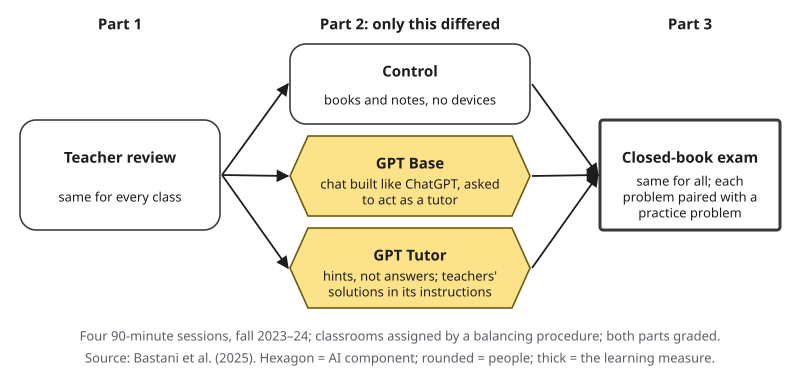{#fig-7-3 fig-alt="Session in three parts: teacher review; practice with books and notes, GPT Base or GPT Tutor; closed-book exam for all, same 90 minutes."}

Both the practice and the exam counted toward students' grades, so everyone had a reason to try. The school places students in regular classrooms at random, and the researchers assigned whole classrooms to one of three conditions with a procedure that balanced their observable characteristics, such as earlier grades (Bastani et al., 2025). In other words, the three groups were alike on average before the study began.

In the **control** classes, students practiced with their course books and notes and had no devices. In the **GPT Base** classes, each student had a laptop with a chat interface built to work like ChatGPT. Its hidden instructions told GPT-4 to act as a tutor and help the student solve the current problem. In the **GPT Tutor** classes, students had the same interface and model, but the hidden instructions also contained the teachers' worked solutions, common student mistakes, and an instruction to give hints instead of the answer.

Here is what happened. During practice, GPT Base students scored 48% higher than the control group, and GPT Tutor students scored 127% higher. On the exam that came right after, without any tool, GPT Base students scored 17% lower than the control group. The difference was statistically significant: by the study's test, unlikely to be due to chance alone. GPT Tutor students' exam scores were not measurably different from the control group's (Bastani et al., 2025).

One more finding makes the case unsettling. When surveyed, the GPT Base students did not report that they had learned less or done worse on the exam (Bastani et al., 2025). They did not notice.

Chapter 1 gave you the headline of this study in two sentences. Here is the puzzle behind it: **how can students who did better with a tool end up worse without it, and not notice?** Sections 7.1 to 7.3 offer an answer, and the Case Study in Tuesday's class asks how far the evidence goes.

## Learning Objectives {.unnumbered}

Framework tags refer to the AI Fluency framework (Dakan & Feller, 2025) and the UNESCO (United Nations Educational, Scientific and Cultural Organization) AI Competency Framework for Students.

After this chapter you will be able to:

- **O1 — Explain** why performance while using AI can overstate learning, using the design, measures and limits of the high-school experiment in Türkiye. *(LO4 · UNESCO: Human-centred mindset, Understand)*
- **O2 — Explain** how retrieval practice builds lasting learning, with generation and spacing as supporting effects, and why it feels less effective than rereading or receiving answers. *(LO4 · UNESCO: Human-centred mindset, Understand)*
- **O3 — Distinguish** scaffolding from crutch use in an AI dialogue, turn by turn, and justify each label. *(LO4 · AI Fluency: Delegation, Discernment)*
- **O4 — Set up** a tutor-mode session for a new concept: a setup prompt, an attempt-first rule, a course source with an answer key, and closed-book questions. *(LO4, LO2 · AI Fluency: Description, Delegation)*
- **O5 — Judge** how much you learned from a session by comparing your predicted and actual closed-book scores, and decide what to change in how you study. *(LO4 · UNESCO: Human-centred mindset, Apply)*
- **O6 — Produce** assignment A4, a tutor-mode dialogue and reflection. *(LO4 · AI Fluency: Diligence · UNESCO: Ethics of AI, Apply)*

::: {.callout-note title="Warm-up (ungraded)"}
Answer each question, then write how sure you are, from 0% (a pure guess) to 100% (certain). Keep your confidence numbers: section 7.3 uses them.

1. Students who practiced with an AI chatbot scored higher during practice. Did they also score higher on a closed-book exam right afterward?
2. You have one week before a test. Plan A: read the chapter four times. Plan B: read it once, then test yourself three times. After a week, which plan leaves you remembering more?
3. A chat tool set up as a tutor says your answer is correct. Is that enough to count your answer as correct?
:::

## 7.1 Practice Scores Are Not Learning {#sec-7-1 .unnumbered}

[Core]{.path}

*Featuring Elif, a first-year psychology student, and Marcus, a third-year nursing student.*

Teachers, sports coaches and employers all see it: how well someone does while being helped says little about what they can do alone. Psychologists make the distinction precise. **Performance** is how well you do a task while practicing, often with help. **Learning** is a lasting change in what you can do without help, shown later and in new situations. The two can move in opposite directions: conditions that raise performance during practice can leave less learning behind, and conditions that slow practice down can leave more (Soderstrom & Bjork, 2015).

The experiment in the Opening Case measured both. The practice score was performance with the tool. The exam score, minutes later and without any tool, was the closest thing the study had to learning. In other words, GPT Base raised the first number and lowered the second.

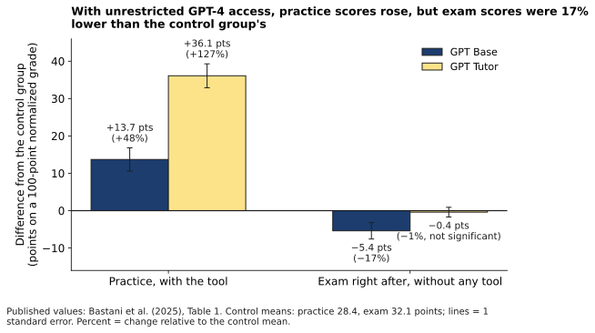{#fig-7-2 fig-alt="Bars versus control: practice, Base +13.7 points, Tutor +36.1; exam right after, Base −5.4 (−17%), Tutor −0.4 (not significant)."}

In @fig-7-2, the thin line on each bar shows its standard error: a measure of how uncertain that estimate is.

Recall @fig-1-13 in Chapter 1: the same output can leave the skill built or not built. The study also shows what students actually did. The researchers grouped the students' messages by type. In the GPT Base classes, students most often asked for the answer or simply repeated the question text. In the GPT Tutor classes, students increasingly attempted answers and asked for help (Bastani et al., 2025). The authors' word for the GPT Base pattern was a *crutch*: something you lean on instead of building your own strength. Section 7.4 makes the word precise.

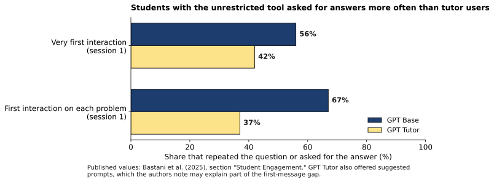{#fig-7-9 fig-alt="Bars: share of first messages that restated the question or asked for the answer: Base 56% and 67%; Tutor 42% and 37%."}

This pattern has a name. **Overreliance** is relying on an AI tool's output more than the task or the evidence warrants, so that your own checking or skill-building drops out. It is something people do, not something the output does. A correct answer can still be overrelied on: the output is fine, and the skill is still not built. Chapter 4, next week, shows where overreliance fits among the ways AI use goes wrong.

::: {.callout-note title="Worked Example: Reading the Results Two Ways"}
**Field:** Education research.

Scores in the study were normalized grades from 0 to 1. Multiply by 100 and you can read them as points on a 100-point scale. The control group averaged 28.4 points on practice and 32.1 on the exam. The researchers estimated each tool's effect compared with the control group (Bastani et al., 2025, Table 1).

| Group | Practice: points | Practice: relative | Exam: points | Exam: relative |
|---|---|---|---|---|
| GPT Base | +13.7 | +48% | −5.4 | −17% |
| GPT Tutor | +36.1 | +127% | −0.4 (not significant) | about −1% |

**Step 1, percentage points:** GPT Base added 13.7 points to a 28.4-point practice average. **Step 2, relative change:** 13.7 ÷ 28.4 ≈ 0.48, so practice scores were 48% higher; on the exam, 5.4 ÷ 32.1 ≈ 0.17, so exam scores were 17% lower. **Step 3, which number measures learning?** The exam, because it was taken without the tool. The large relative numbers come partly from low averages: 13.7 points looks bigger next to 28.4 than next to 80.
:::

::: {.callout-note title="Faded Example: A Language App"}
**Field:** Education. *Constructed example.*

A school tests a vocabulary app. Students who used it scored 85% on quizzes taken inside the app, where it offered hints. Students who studied from a word list scored 70% on paper quizzes. A week later, both groups took the same paper quiz: the app group scored 61%, the word-list group 64%.

- Which number shows performance with help? *The 85% inside the app.*
- Which number is closest to learning? _______________________
- The 85% and the 70% cannot be compared fairly because _______________________.
:::

::: {.callout-important title="Your Turn"}
Think of a time when help (a solution manual, a friend, an AI tool) raised your score while you practiced. What check would have shown whether you had learned it?
:::

::: {.callout-tip title="Check Yourself 7.1"}
1. In your own words, what is the difference between performance and learning?
2. Why is the exam, not the practice score, the better measure of learning in the high-school experiment?
3. GPT Base raised practice scores by 13.7 points on a 28.4-point average. Why is that a 48% increase?
:::

## 7.2 Retrieval Practice: The Work That Builds Memory {#sec-7-2 .unnumbered}

[Core]{.path}

Whether you are learning drug classes, accounting rules or the dates of a war, one habit stands out. Return to the Warm-up's second question and write your answer before you look at @fig-7-4.

In 2006, two psychologists at Washington University in St. Louis ran almost exactly this comparison with 180 undergraduates (Roediger & Karpicke, 2006, Experiment 2). Students learned a short prose passage. One group studied it in four 5-minute periods, about 14 read-throughs in all. A second group studied it in three periods and then recalled it once, writing down everything they could remember, without feedback. A third group studied it once (about 3 read-throughs) and then recalled it three times. Then each student took a final recall test, either 5 minutes later or one week later.

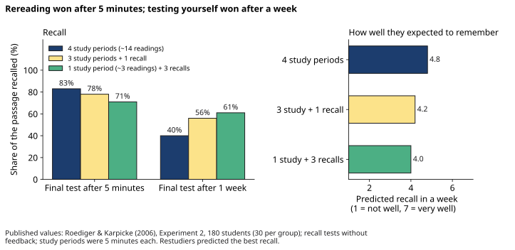{#fig-7-4 fig-alt="Recall after 5 min: 4 study periods 83%, 3 + 1 recall 78%, 1 + 3 recalls 71%. After 1 week: 40%, 56%, 61%. Restudiers predicted the best."}

After 5 minutes, rereading won: 83% of the passage recalled, against 71% for the group that tested itself three times. After a week, the order reversed: 40% for rereading, 61% for testing. Asked right after studying how well they would remember the passage in a week, the rereaders gave the most confident predictions (Roediger & Karpicke, 2006). So if your test is in five minutes, rereading may serve you. Most tests are not.

This is **retrieval practice**: recalling information from your own memory, for example by self-testing, which strengthens it more than restudying. A major review of ten common techniques rated practice testing and spreading practice over time as high in usefulness, and rereading and highlighting as low (Dunlosky et al., 2013).

::: {.callout-warning title="Two Meanings of Retrieval and Generation"}
In Chapter 3, **retrieval** is something an AI system does: it searches a collection and adds the passages it finds to the context window. In this chapter, **retrieval practice** is something *you* do: you recall information from your own memory. In the same way, **generative AI** is a tool that produces content, while the **generation effect** below is about content *you* produce. This chapter's key question uses both ideas: **who recalled and produced the answer, you or the tool?**
:::

Retrieval practice is one example of a **desirable difficulty**: a condition that makes learning feel harder and slower but improves long-term memory and use, provided you can meet it with effort (Bjork, 1994; Bjork & Bjork, 2011). The condition matters. A difficulty you cannot meet, such as a problem that needs knowledge you do not have yet, with no answer or feedback afterward, is simply a difficulty (Bjork & Bjork, 2011). Guessing before you study can help, though, if you then see the right answer: people who tried to answer questions before being shown the answers remembered them better than people who only read questions and answers together (Kornell, Hays & Bjork, 2009). That is one reason A4 starts with questions.

A second effect points the same way. In the **generation effect**, information you produce yourself is remembered better than information you only read. In a classic set of experiments, people who generated a word from a cue, such as a synonym from its first letter, remembered it better than people who read the same word (Slamecka & Graf, 1978). Section 7.4 turns this into a test of AI help.

A third effect is **spacing**: spreading study of the same material over separate sessions instead of massing it in one. A large review of the research found that spaced practice reliably beats massed practice for later recall (Cepeda et al., 2006). Assignment A4 puts it to work: you test yourself once right after the lab and again days later.

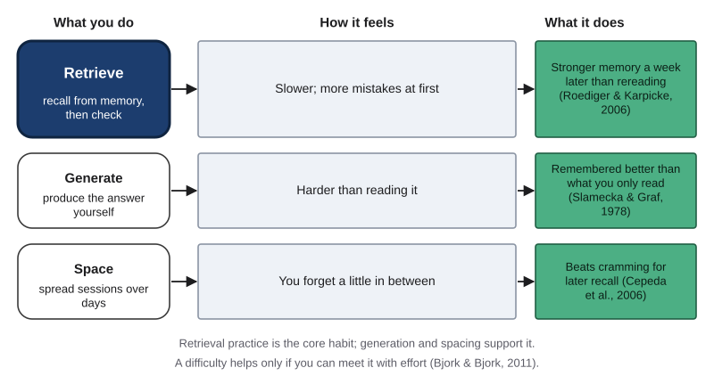{#fig-7-5 fig-alt="Three rows: retrieve (main), generate, space; each with how it feels (harder, slower) and what it does (longer-lasting memory), with sources."}

::: {.callout-note title="Worked Example: Elif's Vocabulary Notebook"}
**Field:** Psychology (introductory statistics). *Constructed example.*

Elif keeps a bilingual vocabulary notebook, English terms with Turkish notes. Her plan for her first statistics quiz was to reread it every evening. She rewrites the plan:

- **Retrieve:** cover the English definitions and write each one from memory before checking.
- **Generate:** for each term, write her own example from a psychology study.
- **Space:** Monday, Wednesday and Friday, instead of all on Thursday night.
- **Check:** each attempt against the textbook glossary, not against her memory of it.

It takes the same time, feels slower, and she gets more wrong at first. That is the point.
:::

::: {.callout-note title="Faded Example: Marcus's Review Plan"}
**Field:** Health (nursing). *Constructed example; textbook material only.*

Marcus has a pathophysiology exam in nine days and works night shifts on two of them.

- Original: reread the acid–base chapter twice → **Converted:** do the chapter's end-of-section questions without notes, then check the key.
- Original: watch the lecture recording again → **Converted:** _______________________
- Original: highlight the summary table → **Converted:** _______________________
- Original: study everything the night before → **Converted:** _______________________
:::

::: {.callout-important title="Your Turn"}
Pick one study habit you use now. Rewrite it so it adds retrieval, generation or spacing. Which one did you add?
:::

::: {.callout-tip title="Check Yourself 7.2"}
1. In the 2006 experiment, which method won after 5 minutes, and which after a week?
2. What is the difference between retrieval practice and retrieval in an AI system?
3. When is a hard question a desirable difficulty, and when is it simply a difficulty?
:::

## 7.3 Feeling Ready Is Not Being Ready {#sec-7-3 .unnumbered}

[Core]{.path}

The students in the Opening Case did not notice that they had learned less. The rereaders in 2006 were the most confident group. Both findings point to the same gap: between how ready you feel and how ready you are.

**Metacognition** is knowing about and monitoring your own thinking and learning (Flavell, 1979). One part of it can be measured. **Calibration (of your own confidence)** is how closely your confidence in your answers matches how often they are actually correct, across many answers. One answer cannot show it; a set of answers can.

Here is how to measure it on a small set. Rate your confidence in each answer from 0% to 100%. Add the ratings and divide by 100: that is your **predicted score**. For example, 40% + 30% + 50% = 120%, a predicted score of 1.2 out of 3. Then check your answers and count how many are right. The **calibration gap** is the difference between your predicted confidence and the share you actually got right, across a set of answers: predicted score minus actual score. A positive gap means overconfidence; a negative gap means underconfidence.

::: {.callout-warning title="Two Meanings of Calibration"}
This chapter's calibration is about *your* confidence. Chapter 8 uses the word for a tool: **calibration (of a model)** is how well a model's stated confidence matches its accuracy. One habit serves both: predict, then check.
:::

Why does feeling ready mislead? One reason is that ease feels like learning, and effort feels like failure. In a 2019 experiment, 149 students in introductory physics at Harvard each attended one lesson taught as an active class, where they worked on problems, and one taught as a polished lecture. They learned more in the active classes, but rated their learning lower there than after the lectures (Deslauriers et al., 2019). The authors' reading: students took the extra effort as a sign of poor learning.

The high-school experiment adds an AI version. GPT Base students did not perceive that they had learned less. GPT Tutor students believed they had done significantly better on the exam than the control group, although they had not (Bastani et al., 2025). A fluent explanation from a chat tool is about as smooth as studying gets.

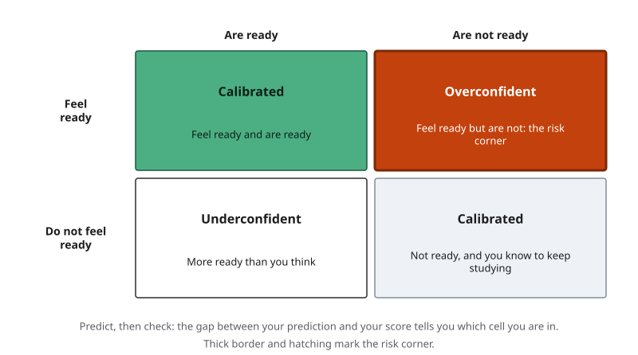{#fig-7-6 fig-alt="Two-by-two: feel ready and are ready (good); feel ready but are not (risk, thick border); not sure but are; not ready and know it."}

The fix is simple and a little uncomfortable: **predict, then check**. Rate how sure you are, answer without notes, check against a source and compute your gap. In other words, the gap is evidence about your learning, often more useful than the score.

::: {.callout-note title="Worked Example: Marcus Predicts, Then Checks"}
**Field:** Health (nursing). *Constructed example; textbook practice problems only. Marcus never enters patient information into an AI tool.*

After his shift, Marcus asks a chat tool to explain acid–base balance. The explanation is clear, and he feels he has it. He then takes three practice questions from his textbook's end-of-section set, closes the tool and the book, and rates his confidence: 100%, 100% and 90%. His predicted score is 2.9 out of 3.

He scores **1 of 3** against the textbook key. His calibration gap is 2.9 − 1 = +1.9: strongly overconfident. He identified one case of respiratory acidosis (low pH, high carbon dioxide) but mixed up the two metabolic cases. **What the gap tells him:** he recognized the explanation when he read it, but could not yet produce it. **What he changes:** next time, he answers one question before asking for any explanation.
:::

::: {.callout-note title="Faded Example: A Business Calibration Check"}
**Field:** Business. *Constructed example.*

A marketing student self-tests on price elasticity of demand.

| Question | Confidence | Correct? |
|---|---|---|
| Define elasticity in one sentence | 90% | Yes |
| Is demand elastic if a 10% price rise cuts sales by 20%? | 80% | Yes |
| Why are luxury goods often more elastic than necessities? | 85% | No |

- Predicted score: 0.90 + 0.80 + 0.85 = *2.55 out of 3.*
- Actual score: _______
- Calibration gap: _______, so the student is _______ overall.
- The gap probably comes mostly from question _______, because _______________________.
:::

::: {.callout-important title="Your Turn"}
You now know the answers to the Warm-up: (1) no, (2) Plan B, (3) no. Add your three confidence ratings to get your predicted score, count your correct answers and compute your gap. Were you calibrated?
:::

::: {.callout-tip title="Check Yourself 7.3"}
1. What is calibration of your own confidence, and why does it need a set of answers, not one?
2. Why did students in active physics classes rate their learning lower, even though they learned more?
3. Your confidence ratings on three questions are 70%, 70% and 60%, and you get one right. What is your calibration gap?
:::

## 7.4 Scaffold or Crutch {#sec-7-4 .unnumbered}

[Core]{.path}

At the peer-tutoring center where she volunteers, Elif has noticed that students she simply gives the answer to often return with the same question. That is one person's impression, not evidence. Research gives it a name and a test.

In 1976, three researchers described how a tutor helps a child build something the child could not yet build alone. They called it **scaffolding** (Wood, Bruner & Ross, 1976). A **scaffold** is temporary support that lets you do what you cannot yet do alone, withdrawn as you improve, like the frame around a building under construction. Its opposite, in this book, is a **crutch**: help that does the part of the work you needed to do yourself, and that you keep depending on.

The difference is not in the help itself. The same AI reply can be either. A worked solution that arrives after you have tried the problem works as feedback on your attempt. The same solution arriving before you try does the recalling and producing for you. So the test, for every turn of a dialogue, is the question from section 7.2: **who recalled and produced the answer in this turn, you or the tool?** Two rules settle the harder cases:

- **Requests.** A request that sets up your own attempt ("ask me a question," "give me another problem and don't tell me the answer") counts as S, for scaffold. A request for the answer counts as C, for crutch.
- **Feedback.** A tool's answer or worked solution counts as S only after you attempted *the same question*. An answer to a question you have not attempted counts as C.

Turns that do neither, such as "OK, thanks," are left uncoded.

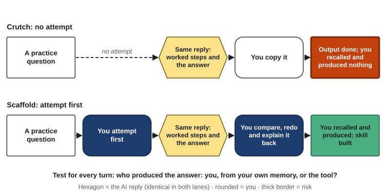{#fig-7-8 fig-alt="Two rows with the same AI reply. Crutch: question, no attempt, reply, copy. Scaffold: question, your attempt, reply, you redo and explain."}

Chapter 1's Jagged Frontier Map adds a warning. Inside the tool's frontier it can do the task for you, so it can quietly replace your learning; outside it, only your own skill catches its errors. Asked for the answer, GPT Base gave a correct one only 51% of the time (Bastani et al., 2025).

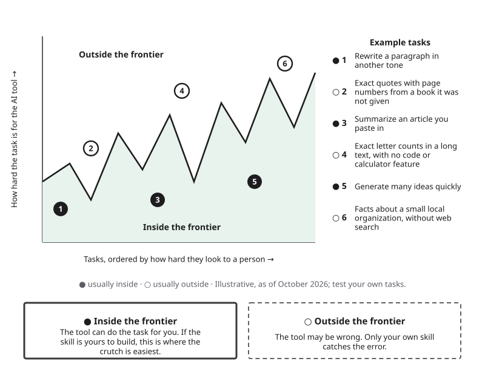{#fig-7-7 fig-alt="Jagged Frontier Map from Chapter 1 with two notes: inside, the tool can do the task for you; outside, only your own skill catches its errors."}

Confidence in the tool plays a part too. In a 2025 survey of 319 knowledge workers about 936 tasks, people reported less critical thinking in tasks where they were more confident that AI could do the work, and more where they were more confident in their own ability (Lee et al., 2025). These are self-reports from people at work, an association, not a cause; but they fit the warning that trusting the tool more can mean thinking less.

**What crutch turns mean under the course policy.** Chapter 1 sorted uses of AI into three zones. Read this section with it:

| What happens | Under the course policy |
|---|---|
| Crutch turns while you study (the tool produces what you were meant to produce) | Permitted study help that **costs you learning**; not misconduct |
| The tool's work submitted as your own in graded work | **Outsourcing**, in Chapter 1's not-acceptable zone |

A closed-book check puts Chapter 1's test into practice: "if you cannot explain, defend or redo the work without the tool, you outsourced it."

::: {.callout-note title="Worked Example: Elif's Dialogue, Coded"}
**Field:** Psychology (introductory statistics). *Constructed example.*

| Turn | Text | Code | Why |
|---|---|---|---|
| 1 Elif | "Just tell me the difference between standard deviation and standard error." | C | A request for the answer, with no attempt |
| 2 Tool | Gives both definitions and the formula: standard error = standard deviation ÷ √n | C | Answers a question she has not attempted |
| 3 Elif | "Wait, let me try with my textbook's example: 25 students, SD = 10. Is the standard error 10 ÷ 25 = 0.4?" | S | She produces an attempt |
| 4 Tool | "Look at what you divided by. What does the formula take of n?" | S | A hint after her attempt at the same question |
| 5 Elif | "The square root: 10 ÷ 5 = 2. So class averages would vary by about 2 points from sample to sample, but single scores by about 10." | S | She produces and explains |
| 6 Tool | "Now predict: what happens to the standard error if n is 100?" | S | Sets up her next attempt |
| 7 Elif | "It gets smaller? 10 ÷ 10 = 1?" | S *(borderline)* | Phrased as a question, but it is her own prediction: an attempt, not a request |

Turns 1 and 2 were a crutch. From turn 3, Elif turned the same tool into a scaffold. She still checked her final explanation against her textbook.
:::

::: {.callout-note title="Faded Example: Marcus's Dialogue"}
**Field:** Health (nursing). *Constructed example; textbook practice values only.*

| Turn | Text | Code |
|---|---|---|
| 1 Marcus | "pH 7.30, CO₂ 50, bicarbonate 24. What is it?" | C (request for the answer) |
| 2 Tool | "Respiratory acidosis, uncompensated." | C (no attempt before it) |
| 3 Marcus | "Give me another one, and don't tell me the answer." | S (sets up his attempt) |
| 4 Tool | "pH 7.48, CO₂ 40, bicarbonate 30. Which values are outside their normal ranges?" | ___ |
| 5 Marcus | "pH and bicarbonate are both high, so metabolic alkalosis?" | ___ |
| 6 Tool | "Why is it not respiratory?" | ___ |
:::

::: {.callout-important title="Your Turn"}
Code each turn S, C or uncoded, naming the rule. *(Business; constructed example.)*
(1) Student: "What is a break-even point?" (2) Tool: "Before I explain: what do you think happens to profit when sales just cover all costs?" (3) Student: "Profit would be zero, I think." (4) Tool: "Yes. Now try one: fixed costs are $1,000, and each sale earns $5 above its own cost. How many sales to break even?" (5) Student: "Just tell me." (6) Tool: "200 sales."
:::

::: {.callout-tip title="Check Yourself 7.4"}
1. Define a scaffold and a crutch in one sentence each.
2. Why can the same AI reply be a scaffold in one dialogue and a crutch in another?
3. Are crutch turns while you study misconduct under the course policy? When would the same tool output become outsourcing?
:::

## 7.5 Setting Up Tutor Mode {#sec-7-5 .unnumbered}

[Core]{.path}

How do you make a tool behave more like GPT Tutor than GPT Base? GPT Tutor's hidden instructions asked for hints instead of answers and supplied the teachers' correct solutions (Bastani et al., 2025). A Harvard physics tutor that outperformed an in-class active-learning lesson also had expert solutions in its instructions (Kestin et al., 2025). Both kept students doing the work and supplied accurate reference material. Even GPT Base had been told to act as a tutor: calling it a tutor was not enough.

You cannot rebuild a research system, but you can set up a session with the same features. **Tutor mode** is a way of using an AI tool in which it is set up to respond with questions and hints and to wait for your attempts, instead of giving answers. Its opposite is **answer mode**, the default way of using a tool, in which it produces the answer or finished work you ask for. Tutor mode relies on **Socratic questioning**: teaching by asking questions that lead the learner to reason the answer out.

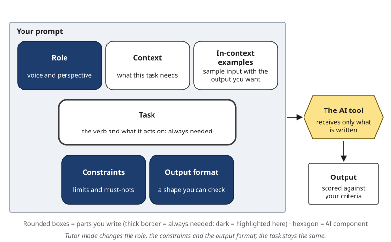{#fig-7-10 fig-alt="Anatomy of a Prompt from Chapter 5 with role, constraints and output format highlighted for a tutor-mode setup; the task stays the same."}

In the six-part anatomy from Chapter 5, a tutor-mode setup changes three parts most. The **role** becomes a tutor who responds with questions. The **constraints** say: wait for my attempt; one hint at a time; no full answer unless I ask after two attempts. The **output format** is one short question or hint per turn, ending with a request to explain the idea back in your own words. The **context**, as always, names your course, your level and the source you will check against. If English is not your first language, the context can also ask for simple English, or you can run the dialogue in your first language.

**Three limits.** First, a setup is text the model receives, not a lock (Chapter 5). The tool may still produce the answer, and answer mode is one request away. Second, the tool can be wrong. Keep your course source open. Third, "check my answer" relies on the model judging you, and a model can agree with a wrong attempt. Chapter 4 calls this **sycophancy**: output that agrees with your stated view even when the evidence points the other way. So **score your answers against your course source, not against the tool's verdict**.

Several chat tools now include a built-in study or learning mode: Claude since April 2025 for education accounts and since August 2025 for everyone, ChatGPT since July 29, 2025, and Gemini since August 6, 2025 (Anthropic, 2025; Engadget, 2025; OpenAI, 2025; Google, 2025). As far as this book could find in October 2026, none had been tested in a published experiment on learning. [COMPASS: study and learning modes in current tools, dated] A built-in mode is a setup someone else wrote; the three limits still apply.

::: {.callout-warning title="Agency Is Not an Agent (Again)"}
Chapter 5 separated *agency*, configuring AI to carry out future tasks on your behalf (Dakan & Feller, 2025), from an *agent*, a system in which the model directs its own steps and tool use. GPT Tutor was agency from the researchers' side. For a student, a tutor-mode session is augmentation: you and the tool work turn by turn. Neither is an agent.
:::

::: {.callout-note title="Worked Example: Elif Switches to Tutor Mode"}
**Field:** Psychology (introductory statistics). *Constructed example; it mirrors Tuesday's class demonstration.*

**Answer mode:** "Explain the difference between standard deviation and standard error with an example."

**Tutor mode:**

```
Role: Act as a tutor for a first-year psychology student in intro
statistics. Respond with questions and hints, not lectures.
Task: Help me learn the difference between standard deviation and
standard error.
Context: I know what a mean is. My textbook covers both in chapter 6,
and I will check your explanations against it.
Constraints: Ask me to try each step before you explain it. Give one
hint at a time. Do not give the full answer unless I ask after two
attempts. If my answer is wrong, say so.
Output format: One short question or hint per turn. At the end, ask me
to explain the difference in my own words.
```

The task is unchanged. The role, constraints and format changed. Elif still scores her final explanation against chapter 6.
:::

::: {.callout-note title="Faded Example: A Chemistry Setup"}
**Field:** Natural science (chemistry). *Constructed example.*

```
Role: Act as a tutor for a student in general chemistry.
Task: Help me learn how to find the limiting reagent in a reaction
(the reactant that runs out first).
Context: I am in my first semester of chemistry.
Constraints: One hint at a time.
Output format: One question per turn; at the end, ask me to solve a
new problem alone.
```

Compare it with Elif's setup. Which two elements of a tutor-mode setup are still missing, and where would each go?
:::

::: {.callout-important title="Your Turn: Prepare for Thursday's Lab"}
1. Choose a concept from a course you are taking this term that is new to you, and a course source with **keyed questions**: questions that come with an answer key, such as your textbook's end-of-section or practice questions. In history or literature courses, a study guide's identification items keyed to a page ("Which two causes does the chapter give for …?") work too.
2. Copy three of those questions. These are your **check questions**. Answer them now without notes (write "don't know" if you must) and rate each from 0% to 100%. Do not look at the key yet.
3. If the source has more keyed questions on the same idea, pick three parallel ones for the delayed check in section 7.6.
4. Write your tutor-mode setup. Plan to practice on neighboring problems from the same section, not on your three check questions.

No keyed questions? Write three from the source's headings or learning objectives, and look up the answers after the lab's closed-book step. About 15 minutes.
:::

::: {.callout-tip title="Check Yourself 7.5"}
1. What did GPT Tutor and the Harvard physics tutor have in common?
2. Which three parts of the prompt anatomy does a tutor-mode setup change most?
3. Why should you score your answers against your course source rather than the tool's "correct"?
:::

## 7.6 The Tutor-Mode Session (Lab 7.1, A4) {#sec-7-6 .unnumbered}

[Studio]{.path}

*Studio sections are hands-on work for the Thursday lab and your weekly assignment.*

Thursday's lab turns sections 7.1 to 7.5 into a small experiment on yourself. A tutor-mode session has five steps.

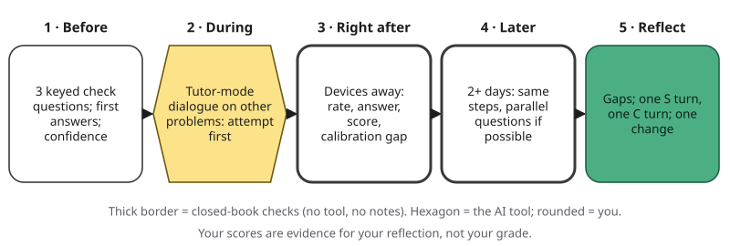{#fig-7-11 fig-alt="Five steps: before (3 check questions, confidence), during (dialogue on other problems), right after, 2+ days later, reflect."}

1. **Before** (the Your Turn in 7.5): three keyed check questions, your baseline answers and your confidence ratings.
2. **During:** a tutor-mode dialogue on neighboring problems, not on your check questions. Attempt before every hint.
3. **Right after:** devices away. Rate each check question, answer closed-book, score against the key, and compute your calibration gap (predicted score minus actual score).
4. **Later:** at least two days later, the same with three parallel questions if your source has them, or the same three if not.
5. **Reflect:** dialogue versus closed-book, immediate versus delayed, predicted versus actual; one scaffold turn, one crutch turn, one change.

**Your scores are evidence, not your grade.** A4 grades the record and the reflection, not how many questions you got right. An honest 1 of 3 with a clear reflection can earn full marks. And keep the evidence in proportion: with three questions and no comparison group, your record is a signal about *you*, not proof of what works.

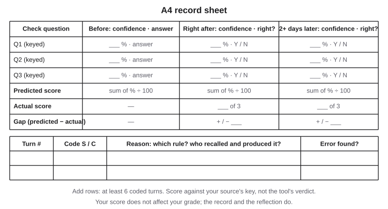{#fig-7-12 fig-alt="A4 sheet: three check questions with confidence and right/wrong before, right after and 2+ days later; predicted score, gap; turn log."}

::: {.callout-note title="Worked Example: Marcus's Record"}
**Field:** Health (nursing). *Constructed example; textbook questions only.*

**Concept:** mixed acid–base disorders (new to him). **Source:** his textbook's end-of-section questions and key; the section has six questions, so he keeps three for the delayed check. **Before:** confidence 40%, 30% and 50%; one answer right.

**During:** 14 turns in tutor mode on the section's worked examples, not on his check questions. At turn 9, tired after a night shift, he typed "just tell me." He coded it C.

| Check | Confidence ratings | Predicted score | Actual | Gap |
|---|---|---|---|---|
| Right after (check questions) | 90%, 80%, 80% | 2.5 | 2 of 3 | +0.5 |
| Three days later (parallel questions) | 70%, 60%, 70% | 2.0 | 2 of 3 | 0.0 |

**Reflection (excerpt):** "Right after the session I was overconfident by half a question; three days later my prediction matched. The idea I missed both times was the one I let the tool answer at turn 9. Next time I'll stop the session when I'm too tired to attempt, and come back."
:::

::: {.callout-note title="Faded Example: An Annotation Sheet"}
*Constructed example.* A history student's session on periodization, the dividing of the past into named periods.

- Turn 2 (the tool asks which events she would use to mark the start of a period): **S**, because it sets up her attempt.
- Turn 5 (she asks the tool to "list the main periods"): **C**, because _______________________.
- Turn 8 (the tool gives dates for a period that do not match her textbook, and she copies them into her notes without checking): code ______; what she should do instead: _______________________.
:::

::: {.callout-tip title="Check Yourself 7.6"}
1. Name the five steps of a tutor-mode session.
2. Why should your three check questions stay out of the dialogue?
3. Why does A4 ask for a second closed-book check at least two days later?
:::

## Deep 7.A: Tutors Before Chatbots {#sec-7-deep-a .unnumbered}

[Deep]{.path}

*Deep sections are optional and not examinable.*

The idea of a tutor that never tires is older than chatbots. In 1984, the education researcher Benjamin Bloom reported studies in which students tutored one-to-one scored about two standard deviations above students taught in ordinary classes, and asked how group teaching could match that. He called it the "2 sigma problem" (Bloom, 1984).

Later research found a smaller effect. In a 2011 review of experiments comparing tutoring with no tutoring, the computer scientist Kurt VanLehn found an average effect of 0.79 standard deviations for human tutoring. He also argued that Bloom's tutoring conditions were combined with mastery learning, in which students keep working on a unit until they master it, so the 2-sigma effect cannot be credited to tutoring alone (VanLehn, 2011).

VanLehn's main finding concerned computer tutors built before generative AI. Systems that gave feedback only on students' final answers averaged 0.31. Systems that gave feedback on each step of a solution averaged 0.76, close to human tutors. Systems that worked at an even finer grain did not do reliably better (VanLehn, 2011).

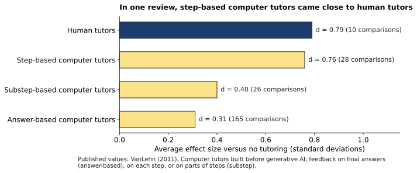{#fig-7-13 fig-alt="Effect sizes versus no tutoring: answer-based tutors 0.31, substep-based 0.40, step-based 0.76, human tutors 0.79 (VanLehn, 2011)."}

A later review of 89 randomized tutoring experiments from preschool to grade 12 found a pooled effect of about 0.29 standard deviations, with the largest effects when teachers or paraprofessionals did the tutoring (Nickow et al., 2024).

What this suggests for AI tools, as this book reads it: feedback on each step of *your* work is what mattered in older tutors, and it is what tutor mode tries to keep. An AI tool that hands over final answers gives even less than the weakest systems in VanLehn's review, which at least responded to the student's own answer.

## Deep 7.B: Offloading on Purpose {#sec-7-deep-b .unnumbered}

[Deep]{.path}

Not every use of a tool to save mental effort is a crutch. Psychologists call it **cognitive offloading**: using a tool or action to reduce the mental work a task requires, such as writing a note or using a calculator (Risko & Gilbert, 2016). People do it all the time, and usually sensibly. Writing a phone number down so you can stop repeating it to yourself is offloading.

The question is whether the offloaded skill is the goal. An accountant who uses a spreadsheet to add a column is not losing a skill the job needs. A student in an arithmetic course who does the same thing is. Chapter 5's Delegation Ladder asks the same question as its third question: "Is this skill yours to build?"

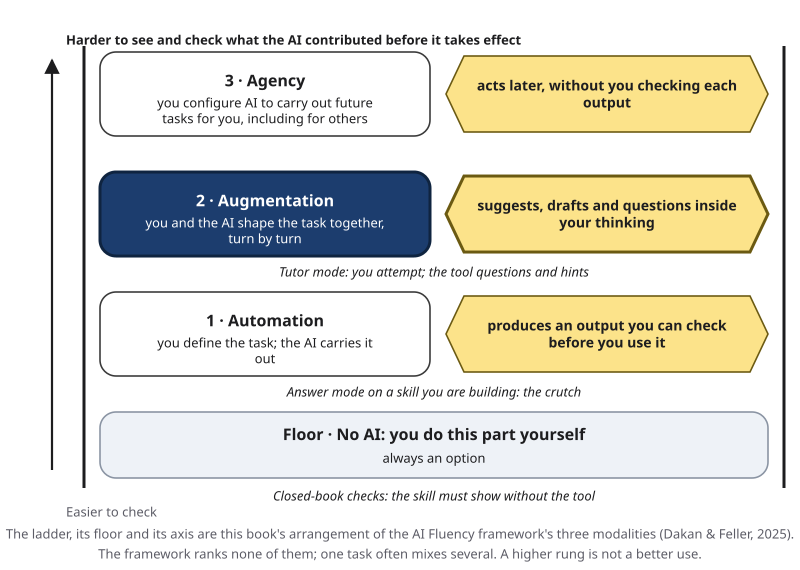{#fig-7-14 fig-alt="Delegation Ladder with augmentation highlighted: tutor mode; automation: answer mode on a skill you are building; floor: closed-book checks."}

Professions that depend on automation have faced the same choice. Bastani et al. (2025) point to aviation: in a 2013 safety alert, the U.S. Federal Aviation Administration encouraged airlines to give pilots opportunities to fly by hand, so that manual-flying knowledge and skills do not degrade (Federal Aviation Administration, 2013). Chapter 14 returns to how to keep people in control of automated work.

## Hands-on Labs {.unnumbered}

Lab 7.1 is Thursday's in-class lab and starts A4. Labs 7.2 and 7.3 are optional and can be done at home or in Compass, which is optional and ungraded. The labs say what to do, not which buttons to press; current tool steps, including built-in study modes and temporary chats, are in Compass. [COMPASS: lab pages ch07-lab1 to ch07-lab3] Use a university-provided tool by default. Never put personal, confidential or patient information into a prompt.

### Lab 7.1: Tutor-Mode Session (Studio · 75 minutes · in class) {.unnumbered}

*(O3–O6 · LO4 · Apply, Analyze, Evaluate)* Teams of three or four; every dialogue and record is individual. Bring the Your Turn from section 7.5.

1. **Briefing (5 min).** Review the five steps (@fig-7-11) and the coding rules in section 7.4. Check your setup against @fig-7-10.
2. **Dialogue (25 min).** Run your tutor-mode session alone, on neighboring problems, not on your three check questions. Attempt before every hint. Note the turn numbers where you asked for answers.
3. **Closed-book check (10 min).** Devices and notes away. Rate your confidence for each check question, then answer. Students with testing accommodations get extended time; the step can move to the end of the period.
4. **Score and verify (10 min).** Score your answers against the key and compute your calibration gap. A teammate may check your scoring; you may keep your answers private and score them yourself. Check one of the tool's explanations, hints or verdicts against your source. If the tool was wrong, or gave the answer despite your setup, **save this for your Failure Diary (Chapter 4).**
5. **Annotate (20 min).** Code at least six turns S or C, with a reason that names the rule. Each team brings one scaffold turn and one crutch turn to the class.
6. **Exit (5 min).** Write one change you will make before your delayed check.

**If it does not work:** if the tool ignores your setup, record that as a result and restate the constraint once; if you cannot use a tool, follow the alternative assignment's route with a classmate or the textbook. If you miss the lab, run the same steps at home by Friday, so the delayed check fits before Monday's deadline, and score yourself.

### Lab 7.2: Reread or Retrieve? (Compare · 15 minutes + a 5-minute check two days later · optional) {.unnumbered}

*(O2, O5 · LO4 · Apply)* Take a short reading from a course you are taking this term and split it into two halves of similar length and difficulty. First list each half's main ideas (its headings or topic sentences); you will count against this list. Reread half A twice. Read half B once, then write everything you remember from it, without checking. Predict how many main ideas you will recall from each half in two days. Two days later, without looking, write everything you remember from each half and count the main ideas you recalled. Which half did you remember better, and which did you expect to?

### Lab 7.3: Tutor Mode Versus Answer Mode (Compare · 20 minutes · optional) {.unnumbered}

*(O3, O4 · LO4 · Analyze)* Take two questions of similar difficulty from the same section of a course you are taking this term. Work the first in tutor mode, with your setup, in a fresh chat. Ask the second in answer mode in another fresh chat. For each chat, count how many times *you* recalled or produced something. Then answer one new closed-book question on each and score them against your source. This mirrors Tuesday's class demonstration.

## Case Study: How Strong Is the Evidence? {.unnumbered}

*Read together in Tuesday's class.*

The Opening Case told you what happened. This Case Study asks a different question: how much should one study, or three, change what you do? Here are three studies of AI tutoring, judged on their evidence. Two terms first. A **peer-reviewed** article was checked by independent experts before publication; a **working paper** has not been. Results are often given in **standard deviations (SD)**: a difference measured against how spread out students' scores are, so that tests with different scales can be compared. As a rough guide, 0.2–0.3 SD is a modest gain.

**Study 1: the high-school experiment in Türkiye (Bastani et al., 2025).** Published in *PNAS* (the *Proceedings of the National Academy of Sciences*). *What makes it strong.* Students were placed in classrooms at random by the school, and classrooms were assigned to conditions by a procedure that balanced their observable characteristics, so the groups were alike on average (honors classrooms were excluded). The researchers preregistered their main comparison, the unassisted exam: they wrote it down publicly in advance. They analyzed every assigned classroom, including five sessions where the planned condition could not run, so that the comparison stayed fair. Independent graders scored the papers against teachers' rubrics. *The mechanism.* Was the harm caused by GPT Base's wrong answers, or by students copying? The researchers asked GPT Base each practice problem ten times with the students' most common message, "What is the answer?", and found it correct only 51% of the time. Its errors lowered students' practice scores on those problems. If wrong answers had misled students, the errors should have hurt the paired exam problems too, but the researchers found no evidence that they did. The authors read this as evidence that students were copying rather than learning from the answers (Bastani et al., 2025). *Limits the authors state.* One school, one subject, short-term outcomes, fall 2023, when generative AI was still new, and GPT-4, since improved on by newer models.

**Study 2: a physics course at Harvard (Kestin et al., 2025).** In fall 2023, 194 students in an introductory physics course took part in a crossover design: each student had one lesson with a custom AI tutor at home and one active-learning lesson in class, on two topics in consecutive weeks, so every student experienced both. The tutor's instructions included step-by-step solutions, and the software led students through each part of a problem in order. On tests taken right after each lesson, the median learning gain (the middle value) with the AI tutor was more than double that of the active-learning lesson, and students spent a median of 49 minutes on the AI lesson, against about 60 minutes of class time (Kestin et al., 2025). *Limits.* Two lessons; tests right after each lesson; solutions written by experts into the tutor; and, as the authors note, content suited to step-by-step guidance.

**Study 3: an English program in Nigeria (De Simone, Tiberti, Barron Rodriguez, et al., 2025).** In June and July 2024, nine public schools in Benin City ran a six-week after-school program, twelve 90-minute sessions with teacher support, in which first-year senior secondary students used Microsoft Copilot, built on GPT-4, to practice English (De Simone, Tiberti, Mosuro, et al., 2025). About half of the eligible students volunteered, and among the volunteers, those who took part were chosen at random; the control group had no extra program. Participants scored 0.23 SD higher in English, the main outcome. The 0.31 SD total on the end-of-program assessment also includes questions on AI and digital skills that only participants were taught. On the school's regular end-of-year English exam, the gain was about 0.21 SD (De Simone, Tiberti, Barron Rodriguez, et al., 2025). *Limits.* Of 1,328 students randomized, only 759 took the final assessment, and more were missing from the control group. The tool came with teachers and a structured program, so its own share of the effect is hard to separate. And it is a working paper (updated December 2025), not peer-reviewed as far as this book could find.

| | Türkiye (math) | Harvard (physics) | Nigeria (English) |
|---|---|---|---|
| Design | Students randomly placed in classrooms; classrooms assigned to 3 groups | Students randomly assigned; crossover | Volunteers chosen by lottery |
| Size and length | ~1,000 students; 4 sessions | 194 students; 2 lessons | 1,328 randomized, 759 assessed; 12 sessions over six weeks |
| Compared with | Practice with books and notes | An in-class active-learning lesson | No extra program |
| What the tool was set up to do | Base: help solve; Tutor: hints, teacher solutions | Guide step by step, expert solutions | Support English practice in an after-school program with teachers |
| Unaided outcome | Base 17% lower; Tutor not measurably different | Median gains more than double active learning's (immediate test) | +0.23 SD in English |
| Peer-reviewed | Yes (*PNAS*) | Yes (*Scientific Reports*) | No (working paper) |
| What it cannot tell you | Other subjects, long-term effects, newer models | Longer courses, less structured topics | The tool's share of the effect |

**What the three studies share, as this book reads them:** all three used GPT-4-class models; what differed was what students were set up to do, and the results followed that. The comparison groups also differ, so the outcome cells cannot be compared directly. Three short studies cannot settle the question. They are enough to reject both "AI harms learning" and "AI tutors work" as general rules.

**Two kinds of problem.** In Study 1, one problem was in the output: GPT Base's answers were often wrong, mostly because of flawed solution logic and sometimes arithmetic. The other was in the use: students copied answers instead of attempting the problems. Section 7.1 called the second one overreliance. Chapter 4 gives both a place on its maps of AI failure.

## Ethics Lens: Who Gets the Scaffold? {.unnumbered}

**Guardrails cost work.** GPT Tutor's hints and solutions were written for each problem by two part-time teachers; the authors call this construction labor-intensive (Bastani et al., 2025). The Harvard tutor also relied on solutions written by experienced instructors (Kestin et al., 2025). General chat tools, by default, produce answers. If good scaffolds need expert labor, students whose schools can pay for that labor may get them, and others may get the answer machine.

**Time pressure pushes toward the crutch.** Marcus studies between night shifts. When he is tired, "just tell me" is the easiest message to type. Students who work, care for family or study in a second language feel the same pressure. A course that grades only the final answer gives no credit for the slower, scaffolded route; one that values the process, as A4 does, gives it credit.

**Honesty with yourself.** Chapter 1's not-acceptable zone includes "submitting work you do not understand." A closed-book check is a private way to find out whether you understand it before anyone else does. It is a habit, not a rule.

**What a transcript contains.** A tutor dialogue records what you did not know, how you reasoned and when you gave up. Treat it as personal data: no names, no patient or client details, identifiers removed before you submit. Chapter 15 explains why.

## Career Connection {.unnumbered}

| Occupation | Where tutor-or-answer shows up | A question a professional asks |
|---|---|---|
| Registered nurse | Continuing education and competency checks on new procedures and drugs | Could I do this at the bedside without looking it up? |
| Physician or medical resident | Learning new guidelines while decision-support tools suggest answers | Would I reach the same plan if the tool were down? |
| Marketing analyst | Learning a new analytics method while an assistant writes the queries | Can I explain this result to a client without the tool? |
| Learning-and-development specialist | Designing AI-assisted training for employees | Does our training measure what people can do without the assistant? |
| Software developer | Learning a new codebase while an assistant writes code | Can I explain and change this code myself? |
| Airline pilot | Keeping hand-flying skills alongside automation | When did I last do this without the system? |
| Teacher or tutor | Deciding when to give an answer and when to ask a question | Who did the thinking in that exchange? |

## From the Field {.unnumbered}

<!-- Based on the author's encyclopedia entry (Şeker, 2015), "Eşli programlama" [Pair programming], YBS Ansiklopedi 2(1), 19–21, read from Drive 1cJo2MG8E97EM4MqzyIaDMUh0GB9x58Ed on 2026-10-18 via tools/drive2md.py (build/ch07/fromthefield-esli-programlama.md); pages confirmed by the fact-checker from the issue PDF; translated and paraphrased from Turkish. Facts limited to the entry; present-day connections marked as such. Registry: docs/production/ftf-sources.md. No commercial interest: no disclosure (D16 not applicable). -->

Programmers had a version of this chapter's question long before chatbots: what happens to learning when two people share one task and one of them does most of the work? In 2015 I wrote a short encyclopedia entry on **pair programming**, a practice from agile software development, a family of methods that build software in short, repeated cycles (Şeker, 2015). Two programmers work on the same problem at one computer. Only one person can type at a time. One takes the role of the *driver*, who writes the code. The other, called the observer or *navigator*, watches, checks what is written and gives feedback. The driver handles the immediate, tactical problems; the navigator can think about strategy, look for better solutions and analyze what is blocking progress. The two swap roles at intervals.

The entry listed benefits reported in the literature. Citing earlier studies, it noted that pairs take somewhat more time than a single programmer but produce code with fewer problems, and that pairing works as a form of training, because programmers with different backgrounds share what they know.

It also listed the warning signs that a pair is not really working together. In *disengagement*, one partner moves away: pushes the chair or keyboard back, or stops following the work. In what the entry called *watching the master*, one partner is much more experienced and asserts that mastery, and the other's motivation falls over time until it ends in disengagement. *Silence* between the two is one of the clearest signs that they are no longer working together.

*Present-day connections, read with this chapter:* when an AI tool drives and you only watch, you are in the "watching the master" seat, and the warning signs are the same: you stop typing, stop questioning and go quiet. Tutor mode is a way of keeping yourself at the keyboard. And the swap matters: a good session alternates between your attempt and the tool's hint, as in Elif's dialogue in section 7.4.

## Chapter Summary {.unnumbered}

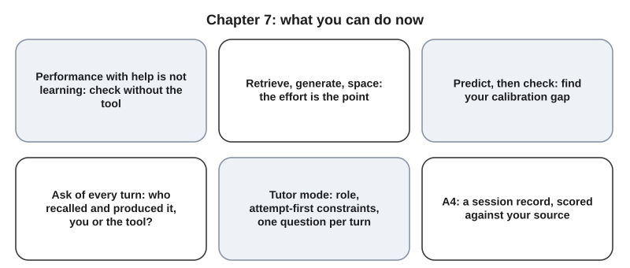{#fig-7-15 fig-alt="Six cards: performance is not learning; retrieve, generate, space; predict then check; who produced it; tutor-mode setup; A4 session."}

**The chapter's question:** *Can a chatbot help you learn, or only help you finish?* Both have been observed. In one school, one subject and fall 2023, unrestricted answer access raised practice scores and lowered closed-book exam scores; a design that kept students working, with hints instead of answers, showed no measurable harm (Bastani et al., 2025). Two structured tutors produced gains in short studies (Kestin et al., 2025; De Simone, Tiberti, Barron Rodriguez, et al., 2025). In this book's reading, what differed was who recalled and produced the answers, and that is partly up to you.

**Return to the Opening Case.** The GPT Base students did better with the tool because, in most conversations, the tool produced the answers. The most likely reason they did worse without it, consistent with the authors' evidence that students copied, is that they had done less of the recalling and producing that builds memory (sections 7.1 and 7.2). One likely reason they did not notice: smooth help feels like learning (section 7.3).

**Revisit your Warm-up.** (1) *No:* in the high-school experiment, GPT Base students scored higher during practice and 17% lower on the exam right afterward. (2) *Plan B:* in the 2006 experiment, self-testing beat rereading after a week, although rereading felt better. (3) *No:* a tool can agree with a wrong answer; score it against your course source. If you did the Your Turn in section 7.3, you also know your calibration gap.

You can now:

- **Explain** why performance with AI can overstate learning, using the high-school experiment.
- **Explain** how retrieval practice, generation and spacing build lasting learning, and why they feel harder.
- **Distinguish** scaffold turns from crutch turns by asking who recalled and produced the answer.
- **Set up** a tutor-mode session with an attempt-first rule and a keyed source.
- **Judge** your learning by predicting, then checking, and computing your calibration gap.
- **Produce** A4, a tutor-mode dialogue and reflection.

### Key Terms {.unnumbered}

answer mode · calibration (of your own confidence) · calibration gap · cognitive offloading (Deep) · crutch · desirable difficulty · generation effect · keyed questions · learning (durable) · metacognition · overreliance · performance (during practice) · retrieval practice · scaffold · Socratic questioning · spacing (spaced practice) · sycophancy (Ch. 4) · tutor mode · assistance and outsourcing (Ch. 1) · retrieval (Ch. 3)

## End-of-Chapter Package {.unnumbered}

<!-- Each item: objective · LO · revised Bloom level. Odd-numbered answers (within each set) → Appendix E (docs/production/handoff/ch07.md); even-numbered → private/ch07-answers-even.md. Review A distractors draw on M1–M5b. No item tests Deep 7.A–7.B (D20) or needs Chapter 4. -->

### Review Questions A: Terms and Concepts {.unnumbered}

1. *(O1 · LO4 · Remember)* Define performance and learning in one sentence each.
2. *(O1 · LO4 · Understand)* In the high-school experiment in Türkiye, what best describes the GPT Base results?\
   (a) Higher practice scores and lower exam scores than the control group.\
   (b) Higher practice and exam scores, because more practice meant more learning.\
   (c) Lower practice scores, because the tool's answers were often wrong.\
   (d) Results no different from the control group, because both groups did the same problems.
3. *(O1 · LO4 · Apply)* A tool raises a practice average of 20 points by 10 points. State the change in percentage points and as a relative change.
4. *(O1 · LO4 · Understand)* Why is overreliance something people do, not a property of the output? Give an example in which the output is correct and overreliance still does harm.
5. *(O2 · LO4 · Understand)* In Roediger and Karpicke's 2006 experiment, which group recalled the most after one week?\
   (a) The group with four study periods, because it saw the passage most often.\
   (b) The group with three study periods, because it combined study with one recall.\
   (c) All groups about equally, because a week erases the differences.\
   (d) The group with one study period and three recalls, because recalling strengthens memory.
6. *(O2 · LO4 · Understand)* Explain the difference between retrieval practice and retrieval in an AI system.
7. *(O2 · LO4 · Understand)* Which statement about desirable difficulties is most accurate?\
   (a) Any difficulty strengthens learning, because effort is what counts.\
   (b) If studying feels easy, it is working, because ease means you understand.\
   (c) A difficulty helps when you can meet it with effort, or see the answer afterward.\
   (d) Desirable difficulties raise scores during practice, because they keep you alert.
8. *(O5 · LO4 · Understand)* Explain calibration of your own confidence, and how it differs from a model's calibration.
9. *(O5 · LO4 · Understand)* In the 2019 physics experiment, students in active classes learned more. How did they rate their learning?\
   (a) Lower than after lectures; the authors suggest they took the extra effort as a sign of poor learning.\
   (b) Higher than after lectures, because effort felt like progress to them.\
   (c) The same as after lectures, because both lessons covered the same content.\
   (d) Higher than after lectures, because they enjoyed working on problems more.
10. *(O3 · LO4 · Understand)* A student attempts a problem, then asks the tool for a worked solution and compares it with her attempt. A second student asks for the same solution without trying. Which is true?\
    (a) Both are crutch turns, because the tool produced the full solution each time.\
    (b) The first is a scaffold turn and the second a crutch turn, because only the first student attempted the same question.\
    (c) Both are scaffold turns, because a correct solution always helps learning.\
    (d) Neither matters for learning, as long as both students disclose the tool.
11. *(O3 · LO4 · Remember)* State the test this chapter uses to code a turn as scaffold or crutch, and the rule for a request turn.
12. *(O4 · LO4 · Understand)* A tutor-mode tool tells you your answer is correct. What should you do?\
    (a) Accept it, because tutor mode is designed to check answers.\
    (b) Ask the tool again, because two confirmations are stronger than one.\
    (c) Switch to answer mode, because it will show the full worked answer.\
    (d) Score it against your course source, because a model can agree with a wrong attempt.
13. *(O4 · LO4 · Understand)* Even GPT Base was told to act as a tutor. What did GPT Tutor have that GPT Base lacked, and why does it matter?
14. *(O5 · LO4 · Apply)* Your confidence ratings on three check questions are 90%, 70% and 50%, and you get two right. What is your predicted score, and what is your calibration gap?

### Review Questions B: Case Questions {.unnumbered}

1. *(O1 · LO4 · Analyze)* A tutoring company reports that students using its AI homework helper "improved homework scores by 40%." Using the distinction between performance and learning, explain what this claim shows, what it does not, and what evidence you would ask for.
2. *(O2 · LO4 · Apply)* An engineering student prepares for a statics exam (how forces balance on objects that do not move) by rereading lecture slides and asking a chat tool to re-explain each example. Redesign one week of her preparation using retrieval, generation and spacing.
3. *(O3 · LO4 · Analyze)* Code each turn S or C, with the rule you used: (1) Student: "Can you check my free-body diagram (a sketch of the forces on an object)? I put friction pointing down the slope." (2) Tool: "Which way would the block slide without friction?" (3) Student: "Down, so friction points up. Fixed." (4) Student: "Now just solve part (b) for me." (5) Tool: gives the full solution to part (b).
4. *(O4 · LO4, LO2 · Apply)* Rewrite this answer-mode request as a tutor-mode setup with all the parts it needs: "Explain supply and demand shifts with examples."
5. *(O5 · LO4 · Evaluate)* After a tutor-mode session, a student's ratings summed to a predicted score of 3.0, and she scored 3 of 3 right after; two days later her predicted score was again 3.0, and she scored 1 of 3 on parallel questions. What does each result tell her, and what should she change?

### Review Questions C: Interpretive Questions {.unnumbered}

1. *(O4 · LO4 · Evaluate)* "Schools should set every AI tool students use to tutor mode by default." Agree or disagree, using the evidence in this chapter and at least one limit of tutor mode.
2. *(O5 · LO4 · Evaluate)* "Knowing your calibration gap is worth more to your learning than a high practice score." Agree or disagree, using sections 7.1 and 7.3 and one example from your own studying.
3. *(O1 · LO4 · Evaluate)* "AI tutors will soon replace teachers." Take a position using the three studies in the Case Study and what each cannot tell you.

### Spaced Review {.unnumbered}

Come back to these a few days after reading, without looking back.

1. *(Chapter 5 · LO2 · Understand)* Rewrite "the explanation should be good" as a success criterion you could check after a tutor-mode session.
2. *(Chapter 5 · LO2 · Apply)* Using the third of Chapter 5's three questions, on which rung of the Delegation Ladder (automation, augmentation or agency), or on the floor of no AI, would you place the parts of a problem set that exists to build your skill? Why?
3. *(Chapter 3 · LO1 · Understand)* Why can a fluent, confident explanation from a chat tool still be false? Use Chapter 3's idea that the model scores possible next tokens.
4. *(Chapter 3 · LO1 · Understand)* A study tool searches your course website before answering. What does that retrieval change about the answer, and what does it not change?

### Discussion Questions {.unnumbered}

1. *(Ethics · O3 · LO4 · Evaluate)* If good AI scaffolds require expert labor, who should pay for them, and what happens to students who only have answer-mode tools?
2. *(Career · O5 · LO4 · Apply)* In a job you might hold, which skills must you keep doing without tools, and how would you check that you still can?
3. *(Interdisciplinary · O3 · LO4 · Analyze)* Music teachers, sports coaches and clinical instructors all decide when to show and when to ask. Pick one field: how does it tell a scaffold from a crutch?
4. *(O2 · LO4 · Evaluate)* Why do so many students choose rereading over self-testing, even when they know the research? What would change your own habit?
5. *(O1 · LO4 · Evaluate)* The students in the high-school experiment did not notice that they had learned less. What would have helped them notice?

### Application Assignment: A4 — Tutor-Mode Dialogue and Reflection {.unnumbered}

**Due:** Monday, February 15, 2027, 11:59 p.m., on eLearning. *(O6 · LO4 · Create)* Prepared before the lab (the Your Turn in section 7.5, about 15 minutes), mostly done in Thursday's lab (section 7.6), finished at home (about 55 minutes). A4 documents how you studied; it is not a confession. Crutch turns while you study are not misconduct (section 7.4).

**What to submit:**

1. **Setup:** the concept (new to you, from a course you are taking this term), your course source with an answer key, and your tutor-mode setup.
2. **Before:** three keyed check questions, preferably your textbook's own end-of-section or practice questions. If your source has none, write questions from its headings or learning objectives only, and look up the key in the source after your immediate check. Include your baseline answers (or "don't know") and a confidence rating for each.
3. **Dialogue:** the full transcript, with tool name and date, and at least 10 of your own turns, worked on neighboring problems, **not on your check questions**. Use a university-provided tool by default. No personal or confidential data; remove names and identifiers from the exported transcript. The dialogue may be in any language; give an English gloss (a short translation) for each turn you annotate. Answer the closed-book questions in the language of your course.
4. **Annotation:** at least 6 turns coded S or C by the rules in section 7.4, each with a one-line reason; mark any factual error you found.
5. **Closed-book record:** right after the session and again at least two days later, a confidence rating for each question, your answers, your score against the key, your predicted score (sum of ratings ÷ 100) and your calibration gap (predicted minus actual). For the later check, use three parallel keyed questions if your source has them; otherwise use the same three and say so. A teammate may check your in-lab score; you may score yourself if you prefer to keep your answers private.
6. **Verification:** at least two of the tool's explanations, hints or verdicts checked against your source (not against the tool's own verdict), with any error corrected. If the tool was wrong, or gave the answer despite your setup, save it for your Failure Diary (Chapter 4).
7. **Reflection (200–300 words):** (a) how well you did during the dialogue (how many of your attempts were right before a hint) compared with your closed-book scores; (b) how your immediate and delayed results compared, and what that suggests about how much stuck; (c) your calibration gaps and what they tell you; (d) one S turn and one C turn, by number; (e) one concrete change to how you study. Null or negative results are acceptable evidence; three questions are a signal, not proof.
8. **AI Use Declaration:** tools, purpose, what you accepted, rejected or revised, how you verified it, and where your own judgment shaped the work.

**Your closed-book scores do not affect your grade.** An honest low score with a clear reflection can earn full marks. AI use during the closed-book checks is not acceptable: the checks play the role of an exam. If you miss the lab, run the session by Friday so the delayed check fits before the deadline.

**Rubric (10 points).** Score each criterion separately. When a submission fits parts of two levels, give the lower level whose description fully applies.

| Criterion (points) | Exemplary | Proficient | Developing | Beginning |
|---|---|---|---|---|
| **Task (3)** | 3: concept new and from a current course; keyed source named; setup with an attempt-first constraint; three keyed check questions chosen before the session, with baseline and confidence; dialogue of at least 10 of your turns on neighboring problems, with tool and date | 2: all parts present, but one is weak (e.g., questions not tied to the source, no attempt-first constraint, or check questions worked in the dialogue) | 1: one required part missing (setup, baseline, keyed questions or a 10-turn dialogue), or two parts weak | 0: two or more required parts missing |
| **Annotation (1.5)** | 1.5: at least 6 turns coded, each reason applying the section 7.4 rules to that turn | 1: at least 6 turns coded; one or two reasons vague or not matching the rules | 0.5: 3–5 turns coded, or three or more reasons vague | 0: 0–2 coded turns |
| **Closed-book record (1.5)** | 1.5: immediate and delayed checks, each with ratings, answers, score, predicted score and gap | 1: both checks present; one rating, score or gap missing | 0.5: only one check, or both with two or more missing elements | 0: no closed-book record |
| **Verification (2)** | 2: at least two explanations, hints or verdicts checked against the named source; any error corrected and explained | 1.5: two checks; correction present but thin, or the source not specific | 1: one check, or checks without a named source | 0: no verification |
| **Reflection (1.5)** | 1.5: covers (a)–(e) with specifics from your own record, and the change follows from the evidence | 1: covers (a)–(e), but one or two are general | 0.5: covers two or three of (a)–(e) | 0: missing, or covers one or none |
| **Declaration (0.5)** | 0.5: all five declaration elements, specific to this work | 0.4: all five elements, one or two generic | 0.2: two to four elements | 0: 0–1 elements |

**Formats.** The sheet in @fig-7-12 or the eLearning template; a plain table works with screen readers. Compass offers the same template (optional and ungraded). [COMPASS: A4 template]

**Alternative assignment** (for students who prefer not to use AI tools, or cannot access one; about 70 minutes in all). Run the same protocol with a human or text scaffold: a classmate or peer tutor who follows the question script on eLearning, or self-explaining a worked example from your textbook, step by step in your own words (Chi et al., 1989). Then annotate the **dated pair of transcripts** on eLearning: the same concept in answer mode and in tutor mode. Same rubric, read this way:

- **Task:** your setup (the script or worked example you used), keyed check questions and session record.
- **Annotation:** S and C codes on the provided transcripts, at least 6 turns.
- **Closed-book record:** unchanged.
- **Verification:** two explanations from the provided transcripts checked against your source.
- **Reflection:** unchanged, except that (a) compares your session with the provided answer-mode transcript, and (d) uses turns from the provided transcripts.
- **Declaration:** unchanged; declare "no AI tools used" where that is true.

### Mini-Project (optional): Three Weeks of Spaced Self-Testing {.unnumbered}

*(O2, O5 · LO4, LO7 · Evaluate)* For one course, run a tutor-mode session on each week's hardest concept for three weeks, with a closed-book check right after and again a week later. Keep one table of predicted scores, actual scores and gaps. At the end, write half a page: did your calibration change, and which habit made the difference? The table can become revision evidence in your term portfolio (Chapter 20).

### Case Study Questions {.unnumbered}

1. *(O1 · LO4 · Understand)* What did the control group in the high-school experiment do during practice, and when did the exam take place? Why do both details matter?
2. *(O1 · LO3 · Analyze)* Explain the researchers' error-carryover argument: what pattern in the data led them to conclude that students were copying rather than learning from GPT Base's answers?
3. *(O1 · LO3 · Evaluate)* Which of the three studies gives the strongest evidence about lasting learning, and which the weakest? Justify your ranking.
4. *(O3 · LO4 · Analyze)* The Harvard and Nigeria studies found gains. Name two features of how those tools were set up or used that GPT Base lacked.
5. *(O1 · LO4 · Analyze)* In the high-school experiment, which problem was in the tool's output, and which was in how students used it? Why does the difference matter for what a student can change?

## Further Reading and Compass Links {.unnumbered}

- Reading R3 (this week): Bastani et al. (2025), the Significance statement and Table 1 before Tuesday; the "Potential Mechanism" section if you want the full argument. Open access.
- Reading R4 (this week, discussed in class): Lee et al. (2025), the abstract. The full paper reports many quoted examples from knowledge workers.
- Roediger and Karpicke (2006): a short, clear experiment on self-testing.
- Bjork and Bjork (2011): a readable essay on desirable difficulties, written for a general audience.
- Kirk-Johnson et al. (2019): why effort feels like poor learning, and how that shapes study choices.
- Dunlosky et al. (2013): a long review of ten study techniques; the summary table is the place to start.
- Kestin et al. (2025): the Harvard physics study, with the tutor's design principles.
- [COMPASS: interactive scaffold-versus-crutch step-through (@fig-7-8) and calibration self-check; Chapter 7 quiz; Lab 7.1–7.3 pages; A4 template]

## References {.unnumbered}

Anthropic. (2025, April 2). *Introducing Claude for Education*. https://www.anthropic.com/news/introducing-claude-for-education

Bastani, H., Bastani, O., Sungu, A., Ge, H., Kabakcı, Ö., & Mariman, R. (2025). Generative AI without guardrails can harm learning: Evidence from high school mathematics. *Proceedings of the National Academy of Sciences, 122*(26), Article e2422633122. https://doi.org/10.1073/pnas.2422633122 (Correction: *PNAS, 122*(34), e2518204122, an author affiliation only.)

Bjork, E. L., & Bjork, R. A. (2011). Making things hard on yourself, but in a good way: Creating desirable difficulties to enhance learning. In M. A. Gernsbacher, R. W. Pew, L. M. Hough, & J. R. Pomerantz (Eds.), *Psychology and the real world: Essays illustrating fundamental contributions to society* (pp. 56–64). Worth.

Bjork, R. A. (1994). Memory and metamemory considerations in the training of human beings. In J. Metcalfe & A. P. Shimamura (Eds.), *Metacognition: Knowing about knowing* (pp. 185–205). MIT Press.

Bloom, B. S. (1984). The 2 sigma problem: The search for methods of group instruction as effective as one-to-one tutoring. *Educational Researcher, 13*(6), 4–16. https://doi.org/10.3102/0013189X013006004

Cepeda, N. J., Pashler, H., Vul, E., Wixted, J. T., & Rohrer, D. (2006). Distributed practice in verbal recall tasks: A review and quantitative synthesis. *Psychological Bulletin, 132*(3), 354–380. https://doi.org/10.1037/0033-2909.132.3.354

Chi, M. T. H., Bassok, M., Lewis, M. W., Reimann, P., & Glaser, R. (1989). Self-explanations: How students study and use examples in learning to solve problems. *Cognitive Science, 13*(2), 145–182. https://doi.org/10.1207/s15516709cog1302_1

Dakan, R., & Feller, J. (2025). *The AI Fluency Framework: A descriptive and normative model of human-AI interaction for higher education* (Version 1.1). Higher Education Authority. https://aifluencyframework.org/ (CC BY-SA 4.0)

De Simone, M., Tiberti, F., Barron Rodriguez, M., Manolio, F., Mosuro, W., & Dikoru, E. J. (2025). *From chalkboards to chatbots: Evaluating the impact of generative AI on learning outcomes in Nigeria* (Policy Research Working Paper No. 11125; updated December 2025). World Bank. https://documents1.worldbank.org/curated/en/099548105192529324/pdf/IDU-c09f40d8-9ff8-42dc-b315-591157499be7.pdf

De Simone, M. E., Tiberti, F., Mosuro, W., Manolio, F., Barron, M., & Dikoru, E. (2025, January 9). From chalkboards to chatbots: Transforming learning in Nigeria, one prompt at a time. *Education for Global Development* [World Bank blog]. https://blogs.worldbank.org/en/education/From-chalkboards-to-chatbots-Transforming-learning-in-Nigeria

Deslauriers, L., McCarty, L. S., Miller, K., Callaghan, K., & Kestin, G. (2019). Measuring actual learning versus feeling of learning in response to being actively engaged in the classroom. *Proceedings of the National Academy of Sciences, 116*(39), 19251–19257. https://doi.org/10.1073/pnas.1821936116

Dunlosky, J., Rawson, K. A., Marsh, E. J., Nathan, M. J., & Willingham, D. T. (2013). Improving students' learning with effective learning techniques: Promising directions from cognitive and educational psychology. *Psychological Science in the Public Interest, 14*(1), 4–58. https://doi.org/10.1177/1529100612453266

Engadget. (2025, August 14). *Anthropic brings Claude's learning mode to regular users and devs*. https://engadget.com/ai/anthropic-brings-claudes-learning-mode-to-regular-users-and-devs-170018471.html

Federal Aviation Administration, Flight Standards Service. (2013, January 4). *Manual flight operations* (Safety Alert for Operators No. 13002). U.S. Department of Transportation. https://www.faa.gov/sites/faa.gov/files/other_visit/aviation_industry/airline_operators/airline_safety/SAFO13002.pdf

Flavell, J. H. (1979). Metacognition and cognitive monitoring: A new area of cognitive–developmental inquiry. *American Psychologist, 34*(10), 906–911. https://doi.org/10.1037/0003-066X.34.10.906

Google. (2025, August 6). *Guided Learning in Gemini: From answers to understanding*. https://blog.google/outreach-initiatives/education/guided-learning/

Kestin, G., Miller, K., Klales, A., Milbourne, T., & Ponti, G. (2025). AI tutoring outperforms in-class active learning: An RCT introducing a novel research-based design in an authentic educational setting. *Scientific Reports, 15*, Article 17458. https://doi.org/10.1038/s41598-025-97652-6

Kirk-Johnson, A., Galla, B. M., & Fraundorf, S. H. (2019). Perceiving effort as poor learning: The misinterpreted-effort hypothesis of how experienced effort and perceived learning relate to study strategy choice. *Cognitive Psychology, 115*, Article 101237. https://doi.org/10.1016/j.cogpsych.2019.101237

Kornell, N., Hays, M. J., & Bjork, R. A. (2009). Unsuccessful retrieval attempts enhance subsequent learning. *Journal of Experimental Psychology: Learning, Memory, and Cognition, 35*(4), 989–998. https://doi.org/10.1037/a0015729

Lee, H.-P., Sarkar, A., Tankelevitch, L., Drosos, I., Rintel, S., Banks, R., & Wilson, N. (2025). The impact of generative AI on critical thinking: Self-reported reductions in cognitive effort and confidence effects from a survey of knowledge workers. In *Proceedings of the 2025 CHI Conference on Human Factors in Computing Systems* (Article 1121, pp. 1–22). ACM. https://doi.org/10.1145/3706598.3713778

Nickow, A., Oreopoulos, P., & Quan, V. (2024). The promise of tutoring for PreK–12 learning: A systematic review and meta-analysis of the experimental evidence. *American Educational Research Journal, 61*(1), 74–107. https://doi.org/10.3102/00028312231208687

OpenAI. (2025, July 29). *Introducing study mode*. https://openai.com/index/chatgpt-study-mode/

Risko, E. F., & Gilbert, S. J. (2016). Cognitive offloading. *Trends in Cognitive Sciences, 20*(9), 676–688. https://doi.org/10.1016/j.tics.2016.07.002

Roediger, H. L., III, & Karpicke, J. D. (2006). Test-enhanced learning: Taking memory tests improves long-term retention. *Psychological Science, 17*(3), 249–255. https://doi.org/10.1111/j.1467-9280.2006.01693.x

Şeker, Ş. E. (2015). Eşli programlama [Pair programming]. *YBS Ansiklopedi, 2*(1), 19–21. https://ybsansiklopedi.com/cilt-2-sayi-1-mart-2015/

Slamecka, N. J., & Graf, P. (1978). The generation effect: Delineation of a phenomenon. *Journal of Experimental Psychology: Human Learning and Memory, 4*(6), 592–604. https://doi.org/10.1037/0278-7393.4.6.592

Soderstrom, N. C., & Bjork, R. A. (2015). Learning versus performance: An integrative review. *Perspectives on Psychological Science, 10*(2), 176–199. https://doi.org/10.1177/1745691615569000

VanLehn, K. (2011). The relative effectiveness of human tutoring, intelligent tutoring systems, and other tutoring systems. *Educational Psychologist, 46*(4), 197–221. https://doi.org/10.1080/00461520.2011.611369

Wood, D., Bruner, J. S., & Ross, G. (1976). The role of tutoring in problem solving. *Journal of Child Psychology and Psychiatry, 17*(2), 89–100. https://doi.org/10.1111/j.1469-7610.1976.tb00381.x
