# Hallucination, Uncertainty and Verification {#sec-ch08}

<!-- Status: DRAFT v1 (2026-10-18) from blueprint v0.2 (approved under D19). Characters per docs/characters.md (Lucía featured).
Mata facts only from the court record: ECF 54 (Opinion and Order on Sanctions) and ECF 55 (dismissal), both June 22, 2023.
Computed and constructed numbers only from data/ch08_*.csv (figures/scripts/ch08_experiments.py). Published values in data/ch08_citations.csv.
Not marked done: independent reviews, revision and the author's final voice edit are pending. -->

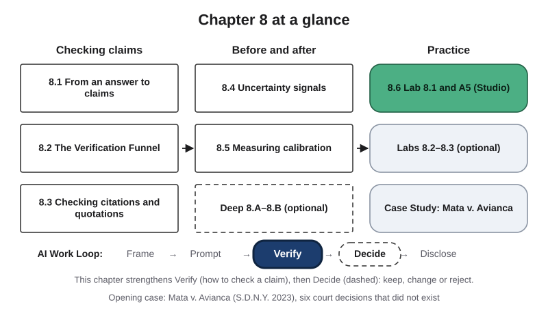{#fig-8-1 fig-alt="Chapter map: checking claims (8.1–8.3), before and after (8.4, 8.5, Deep), practice (8.6, labs, case); Work Loop with Verify highlighted."}

**Chapter 8 at a glance.** On Tuesday, Chapter 4 named the ways artificial intelligence (AI) tools fail and explained why. This chapter is about what you do next: how to check an output before you rely on it. You will split an answer into claims, take each claim through a short series of checks called the Verification Funnel, check citations properly, read the signals that suggest where an error is hiding, and measure how far a tool's confidence can be trusted. Thursday's lab and assignment A5 put all of it to work on an output from your own field.

**Before you read (5 minutes).** Ask an AI tool a question from your major that calls for an explanation with at least two sources, for example "Explain [a concept from your course] and cite two sources." Save the full output with the tool's name and the date. You will use it in the Your Turn boxes of sections 8.1 and 8.2, and those boxes become the first rows of A5. Use a university-provided tool if you can, and never put personal or confidential information into the prompt.

**Time:** about 27 minutes for the Core and Studio reading and the Check Yourself boxes (longer if English is not your first language), plus about 10 minutes for the two Your Turn boxes that start A5. Core sections are examinable; Studio sections are hands-on work; Deep sections are optional.

**The question of this chapter:** *How do you know when an AI output is true enough to use?* The Chapter Summary answers it.

## Opening Case: Six Cases That Did Not Exist {.unnumbered}

In August 2019, Roberto Mata was flying on Avianca Flight 670 from El Salvador to New York. He says that during the flight a metal serving cart struck his left knee, and in February 2022 he sued the airline (*Mata v. Avianca*, ECF 55, 2023, p. 1). The case moved to a federal court in New York. In January 2023 the airline asked the court to dismiss it: under the Montreal Convention, the treaty that governs claims against international airlines, Mata had waited too long to sue (*Mata v. Avianca*, ECF 54, 2023, ¶¶ 1, 3).

On March 1, 2023, Mata's lawyers filed their answer. It argued that the deadline had been paused and supported the argument with quotations from published court decisions (¶ 5). One lawyer had researched and written it; a colleague, the lawyer of record in that court, signed and filed it without reading the decisions it cited (¶ 6).

The airline's lawyers replied on March 15: they could not find several of the cases (¶ 7). The judge ordered the lawyers to file copies (¶ 13). On April 25 they filed excerpts of the "decisions" (¶¶ 20–22). None of the six cases at the center of the dispute existed. They had been produced by ChatGPT (¶ 36).

At a hearing, the lawyer who wrote the filing explained that he had not imagined the tool could make cases up (¶ 11). He had looked up one of them, "Varghese v. China Southern Airlines," on a free case-law website, could not find it, and cited it anyway (¶ 12). He had also asked ChatGPT directly whether the cases were real. Its replies said they were, and that they could be found in the standard legal research databases (¶ 45).

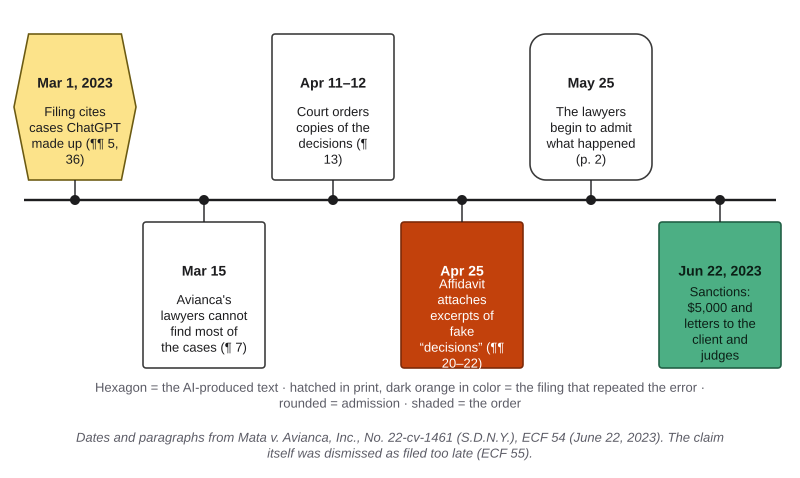{#fig-8-2 fig-alt="Timeline: Mar 1 filing with made-up cases; Mar 15 not found; Apr 11–12 copies ordered; Apr 25 excerpts filed; May 25 admission; Jun 22 sanctions."}

On June 22, 2023, Judge P. Kevin Castel found that the two lawyers had acted in bad faith. They had not only filed fake decisions; they had kept standing by them after the court's orders called them into question, and began to tell the truth only on May 25 (ECF 54, pp. 1–2). The court imposed a $5,000 penalty on the two lawyers and their firm together. It also ordered them to send letters to their client and to each real judge whose name had been attached to a fake opinion (pp. 33–34). The same day, in a separate opinion, the court dismissed Mata's claim as filed too late (ECF 55). The fake cases were not the reason; the deadline was.

The judge did not blame the technology itself. He wrote that there is "nothing inherently improper about using a reliable artificial intelligence tool for assistance" (ECF 54, p. 1). What the rules require is that lawyers act as gatekeepers for the accuracy of what they file.

Mata was not the last case of its kind. As of October 2026, a public database kept by the researcher Damien Charlotin listed more than 2,100 decisions by courts and tribunals around the world dealing with AI-generated errors in filings (Charlotin, 2026).

So here is the puzzle. **The lawyer asked the tool whether the cases were real, and it said yes. What check would have caught them, and when?** Section 8.3 answers the first half; the Case Study answers the second.

## Learning Objectives {.unnumbered}

Framework tags refer to the UNESCO (United Nations Educational, Scientific and Cultural Organization) AI Competency Framework for Students, Long and Magerko's AI literacy competencies, and the AI Fluency framework.

After this chapter you will be able to:

- **O1 — Decompose** an AI output into claims you might rely on, mark each one checkable or not, and rank them by what an error would cost. *(LO3 · AI Fluency: Discernment · UNESCO: human-centred mindset, Understand)*
- **O2 — Apply** the Verification Funnel: take a claim as far as its stakes require, give a verdict and record what remains uncertain. *(LO3 · AI Fluency: Discernment, Diligence)*
- **O3 — Analyze** a citation or quotation for the three ways it can fail, using indexes and records that no AI tool produced. *(LO3 · AI Fluency: Discernment)*
- **O4 — Evaluate** what an output's uncertainty signals tell you, by comparing a tool's stated confidence with its results. *(LO3, LO1 · AI Fluency: Discernment · Long & Magerko: how AI works)*
- **O5 — Diagnose** a real verification failure on the Failure Taxonomy Tree and the failure-to-harm chain, and name the stage of the funnel that would have stopped it. *(LO3, LO1 · AI Fluency: Diligence · UNESCO: ethics of AI, Understand)*
- **O6 — Produce** a claim verification table (A5). *(LO3 · AI Fluency: Diligence, Discernment)*

::: {.callout-note title="Warm-up (ungraded)"}
Answer from what you know today. You will come back to these in the Chapter Summary.

1. A chatbot gives you a reference with authors, a year, a journal and page numbers. Does that make it likely that the paper exists?
2. You ask the same chatbot "Is this source real?" and it says yes. Is that a check?
3. A tool says it is 90% sure of each of ten answers. How many would you expect to be right?
:::

## 8.1 From an Answer to Claims {#sec-8-1 .unnumbered}

[Core]{.path}

Chapter 4 explained why errors hide inside fluent text: a language model produces likely text, nothing in that step checks truth, and patterns learned from true text can be recombined into false statements. So an answer is rarely all right or all wrong. It is a bundle of statements, some right and some not.

That changes what you check. **You verify claims, not answers.** A **claim** is one statement in an output that you might rely on. Some claims are *checkable*: they can be true or false, such as a date, a number or "this study found X." Others are *not checkable as true or false*, such as a recommendation ("start with the hardest section") or a prediction. You still mark them, because you may rely on them too; the evidence that bears on them is different.

You may assume that if most of an answer checks out, the rest is probably right too. Research says otherwise. In a 2023 evaluation, researchers split biographies of people written by ChatGPT into single facts and checked each one against a reliable source. Only 58% of the facts were supported (Min et al., 2023). The other 42% sat in the same fluent paragraphs. A correct first sentence tells you nothing about the fourth.

Splitting has three steps.

1. **One fact per claim.** A sentence with a number, a name and a source holds three claims.
2. **Mark and type each claim:** a fact, a number, a citation or quotation, a reasoning step, or a claim that is not checkable as true or false (a judgment or prediction).
3. **Rank by stakes.** Ask: what would it cost me, or someone else, if this claim were wrong? A wrong date in your notes costs little. A wrong figure in a client report, a dose or a citation in a court filing costs a great deal.

You will not check everything equally. Section 8.2 shows how far to take each claim, and the ranking tells you where to start.

::: {.callout-note title="Worked Example: Lucía's Exam Overview"}
*Featuring Lucía (accounting), who is saving to sit for the CPA (Certified Public Accountant) exam.* *(Constructed example.)*

Lucía asks a chat tool for a short overview of the exam for her study plan. The output is one confident paragraph. She splits it into six claims (@fig-8-3).

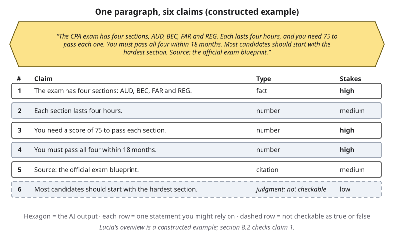{#fig-8-3 fig-alt="A constructed AI paragraph about the CPA exam split into six rows: four sections, four hours, score of 75, 18 months, a source, and a judgment."}

Claims 1, 3 and 4 decide what she studies and when she must finish, so they rank highest. Claim 6 is advice, not a fact: she marks it "not checkable as true or false" and decides later whether to follow it. Claim 5 names a source without saying which one, so she notes that it needs finding.
:::

::: {.callout-note title="Faded Example: The Steel Paragraph"}
*(Constructed output.)* "A36 structural steel has a minimum yield strength of 36 ksi (250 MPa), according to ASTM A36. It is the cheapest choice for small brackets and is easy to weld, so most student teams should use it."

**Claims split so far:** (1) minimum yield strength 36 ksi; (2) equals 250 MPa; (3) the source is ASTM A36.

**Split the rest, mark each checkable or not, and rank all of them by stakes:** _______
:::

::: {.callout-important title="Your Turn (A5, rows 1–10)"}
Take the output you saved before reading. Split it into ten claims, one fact per row. Mark each checkable or not, give its type, and rate its stakes (low, medium or high) with a reason. Include at least two citations or quotations and one number. These are the first ten rows of your A5 table.
:::

::: {.callout-tip title="Check Yourself 8.1"}
1. Why does this book say you verify claims rather than answers?
2. Split this made-up sentence into claims: "A 2019 survey of 4,000 nurses by the American Nurses Association found that 62% worked overtime."
3. Why is "you should start with the hardest section" marked not checkable as true or false, and why do you still list it?
:::

## 8.2 The Verification Funnel {#sec-8-2 .unnumbered}

[Core]{.path}

Once you have claims, you need a way to check them that is neither careless nor endless. The **Verification Funnel** is the book's diagram of three checks a claim can pass through, each outside the tool, taken only as far as the stakes require. **Verification** means checking a claim against evidence that no AI tool produced.

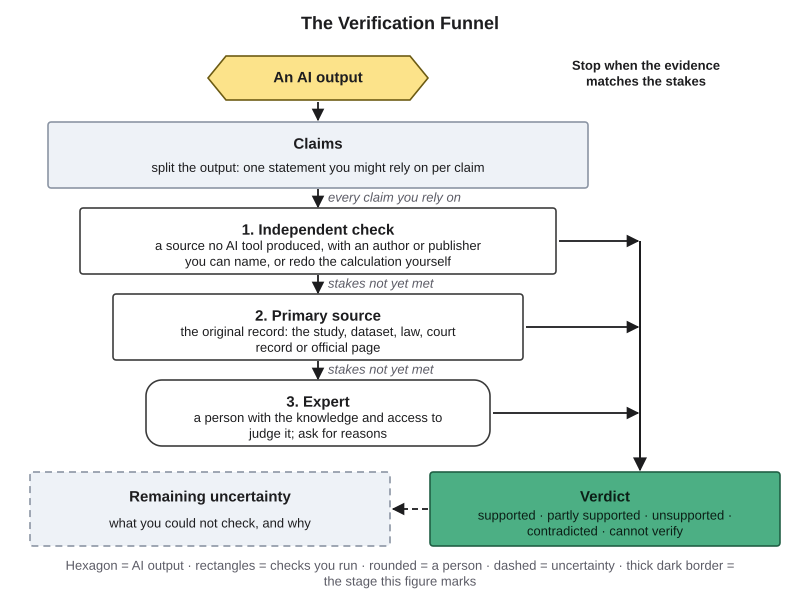{#fig-8-4 fig-alt="Funnel: AI output, claims, 1 independent check, 2 primary source, 3 expert; a side rail stops at the stakes, leading to verdict and uncertainty."}

**Stage 1, an independent check.** An **independent check** is evidence that no AI tool produced: a source with an author or publisher you can name, or your own recalculation or reasoning from known inputs. A textbook, an official web page or a news report with a named publisher counts. A page with no author, a page that copies the same text, or another AI tool's answer does not. An AI search tool can help you *find* a source, but your verdict rests on the source you opened, never on the tool's summary of it. Every claim you rely on gets at least this stage.

**Stage 2, the primary source.** A **primary source** is the original record a claim comes from: the study, the dataset, the law, the court record, the official page of the organization that sets the rule. A news story about a study is independent, but it is not the study. Go to the primary source when the stakes are high, when stage 1 sources disagree, or when the claim is a number, a quotation or a citation.

**Stage 3, an expert.** An expert is a person with the knowledge and the access to judge the claim: an instructor, a librarian, a pharmacist, a professional in the field. Ask for reasons and evidence, not just a yes or no. Go here when the sources conflict, when applying a rule needs judgment, or when someone's health, money or rights depend on the answer.

**Stop when the evidence matches the stakes.** You may think verifying means checking every sentence as far as possible. It does not. A low-stakes claim can stop at stage 1, and every claim you rely on gets at least stage 1.

Each check ends in a **verdict**, a judgment on the book's five-point scale, and a line of **remaining uncertainty**: what you could not check, and why.

| Verdict | Meaning | Example |
|---|---|---|
| Supported | The evidence says what the claim says | The exam's official page lists a passing score of 75 |
| Partly supported | Part of the claim holds, part does not or is missing | Right figure, wrong year |
| Unsupported | No evidence found either way at the stage you reached | A statistic you cannot trace to any source |
| Contradicted | The evidence says otherwise | The official page lists different sections |
| Cannot verify | No source you can reach | A private company memo |

How far a source deserves trust is a separate question; Chapter 9 gives you a ladder for judging it.

::: {.callout-note title="Worked Example: Is BEC Still on the Exam?"}
*Featuring Lucía.* Claim 1 says the CPA exam has four sections: AUD, BEC, FAR and REG. Stakes: high.

**Stage 1.** A review-course page with a named publisher says the exam changed in January 2024. That conflicts with the claim, so she goes on.

**Stage 2.** The board that runs the exam's transition states that the last day to take BEC (Business Environment and Concepts) was December 15, 2023 (NASBA, n.d.). The exam's official FAQ lists three core sections, AUD, FAR and REG, plus one discipline section chosen from three (AICPA & CIMA, n.d.).

**Verdict:** contradicted. **Label:** outdated information, a leaf of hallucination (Chapter 4). **Remaining uncertainty:** none for the structure; the rules for applying vary by state, so she checks her state board next.
:::

::: {.callout-note title="Faded Example: A Drug Interaction"}
A nursing student's AI output says that taking ibuprofen with the blood thinner warfarin raises the risk of bleeding.

**Stage 1:** a current nursing drug handbook agrees. **Stage 2:** the warfarin prescribing label warns about this combination.

**Is stage 3 (an expert) needed, and when?** _______ **Verdict and remaining uncertainty:** _______
:::

::: {.callout-important title="Your Turn (A5, row 1)"}
Take your highest-stakes claim from section 8.1 through the funnel. Record the stage you reached, the source with a link or location, your verdict and one line of remaining uncertainty.
:::

::: {.callout-tip title="Check Yourself 8.2"}
1. Name the three stages of the funnel and say what each one adds.
2. Why does an answer from a second AI tool not count as an independent check?
3. When should you stop at stage 1, and when should you go on to stage 2?
:::

## 8.3 Checking Citations and Quotations {#sec-8-3 .unnumbered}

[Core]{.path}

Citations deserve their own section, because they look like evidence and are often treated as if they were. You may think that if an output names a source, the claim has been verified. A named source is only a pointer until you open it.

Before you read on, make a prediction. In 2023, researchers asked ChatGPT to write short literature reviews on 42 topics. Out of 100 references that the GPT-3.5 version produced, how many do you think did not exist?

The answer: 55 (Walters & Wilder, 2023). With GPT-4, 18 of every 100 did not exist. And among the references that did exist, 43% from GPT-3.5 and 24% from GPT-4 had substantive errors, such as wrong authors, years or page numbers. Newer tools do better on many tasks, and tools built on retrieval do better still, but not perfectly: in a 2024 test, legal research tools that retrieve real cases still gave answers that were incorrect or misgrounded, meaning backed by a source that does not support them, on 17% to 33% of questions (Magesh et al., 2025).

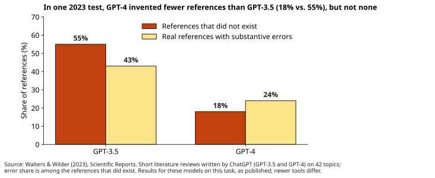{#fig-8-6 fig-alt="Bars: GPT-3.5 55% of references did not exist, 43% of real ones had errors; GPT-4 18% and 24%."}

A citation can fail in three ways, and each needs a different check.

1. **It does not exist.** A citation to a work that does not exist is a **fabricated citation**. Check: search for it in an index that no AI tool produced, such as your library catalog, a Digital Object Identifier (DOI) lookup, a publisher's site or a court-records site.
2. **It points to another work.** The title, number or author belongs to something else. Check: match every detail, not just the title, to the record you found.
3. **It exists but does not say what is claimed.** Check: open it and find the passage. In this chapter you ask whether one passage supports one claim; whether a summary represents a whole source is Chapter 9's question.

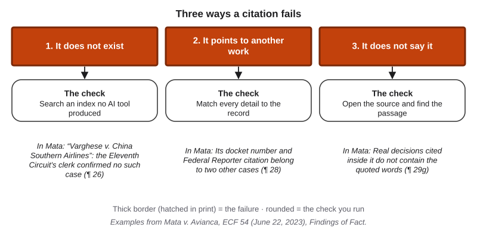{#fig-8-5 fig-alt="Three columns: does not exist (search an index), points to another work (match details), does not say it (find the passage), each with a Mata example."}

Which verdict do you give? If an authoritative record shows that the work does not exist, or that its details belong to another work, the verdict is **contradicted**. If you simply cannot find it in two indexes that no AI tool produced, the verdict is **unsupported**, and your uncertainty line names the indexes you searched; some real works are poorly indexed. If the passage does not support the claim, the verdict is unsupported, or contradicted if the passage says the opposite.

One shortcut never counts: asking the tool whether its source is real. The answer comes from the same kind of process that produced the source. In Mata, the replies said the cases were real (ECF 54, ¶ 45).

::: {.callout-note title="Worked Example: Checking “Varghese”"}
*The court's own findings, used as a model of the three checks (ECF 54, 2023).*

**Does it exist?** The clerk of the federal appeals court named in the citation confirmed that no party called Varghese had been part of a case there since 2010 (¶ 26).

**Does it point to another work?** Its docket number belonged to a different case, and its citation in the official reporter led to a third (¶ 28).

**Does it say it?** Some real decisions quoted inside the fake one did not contain the quoted words at all (¶ 29).

**Verdict:** contradicted. A record shows that the case does not exist.
:::

::: {.callout-note title="Faded Example: Lucía's Enron Paragraph"}
*(Constructed output for Lucía's accounting class.)* It cites three references:

1. Sarbanes-Oxley Act of 2002, Pub. L. No. 107-204. *Checked:* on the U.S. government's legal publishing site; enacted July 30, 2002. Supported.
2. Healy, P. M., & Palepu, K. G. (2005). The fall of Enron. *The Accounting Review*, 80(2). *Which check, and which failure?* _______
3. Morales, D. (2021). Auditor independence after Enron: A twenty-year review. *Review of Audit Practice and Ethics*, 12(3). *Verdict and uncertainty line:* _______
:::

::: {.callout-important title="Your Turn"}
Lab 8.2 asks you to run the three checks on five references in your field. Your A5 citations get the same checks.
:::

::: {.callout-tip title="Check Yourself 8.3"}
1. Name the three ways a citation can fail and the check for each.
2. A reference does not appear in your library catalog or in a scholarly search engine. Which verdict do you give, and what goes in the uncertainty line?
3. Why is asking the tool "Is this source real?" not a check?
:::

## 8.4 Uncertainty Signals: Where to Look First {#sec-8-4 .unnumbered}

[Core]{.path}

You cannot take every claim to an expert, so it helps to know where errors are more likely. An **uncertainty signal** is a feature of an output that makes an error more or less likely without settling whether a claim is true. Four signals are worth recording *before* you check.

1. **Stated confidence.** **Stated confidence** is the certainty an output expresses in words or numbers, such as "I'm 95% sure" or "definitely." It is a weak signal, and often too high (section 8.5).
2. **Disagreement across fresh runs.** Each run of a model samples its tokens again (Chapter 3), so the same question can get different answers. A **consistency check** asks the same question in several new chats and compares the answers. If they disagree, treat the claim as unreliable: research on detecting hallucinations uses this signal (Manakul et al., 2023; Farquhar et al., 2024). If they agree, that is weaker evidence than it looks, because the same patterns can produce the same wrong answer every time.
3. **Response to pushback.** Chapter 4's pushback test challenges an answer. If the answer flips to agree with you, that is a warning sign. If it holds firm, that is no evidence either way: in Mata, the replies held firm and were wrong (ECF 54, ¶ 45).
4. **Precise detail about something rare.** An exact figure, name or page number for an obscure topic is where Chapter 4 said invention is most likely.

You may believe that if several runs, or several tools, give the same answer, it must be correct. Agreement lowers the priority of a check; it does not replace it.

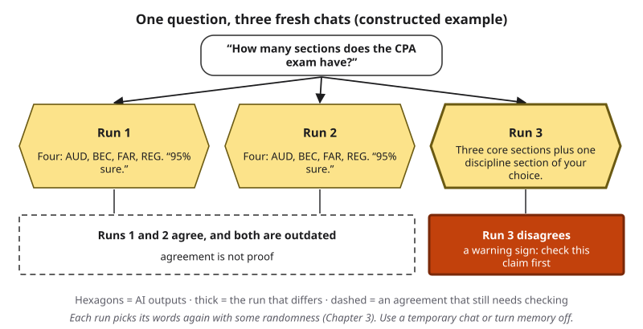{#fig-8-7 fig-alt="One question, three fresh chats: two runs give the outdated four sections at 95% sure; one differs; agreement is not proof, disagreement is a warning."}

::: {.callout-note title="Worked Example: What the Signals Would Have Shown"}
*Featuring Lucía.* *(Constructed example.)* Before checking claim 1, Lucía asks the same question in three fresh chats and asks how sure the tool is.

Runs 1 and 2 repeat the four-section structure, each "95% sure." Run 3 describes three core sections plus a discipline section.

**Reading the signals:** the disagreement flags claim 1 as one to check first, and section 8.2 showed that the agreeing majority was wrong. The two "95%" ratings did not make it right.
:::

::: {.callout-note title="Faded Example: A Quotation"}
A history student's output attributes a famous quotation to a nineteenth-century president. Three fresh runs give the same attribution, each "90% sure."

**What do the signals justify?** _______ **Which funnel stage comes next, and why?** _______
:::

::: {.callout-important title="Your Turn"}
Lab 8.3 compares the signals with the truth on ten questions with known answers. In A5, record your signals before you check.
:::

::: {.callout-tip title="Check Yourself 8.4"}
1. Name four uncertainty signals.
2. Why is disagreement across fresh runs a stronger signal than agreement?
3. A tool holds firm when you push back. What does that tell you?
:::

## 8.5 Measuring Calibration {#sec-8-5 .unnumbered}

[Core]{.path}

You may assume that a tool that says it is 90% sure will be right about 9 times in 10. That assumption can be tested. Chapter 7 gave the word two meanings. **Calibration of your confidence** is how well your predicted score matches your actual score. **Calibration (of a model)** is how well a model's stated confidence matches its accuracy. Two meanings, one habit: predict, then check.

To measure a tool's calibration:

1. Collect questions whose answers you know, such as items from a course answer key.
2. Ask each one, and record the tool's stated confidence *before* you check.
3. Group the answers by confidence, for example 50–69%, 70–89% and 90–100%.
4. For each group, compare the share of correct answers with the average stated confidence.

A perfectly calibrated tool would be right about 90% of the time when it says 90%. On a chart of confidence against accuracy, it would sit on the diagonal. Points below the diagonal show overconfidence: output stated with more certainty than the evidence supports (Chapter 1).

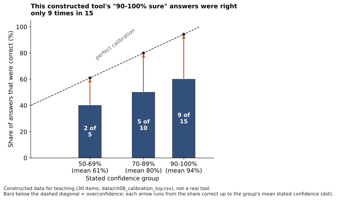{#fig-8-9 fig-alt="Bars below a dashed diagonal: 50–69% group 2 of 5 correct, 70–89% 5 of 10, 90–100% 9 of 15; arrows show the gaps."}

Published tests found this pattern. When researchers asked several models in 2023–2024 to state their confidence, most values fell between 80% and 100% (Xiong et al., 2024). In a 2024 benchmark of short factual questions, the models tested consistently stated more confidence than their accuracy justified, though answers stated with higher confidence were more often right (Wei et al., 2024). So stated confidence is not meaningless; it is a weak signal that you can measure.

Two cautions. Ten or twenty questions give a rough picture, not a measurement of the tool. And "I don't know" is a valid answer; Chapter 4 explained why tools rarely give it. The difference between stated confidence and the share correct is the **calibration gap**, the same idea you met in A4. In A5 you compute it for yourself and for the tool.

::: {.callout-note title="Worked Example: Reading the Chart"}
*(Constructed data for teaching.)* @fig-8-9 shows a 30-question record. In the 90–100% group, the tool's average stated confidence was 94%, but it was right on 9 of 15 answers, 60%: a gap of about 34 points. In the 70–89% group, an average of 80% met 50% correct. Confidence rose with accuracy, as in the published tests, but every group sits below the diagonal. **Conclusion:** this tool's high confidence still needs checking.
:::

::: {.callout-note title="Faded Example: Lucía's Study Questions"}
*(Constructed.)* Lucía asks a tool ten accounting questions from her textbook's answer key.

| Stated confidence | Answers | Correct |
|---|---|---|
| 70–89% | 3 | 2 |
| 90–100% | 7 | 4 |

**Share correct in the 90–100% group:** _______ **Calibration gap, and what it tells her:** _______
:::

::: {.callout-important title="Your Turn"}
Look back at Warm-up question 3. Would you now expect nine right answers out of ten? In A5, record your own confidence and the tool's for every claim before you check.
:::

::: {.callout-tip title="Check Yourself 8.5"}
1. Define calibration of a model, and say how it differs from calibration of your confidence.
2. Describe the four steps for measuring a tool's calibration.
3. Why do ten questions give only a rough picture?
:::

## 8.6 The Verification Lab and A5 {#sec-8-6 .unnumbered}

[Studio]{.path}

*Read before Thursday's lab. Lab 8.1 uses it, and you finish A5 at home.*

A **claim verification table** has one row per claim and records how far each claim got, not only the verdict. You have already written ten rows (section 8.1) and checked one (section 8.2). In Thursday's lab you check three more of your own claims, citations first, after a team check of the sources from Tuesday's demonstration.

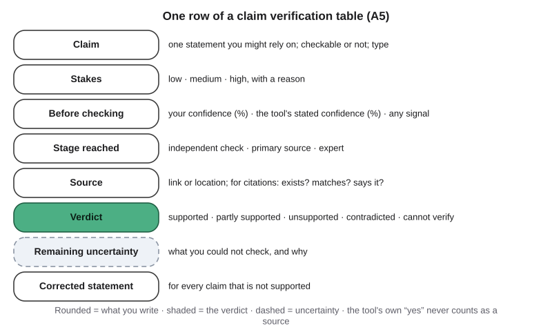{#fig-8-13 fig-alt="One A5 row: claim, stakes, confidence before checking, stage reached, source, verdict, remaining uncertainty, corrected statement."}

A strong table splits claims one fact per row, matches the stage to the stakes, opens every citation, names the indexes searched when something is not found, and says "cannot verify" honestly when that is the truth. A weak table has ten rows of "looks right" and uses the tool's own answers as sources.

::: {.callout-note title="Worked Example: Two of Lucía's Rows"}
**Claim 4, number, high stakes.** "You must pass all four sections within 18 months." Before checking: Lucía 70%, the tool's run "90%." Stage 2: the national model rule changed from 18 to 30 months in 2023 (NASBA, 2023), and her state board's rule allows 30 months (22 Tex. Admin. Code § 511.80). Verdict: contradicted. Uncertainty: rules can change; she will recheck when she applies. Correction: "In her state, credit for a passed section lasts 30 months."

**Claim 5, citation, medium stakes.** "Source: the official exam blueprint." Stage 2: the exam's publisher does publish blueprints, and the current ones describe the new structure. <!-- [VERIFY: current AICPA Uniform CPA Examination Blueprints edition and wording] --> Verdict for claim 1: still contradicted; the source exists but does not say what the output said (failure 3).
:::

::: {.callout-note title="Faded Example: A Half-Filled Row"}
**Claim 3, number, high stakes.** "You need a score of 75 to pass each section." Before checking: Lucía 90%, the tool 95%. **Stage reached and source:** _______ **Verdict and uncertainty:** _______
:::

::: {.callout-important title="Your Turn"}
Lab 8.1 on Thursday, then the Application Assignment (A5) at the end of this chapter.
:::

::: {.callout-tip title="Check Yourself 8.6"}
1. What does a verification table record besides the verdict?
2. Name two features of a strong table and two of a weak one.
:::

## Deep 8.A: Judging an Automatic Checker {#sec-8-deep-a .unnumbered}

[Deep]{.path}

*Deep sections are optional and not examinable.*

More and more tools offer to check AI output for you: reference checkers that flag citations they cannot match, hallucination detectors, and options that ask a model to review its own draft. How should you judge such a checker?

Chapter 2's Deep section gave you two numbers for exactly this job. **Precision** asks: of the references the checker flagged, what share were really fake? **Recall** asks: of the references that were really fake, what share did the checker flag? @fig-8-14 compares two constructed checkers on the same 20 references, 5 of them fake.

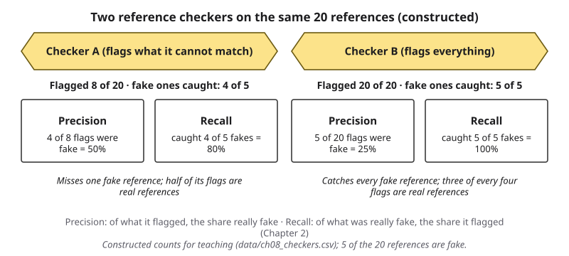{#fig-8-14 fig-alt="Two constructed checkers on 20 references: A flags 8, catches 4 of 5 fakes (precision 50%, recall 80%); B flags all 20 (25%, 100%)."}

Checker B never misses a fake, because it flags everything. Its recall is perfect and it is useless: you still have to check all 20 yourself. Checker A misses one fake and raises four false alarms. Whether A is good enough depends on the stakes. For a court filing, a missed fake is the expensive error, so you would still check every citation; for a reading list, A might save real time.

What about asking the model to check itself? The evidence is mixed. In one method, the model drafts an answer, writes verification questions about it, answers them separately and then revises; this reduced hallucinations on several tasks (Dhuliawala et al., 2024). But when models were asked to review and revise their answers to reasoning problems without any outside feedback, they often did not improve, and sometimes got worse (Huang et al., 2024).

*This book's inference:* an automatic checker, including a model checking itself, is one more uncertainty signal (section 8.4). It can tell you where to look first. It is not a stage of the funnel, because its evidence still comes from an AI tool.

## Deep 8.B: How Researchers Measure Calibration {#sec-8-deep-b .unnumbered}

[Deep]{.path}

Section 8.5 compared groups by eye. Researchers summarize the same picture in one number. A **reliability diagram** plots accuracy against confidence, group by group, as @fig-8-9 does. The **expected calibration error** averages the gap between confidence and accuracy across the groups, giving larger groups more weight (Guo et al., 2017). In @fig-8-9, the gaps are about 21, 30 and 34 points for groups of 5, 10 and 15 answers, so the weighted average is about 30 points: (5 × 21 + 10 × 30 + 15 × 34) ÷ 30.

Researchers get a model's confidence in two main ways. One is to ask for it in words, as section 8.5 does. The other is to ask the same question many times and count how often each answer appears; an answer that comes back 90 times out of 100 is treated as "90% confident." The 2024 benchmark in section 8.5 measured calibration both ways (Wei et al., 2024). Earlier work found that large models could score their own answers' probability of being correct reasonably well on some question formats (Kadavath et al., 2022).

Guo et al. (2017) also reported that modern, deeper neural networks for image classification were less well calibrated than networks from a decade earlier, so calibration does not simply improve as models grow. Results like these age quickly. Any figure for a particular model should carry its date, and you should expect next year's models to differ.

## Hands-on Labs {.unnumbered}

These labs are tool-neutral: they describe what to do, not which buttons to press. Compass, the book's optional, free and ungraded companion, lists current free tools [COMPASS: lab pages ch08-lab1 to ch08-lab3]. Never put personal or confidential information into a prompt.

### Lab 8.1: Ten Claims (Studio · Thursday, in class) {.unnumbered}

*(O2, O3, O6 · LO3 · Apply)*

1. **Briefing (10 minutes).** Read pages 1–2 of the sanctions opinion in *Mata v. Avianca* and the excerpts handed out (paragraphs 11–12, 25–28 and 45).
2. **Team check (15 minutes).** In teams of three or four, take the dated printout of Tuesday's demonstration and one provided output. Each member takes two or three claims through the funnel, citations first. Record your confidence before each check.
3. **Your own claims (30 minutes).** Individually, take three claims from your A5 rows through the funnel, citations first.
4. **Share (15 minutes).** Each team reports one claim whose verdict changed at the primary source. The class pools the shared set's confidence and verdicts into one calibration gap on the board.
5. **Exit (5 minutes).** Write down one claim you could not verify and the stage that would settle it.

**If this doesn't work:** the dated sample output on eLearning replaces your own output.

### Lab 8.2: Five References (Check It · 30 minutes · optional, recommended) {.unnumbered}

*(O3 · LO3 · Analyze)*

1. Ask an AI tool for five references on a narrow topic in your field.
2. For each, run the three checks: does it exist, does every detail match, does it say what is claimed?
3. Give each a verdict and an uncertainty line. "All five were real and said what was claimed" is a valid result.
4. Keep your record: Chapter 9's source audit (A6) builds on it.

**If this doesn't work:** use the five dated sample references on eLearning.

### Lab 8.3: Signals versus Truth (Break It · 35 minutes · optional) {.unnumbered}

*(O4 · LO3 · Evaluate)*

1. Take the ten provided known-answer questions for your field (packs for business, health, engineering, humanities, social science and science).
2. Ask each one and the tool's confidence, as a percentage. Ask three of them in three fresh chats.
3. Score the answers against the key. Group them by stated confidence and compute each group's share correct.
4. Write three sentences: which signal, stated confidence or disagreement across runs, went with the wrong answers?

**If this doesn't work:** analyze the dated sample transcripts on eLearning.

## Case Study: The Fake Cases, Revisited {.unnumbered}

**Context.** A personal-injury claim against an airline, a deadline dispute and a filing that cited decisions produced with ChatGPT (*Mata v. Avianca*, ECF 54, 2023). The Opening Case gave the facts; section 8.3 checked one fake case. This study labels what went wrong and asks where the funnel would have stopped it.

**What the AI did.** It produced descriptions and excerpts of six decisions that do not exist (¶ 36). Asked directly whether one of them was real, and whether the others were fake, its replies said the cases were real and could be found in the standard legal databases (¶ 45).

**What people did.** The researching lawyer used the tool as his research source, could not find "Varghese" on a free case-law site and cited it anyway (¶¶ 12, 36–38). The signing lawyer read the filing only for style and checked none of its cases (¶ 6). Both kept defending the cases after the court's orders (pp. 1–2).

**Failure label.**

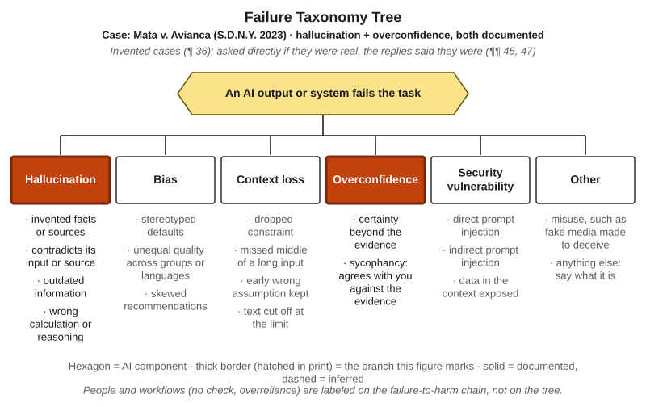{#fig-8-11 fig-alt="The tree with hallucination and overconfidence highlighted with solid borders; tag Mata v. Avianca (S.D.N.Y. 2023), both documented."}

- **Tree:** hallucination, leaf *invented facts or sources*, **documented**: the record shows the decisions do not exist and were generated by ChatGPT (¶ 36). Secondary branch: overconfidence, leaf *certainty beyond the evidence*, **documented**. Chapter 4 labeled overconfidence only with evidence about expressed certainty. Here the evidence is on the record: asked directly whether the cases were real, the replies said they were and named databases where they could be found (¶ 45). The Moffatt chatbot in Chapter 4 gave plain instructions, with no such statement, which is why it carried no overconfidence label.
- **Chain:** link 2, "checked before use?", failed, **documented** (¶¶ 6, 12).

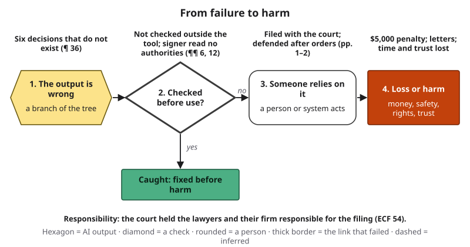{#fig-8-12 fig-alt="Chain: six nonexistent decisions; not checked outside the tool; filed and defended; $5,000 penalty and letters. The check link is marked as failed."}

**Where the funnel would have stopped it.**

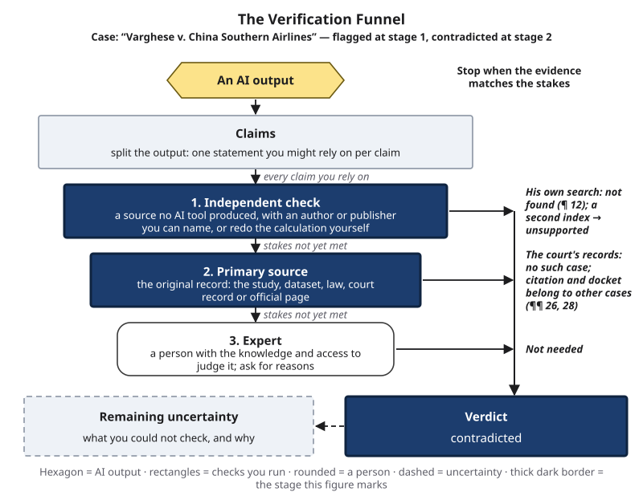{#fig-8-4d fig-alt="Funnel for Varghese: stage 1 free site, not found; stage 2 citation and docket belong to other cases; clerk: no such case; verdict contradicted."}

- **Stage 1** would have stopped "Varghese": the lawyer's own search found nothing (¶ 12). Under this chapter's rule, that alone makes the verdict unsupported, and a citation in a court filing cannot rest on an unsupported verdict.
- **Stage 2** would have turned "unsupported" into "contradicted": the reporter citation and docket number lead to other cases (¶ 28).
- **The signer's own reading**, a stage-1 check anyone could do, would have shown that the "decisions" were excerpts and that "Varghese" was internally inconsistent (Conclusions of Law ¶ 23, p. 30).

**A better workflow.** *Frame:* a chatbot can help brainstorm arguments; it is not a source of law. *Verify:* every citation opened in a legal research database before filing. *Decide:* the lawyer who signs reads the cited authorities. *Disclose:* follow the court's rules on AI use where they exist (Chapters 10 and 18).

**Short case 1: An expert's declaration (2025).** In a Minnesota case over a state law on election deepfakes, the state filed a declaration by a university expert on AI and misinformation. It cited two academic articles that do not exist and gave the wrong authors for a third. The court's order records that the errors came from the expert's use of GPT-4o in drafting and that he did not verify the citations before filing. On January 10, 2025, Judge Laura M. Provinzino excluded the declaration, noting the irony of the subject, and denied as moot the state's request to file a corrected version (*Kohls v. Ellison*, 2025, pp. 2–3, 8–12). **Labels:** hallucination, invented facts or sources (documented, p. 3). **Chain:** link 2, ______ (documented or inferred? use p. 3). Lesson for the funnel: an expert's statement is evidence to check, not the end of checking.

**Short case 2: A summer reading list (2025).** On May 18, 2025, the *Chicago Sun-Times* carried a licensed summer insert produced by King Features. Its reading list paired real authors with books that do not exist: of the 15 titles, 10 were false (Bell, 2025). The newspaper said that the freelance writer had used AI to build the section and that it ran without review by its own editors (Chicago Sun-Times, 2025). King Features said it was ending its relationship with the writer, and the *Philadelphia Inquirer*, which had run the same insert, called some of its material apparently fabricated (Mihalopoulos, 2025). **Labels:** hallucination, invented facts or sources (documented); chain link 2 failed (documented: the newspaper's statement). A stage-1 check, one search per title in a library catalog, would have caught every fake.

## Ethics Lens: Who Pays for an Unchecked Claim? {.unnumbered}

The *Mata* court listed the costs of fake citations (ECF 54, pp. 1–2). The other side spends time and money exposing them. The court's time is taken from other cases. The client may lose arguments that real precedents could have supported. Real judges are named as authors of opinions they never wrote. And every such case gives people one more reason to doubt courts and lawyers.

Notice who pays. Producing a fabricated citation took the lawyer seconds. Exposing it took months of letters, court orders and a hearing, plus a search by a federal appeals court's clerk (ECF 54, ¶¶ 7–26). The same pattern holds outside law: the reader of a reading list, the customer reading a chatbot answer and the patient reading a health summary pay for checks that the writer skipped.

Checking also has costs of its own, and they are not shared equally. Verification needs library access, time and sometimes paid databases. Free routes exist: your university library, DOI lookups, public court records and government pages. Using them is part of the work, not an extra.

Two lines hold in this course. A fabricated source is unacceptable even if you disclose that AI produced it (Chapter 1). An honest "cannot verify," with a reason, is acceptable, and it is a sign of care.

**Discuss:** Should the person who uses an AI tool carry the full cost of checking its output, or should the companies that build the tools share it? How?

## Career Connection {.unnumbered}

Verification is already a job skill, and in some jobs it is the job.

- **Paralegals and legal researchers** check every authority in a filing before it goes to court, using research databases that show whether a case exists and is still good law.
- **Journalists and fact-checkers** take claims back to primary sources and keep records of how each one was verified.
- **Reference librarians** find and confirm sources, and they are often the expert at stage 3 for students.
- **Auditors and staff accountants**, Lucía's future field, trace amounts to source documents. Audit standards treat evidence from a knowledgeable source independent of the company as more reliable than evidence from inside it (PCAOB, 2024, AS 1105.08). Chapter 9 returns to judging sources.
- **Clinical pharmacists and nurses** check drug information against the official label before it reaches a patient.
- **Data analysts** check a figure in a report against the dataset it came from, and recompute it.
- **In your own field:** the person who can say "this claim is supported by the primary source, and here is what I could not check" is the one people trust with AI tools.

## From the Field {.unnumbered}

<!-- Based on the author's published paper (Şeker, 2015, IEEE Access 3, 368–380), within the facts of that paper; present-day connections are marked as the book's. Assigned by the chapter agent under D19 (ftf-sources.md row in the handoff). Not commercial: no D16 disclosure. -->

In 2015 I published a paper on a computer-based version of a forecasting method called Argument Delphi (Şeker, 2015). The classical Delphi method gathers predictions from a group of experts in rounds. A facilitator collects the predictions, combines them, for example by averaging, and reports the result back; the experts then revise their predictions, and the rounds repeat until the group settles.

The paper pointed to a weakness in that design: the classical method collects numbers, not arguments. The reasons behind each prediction stay out of the discussion, and each expert checks their number against little more than common sense. Argument Delphi instead asks people to state arguments and to criticize one another's. The paper modeled those arguments and ratings as a network, so that the strongest arguments could be found and analyzed.

To test the idea, I built a web page that asked people to predict petroleum prices for the end of 2014 and to argue for their prediction, and I shared it on social networks. More than 100 people responded within minutes; after removing unfinished and empty entries, 63 remained. The test exposed practical problems. Arguments entered early were shown and rated far more often than later ones, a problem the paper called "first come gets higher attention." And because anyone could join, spam and unrelated entries crept in; moderating them by hand stopped working as the crowd grew, so the system added a button for participants to report them.

*A present-day connection, which is this book's and not the 2015 paper's:* when you reach the expert stage of the Verification Funnel, ask for reasons and evidence, not only a verdict; a number without an argument is hard to check. When experts disagree, structured methods such as Delphi exist to combine their judgments rather than picking the loudest. And the consistency check of section 8.4 is something like a numbers-only Delphi round run on one AI tool: you can count the answers, but agreement without arguments tells you less than it seems.

## Chapter Summary {.unnumbered}

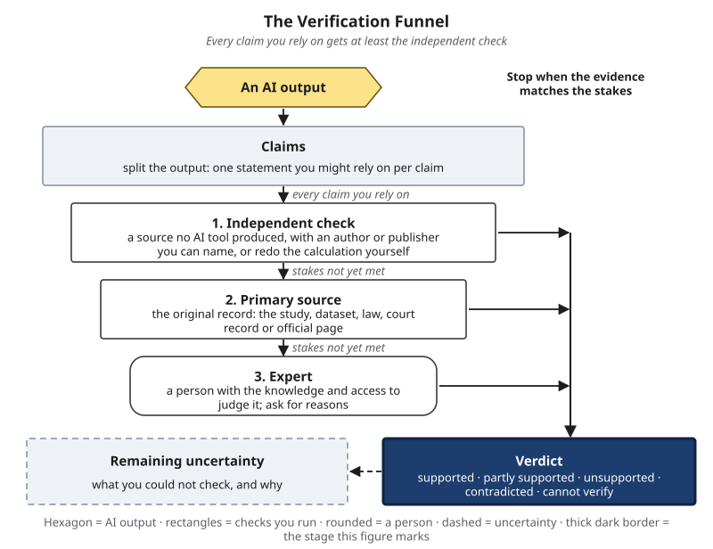{#fig-8-4s fig-alt="The complete funnel with the verdict box highlighted and the five-point scale: supported, partly supported, unsupported, contradicted, cannot verify."}

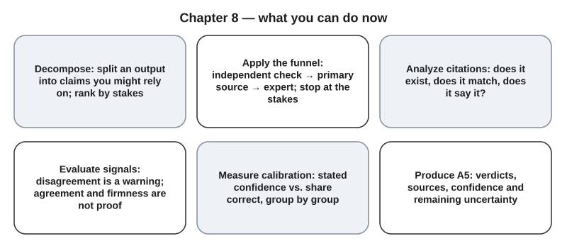{#fig-8-15 fig-alt="Six cards: decompose, apply the funnel, analyze citations, evaluate signals, measure calibration, produce A5."}

**The chapter's question:** *How do you know when an AI output is true enough to use?* Not from the output itself. A fluent answer is a bundle of claims, some right and some not. Signals in the output, such as stated confidence, agreement across runs or holding firm under pushback, tell you where to look first, and none of them settles a claim. Only a check against evidence that no AI tool produced does that: an independent check, then the primary source, then an expert, taken as far as the stakes require, with what remains uncertain written down. How much a particular source deserves trust is the next chapter's question.

**Return to the Opening Case.** What would have caught the fake cases? The first stage of the funnel: the lawyer's own search, which found nothing. A second stage would have shown the citations pointing to other cases. Asking the tool was never a check.

**Revisit your Warm-up.** (1) Does a complete-looking reference mean the paper exists? *No: in one 2023 test, 55% of GPT-3.5's references did not (section 8.3).* (2) Is the tool's "yes, it is real" a check? *No: a check needs evidence no AI tool produced (section 8.3).* (3) How many of ten "90% sure" answers will be right? *Fewer than nine, often: stated confidence tends to run ahead of accuracy (section 8.5).*

You can now:

- **Decompose** an output into claims and rank them by stakes.
- **Apply** the Verification Funnel and give a verdict with its remaining uncertainty.
- **Analyze** a citation for the three ways it can fail.
- **Evaluate** uncertainty signals and measure a tool's calibration.
- **Diagnose** a verification failure on the tree and the chain.
- **Produce** a claim verification table.

### Key Terms {.unnumbered}

calibration (of a model) · calibration gap · claim · consistency check · expected calibration error (Deep) · fabricated citation · independent check · primary source · remaining uncertainty · stated confidence · uncertainty signal · verdict · verification · Verification Funnel

## End-of-Chapter Package {.unnumbered}

<!-- Each item: objective · LO · revised Bloom level. Odd-numbered answers → appendix/answers.md (Appendix E, via docs/production/handoff/ch08.md); even-numbered → private/ch08-answers-even.md. Review A distractors draw on M1–M6. No item tests Deep 8.A–8.B (D20). -->

### Review Questions A: Terms and Concepts {.unnumbered}

1. *(O1 · LO3 · Remember)* Define a *claim* as this book uses the word, and give one example of a claim that is not checkable as true or false.
2. *(O1 · LO3 · Understand)* In a 2023 evaluation, 58% of the separate facts in ChatGPT's biographies were supported. What does this suggest?\
   (a) Most AI answers are mostly wrong.\
   (b) Accuracy varies claim by claim, so a correct first sentence says little about the rest.\
   (c) If the first few facts check out, the rest can be trusted.\
   (d) Biographies are the only kind of text with errors.
3. *(O2 · LO3 · Remember)* Name the three stages of the Verification Funnel in order.
4. *(O2 · LO3 · Understand)* Which of these counts as an independent check?\
   (a) A second AI tool gives the same answer.\
   (b) A web page with no author repeats the claim word for word.\
   (c) You redo the calculation yourself from the inputs given.\
   (d) The first tool says it is 95% sure.
5. *(O2 · LO3 · Understand)* A student says, "Verifying means taking every claim to an expert." What is the most accurate response?\
   (a) Correct; anything less is not verification.\
   (b) Checks are proportional to stakes; every claim you rely on gets at least the independent check.\
   (c) Low-stakes claims need no check at all.\
   (d) Only citations need checking.
6. *(O2 · LO3 · Understand)* Match each situation to a verdict: (i) the official page lists a different figure; (ii) the source is a private memo you cannot see; (iii) the figure is right but the year is wrong.
7. *(O3 · LO3 · Understand)* An output cites a journal article with a real author and a real journal, but the title and pages match nothing in the journal's archive. Which statement is most accurate?\
   (a) The real author's name shows the citation is reliable.\
   (b) It may point to another work or not exist; match every detail to the record before giving a verdict.\
   (c) Ask the tool whether the article is real; if it says yes, cite it.\
   (d) The output named a source, so the claim is verified.
8. *(O3 · LO3 · Apply)* You search two indexes that no AI tool produced and cannot find a cited book. No record says it does not exist. Which verdict do you give, and what goes in the uncertainty line?
9. *(O3 · LO3 · Understand)* Why is asking a tool "Is this source real?" not a check?\
   (a) Because tools never answer that question.\
   (b) Because the answer comes from the same kind of process that produced the source, not from evidence outside it.\
   (c) Because tools always say no.\
   (d) Because only lawyers may ask it.
10. *(O4 · LO3 · Understand)* Three fresh runs give the same answer. What does this show?\
    (a) The answer is correct.\
    (b) It lowers the priority of a check but does not replace it; the same patterns can give the same wrong answer.\
    (c) The tool has memorized the answer, so it must be right.\
    (d) Agreement means nothing at all.
11. *(O4 · LO3 · Understand)* You push back and the tool holds firm. What does that tell you?
12. *(O4 · LO3 · Analyze)* A calibration chart shows a tool's 90–100% group with an average stated confidence of 95% and 12 of 20 answers correct. Compute the share correct, describe the gap, and say whether the tool is overconfident in this group.
13. *(O4 · LO1 · Remember)* Define *calibration (of a model)* and *calibration of your confidence*.

### Review Questions B: Case Questions {.unnumbered}

1. *(O1 · LO3 · Apply)* A marketing intern's AI output *(constructed)* says: "Gen Z spends an average of 7.2 hours a day on social media, according to a 2024 Pew Research Center report, so brands should move all their budget to TikTok." Split it into claims, mark each checkable or not, and rank them by stakes for a client presentation.
2. *(O2 · LO3 · Apply)* A pharmacy student's output states a maximum daily dose of a common over-the-counter painkiller. Which stage of the funnel would you take this claim to, and why? What would your uncertainty line say if you could reach only stage 1?
3. *(O3 · LO3 · Analyze)* A history student's paper cites a reference *(constructed for this question)*: "Smith, J. (2018). *The Silk Road Economy*. Oxford University Press, p. 214" for a quotation. Describe the three checks in order, and the verdict for each of these findings: (a) the book exists but page 214 is about something else; (b) the publisher's catalog lists a book of that title by a different author; (c) the book appears in no catalog you search.
4. *(O4 · LO3 · Evaluate)* A study app shows its AI tutor's confidence next to every answer. In a class test of 30 questions, its "high confidence" answers were right 60% of the time. Should students be told to trust high-confidence answers? Use the idea of calibration in your answer.

### Review Questions C: Interpretive Questions {.unnumbered}

1. *(O2 · LO3 · Evaluate)* Should the stopping point for a check depend on who bears the cost of an error, the writer or the reader? Take a position, using the Ethics Lens and one example.
2. *(O4 · LO3 · Evaluate)* Should AI tools show users a confidence number with each answer? Consider calibration evidence and what users might do with the number.
3. *(O2 · LO3 · Evaluate)* "Verification takes longer than writing it yourself, so AI saves no time." Agree or disagree, using the funnel's stopping rule and a task from your field.

### Spaced Review {.unnumbered}

Come back to these a few days after reading, without looking back. They connect this chapter to Chapters 4, 7 and 5.

1. *(Chapter 4 · LO1 · Apply)* A tool invents a reference. On which branch and leaf of the tree does it go, and is it an intrinsic or an extrinsic hallucination?
2. *(Chapter 4 · LO1 · Understand)* Why is overconfidence labeled only with evidence about expressed certainty?
3. *(Chapter 7 · LO4 · Analyze)* Two meanings, one habit: predict, then check. What was calibrated in A4, and what in A5?
4. *(Chapter 5 · LO2 · Understand)* Chapter 5 said that one result is not evidence. Why does one agreeing re-run not settle a claim?

### Discussion Questions {.unnumbered}

1. *(Ethics · O2 · LO3 · Evaluate)* Fabricated references cost their writers seconds and their readers hours. What responsibilities follow for students, professionals and tool makers?
2. *(Career · O2 · LO3 · Analyze)* In the job you want, which claims would you always take to the primary source, and which could stop at stage 1?
3. *(Interdisciplinary · O3 · LO3 · Analyze)* Law, journalism and science each have their own way of checking sources. What could each learn from the others?
4. *(Society · O4 · LO3 · Evaluate)* If more people rely on AI answers, what happens to public trust when fabricated sources come to light, as in the Mata case or the 2025 reading list?
5. *(Learning · O6 · LO3 · Evaluate)* What did your A5 table reveal about which of your own claims you were overconfident about?

### Application Assignment: A5 Claim Verification Table {.unnumbered}

**Due:** Monday, February 22, 2027, 11:59 p.m., on eLearning. *(O6 · LO3 · Create)* Rows 1–10 began in the Your Turn boxes of sections 8.1 and 8.2, and three claims are checked in Lab 8.1. Expect about 45–50 minutes at home: about 4 minutes per claim at stage 1, 6–10 minutes per claim at the primary source or per citation, then 20–25 minutes for the calibration gap, corrections, reflection and declaration.

**What to submit:**

1. **The output:** your prompt, the full output, the tool's name and the date. From your own field; naming at least two sources. No personal or confidential data.
2. **Ten claims**, one fact per row, each marked checkable or not, typed, and rated for stakes (low, medium or high) with a reason. Include at least two citations or quotations and at least one number. At most two claims may be not checkable as true or false; for those, say what evidence would bear on them.
3. **Before checking**, for every claim: your confidence (0–100%) and the tool's stated confidence or another signal (ask it, or run a three-chat consistency check for at least three claims).
4. **The check**, for every claim: the stage reached (independent check, primary source or expert), the source with a link or location, and for citations which of the three checks you ran. **At least three claims at the primary source, including every citation.** The tool's own "yes" never counts as a source. An AI search tool may help you find a source; you cite the source you opened.
5. **Verdict and remaining uncertainty** for every claim, on the book's scale; a **corrected statement** for every claim that is not supported.
6. **Calibration gap:** of the claims you rated 80% or higher, how many were supported; the same for the tool; one sentence on what the gap tells you. Ten claims give a rough picture, not a measurement.
7. **One failed claim labeled** on the Failure Taxonomy Tree (branch and leaf, documented or inferred). If none failed, label the claim that came closest and say why. A failed claim can also go into your Failure Diary (Chapter 4).
8. **Reflection (100–150 words):** which signal best predicted the errors you found; one claim where your stopping point was a judgment call, and why; what you will check first next time.
9. **AI Use Declaration:** tools, purpose, what you accepted, rejected or revised, how you verified it, and where your own judgment shaped the work.

Finding that the output was mostly right is a valid result, and so is an honest "cannot verify" with a reason. Inventing a source or a verdict is not acceptable (course policy).

**Rubric (10 points).** The course's artifact split is task 3, process evidence 3, verification 2, declaration and judgment 2; process evidence is scored as two separate criteria.

| Criterion (points) | Exemplary | Proficient | Developing | Beginning |
|---|---|---|---|---|
| **Task (3)** | 3: dated output from your field with prompt and tool; ten one-fact claims, each marked, typed and stakes-rated with reasons; two citations or quotations and one number; at most two not-checkable claims, marked | 2: all parts present; one weak (e.g., two rows hold two facts, or stakes without reasons) | 1: one required part missing (prompt or date, the two citations, the number, the stakes), or seven to nine claims | 0: two or more parts missing, or fewer than seven claims |
| **Funnel record (1.5)** | 1.5: every claim has a stage, a source no AI tool produced (or a recalculation) with link or location, and a stage that fits its stakes; three or more at the primary source, including every citation | 1: exactly one claim without a source, or one stage that does not fit the stakes, or one citation not taken to the primary source | 0.5: two or three claims without sources, or the tool's own answer used as a source once or twice | 0: four or more claims without sources, or the tool's answers used as sources three or more times |
| **Confidence record (1.5)** | 1.5: both confidence columns for all ten claims, recorded before checking; calibration gap computed correctly; one specific sentence on it | 1: both columns for eight or nine claims; gap computed; sentence general | 0.5: both columns for fewer than eight claims, or one column missing, or no gap | 0: no confidence record |
| **Verification (2)** | 2: every verdict follows from the cited evidence and the book's rule; citation checks reported for each citation; specific uncertainty lines; accurate corrections for every claim not supported | 1.5: verdicts follow; one citation check, one uncertainty line or one correction missing | 1: two or more verdicts not supported by the evidence, or citation checks reported only as "found," or corrections missing for two or more claims | 0: verdicts without evidence, or no corrections |
| **Declaration and judgment (2)** | 2: all five declaration elements; reflection names the best-predicting signal, one stopping-point judgment and one concrete change, with specifics from the table; the failed claim, or the closest claim with a reason, correctly labeled | 1.5: all five elements; reflection covers all three points, one of them general; or the label imprecise | 1: two to four elements, or the reflection misses two points, or no label | 0: zero or one element |

**Alternative assignment** (for students who prefer not to use AI tools, or cannot access one). Work from the dated sample output on eLearning: a real output with the model's name and the date, about 400 words, with at least twelve claims, three citations and the tool's stated confidence for each claim. Choose ten claims and complete items 2–9 in the same way. For item 3, record your own confidence and copy the tool's from the sample. Same rubric, read this way:

- **Task:** your ten claims, split, marked and stakes-rated from the sample.
- **All other criteria:** unchanged (the declaration states "no AI tools used" if so).

### Mini-Project (optional): A Three-Week Verification Log {.unnumbered}

*(O2, O4 · LO3 · Evaluate)* For three weeks, take one AI output a week from your own work through the funnel, five claims each, recording your and the tool's confidence before checking. At the end, compare the three calibration gaps and write a one-page note on what changed in how you check. The log can become a piece of your term portfolio (Chapter 20).

### Case Study Questions {.unnumbered}

1. *(O5 · LO1 · Remember)* What two tree labels does the Case Study give the Mata citations, and what evidence makes each documented?
2. *(O5 · LO1 · Analyze)* Why does Mata carry an overconfidence label when the Moffatt chatbot in Chapter 4 did not?
3. *(O5 · LO3 · Analyze)* Which stage of the funnel would have stopped "Varghese," and which verdict would that stage have produced?
4. *(O5 · LO3 · Analyze)* In *Kohls v. Ellison*, fill in the chain link, and say whether it is documented or inferred. What does the case teach about the expert stage?
5. *(O5 · LO3 · Evaluate)* The 2025 reading list and Mata both involved fabricated works. Which better-workflow step would have prevented each, and why are they different?

## Further Reading and Compass Links {.unnumbered}

- Reading R6: *Mata v. Avianca* (2023), the sanctions opinion. Pages 1–2 are read in the lab; the full 43 pages show how a court checks citations.
- Reading R5 (recommended, from Chapter 4): Ji et al. (2023), the sections that define hallucination and its categories.
- Walters & Wilder (2023): the citation study behind section 8.3, open access.
- Chelli et al. (2024): a related test of AI-generated references for medical systematic reviews, with another set of rates.
- Magesh et al. (2025): legal research tools built on retrieval, tested with 202 questions.
- Wei et al. (2024): the benchmark behind section 8.5's calibration finding, with its charts.
- Charlotin (2026): the database of court decisions on AI-generated errors in filings, updated often.
- [COMPASS: interactive Verification Funnel, "take this claim through the funnel" (@fig-8-4); calibration self-check; Chapter 8 quiz; Lab 8.1–8.3 pages]

## References {.unnumbered}

AICPA & CIMA. (n.d.). *CPA Exam: Frequently asked questions*. Retrieved October 18, 2026, from https://www.aicpa-cima.com/resources/article/find-answers-to-frequently-asked-questions-about-cpa-exam

Bell, M. (2025, May 29). Lessons and an apology from the Sun-Times CEO on the AI-generated book list. *Chicago Sun-Times*. https://chicago.suntimes.com/opinion/2025/05/29/lessons-apology-from-sun-times-ceo-ai-generated-book-list [VERIFY title]

Charlotin, D. (2026). *AI hallucination cases* [Database]. Retrieved October 18, 2026, from https://www.damiencharlotin.com/hallucinations/

Chelli, M., Descamps, J., Lavoué, V., Trojani, C., Azar, M., Deckert, M., Raynier, J.-L., Clowez, G., Boileau, P., & Ruetsch-Chelli, C. (2024). Hallucination rates and reference accuracy of ChatGPT and Bard for systematic reviews: Comparative analysis. *Journal of Medical Internet Research, 26*, e53164. https://doi.org/10.2196/53164 [VERIFY author list]

Chicago Sun-Times. (2025, May 20). *Chicago Sun-Times response to May 18 special section*. https://chicago.suntimes.com/press-room/2025/05/20/chicago-sun-times-response-to-may-18-special-section

Dhuliawala, S., Komeili, M., Xu, J., Raileanu, R., Li, X., Celikyilmaz, A., & Weston, J. (2024). Chain-of-verification reduces hallucination in large language models. In *Findings of the Association for Computational Linguistics: ACL 2024* (pp. 3563–3578). https://aclanthology.org/2024.findings-acl.212/

Farquhar, S., Kossen, J., Kuhn, L., & Gal, Y. (2024). Detecting hallucinations in large language models using semantic entropy. *Nature, 630*, 625–630. https://doi.org/10.1038/s41586-024-07421-0

Guo, C., Pleiss, G., Sun, Y., & Weinberger, K. Q. (2017). On calibration of modern neural networks. In *Proceedings of the 34th International Conference on Machine Learning* (PMLR 70, pp. 1321–1330). https://proceedings.mlr.press/v70/guo17a.html

Huang, J., Chen, X., Mishra, S., Zheng, H. S., Yu, A. W., Song, X., & Zhou, D. (2024). Large language models cannot self-correct reasoning yet. In *The Twelfth International Conference on Learning Representations (ICLR 2024)*. https://arxiv.org/abs/2310.01798

Kadavath, S., Conerly, T., Askell, A., Henighan, T., Drain, D., Perez, E., Schiefer, N., Hatfield-Dodds, Z., DasSarma, N., Tran-Johnson, E., Johnston, S., El-Showk, S., Jones, A., Elhage, N., Hume, T., Chen, A., Bai, Y., Bowman, S., Fort, S., … Kaplan, J. (2022). *Language models (mostly) know what they know* (arXiv:2207.05221). arXiv. https://doi.org/10.48550/arXiv.2207.05221

*Kohls v. Ellison*, No. 24-cv-3754 (LMP/DLM) (D. Minn. Jan. 10, 2025) (order granting in part and denying in part motion to exclude expert testimony, ECF No. 46). https://storage.courtlistener.com/recap/gov.uscourts.mnd.220348/gov.uscourts.mnd.220348.46.0.pdf

Magesh, V., Surani, F., Dahl, M., Suzgun, M., Manning, C. D., & Ho, D. E. (2025). Hallucination-free? Assessing the reliability of leading AI legal research tools. *Journal of Empirical Legal Studies, 22*, 216–242. https://doi.org/10.1111/jels.12413

*Mata v. Avianca, Inc.*, 678 F. Supp. 3d 443 (S.D.N.Y. 2023) (No. 1:22-cv-01461-PKC) (opinion and order on sanctions, June 22, 2023, ECF 54). https://storage.courtlistener.com/recap/gov.uscourts.nysd.575368/gov.uscourts.nysd.575368.54.0_4.pdf

*Mata v. Avianca, Inc.*, No. 1:22-cv-01461-PKC (S.D.N.Y. June 22, 2023) (opinion and order granting motion to dismiss, ECF 55). https://storage.courtlistener.com/recap/gov.uscourts.nysd.575368/gov.uscourts.nysd.575368.55.0_2.pdf

Manakul, P., Liusie, A., & Gales, M. J. F. (2023). SelfCheckGPT: Zero-resource black-box hallucination detection for generative large language models. In *Proceedings of the 2023 Conference on Empirical Methods in Natural Language Processing* (pp. 9004–9017). https://aclanthology.org/2023.emnlp-main.557/ [VERIFY pages]

Mihalopoulos, D. (2025, May 20). Syndicated content in Sunday print Sun-Times contained AI-generated misinformation. *Chicago Sun-Times*. https://chicago.suntimes.com/news/2025/05/20/syndicated-content-sunday-print-sun-times-ai-misinformation [VERIFY title]

Min, S., Krishna, K., Lyu, X., Lewis, M., Yih, W., Koh, P. W., Iyyer, M., Zettlemoyer, L., & Hajishirzi, H. (2023). FActScore: Fine-grained atomic evaluation of factual precision in long form text generation. In *Proceedings of the 2023 Conference on Empirical Methods in Natural Language Processing* (pp. 12076–12100). https://aclanthology.org/2023.emnlp-main.741/

NASBA. (n.d.). *Exam transition FAQs*. National Association of State Boards of Accountancy. Retrieved October 18, 2026, from https://nasba.org/examtransitionfaqs

NASBA. (2023). *UAA Model Rule 5-7: The 18 to 30 shift*. National Association of State Boards of Accountancy. https://nasba.org/?p=69994 [VERIFY date]

PCAOB. (2024). *Amendments related to aspects of designing and performing audit procedures that involve technology-assisted analysis of information in electronic form* (PCAOB Release No. 2024-007), Appendix 1 (AS 1105.08). Public Company Accounting Oversight Board. [VERIFY title and URL]

Şeker, Ş. E. (2015). Computerized argument Delphi technique. *IEEE Access, 3*, 368–380. https://doi.org/10.1109/ACCESS.2015.2424703

22 Tex. Admin. Code § 511.80 (amended effective February 7, 2024). Texas State Board of Public Accountancy. https://www.law.cornell.edu/regulations/texas/22-Tex-Admin-Code-SS-511-80

Walters, W. H., & Wilder, E. I. (2023). Fabrication and errors in the bibliographic citations generated by ChatGPT. *Scientific Reports, 13*, 14045. https://doi.org/10.1038/s41598-023-41032-5

Wei, J., Karina, N., Chung, H. W., Jiao, Y. J., Papay, S., Glaese, A., Schulman, J., & Fedus, W. (2024). *Measuring short-form factuality in large language models* (arXiv:2411.04368). arXiv. https://doi.org/10.48550/arXiv.2411.04368

Xiong, M., Hu, Z., Lu, X., Li, Y., Fu, J., He, J., & Hooi, B. (2024). Can LLMs express their uncertainty? An empirical evaluation of confidence elicitation in LLMs. In *The Twelfth International Conference on Learning Representations (ICLR 2024)*. https://arxiv.org/abs/2306.13063
