# Sources, Evidence and Reading with AI {#sec-ch09}

<!-- Status: DRAFT v2 (2026-10-18), revised after four independent reviews (subject expert, pedagogy, student panel, fact-check); see docs/editorial/ch09-dev-memo.md. From blueprint v0.2 (approved under D19). Characters per docs/characters.md (Maya main, Marcus second; Marcus never enters patient information).
Case C06 facts in attribution tiers (confirmed = the department's own pages and report PDFs, AusTender, Senate Hansard; reported = a named outlet or person; inferred = the book's reading). Chapter 8 definitions copied from chapters/08 (v2).
Numbers come from data/ch09_*.csv or the cited sources (docs/factcheck/ch09.csv). Not marked done: final review and the author's voice edit are pending. -->

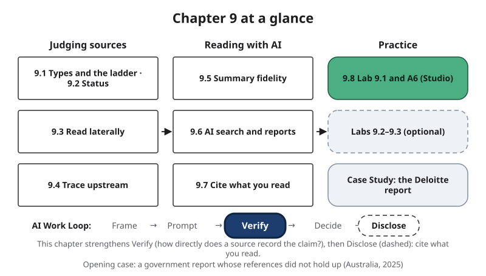{#fig-9-1 fig-alt="Chapter map: judging sources (9.1–9.4), reading with AI (9.5–9.7), practice (9.8, labs, case); Work Loop strip with Verify highlighted."}

**Chapter 9 at a glance.** In Chapter 8 you learned to check a claim: split an output into claims, take each one through the Verification Funnel, and give a verdict. Chapter 9 asks two questions the funnel leaves open. First, **how directly does a source record the claim you need, and who is behind it?** A source can be real and still be a weak record of that claim. Second, **does a summary say what its source says?** More and more of your reading now arrives through artificial intelligence (AI) tools that search, condense and cite for you. This chapter shows you how to judge sources, how to check a summary sentence by sentence, and how to cite what you actually read. The steps of the AI Work Loop (Frame, Prompt, Verify, Decide, Disclose) are the ones from Chapter 1.

**Time:** about 35 minutes for the Core sections, and about 50 minutes for the whole Core package (with the Opening Case, the Warm-up, the Check Yourself boxes, section 9.8, the Case Study and the Summary); longer if English is not your first language. A6 takes about 15 minutes before the lab and about 65 minutes after it; the Your Turn boxes are parts of A6, not extra work. Answers to the faded examples and to odd-numbered end-of-chapter questions are in Appendix E. Core sections are examinable; Studio sections are hands-on work; Deep sections are optional.

**The question of this chapter:** *Can you trust what an AI tool tells you a source says?* The Chapter Summary answers it.

## Opening Case: A Government Report and Its References {.unnumbered}

Australia's Department of Employment and Workplace Relations (DEWR) runs the Targeted Compliance Framework: the rules that can pause or cut a person's welfare payment when they miss required activities, such as meetings with an employment service. These requirements are called "mutual obligations." The department said it had found examples where the information technology (IT) system behind the framework did not follow the law and its policies, including in ways that affected people's payments (DEWR, 2025a).

The government commissioned an independent review of that system from the consulting firm Deloitte, under a contract worth A$439,142 (Australian dollars; AusTender, 2024). Deloitte did the work from December 2024 to June 2025 (DEWR, 2026). The report's cover is dated July 4, 2025, and the department published it on its website on August 14, 2025 (DEWR, 2025a; DEWR, 2026).

Then a reader outside both organizations looked at the report's references. On August 22, 2025, the *Australian Financial Review* reported citation errors that Chris Rudge, a researcher in health and welfare law at the University of Sydney, had raised (Karp, 2025). Rudge later told the Associated Press that the report was full of fabricated references; he said he found up to 20 errors (McGuirk, 2025). The first one he noticed credited a Sydney law professor, Lisa Burton Crawford, with a book that does not exist. He said he knew at once that the book was either invented by AI or the best-kept secret in his field, because he had never heard of it. The reporting also described a quotation attributed to a Federal Court judge that had been made up. Rudge said colleagues' work had been cited as "tokens of legitimacy," that is, as signs that the report was well researched, without being read (McGuirk, 2025).

On October 3, 2025, the department said Deloitte had confirmed that some footnotes and references were incorrect, and that a corrected version had been released (DEWR, 2025b). The corrected report added a disclosure to its methods: a tool chain built on a generative AI large language model (LLM), Azure OpenAI GPT-4o, had been used in the technical work that assessed whether the system's code matched its business rules (DEWR, 2026, pp. 48, 147). The July version had no such disclosure. The Associated Press summarized this as AI having been used in writing the report, and the department said the report's substance and recommendations were unchanged (McGuirk, 2025).

Deloitte repaid the final installment of its fee, A$97,587.11, on October 8, 2025, as a Department of Finance official told a Senate committee that day (Parliament of Australia, 2025). Deloitte told the Associated Press that the matter had been resolved directly with the client (McGuirk, 2025).

Notice how this account is built. Some facts come from the government's own records: they are *confirmed*. Others come from what a named person or outlet *reported*. And one question no source answers: whether the AI tool chain produced the incorrect references, and what checks the firm or the department ran before publication. Anything this book says about that is *inferred*, and marked as such.

So here is the puzzle. A long, professional report from a global firm, published by a government department, carried references that did not hold up. An outside reader reported the errors. **What did that reader check, and could it have been checked before the report was published?** Sections 9.3 and 9.4 answer it, and the Case Study returns to it.

## Learning Objectives {.unnumbered}

Framework tags refer to the UNESCO (United Nations Educational, Scientific and Cultural Organization) AI Competency Framework for Students and the AI Fluency framework.

After this chapter you will be able to:

- **O1 — Differentiate** sources by type (primary, secondary or tertiary) and status (peer-reviewed, preprint, corrected or retracted), and explain what claims each can be evidence for. *(LO3 · AI Fluency: Discernment)*
- **O2 — Evaluate** a source by placing it on the source ladder for a specific claim and by reading laterally to find out who is behind it, and decide how to use it. *(LO3 · AI Fluency: Discernment · UNESCO: human-centred mindset, Apply)*
- **O3 — Trace** a claim upstream through at least two hops of citations to its origin or a dead end, and identify where it changed. *(LO3 · AI Fluency: Discernment, Diligence)*
- **O4 — Judge** the fidelity of a summary, by AI or by a person, against its original, sentence by sentence. *(LO3 · AI Fluency: Discernment · UNESCO: AI techniques and applications, Apply)*
- **O5 — Critique** what an AI search answer or research report leaves unchecked. *(LO3 · AI Fluency: Discernment · UNESCO: AI techniques and applications, Apply)*
- **O6 — Produce** A6: three rated sources, one traced claim, one summary check, correct reference-list citations and an AI Use Declaration. *(LO3, LO4 · AI Fluency: Diligence · UNESCO: ethics of AI, Apply)*

::: {.callout-note title="Warm-up (ungraded)"}
Answer from what you know today. You will come back to these in the Chapter Summary.

1. A report from a well-known firm has more than 100 references. How likely is it that every reference exists and says what the report claims?
2. An AI tool summarizes a study for you. Will the summary claim more, less or the same as the study?
3. To judge an unfamiliar website, should you read it carefully first, or leave it quickly?

For each answer, write how sure you are, from 0 to 100%.
:::

## 9.1 How Directly Does a Source Record the Claim? {#sec-9-1 .unnumbered}

[Core]{.path}

Every source answers some questions well and others badly. A court judgment is the best record of what the court said and a poor record of what the public thinks about it. So the question is never "is this a good source?" but "is this a good source **for this claim**?"

Chapter 8 gave you two tests. A **claim** is one statement in an output that you might rely on. An **independent check** is evidence that no AI tool produced: a source with an author or publisher you can name, or your own recalculation or reasoning from known inputs. A **primary source** is the original record a claim comes from: the study, the dataset, the law, the court record, the official page of the organization that sets the rule.

**Three types.** A primary source is the record itself. A **secondary source** reports on or interprets primary sources: a review article, a textbook, a news story about a study. A **tertiary source** collects and condenses secondary ones: an encyclopedia, an index, a study guide. Outside science, too, a company's annual report is the record of what the company reported, a survey's dataset is the record of its results, and an interview transcript is the record of what was said.

**Type depends on the claim.** The same document can be primary for one claim and secondary for another (@fig-9-3). The Deloitte report is the primary record of *what the department was told* by its reviewers. For *what a court said*, it is only secondary: the court's own record is the source.

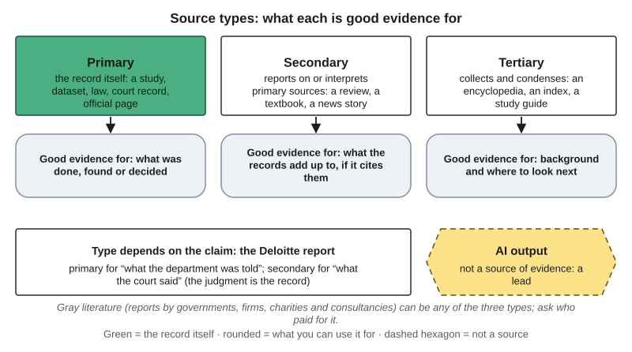{#fig-9-3 fig-alt="Primary, secondary and tertiary sources, each with what it is good evidence for; the Deloitte report placed under two claims; AI output set apart."}

**The source ladder.** This book uses one picture for this judgment (@fig-9-8b). A source's **rung** says how directly it records the claim, judged from the source alone:

- **Rung 4: it is the record of this claim.** The study for "this study found…"; for "what studies show," a **systematic review**, which searches for every study on a question with a written plan.
- **Rung 3: it cites the specific record** (with a page, table or DOI, a Digital Object Identifier, or details you can find), **or it records a narrower part of the claim.** A textbook or an ordinary review that cites specific studies; one experiment, for a claim about many studies.
- **Rung 2: it names a source too vaguely to find.** "A recent Harvard study," "experts say."
- **Rung 1: it gives no source.**

Two rules keep the rungs honest. **A citation lifts a source only if the cited record holds this claim, or a narrower part of it about the same population and outcome; otherwise rate the source as if that citation were missing.** And **opening the cited record does not raise this source's rung**: it gives you a second source, with its own rung (rung 4 if it is the record of this claim).

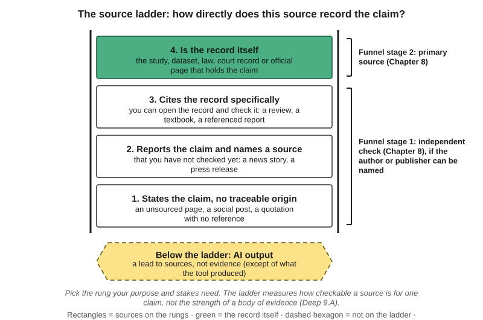{#fig-9-8b fig-alt="A four-rung ladder from gives no source up to is the record of this claim; a dashed area below labeled AI output: a lead, not evidence."}

**AI output is not on the ladder:** it is a lead to sources, and evidence only of what the tool produced (section 9.7).

**The rung you need.** Your purpose and the stakes set the **rung needed**, just as the stakes set where you stop in Chapter 8's funnel. As a rough guide:

| Purpose | Rung needed |
|---|---|
| Background for a class discussion | 2 or 3 |
| A central claim in an essay | 3, and 4 if you can |
| A number or quotation you repeat | 4 |
| A decision about health, money or rights | 4, plus an expert (Chapter 8, stage 3) |

The ladder measures how checkable a source is for one claim, not how strong the evidence is. A primary source does not always beat a secondary one: for "what studies show," one experiment is a narrower record than a systematic review of many experiments. Deep 9.A shows how researchers rate the strength of a whole body of evidence.

::: {.callout-note title="Worked Example: Maya's Five Items"}
*Featuring Maya (psychology), a first-year student from Izmir.* *(Constructed list of real item types.)*

Maya's essay claims, as a general finding, that sleeping after study improves memory. Let's place her five items.

- A journal article reporting one experiment: it records one study, a narrower part of her claim. **Rung 3.**
- A systematic review of many sleep studies: the record of "what studies show." **Rung 4.**
- A news story that names the review, its journal and year: it cites the record findably. **Rung 3.**
- An encyclopedia entry with no references: **rung 1.**
- An AI answer: below the ladder; a lead to the review.

**Rung needed:** a central essay claim, so 3, and 4 if she can. She cites the review itself.
:::

::: {.callout-note title="Faded Example: Marcus's Hand-Hygiene Sources"}
*Featuring Marcus (nursing).* Claim: "Hand-hygiene compliance in hospitals is often below recommended levels." His care-plan assignment needs rung 3 or higher.

1. A World Health Organization (WHO) guideline that cites specific studies: **rung 3**; meets the need. *(Done for you.)*
2. A hospital newsletter that quotes "a recent study" without naming it: rung _____; meets the need? _____
3. A nursing blog with no sources: rung _____; meets the need? _____
:::

::: {.callout-important title="Your Turn"}
A6 item 2: give each of your sources a type, a rung for your claim and the rung you need.
:::

::: {.callout-tip title="Check Yourself 9.1"}
1. How can the same document be a primary source for one claim and a secondary source for another?
2. A blog cites a study by DOI, but the study is about mice and the blog's claim is about people. Which rung is the blog, and why?
3. Why can a systematic review be a more direct record than one experiment for some claims?
:::

## 9.2 How Research Gets Checked {#sec-9-2 .unnumbered}

[Core]{.path}

A source's **status** is the other half of judging research: has anyone outside the authors checked it, and has it changed since?

**Peer review.** Before a journal publishes a research article, an editor usually sends the manuscript to a few experts in the field, the "peers." They advise whether the work is sound, and the authors often revise. Peer review is meant to filter out weak work, and it misses things. Reviewers rarely see the raw data or re-run the analysis. Richard Smith, a former editor of *The BMJ*, called peer review a flawed process with little evidence that it works, yet one likely to stay central to science because there is no obvious alternative (Smith, 2006). In other words, "peer-reviewed" means "checked by a few experts before publication," not "proven."

**Preprints.** A **preprint** is a research manuscript posted publicly before peer review, on a server such as arXiv (mainly physics, mathematics and computer science). Preprints make findings available in days rather than months. But no outside expert has checked them yet. When you meet one, look for a reviewed version and compare: did the conclusion change?

**Corrections and retractions.** Published work can change. A **correction** fixes part of an article. A **retraction** withdraws it, because of serious error or misconduct. A retracted paper can keep circulating for years, so check an article's page and a retraction database before you rely on an older study. In 2023, Crossref, a nonprofit that registers scholarly articles, acquired the Retraction Watch database and made it openly available (Hendricks, 2023). Reports change too: the Deloitte report now exists in three versions.

| Peer review usually checks | Peer review usually does not |
|---|---|
| Whether the question matters and the method fits it | Re-run the analysis or inspect the raw data |
| Whether the conclusions follow from the results shown | Catch deliberate fraud |
| Whether key earlier work is cited | Guarantee that later studies will agree |

Status is one input to your judgment, not a verdict. A preprint can be right; a peer-reviewed article can be retracted.

::: {.callout-note title="Worked Example: Marcus Checks a Study's Status"}
*Featuring Marcus.* *(Constructed path; real check types.)* A classmate on his nursing course's discussion board cites a study on a new wound dressing. Let's follow Marcus. He opens the link: it is a preprint from last year. He searches the title and finds a peer-reviewed version published six months later. He compares the two abstracts (an **abstract** is the short summary at the start of an article). The preprint said the dressing "reduces infections"; the published version says it was "associated with fewer infections in one hospital." He replies with the published version and its narrower wording.
:::

::: {.callout-note title="Faded Example: A Superconductor in a Preprint"}
*Natural science.* In July 2023, two preprints claimed that a material called LK-99 was a superconductor at room temperature and ordinary pressure, which would be a major advance. Within weeks, labs around the world tried to reproduce the result, and by mid-August the evidence pointed away from superconductivity (Garisto, 2023a, 2023b).

1. Did other teams reproduce the result? *(Done for you: most could not.)*
2. Is there a peer-reviewed version, and what does it say? _______
3. Have the original authors corrected or withdrawn the claim? _______
:::

::: {.callout-important title="Your Turn"}
A6 item 2: record the status of each of your sources.
:::

::: {.callout-tip title="Check Yourself 9.2"}
1. What does "peer-reviewed" mean, and what does it not mean?
2. You find a preprint that supports your argument. What two things do you check?
3. Why check a retraction database before relying on an older study?
:::

## 9.3 Who Is Behind It? Read Laterally {#sec-9-3 .unnumbered}

[Core]{.path}

The ladder tells you how directly a source records a claim. It does not tell you whether the people behind the source have a stake in the answer. That is a separate question, and it decides how you use the source.

**Gray literature and who paid.** Much of what you will read is **gray literature**: material published outside journals and books, such as reports by governments, companies, charities and consulting firms (theses, conference papers and preprints are often counted too). It is often valuable and current, rarely peer-reviewed, and sometimes paid for by someone with a stake in the answer. The Deloitte report is commissioned gray literature: one organization paid another to review its own system. Its own pages say the work was advisory and not an audit under Australian auditing standards (DEWR, 2026, p. 2). Its two strong brand names, a global firm and a government department, are a cue that it is *probably* careful, not evidence that a particular reference is right.

**Vertical reading** means judging a page by its own look and its own claims: the design, the "About us" page, the logos, a web address ending in .org. Researchers at Stanford tested how well that works in a small think-aloud study, in which people describe what they are doing as they work. Ten professional fact-checkers, 10 historians with PhDs and 25 Stanford undergraduates evaluated unfamiliar websites (Wineburg & McGrew, 2019). The historians and students often stayed on the page and were taken in by official-looking logos, domain names and a site's description of itself. The fact-checkers did something different. After a quick scan, often within about half a minute, they left the page, opened new tabs and searched for what others said about who was behind it. They reached more accurate judgments in a fraction of the time the other groups needed.

This is **lateral reading**: leaving a page early to see what outside sources say about who is behind it. An **outside source** is a source not written or paid for by whoever is behind the page you are checking. A site's own About page passes Chapter 8's independent check, because no AI tool produced it, but it is not an outside source: it is the site describing itself.

Mike Caulfield, a researcher in digital literacy, built a short routine for this kind of checking, four moves called **SIFT** (Caulfield, 2019; Caulfield & Wineburg, 2023):

1. **Stop.** Before you read or share, ask whether you know this source and what you want from it.
2. **Investigate the source.** Leave the page and look up who is behind it in outside sources.
3. **Find better coverage.** Search for the claim itself; see whether trusted sources report it.
4. **Trace claims, quotes and media to the original context** (section 9.4).

**How the two judgments combine.** Lateral reading feeds your **use decision**: rely on it, use it with a caveat (a stated limit), use it only as a lead, or do not use it. The rung records directness. **"Rely on it" needs both:** a rung that meets your need, and nothing in your outside sources that gives you reason to distrust who is behind it.

**With AI.** An AI tool's answer about who is behind a site is a lead, not a source (Chapter 8): open outside sources yourself.

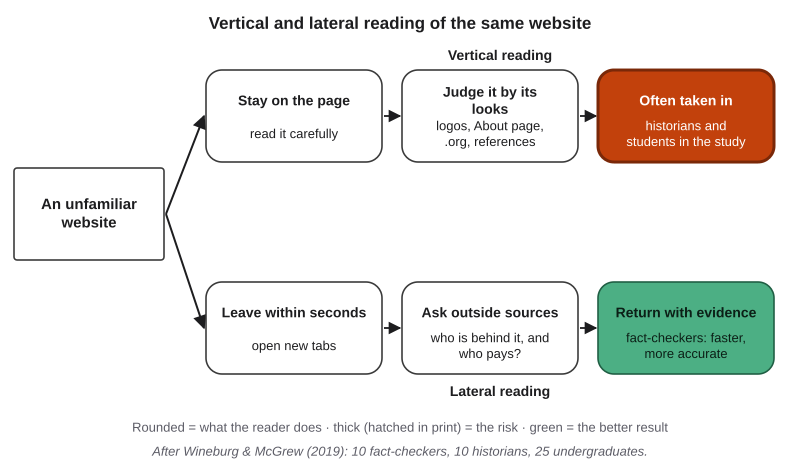{#fig-9-6 fig-alt="Two paths from one website: vertical reading stays and judges by looks; lateral reading leaves, consults outside sources and returns with evidence."}

In the Opening Case, Rudge did what lateral reading teaches: he did not trust the report's own signals, its brand and its long reference list, and went outside the report to check one reference against what he knew of his colleague's work (McGuirk, 2025).

::: {.callout-note title="Worked Example: Marcus and the Supplement Site"}
*Featuring Marcus.* *(Constructed site; no real brand. No patient information is involved.)* A friend sends Marcus a polished website recommending a supplement "for heart health," with charts, a ".org" address and a page of references.

**Rung for "this supplement protects the heart in people":** the site cites a study by DOI, but the study is in mice. Rated as if that citation were missing: **rung 1**.

**Lateral moves:** (1) He searches the organization's name with "funding": a news story reports that it is run by the supplement's maker. (2) He searches the supplement on a government health site, which says the evidence in people is limited.

**Use decision:** do not use. He tells his friend why.
:::

::: {.callout-note title="Faded Example: The History Institute"}
*History.* A news story about a 19th-century treaty quotes "the Institute for Historical Clarity" *(constructed name)*.

1. Who runs it? *(Done for you: a search shows it was founded last year by a political advocacy group and lists no historians.)*
2. Do historians or archives cite it? Your search and result: _______
3. Better coverage of the treaty: where would you look? _______
:::

::: {.callout-important title="Your Turn"}
A6 item 2: complete the outside-source log for each of your sources.
:::

::: {.callout-tip title="Check Yourself 9.3"}
1. What did the fact-checkers do that the historians and students did not?
2. Why is a site's own About page not an outside source, even though it passes Chapter 8's independent check?
3. A source is on the rung you need, but your lateral reading shows it is run by a company that sells the product it praises. Should you rely on it? Why or why not?
:::

## 9.4 Trace the Claim Upstream {#sec-9-4 .unnumbered}

[Core]{.path}

Claims travel (@fig-9-4). A study becomes a press release, the press release becomes a news story, and the news story becomes part of an AI answer. At each step someone retells the claim, and a retelling can change it.

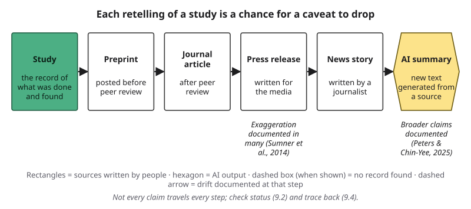{#fig-9-4 fig-alt="Chain: study, preprint, peer-reviewed article, press release, news story, AI summary; dashed arrows where drift has been documented."}

**Citation tracing** means following a claim from where you met it, hop by hop, to the place it first appeared, and checking at each hop that the cited source says what the citing source claims. At every hop you run Chapter 8's three checks: does the cited work exist, do its details match, and does it say what is claimed? What is new here is the number of hops, and the fact that the sources along the way are usually written by people, not by AI.

When a claim changes as it is retold, this book calls it **drift**. Four types are common:

- **Dropped caveat:** a limit disappears ("in mice," "in one hospital").
- **Broadened claim:** the sample, place or time is widened ("students" becomes "people").
- **Cause from correlation:** "linked to" becomes "causes." A **correlation** means two things vary together, which does not show that one causes the other.
- **Changed number:** a value is rounded, swapped or attached to the wrong group.

People drift in scholarly writing too. A 2015 review pooled 28 studies of citations in medical journal articles and estimated that about a quarter did not fully support the statement they were attached to (Jergas & Baethge, 2015).

When the trail ends without an origin, the verdict on Chapter 8's scale is **unsupported**: no evidence for it at the stage you reached. Many sources repeating a claim is not one record showing it.

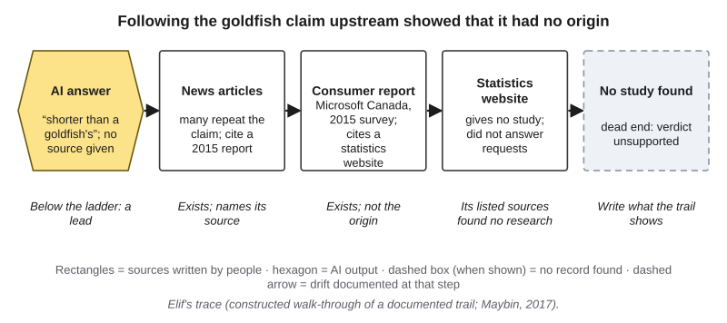{#fig-9-7 fig-alt="Hops: AI answer, news articles, a 2015 Microsoft Canada consumer report, a statistics website, then a dashed dead end: no study found."}

::: {.callout-note title="Worked Example: Maya and the Goldfish"}
*Featuring Maya.* For a short presentation on attention and memory, Maya finds a claim in an AI answer: people now have shorter attention spans than goldfish, about eight seconds. Let's trace it with her. *(A constructed walk-through of a documented trail.)*

**Hop 1:** the AI answer gives no source. Below the ladder: a lead.

**Hop 2:** many news articles repeat it. They exist, and they cite a 2015 report by Microsoft Canada.

**Hop 3:** the report exists. It was a consumer survey (2,000 Canadians, plus brain-activity measurements on 112 people). For the eight-second figure, it cites a statistics website, Statistic Brain.

**Hop 4:** a journalist at the British Broadcasting Corporation (BBC) asked the two organizations that Statistic Brain listed as its sources; neither could find any research behind the figure, and his attempts to reach the website came to nothing (Maybin, 2017).

**Verdict:** unsupported. **What Maya writes instead:** "A widely repeated claim that attention spans have fallen below a goldfish's has no traceable study behind it."
:::

::: {.callout-note title="Faded Example: Most Startups Fail"}
*Business.* A blog says "most startups fail within five years."

1. Hop 1: the blog cites a news article. Exists: yes. Details match: yes. Says it: yes, and it cites national business survival statistics. *(Done for you.)*
2. Hop 2: find those statistics (in the United States, the Bureau of Labor Statistics publishes them; U.S. Bureau of Labor Statistics, n.d.). How do they define "survival," and is closing the same as failing? _______
3. Verdict and the sentence you would write instead: _______
:::

::: {.callout-important title="Your Turn"}
Lab 9.1, step 4 (A6 item 3): trace one claim from your own sources at least two hops, or to a dead end.
:::

::: {.callout-tip title="Check Yourself 9.4"}
1. What does tracing a claim upstream add to Chapter 8's citation checks?
2. Give an example of each of the four drift types.
3. A claim appears in twenty news stories but no study. What verdict does it get, and why?
:::

## 9.5 Reading with AI: Summary Fidelity {#sec-9-5 .unnumbered}

[Core]{.path}

You paste an article into an AI tool and ask for a summary. What comes back looks like the article, only shorter. It is not. Chapter 3 showed that a large language model (LLM) produces text one **token** (a word or piece of a word) at a time, scoring every possible next token given everything in its **context window**, the text it receives in one turn. A summary is produced the same way: it is new text generated from the pasted original, not a set of sentences cut out of it (@fig-9-11).

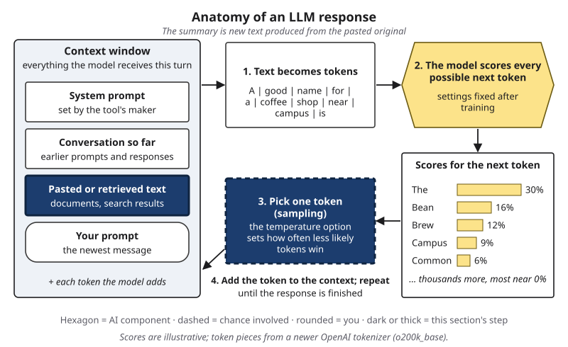{#fig-9-11 fig-alt="Anatomy of an LLM response with the pasted-text slot and the sampling step highlighted; note: the summary is new text produced from the original."}

**Summary fidelity** is how closely a summary's claims match what the original supports. Predict first: will a three-sentence AI summary of a study claim more, less or the same? Would a human science writer do better?

In a 2025 study, two researchers had ten language models produce 4,900 summaries of research abstracts and articles from leading medical and science journals. Most of the models produced conclusions broader than the originals' (Peters & Chin-Yee, 2025). When the authors compared summaries of the same articles written by experts for *NEJM Journal Watch*, a medical newsletter from the publisher of the *New England Journal of Medicine*, the models' summaries had nearly five times the odds of containing broad generalizations. Newer models in the test tended to overgeneralize more, not less (as of 2025).

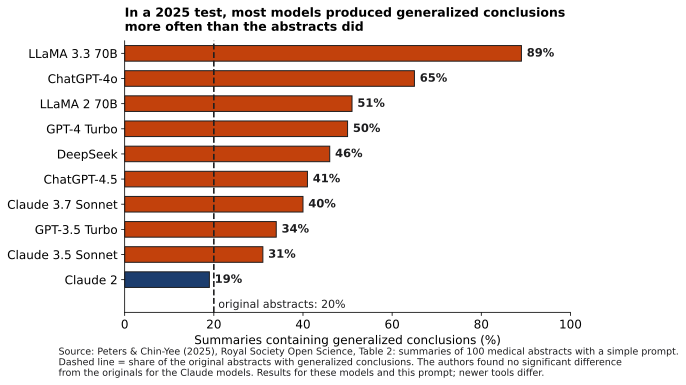{#fig-9-9 fig-alt="Bars: share of summaries with generalized conclusions for ten models, most above the 20% of the original abstracts; one just below it."}

People do it too. A study of 462 press releases about health research, issued by 20 UK universities in 2011, found that about a third or more contained exaggerated advice, exaggerated causal claims or claims about humans drawn from animal research (Sumner et al., 2014). So the lesson is not "trust humans, distrust AI." It is: **check any summary against its original.**

**The fidelity check.** For each sentence of a summary:

1. Find the passage in the original that supports it.
2. Give a verdict on Chapter 8's scale: *supported* (the evidence says what the claim says), *partly supported* (part of the claim holds, part does not or is missing), *unsupported* (no evidence for it at the stage you reached: nothing found, or the source does not say it), *contradicted* (the evidence says otherwise) or *cannot verify* (the evidence exists or may exist, but you cannot reach it).
3. If the verdict is not "supported," name the drift type from section 9.4 when one fits. A sentence with no basis in the original at all is simply unsupported; one that says the opposite is contradicted. If a sentence turns a link the original reports into a cause, the verdict is unsupported, because the design cannot show cause; name the drift "cause from correlation" (and "broadened claim" if the sample was widened too).

Then check the summary as a whole for an **omitted key result**: a finding that changes the picture but is missing.

**Good uses while reading.** AI tools can help you read: explain a term, find the methods section, list questions to read for, or translate a passage. Keep the original open while you do. And mind access. Paywalls push readers toward summaries. Your library can usually get you the original, and many articles are **open access**, free to read online. Do not upload a paywalled or confidential document to a public tool: Chapter 18 covers copyright, and Chapter 15 covers privacy.

::: {.callout-note title="Worked Example: Maya Checks a Summary"}
*Featuring Maya.* *(Constructed example: the study and its summary are invented for teaching. An instructor may run the same demonstration in the concept session.)*

**The original's claims:** (1) 120 students at one university learned word lists; (2) students who reported sleeping at least seven hours between learning and the test recalled more words; (3) the design measured sleep by survey; students were not assigned to sleep or stay awake.

**The summary, coded:**

- "In one study of 120 students, those who slept more after learning recalled more words." **Supported** (claims 1–2).
- "People who sleep after learning remember more." **Partly supported**; drift: **broadened claim** ("students at one university" became "people").
- "Sleep causes better recall." **Unsupported**; drift: **cause from correlation**. Not contradicted: the original does not say the opposite; its design cannot show cause.

**Omitted key result:** none. **Corrected second and third sentences:** "In this one study, more sleep was linked to better recall; the design cannot show that sleep caused it."
:::

::: {.callout-note title="Faded Example: Marcus's Public-Health Summary"}
*Featuring Marcus.* *(Constructed.)* **The original's claims:** (1) in one state, vaccination among adults aged 65 and over rose from 58% in 2022 to 63% in 2024; (2) the rise was larger in urban counties than in rural ones; (3) the data come from the state's vaccination registry.

1. "Adult vaccination rose to 63%." **Partly supported**; drift: **broadened claim** (adults 65 and over became all adults). *(Done for you.)*
2. "The rise was largest in rural counties." Verdict and drift: _______
3. "The rise shows that the state's campaign worked." Verdict and drift: _______
:::

::: {.callout-important title="Your Turn"}
A6 item 4 (started in Lab 9.1); for extra practice, Lab 9.3.
:::

::: {.callout-tip title="Check Yourself 9.5"}
1. Why is an AI summary not just the original made shorter?
2. What did Peters and Chin-Yee (2025) find, and what is one limit of the finding?
3. When do you name a drift type, and when is the verdict enough on its own?
:::

## 9.6 AI Search and Research Reports {#sec-9-6 .unnumbered}

[Core]{.path}

Many tools now search before they answer. In Chapter 1's terms, this is the search-then-generate lane: the system retrieves pages, adds passages from them to the context window (Chapter 3), then produces an answer with links. A link shows where text *may* have come from. It does not show that the page supports the sentence beside it.

Chapter 1 reported one test of this: in 2023, only about half of the sentences produced by generative search engines were fully supported by their citations (Liu et al., 2023). A 2025 test asked whether AI search tools could identify where a quoted news excerpt came from. Researchers at Columbia University's Tow Center for Digital Journalism gave eight AI search tools the same 200 excerpts, chosen so that an ordinary Google search found the original article in its top three results, and asked each tool once for the article's headline, publisher, date and web address (Jazwinska & Chandrasekar, 2025). Together, the tools gave incorrect answers to more than 60% of the 1,600 queries. Error rates ranged from 37% for one tool to 94% for another, as tested in February 2025. Most of the tools presented wrong answers confidently, rarely **hedging** (using words such as "may" or "I could not find").

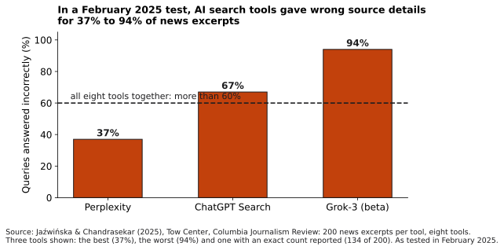{#fig-9-12 fig-alt="Bars for three AI search tools: 37%, 67% and 94% of 200 queries answered incorrectly; dashed line: more than 60% across all eight."}

**Research-report tools.** Some products, often marketed as "deep research," go further: the system runs many searches, retrieves many pages and produces a long report with dozens of citations. Google, OpenAI and Perplexity each announced one between December 11, 2024 and February 14, 2025 (Google, 2024; OpenAI, 2025; Perplexity, 2025). As of October 2026, current tools are listed in Compass, the book's optional, free and ungraded online companion.

They change coverage and speed, not the checks in sections 9.1 to 9.5. A report with 40 citations still needs four checks:

1. **Types:** which rungs are the sources on, for the claims they support?
2. **Support:** does each cited page say what its sentence claims?
3. **Missing evidence:** are dates, counter-evidence and primary sources present?
4. **Faithfulness:** does the report's synthesis say what its sources say?

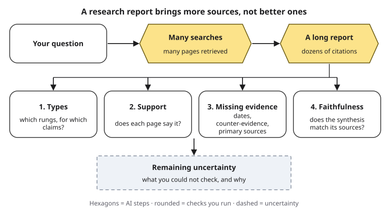{#fig-9-13 fig-alt="A question goes to many AI searches, then a report with citations; four checks follow: types, support, missing evidence, faithfulness."}

::: {.callout-note title="Worked Example: The Four-Day Workweek Report"}
*Business.* *(Constructed report; real study types.)* A research tool's report claims: "Four-day workweek trials raised productivity." It gives four citations.

- **Types:** the organizer's report: rung 4 for "these trials found," written by an advocate; a peer-reviewed analysis of the trial data: rung 4 for "these trials found," rung 3 for trials in general; a news story naming both: rung 3; a consulting firm's blog with no sources: rung 1.
- **Support:** the blog says only that firms liked the change, not that productivity rose: unsupported.
- **Missing:** a study by researchers independent of the organizers; data on companies that dropped out.
- **Faithfulness:** "raised productivity" broadens the organizer's wording, "reported by most participating firms."
:::

::: {.callout-note title="Faded Example: A Readmissions Report"}
*Featuring Marcus.* *(Constructed.)* A research report claims: "Nurse phone calls after discharge cut hospital readmissions." Four citations:

1. A randomized trial in one hospital: rung 4 for "this trial found"; rung 3 for the general claim; says it: yes. *(Done for you.)*
2. A hospital newsletter quoting "a recent study": rung and support: _______
3. A government dataset of readmission rates by hospital, with no data on phone calls: does it support the claim? _______
4. What evidence is missing? _______
:::

::: {.callout-important title="Your Turn"}
A6 item 2: one of your three sources must come from an AI search answer or research report; open it and check that it says what the answer claimed.
:::

::: {.callout-tip title="Check Yourself 9.6"}
1. What does a link in an AI search answer show, and what does it not show?
2. What did the Tow Center study measure, and what was the overall result?
3. Name the four checks for a research report.
:::

## 9.7 Cite What You Read, and Cite AI Correctly {#sec-9-7 .unnumbered}

[Core]{.path}

A reference list is a promise to your reader: these are the sources I used, and you can check them. Four rules keep that promise when AI is part of your research. (Disclosing AI use in the text of your writing, and at work, is Chapter 10's topic.)

**Rule 1: cite the source you read, not the tool that found it.** The American Psychological Association (APA) Style team, which maintains a citation style used across the social sciences and many other fields, says that when you use AI the way you use a search engine, you cite the sources you then read, not the AI (McAdoo et al., 2025b).

**Rule 2: never cite a source you have not opened.** Never copy a citation from an AI answer into your reference list. Chapter 8 showed how often such citations fail.

**Rule 3: when you quote or paraphrase AI output itself, cite it in your style guide's format.** APA's September 2025 guidance names the company as the author and cites a shared chat by its date, title, a description in brackets, the tool or model, and the link (McAdoo et al., 2025a):

> OpenAI. (2027, February 23). *Summary of a sleep and memory study* [Generative AI chat]. ChatGPT. https://chatgpt.com/share/… *(constructed example)*

The Modern Language Association (MLA) puts a description of what the tool generated, often the prompt, in the title slot, and names the tool as the container and its company as the publisher (Modern Language Association, 2025). Whatever the style, an AI tool is never an author.

**Rule 4 (this book): declare AI use every time.** Even where a style guide requires no citation, this book's assignments require an AI Use Declaration: which AI tools you used, for what, what you accepted, rejected or revised, how you verified it, and where your judgment shaped the work (Chapter 1). The reason is that your reader, here your instructor, can judge your work only if they know what the tools did and what you did.

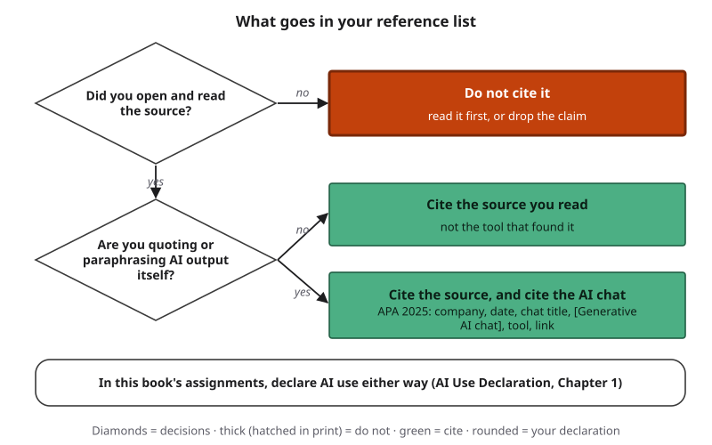{#fig-9-14 fig-alt="Decision tree: did you read it? Are you quoting AI output? Leads to cite the source, cite the AI chat, or do not use; declare AI use either way."}

These rules are also a matter of honesty. In this book's assignments, fabricated sources are not acceptable, even when AI use is disclosed. The Deloitte report's corrected version disclosed AI use in its methods; whether a disclosure like that is enough is a question for Chapter 10.

::: {.callout-note title="Worked Example: Maya's Reference List"}
*Featuring Maya.* Her A6 reference list cites the systematic review and the experiment she read, in APA 7 format, and one AI chat, because she quotes one of its summary sentences as an example of a broadened claim. She does not cite the AI search she used to find the review. Her declaration covers all five elements: "**Tools:** an AI search tool and a chat tool. **Purpose:** finding sources; summarizing one article. **Accepted, rejected, revised:** I kept one summary sentence, rejected two and rewrote one. **Verified:** I checked every summary sentence against the article. **My judgment:** I chose the review over the news story because it is the record of my claim."
:::

::: {.callout-note title="Faded Example: Marcus's Two Errors"}
*Featuring Marcus.* His draft list (1) names an AI tool as the source of a statistic on readmissions and (2) includes an article copied from an AI answer that he never opened.

1. Error 1, fixed: he found the government dataset the statistic came from, read it and cited it. *(Done for you.)*
2. Error 2: what should he do, and what goes in his declaration? _______
:::

::: {.callout-important title="Your Turn"}
A6 item 5: check your own reference list against the four rules.
:::

::: {.callout-tip title="Check Yourself 9.7"}
1. You used an AI search tool to find three articles and read them. What goes in your reference list?
2. When do you cite an AI chat itself?
3. Why do this book's assignments require a declaration even when APA does not require a citation?
:::

## 9.8 The Source Audit (Lab 9.1 and A6) {#sec-9-8 .unnumbered}

[Studio]{.path}

*Studio sections are hands-on work. This one is the lab session and the start of A6.*

A source audit brings the whole chapter together in one record:

1. A **question and purpose**, and the claim you most need to support.
2. **Three sources**, each with its type and status, its **rung for the claim**, the **rung you need**, an outside-source log, and a use decision.
3. One claim **traced** at least two hops, or to a dead end.
4. One AI summary **checked** sentence by sentence.
5. **References**, a short **judgment** with what remains uncertain, and your **declaration**.

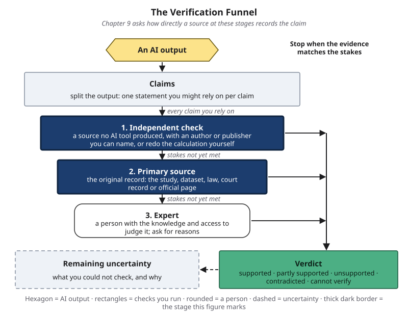{#fig-9-8a fig-alt="The Verification Funnel with the independent check and primary source stages highlighted; note: how directly does a source record the claim?"}

The ladder fits inside Chapter 8's funnel. A source on rungs 1 to 3 can serve as an independent check if you can name its author or publisher, though rungs 1 and 2 rarely meet the rung a claim needs. Stage 2 asks for the record of the claim, which is rung 4: for "this study found," the primary source; for "what studies show," a systematic review, which by type is secondary. The funnel tells you when to stop; the ladder tells you how directly a source records the claim; lateral reading tells you who is behind it.

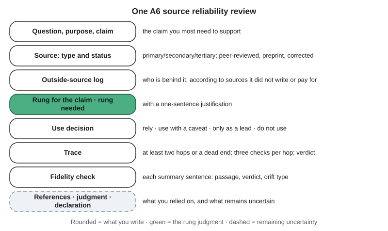{#fig-9-15 fig-alt="A6 sheet: question, type and status, outside-source log, rung for the claim and rung needed, use decision, trace, fidelity check, references."}

Two results are valid and can earn full credit: "a source I first trusted became 'use only as a lead' after lateral reading," and "the summary was faithful." The audit is evidence of your judgment, not a hunt for failures.

::: {.callout-note title="Worked Example: One of Maya's Source Rows"}
*Featuring Maya.* **Source:** the news story about the sleep review. **Type and status:** secondary; a news story, not peer-reviewed. **Rung for "studies show sleep helps memory":** 3 (it names the review, journal and year). **Rung needed:** 3, and 4 if she can. **Outside-source log:** a university library's guide to news sources describes the newspaper as an established national daily with a published corrections policy; a press-freedom group's ownership listing names its owner, a media company with no stake in sleep research. **Use:** use with a caveat, mainly as a lead to the review, which she cites directly.
:::

::: {.callout-note title="Faded Example: A Partly Filled A6 Row"}
*(Constructed.)* **Source:** a 2024 report, "Caffeine and Student Performance," published by a trade association of energy-drink makers; it cites three studies by DOI. **Claim:** "Moderate caffeine improves exam scores."

1. Type and status: gray literature; not peer-reviewed; paid for by makers of the product. *(Done for you.)*
2. Rung for the claim (open one cited study: does it hold this claim?): _______
3. One outside source about the association, and what it says: _______
4. Use decision: _______
:::

::: {.callout-tip title="Check Yourself 9.8"}
1. A source is on rung 4 for your claim, but your outside sources show it is paid for by a party with a stake in the answer. Which A6 columns record each fact?
2. Why can "the summary was faithful" earn full credit?
:::

## Deep 9.A: Grading a Body of Evidence {#sec-9-deep-a .unnumbered}

[Deep]{.path}

*Optional. Not examinable.*

The ladder asks how directly one source records one claim. Health researchers ask a different question: across *all* the studies, how sure can we be about the answer? Their tools explain why the idea that a primary source always beats a secondary one is wrong.

A **systematic review** searches for every study on a question using a written plan, judges each one's quality and summarizes them. A **meta-analysis** goes one step further and combines their results statistically into one estimate. Both are usually stronger evidence on a broad question than any single study.

The GRADE system (Grading of Recommendations Assessment, Development and Evaluation), developed by an international group of health researchers, rates a body of evidence at one of four levels: high, moderate, low or very low (Balshem et al., 2011). Evidence from randomized trials starts high, and evidence from observational studies starts low. The rating moves down for five kinds of problem: limitations in the studies, inconsistent results, evidence that does not directly match the question, imprecise estimates and signs that unfavorable results went unreported (Guyatt et al., 2008). It can move up, mainly for observational evidence, for three reasons: a very large effect, a dose–response pattern or biases that would have hidden the effect. Early GRADE papers called the rating the "quality" of evidence; later ones say "certainty."

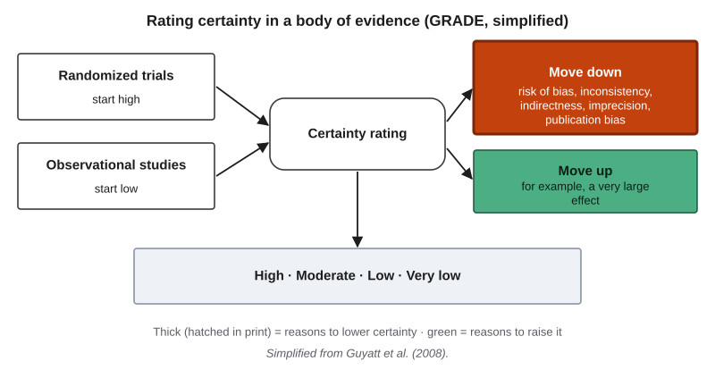{#fig-9-16 fig-alt="GRADE: randomized trials start high, observational studies low; move down for five problems; observational evidence can move up for three reasons."}

Marcus meets this in his nursing program as evidence-based practice. A clinical guideline that rates its evidence with GRADE tells him two things a single study cannot: how many studies agree, and how much their weaknesses should temper his confidence. In other words, "a study found" is weaker than "the evidence shows," and GRADE is one way of saying how much weaker.

## Deep 9.B: Measuring Summary Faithfulness {#sec-9-deep-b .unnumbered}

[Deep]{.path}

*Optional. Not examinable.*

How do researchers decide whether a summary is faithful? The most trusted method is still people: trained annotators read the source and the summary and mark every unsupported or contradicted span. Common automatic scores, such as ROUGE (Recall-Oriented Understudy for Gisting Evaluation) and BERTScore, compare a summary with a human-written reference summary, not with the source, so they can reward fluent text that shares words with the reference.

An early large study of summarization asked annotators to mark content not supported by the source article (Maynez et al., 2020). More than 70% of the one-sentence summaries contained such content, and that included the human-written reference summaries in the dataset, not only the systems' outputs. The authors also found that measures based on whether the source logically supports the summary tracked faithfulness better than word-overlap scores.

Peters and Chin-Yee (2025) reported two further results, as odds. Prompts that asked the models to be accurate made generalized conclusions *more* likely than a simple prompt (an odds ratio of 1.90; an odds ratio compares the odds of an outcome in two conditions). And summaries produced with the temperature option at 0 had 76% lower odds of containing generalized conclusions than those at 0.7 (an odds ratio of about 0.24). (Chapter 3 explained temperature: lower values make the highest-scoring tokens even more likely to be picked.) The authors offer possible explanations, such as fine-tuning that favors confident, helpful-sounding answers, as hypotheses rather than established causes, and they note that their findings are specific to the models tested. For your own work, the safe lesson is the same as in section 9.5: a careful prompt does not replace a check against the original.

## Hands-on Labs {.unnumbered}

These labs are tool-neutral: they describe what to do, not which buttons to press. Use a tool your institution provides or approves (for example, an enterprise chat assistant with data protection) or a free tier. Compass lists current tools. Never put personal or confidential information into a prompt, and never upload a paywalled or confidential document to a public tool.

### Lab 9.1: Source Audit (Studio · 75 minutes · in class) {.unnumbered}

*(O2, O3, O4, O6 · LO3 · Evaluate)*

**Before the lab (about 15 minutes):** write your A6 question, purpose and claim. Find two of your three sources (your Chapter 8 Lab 8.2 record may supply up to two). One of them should be an abstract or an open-access article of at most 1,500 words: bring an AI summary of it, at least five sentences, with the tool, date and prompt. If you cannot, use the provided summary in the book's companion files; its original then counts as one of your three sources.

1. **Briefing (10 minutes).** The ladder and its two rules, lateral reading and the use decision, the drift types; the rule for uploads.
2. **Team jigsaw (15 minutes).** Your team receives four sources on one shared question: a gray report, a preprint, a news story and a peer-reviewed article. Each member takes one: open it to find the claim and place it on the ladder, then read laterally for five minutes and make a use decision. Teams of three share the fourth. Compare.
3. **Fidelity check (15 minutes, individual).** Check your own summary against its original. Swap with a teammate and check two of each other's verdicts.
4. **Trace (15 minutes, individual).** Trace a claim from one of your own sources at least two hops, or to a dead end.
5. **Share and critique (15 minutes).** Each team shows one source whose use decision changed after lateral reading, and one summary sentence with its verdict and drift type.
6. **Exit (5 minutes).** Name one source you would not rely on for your A6 claim, and why.

**If this doesn't work:** the source pack is in the book's companion files as a printable set and as a screen-reader-friendly table; the alternative assignment explains the no-AI route.

### Lab 9.2: Lateral Reading Sprint (Check It · 20 minutes · optional) {.unnumbered}

*(O2 · LO3 · Evaluate)*

1. Open the three websites listed in the book's companion files. They come from published lateral-reading studies, so the answers are documented.
2. Give yourself two minutes per site. Do not read the site itself beyond its name and front-page heading.
3. For each, record who is behind it, which outside sources told you, and how long it took.
4. Compare your answers with the key in the book's companion files (also in Compass).

**If this doesn't work:** use the printed screenshots and the provided search-result pages.

### Lab 9.3: Summary versus Original (Check It · 20 minutes · optional) {.unnumbered}

*(O4 · LO3 · Evaluate)*

1. Choose one open-access abstract from your field (your library's article database can filter for open access, or use the list in the book's companion files).
2. Ask a tool to summarize it in three sentences. If you can, ask a second tool, or the same tool in a new chat.
3. For every sentence: verdict, and drift type if one fits.
4. Write one sentence on what changed between the two summaries.

This mirrors the Worked Example in section 9.5. "Both summaries were faithful" is a valid result.

**If this doesn't work:** use the dated sample summaries in the book's companion files.

## Case Study: The Deloitte Report, Revisited {.unnumbered}

**Context.** The review examined whether the IT system behind Australia's Targeted Compliance Framework followed the law and policy (DEWR, 2025a). By type, it is commissioned gray literature. Its status was not "peer-reviewed." The department calls it an independent assurance review, but the report itself says the work was advisory and was not carried out under the Australian Auditing and Assurance Standards Board's standards, so it expresses no opinions under those standards (DEWR, 2026, p. 2). It was published by the client.

**Timeline** (confirmed unless marked).

- December 2024 to June 2025: Deloitte conducts the review (DEWR, 2026).
- August 14, 2025: the department publishes the report, whose cover is dated July 4, 2025 (DEWR, 2025a, 2026). The Associated Press wrote that the report was originally published in July; the department's own statements give August 14.
- August 22, 2025: the *Australian Financial Review* reports citation errors raised by Rudge (reported; Karp, 2025).
- October 3, 2025: the department says Deloitte confirmed some footnotes and references were incorrect, and publishes a corrected version dated September 26 that adds the AI disclosure (DEWR, 2025b, 2026).
- October 8, 2025: Deloitte repays the final installment, A$97,587.11 (Parliament of Australia, 2025).
- February 3, 2026: the department updates the report again; a comparison of the two files shows changes to a handful of footnote citations to one book, not to findings or recommendations (DEWR, 2026).

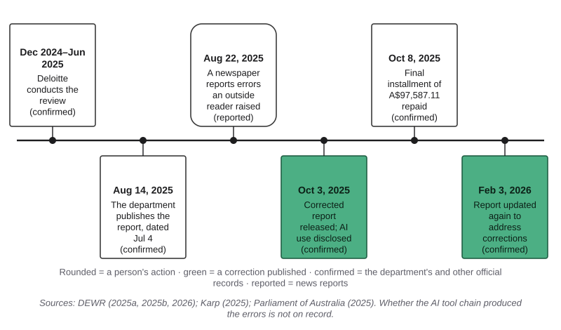{#fig-9-2 fig-alt="Timeline: review 2024–25; published Aug 14, 2025; errors reported Aug 22; corrected Oct 3, AI disclosed; final payment repaid Oct 8; 2026 update."}

**What the AI did.** The corrected report says a generative AI tool chain, licensed by the department and hosted on its own cloud account, was used in the technical work that checked whether the system's code matched its business rules (DEWR, 2026, pp. 48, 147). No public source says the tool produced the incorrect references or any report text; that is **inferred**. Deloitte did not answer the Associated Press's question about whether AI produced the errors (McGuirk, 2025).

**What humans did.** Two checkpoints existed before publication: the firm's review of its own report, and the department's acceptance and publication of it. What either checked is not on the public record. After publication, an outside reader checked references outside the report, the media reported the errors, and the firm and the department corrected the report.

**Where the checks were.** In Chapter 8's terms, the nonexistent book is a citation that does not exist (reported). The misquotation was a passage attributed to a Federal Court judge in a real case, *Amato v Commonwealth*, that the reporting said was made up; the corrected report replaced it and describes the case as resolved by consent orders, orders the parties agreed to (reported, and visible in the two versions). Checking the book outside the report caught the first error. Tracing the quotation to the court's own record would have caught the second: for "what the court said," the report was only a secondary source.

**Failure label.**

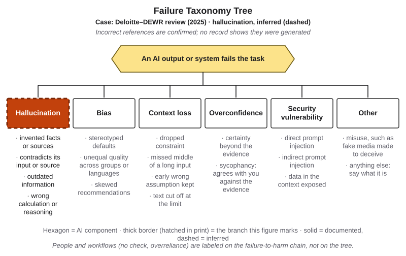{#fig-9-19 fig-alt="The Failure Taxonomy Tree with hallucination marked by a dashed thick border and the tag Deloitte–DEWR review (2025), inferred."}

- **Tree:** hallucination, leaf "invented facts or sources," **inferred** (dashed). The published references were incorrect (confirmed), but no record shows that they were generated.
- **Chain:** link 1, "the output is wrong," documented: the incorrect references reached the published report. Link 2, "checked before use?", failed, **documented**: the incorrect references reached the published report. What checks ran is not on the public record (inferred).

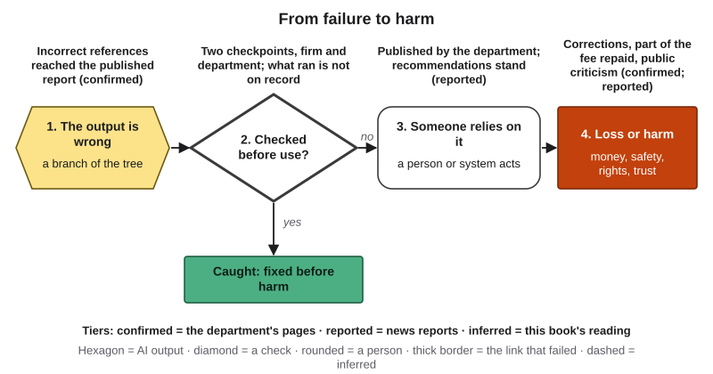{#fig-9-20 fig-alt="Failure-to-harm chain: output wrong (incorrect references, confirmed); checked before use? failed: two checkpoints, process not on record."}

**Three versions.** The report now exists in three published versions: the original (dated July 4, 2025, published August 14, 2025), the corrected version (dated September 26, 2025, published October 3, 2025) and the February 3, 2026 update, which keeps the September date on its cover. If you cited it, which one did you read? Section 9.2's advice applies to gray literature too: check for corrections, and cite the version you used.

**Short case 1: a withdrawn medical preprint (2021).** In late 2020, a preprint reported that the drug ivermectin greatly reduced deaths from COVID-19. In July 2021, the preprint server removed it after outside readers raised concerns about plagiarism and about the data. By then it had been included in several **meta-analyses** (studies that combine the results of many studies), some of whose authors said they would redo their analyses without it (Reardon, 2021). The lead author disputed the concerns. **Lesson:** status changes, and a meta-analysis is only as good as the studies in it.

**Short case 2: AI assistants and the news (2025).** In a study led jointly by the European Broadcasting Union (EBU) and the BBC, journalists at 22 public-service media organizations in 18 countries rated more than 2,700 answers from four AI assistants to news questions. Of the answers, 45% had at least one significant issue, and 31% had a significant sourcing problem: information not supported by the cited source, no source at all, or incorrect or unverifiable sourcing claims (Fletcher & Verckist, 2025). **Lesson:** a cited source in an AI answer is a claim about a source, to be checked like any other.

## Ethics Lens: Whose Names, and Who Is Affected? {.unnumbered}

**Whose names lend legitimacy?** In the Opening Case, a real scholar's name was attached to a book she did not write (reported; McGuirk, 2025). Citations borrow other people's reputations. An invented reference does not only mislead readers; it uses a real person's name to make a claim look supported, and someone else has to spend time finding out that it is not. Here, that someone was an outside reader.

**Who is affected?** The review concerned a system that can suspend or cut welfare payments. The department's own statement said that the people subject to this framework are often among the most vulnerable, including people who are homeless, First Nations people and people with disability (DEWR, 2025a). When a report about such a system cites sources that do not exist, the risk falls on people who never read it.

**Discuss:** When a report affects people who will never see its reference list, who should check the references, and how much checking is enough?

## Career Connection {.unnumbered}

Judging sources is daily work in many jobs.

- **Policy analysts and consultants** write and review reports like the one in this chapter. A reference that has been opened and checked is part of the product.
- **Journalists and fact-checkers** read laterally for a living; the professional fact-checkers in section 9.3 are the model.
- **Research and reference librarians** teach source evaluation, find originals behind summaries, and check retraction status.
- **Nurses** practice evidence-based care: guidelines that grade a body of evidence, not single studies (Deep 9.A).
- **Market research and competitive intelligence analysts** use AI research reports and must check what those reports leave out (section 9.6).
- **Science communicators** write the summaries others rely on, and summary fidelity is the core of the job.
- **Engineers** read standards and test reports, and know the difference between the test record and a vendor's **white paper**, a report a company publishes to explain or promote its product.

## From the Field {.unnumbered}

<!-- Based on the author's published encyclopedia entry (Şeker, 2014), translated and paraphrased from Turkish, within the facts of that entry; present-day connections and the book's notes are marked as such. Not commercial: no D16 disclosure. -->

In 2014 I wrote a short encyclopedia entry on the Elaboration Likelihood Model, a theory of how people are persuaded (Seker, 2014). The model rests on dual-process theory: the idea that two parallel processes shape a decision. They are often described as two routes.

The **central route** is the one a person takes when they are closely involved in a decision and curious about it. They weigh features that are objective, measurable and open to debate. My example was buying a car: fuel consumption, tax and the number of seats can all be compared across alternatives. The **peripheral route** is the one a person takes when they are not closely involved. They respond to features that depend on perception and differ from person to person: the car's color, its design, the reputation of its brand. The entry noted that the peripheral route can turn into the central one as a person's involvement grows. It also described a study that combined the model with consumer search theory to analyze how people choose books in an online store (Ho & Bodoff, 2014). *(The book's note: the model is usually cited to Petty and Cacioppo, 1986.)*

*A present-day connection, which is this book's and not the 2014 entry's:* a famous brand and a long reference list are peripheral cues. They are reasonable signals when little is at stake. When a report will shape decisions about people's welfare payments, or your grade depends on a claim, the stakes call for the central route. Placing a source on the ladder, reading laterally and tracing a claim to its origin are ways of moving yourself onto it.

## Chapter Summary {.unnumbered}

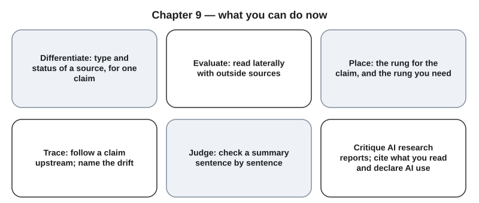{#fig-9-18 fig-alt="Six cards: differentiate sources, place on the ladder, read laterally, trace claims, check summaries, critique AI research and cite what you read."}

**The chapter's question:** *Can you trust what an AI tool tells you a source says?* Not without opening the source. AI tools can find and condense sources quickly, but in tests from 2023 to 2025 their citations often did not support their sentences (2023), they often named the wrong source for a quoted excerpt (2025), and their summaries often stated broader conclusions than the originals (2025); each finding is dated and specific to the tools tested. How directly a source records your claim, and who is behind it, are separate judgments that you make with the ladder and by reading laterally. Both stay with you, and your reference list should show what you actually read.

**Return to the Opening Case.** What did the outside reader check? Whether a cited work existed, by going outside the report to what he knew of his colleague's field. Could it have been checked before publication? The checks were simple; whether anyone ran them is not on the record.

**Revisit your Warm-up.** (1) Every reference in a long, professional report? *Not guaranteed: in the Opening Case, some were incorrect, and in studies of medical journals about a quarter of citations did not fully support their statements (section 9.4).* (2) Will an AI summary claim more, less or the same? *In one 2025 study, most models' summaries claimed more (section 9.5).* (3) Read carefully or leave quickly? *Leave early to read laterally, as the fact-checkers did, then read the source itself carefully (section 9.3).* Compare these with your confidence ratings.

### Key Terms {.unnumbered}

abstract · AI search · citation tracing · correction · drift (in a retelling) · GRADE (Deep) · gray literature · lateral reading · meta-analysis · omitted key result · open access · outside source · peer review · preprint · research-report tool · retraction · rung needed · secondary source · source ladder · summary fidelity · systematic review · tertiary source · use decision · vertical reading. From Chapter 8: claim · independent check · primary source.

## End-of-Chapter Package {.unnumbered}

<!-- Each item: objective · LO · revised Bloom level. Odd-numbered answers → appendix/answers.md (Appendix E, via docs/production/handoff/ch09.md); even-numbered → private/ch09-answers-even.md. MC keys rotated: 1a, 3d, 5b, 7c, 9a, 11d, 13b, 15c; key is the longest option in at most two items; distractors tagged to misconceptions in the answer files. -->

### Review Questions A: Terms and Concepts {.unnumbered}

1. *(O1 · LO3 · Understand)* Which statement is correct?\
   (a) A court's record is primary for what the court said; a report quoting it is secondary.\
   (b) A news story about a study is a primary source for what the study found, since it reports it.\
   (c) An encyclopedia is a primary source when a respected organization publishes it.\
   (d) A report is a primary source for each claim it makes, since it is the original document.
2. *(O1 · LO3 · Understand)* Define gray literature and give two examples.
3. *(O1 · LO3 · Apply)* A preprint supports your argument. What is the best response?\
   (a) Leave it out until it is published, since unreviewed work should not be cited.\
   (b) Treat it as reliable, since a well-known lab wrote it.\
   (c) Cite it if an AI search tool also returns it near the top.\
   (d) Find a reviewed version, compare conclusions, and say it is a preprint.
4. *(O1 · LO3 · Understand)* What does peer review usually check? Name one thing it usually does not.
5. *(O2 · LO3 · Understand)* Which of these is lateral reading?\
   (a) Reading the site's About page and references closely.\
   (b) Searching for what outside sources say about who runs the site.\
   (c) Checking that the site's address ends in .org or .edu.\
   (d) Asking an AI tool whether the site is reliable and accepting the answer.
6. *(O2 · LO3 · Analyze)* A site's own "Our funding" page says it is independent. Why is that page not an outside source, even though no AI tool produced it?
7. *(O2 · LO3 · Analyze)* For the claim "studies agree that regular exercise lowers blood pressure," which source is on the highest rung?\
   (a) One well-run experiment with 40 participants.\
   (b) A news story that names a review but not where it appeared.\
   (c) A systematic review that pooled many trials.\
   (d) An AI answer that names the systematic review.
8. *(O2 · LO3 · Understand)* Where does AI output sit on the source ladder, and why?
9. *(O3 · LO3 · Apply)* A claim appears in thirty news stories, but tracing finds no study behind it. Which verdict fits?\
   (a) Unsupported: no evidence for it at the stage reached.\
   (b) Supported, because so many independent stories agree on it.\
   (c) Contradicted, because no study could be found.\
   (d) Cannot verify, because news stories are not records.
10. *(O4 · LO3 · Apply)* An original says "linked to lower stress in one sample of nurses"; a summary says "reduces stress." Give the verdict and name the drift types.
11. *(O4 · LO3 · Understand)* Which statement fits the evidence in section 9.5?\
    (a) AI summaries condense the original, so they rarely add claims of their own.\
    (b) Human summaries of studies are faithful, so only AI summaries need checking.\
    (c) A summary from a newer model is less likely to overgeneralize than an older one.\
    (d) Both AI summaries and press releases often overstated studies in tests.
12. *(O6 · LO3 · Apply)* You used an AI search tool to find two articles and read both. What goes in your reference list?
13. *(O5 · LO3 · Analyze)* An AI research report on a health question gives 30 citations. What is the best first step?\
    (a) Trust it, because 30 citations show that it covered the topic widely.\
    (b) Check each source's rung and whether it says what its sentence claims.\
    (c) Ask the same tool to confirm that every one of its citations is correct.\
    (d) Count how many of the citations come from well-known organizations.
14. *(O6 · LO4 · Apply)* You quote one sentence of an AI chat as an example of a broadened claim. How do you cite it in APA style, and what else do this book's assignments require?
15. *(O2 · LO3 · Evaluate)* A source sits on the rung you need, but lateral reading shows it is paid for by a company that sells the product it praises. What should you do?\
    (a) Rely on it, because its rung meets the rung your purpose needs.\
    (b) Drop it, because company-funded sources should not be cited in coursework.\
    (c) Use it with a caveat or as a lead, and look for an outside record.\
    (d) Move it down to rung 1, since its funding makes it a weak record.

### Review Questions B: Case Questions {.unnumbered}

1. *(O1 · LO3 · Analyze)* An engineering student cites a manufacturer's white paper for a battery's lifetime. Classify the source by type and status, say who paid for it, and name one claim it is a good record of and one it is not.
2. *(O2 · LO3 · Evaluate)* A history student finds a website quoting a letter from 1862, with no archive reference. Give its rung, then plan two lateral moves and one search that could find a higher-rung source.
3. *(O3 · LO3 · Analyze)* An art-history blog says a painting "sold for $2 million in 1910," citing an exhibition catalogue that cites an auction record. Trace the claim: what do you check at each hop, and where is drift most likely?
4. *(O4 · LO3 · Evaluate)* *(Constructed.)* **Original's claims:** (1) 300 adults in one city kept food diaries for a month; (2) those who ate breakfast daily reported more energy; (3) the study did not test weight. **Summary:** "Eating breakfast gives adults more energy. It also helps with weight loss. The study followed 300 adults in one city." Code each sentence with a verdict and, where one fits, a drift type; then write a corrected summary.
5. *(O5 · LO3 · Evaluate)* A research tool's report on remote work cites six sources: three company blogs, two news stories and one survey by the tool's own provider. Critique what the report leaves unchecked, using the four checks.

### Review Questions C: Interpretive Questions {.unnumbered}

1. *(O2, O3 · LO3 · Evaluate)* Who should check a commissioned report's references before it is published: the firm that wrote it, the client that publishes it, or both? Take a position, say what each check should include, and use the Case Study.
2. *(O5 · LO3 · Evaluate)* "AI research reports make reading the original studies unnecessary for students." Agree or disagree, using sections 9.5 and 9.6.
3. *(O4 · LO3 · Evaluate)* When a university press release or an AI summary overstates a study, who is responsible: the writer, the provider of the tool, or the person who publishes the summary? Take a position, using Sumner et al. (2014) and Peters and Chin-Yee (2025).

### Spaced Review {.unnumbered}

Come back to these a few days after reading, without looking back. They connect this chapter to Chapters 8, 4 and 3.

1. *(Chapter 8 · LO3 · Apply)* What is the funnel's stopping rule, and how does it relate to the "rung you need" in this chapter?
2. *(Chapter 8 · LO3 · Apply)* A reference is not found in two indexes that no AI tool produced. What verdict does it get, and what goes in the uncertainty line?
3. *(Chapter 4 · LO1 · Analyze)* Label an incorrect reference in a published report on the tree when no record says how it was produced. Why is the label inferred, and which Chapter 4 case used the same reasoning?
4. *(Chapter 3 · LO1 · Understand)* What does retrieval change about an AI answer, and what does it not change?

### Discussion Questions {.unnumbered}

1. *(Ethics · O2 · LO3 · Evaluate)* Real scholars' names were attached to works they did not write. What harm does that do, and to whom?
2. *(Career · O5 · LO3 · Analyze)* In the job you want, which source would you be most tempted to trust because of its brand, and how would you check it?
3. *(Interdisciplinary · O1 · LO3 · Analyze)* What counts as a primary source in history, in nursing, in marketing and in engineering? What do they have in common?
4. *(Society · O4 · LO3 · Evaluate)* If most people read science through summaries, who should make sure the summaries are faithful?
5. *(Learning · O6 · LO4 · Evaluate)* Did tracing a claim or checking a summary change how you will use AI for reading? How?

### Application Assignment: A6 Source Reliability Review {.unnumbered}

**Due:** when your instructor sets it, on your course site. *(O6 · LO3, LO4 · Create)* You start it before and during the lab session (section 9.8). Expect about 15 minutes before the lab and about 65 minutes after it.

**What to submit:**

1. **Question and purpose:** one question from your major or a course you are taking, in one sentence; your purpose (for example, background for an essay, a statistic for a presentation, a decision at work); and the claim you most need to support.
2. **Three sources:** at least one rung-4 source for your claim, at least one found through an AI search answer or research report, and at least one that is gray literature, news or a website. Up to two may come from your Chapter 8 Lab 8.2 record. For each source:
   - full citation;
   - **type and status**;
   - its **rung for the claim** and the **rung you need**, with a one-sentence justification;
   - an **outside-source log**: two outside sources for the source you knew least about and one for each of the others (four in all), with what each said about who is behind the source;
   - a **use decision**: rely on it, use it with a caveat, use it only as a lead, or do not use it.
3. **One traced claim** (done in the lab): a claim from one of your sources or from an AI answer, traced at least two hops or to a dead end, with Chapter 8's three checks at each hop, a verdict, and the sentence you would write instead.
4. **One summary check:** the AI summary you brought (at least five sentences, of one of your sources), with the tool, the model if shown, the date and the prompt. For each summary sentence: the supporting passage (its location in the original, paraphrased), a verdict, and a drift type if one fits; then whether a key result was omitted, and a corrected summary.
5. **References:** all sources in APA 7 (or your major's style), plus a citation for any AI output you quote or paraphrase.
6. **Judgment (100–150 words):** which sources you would rely on, for which claim, and what remains uncertain.
7. **AI Use Declaration:** tools, purpose, what you accepted, rejected or revised, how you verified it, and where your own judgment shaped the work.

No personal or confidential data in prompts. Use only open-access or library-licensed sources, and do not upload a paywalled PDF to a public tool. Sources in any language are fine, with an English translation or explanation of each passage you cite. A faithful summary, or a source that keeps its rung and use decision after checking, is a valid result and can earn full credit.

**Rubric (10 points)**

| Criterion (points) | Exemplary | Proficient | Developing | Beginning |
|---|---|---|---|---|
| **Task (3)** | 3: question, purpose and claim stated; three sources meeting the mix; type, status, both rungs and a use decision for every source, all accurate and justified | 2: all parts present; one type, status or rung inaccurate, or one justification missing | 1: one required part missing (the claim, the AI-found source or the rung-4 source), or two or more types or rungs inaccurate, or two or more justifications missing | 0: two or more required parts missing |
| **Outside-source log (1.5)** | 1.5: four outside sources as required, each named, each saying who is behind the source | 1: three acceptable outside sources, or one entry is not an outside source (such as the site's own pages) | 0.5: one or two acceptable outside sources | 0: no log |
| **Citation trace (1.5)** | 1.5: two or more hops (or a dead end), the three checks at every hop, a verdict that follows Chapter 8's rule, and a replacement sentence | 1: two or more hops with one hop's checks, the verdict or the replacement sentence missing | 0.5: one hop checked, or two or more of those items missing | 0: no trace |
| **Verification (2)** | 2: every summary sentence matched to a located passage; verdicts and drift types accurate; omitted-result check and corrected summary present; tool, date and prompt given | 1.5: all sentences checked; one verdict or drift type inaccurate, or the corrected summary or omitted-result check missing | 1: two or three verdicts inaccurate, or one or two sentences unchecked, or verdicts given without passages | 0: no summary check, or more than three verdicts inaccurate or unchecked |
| **References, declaration and judgment (2)** | 2: references correct (any quoted or paraphrased AI output cited); all five declaration elements; judgment names what each source is relied on for and what remains uncertain | 1.5: one reference error, or one declaration element missing, or the judgment lacks the remaining uncertainty | 1: two or more reference errors, or two or three declaration elements, or no judgment | 0: zero or one declaration element, or no references |

**Alternative assignment** (for students who prefer not to use AI tools, or cannot access one). Use the same brief with two changes. The AI-found source becomes a source found through a library database or a search engine. The summary check uses either the dated AI summary in the book's companion files (with its model name, date and prompt) or a university press release compared with the study it reports; press releases also overstate studies (Sumner et al., 2014). Same rubric, read this way:

- **Task:** unchanged, except the AI-found source.
- **Outside-source log** and **Citation trace:** unchanged.
- **Verification:** the summary check on the provided summary or the press release; for a press release, identify the release and the study, with their dates, instead of the tool and prompt.
- **References, declaration and judgment:** unchanged (the declaration states "no AI tools used" if so).

### Mini-Project (optional): A Source Diary {.unnumbered}

*(O1, O2 · LO3 · Analyze)* For three weeks, keep a diary for one course: every source you use, the claim it supports, its type, status, rung and use decision. At the end, write half a page on what changed in where you look first. The diary can become a piece of your portfolio (Chapter 20).

### Case Study Questions {.unnumbered}

1. *(O1 · LO3 · Understand)* What type of source is the Deloitte review, and for which claim is it a primary source?
2. *(O3 · LO3 · Analyze)* Which of the case's facts are confirmed, which are reported, and which are inferred? Give one of each.
3. *(O1 · LO3 · Analyze)* The Associated Press wrote that the report was originally published in July 2025; the department's statements give August 14, 2025; the report's cover says July 4, 2025. Which source settles the publication date, which settles the report's own date, and why?
4. *(O2 · LO3 · Evaluate)* Why is the tree label "hallucination, inferred" rather than "documented"?
5. *(O1, O6 · LO3 · Apply)* You cited the August 2025 version of the report in an essay. What should you do now?

## Further Reading and Compass Links {.unnumbered}

- Peters and Chin-Yee (2025), open access: the abstract and the Discussion (about 15 minutes); the study behind section 9.5.
- Wineburg and McGrew (2019): the fact-checker study, with the participants' own words.
- Caulfield and Wineburg (2023): a book-length guide to lateral reading and SIFT, written for students.
- Breakstone et al. (2021): a national study of how 3,446 U.S. high-school students judged online sources.
- McGrew et al. (2019): an intervention study that taught university students to read laterally.
- Wakeling et al. (2025): a survey in which 2,648 authors judged how accurately their own work had been cited.
- APA Style's 2025 posts on citing generative AI (McAdoo et al., 2025a, 2025b).
- *In Compass (optional): interactive source ladder, "place this source" (@fig-9-8b); summary-check drill; Chapter 9 quiz; Lab 9.1–9.3 pages.*

## References {.unnumbered}

AusTender. (2024). *Contract notice CN4118426: Department of Employment and Workplace Relations* [Contract with Deloitte Touche Tohmatsu; updated 2025]. Australian Government. Retrieved October 18, 2026, from https://www.tenders.gov.au/

Balshem, H., Helfand, M., Schunemann, H. J., Oxman, A. D., Kunz, R., Brozek, J., Vist, G. E., Falck-Ytter, Y., Meerpohl, J., Norris, S., & Guyatt, G. H. (2011). GRADE guidelines: 3. Rating the quality of evidence. *Journal of Clinical Epidemiology, 64*(4), 401–406. https://doi.org/10.1016/j.jclinepi.2010.07.015

Breakstone, J., Smith, M., Wineburg, S., Rapaport, A., Carle, J., Garland, M., & Saavedra, A. (2021). Students' civic online reasoning: A national portrait. *Educational Researcher, 50*(8), 505–515. https://doi.org/10.3102/0013189X211017495

Caulfield, M. (2019, June 19). *SIFT (the four moves)*. Hapgood. https://hapgood.us/2019/06/19/sift-the-four-moves/

Caulfield, M., & Wineburg, S. (2023). *Verified: How to think straight, get duped less, and make better decisions about what to believe online*. University of Chicago Press.

Department of Employment and Workplace Relations. (2025a, August 14). *Secretary's statement in response to the independent assurance review*. Australian Government. https://www.dewr.gov.au/assuring-integrity-targeted-compliance-framework/announcements/secretarys-statement-response-independent-assurance-review

Department of Employment and Workplace Relations. (2025b, October 3). *Secretary statement on progress under the Targeted Compliance Framework Integrity Assurance program*. Australian Government. https://www.dewr.gov.au/assuring-integrity-targeted-compliance-framework/announcements/statement-secretary-progress-under-targeted-compliance-framework-integrity-assurance-program

Department of Employment and Workplace Relations. (2026). *Targeted Compliance Framework assurance review – Final report* [Report prepared by Deloitte; versions dated July 4, 2025 and September 26, 2025; updated February 3, 2026]. Australian Government. Retrieved October 18, 2026, from https://www.dewr.gov.au/assuring-integrity-targeted-compliance-framework/resources/targeted-compliance-framework-assurance-review-final-report

Fletcher, J., & Verckist, D. (2025). *News integrity in AI assistants: An international PSM study*. European Broadcasting Union and BBC. https://www.ebu.ch/files/live/sites/ebu/files/Publications/Intelligence/open/EBU-Intelligence-BBC_News_Integrity_in_AI_Assistants_Report_2025.pdf

Garisto, D. (2023a, August 4). Claimed superconductor LK-99 is an online sensation, but replication efforts fall short. *Nature, 620*(7973), 253. https://doi.org/10.1038/d41586-023-02481-0

Garisto, D. (2023b, August 16). LK-99 isn't a superconductor: How science sleuths solved the mystery. *Nature, 620*(7975), 705–706. https://doi.org/10.1038/d41586-023-02585-7

Google. (2024, December 11). *Try Deep Research and our new experimental model in Gemini, your AI assistant* [Blog post]. https://blog.google/products/gemini/google-gemini-deep-research/

Guyatt, G. H., Oxman, A. D., Vist, G. E., Kunz, R., Falck-Ytter, Y., Alonso-Coello, P., & Schunemann, H. J. (2008). GRADE: An emerging consensus on rating quality of evidence and strength of recommendations. *BMJ, 336*(7650), 924–926. https://doi.org/10.1136/bmj.39489.470347.AD

Hendricks, G. (2023, September 12). *News: Crossref and Retraction Watch*. Crossref. https://www.crossref.org/blog/news-crossref-and-retraction-watch/

Ho, S. Y., & Bodoff, D. (2014). The effects of web personalization on user attitude and behavior: An integration of the elaboration likelihood model and consumer search theory. *MIS Quarterly, 38*(2), 497–520. https://doi.org/10.25300/MISQ/2014/38.2.08

Jazwinska, K., & Chandrasekar, A. (2025, March 6). AI search has a citation problem. *Columbia Journalism Review*. https://www.cjr.org/tow_center/we-compared-eight-ai-search-engines-theyre-all-bad-at-citing-news.php

Jergas, H., & Baethge, C. (2015). Quotation accuracy in medical journal articles—a systematic review and meta-analysis. *PeerJ, 3*, e1364. https://doi.org/10.7717/peerj.1364

Karp, P. (2025, August 22). Deloitte accused of erroneous citations, leading to suspected AI use in major report on welfare. *Australian Financial Review*. https://www.afr.com/companies/professional-services/academics-raise-alarm-over-suspected-aiuse-in-deloitte-report-20250822-p5mp0f

Liu, N. F., Zhang, T., & Liang, P. (2023). Evaluating verifiability in generative search engines. In *Findings of the Association for Computational Linguistics: EMNLP 2023* (pp. 7001–7025). Association for Computational Linguistics. https://doi.org/10.18653/v1/2023.findings-emnlp.467

Maybin, S. (2017, March 10). *Busting the attention span myth*. BBC News. https://www.bbc.com/news/health-38896790

Maynez, J., Narayan, S., Bohnet, B., & McDonald, R. (2020). On faithfulness and factuality in abstractive summarization. In *Proceedings of the 58th Annual Meeting of the Association for Computational Linguistics* (pp. 1906–1919). Association for Computational Linguistics. https://doi.org/10.18653/v1/2020.acl-main.173

McAdoo, T., Denneny, S., & Lee, C. (2025a, September 9). *Citing generative AI in APA Style: Part 1—Reference formats*. APA Style Blog. https://apastyle.apa.org/blog/cite-generative-ai-references

McAdoo, T., Denneny, S., & Lee, C. (2025b, September 9). *Citing generative AI in APA Style: Part 2—AI as a search engine and AI integrated into common software*. APA Style Blog. https://apastyle.apa.org/blog/cite-generative-ai-search-software

McGrew, S., Smith, M., Breakstone, J., Ortega, T., & Wineburg, S. (2019). Improving university students' web savvy: An intervention study. *British Journal of Educational Psychology, 89*(3), 485–500. https://doi.org/10.1111/bjep.12279

McGuirk, R. (2025, October 7). *Deloitte to partially refund Australian government for report with apparent AI-generated errors*. Associated Press, via News4JAX. https://www.news4jax.com/business/2025/10/07/deloitte-to-partially-refund-australian-government-for-report-with-apparent-ai-generated-errors/

Modern Language Association. (2025, August 13). *How do I cite generative AI in MLA style? (Updated and revised)*. MLA Style Center. https://style.mla.org/citing-generative-ai-updated-revised/

OpenAI. (2025, February 2). *Introducing deep research*. https://openai.com/index/introducing-deep-research/

Parliament of Australia. (2025, October 8). *Finance and Public Administration Legislation Committee: Estimates, Finance portfolio* [Committee Hansard]. https://parlinfo.aph.gov.au/

Perplexity. (2025, February 14). *Introducing Perplexity Deep Research* [Blog post]. https://www.perplexity.ai/hub/blog/introducing-perplexity-deep-research

Peters, U., & Chin-Yee, B. (2025). Generalization bias in large language model summarization of scientific research. *Royal Society Open Science, 12*(4), 241776. https://doi.org/10.1098/rsos.241776

Petty, R. E., & Cacioppo, J. T. (1986). *Communication and persuasion: Central and peripheral routes to attitude change*. Springer.

Reardon, S. (2021). Flawed ivermectin preprint highlights challenges of COVID drug studies. *Nature, 596*(7871), 173–174. https://doi.org/10.1038/d41586-021-02081-w

Seker, S. E. (2014). Detaylandirma olasilik modeli [Elaboration likelihood model]. *YBS Ansiklopedi, 1*(1), 15–16.

Smith, R. (2006). Peer review: A flawed process at the heart of science and journals. *Journal of the Royal Society of Medicine, 99*(4), 178–182. https://doi.org/10.1177/014107680609900414

Sumner, P., Vivian-Griffiths, S., Boivin, J., Williams, A., Venetis, C. A., Davies, A., Ogden, J., Whelan, L., Hughes, B., Dalton, B., Boy, F., & Chambers, C. D. (2014). The association between exaggeration in health related science news and academic press releases: Retrospective observational study. *BMJ, 349*, g7015. https://doi.org/10.1136/bmj.g7015

U.S. Bureau of Labor Statistics. (n.d.). *Establishment age and survival data* [Business Employment Dynamics]. https://www.bls.gov/bdm/bdmage.htm

Wakeling, S., Paramita, M. L., & Pinfield, S. (2025). How do authors perceive the way their work is cited? Findings from a large-scale survey on quotation accuracy. *Journal of the Association for Information Science and Technology, 76*(10), 1396–1410. https://doi.org/10.1002/asi.70000

Wineburg, S., & McGrew, S. (2019). Lateral reading and the nature of expertise: Reading less and learning more when evaluating digital information. *Teachers College Record, 121*(11), 1–40. https://doi.org/10.1177/016146811912101102
