# Writing and Professional Communication: Keeping Your Voice {#sec-ch10}

<!-- Status: DRAFT v1 (2026-10-18) from blueprint v0.2 (approved under D19). Featured student: Elif only (docs/characters.md); all AI outputs are constructed examples unless a model and date are given.
Case C07 facts in attribution tiers (confirmed = the email and the dean's email as reproduced or quoted in the reporting; reported = named outlet; inferred = the book's reading). No individual named except the dean who issued public statements (blueprint V3).
Moffatt has one job here (10.7, paras. 27–28; D-4.4). Chapter 9 owns reference-list citation; this chapter owns disclosure in prose and at work.
Numbers in text come from data/ch10_*.csv or the cited sources. Not marked done: independent reviews, revision and the author's final voice edit are pending. -->

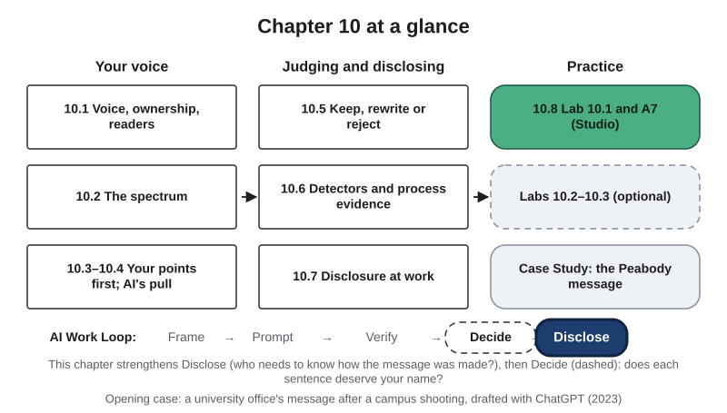{#fig-10-1 fig-alt="Chapter map: your voice (10.1–10.4), judging and disclosing (10.5–10.7), practice (10.8, labs, case); Work Loop with Disclose highlighted."}

**Chapter 10 at a glance.** Much of what you write in college and at work now passes through an AI tool at some point: a grammar check, a translation, a suggested reply, a first draft. Each of these can help. Each can also change what you say and how you sound, sometimes in ways you do not notice. This chapter asks how a message stays yours when a tool helps write it. You will learn to place a use of AI on a spectrum from "your words only" to "the tool's words, sent as is"; to bring your own points before you ask a tool for anything; to judge a draft sentence by sentence; to keep evidence of how you wrote; and to decide when, and how, to tell your readers that AI was involved.

**Time:** about 31 minutes for the Core sections, and about 46 minutes for the whole Core package (with the Opening Case, the Check Yourself boxes, section 10.8, the Case Study and the Summary); longer if English is not your first language. The two readings take about 8 minutes with the guides below. After Thursday's lab, the A7 assignment takes about 45 minutes at home. Core sections are examinable; Studio sections are hands-on work; Deep sections are optional. This is the last chapter before the midterm: its End-of-Chapter Package closes with a **Midterm Bridge** for Chapters 1 to 9.

**Reading guides.** R7, *Moffatt v. Air Canada* (2024): read paragraphs 27 to 29 only, and answer: what did the tribunal say about who answers for information on a company's website, whatever produced it? R8, Noy and Zhang (2023a): read the abstract and Figure 1 only, and answer: what happened to the time taken, the rated quality, and the gap between weaker and stronger writers?

**The question of this chapter:** *Can a message still be yours if an AI tool helped write it?* The Chapter Summary answers it.

## Opening Case: A Message to a Grieving Campus {.unnumbered}

*Content note: this case concerns a message sent after a campus shooting in which three students died. No victim is named.*

On the evening of February 13, 2023, a gunman opened fire on the campus of Michigan State University (MSU). Three students were killed and five were wounded (reported: NPR, 2023).

Three days later, on February 16, an office at another university wrote to its own community. Peabody College, the college of education and human development at Vanderbilt University in Nashville, has an Office of Equity, Diversity and Inclusion (EDI), which works on making the college welcoming to everyone. Its email to the Peabody community spoke about creating safe and inclusive environments and said that respect and understanding were needed (reported: Perrotta, 2023). It referred to shootings in Michigan in the plural, although there had been one (reported: Perrotta, 2023; Korn, 2023).

The email ended with a line in smaller type. It said the message was a paraphrase of output from ChatGPT, and it was written like a citation of a personal communication: "Paraphrase from OpenAI's ChatGPT AI language model, personal communication, February 15, 2023" (confirmed: the email's own line, as quoted by Korn, 2023).

Students noticed. The student newspaper, *The Vanderbilt Hustler*, reported the email on February 17, with students' reactions: several said that a message about community and care was the wrong thing to hand to a machine after a tragedy (reported: Perrotta, 2023). That evening, the office's associate dean sent an apology, calling the use of ChatGPT "poor judgment" (reported: Perrotta, 2023). A university spokesperson told the newspaper that Vanderbilt does not use AI systems to generate its messages (reported: Perrotta, 2023).

On February 18, the dean of Peabody College, Camilla Benbow, wrote to the community. She said the message had not followed Peabody's normal processes "providing for multiple layers of review," that administrators, herself included, had not known about it before it was sent, and that her office would review how it came to be sent (confirmed: the dean's email, as quoted by Lele, 2023). The office's associate dean and assistant dean stepped back from their roles while the review took place (reported: Lele, 2023). They returned to their roles on April 11, 2023 (reported: Lele & Faquih, 2023).

Notice what the message did *not* do. It did not hide the tool; it said, in its last line, that ChatGPT had helped. It was polite, fluent and on topic. And still its readers, and the office's own dean, treated it as a failure. **Why?** Sections 10.1, 10.2, 10.5 and 10.7 answer that question, and the Case Study returns to it.

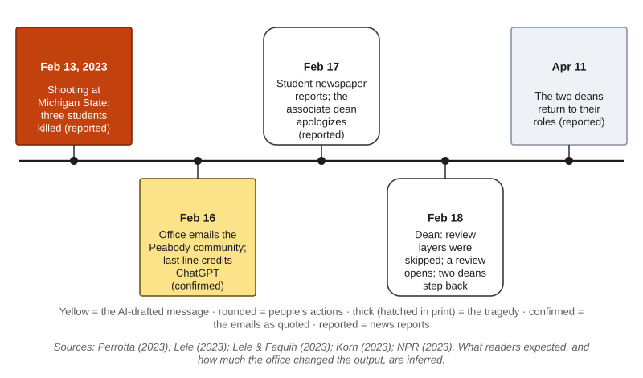{#fig-10-2 fig-alt="Timeline from the February 13, 2023 shooting to the February 16 email with an AI line, the apology, the dean's statement and the April return."}

## Learning Objectives {.unnumbered}

Framework tags refer to the UNESCO (United Nations Educational, Scientific and Cultural Organization) AI Competency Framework for Students and the AI Fluency framework.

After this chapter you will be able to:

- **O1 — Classify** a use of AI in writing on the voice and ownership spectrum for a stated reader and purpose, and give the Chapter 1 zone it falls in. *(LO4 · AI Fluency: Delegation · UNESCO: human-centred mindset, Understand)*
- **O2 — Frame** a professional writing task for an AI tool, with your own points first, the reader, the tone and the constraints. *(LO2 · AI Fluency: Description · UNESCO: AI techniques and applications, Apply)*
- **O3 — Judge** each sentence of an AI-assisted draft as keep, rewrite or reject, with a reason, taking factual claims through the Verification Funnel. *(LO4, LO3 · AI Fluency: Discernment, Diligence)*
- **O4 — Explain** why an AI-text detector score is weak evidence of who wrote a text, how detectors can flag second-language writers (as they did in a 2023 test), and what process evidence shows instead. *(LO4 · AI Fluency: Diligence · UNESCO: ethics of AI, Understand)*
- **O5 — Decide** whether and how to disclose AI use in a professional message, and explain why responsibility stays with the sender. *(LO4 · AI Fluency: Diligence · UNESCO: ethics of AI, Apply)*
- **O6 — Produce** A7: a real professional document with your own starting notes, labeled prompts, an annotated draft, a fact check, a final version with a revision trace, and an AI Use Declaration that includes your disclosure decision. *(LO2, LO4 · AI Fluency: Diligence, Description)*

::: {.callout-note title="Warm-up (ungraded)"}
Answer from what you know today. You will come back to these in the Chapter Summary.

1. An office sends a message to students after a tragedy, with a note saying ChatGPT drafted it. Does the note make the message acceptable?
2. You ask a tool to "fix the grammar" in a paragraph you wrote. Can that change what you say?
3. Can an AI detector reliably tell whether a person wrote a text?

For each answer, write how sure you are, from 0 to 100%.
:::

## 10.1 Voice, Ownership and What Readers Expect {#sec-10-1 .unnumbered}

[Core]{.path}

Read two short messages from people you know, and you can often tell who wrote which. What you recognize is their **voice**: the impression of a writer that a reader forms from the writer's choices of words, sentence shapes, stance and what to include. The second-language writing researcher Paul Kei Matsuda describes voice in this way, as an overall effect built from many features of a text, some chosen on purpose and some not (Matsuda, 2001). Voice lives partly in the reader: it is what comes across. (In Chapter 5, a prompt's **role** set the voice an *output* takes on. Here, voice means *yours*.)

A second idea matters in every message. This book calls it **ownership (of a text)**: you decided what the text says, and you can explain, defend and stand behind every sentence in it and its consequences. Ownership is not legal authorship; who owns the words under copyright law is Chapter 18's question. You can own a message even if a tool suggested some of its words, and you can lose ownership of one you typed yourself, if you cannot say why it says what it says.

**Readers judge senders, not only sentences.** In a 2022 study, 147 crowd workers (people recruited online for short paid tasks) read emails that had all been written by people; some were labeled as written with AI help. Participants trusted the writers less when told AI was involved. One result surprised the researchers: in the survey, trust *rose* as the emails became more personal, in every condition. Yet in interviews with ten participants, people firmly rejected AI help for highly personal messages (Liu, Mittal, Yang & Bruckman, 2022). The two parts point in different directions, and both are small. What they share is that readers judge the sender by what they believe about how the message was made.

So before you ask whether a tool *can* write a message, ask about its readers: **does this message need my own words?** For a meeting summary, readers mainly want accuracy and clarity. For an apology, a thank-you note or a message after a loss, they want to know that a person took the time.

::: {.callout-note title="Worked Example: What Do These Readers Expect?"}
| Message | Readers expect | Why |
|---|---|---|
| A thank-you note to a mentor | Your own words | Its value is that you wrote it |
| A weekly team update | Accuracy and clarity first | Readers need the facts |
| A message to a colleague whose parent has died | Your own words | Readers infer care from effort |
| A reply to a routine question about opening hours | Accuracy and clarity first | The customer wants the right hours |
:::

::: {.callout-note title="Faded Example: Three More Messages"}
| Message | Readers expect | Why |
|---|---|---|
| An apology to a client for a missed deadline | Your own words | The client wants a person to take responsibility |
| A lab-safety reminder to a whole building | _______ | _______ |
| A reference letter for a former intern | _______ | _______ |
:::

The Your Turn for this section comes at the end of section 10.2.

::: {.callout-tip title="Check Yourself 10.1"}
1. In your own words, what is voice, and where does it live?
2. Why is ownership in this chapter not the same as legal authorship?
3. What did the 2022 email study find in its survey, and what did its interviews add?
:::

## 10.2 The Voice and Ownership Spectrum {#sec-10-2 .unnumbered}

[Core]{.path}

"Did you use AI?" is too blunt a question for writing. A grammar check and a generated essay are both "using AI." This book places writing uses on a **voice and ownership spectrum**: five positions, ordered by how much of the wording a tool supplies.

1. **Your words only.** No AI.
2. **AI as reader.** The tool comments on your draft; you make the changes yourself.
3. **AI as editor.** The tool changes wording in your draft: grammar and spelling, whole sentences, or a translation of text you wrote. You accept or reject each change.
4. **AI as co-drafter.** The tool drafts from your points; you rewrite it sentence by sentence.
5. **AI as author (sent as is).** The tool drafts; you send it with little or no change.

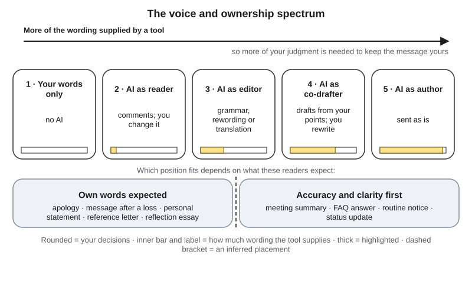{#fig-10-3 fig-alt="Spectrum of five positions from your words only to AI as author, sent as is; below, two bands: own words expected, and accuracy and clarity first."}

The spectrum measures wording, not worth. A message at position 4 can be fully yours, if you decided what it says and checked every sentence. Moving right, the tool chooses more, so the message needs more of your judgment. (Chapter 5's Delegation Ladder describes ways of working with AI; the spectrum describes one document.)

**The spectrum and the three zones.** Chapter 1 said that drafting depends on the purpose of the writing: if an assignment exists to build your skill in writing or reasoning, such as a reflection essay, AI drafting is outsourcing unless your instructor explicitly allows it. The table applies that rule. Where the course policy does not name a use, the table gives this book's reading, marked as such.

| Position | Writing that builds your own skill | Writing for another purpose |
|---|---|---|
| 2. Reader | Permitted (feedback on your own draft); list it briefly in your declaration | Permitted; list it briefly |
| 3. Editor: grammar and spelling only | Permitted (this book's reading of "formatting" and "feedback"); list it briefly | Permitted; list it briefly |
| 3. Editor: rewording, or translating your own text | Ask your instructor first (this book's reading) | Permitted with disclosure and verification |
| 4. Co-drafter | Outsourcing, unless your instructor explicitly allows it | Permitted with disclosure and verification |
| 5. Author (sent as is) | Not acceptable | Only if you can explain every sentence, readers would accept it, and you disclose where expected |

The two bands under the positions come from section 10.1, so the question is always "which position, for these readers?"

**What about human ghostwriters?** A **ghostwriter** is a person who writes a text that someone else signs, like a communications officer drafting a president's statement. Readers of such genres usually accept this, because someone senior approved the words. So "someone else drafted it" is not, by itself, the problem. In the Opening Case, this book's reading (inferred) is that readers expected the office's own words, and the usual reviewers never saw the message. Its last line said "paraphrase," so it sat at position 4 or 5, drawn dashed because the placement is inferred.

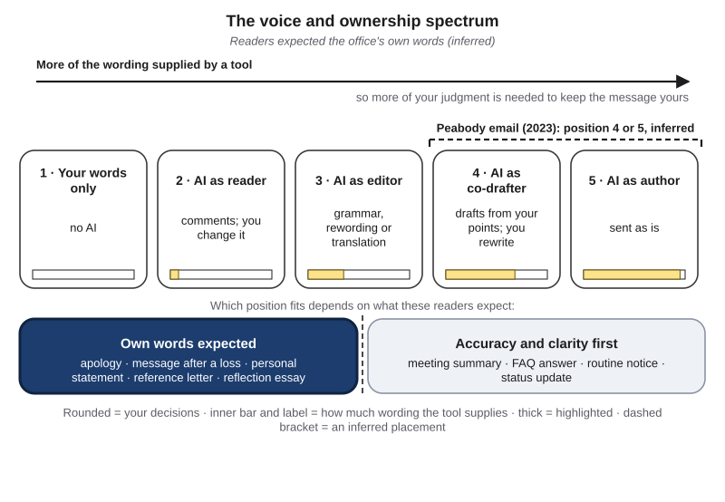{#fig-10-3b fig-alt="The spectrum with positions 4 and 5 marked by a dashed bracket labeled Peabody email (2023), and the band own words expected highlighted."}

::: {.callout-note title="Worked Example: Elif's Week"}
*Featuring Elif (psychology), a first-year student from İzmir. English is her second language; she writes well but slowly, starting from notes in Turkish.*

| Use | Position | Zone |
|---|---|---|
| Translates her own Turkish paragraph for a psychology essay, then revises it | 3, translation | The essay builds her skill, so she asked her instructor first; it is allowed with a declaration line |
| Grammar feedback on a flyer she wrote for the peer-tutoring center | 2–3, grammar only | Permitted; listed briefly |
| An email to the tutoring coordinator, drafted from her five points and rewritten | 4 | Another purpose: permitted with disclosure and verification |
| "Write my reflection" for her tutor-training course | 5 | Not acceptable: she deletes the output and writes it herself |
:::

::: {.callout-note title="Faded Example: An Engineering Student's Uses"}
| Use | Position | Zone |
|---|---|---|
| A tool formats his lab data into a table | 3, formatting | Permitted; listed briefly |
| A tool drafts his status email to a client; he edits two sentences | _______ | _______ |
| A tool writes his course's required design reflection | _______ | _______ |
:::

::: {.callout-important title="Your Turn (sections 10.1 and 10.2)"}
Choose three messages you sent or submitted this month. For each, say what its readers expected, place your actual use on the spectrum, and give the zone. If one sits somewhere you are not comfortable with, say where it should have sat.
:::

::: {.callout-tip title="Check Yourself 10.2"}
1. What does the spectrum measure, and what does it not measure?
2. Why can position 4 be outsourcing in one course and acceptable in another?
3. Why is a ghostwritten statement not automatically a failure?
:::

## 10.3 Framing a Writing Task: Your Points First {#sec-10-3 .unnumbered}

[Core]{.path}

The easiest way to lose your voice is to start with the tool. Ask "write an email to my coordinator about rescheduling," and the tool must supply everything: what you want, how sorry you are, what you propose. It will supply the most common version of each. So the first rule is **write first**: put down what you want to say, in notes or a rough draft, before you ask a tool for anything. Then the tool shapes your content instead of choosing it.

Your notes become part of a prompt. Chapter 5's anatomy of a prompt still applies; for writing, three parts carry most of the weight. **Role** sets the voice the output takes on, and shapes tone and vocabulary, not accuracy. **Context** holds the reader, your relationship, the situation and your own points. **Constraints** hold length, what must not be promised or said, and words you would never use.

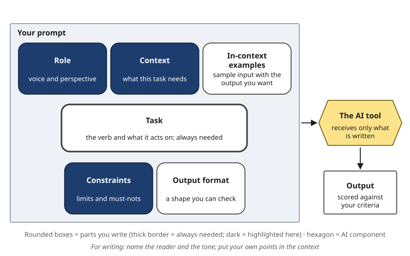{#fig-10-4 fig-alt="Anatomy of a Prompt with role, context and constraints highlighted; note: name the reader and the tone; put your own points in the context."}

**Tone** is the attitude a message conveys toward its reader and topic: formal or casual, warm or brief, firm or apologetic. Name the tone you want, and the reader. Tone is also where writers overestimate themselves: in five experiments, people predicted that readers would recognize the tone of their emails, such as sarcasm or seriousness, far more often than readers did (Kruger, Epley, Parker & Ng, 2005). The researchers traced this to egocentrism: senders hear their own tone in their head. Check tone with a person, or read the message aloud.

**Privacy.** Chapter 1's rule applies: no personal or confidential information, *yours or anyone else's*, goes into a public AI tool. A cover letter carries your phone number; an email may carry a student's name. Use placeholders such as [PHONE] or [STUDENT], or the university-provided tool, and fill in details yourself afterward (Chapter 15).

::: {.callout-note title="Worked Example: One Email, Three Tones"}
*Featuring Elif. This mirrors Tuesday's demonstration; the outputs are constructed examples.*

Elif cannot lead Thursday's 4 p.m. tutoring session, because her own statistics exam moved to that slot. **Her points first:** (1) she cannot lead Thursday's session; (2) she is sorry for the short notice; (3) she proposes Friday at 2 p.m. or Monday at 4 p.m.; (4) if the coordinator agrees, she will tell the two students herself; (5) the materials are in the shared folder.

**Prompt.** *Role:* a peer tutor writing to the center's coordinator. *Task:* draft a short email. *Context:* my five points; the coordinator is friendly but busy; students' names replaced by [STUDENTS]. *Constraints:* under 120 words; no reason beyond "my exam moved"; promise nothing I did not list. *Output format:* three versions: formal, warm, brief.

**Her choice:** the warm version (@fig-10-5), because the coordinator knows her. **Her edits:** she cut "I completely understand if this causes inconvenience," which sounded unlike her, and added her own line of thanks.
:::

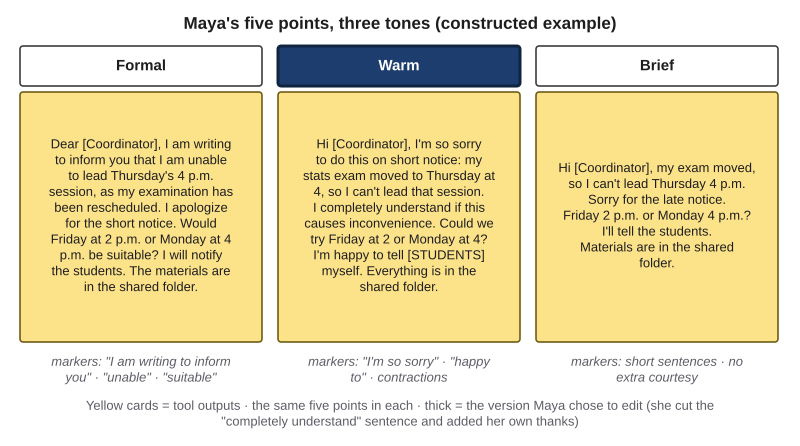{#fig-10-5 fig-alt="Three message cards with the same five points: formal, warm and brief versions of Elif's rescheduling email; tone markers listed under each."}

::: {.callout-note title="Faded Example: A Status Update to a Client"}
*Field: engineering. A one-off example.* A test fixture will be two weeks late. **Task:** draft a status-update email to the client. **Output format:** under 150 words, three short paragraphs. **Now add:** the reader and the tone (_______), the context with the team's own points (_______), and one constraint about promises (_______).
:::

::: {.callout-important title="Your Turn"}
Lab 10.2 (optional, 20 minutes): your own five points, three tones, one reader's opinion.
:::

::: {.callout-tip title="Check Yourself 10.3"}
1. What is "write first," and why does it protect your voice?
2. Which prompt part holds the reader and your own points?
3. Why check the tone of an email with a person before you trust it?
:::

## 10.4 What AI Help Does to Your Writing {#sec-10-4 .unnumbered}

[Core]{.path}

AI help is fast, and it often makes a draft read better. Chapter 1 described an experiment in which access to ChatGPT cut professionals' time on job-like writing tasks by about 40% and raised graders' quality ratings by about 18%; the graders did not check factual accuracy (Noy & Zhang, 2023a). This section asks what happens to the writer's own contribution.

**Many participants did not edit.** In the authors' March 2023 working paper, an earlier version that had not been peer reviewed, 68% of the participants who used ChatGPT reported submitting its first output without editing it, and their essays scored no higher than ChatGPT's raw output given to the same graders (reported: Noy & Zhang, 2023b).

**AI help pulls writing toward common phrasing.** Recall Chapter 3: a language model produces likely text, and likely text is the common way of saying something. Several studies show what this can do.

- Short stories written with ideas from a language model were rated more creative and better written, one by one, and were more similar to one another than stories written without them (Doshi & Hauser, 2024). **Homogenization** is the word for this: becoming more alike.
- With 118 participants from India and the United States writing in English with autocomplete suggestions from a language model (GPT-4o), the suggestions gave American participants larger speed gains and moved Indian participants' writing toward Western styles (Agarwal, Naaman & Vashistha, 2025).
- With 1,506 online participants writing about whether social media is good for society, an assistant deliberately set up to argue one side shifted the opinions they wrote and their answers in a later survey (Jakesch, Bhat, Buschek, Zalmanson & Naaman, 2023).

None of these studies tested a grammar checker; they tested story ideas, autocomplete and a deliberately one-sided assistant. This book's inference, which you can test in Lab 10.3, is that "polishing" can change what you say too, because a polishing tool also supplies new wording. The lesson is not "never use grammar help": light edits often change very little. It is: **compare before and after**, and treat a change you did not choose as a change to your voice.

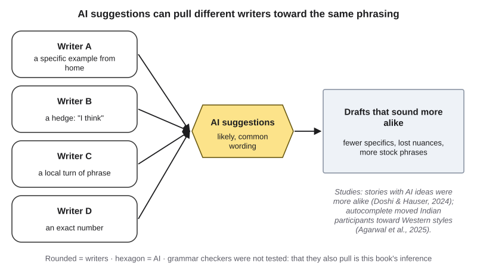{#fig-10-6 fig-alt="Four different writers' drafts pass through AI suggestions and come out clustered together; side note names the story and autocomplete studies."}

::: {.callout-note title="Worked Example: Elif's Scholarship Paragraph"}
*Featuring Elif. The "after" version is a constructed example.*

**Before (her English, from her Turkish notes):** "In İzmir, my grandmother forgot the names of her neighbors but remembered every song from her youth. I think this is why I want to study memory. I do not know yet if I will do research or clinical work."

**After "improve my English":** "My passion for psychology stems from a lifelong fascination with the human mind. Witnessing memory loss in my family inspired me to pursue research that will transform how we understand memory."

**Four changes.** (1) The grandmother and the songs became "memory loss in my family": the example that made it hers is gone (*voice*). (2) "I think" disappeared: Chapter 9's *dropped caveat*. (3) "Passion … lifelong fascination" was added: a stock phrase (*voice*). (4) "I do not know yet" became "research that will transform": a *broadened claim* and a commitment she did not make (*commitment*). She keeps two grammar fixes and restores the rest.
:::

::: {.callout-note title="Faded Example: A Business Student's Paragraph"}
*A one-off example.* Original: "Our club raised $1,240 at three bake sales, less than we hoped." Tool version: "Our club achieved outstanding fundraising success through a series of community events." **Change 1:** the number and the bake sales are gone (*accuracy*, *voice*). **Change 2:** _______
:::

::: {.callout-important title="Your Turn"}
Lab 10.3 (optional, 20 minutes): the voice fingerprint.
:::

::: {.callout-tip title="Check Yourself 10.4"}
1. What does homogenization mean, and which study found it for short stories?
2. Why does this chapter mark "polishing can change what you say" as an inference?
3. What did 68% of participants report in the working paper, and why is the figure labeled?
:::

## 10.5 Keep, Rewrite or Reject {#sec-10-5 .unnumbered}

[Core]{.path}

Once a tool has produced a draft, what keeps the message yours is a decision about every sentence:

- **Keep (K):** it is true, says what you mean, fits the reader, and you can stand behind it.
- **Rewrite (R):** the idea is right, but the words, tone or strength are wrong.
- **Reject (X):** it is untrue, not yours, promises what you cannot deliver, or should not reach this reader.

Every decision gets a **reason tag**: *voice*, *accuracy*, *audience and tone*, *commitment* (a claim or promise made in your name) or *privacy*. The tag makes your judgment specific and tells you what to fix.

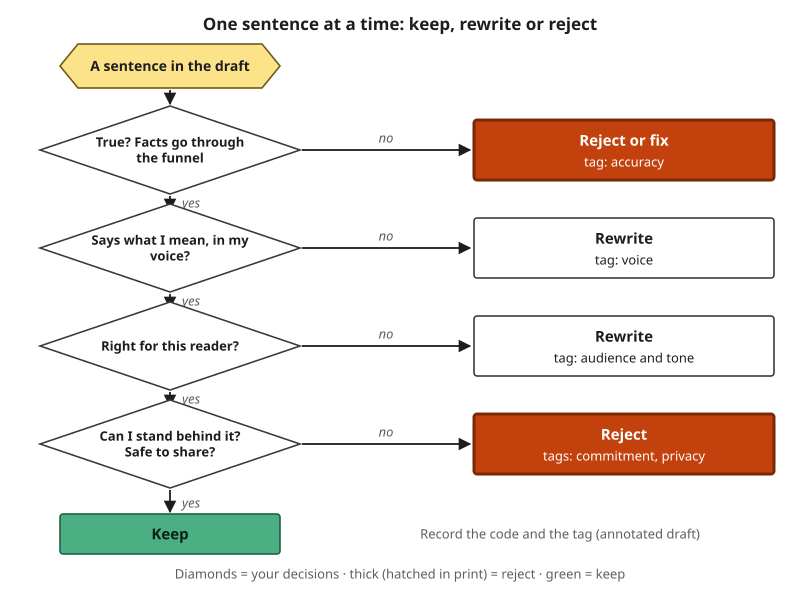{#fig-10-7 fig-alt="Decision flow for one sentence: true? says what I mean? right for this reader? can I stand behind it? Exits lead to keep, rewrite or reject with tags."}

**Facts in a draft are claims.** Names, dates, numbers, policies and quotations are claims in Chapter 8's sense: statements you might rely on, and your readers will. Take them through the Verification Funnel as far as the stakes require, and give each a verdict (supported, partly supported, unsupported, contradicted, cannot verify). An AI tool's own "yes" is never a source. In A7 you check the three highest-stakes claims.

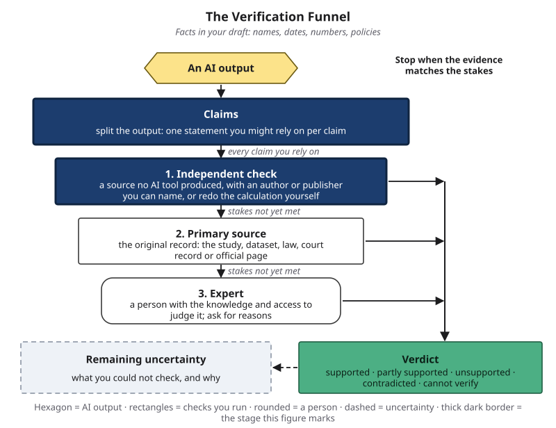{#fig-10-8 fig-alt="The Verification Funnel with claims and the independent check highlighted; note: facts in your draft: names, dates, numbers, policies."}

Two records make this work visible. An **annotated draft** is the AI-assisted draft with every sentence coded K, R or X and tagged. A **revision trace** is a record of versions, from your notes or first draft to the tool's draft to your final version, with what changed, who or what proposed it, and why.

Look back at the Opening Case. A message to a grieving community went out with a wrong detail, "shootings" for one shooting. Whether the error came from the tool or the paraphrase, no source says. Either way, one read of each sentence, by the writer or by the reviewers the dean said were skipped, could have caught it. And "I kept almost everything" is a valid result, as long as each keep has a reason.

::: {.callout-note title="Worked Example: Elif's Cover Letter"}
*Featuring Elif, applying for a research-assistant position in a memory lab in her psychology department (a constructed lab). The draft is a constructed example; her notes came first.*

| # | Sentence (shortened) | Code | Tag and reason |
|---|---|---|---|
| 1 | "I am writing to apply for the research assistant position." | K | *Audience*: clear and standard |
| 2 | "I am passionate about unlocking the mysteries of the human mind." | R | *Voice*: a stock phrase. Hers: "I became interested in memory while tutoring students who could explain a concept on Monday and not on Friday." |
| 3 | "Your lab's eye-tracking studies have inspired me." | R | *Accuracy*: the lab's own page (the primary source) lists sleep-diary and memory-test studies, no eye tracking: **contradicted**. She names the sleep studies |
| 4 | "As a fluent SPSS user, I can start running analyses on day one." | X | *Commitment*: she has used SPSS, a statistics program, once in a course lab |
| 5 | "I volunteer at the campus peer-tutoring center." | K | *Accuracy*: true |
| 6 | "I have published research on memory." | X | *Accuracy*, *commitment*: not true |
| 7 | "My international background gives me a unique global perspective." | R | *Voice*: generic; she names what she offers: reading Turkish sources |
| 8 | "[PHONE] · [EMAIL]" | K | *Privacy*: placeholders, filled in by her |
:::

::: {.callout-note title="Faded Example: A Refund Reply"}
*Field: business. A one-off support agent's AI-drafted reply, eight sentences.*

| # | Sentence | Code | Tag and reason |
|---|---|---|---|
| 1 | "Thank you for your patience while we looked into your refund." | K | *Audience and tone*: courteous |
| 2 | "Your refund was processed on March 3 and will arrive within 3–5 business days." | _____ | *Accuracy*: check the date in the account record and the timeline on the refund-policy page, then decide: _______ |
| 3 | "We guarantee this will never happen again." | _____ | _______ |
| 4–8 | (on eLearning) | _____ | _______ |
:::

::: {.callout-important title="Your Turn"}
Lab 10.1 (Thursday): annotate your own A7 draft, sentence by sentence.
:::

::: {.callout-tip title="Check Yourself 10.5"}
1. Name the three codes and the five reason tags.
2. Which sentences in a draft go through the Verification Funnel?
3. What is the difference between an annotated draft and a revision trace?
:::

## 10.6 Second-Language Writers, Polish and Detectors {#sec-10-6 .unnumbered}

[Core]{.path}

Elif came to this course worried that using AI for her English is cheating, and that her voice will disappear. The spectrum answers the first half: grammar feedback and an instructor-approved translation of her own text sit at positions 2 and 3, where the ideas and examples are hers.

The second half deserves evidence. Matsuda (2001), writing about Japanese students writing in English, argued that their difficulty with voice came from unfamiliarity with how voice is built in English, not from a lack of voice or from their culture. A multilingual writer has a voice and is still learning the English strategies for it, which is a reason to protect the examples and hedges that carry it, as Elif did in section 10.4.

**Detectors.** Some instructors and employers use **AI-text detectors**: tools that give a score for how likely a text is to have been generated by AI. A **false positive** is a human-written text labeled AI-generated.

*Prediction:* will detectors flag essays by non-native English writers more often, less often or about as often as essays by U.S. eighth graders?

In a 2023 study, researchers ran seven widely used detectors on 91 essays written for the TOEFL (Test of English as a Foreign Language) by non-native English writers, collected from a Chinese online forum, and on 88 essays by U.S. eighth graders. The detectors classified the eighth graders' essays with near-perfect accuracy. On the TOEFL essays, the average false-positive rate was 61.3%; 97.8% of the essays were flagged by at least one detector, and 19.8% by all seven (Liang, Yuksekgonul, Mao, Wu & Zou, 2023). Every essay was written by a person.

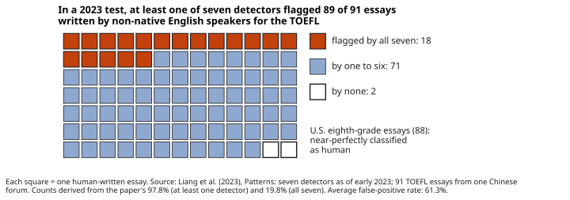{#fig-10-10 fig-alt="Grid of 91 squares: 18 flagged by all seven detectors, 71 by one to six, 2 by none; note: U.S. eighth-grade essays near-perfectly classified."}

Keep the limits in view: one test, seven detectors as they were in early 2023, essays from one source. Later studies with other detectors and writers report different results (for example, Jiang, Hao, Fauss & Li, 2024). Still, OpenAI withdrew its own classifier in July 2023, citing low accuracy (reported: OpenAI, 2023), and a 2023 test of 14 detection tools judged none reliable (Weber-Wulff et al., 2023). A score alone is weak evidence of who wrote a text. That does not make detectors random, and it is never a reason to rewrite your work with AI to avoid a flag (Deep 10.A explains why that proves nothing).

**Process evidence is stronger.** **Process evidence** is the record of how you wrote: notes, earlier drafts, your document's version history, your revision trace, your declaration, and your ability to explain your choices. Keep it for every important piece of writing: not as a defense, but as the honest record of your work.

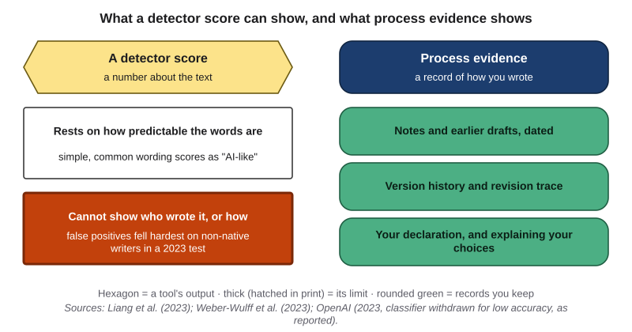{#fig-10-11 fig-alt="Two columns: a detector score rests on word predictability and cannot show who wrote a text; notes, drafts, history and trace show the process."}

::: {.callout-note title="Worked Example: Elif's Habit"}
*Featuring Elif.* For her psychology essay on sleep and memory (Chapter 9), she sets up four habits on day one: (1) her Turkish notes go into her bilingual vocabulary notebook, dated; (2) she drafts with version history turned on; (3) after each session she adds two lines to a revision trace: what she wrote, and what a tool translated or corrected; (4) her declaration lists the translation and the grammar check. Nothing has happened, and nothing needs to: this is how she works now, and it shows her own progress too.
:::

::: {.callout-note title="Faded Example: An Unexpected Score"}
*A one-off student.* A multilingual student's essay gets a high "AI" score, and the instructor asks to talk. **Step 1:** ask which tool produced the score and what the course policy says about detector results. **Step 2:** _______ **Step 3:** _______ **Step 4:** _______
:::

Your Turn for this section is part of A7: your reflection names the process evidence you kept.

::: {.callout-tip title="Check Yourself 10.6"}
1. What is a false positive for an AI-text detector?
2. In the 2023 study, what share of the TOEFL essays was flagged by at least one detector, and why is that result limited?
3. Name three kinds of process evidence.
:::

## 10.7 Disclosure at Work, and Who Answers for the Message {#sec-10-7 .unnumbered}

[Core]{.path}

In this course the AI Use Declaration is the rule (Chapter 1); at work there is often no single form. **Disclosure (of AI use)** means telling the people who rely on a message how AI was involved in making it, in a form and place they will see. Three questions decide it:

1. **Does a rule require it?** Your course, employer, a client's contract or your profession may. The Associated Press, for example, set standards in 2023 under which staff may experiment with generative AI but do not use it to create publishable content, treat its output as unvetted source material, and stay accountable for accuracy (Barrett, 2023).
2. **Do these readers expect your own words?** (Section 10.1.)
3. **Would a reasonable reader feel misled on learning about it later?**

If any answer is yes, disclose: a line at the end of the message, a note to your manager, a project-log entry, the course declaration, or a citation when you quote AI output (Chapter 9).

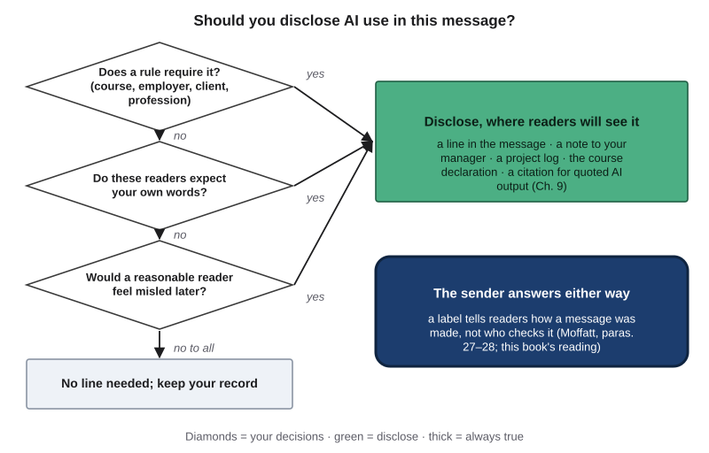{#fig-10-12 fig-alt="Three decision diamonds: a rule? readers expect your words? misled later? lead to forms of disclosure; a banner says the sender answers either way."}

**What disclosure does not do.** It does not make a delegation acceptable: the Peabody message disclosed its AI help and still missed the review it needed. And it does not move responsibility. In Chapter 4's case, an airline argued that it could not be held liable for information given by its website chatbot. The tribunal, a body that decides small disputes, answered that the airline is responsible for all the information on its website, whether from a static page or a chatbot (*Moffatt v. Air Canada*, 2024, para. 27), and saw no reason a customer should know that one part of the site was accurate and another was not (para. 28). The record shows no AI label, and the decision does not describe the chatbot's technology. This book's reading, which is inferred: a label would not have changed the answer. A label tells readers how a message was made; it does not hand them the job of checking it. An email drafted with AI and sent under your name is your email. Laws that require AI labels in some settings are Chapter 18's topic.

::: {.callout-note title="Worked Example: Three Messages at Work"}
| Message | Decision | Disclosure |
|---|---|---|
| Meeting summary drafted by a tool from the notes | Team policy asks for a note; accuracy first | "Draft summary produced with an AI tool from the meeting notes; checked by [name]." The checker confirms every decision and name |
| A reply template for customers | Customers rely on it; the company answers for every reply | Disclosed to the manager, who reviews and approves it before use |
| A reference letter for a former intern | The reader expects the writer's own judgment | Own words; a grammar check only, listed if asked |
:::

::: {.callout-note title="Faded Example: Two More"}
| Message | Decision | Disclosure |
|---|---|---|
| A teacher's newsletter to parents, drafted from her notes | School policy asks staff to note AI drafting; parents want accurate dates and warmth | "Drafted with help from an AI tool; checked by [teacher]." |
| A paragraph in a grant report to a foundation | _______ | _______ |
:::

::: {.callout-important title="Your Turn"}
Your A7 declaration includes your disclosure decision: answer the three questions for your document's reader.
:::

::: {.callout-tip title="Check Yourself 10.7"}
1. What are the three disclosure questions?
2. Name two things disclosure does not do.
3. What did the tribunal say in paragraphs 27 and 28, and which part of this section's conclusion is the book's inference?
:::

## 10.8 The Writing Studio (Lab 10.1 and A7) {#sec-10-8 .unnumbered}

[Studio]{.path}

*Studio sections are hands-on work. This one is Thursday's lab and the start of A7.*

A7 brings the chapter together in one record:

1. A **context card**: the document, its reader, its purpose and stakes, whether its reader expects your own words, and the spectrum position you are aiming for.
2. **v0**, your own notes or first draft, written before any AI use.
3. Your **prompts**, parts labeled, with at least one iteration.
4. **v1**, the AI-assisted draft, **annotated**: every sentence K, R or X with a tag.
5. A **fact check** of the three highest-stakes claims.
6. **v2**, your final version, and a **revision trace** of at least three changes.
7. A short **reflection**.
8. Your **declaration**, with the disclosure decision.

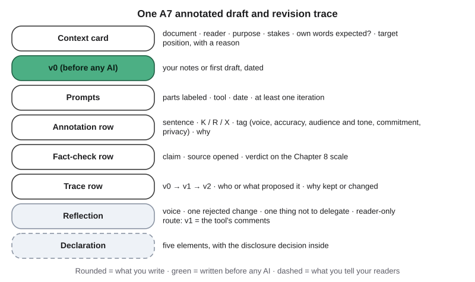{#fig-10-9 fig-alt="A7 sheet with an annotation row (sentence, code, tag, why), a trace row (v0, v1, v2, source, reason) and a fact-check row (claim, source, verdict)."}

Two results are valid and can earn full marks: "I used the tool only as a reader and kept my own draft," and "I rejected most of v1." The record is evidence of your judgment, not a count of AI use.

::: {.callout-note title="Worked Example: Two of Elif's Rows"}
*Featuring Elif.* **Annotation row:** sentence 4, "As a fluent SPSS user…" · X · *commitment* · "used it once in a course lab." **Trace row:** v0 (her note: "used SPSS in stats lab") → v1 ("fluent SPSS user") → v2 ("I have used SPSS in a statistics course and am learning more") · proposed by the tool, rejected by Elif · reason: the claim was not true.
:::

::: {.callout-note title="Faded Example: A Partly Filled Sheet"}
An annotation row filled in: "We are thrilled to announce…" · R · *audience and tone* · "too loud for a delay notice." **Complete the trace row for the same sentence (v0 → v1 → v2, who proposed it, why):** _______
:::

## Deep 10.A: How AI-Text Detectors Work, and Why a Score Is Weak Evidence {#sec-10-deep-a .unnumbered}

[Deep]{.path}

Most detectors score how predictable a text's words are to a language model. The measure behind many of them is **perplexity**: roughly, how surprised a model is by each next word. Low perplexity means the words are easy to predict; high perplexity means they are not. Generated text tends to have low perplexity, because models produce likely words (Chapter 3). So does writing with a smaller range of vocabulary and more common sentence patterns, which is how Liang et al. (2023) explain why the TOEFL essays were flagged.

Two of their follow-up tests make the point sharper. When they asked ChatGPT to "Enhance the word choices to sound more like that of a native speaker" in the TOEFL essays, the average false-positive rate fell from 61.3% to 11.6%. And when they asked it to rewrite AI-generated essays in more literary language, detection fell to near zero (Liang et al., 2023). Both results show that the score tracks word predictability, not who wrote the text. They are not advice. Rewriting your own work with AI to lower a score moves it toward position 5 on the spectrum, replaces your voice with the tool's, and proves nothing about authorship.

A second approach is a **watermark**: a provider can make its model favor certain tokens in a hidden statistical pattern that a matching tool can later test for (Kirchenbauer et al., 2023). A watermark works only for that provider's model, and researchers have shown that paraphrasing can weaken both watermarks and perplexity-based detectors (Sadasivan et al., 2023).

**Base rates.** Even a detector with a modest error rate can flag mostly human writers, if most writing is human. In the illustration below, the detection rates are the ones OpenAI reported for its own classifier: 26% of AI-written texts labeled "likely AI-written," and 9% of human texts mislabeled (reported: OpenAI, 2023). If 10% of 1,000 texts were AI-written, the detector would flag 26 of the 100 AI texts and 81 of the 900 human ones: 81 of 107 flags, about three in four, would point at a person. This is Chapter 2's precision problem in a new place.

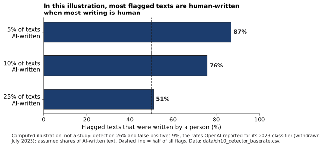{#fig-10-15 fig-alt="Bars for three assumed shares of AI-written text, 5%, 10% and 25%: human-written share of flagged texts falls from 87% to 76% to 51%."}

## Deep 10.B: AI-Mediated Communication {#sec-10-deep-b .unnumbered}

[Deep]{.path}

Researchers have a name for messages like the ones in this chapter. **AI-mediated communication** is communication between people in which software acts on behalf of one of them by changing, adding to or generating their message (Hancock, Naaman & Levy, 2020). Autocorrect, suggested replies, tone rewriters and drafting assistants all fit.

The field's early findings point in two directions. In two randomized experiments with a messaging app, suggested replies sped up conversations and made the language more positive, and partners rated each other as closer and more cooperative; yet people *suspected* of using suggested replies were judged more negatively (Hohenstein et al., 2023). Liu et al. (2022), from section 10.1, held the text constant: every email was human-written, and only the label changed. That design isolates what readers believe about the sender, which is the heart of the Peabody case.

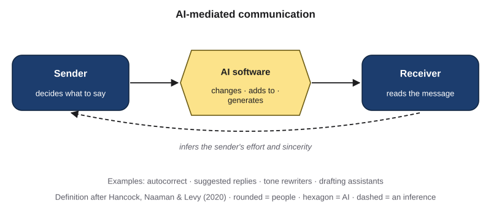{#fig-10-16 fig-alt="Sender, then AI that changes, adds to or generates the message, then receiver; a dashed arrow marks the receiver's inference about effort."}

What the field does not yet know: whether readers' penalties for AI help will fade as the tools become ordinary, how AI mediation changes relationships over months rather than minutes, and whether disclosure norms will settle by genre, as they did for ghostwritten speeches.

## Hands-on Labs {.unnumbered}

These labs are tool-neutral: they describe what to do, not which buttons to press. Compass, the book's optional, free and ungraded companion, lists current free tools [COMPASS: lab pages ch10-lab1 to ch10-lab3]. Never put personal or confidential information, yours or anyone else's, into a prompt: use placeholders or the university-provided tool. No lab asks you to use an AI detector.

### Lab 10.1: Writing Studio (Studio · 75 minutes · Thursday, in class) {.unnumbered}

*(O2, O3, O6 · LO2, LO4 · Evaluate)*

**Before Thursday (about 15 minutes):** choose your A7 document, fill in the context card, and write v0 before any AI use.

1. **Briefing (10 minutes).** The spectrum, the three codes and five tags, the funnel for facts, the privacy rule.
2. **Frame and draft (15 minutes, individual).** Write your prompt from v0 with Signature 6 parts labeled; produce v1 and one iteration. No-AI route: start from the provided dated draft or a person's suggested edits.
3. **Annotate (20 minutes, individual).** Code v1 sentence by sentence; list the claims to check.
4. **Optional pair read (10 minutes).** If you choose to, a partner reads v0 and v1 without your codes and marks two places where v1 "doesn't sound like you" or "promises something." If you prefer not to share your document, read the provided sample draft instead.
5. **Share and critique (15 minutes).** Each team shows one sentence rewritten back into its writer's voice and one disclosure decision.
6. **Exit (5 minutes).** One sentence you rejected, and its tag.

**If this doesn't work:** the provided dated drafts are on eLearning in print and screen-reader-friendly formats; codes are letters, never colors.

### Lab 10.2: One Message, Three Tones (Explore · 20 minutes · optional) {.unnumbered}

*(O2 · LO2 · Apply)* Write your own five points for a real message. Produce three versions in named tones, with any tool or by hand. Ask one person which tone they would want to receive, and why. Write one sentence on what you learned about your own tone. This mirrors Tuesday's demonstration.

### Lab 10.3: Voice Fingerprint (Check It · 20 minutes · optional) {.unnumbered}

*(O3 · LO4 · Analyze)* Take a paragraph you wrote before this course. Ask a tool to "improve" it. List every change, mark which you would keep, and name three features of your own writing that the new version removed or kept. "Almost nothing changed" is a valid result.

## Case Study: The Peabody Message, Revisited {.unnumbered}

**Tiers.** *Confirmed*: the email's own AI line and the dean's email, as reproduced or quoted in the reporting. *Reported*: the student newspaper's and CNN's accounts. *Inferred*: what readers expected, how much the office changed the output, and where the "shootings" error came from.

**What the AI did.** ChatGPT produced text that the office paraphrased; the email says so (confirmed). How much survived, no source says.

**What people did.** The office sent the message without the usual layers of review, and the dean and other administrators had not seen it (confirmed: the dean's email). Students and the newspaper reacted within a day; the office apologized; the dean opened a review; two deans stepped back and later returned (reported).

**Failure label.** On Chapter 4's chain, the failure sits at **link 2, "checked before use?"**: an office's message to a grieving community was handed to a tool and sent without the review that normally applies. Inappropriate delegation and the skipped review are **documented** by the dean's own statement. On the tree, the single wrong detail is a secondary label: **hallucination**, leaf "invented facts or sources," with the error documented and its AI origin **inferred** (dashed).

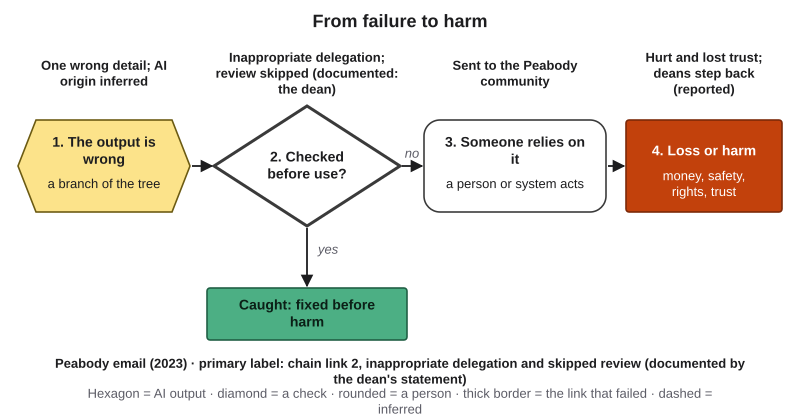{#fig-10-13 fig-alt="Failure-to-harm chain: output with one wrong detail; checked before use? failed: inappropriate delegation, review skipped; sent; lost trust."}

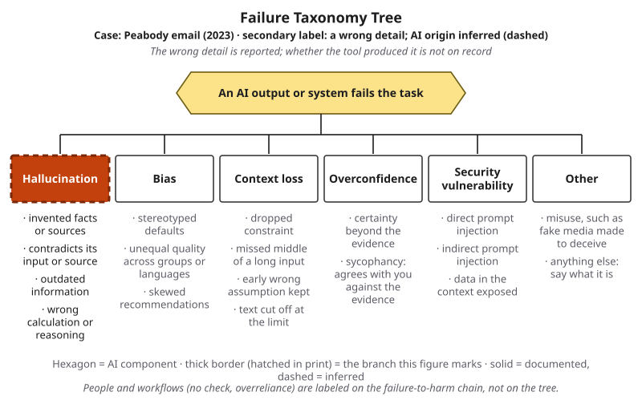{#fig-10-14 fig-alt="The Failure Taxonomy Tree with hallucination marked by a dashed thick border and the tag Peabody email (2023), secondary label, inferred."}

**A better workflow.** *Frame:* this is a message whose readers expect the office's own words. *Prompt:* at most, ask a tool for a checklist of what such messages usually include (support services, how to reach them). *Verify:* the facts (one shooting; the right campus services and hours). *Decide:* the normal review layers. *Disclose:* no line repairs a delegation the readers would reject.

**Callback: was Deloitte's disclosure enough?** Chapter 9's case ended with a question. After an outside reader reported fabricated references in a report Deloitte prepared for an Australian government department, a corrected version was released, and that version disclosed that a generative AI system had been used in its preparation (reported: Associated Press, 2025; DEWR, 2025b). This chapter's answer: a disclosure tells readers how a document was made. Arriving after the errors, inside a corrected version, it repaired nothing that checking each reference would have caught. Disclosure belongs at the start, next to the work that makes it honest, not in place of that work.

## Ethics Lens: Who Pays, and Who Should Change the Incentive? {.unnumbered}

**Who pays for suspicion?** If detector scores decide misconduct cases, the cost of false positives falls on the writers detectors flag most, who in the 2023 study were second-language writers (Liang et al., 2023). The burden of proving authorship then lands on the student. A fair policy rests on process evidence and a conversation, not a score alone.

**What do readers deserve?** Some messages are about the relationship, not the information. Readers of a message after a death deserve to know that a person thought about them.

**The incentive to hide.** In a 2024 survey of 31,000 people in 31 countries, run by Microsoft and LinkedIn, 52% of people who used AI at work said they were reluctant to admit using it for their most important tasks (Microsoft & LinkedIn, 2024); the survey comes from a company that sells AI tools. In 13 experiments, people who disclosed their AI use were trusted less than people who did not (Schilke & Reimann, 2025). The authors also reported that being found out by others was worse for trust than disclosing, and that it is unknown whether the penalty will fade as AI becomes ordinary.

**Whose voice becomes the default?** If AI suggestions pull writing toward Western styles (Agarwal et al., 2025), a tool that helps one group sound "professional" may ask another to sound like someone else.

**Discuss:** If honest people pay a trust penalty for disclosing AI use, who should change that incentive: individuals, managers, organizations, or the people who write policies? What would each have to do?

## Career Connection {.unnumbered}

- **Communications and public-relations specialists** draft statements that leaders sign and run the review layers that the Peabody message skipped. Knowing when a message needs a person's own words is part of the job.
- **Recruiters and human-resources coordinators** read cover letters that may be AI-assisted. A strong reader looks for specifics a tool could not supply.
- **Customer-support leads** approve reply templates and chatbot answers, and answer for them (section 10.7).
- **Journalists and editors** work under newsroom standards for generative AI, such as the Associated Press's (Barrett, 2023).
- **Grant writers and technical writers** keep every claim checkable, because reviewers and users rely on it.
- **Health communicators** write patient letters from approved templates and keep patient information out of public tools (Chapter 15).

## From the Field {.unnumbered}

<!-- Based on the author's published encyclopedia entry (Şeker, 2016), translated and paraphrased from Turkish, within the facts of that entry; present-day connections are marked as such. D16 disclosure included because the present-day connection concerns AI tools for business communication (blueprint V12). The PDF's running header wrongly reads "İş Planı (Business Plan)"; the title page is cited. Editor to register in docs/production/ftf-sources.md. -->

In 2016 I wrote a short encyclopedia entry on social customer relationship management (social CRM): the use of social networks for managing a company's relationships with its customers (Şeker, 2016). I started from a 1995 definition of CRM, attributed to the research firm Gartner, as a customer-focused business strategy, and asked what social networks change.

The main change, I argued, is that communication stops being one-way. Television broadcast a brand's message; social networks turn it into a dialogue. The entry described *brand talk*, the way a brand speaks to its customers, and *brand language*, the effort to tie certain words to a brand in customers' minds. On social networks, customers do not only receive these messages: they interpret them, change them and pass them on, and a slogan can be turned against its brand and shared by millions within seconds. Everything posted socially is open to the whole world, so the way both company accounts and employees' personal accounts are used affects the brand; one wrong comment can be very costly, and many firms had begun to add clauses about social media to their employment contracts. Companies were hiring people to manage their social accounts from one center, under principles that had already been worked out: aim to solve people's problems rather than to advertise; stay close and relevant to the audience (my example was a university whose social accounts are answered by its students); and keep messages short and clear, because nobody reads pages of reply on a social network.

*A present-day connection, which is this book's and not the 2016 entry's:* an organization's voice was designed, centralized and reviewed long before generative AI. AI-drafted replies now enter that same system. The entry's principles work as keep-or-rewrite questions for any sentence a tool drafts: does it solve the reader's problem? Is it short and clear? Could it be screenshotted and shared? And the review the entry takes for granted is exactly what the Peabody message skipped.

*Disclosure:* I am a founder of OptiWisdom, which develops software for businesses, including AI tools.

## Chapter Summary {.unnumbered}

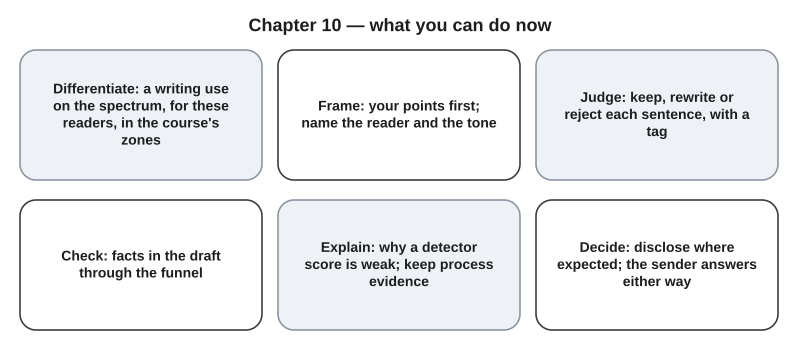{#fig-10-18 fig-alt="Six cards: place a use on the spectrum, write first, judge each sentence, check facts, keep process evidence, decide disclosure; the sender answers."}

**The chapter's question:** *Can a message still be yours if an AI tool helped write it?* Yes, when you decided what it says, you can explain and stand behind every sentence, the help is the kind its readers would accept, and you disclose where your course, employer or profession expects it. It stops being yours when the tool decides what the message says, especially in a message whose readers expect your own words. Either way, a disclosure line does not change who answers for the message: the sender does.

**Return to the Opening Case.** Why did a fluent, disclosed message fail? Its readers expected the office's own words (inferred), it sat near the far end of the spectrum (inferred), nobody checked its sentences (one wrong detail reached every reader), and the review that normally applies was skipped (documented). The disclosure line was honest. It was not enough.

**Revisit your Warm-up.** (1) Does the note make the message acceptable? *No: disclosure is necessary where it is expected, and never sufficient on its own (sections 10.2, 10.7).* (2) Can "fix the grammar" change what you say? *Light edits often change little, but studies of writing suggestions found shifts in style and stance; compare before and after (section 10.4).* (3) Can a detector reliably tell who wrote a text? *Not reliably enough to decide a case on its own; in a 2023 test, detectors flagged most essays by non-native writers (section 10.6).* Compare these with your confidence ratings.

You can now:

- **Classify** a writing use on the spectrum and in the course's zones.
- **Frame** a writing task with your own points first.
- **Judge** a draft sentence by sentence, checking its facts.
- **Explain** why a detector score is weak evidence, and keep process evidence instead.
- **Decide** whether and how to disclose, knowing the sender answers either way.
- **Produce** an annotated draft and revision trace.

### Key Terms {.unnumbered}

AI-mediated communication (Deep) · AI-text detector · annotated draft · disclosure (of AI use) · false positive · ghostwriter · homogenization · ownership (of a text) · perplexity (Deep) · process evidence · revision trace · tone · voice · voice and ownership spectrum · watermark (Deep) · write first

## End-of-Chapter Package {.unnumbered}

<!-- Each item: objective · LO · revised Bloom level. Odd-numbered answers → appendix/answers.md (Appendix E, via docs/production/handoff/ch10.md); even-numbered → private/ch10-answers-even.md. Review A distractors draw on M1–M6; keys rotated across (a)–(d). -->

### Review Questions A: Terms and Concepts {.unnumbered}

1. *(O1 · LO4 · Understand)* Which describes "voice" as this chapter uses it?\
   (a) The role you give an AI tool in a prompt, such as "write as a peer mentor."\
   (b) Correct grammar and a formal vocabulary.\
   (c) The impression of a writer that a reader forms from the writer's choices of words, sentence shapes, stance and content.\
   (d) Whatever a tool produces when you ask it to "write like me."
2. *(O1 · LO4 · Understand)* Define ownership of a text as this chapter uses it, and say how it differs from legal authorship.
3. *(O1 · LO4 · Apply)* A student asks a tool for grammar and spelling corrections only on a cover letter she wrote, and accepts three of them. Where does this sit, and what does the course expect?\
   (a) Position 3, grammar only: permitted; list it briefly in the declaration.\
   (b) Position 5: outsourcing, because a tool changed her text.\
   (c) Position 1: no AI was really involved, so she should not mention it.\
   (d) Position 4: not acceptable in any course.
4. *(O1 · LO4 · Analyze)* Why can the same use, AI as co-drafter, be outsourcing in one assignment and acceptable in another?
5. *(O2 · LO2 · Understand)* In a writing prompt, which part holds the reader and your own points?\
   (a) Role.\
   (b) Output format.\
   (c) Constraints.\
   (d) Context.
6. *(O2 · LO2 · Understand)* What is "write first," and how does it protect your voice?
7. *(O3 · LO4 · Understand)* A friend says, "I only asked it to polish my English, so the meaning is exactly the same." Which reply fits this chapter best?\
   (a) Right: polishing tools change spelling and grammar, never meaning.\
   (b) Compare before and after: studies of writing suggestions found shifts in style and stance, so check that each change says what you mean.\
   (c) Polishing your English with any tool is outsourcing in every course.\
   (d) Run the polished version through a detector to see whether it is still yours.
8. *(O3 · LO4 · Apply)* Code this sentence K, R or X with a tag: "As a fluent SPSS user, I can start running analyses on day one," when you have used SPSS once.
9. *(O4 · LO4 · Understand)* What does the 2023 detector study (Liang et al.) show?\
   (a) Detectors flagged essays by non-native English writers as AI-generated often enough that, at least for those detectors, a score alone is weak evidence of authorship.\
   (b) Detectors can identify who wrote any text, which is why the TOEFL essays were flagged.\
   (c) Non-native English writers use AI more often than native speakers.\
   (d) Detectors are random and give the same results as flipping a coin.
10. *(O4 · LO4 · Understand)* Define a false positive for an AI-text detector, and name two kinds of process evidence.
11. *(O5 · LO4 · Evaluate)* A company adds "This reply was generated by AI" under its website chatbot's answers. What follows, in this chapter's reading?\
    (a) Customers now carry the job of checking every answer against the policy pages.\
    (b) The company still answers for what its chatbot says; the label tells readers how answers are made.\
    (c) A wrong answer is acceptable, because the company was honest about the tool.\
    (d) The chatbot's vendor, not the company, becomes responsible for wrong answers.
12. *(O5 · LO4 · Understand)* List the three questions that decide whether to disclose AI use in a professional message.

### Review Questions B: Case Questions {.unnumbered}

1. *(O1 · LO4 · Analyze)* An art student writes notes for an artist statement for a gallery application, asks a tool to draft the statement from them, and rewrites half of it. Place this use on the spectrum and in the zones. What would change if the same statement were the graded reflection in her studio course?
2. *(O2 · LO2 · Apply)* A hospital's volunteer coordinator must tell volunteers about a schedule change (no patient information is involved). Write her points first, then a prompt with role, task, context, constraints and output format labeled.
3. *(O3 · LO4 · Evaluate)* A six-sentence AI draft of a student club's event announcement is on eLearning. Code every sentence K, R or X with a tag, and name the claim you would check first and where.
4. *(O4 · LO4 · Evaluate)* A teaching assistant sees a detector score of 85% "AI" on an essay by a multilingual student. What should the assistant do, and what should they not do? Use section 10.6.
5. *(O5 · LO4 · Evaluate)* A small bakery uses an AI tool to draft replies to online reviews. Decide on disclosure, on who reviews the replies before they are posted, and on what the owner answers for.

### Review Questions C: Interpretive Questions {.unnumbered}

1. *(O1, O5 · LO4 · Evaluate)* "A message drafted by AI and honestly disclosed is as good as one written by hand." Take a position, using the Opening Case and section 10.1.
2. *(O4 · LO4 · Evaluate)* Should universities be allowed to act on AI-detector scores? Take a position, and say what evidence a fair process would require.
3. *(O5 · LO4 · Evaluate)* Should employers require disclosure of AI-drafted internal messages, such as meeting summaries? Take a position, using the three disclosure questions and the Ethics Lens.

### Spaced Review {.unnumbered}

Come back to these a few days after reading, without looking back. They connect this chapter to Chapters 9 and 8.

1. *(Chapter 9 · LO3 · Apply)* A tool's rewrite of your paragraph turned "students in one study" into "people." Name the drift type, and write the corrected phrase.
2. *(Chapter 9 · LO4 · Apply)* You quote one sentence of AI output in a report. What goes in the reference list, and what does this chapter add about disclosure in the text?
3. *(Chapter 8 · LO3 · Apply)* A draft says the tutoring center opens at 9 a.m.; the center's official page says 10 a.m. What is the verdict, and which stage gave it?
4. *(Chapter 8 · LO3 · Evaluate)* How far would you check a date in a thank-you note, and how far in a refund email? Use the stopping rule.

### Discussion Questions {.unnumbered}

1. *(Ethics · O4 · LO4 · Evaluate)* Who should carry the burden of proof when a detector flags a student's work, and why?
2. *(Career · O5 · LO4 · Analyze)* In the job you want, which messages would readers expect in your own words, and which would they accept from a template or a tool?
3. *(Interdisciplinary · O1 · LO4 · Analyze)* How do expectations about who wrote a text differ in journalism, law, science and the arts?
4. *(Society · O3 · LO4 · Evaluate)* If many people's writing moves toward the same phrasing, what is lost, and does it matter?
5. *(Learning · O6 · LO4 · Evaluate)* After A7, what part of your own writing will you never hand to a tool, and why?

### Application Assignment: A7 Annotated Draft and Revision Trace {.unnumbered}

**Due:** Monday, March 8, 2027, 11:59 p.m., on eLearning. *(O6 · LO2, LO4 · Create)* You start it in Thursday's lab (section 10.8). Expect about 15 minutes before the lab and about 45 minutes after it.

**What to submit:**

1. **Context card:** a real professional document of 150–350 words that you will send or could send (an email to a professor or employer, a cover letter, a short memo, a professional profile summary, a club or volunteer announcement); its reader, purpose and stakes; whether its reader expects your own words; and the spectrum position you are aiming for.
2. **v0:** your own notes or first draft, written before any AI use (at least 80 words or 6 bullet points), with the date.
3. **Prompts:** every prompt you used, with its parts labeled, the tool, the model if shown, the date, and at least one iteration (for example, a second tone).
4. **Annotated v1:** every sentence of the AI-assisted draft coded K, R or X, each with a reason tag (voice, accuracy, audience and tone, commitment, privacy) and a few words of explanation.
5. **Fact check:** the three highest-stakes factual claims in v1 (names, dates, numbers, policies, quotations), each taken through the Verification Funnel to a verdict, with the source you opened. If v1 has fewer than three, check all of them and say so.
6. **v2 and revision trace:** your final document and a table of at least three changes from v0 to v1 to v2 (what changed, who or what proposed it, why you kept or changed it).
7. **Reflection (100–150 words):** where your voice is in v2, one change you rejected and why, one part of this kind of document you would not delegate, and what process evidence you kept.
8. **AI Use Declaration:** tools, purpose, what you accepted, rejected or revised, how you verified it, and where your own judgment shaped the work. **Inside it, your disclosure decision:** answer the three questions for this document's reader, and write the line you would use, or explain why none is needed for this reader. If your document quotes AI output, cite it as Chapter 9 shows.

**Privacy:** no personal or confidential information, yours or anyone else's, in a public tool. Use placeholders ([PHONE], [ADDRESS], [NAME]) and fill them in yourself, or use the university-provided tool. You may write v0 in any language; v2 is in the language its reader needs, with an English gloss if that is not English. A document you mostly kept in your own words, with AI only as a reader, and a v1 you mostly rejected are valid results and can earn full marks.

**Rubric (10 points)**

| Criterion (points) | Exemplary | Proficient | Developing | Beginning |
|---|---|---|---|---|
| **Task (3)** | 3: a real document of 150–350 words; context card complete (reader, purpose, stakes, reader expectation, target position with a reason); v0 written before AI and dated; v2 fits its reader and purpose | 2: all parts present; one is weak (for example, a target position without a reason, or v2 drops a point from v0 without explanation) | 1: one required part missing (context card, v0 or v2) | 0: two or more required parts missing |
| **Annotated draft (1.5)** | 1.5: every sentence coded K, R or X with a fitting tag and explanation | 1: every sentence coded and tagged; two or three explanations missing or not fitting | 0.5: at least half of the sentences coded, or codes without tags | 0: fewer than half of the sentences coded, or no annotation |
| **Prompts and revision trace (1.5)** | 1.5: all prompts with parts labeled, tool and date, at least one iteration; trace of at least three changes, each with who proposed it and why | 1: prompts and trace present; the iteration or one reason missing | 0.5: prompts without labels or without tool and date, or a trace of fewer than three changes | 0: no prompts, or no trace |
| **Verification (2)** | 2: three highest-stakes claims (or all, if fewer) taken to accurate verdicts with the source opened; v2 reflects them | 1.5: all required claims checked; one verdict inaccurate or one source not named | 1: some required claims unchecked, or verdicts without sources | 0: no fact check |
| **Declaration and judgment (2)** | 2: all five declaration elements; the disclosure decision answers the three questions with a fitting line or reason; reflection covers voice, a rejected change, one part not to delegate and the process evidence kept | 1.5: all five elements; the disclosure decision or the reflection misses one part | 1: two to four declaration elements, or the disclosure decision missing, or no reflection | 0: zero or one declaration element |

**Alternative assignment** (for students who prefer not to use AI tools, or cannot access one). Use the same brief with one change: v1 is either (a) the **provided dated AI draft** on eLearning for your document type (with its model name, date and prompt), adapted to your situation, or (b) **suggested edits from a person**, such as a writing-center tutor or a classmate, on your v0, with their consent. Same rubric, read this way:

- **Task:** unchanged.
- **Annotated draft:** the provided draft or the suggested edits, coded K, R or X with tags.
- **Prompts and revision trace:** for route (a), the provided draft's prompt with its parts labeled, plus one prompt you would have written (not run); for route (b), the request you made to the person. The trace is unchanged.
- **Verification** and **Declaration and judgment:** unchanged (the declaration states "no AI tools used" if so).

### Mini-Project (optional): A Voice Journal {.unnumbered}

*(O1, O3 · LO4 · Analyze)* For three weeks, choose one message a week that you write with any help. Place it on the spectrum, keep its revision trace, and write two sentences on what you kept of your voice. At the end, write half a page on what changed. The journal can become a piece of your term portfolio (Chapter 20).

### Case Study Questions {.unnumbered}

1. *(O5 · LO4 · Understand)* The email's last line was written like a citation of a personal communication. What job does a citation do, and what job did this message need done?
2. *(O1 · LO4 · Analyze)* Which facts in the case are confirmed, which reported and which inferred? Give one of each.
3. *(O3 · LO4 · Analyze)* Why is the main label on the chain and not the tree? Why is the tree label only secondary and inferred?
4. *(O1 · LO4 · Evaluate)* Communications offices often draft messages that leaders sign. What made this message different, in this book's reading?
5. *(O5 · LO4 · Evaluate)* Write the better workflow for one message your own organization or club sends, step by step on the AI Work Loop.

### Midterm Bridge: Chapters 1 to 9 {.unnumbered}

The midterm on Thursday, March 11, covers the Core sections of Chapters 1 to 10, in three parts: terms and concepts, a case, and interpretive questions. Chapters 8 and 9 appeared in this chapter's Spaced Review. The items below go further back, where spacing pays most. Answer without notes, then check: odd answers are in Appendix E; your instructor reviews the rest in Tuesday's session.

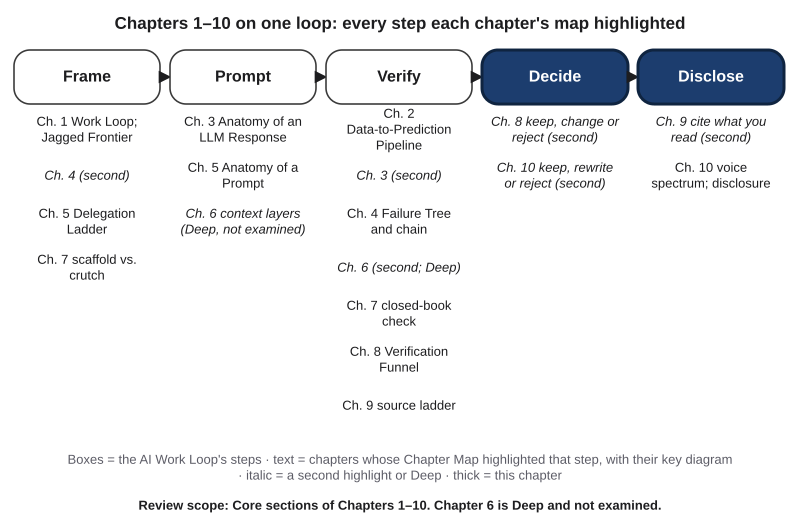{#fig-10-17 fig-alt="AI Work Loop with five steps; under each, the chapters whose maps highlighted it and their key diagrams; Chapter 6 marked Deep, not examined."}

| Work Loop step | Chapters whose map highlighted it (key diagram) |
|---|---|
| Frame | 1 (AI Work Loop; Jagged Frontier) · 5 (Delegation Ladder) · 7 (scaffold versus crutch) |
| Prompt | 3 (Anatomy of an LLM Response) · 5 (Anatomy of a Prompt) · 6 (context layers; Deep, not examined) |
| Verify | 2 (Data-to-Prediction Pipeline) · 4 (Failure Taxonomy Tree and chain) · 7 · 8 (Verification Funnel) · 9 (source ladder) |
| Decide | 10 (keep, rewrite or reject) |
| Disclose | 10 (voice and ownership spectrum; disclosure decision) · 9 (cite what you read, second) |

**Bridge A: Terms and concepts**

MB1. *(Chapter 1 · LO4 · Understand)* Which is assistance rather than outsourcing?\
(a) Pasting a tool's correct answer into your homework as your own work.\
(b) Submitting a reflection a tool wrote, after checking it for errors.\
(c) Copying a tool's summary of a reading into your notes without reading the original.\
(d) Asking a tool to explain a concept, then using it in your own words in your work.\
*Missed it? Reread section 1.5.*

MB2. *(Chapter 2 · LO1 · Understand)* What is the difference between a shortcut and a proxy, and why does testing in new conditions reveal one but not the other? *Missed it? Reread sections 2.4–2.5.*

MB3. *(Chapter 3 · LO1 · Understand)* Why can the same prompt give two different answers?\
(a) The model searches a different database each time.\
(b) The model picks each next token by sampling from its scores, so different tokens can be chosen.\
(c) The model learns from your previous chat and changes its settings.\
(d) A different answer means the tool has an error.\
*Missed it? Reread section 3.2.*

MB4. *(Chapter 5 · LO2 · Understand)* Which part of a prompt is the one you always need?\
(a) Role.\
(b) In-context examples.\
(c) Task.\
(d) Output format.\
*Missed it? Reread section 5.3.*

**Bridge B: Case questions**

MB5. *(Chapter 1 · LO4 · Apply)* A nursing student uses AI to summarize three research articles for a literature review, checks every summary against its article, and lists this in her declaration. Which zone is this, and what would move it to "not acceptable"? *Missed it? Reread section 1.5.*

MB6. *(Chapter 4 · LO1 · Analyze)* A store's staff send a customer an AI-drafted email that gives the wrong return deadline; nobody read it before it went out. Label the failure on the tree and on the chain, and say which labels are documented and which inferred, if all you have is the email and the store's statement that "nobody reviewed it." *Missed it? Reread sections 4.1 and 4.7.*

**Bridge C: Interpretive questions**

MB7. *(Chapter 7 · LO4 · Evaluate)* "If the AI explanation is correct, it does not matter whether I tried the problem first." Agree or disagree, using scaffold and crutch. *Missed it? Reread section 7.4.*

MB8. *(Chapter 5 · LO2 · Evaluate)* "A higher rung on the Delegation Ladder is a more advanced, and therefore better, use of AI." Agree or disagree. *Missed it? Reread section 5.2.*

## Further Reading and Compass Links {.unnumbered}

- *Moffatt v. Air Canada* (2024), paragraphs 24 to 32: the tribunal's full reasoning on negligent misrepresentation (R7, beyond the guide).
- Noy and Zhang (2023a), the full article: the design of the writing experiment (R8, beyond the guide).
- Liang et al. (2023), open access: the detector study, short and readable.
- Liu et al. (2022): how readers judge AI-mediated emails, with the participants' own words.
- Matsuda (2001): voice in a second language, from a researcher of second-language writing.
- Hancock, Naaman and Levy (2020): the definition and research agenda of AI-mediated communication.
- [COMPASS: spectrum placement drill (@fig-10-3); keep/rewrite/reject drill on a provided draft; Chapter 10 quiz; Midterm Bridge with feedback; Lab 10.1–10.3 pages]

## References {.unnumbered}

Agarwal, D., Naaman, M., & Vashistha, A. (2025). AI suggestions homogenize writing toward Western styles and diminish cultural nuances. In *Proceedings of the 2025 CHI Conference on Human Factors in Computing Systems*. Association for Computing Machinery. https://doi.org/10.1145/3706598.3713564

Associated Press. (2025, October 7). *Deloitte to partially refund Australian government for report with apparent AI-generated errors*. News4JAX. https://www.news4jax.com/business/2025/10/07/deloitte-to-partially-refund-australian-government-for-report-with-apparent-ai-generated-errors/

Barrett, A. (2023, August 16). *Standards around generative AI*. Associated Press. [VERIFY URL]

Department of Employment and Workplace Relations. (2025b, October 3). *Secretary statement on progress under the Targeted Compliance Framework Integrity Assurance program*. Australian Government. https://www.dewr.gov.au/assuring-integrity-targeted-compliance-framework/announcements/statement-secretary-progress-under-targeted-compliance-framework-integrity-assurance-program

Doshi, A. R., & Hauser, O. P. (2024). Generative AI enhances individual creativity but reduces the collective diversity of novel content. *Science Advances, 10*(28), eadn5290. https://doi.org/10.1126/sciadv.adn5290

Hancock, J. T., Naaman, M., & Levy, K. (2020). AI-mediated communication: Definition, research agenda, and ethical considerations. *Journal of Computer-Mediated Communication, 25*(1), 89–100. https://doi.org/10.1093/jcmc/zmz022

Hohenstein, J., Kizilcec, R. F., DiFranzo, D., Aghajari, Z., Mieczkowski, H., Levy, K., Naaman, M., Hancock, J., & Jung, M. F. (2023). Artificial intelligence in communication impacts language and social relationships. *Scientific Reports, 13*, 5487. https://doi.org/10.1038/s41598-023-30938-9

Jakesch, M., Bhat, A., Buschek, D., Zalmanson, L., & Naaman, M. (2023). Co-writing with opinionated language models affects users' views. In *Proceedings of the 2023 CHI Conference on Human Factors in Computing Systems*. Association for Computing Machinery. https://doi.org/10.1145/3544548.3581196

Jiang, Y., Hao, J., Fauss, M., & Li, C. (2024). Detecting ChatGPT-generated essays in a large-scale writing assessment: Is there a bias against non-native English speakers? *Computers & Education*, 105070. [VERIFY volume and findings]

Kirchenbauer, J., Geiping, J., Wen, Y., Katz, J., Miers, I., & Goldstein, T. (2023). A watermark for large language models. In *Proceedings of the 40th International Conference on Machine Learning* (PMLR 202). [VERIFY pages]

Korn, J. (2023, February 22). *Vanderbilt University apologizes for using ChatGPT to write mass-shooting email*. CNN (via KTVZ). https://ktvz.com/lifestyle/technology/cnn-social-media-technology/2023/02/22/vanderbilt-university-apologizes-for-using-chatgpt-to-write-mass-shooting-email/

Kruger, J., Epley, N., Parker, J., & Ng, Z.-W. (2005). Egocentrism over e-mail: Can we communicate as well as we think? *Journal of Personality and Social Psychology, 89*(6), 925–936. https://doi.org/10.1037/0022-3514.89.6.925 [VERIFY DOI]

Lele, A. (2023, February 19). *Peabody EDI deans to temporarily step back following ChatGPT-crafted message about MSU shooting*. The Vanderbilt Hustler. https://vanderbilthustler.com/2023/02/19/peabody-edi-deans-to-temporarily-step-back-following-chatgpt-crafted-message-about-msu-shooting

Lele, A., & Faquih, D. (2023, April 12). *Peabody EDI deans Nicole Joseph, Hasina Mohyuddin reinstated after utilizing ChatGPT to write an email about MSU shooting*. The Vanderbilt Hustler. https://vanderbilthustler.com/2023/04/12/peabody-edi-deans-nicole-joseph-hasina-mohyuddin-reinstated-after-utilizing-chatgpt-to-write-an-email-about-msu-shooting/

Liang, W., Yuksekgonul, M., Mao, Y., Wu, E., & Zou, J. (2023). GPT detectors are biased against non-native English writers. *Patterns, 4*(7), Article 100779. https://doi.org/10.1016/j.patter.2023.100779

Liu, Y., Mittal, A., Yang, D., & Bruckman, A. (2022). Will AI console me when I lose my pet? Understanding perceptions of AI-mediated email writing. In *CHI Conference on Human Factors in Computing Systems (CHI '22)*. Association for Computing Machinery. https://doi.org/10.1145/3491102.3517731

Matsuda, P. K. (2001). Voice in Japanese written discourse: Implications for second language writing. *Journal of Second Language Writing, 10*(1–2), 35–53. https://doi.org/10.1016/S1060-3743(00)00036-9 [VERIFY DOI]

Microsoft & LinkedIn. (2024). *2024 Work Trend Index annual report: AI at work is here. Now comes the hard part*. Microsoft. [VERIFY title and URL]

*Moffatt v. Air Canada*, 2024 BCCRT 149 (Civil Resolution Tribunal of British Columbia, February 14, 2024). https://decisions.civilresolutionbc.ca/crt/crtd/en/525448/1/document.do

Noy, S., & Zhang, W. (2023a). Experimental evidence on the productivity effects of generative artificial intelligence. *Science, 381*(6654), 187–192. https://doi.org/10.1126/science.adh2586

Noy, S., & Zhang, W. (2023b, March 10). *Experimental evidence on the productivity effects of generative artificial intelligence* [Working paper, not peer reviewed]. Massachusetts Institute of Technology. https://economics.mit.edu/sites/default/files/inline-files/Noy_Zhang_1_0.pdf

NPR. (2023, February 13). *3 students and a suspect are dead after Michigan State University shooting*. https://www.npr.org/2023/02/13/1156701701 [VERIFY title]

OpenAI. (2023, January 31; updated July 20, 2023). *New AI classifier for indicating AI-written text*. https://openai.com/index/new-ai-classifier-for-indicating-ai-written-text/ [VERIFY: page not accessible on 2026-10-18; figures as reported]

Perrotta, R. (2023, February 17; updated February 17 and 21). *Peabody EDI Office responds to MSU shooting with email written using ChatGPT*. The Vanderbilt Hustler. https://vanderbilthustler.com/2023/02/17/peabody-edi-office-responds-to-msu-shooting-with-email-written-using-chatgpt/

Sadasivan, V. S., Kumar, A., Balasubramanian, S., Wang, W., & Feizi, S. (2023). *Can AI-generated text be reliably detected?* arXiv. https://arxiv.org/abs/2303.11156 [VERIFY]

Schilke, O., & Reimann, M. (2025). The transparency dilemma: How AI disclosure erodes trust. *Organizational Behavior and Human Decision Processes, 188*, 104405. https://doi.org/10.1016/j.obhdp.2025.104405

Şeker, Ş. E. (2016). Sosyal müşteri ilişkileri yönetimi [Social customer relationship management]. *YBS Ansiklopedi, 3*(3), 38–40.

Weber-Wulff, D., Anohina-Naumeca, A., Bjelobaba, S., Foltýnek, T., Guerrero-Dib, J., Popoola, O., Šigut, P., & Waddington, L. (2023). Testing of detection tools for AI-generated text. *International Journal for Educational Integrity, 19*, Article 26. https://doi.org/10.1007/s40979-023-00146-z
