# Decision Support, Data Work and Hidden Assumptions {#sec-ch11}

<!-- Status: DRAFT v2 (2026-10-18): four independent reviews applied (docs/editorial/ch11-dev-memo.md) and a light Mode B voice pass. From blueprint v0.2 (approved under D19). Characters per docs/characters.md (Lucía featured, alone).
Case C08 facts in attribution tiers (confirmed = the article or the regulators' letter; reported = named outlet; inferred = the book's reading). Chapter 8 definitions reused word for word from chapters/08.
Numbers in text come from data/ch11_*.csv (constructed or simulated demos, figures/scripts/ch11_experiments.py; published values re-plotted with source lines) or the cited sources; fact-check log docs/factcheck/ch11.csv (resolution_v2). Not marked done: final review and the author's final voice edit are pending. -->

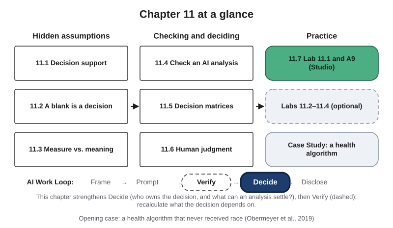{#fig-11-1 fig-alt="Chapter map: hidden assumptions (11.1–11.3), checking and deciding (11.4–11.6), practice (11.7, labs, case); Work Loop strip with Decide highlighted."}

**Chapter 11 at a glance.** This chapter opens Part III, Deciding and Building with AI. Part II was about what AI tools produce and how to check it. This chapter is about what happens next: someone uses an analysis, a score or a recommendation to make a decision. AI tools can now sort a spreadsheet, run an analysis and draft a decision matrix in seconds. Every one of those outputs rests on choices that someone made, often without saying so: what a blank cell means, what a number stands in for, how much each criterion counts. This chapter shows you how to find those hidden assumptions, how to check an AI-generated analysis, how to stress-test a decision matrix, and why a person who reviews an AI output can still follow it when it is wrong.

The chapter map shows the **AI Work Loop**, the book's five-step method for AI-assisted work: Frame, Prompt, Verify, Decide, Disclose (Chapter 1). This chapter strengthens Decide, and then Verify.

**Time:** about 32 minutes for sections 11.1 to 11.6, and about 44 minutes for everything this chapter asks you to read this week (the Opening Case, the Learning Objectives and Warm-up, sections 11.1 to 11.7 with their Check Yourself boxes, and the Summary), at 150 words per minute. It takes longer if English is not your first language. The Case Study is read together in Tuesday's class. Counted requirement by requirement, the week comes to about 2.0 hours outside class (about 2.1 if you choose your own scenario): this chapter (44 minutes), the A9 brief and rubric (8), the short Your Turn boxes and their answer checks (13), the pre-lab step (5; 10 if you choose your own scenario) and finishing A9 at home (about 50). Core sections are examinable; Studio sections are hands-on work; Deep sections are optional. If you read the recommended R9, add about 12 minutes; nothing in this chapter depends on it. Answers to Check Yourself, the faded examples and odd-numbered end-of-chapter questions are in Appendix E.

**The question of this chapter:** *Can an AI-assisted analysis make a decision for you?* The Chapter Summary answers it.

## Opening Case: A Health Algorithm Built Without Race {.unnumbered}

Many hospitals in the United States run **care management programs**: extra help for patients with complex health needs, such as a dedicated nurse, more appointments and closer follow-up. These programs are expensive, so health systems use software to choose who gets in. The software gives every patient a **risk score**, a number meant to show how much help that patient will need.

In October 2019, Ziad Obermeyer, Brian Powers, Christine Vogeli and Sendhil Mullainathan published a study of one such algorithm in *Science*. They did something outside researchers can rarely do: they compared its scores with the patients' actual health records (Obermeyer et al., 2019). The authors describe it as typical of a class of commercial tools that, by industry estimates, are applied to about 200 million people in the United States each year.

Their data came from a large academic hospital: all primary care patients in certain insurance contracts from 2013 to 2015, including 6,079 patients who identified as Black and 43,539 who identified as White. In that hospital, patients whose score was above the 97th **percentile** (higher than 97% of patients) were flagged for the program by the score alone. Patients above the 55th percentile were referred to their doctor, who was asked to consider **enrolling** them (signing them up). The authors call the algorithm a **screening tool**, a first sort that is not used for enrollment decisions in isolation: whether a flagged or referred patient was actually enrolled also depended on doctors and on rules about who was eligible.

The algorithm was never given anyone's race; it specifically excluded it. Yet at the same risk score, Black patients were considerably sicker than White patients. At the 97th percentile, Black patients had on average 4.8 **chronic conditions** (long-lasting illnesses such as diabetes or high blood pressure), against 3.8 for White patients: 26.3% more (Obermeyer et al., 2019). Among the patients the score flagged automatically, 17.7% were Black. In the authors' simulation, if the scores had reflected health equally for both groups, that share would have been 46.5%.

The algorithm was also good at its own job. It predicted next year's health-care costs well, and by that measure it looked accurate.

Notice how this account is built. Everything above comes from the published article, the primary record. Later in the chapter you will meet facts with a different status: what New York regulators wrote (confirmed in their own letter), what news outlets reported about the company behind the product (reported), and what happened to individual patients afterward (not on record, so anything said about it is inferred).

So here is the puzzle. **The algorithm never received anyone's race, and it predicted costs well. How could its scores treat Black patients unequally, and why did the doctors who reviewed patients after it not undo the gap?** Sections 11.3 and 11.6 answer it, and the Case Study returns to it.

## Learning Objectives {.unnumbered}

Framework tags refer to the UNESCO (United Nations Educational, Scientific and Cultural Organization) AI Competency Framework for Students and the AI Fluency framework.

After this chapter you will be able to:

- **O1 — Distinguish** an AI output that informs, recommends or triggers an action, and name for a given workflow who owns the decision. *(LO5 · AI Fluency: Delegation · UNESCO: human-centred mindset, Apply)*
- **O2 — Test** whether a hidden assumption in a dataset or an analysis (a blank, a definition or unit, a time window, a total that hides groups, a tool default) changes the result. *(LO3 · AI Fluency: Discernment · UNESCO: AI techniques and applications, Apply)*
- **O3 — Evaluate** whether a measure is a fit proxy for the outcome a decision should serve, including for whom the gap between them is larger. *(LO5, LO3 · AI Fluency: Discernment · UNESCO: ethics of AI, Apply)*
- **O4 — Verify** an AI-generated analysis by recalculating the numbers a decision depends on from the raw data, with verdicts and remaining uncertainty. *(LO3 · AI Fluency: Discernment, Diligence)*
- **O5 — Stress-test** a decision matrix by auditing its criteria, scales and blanks and running sensitivity checks on the top option and the shortlist. *(LO3, LO5 · AI Fluency: Diligence, Discernment)*
- **O6 — Design** a review step that makes disagreement with an AI output possible and recorded. *(LO5 · AI Fluency: Diligence · UNESCO: ethics of AI, Apply)*

::: {.callout-note title="Warm-up (ungraded)"}
Answer from what you know today. You will come back to these in the Chapter Summary.

1. A health algorithm is not given patients' race. Can its scores still treat racial groups unequally?
2. Two cells in a spreadsheet of 18 rows are blank. Can that change which option looks best?
3. A doctor reviews every patient an AI tool sends them. Does that make the tool's errors harmless?

For each answer, write how sure you are, from 0 to 100%.
:::

## 11.1 Decision Support, Not Decision Replacement {#sec-11-1 .unnumbered}

[Core]{.path}

At work, someone uses AI outputs: to approve a budget, shortlist candidates, pick a supplier, flag a patient. This book calls that **decision support**: AI output, such as a summary, an analysis, a score or a recommendation, that goes to a named person who decides and answers for the result. The **decision owner** is the named person or body who makes a decision and answers for its result.

Sometimes there is no person in between. An **automated decision** is a decision in which an AI output triggers an action with no person in between: a payment blocked, an email sent, a patient flagged. Someone still answers for it, but only afterward.

**One output, three roles.** The same kind of output can play three roles (@fig-11-3). It can **inform**: a person reads it as one piece of evidence among others. It can **recommend**: it proposes what to do, and a person decides whether to follow it. Or it can **trigger an action** with no person in between. A quick test: if the output proposes an action that a person then accepts or rejects, it recommends; if it is only one input to a person's own judgment, it informs. The Opening Case shows two roles in one system. Above the 97th percentile, the risk score alone flagged patients. Above the 55th, it only prompted a doctor to consider them.

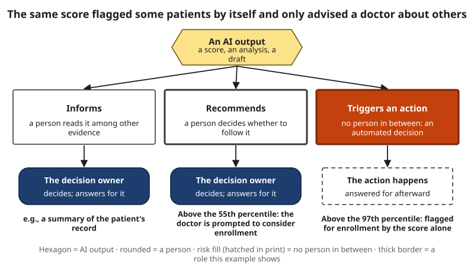{#fig-11-3 fig-alt="An AI output can inform or recommend, leading to a decision owner, or trigger an action with no person in between; the case's two thresholds marked."}

The role tells you where the checks go. If an output only informs, the owner's judgment is the check. If it triggers an action, the checks must happen before the system is switched on and in regular audits afterward, because no one looks at each case (Chapter 14).

**One privacy rule.** Never give a public AI tool personal or confidential data: other people's names, grades, health or pay. If you analyze your own data, use a university-provided tool such as Microsoft Copilot Chat (as of October 2026). Chapter 15 explains why.

::: {.callout-note title="Worked Example: Lucía Sorts a Reply"}
*Featuring Lucía (accounting), who is saving to sit for the CPA (Certified Public Accountant) exam.* *(Constructed example.)*

Lucía is the treasurer (she keeps the accounts) of the accounting students' association. The board must choose which of last year's fundraisers to repeat: a bake sale, a book swap or a car wash. Volunteers are scarce, so the question is which raised the most per volunteer hour. She gives a chat tool that can run code the association's shift log, which holds no personal data, and asks, "Which fundraiser should we repeat?"

She sorts the reply into three parts. **Information:** per-event totals of proceeds (money raised, after costs) and hours. **Recommendation:** "Repeat the book swap; it raised $24.22 per volunteer hour." **Decision:** not in the reply. It belongs to the board's vote. The owner is the board; Lucía is responsible for what she tells it.
:::

::: {.callout-note title="Faded Example: A Maintenance Score"}
*(Engineering.)* A plant's AI tool scores machines by how likely they are to fail this month. Above one threshold, a work order is created automatically. Below it, the tool lists the machines in order, and a supervisor decides which to service.

**Role above the threshold:** triggers an action (automated decision). **Role below it:** _______. **Who owns the decision in each case?** _______.
:::

::: {.callout-tip title="Check your answer" collapse="true"}
Below the threshold the list **recommends**: it proposes an order that the supervisor accepts or changes. The supervisor owns those decisions. Above it, the plant's managers who switched on the automatic work orders own the rule and answer for its results.
:::

::: {.callout-important title="Your Turn"}
Name one decision in your week where an AI output played a part. Did it inform, recommend or trigger an action? Who was the owner?
:::

::: {.callout-tip title="Check Yourself 11.1"}
1. What is the difference between decision support and an automated decision?
2. In the Opening Case, which role did the score play above the 97th percentile, and which above the 55th?
3. Why must the checks for an automated decision happen before it is switched on?
:::

## 11.2 A Blank Is a Decision {#sec-11-2 .unnumbered}

[Core]{.path}

Before you read on, make a prediction. Lucía's log has 18 shifts, six per event. Two of them have no volunteer hours recorded. Can two blank cells change which event looks best? Write your guess down.

A **hidden assumption** is a choice built into data or an analysis that can change the result but is not stated. Blank cells are the most common place to find one. A **missing value** is an empty cell or field where a value should be. It is not nothing: every way of handling it is an assumption about why it is missing.

- **Blank as zero.** If a formula divides total proceeds by total hours, a blank hour counts as zero hours while its proceeds still count. Spreadsheet functions such as SUM and AVERAGE leave empty cells out and normally show no message.
- **Listwise deletion:** deleting every row that has a missing value, so the analysis uses complete rows only. It assumes the deleted rows are like the rest.
- **Imputation:** filling a missing value with an estimate, such as the average (mean) of the other values, the average for the same group, or the value in the row above. Each fill assumes the missing value resembles the values it was estimated from.

**What our demonstration showed.** This book built a small log and computed the answer every way. The two blanks are the book swap's two longest shifts, 14 and 13 hours. Few people came late in those shifts, and the volunteers who stayed longest left without logging: the values are missing *because* they were long. The log is constructed, so we know the true hours.

| How the two blanks were handled | Book swap ($ per hour) | Car wash ($ per hour) | Best event |
|---|---|---|---|
| True hours (known only in this demonstration) | 19.61 | 22.50 | car wash |
| Blank as zero | 39.22 | 22.50 | book swap |
| Delete the rows with a blank | 24.22 | 22.50 | book swap |
| Fill with the mean of all logged shifts (8.8 hours) | 23.73 | 22.50 | book swap |
| Fill with the book swap's own mean (6.75 hours) | 26.15 | 22.50 | book swap |
| Copy the previous shift | 26.48 | 22.50 | book swap |

*Constructed data (data/ch11_missing_choices.csv). The bake sale earned $18.00 per hour under every choice.*

All five shortcuts agreed, and all five were wrong: every fill put in fewer hours than the true 14 and 13, and deletion left out the two slowest shifts. Agreement among methods is not evidence that they are right.

A simulation of 1,000 constructed logs shows how general this is (@fig-11-6). As in Lucía's log, long shifts earned less per hour; if they had not, deleting them would have mattered far less. With blanks at random across all events, blank as zero picked the truly best event in about half of the logs and deletion in about 92%. With blanks on the long shifts of one event, every choice did worse: blank as zero about a third, deletion 87%, the fills 61% to 73%. No choice was always right, and in Lucía's own log even deletion picked the wrong event.

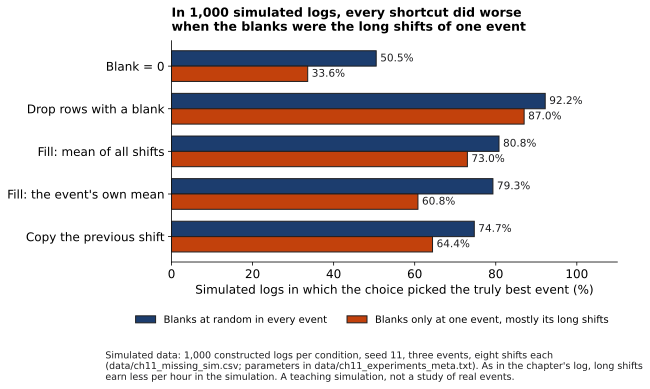{#fig-11-6 fig-alt="Paired bars for five choices: share of simulated logs that picked the best event, lower for every choice when blanks were one event's long shifts."}

**The rule, in this order:**

1. **Count the blanks by group.** Two blanks in one event differ from two spread across events.
2. **Ask why each one is blank.** A smudged page and a skipped long shift call for different fixes (compare Chapter 2's 1936 poll, whose non-responders differed from responders).
3. **Get the real value if you can:** the volunteers, the sign-in sheet, the missing interview. A real value beats any estimate.
4. **Only then compare defensible choices,** and say whether the decision changes. If it does, the data cannot settle it yet.

::: {.callout-note title="Worked Example: Lucía's Two Blanks"}
*(Constructed data.)* The tool recommended the book swap at $24.22 per hour. Lucía follows the rule.

**Count:** both blanks are book-swap shifts; the other events have none. **Why:** a volunteer says the two longest shifts ran into the evening, when few people came, and the people who stayed to the end left without logging. **Real value:** the paper sign-in sheets in the association's binder, where volunteers wrote start and end times, show 14 and 13 hours. **Recompute:** $1,059 over 54 hours is $19.61 per hour, below the car wash's $22.50. **Compare:** with the real hours, no fill is needed. The recommendation reverses.
:::

::: {.callout-note title="Faded Example: A Clinic Survey"}
*(Health.)* A clinic's satisfaction survey shows an average of 4.5 out of 5. Of patients who waited under 20 minutes, 70% returned the form; of patients who waited over an hour, 30% did.

**Step 1, count by group:** the missing forms are concentrated among long-wait patients. **Step 2, why blank?** _______. **Step 3, can you get the real value?** _______. **Step 4, does the conclusion change?** _______.
:::

::: {.callout-tip title="Check your answer" collapse="true"}
**Step 2:** probably because unhappy long-wait patients were less willing to fill in a form; the blanks may depend on the very satisfaction being measured. **Step 3:** partly: a short follow-up call or text to a sample of long-wait patients. **Step 4:** yes, very likely: the 4.5 overstates satisfaction, because the patients most likely to be unhappy are underrepresented. Report it with that caveat, or by wait group.
:::

::: {.callout-important title="Your Turn"}
In a spreadsheet of your own records (a budget, your course grades) or the practice file on eLearning, the course site, count the blanks in one column. Write one guess about why they are blank.
:::

::: {.callout-tip title="Check Yourself 11.2"}
1. Why can treating a blank as zero make an event look better, not worse?
2. All five ways of handling the blanks agreed. Why was that not evidence that they were right?
3. Put the four steps of the rule in order, and say why getting the real value comes before comparing choices.
:::

## 11.3 What You Measure Versus What You Mean {#sec-11-3 .unnumbered}

[Core]{.path}

Every decision uses a measure that stands in for its goal: a store counts repeat purchases to find loyal customers; a course records grades to show learning. Chapter 2 gave this a name. A **proxy** is a clue that stands in for something else, such as a word linked to gender.

**Two places a proxy can hide.** In Chapter 2, the proxy sat in the **inputs**: Reuters reported that the recruiting tool marked down the word "women's", which in Chapter 2's reading stood in for gender, so removing a gender field would not have removed the bias. The Opening Case shows a second place. A **label**, Chapter 2 reminds us, is the correct answer attached to an example: a human decision or a recorded outcome. A **proxy label** is a recorded outcome used as the label because it is easy to measure, standing in for the outcome you actually care about.

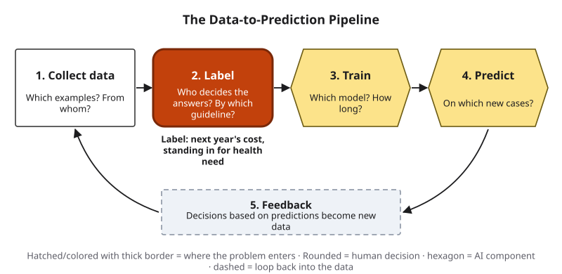{#fig-11-7 fig-alt="The Data-to-Prediction Pipeline with the label stage highlighted; note: next year's cost, standing in for health need."}

The health algorithm was built to find patients who would need the most care. Need cannot be observed directly, so the label was total health-care costs in the following year (Obermeyer et al., 2019). Cost tracks need, but not equally for everyone. At the same level of health, measured by the number of chronic conditions, Black patients in the study generated on average $1,801 less in costs per year than White patients. The authors point to two likely channels: barriers to getting care that fall harder on poorer patients, and direct effects of race, such as discrimination by providers and patients' distrust of the health system. Either way, less was spent on equally sick Black patients. So the scores, trained to predict cost, ranked equally sick Black patients as lower risk. In other words, the scores measured who would cost the most, not who was sickest. Race was never an input; the gap came in through the label (@fig-11-8).

This is not quite Chapter 2's biased label, which is wrong in one consistent direction about the thing it records. The cost label recorded cost correctly; it went wrong only as a stand-in for need.

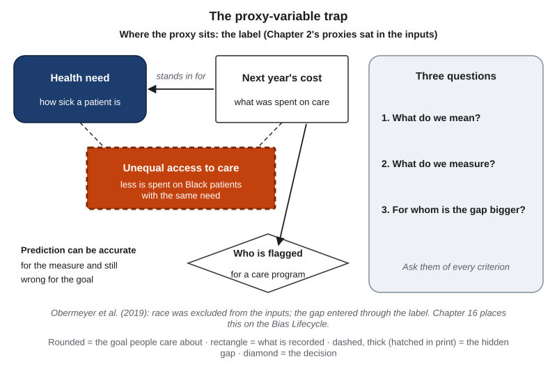{#fig-11-8 fig-alt="Next year's cost stands in for health need; a dashed box between them: unequal access to care; cost decides who is flagged; three questions."}

This is why accuracy did not reveal the problem: prediction can be accurate for the measure and still wrong for the goal. The authors then changed only the label. With the same inputs and training, they built three predictors of their own: one for total cost, one for avoidable cost (emergency visits and hospital stays), and one for a health measure, the number of active chronic conditions. Among the 3% of patients each predictor ranked highest, the share of Black patients was 14.1%, 21.0% and 26.7% (@fig-11-9). Changing only the label nearly doubled it. (Their cost predictor is a re-creation tested on part of the data, so its 14.1% differs from the commercial score's 17.7% in the Opening Case.)

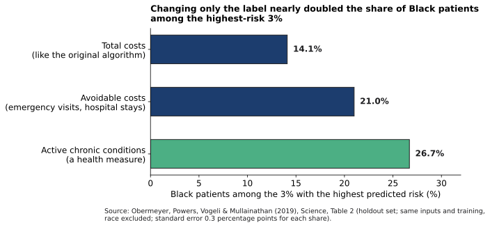{#fig-11-9 fig-alt="Bars: Black share of the top 3% when trained on total costs 14.1%, avoidable costs 21.0%, active chronic conditions 26.7%."}

In general, things decisions care about, such as need, ability or risk, often cannot be observed directly, so someone chooses an observable stand-in, and that choice is an assumption that can fail (Jacobs & Wallach, 2021).

**Three questions for any proxy:**

1. **What do we mean?** The goal, in plain words.
2. **What do we measure?** The number actually in the data.
3. **For whom is the gap bigger?** Who, for reasons unrelated to the goal, scores lower or higher on the measure?

The third question matters most, and accuracy checks miss it. Chapter 16 places label choice on the Bias Lifecycle, its diagram of where bias enters, and shows how fairness is measured; Chapter 17 asks how a score like this should be explained to the people it affects.

::: {.callout-note title="Worked Example: The Three Questions, Applied"}
*(Obermeyer et al., 2019.)* **What do we mean?** Which patients will need the most care, so the program can help them early. **What do we measure?** Next year's total health-care costs. **For whom is the gap bigger?** Patients who receive less care for the same illness; in this hospital, Black patients, who generated $1,801 less per year at the same level of health. **Where the proxy sat:** the label, not the inputs, which is why excluding race did not help.
:::

::: {.callout-note title="Faded Example: Tickets Closed per Hour"}
*(Business; constructed example.)* Lucía's support team ranks agents by tickets closed per hour, to reward helpful agents. Some agents take the long, hard tickets that others pass on.

**What do we mean?** Agents who solve customers' problems well. **What do we measure?** _______. **For whom is the gap bigger?** _______.
:::

::: {.callout-tip title="Check your answer" collapse="true"}
**Measure:** the number of tickets an agent closes per hour, whatever their difficulty or outcome. **Gap:** agents who take the long, hard tickets close fewer per hour while solving the hardest problems, so they score low for a reason unrelated to helpfulness. (Agents who close tickets without solving them may also score high.)
:::

::: {.callout-important title="Your Turn"}
Pick one metric from your field or campus: GPA, step counts, citation counts, star ratings. Answer the three questions for it.
:::

::: {.callout-tip title="Check Yourself 11.3"}
1. What is a proxy label, and how does it differ from a proxy in the inputs?
2. Why did removing race from the inputs not remove the gap in the Opening Case?
3. The algorithm predicted costs accurately. Why was that not enough?
:::

## 11.4 Checking an AI-Generated Analysis {#sec-11-4 .unnumbered}

[Core]{.path}

Chapter 8's **Verification Funnel** is the book's diagram of three checks a claim can pass through (an independent check, the primary source, an expert), each outside the tool, taken only as far as the stakes require. Its first stage is an **independent check**, evidence that no AI tool produced: a source with an author or publisher you can name, or your own recalculation or reasoning from known inputs. Its second is the **primary source**, the original record a claim comes from: the study, the dataset, the law, the court record, the official page of the organization that sets the rule. For a number, the raw data are the primary source (stage 2 of the funnel), and your recalculation from them is your independent check (stage 1). You check an analysis by redoing, outside the tool, the parts the decision depends on (@fig-11-11).

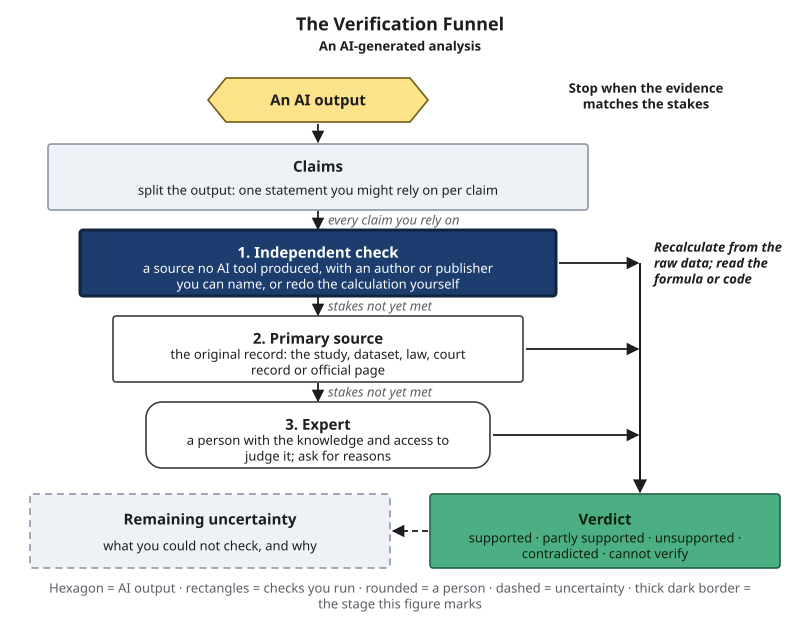{#fig-11-11 fig-alt="The Verification Funnel with the independent check stage highlighted; note: recalculate from the raw data; read the formula or code."}

An analysis can get every sum right and still be wrong. In Lucía's case the arithmetic was correct; the dropped rows were the problem. So look beyond the arithmetic, in six places where a hidden choice can change the answer (@fig-11-12):

1. **Rows in, rows out.** How many records went in, and how many were used? Dropped rows are a decision.
2. **Blanks and impossible values.** How were blanks handled (section 11.2)? Any values that cannot be true, such as a 30-hour shift?
3. **Definitions and units.** Net or gross? Dollars or thousands? Dates read as dates? Tool defaults can change data silently: about one-fifth of genomics papers with supplementary Excel gene lists contained gene names the spreadsheet had turned into dates or numbers (Ziemann et al., 2016).
4. **Time window.** Does the data's period match the decision? After a new price or rule, older patterns may no longer hold.
5. **Totals versus groups.** **Simpson's paradox** is a pattern in a total that weakens or even reverses inside the groups that make it up (@fig-11-13). In fall 1973, graduate admissions at the University of California, Berkeley, showed a clear but misleading pattern of bias against women in the total. Department by department, few departments showed a significant difference, and about as many favored women as men: women had applied more often to departments that were harder for everyone to enter (Bickel et al., 1975). Neither the total nor the groups is automatically the truth; which one answers your question depends on why the groups differ.
6. **The formula or code.** Ask the tool to show it, then read it or rerun it. A tool's description of its own assumptions is a lead, not a check.

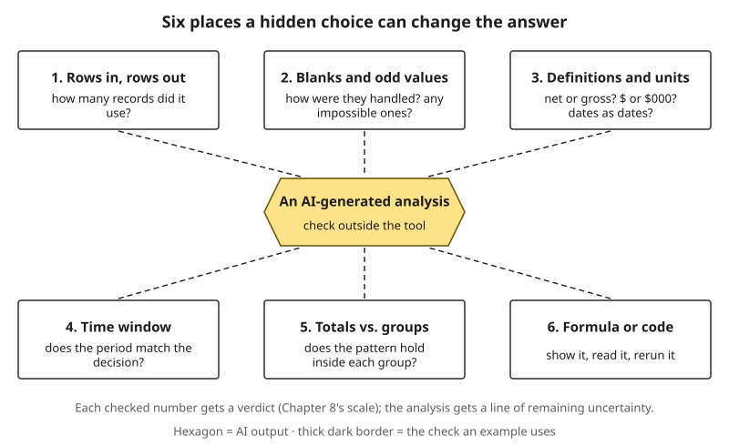{#fig-11-12 fig-alt="Six boxes around an AI-generated analysis: rows in and out, blanks, definitions and units, time window, totals vs. groups, formula or code."}

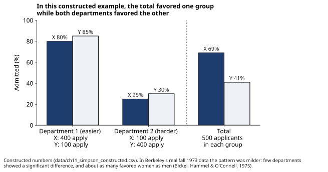{#fig-11-13 fig-alt="Bars: group Y admitted more often in both departments, but group X more often in the total, because X applied mostly to the easier department."}

**What you can inspect.** Check 6 depends on how the AI took part (@fig-11-4): an AI feature in a spreadsheet usually shows its formula; a chat tool that runs code on your file can show the code if you ask; a chat answer shows nothing but the answer. The less you can inspect, the more you recalculate yourself (as of October 2026; Chapter 12 compares kinds of tools).

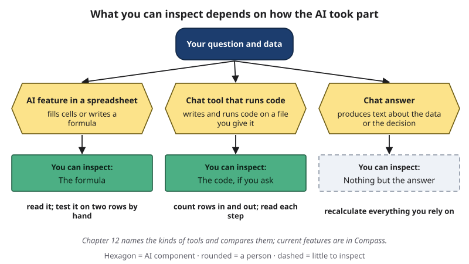{#fig-11-4 fig-alt="Three paths: an AI feature in a spreadsheet shows a formula, a code-running chat tool shows code if asked, a chat answer shows nothing to inspect."}

Each number you check gets a **verdict** on Chapter 8's five-point scale: supported, partly supported, unsupported, contradicted, cannot verify. The analysis as a whole gets a line of **remaining uncertainty**: what you could not check, and why.

::: {.callout-note title="Worked Example: Lucía Audits the Tool's Answer"}
*(Constructed example.)* **1. Rows:** the file had 18 shifts; the tool's code used 16. The two blanks were dropped without a note. **2. Blanks:** both in the book swap (section 11.2). **3. Units:** proceeds are net of costs in every row. **4. Time:** all from last academic year; the same events are planned. **5. Groups:** the comparison is already by event. **6. Code:** she asks for it and finds the line that drops incomplete rows.

**Verdicts:** "Car wash: $22.50 per hour" — supported (recalculated). "Book swap: $24.22 per hour" — contradicted by the sign-in sheets ($19.61). "Repeat the book swap" — contradicted. **Remaining uncertainty:** one year of data, and the weather on the car wash days.
:::

::: {.callout-note title="Faded Example: A Campus Survey"}
*(Education; constructed example.)* An AI summary of a campus dining survey says, "Satisfaction rose from 3.4 to 3.9 out of 5." Last year's survey ran in October and drew 820 responses from all residence halls. This year's ran in the week after a new dining hall opened and drew 140 responses, mostly from the hall next to it.

**Check 1, rows:** 820 last year, 140 this year; ask whether all 140 were used. **Check 4, time window:** _______. **Check 5, totals versus groups:** _______.
:::

::: {.callout-tip title="Check your answer" collapse="true"}
**Check 4:** this year's survey ran in the first week of a new hall, when novelty may raise ratings; the two periods are not comparable. **Check 5:** this year's responses come mostly from one hall, so the "rise" may reflect who answered rather than a change for everyone; compare the same halls across years. **Verdict for "satisfaction rose":** unsupported as stated.
:::

::: {.callout-important title="Your Turn"}
A provided AI output says, "The average of 240 orders was $63." The file it was given has 252 rows. Write the question you would ask first, and the verdict you can give now.
:::

::: {.callout-tip title="Check your answer" collapse="true"}
First question: which 12 rows were left out, and why (blanks, duplicates, returns)? Verdict for now: **cannot verify** until you know, because the average depends on whether the missing orders differ from the rest.
:::

::: {.callout-tip title="Check Yourself 11.4"}
1. For a number in an analysis, what is the primary source, and what is your independent check?
2. Name three of the six places to look, and one hidden choice that could sit in each.
3. Explain Simpson's paradox in one sentence of your own.
:::

## 11.5 Decision Matrices: Structure Without False Precision {#sec-11-5 .unnumbered}

[Core]{.path}

A **decision matrix** is a table that lists options against the criteria they are judged on, each criterion with a scale and a weight. A **criterion** is one of the things the options are judged on, with its own scale. A **weight** is how much a criterion counts toward the total. The point is not the arithmetic. The point is that every judgment becomes visible and can be checked (@fig-11-14).

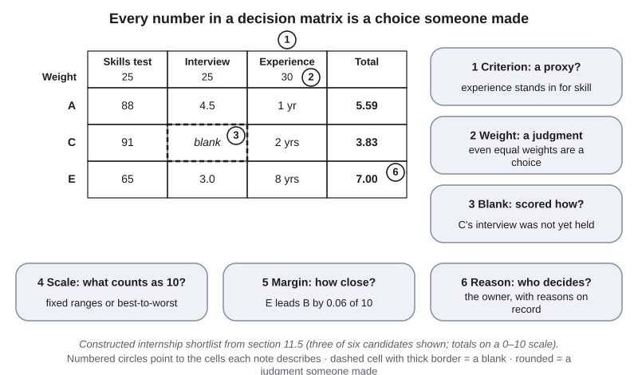{#fig-11-14 fig-alt="Matrix of three candidates and five criteria with scales and weights; notes: proxy criteria, weights as judgments, a blank, scale, margin, reason."}

**Why structure helps.** For predicting a numerical outcome from numerical information, simple weighted rules, even with equal weights, have outperformed **holistic intuition**, an overall gut judgment (Dawes, 1979). Structured interviews, which score every candidate on the same questions, ranked first among hiring methods in a 2022 re-analysis of **validity studies**, studies of how well a method predicts later job performance (Sackett et al., 2022). Researchers on judgment recommend scoring criteria separately and combining them at the end, and argue that this reduces random scatter in judgment (Kahneman et al., 2021).

**How the arithmetic works.** Each raw value is turned into a score from 0 to 10 using fixed ends of a scale chosen in advance: scaled score = (value − low end) ÷ (high end − low end) × 10. If lower is better, as with price or hours, reverse it: scaled score = 10 − that number. Then multiply each scaled score by its weight and add. In other words, every criterion is put on the same 0-to-10 ruler before it is weighted.

::: {.callout-note title="Worked Example: Recalculating One Total"}
*(Constructed data.)* An AI tool drafts a matrix for a small accounting firm's internship. Weights: skills test 25%, structured interview 25%, years of experience 30%, GPA 10%, employee referral 10%.

| Candidate | Skills test (0–100) | Interview (1–5) | Experience (0–10 yrs) | GPA (0–4) | Referral (no = 0, yes = 10) |
|---|---|---|---|---|---|
| A | 88 | 4.5 | 1 | 3.6 | no |
| B | 72 | 3.5 | 6 | 3.1 | yes |
| C | 91 | blank | 2 | 3.8 | no |
| D | 80 | 4.0 | 3 | 3.3 | yes |
| E | 65 | 3.0 | 8 | 2.9 | yes |
| F | 84 | 4.5 | 2 | 3.4 | no |

**Let's take E, step by step:** test 65 ÷ 100 × 10 = 6.5, × 25% = 1.625; interview (3.0 − 1) ÷ 4 × 10 = 5.0, × 25% = 1.25; experience 8 ÷ 10 × 10 = 8.0, × 30% = 2.40; GPA 2.9 ÷ 4 × 10 = 7.25, × 10% = 0.725; referral yes = 10, × 10% = 1.00. **Total: 7.00**, which matches the tool.
:::

**Why it can mislead.** Every number in the matrix is a choice. A criterion can be a proxy: years of experience stand in for skill, and an employee referral, in this book's reading, can track who already knows someone at the firm. A blank can be scored as the lowest value: the tool gave candidate C, who has the highest skills test but no interview yet, the lowest interview score, which put C last. And the weights are judgments, even when they are equal: equal weights are a choice too.

**The sensitivity check.** A **sensitivity check** is changing one choice in an analysis, such as a weight or the handling of a blank, to see whether the result changes. Read two things besides the top: the **margin**, how far the top option leads the next one, and the **shortlist**, the few options that stay near the top whatever you change.

::: {.callout-note title="Worked Example: Testing the Shortlist"}
*(Constructed data, data/ch11_matrix_sensitivity.csv.)* With the tool's weights, E leads B by 0.06. With experience 20 and the test 35, D leads by 0.04; with the referral removed and its 10 points given to the interview, F by 0.05; with equal weights, B by 0.09. Each of these is a **near-tie**: smaller than the 0.31 points that half a step on one interview rating is worth. B and E were on every shortlist of three; D on five of six. Filling C's blank with the average moved C only from sixth to fifth; the real fix is to **hold the interview**. A weight also means little without its scale: score experience on 0–20 years instead of 0–10, and its 30 points count half as much.
:::

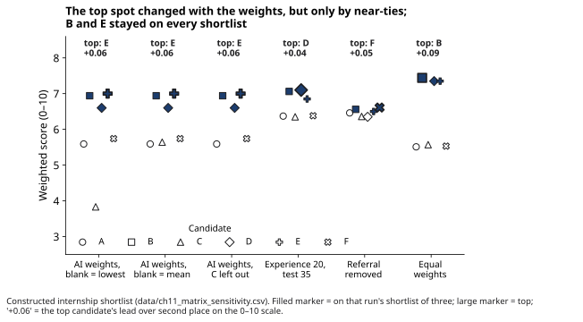{#fig-11-15 fig-alt="Scores of six candidates under six weightings: the top changes by under 0.1 point each time; candidates B and E stay in the top three."}

So the matrix does not say "hire E." It says that B and E are strong under every reasonable weighting, that the order among the top three is **too close to call** (too close to pick a winner), and that C cannot be judged until interviewed. An AI-drafted matrix that adds raw hours or prices without reversing them has a formula error (check 6, section 11.4).

**Rules for a matrix you can defend:** write the criteria before you score the options; let each criterion measure one thing; fix the scale ends in advance; mark blanks and get the missing values where you can; run a sensitivity check; report the margin and the shortlist; and record the reason for the final choice, which may differ from the top score. Chapter 16 looks at criteria that track a protected group and at evidence on AI résumé screening; Chapter 18 covers hiring law.

::: {.callout-note title="Faded Example: A Gallery's Grant Shortlist"}
*(Arts.)* A community gallery scores grant applications on four criteria: artistic quality (rated 0–10 by one juror; weight 40%), community reach (expected visitors, scale 0–500; 30%), budget realism (1–5; 20%) and exhibition history (number of past shows, scale 0–10; 10%). Application P: quality 8, reach 300 visitors, budget 4, history 2 shows.

**Step 1, quality:** already on 0–10 → 8 × 40% = 3.20. **Step 2, reach:** _______. **Step 3, budget:** _______. **Step 4, history and total:** _______. **Which criterion might be a proxy, and for whom is the gap bigger?** _______.
:::

::: {.callout-tip title="Check your answer" collapse="true"}
Reach 300 ÷ 500 × 10 = 6.0 × 30% = 1.80. Budget (4 − 1) ÷ 4 × 10 = 7.5 × 20% = 1.50. History 2 ÷ 10 × 10 = 2.0 × 10% = 0.20. **Total 6.70.** Exhibition history stands in for quality or reliability; the gap is bigger for new or self-taught artists who have had fewer chances to show. One juror's quality rating is also a single person's taste.
:::

::: {.callout-important title="Your Turn"}
This is A9: audit the criteria of your scenario's matrix, recalculate the top two totals and run two sensitivity tests (section 11.7).
:::

::: {.callout-tip title="Check Yourself 11.5"}
1. Give two reasons a decision matrix helps and two ways it can mislead.
2. Recompute candidate A's total from the table. (It should match the tool's 5.59.)
3. In the worked example, why was "hold the interview" a better fix for C than any way of filling the blank?
:::

## 11.6 Human Judgment and Automation Bias {#sec-11-6 .unnumbered}

[Core]{.path}

Adding a person to review AI output sounds like the obvious safeguard. It helps only if the reviewer can, and does, disagree.

**Automation bias** is the tendency to over-rely on automated output, following it when it is wrong or missing what it did not flag (Goddard et al., 2012). So it shows up as two kinds of error. A **commission error** is following an automated output when it is wrong. An **omission error** is missing a problem because an automated system did not flag it (Skitka et al., 1999): for example, a care manager who checks only the patients a list flags misses a patient who is getting worse but was not flagged. Chapter 7 called the general pattern **overreliance**: relying on an AI tool's output more than the task or the evidence warrants, so that your own checking or skill-building drops out. Automation bias is overreliance in a decision.

**The evidence.** A systematic review of 74 studies found the effect across fields; in four pooled health-care studies, erroneous advice was more likely to be followed with decision-support software than without (Goddard et al., 2012). It has been found in novices and experts, in flight simulations and other tasks (Skitka et al., 1999; Parasuraman & Manzey, 2010). In a 2023 experiment, 27 radiologists read mammograms with suggestions from what they were told was an AI system; the researchers had made some suggestions wrong. The least experienced readers rated about 80% of mammograms correctly when the suggested category was right, and about 20% when it was wrong; the most experienced, 82% and 46% (@fig-11-16). The study had no reading without suggestions, and its most experienced group was small (Dratsch et al., 2023). The categories came from the **Breast Imaging Reporting and Data System (BI-RADS)**, a standard system for reporting breast images, whose categories rank how suspicious a finding is.

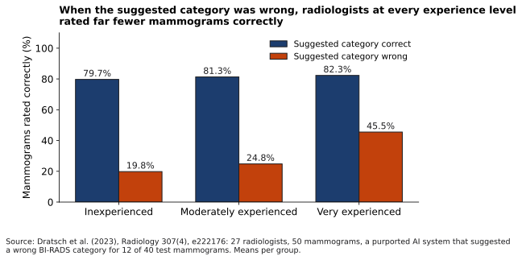{#fig-11-16 fig-alt="Paired bars for three experience levels: about 80% correct with right suggestions; 20%, 25% and 46% with wrong ones."}

**Back to the Opening Case.** Enrollment followed doctors' decisions along with administrative factors such as eligibility rules. Of patients enrolled, 19.2% were Black. In the authors' simulations, which use only factors recorded in the data, enrolling at random within each score band gives 18.3%, a share that cannot be told apart from 19.2%; selecting within each band the patients with the most predicted chronic conditions gives 26.9% (selecting on that prediction alone, 29.2%) (@fig-11-17). The authors conclude that doctors **redressed** (made up for) only a small part of the bias, far less than a differently labeled algorithm would have.

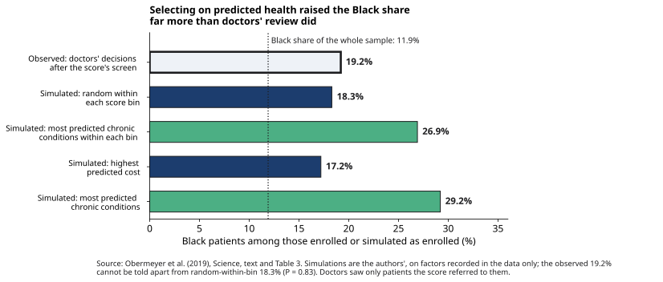{#fig-11-17 fig-alt="Bars: Black share of enrolled patients 19.2% observed, 18.3% random within score bins, 26.9% and 29.2% when selecting on predicted health."}

Two limits matter. Doctors saw only patients the score had already referred, so a sicker patient scored below the 55th percentile never reached them: the review missed those patients by design. And the data cannot say why the doctors' choices tracked the score; eligibility rules and other unrecorded factors also shaped enrollment. Automation bias may be part of the answer, but that is this book's inference, not the authors' finding.

**Design a review step.** A review step says who reviews, what they see first, what counts as a reason to disagree, and where a disagreement is recorded. In the aviation and laboratory studies Goddard et al. (2012) review, making people accountable for their decisions reduced over-reliance. Two further habits are this book's suggestions, consistent with that evidence: **form your own estimate before you see the AI's answer**, so you have something to disagree with; and **record every override** (each time you decide against the AI's output) and its reason, so disagreement is normal and can be learned from.

::: {.callout-note title="Worked Example: Lucía at the Board Meeting"}
*(Constructed example.)* Lucía presents the analysis with one line of disclosure (Chapter 10): "A chat tool ran the first analysis; I checked every number against the sign-in sheets." She shows the reversal: car wash first once the real hours are in.

**The board's review step:** (1) The treasurer counts the sign-in sheets before any vote. (2) Board members write their own ranking before seeing the tool's. (3) Any member can call for a recount, and the reason goes in the **minutes**, the official record of the meeting. The board votes for the car wash, and the minutes record why.
:::

::: {.callout-note title="Faded Example: A Care Manager's Review"}
*(Health.)* A care manager reviews a weekly AI list of patients flagged as high risk. She can also see each patient's notes and recent test results.

**Line 1, what she sees first:** the patient's notes, before the score. **Line 2, what counts as a reason to disagree?** _______. **Line 3, where is a disagreement recorded?** _______. **Line 4, how are unflagged patients covered?** _______.
:::

::: {.callout-tip title="Check your answer" collapse="true"}
Line 2, for example: a recent change in test results or symptoms that the score does not reflect, or notes showing that the patient already has help. Line 3: a column in the list ("disagree: reason") that is reviewed monthly. Line 4: a weekly look at a small random sample of unflagged patients, to catch omission errors.
:::

::: {.callout-important title="Your Turn"}
Write a two-line review step for one decision you make with AI help: what you do before seeing the AI's answer, and where you record a disagreement.
:::

::: {.callout-tip title="Check Yourself 11.6"}
1. Define automation bias, and give one example each of a commission error and an omission error.
2. How much of the bias did doctors' review correct, according to the authors' simulations, and what does this book suggest as a reason?
3. What four things does a review step specify?
:::

## 11.7 The Decision Audit (Lab 11.1 and A9) {#sec-11-7 .unnumbered}

[Studio]{.path}

*Studio sections are hands-on work. This one is Thursday's lab and the start of A9.*

In the lab you audit a decision matrix that an AI tool drafts from a scenario file. Choose one: **A′**, an internship shortlist of six constructed candidates (letters G to L); **B′**, a student association choosing one of three spring fundraisers; or **C**, your own choice among options, not people, using your own data in a university-provided tool such as Microsoft Copilot Chat (as of October 2026) or no AI at all. Scenario C compares options because ranking real people would put their personal data into your work, and ranking people raises the fairness questions Chapter 16 takes up. Each scenario has a one-page brief on eLearning that gives the reason for every blank. Scenarios A′ and B′ are not solved anywhere in this book.

Your A9 record has eight parts (@fig-11-18): the decision statement and owner; the AI-drafted matrix with tool, model, date and prompt; a criteria audit; the top two options recalculated outside the tool, with verdicts; two sensitivity tests with the new top, margin and shortlist; a revised matrix and a decision memo with your review step; remaining uncertainty; and your **AI Use Declaration**: a short statement of which AI tools you used, for what, what you accepted, rejected or revised, how you verified it, and where your judgment shaped the work. A spreadsheet template on eLearning does the scaling and flags blanks.

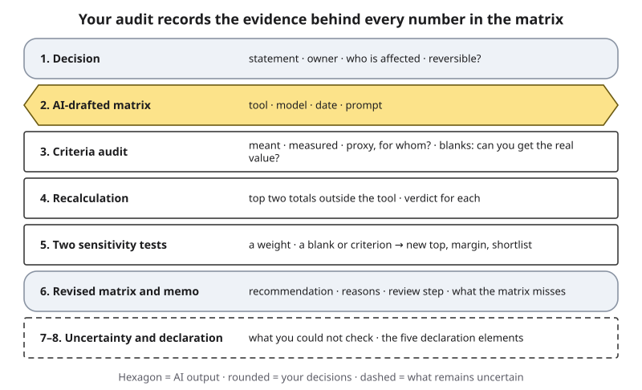{#fig-11-18 fig-alt="A9 sheet: decision, AI-drafted matrix, criteria audit, recalculation, two sensitivity tests, revised matrix and memo, uncertainty and declaration."}

**Worked model, one criteria-audit row** (from section 11.5): *Years of experience* — meant: skill at the work; measured: years in any job; proxy: yes; gap bigger for students who could not take unpaid internships or who changed fields; blanks: none; change: lower the weight from 30 to 15 and add a work-sample task.

**Faded model:** the gallery's application P from section 11.5, with criterion 1 (artistic quality) audited: meant, the quality of the proposed work; measured, one juror's rating; proxy, partly, for one person's taste; blanks, none; change, add a second juror. Criteria 2 to 4 are for you.

"The top option survived every test" and "the AI's arithmetic was correct" are valid results. What earns marks is the evidence that you checked.

::: {.callout-tip title="Check Yourself 11.7"}
1. What do A9's items 4 and 5 test that item 3 does not?
2. Why must scenario C compare options rather than people?
:::

## Deep 11.A: Why Values Go Missing, and Multiple Imputation {#sec-11-deep-a .unnumbered}

[Deep]{.path}

Statisticians distinguish three reasons values go missing (Rubin, 1976; Sterne et al., 2009). Values are **missing completely at random (MCAR)** when the reason has nothing to do with any data, as when a page of sign-in sheets gets wet. They are **missing at random (MAR)** when the reason depends only on things you did observe: evening shifts were logged less often, and the log records which shifts were evenings. They are **missing not at random (MNAR)** when the reason depends on the missing value itself: the longest shifts went unlogged *because* they were long (@fig-11-22).

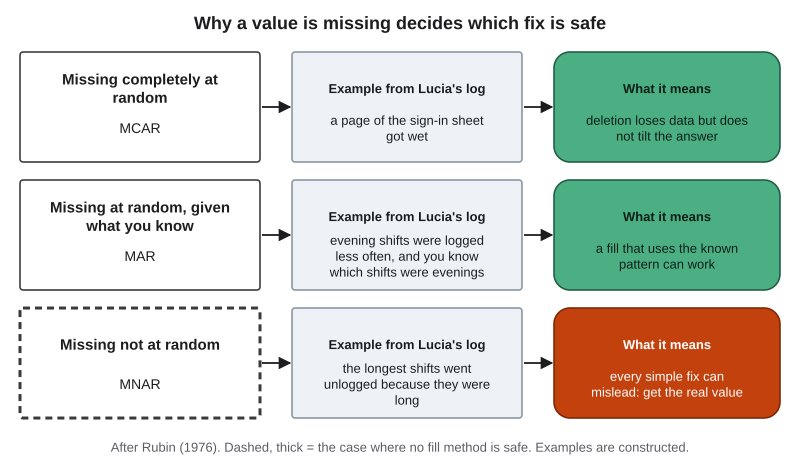{#fig-11-22 fig-alt="Three rows: MCAR, MAR and MNAR, each with an example from the event log and what it means for fixing the data."}

The names explain the chapter's demonstration. Under MCAR, deleting incomplete rows loses information but does not tilt the answer. Under MAR, a fill that uses the known pattern can work. Lucía's spreadsheet is MNAR: the blanks depend on the hours themselves, and the spreadsheet has no column (such as an end time) that could predict them. Even a fill based on time of day would fail there, because every late shift is blank, so no logged shift shows what a late shift is like. The simulation's two conditions roughly correspond to the first and third cases.

**Multiple imputation** is a widely used method when values are missing at random, provided the model includes what predicts the missingness. It fills each blank several times with plausible values drawn from a model of the data, analyzes each completed dataset separately, and pools the results so that the final answer carries the extra uncertainty that the blanks create. A widely cited guide for medical researchers describes its potential and its pitfalls, including the need to think about why data are missing before using it (Sterne et al., 2009). When data may be MNAR, analysts run a **sensitivity analysis**: they assume the missing values were somewhat higher or lower than the fill and check whether the conclusion survives. No method recovers values that are missing for reasons the data cannot see. If you want to try this yourself, Lab 11.4 runs the chapter's own code in a browser notebook.

## Deep 11.B: Many Analysts, One Dataset {#sec-11-deep-b .unnumbered}

[Deep]{.path}

How much does an analysis depend on the analyst's choices? One study tested this directly. Twenty-nine teams, 61 analysts in all, received the same dataset and the same question: are soccer referees more likely to give red cards to players with darker skin tones? The teams' estimates ranged from 0.89 to 2.93 in odds-ratio units (a measure of how much more likely an event is in one group: 1 means no difference). Twenty teams found a statistically significant positive effect and nine did not. The 29 analyses used 21 different combinations of control variables, and neither the analysts' prior beliefs nor their expertise explained the spread (Silberzahn et al., 2018).

The lesson is not that analysis is arbitrary. It is that defensible choices, made honestly by experts, can lead to different answers, and a single analysis hides that. When researchers built a benchmark of open-ended data-analysis questions with answers from expert analysts, the language-model agents they tested in 2024 were often limited to basic analyses, although agents that could interact with the data made more varied choices (Gu et al., 2024).

What this means for you: when you ask an AI tool for "the" analysis, ask it for two defensible alternatives as well, with the choices that differ named, and compare the results. If they disagree, you have learned something the single answer would have hidden.

## Hands-on Labs {.unnumbered}

These labs are tool-neutral: they describe what to do, not which buttons to press. Never put personal or confidential information into a prompt. Your own data goes only into a university-provided tool such as Microsoft Copilot Chat (as of October 2026).

*In Compass (optional), the book's free and ungraded companion: the lab pages ch11-lab1 to ch11-lab4, with keys for Labs 11.2 and 11.3 and the notebook for Lab 11.4.*

### Lab 11.1: Decision Audit (Studio · 75 minutes · Thursday, in class) {.unnumbered}

*(O1–O6 · LO3, LO5 · Evaluate)*

**Before Thursday (about 5 minutes; scenario C about 10):** choose scenario A′, B′ or C and read its one-page brief on eLearning. For C, fill in the template there: your decision statement, your options (not people) and criteria, with the ends of each scale.

1. **Briefing (10 minutes).** Decision roles, the three proxy questions, the six places to look, matrix anatomy and the scaling rule; the privacy rule.
2. **Draft (10 minutes).** Teams on A′ or B′ give an AI tool the scenario file with the prompt in the brief, or use the provided dated output. Save the prompt, tool, model and date. Scenario C students do the same alone, from their own table.
3. **Criteria audit (15 minutes, individual).** For each criterion: meant, measured, proxy and for whom, blanks and whether the real value can be obtained.
4. **Recalculate and test (20 minutes, individual).** Enter the values in the spreadsheet template and compare its totals for the top two options with the tool's, with a verdict for each. Change one weight or one blank and record the new top, margin and shortlist.
5. **Share and critique (15 minutes).** Each team or solo student reports whether the top option survived and one hidden assumption it found.
6. **Exit (5 minutes).** Name one assumption you would not have seen without checking.

**If this doesn't work:** the scenario files and a provided matrix are on eLearning as printable sheets and screen-reader-friendly tables; the alternative assignment explains the no-AI route.

### Lab 11.2: Find the Hidden Error (Check It · 20 minutes · optional, recommended) {.unnumbered}

*(O2, O4 · LO3 · Analyze)*

1. Open the small dataset and the dated AI analysis of it on eLearning. The analysis contains one hidden error.
2. Work through the six places in order. Record what you checked at each.
3. When you find the error, recalculate the affected number and give each claim in the analysis a verdict.
4. Write the corrected sentence. Compare with the key (in Compass, optional).

This works like section 11.4's worked example (Lucía audits the tool's answer), with a different file.

### Lab 11.3: Proxy Hunt (Check It · 20 minutes · optional) {.unnumbered}

*(O3 · LO5 · Evaluate)*

1. Take five everyday metrics: one from campus, one from health, one from work, one from city services and one from online ratings.
2. Answer the three proxy questions for each.
3. Find one documented case, with a source you opened, in which a metric stood in badly for its goal: a library database or a news search for the metric's name with "unintended" or "gaming" is a good start. Cite it.

### Lab 11.4: Rerun the Demonstrations (Build · 25 minutes · optional, Deep) {.unnumbered}

*(O2, O3 · LO3 · Analyze)*

1. Open the chapter's script in a browser notebook (in Compass, optional). It reproduces the event log, the simulation and the proxy simulation.
2. Change which shifts go missing in the event log. When does the best event change?
3. Change the access gap in the proxy simulation and watch the share of group B among those selected (@fig-11-10).

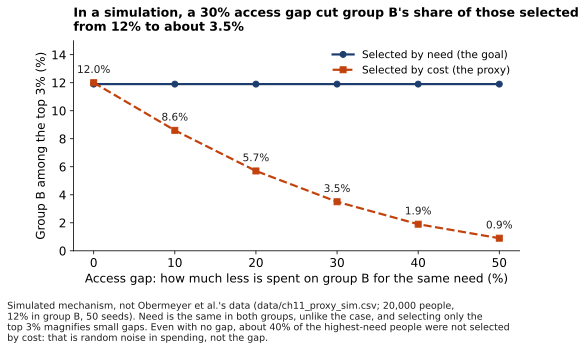{#fig-11-10 fig-alt="Lines: group B's share of the top 3% stays near 12% when selecting by need and falls toward 1% when selecting by cost as the gap grows."}

The proxy simulation is a mechanism, not a copy of the Opening Case's data: need is the same in both groups, and selecting only the top 3% magnifies small gaps. Even with no gap, about 40% of the highest-need people in the simulation were not selected by cost, because spending varies randomly around need; that number is noise, not the gap.

## Case Study: The Health Algorithm, Revisited {.unnumbered}

::: {.callout-note title="Two tools from Chapter 4"}
The **Failure Taxonomy Tree** is the book's diagram that sorts AI failures into five branches (hallucination, bias, context loss, overconfidence, security vulnerability), each with smaller leaves. The **failure-to-harm chain** shows the links by which an AI error becomes a harm: the output is wrong (link 1), it is not checked before use (link 2), someone relies on it (link 3), and a loss follows (link 4). A label is **documented** when the evidence shows it and **inferred** (drawn dashed) when it does not.
:::

**Context.** The algorithm predicted each patient's total health-care costs in the following year from the previous year's insurance claims (age, sex, insurance type, diagnoses, procedures, medications and costs), with race excluded (Obermeyer et al., 2019).

**Timeline (@fig-11-2).** The analysis was done with no contact with the algorithm's maker. Before publication, the authors report, the maker replicated the finding on 3,695,943 patients, and an index combining health and cost predictions reduced the bias by 84%, by one measure, in the maker's data. The article went online on October 24, 2019, in the October 25 issue of *Science*. On October 25, New York's financial and health regulators wrote to UnitedHealth Group about "Impact Pro", which they called Optum's data analytics program, and asked the company to investigate and to stop using any program it could not show was free of racially disparate impact (confirmed: NYDFS & NYSDOH, 2019). The article does not name the product; news reports named Optum as the maker (reported: Ledford, 2019). Optum called the study's conclusion misleading, because the cost model is one of many data elements used to select patients (reported: Ledford, 2019). As of October 2026, no public update on the inquiry or the product has been found.

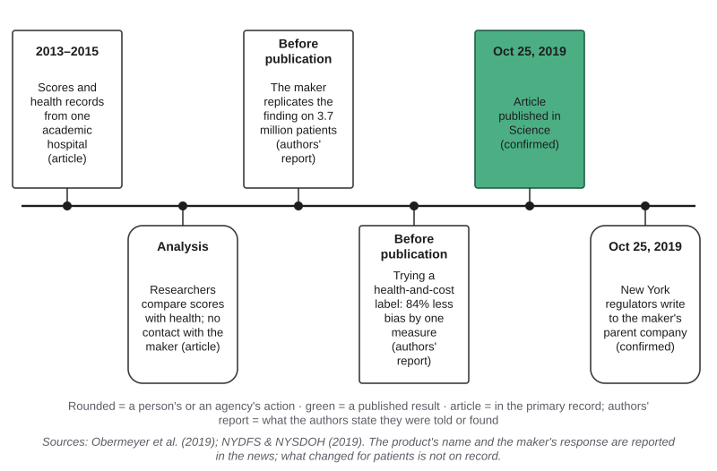{#fig-11-2 fig-alt="Timeline: data 2013–2015, analysis, maker's replication, a health-and-cost label, publication Oct 24–25, 2019 and a regulators' letter."}

**What the AI did and what humans did.** The scores were lower for Black patients than for equally sick White patients, because cost stood in for need (section 11.3). The industry judged such algorithms by cost prediction: the article notes that a Society of Actuaries evaluation of ten widely used algorithms used it as the accuracy measure. Doctors' review, with administrative factors, corrected only a small part of the gap in the authors' simulations (section 11.6).

**Failure label (Signature 5 and the failure-to-harm chain).**

- **Tree: bias, leaf "skewed recommendations", documented.** The article measured the gap in scores at equal health (@fig-11-19).
- **Chain:** link 1, the output is wrong: documented. Link 2, checked before use, failed: **inferred**; evaluation by cost accuracy is documented, but how much review corrected is an estimate from the authors' simulations. Link 3, someone relies on it: documented (the top 3% were flagged by the score alone). Link 4, loss or harm: **inferred**; fewer Black patients identified for extra help is a simulated estimate, with no public record of harm to individuals (@fig-11-20).

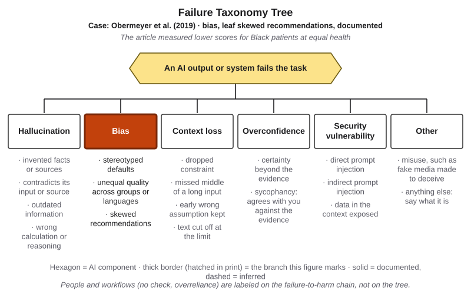{#fig-11-19 fig-alt="The Failure Taxonomy Tree with the bias branch highlighted with a solid border; tag: Obermeyer et al. 2019, skewed recommendations, documented."}

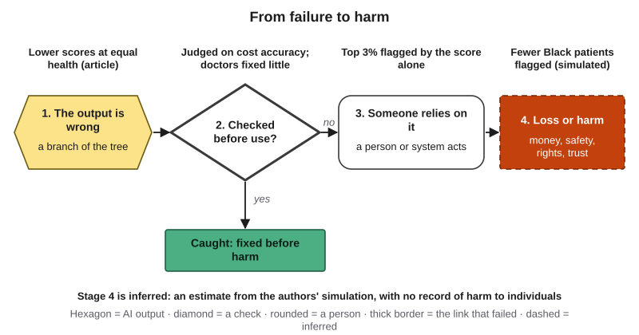{#fig-11-20 fig-alt="Failure-to-harm chain: lower scores at equal health; judged on cost, review's effect an estimate; top 3% flagged; links 2 and 4 dashed."}

**A better workflow (AI Work Loop, for the team that builds or buys such a score).** *Frame:* state the goal as need, and choose a label that measures it, or several. *Verify:* before use, compare scores with health measures group by group, not only with costs. *Decide:* review thresholds with people who can override the score, and record overrides; check a sample of patients below the referral threshold too. *Disclose:* tell the hospitals that use the score what it predicts.

**Short case 1: coding errors behind a policy debate (economics).** Three economists replicated Carmen Reinhart and Kenneth Rogoff's 2010 work on public debt and growth (Reinhart & Rogoff, 2010). They found selective exclusion of available data, coding errors and inappropriate weighting of summary statistics; one spreadsheet formula left five countries out of an average. Corrected, average growth in countries with public debt above 90% of **gross domestic product (GDP)**, a country's total economic output, was 2.2% a year for 1946–2009, not −0.1%: still somewhat lower than at lower debt levels, but not dramatically different (Herndon et al., 2014). The failure tree and chain do not apply, because no AI output was wrong; the lesson is check 1 (rows in, rows out) and the value of an outside recalculation.

**Short case 2: a file-size limit in a health data pipeline (public health).** Public Health England (PHE) said that 15,841 positive COVID-19 cases from September 25 to October 2, 2020, were left out of daily reported figures because some files exceeded the maximum size the system could load; everyone still received their result, and the cases were passed to **contact tracing** (finding and warning people exposed to an infected person) by 1 a.m. on October 3 (PHE, 2020). The BBC reported that the files used an old spreadsheet format (XLS) limited to about 65,000 rows (Kelion, 2020). Again no AI output was wrong, so the tree and chain do not apply; the lesson is check 1.

## Ethics Lens: Who Pays for a Convenient Measure? {.unnumbered}

**Who bears the cost of a proxy?** A convenient measure is chosen for the people who build or buy a system: cost data were already in insurance claims. Its errors fall on the people for whom the gap between measure and goal is widest. In the Opening Case, those were Black patients who received less care for the same illness (Obermeyer et al., 2019). In this book's reading, the same pattern is common with missing values: data are often missing for the people a system serves least, the shift nobody logged, the patient who never returned the form. A criterion such as an employee referral can, in the same way, carry the history of who already knows whom into a shortlist.

**Who answers for the decision?** A score cannot be held accountable; its owner can. Law is starting to name the human side of the problem. For AI systems the European Union (EU) classes as high-risk, Article 14(4)(b) of the EU's AI Act says that the people assigned to oversee them must be enabled, as appropriate, to remain aware of the possible tendency to over-rely on the system's output, which the act calls automation bias (Regulation (EU) 2024/1689). As of October 2026, these rules are scheduled to apply from December 2027 for most listed systems and from August 2028 for those covered by product-safety law, after a 2026 amendment postponed them (Regulation (EU) 2026/1744). Chapter 18 covers the law; Chapter 16 covers fairness.

**Discuss:** When a measure is convenient for an organization but costly for some of the people it judges, who should decide whether to keep using it?

## Career Connection {.unnumbered}

Decision support is daily work in many jobs.

- **Accountants and auditors** recalculate the figures an analysis rests on before anyone relies on them. Lucía's habit of checking against the source document is the core of the job.
- **Recruiters and HR analysts** build shortlists. Structured criteria and interviews improve them (Sackett et al., 2022); auditing every criterion for proxies is part of the work (Chapters 16 and 18).
- **Health-care analysts and care managers** use risk scores and set thresholds, and decide what a score may trigger without review.
- **Operations and supply-chain analysts** compare suppliers in matrices of price, quality, delivery and risk, where a sensitivity check shows whether a choice is robust.
- **Public budget analysts** live with the lesson of short case 1: an analysis error can travel far before anyone replicates it.
- **Data journalists** re-run published analyses and ask the questions in section 11.4.
- **Design engineers** compare design concepts against criteria in a matrix and must say which criteria were weighted and why.

## From the Field {.unnumbered}

<!-- Based on the author's co-authored encyclopedia entry (Şeker & Eşmekaya, 2017; YBS Ansiklopedi 4(3), 10–17, per the fact-check), translated and paraphrased from Turkish, within the facts of that entry; present-day connections are marked as such. Not commercial: no D16 disclosure. First-person voice to be checked by the author (Author-only item 2). -->

In 2017, with my co-author Eda Eşmekaya, I wrote an encyclopedia entry on filling in missing data, a problem that data-mining projects meet whenever values are missing (Şeker & Eşmekaya, 2017). The Turkish word we used for imputation, *töhmet*, means in the dictionary to attribute to something what is not there. That is exactly what imputation does: it puts a value where none was recorded.

The entry started from where blanks come from: data read incorrectly, data damaged at the source, or data that are hard to reach. Blanks cause trouble for most ready-made statistics packages, and the right method depends on the situation and on what you expect from the data. We listed nine and worked through the main ones with small tables. Deleting every incomplete row can throw away useful information; in some columns, the share of missing values can reach 90%. Deleting only the rows a particular calculation needs keeps more data, but every calculation then runs on a different set of rows, which makes results hard to compare. Filling a blank with the average works only for numbers, not for categories, and becomes unreliable when much is missing. Filling from a fitted line needs at least two numeric fields; our example estimated a person's weight from their height. Copying the previous row's value can duplicate an unusual value. Multiple imputation fills each blank several times, analyzes each version and pools the results. Machine-learning methods, such as using a record's nearest neighbors, can also fill blanks.

*A present-day connection, which is this book's and not the 2017 entry's:* as of October 2026, AI features in spreadsheets and chat tools that run code can make these same choices for you, often without saying which one they made. The entry's lesson applies to them unchanged: before you trust the result, ask how the blanks were handled, and why they were blank in the first place.

## Chapter Summary {.unnumbered}

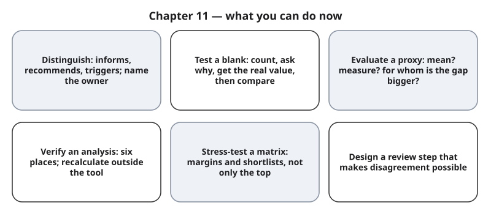{#fig-11-21 fig-alt="Six cards: distinguish roles, test a blank, evaluate a proxy, verify an analysis, stress-test a matrix, design a review step."}

**The chapter's question:** *Can an AI-assisted analysis make a decision for you?* It can do the arithmetic, draft a matrix and propose an option in seconds. But every analysis rests on choices, such as what a blank means, what a number stands in for and how criteria are weighted, and each can change the answer. People who review a score also tend to follow it. So get the real values where you can, recalculate what the decision depends on, test whether another defensible choice changes the result, and decide as the owner, with your reasons written down.

**Return to the Opening Case.** How could a score built without race treat Black patients unequally? Its label, next year's cost, stood in for need, and less was spent on Black patients with the same needs. Why did the doctors not undo the gap? In the authors' simulations their review changed the result only a little; doctors saw only the patients the score sent them, and the data cannot say why their choices tracked the score.

**Revisit your Warm-up.** (1) Can scores be unequal without race in the data? *Yes: a proxy label carried the gap (section 11.3).* (2) Can two blanks change the best option? *Yes: in the constructed log, five ways of handling them all picked the wrong event (section 11.2).* (3) Does a doctor's review make errors harmless? *No: reviewers often follow automated advice (section 11.6), and in the case doctors saw only the patients the score sent them and corrected little.* Compare these with your confidence ratings.

You can now:

- **Distinguish** outputs that inform, recommend or trigger an action, and name the owner.
- **Test** whether a blank, a definition, a time window or a total changes a result.
- **Evaluate** a proxy with three questions.
- **Verify** an AI analysis by recalculating what the decision depends on.
- **Stress-test** a decision matrix, reading margins and shortlists.
- **Design** a review step that makes disagreement possible.

### Key Terms {.unnumbered}

automated decision · automation bias · commission error · criterion (in a decision matrix) · decision matrix · decision owner · decision support · hidden assumption · imputation · listwise deletion · MAR, MCAR, MNAR (Deep) · missing value · multiple imputation (Deep) · omission error · overreliance (Ch. 7) · proxy (Ch. 2) · proxy label · sensitivity analysis (Deep) · sensitivity check · Simpson's paradox · weight (in a decision matrix)

## End-of-Chapter Package {.unnumbered}

<!-- Each item: objective · LO · revised Bloom level. Odd-numbered answers → appendix/answers.md (Appendix E, via docs/production/handoff/ch11.md); even-numbered → private/ch11-answers-even.md. Review A distractors draw on M1–M6. MC keys: A1 b, A3 d, A5 a, A7 c, A9 b, A11 d, A13 a, A14 c; the key is the longest option only in A5 and A7. -->

### Review Questions A: Terms and Concepts {.unnumbered}

1. *(O1 · LO5 · Understand)* Which is an automated decision?\
   (a) A dashboard that shows a manager last month's sales broken down by region.\
   (b) A fraud score that blocks a payment automatically, with no one reviewing it.\
   (c) A tool's loan recommendation that a loan officer reads before she decides.\
   (d) A summary of customer complaints that a team discusses at its weekly meeting.
2. *(O1 · LO5 · Understand)* Define the decision owner, and say why naming one matters when an AI output recommends an action.
3. *(O2 · LO3 · Understand)* An AI tool computes "proceeds per volunteer hour" as total proceeds divided by total logged hours, and two hour cells are blank. What happens?\
   (a) Blank cells are skipped, so they have little effect on the rate.\
   (b) The tool fills them with the average, so the rate stays close to the truth.\
   (c) The rate comes out somewhat lower than the truth.\
   (d) Those shifts' proceeds count but their hours do not, so the rate rises.
4. *(O2 · LO3 · Understand)* What is listwise deletion, and what does it assume about the deleted rows?
5. *(O2 · LO3 · Analyze)* Four ways of handling the same blanks all point to the same option. What should you conclude?\
   (a) Agreement is not evidence they are right; find out why the values are missing and get them if you can.\
   (b) The answer is probably settled, because four different methods agree on the same option.\
   (c) Report the method with the highest estimate, since owners usually want the optimistic case.\
   (d) Delete the column that holds the blanks, since a column with gaps is usually unreliable.
6. *(O3 · LO5 · Understand)* Define a proxy label and give an example from outside health care.
7. *(O3 · LO5 · Analyze)* The algorithm in the Opening Case excluded race from its inputs. Why were its scores still unequal?\
   (a) A field closely linked to race stayed in the inputs, and the algorithm relied on it for its scores.\
   (b) The algorithm predicted cost less accurately for Black patients, so its errors were larger for them.\
   (c) Its label, next year's cost, was lower for Black patients with the same needs, because less was spent on their care.\
   (d) Doctors adjusted the scores before enrollment, and their changes lowered scores for some patients.
8. *(O3 · LO5 · Analyze)* How does a proxy in the inputs (Chapter 2) differ from a proxy label? Use one example of each.
9. *(O2 · LO3 · Understand)* Which statement describes Simpson's paradox?\
   (a) A sample with few responses gives an average that can change a lot from one year to the next.\
   (b) A pattern in a total can weaken or reverse within the groups that make it up.\
   (c) Spreadsheet default settings can silently turn names or codes into dates or numbers.\
   (d) Patterns in older data may stop holding when prices, rules or conditions change.
10. *(O4 · LO3 · Apply)* Your recalculation from the raw data gives $19.61 per hour; the AI tool reported $24.22. What verdict does the tool's figure get, and what goes in the remaining-uncertainty line?
11. *(O5 · LO3 · Understand)* What is the main purpose of a sensitivity check on a decision matrix?\
    (a) To confirm the top option by showing it scores highest under the owner's weights.\
    (b) To find and remove the criteria that are proxies, so that mostly direct measures remain.\
    (c) To replace the owner's weights with equal weights, which are usually more neutral.\
    (d) To see whether the top option and shortlist change when a defensible choice changes.
12. *(O5 · LO3 · Apply)* A matrix ranks options A, B and C at 7.12, 7.08 and 5.40. Under equal weights, B leads A by 0.05. What do you report to the decision owner?
13. *(O6 · LO5 · Apply)* A care manager reviews only the patients an AI list flags, and misses a patient who is getting worse but was not flagged. Which kind of error is this?\
    (a) An omission error: a problem missed because the system did not flag it.\
    (b) A commission error: following the system's output even though the output was wrong.\
    (c) A proxy-label error: the list predicted cost instead of need.\
    (d) A sampling error: the list was built from too few patients.
14. *(O6 · LO5 · Understand)* Which statement about human review of AI output fits the evidence in this chapter?\
    (a) Wrong suggestions mainly misled novices, so experienced reviewers are usually enough protection.\
    (b) A qualified person's sign-off catches most tool errors, so adding one is usually enough.\
    (c) Reviewers often follow wrong advice, so a review step must make disagreement possible and recorded.\
    (d) Because reviewers tend to follow the tool, review adds little, and audits afterward are usually better.

### Review Questions B: Case Questions {.unnumbered}

1. *(O1 · LO5 · Analyze)* A scholarship office uses an AI tool that (i) summarizes each application, (ii) scores applications and lists the top 50 for a committee, and (iii) automatically rejects incomplete applications. Classify each output's role, name the owner of each decision, and say where a check is most needed.
2. *(O2 · LO3 · Apply)* A club treasurer's AI summary says the spring trip cost "$84 per member." The file lists 40 members, but 9 payment cells are blank. What do you do first, and why, before choosing a way to handle the blanks?
3. *(O3 · LO5 · Evaluate)* A city sends road crews where residents file the most pothole complaints through an app. Apply the three proxy questions, and suggest one better measure or check.
4. *(O4 · LO3 · Analyze)* A coffee shop introduced a new menu in January. An AI analysis compares December sales ($41,300) with April sales ($48,700) and concludes: "Sales rose 18%. The new menu raised sales by 18%. Keep the menu." Use the six places to find the hidden error, and give each of the three sentences a verdict.
5. *(O5 · LO3 · Evaluate)* A biology lab compares three microscopes on price (lower is better; 30%), image quality (40%), service contract (20%) and ease of use (10%). The top two differ by 0.1 point. Run one sensitivity check of your choice, say what it could show, and write the advice you would give the lab manager.

### Review Questions C: Interpretive Questions {.unnumbered}

1. *(O3 · LO5 · Evaluate)* "Using next year's cost to target extra care was a reasonable business choice." Take a position, using the Opening Case, section 11.3 and the Case Study.
2. *(O5 · LO5 · Evaluate)* Should a hiring team ever choose someone other than the matrix's top candidate? Take a position, using section 11.5 and what a sensitivity check can show.
3. *(O6 · LO5 · Evaluate)* A hospital adds a doctor's sign-off to every patient an AI tool flags. Is that enough oversight? Take a position, using section 11.6, and design the review step you would require.

### Spaced Review {.unnumbered}

Come back to these a few days after reading, without looking back. The first two connect this chapter to Chapters 10 and 9, which you read just before the midterm; the last two are bridge items that reach further back.

1. *(Chapter 10 · LO4 · Apply)* Lucía tells the board that a chat tool ran the first analysis. What should a one-line disclosure say, and what does disclosure not fix?
2. *(Chapter 9 · LO3 · Analyze)* A company publishes its sales dataset; a news site turns it into a chart; an encyclopedia article quotes the chart. Which is the primary, secondary and tertiary source for the sales numbers, and which would you check a number against?
3. *(Bridge: Chapter 8 · LO3 · Apply)* For the "average of 240 orders" output in section 11.4, why is "cannot verify" a better verdict than "partly supported" until you know which rows were used?
4. *(Bridge: Chapter 2 · LO1 · Analyze)* Chapter 2 distinguished noisy labels from biased labels. Was the cost label in the Opening Case noisy, biased, or neither? Explain why this chapter calls it a proxy label instead.

### Discussion Questions {.unnumbered}

1. *(Ethics · O3 · LO5 · Evaluate)* Who should decide whether a convenient measure, such as cost, may stand in for a goal, such as need, when people's care depends on it?
2. *(Career · O6 · LO5 · Create)* In the job you want, which decisions might an AI score trigger without review? Design one review step for one of them.
3. *(Interdisciplinary · O3 · LO5 · Analyze)* Name a common proxy in your field (GPA, citation counts, test scores, sales, likes). For whom is its gap bigger?
4. *(Society · O1 · LO5 · Evaluate)* Some decisions about people are now made automatically. Which should always have a decision owner who sees each case, and why?
5. *(Learning · O4 · LO3 · Evaluate)* Did checking an AI analysis in this chapter change how you will use AI for your own data work? How?

### Application Assignment: A9 Decision Matrix Audit {.unnumbered}

**Due:** Monday, March 29, 2027, 11:59 p.m., on eLearning. *(O1–O6 · LO3, LO5 · Evaluate)* You start it in Thursday's lab (section 11.7).

**Scenarios** (choose one; none is solved in this book). Each has a one-page brief on eLearning that explains every blank.

- **A′. Internship shortlist:** six constructed candidates (letters G–L) with a work-sample task score, a structured interview score (one not yet held), GPA (one transfer student's transcript not yet received), hours available per week, and a "partner university" flag.
- **B′. Spring fundraiser:** a student association choosing **one** of three fundraisers (a trivia night it ran last fall, a graduation photo booth a partner club ran, and a plant sale nobody has run) against five criteria, two of them "lower is better", with two blank cells; the survey behind one criterion had 14 answers from about 60 members.
- **C. Your own choice among options, not people:** a choice from your work, club or courses (which laptop, which club event, which supplier, which study plan) with at least three options and four criteria. Do not rank people. Use only your own data, and put it only into a university-provided tool such as Microsoft Copilot Chat (as of October 2026), or use the alternative assignment. Fill in the template on eLearning before the lab (about 10 minutes); scenario C runs solo in the lab.

**What to submit:**

1. **Decision statement:** the decision in one sentence, its owner, who is affected, and whether it can be reversed.
2. **The AI-drafted matrix:** the matrix and recommendation an AI tool produced from the scenario file (or the provided dated output), with the tool, model if shown, date and prompt.
3. **Criteria audit:** for every criterion, what it is meant to capture, what the data actually measure, whether it is a proxy and for whom the gap could be larger, and how blanks were handled and whether the real value can be obtained. Revise, re-scale or remove at least one criterion, or explain why none needed changing.
4. **Recalculation:** the top two options' totals recomputed outside the tool, with the spreadsheet template or by hand, compared with the AI's, each with a verdict on Chapter 8's scale. If the totals match, the verdict is "supported"; a discrepancy is not expected, only explained if found.
5. **Two sensitivity tests:** one weight change and one change in how a blank or a criterion is handled. For each, report the new top option, its margin and the shortlist (or the top two for B′ and C).
6. **Revised matrix and decision memo (120–150 words):** your matrix; the decision you would recommend to the owner and why; what the matrix cannot capture; what you would check before acting; and a review step that names who reviews, what they see first, what counts as a reason to disagree, and where a disagreement is recorded. Your recommendation may differ from the top score if you say why.
7. **Remaining uncertainty:** one or two sentences.
8. **AI Use Declaration:** tools, purpose, what you accepted, rejected or revised, how you verified it, and where your own judgment shaped the work.

No personal or confidential data in prompts (Chapter 15). A matrix whose top option survives every test, or an AI analysis whose arithmetic is correct, is a valid result and can earn full marks if your audit shows how you know.

**Time, item by item (after the lab):** reading this brief and rubric (8 minutes, counted separately in the week's total); finishing the criteria audit (8); finishing the recalculation with the template (5); the second sensitivity test (5); the revised matrix (5); the memo (15); remaining uncertainty (3); the declaration (5); checking and submitting (4). About 50 minutes after reading; longer if you work by hand or in a second language.

**Rubric (10 points)** — the course's artifact split (task 3, process evidence 3, verification 2, declaration and judgment 2), with process evidence scored as two separate criteria.

| Criterion (points) | Exemplary | Proficient | Developing | Beginning |
|---|---|---|---|---|
| **Task (3)** | 3: decision statement with owner, affected people and reversibility; AI-drafted matrix with tool, date and prompt; revised matrix; memo with reasons, what the matrix cannot capture and what you would check before acting; a review step naming all four elements (who reviews, what they see first, a reason to disagree, where it is recorded) | 2: all required parts present, but one or two of these elements are missing or thin (owner, affected people, reversibility, what to check before acting, a review-step element) | 1: one required part missing (the decision statement, the AI-drafted matrix, the revised matrix or the memo), or three or more elements missing, or the memo restates the top score without reasons | 0: two or more required parts missing |
| **Criteria audit (1.5)** | 1.5: every criterion audited on all four points (meant, measured, proxy and for whom, blanks and whether the real value can be obtained), with at least one justified change or a justified "no change" | 1: every criterion audited, but one or two audits miss a point, or no change is justified | 0.5: at least half of the criteria audited, or audits mostly describe the criteria | 0: fewer than half of the criteria audited |
| **Sensitivity tests (1.5)** | 1.5: two tests of different kinds (a weight; a blank or criterion), each with the new top option, margin and shortlist, and a sentence on what the margins mean | 1: two tests with top, margin and shortlist, but of the same kind or without the sentence on margins | 0.5: one complete test, or two tests missing the margin or shortlist | 0: no test |
| **Verification (2)** | 2: the top two totals recomputed outside the tool, each with a verdict that follows Chapter 8's scale; any discrepancy explained; remaining uncertainty stated | 1.5: both recomputed with verdicts; a discrepancy unexplained, or remaining uncertainty missing | 1: only one option recomputed, or both recomputed without verdicts, or verdicts given without a recalculation | 0: no recalculation and no verdicts |
| **Declaration and judgment (2)** | 2: all five declaration elements; the memo shows the owner's judgment (what was weighed beyond the scores) | 1.5: all five elements; the judgment is present but generic | 1: two to four declaration elements, or no judgment beyond the scores | 0: zero or one declaration element |

**Alternative assignment** (if you prefer not to use AI tools, or cannot access one). Same brief with one substitution for item 2. For A′ or B′, audit the **provided matrix** built by an unnamed team from the same file (on eLearning, with errors you are not told about). For C, build your matrix yourself and swap it with a classmate in the lab: you audit theirs, they audit yours. The rubric is read the same way; the declaration states "no AI tools used" if so. Time: about the same as the main route.

### Mini-Project (optional): A Decision Log {.unnumbered}

*(O1, O2, O6 · LO5 · Evaluate)* For three weeks, log three decisions you made with the help of an analysis, a score or an AI recommendation: the owner, one hidden assumption you found, and whether a sensitivity check or the real value changed anything. Write half a page on what you would now check first. The log can become a piece of your term portfolio (Chapter 20).

### Case Study Questions {.unnumbered}

1. *(O3 · LO5 · Analyze)* What was the algorithm's label, what was it meant to stand in for, and why was the gap larger for Black patients?
2. *(O3 · LO3 · Analyze)* The article does not name the product. Which sources do, and what is the attribution tier of that fact?
3. *(O6 · LO5 · Evaluate)* Where on the failure-to-harm chain would you add a check, and who should run it?
4. *(O2 · LO3 · Analyze)* Why is link 4 (harm) labeled inferred, while the bias on the tree is documented?
5. *(O1 · LO5 · Evaluate)* The score flagged patients above the 97th percentile automatically. Would you allow any automatic flagging in such a program? Defend your answer.

## Further Reading and Compass Links {.unnumbered}

- **R9 (recommended):** Dell'Acqua et al. (2026), the study behind Chapter 1's jagged frontier and Chapter 12's case. If you read it, use the working paper's sections 3.2 and 3.3 (pages 13–16 of the 2023 working paper, about 12 minutes). Question: the spreadsheet looked complete; what does the paper say the consultants who did worse had relied on?
- Obermeyer et al. (2019): the Opening Case, short and readable; Figure 1 and the section on label choice.
- Ledford (2019): *Nature*'s news report on the study, with the company's response.
- Jacobs and Wallach (2021): measurement and its assumptions, for readers interested in where proxies come from.
- Goddard et al. (2012): the systematic review of automation bias, free to read on PubMed Central.
- Silberzahn et al. (2018): the "many analysts, one dataset" study (Deep 11.B).
- Sterne et al. (2009): a practical guide to multiple imputation (Deep 11.A).
- Kahneman, Sibony and Sunstein (2021): on structured judgment and noise in decisions.
- *In Compass (optional): the missing-value demonstration with a toggle per choice; a decision matrix with weight sliders; the Chapter 11 quiz; Lab 11.1–11.4 pages.*

## References {.unnumbered}

Bickel, P. J., Hammel, E. A., & O'Connell, J. W. (1975). Sex bias in graduate admissions: Data from Berkeley. *Science, 187*(4175), 398–404. https://doi.org/10.1126/science.187.4175.398

Dawes, R. M. (1979). The robust beauty of improper linear models in decision making. *American Psychologist, 34*(7), 571–582. https://doi.org/10.1037/0003-066X.34.7.571

Dell'Acqua, F., McFowland, E., III, Mollick, E., Lifshitz, H., Kellogg, K. C., Rajendran, S., Krayer, L., Candelon, F., & Lakhani, K. R. (2026). Navigating the jagged technological frontier: Field experimental evidence of the effects of artificial intelligence on knowledge worker productivity and quality. *Organization Science, 37*(2), 403–423. https://doi.org/10.1287/orsc.2025.21838

Dratsch, T., Chen, X., Rezazade Mehrizi, M., Kloeckner, R., Mähringer-Kunz, A., Püsken, M., Baeßler, B., Sauer, S., Maintz, D., & Pinto dos Santos, D. (2023). Automation bias in mammography: The impact of artificial intelligence BI-RADS suggestions on reader performance. *Radiology, 307*(4), e222176. https://doi.org/10.1148/radiol.222176

Goddard, K., Roudsari, A., & Wyatt, J. C. (2012). Automation bias: A systematic review of frequency, effect mediators, and mitigators. *Journal of the American Medical Informatics Association, 19*(1), 121–127. https://doi.org/10.1136/amiajnl-2011-000089

Gu, K., Shang, R., Jiang, R., Kuang, K., Lin, R.-J., Lyu, D., Mao, Y., Pan, Y., Wu, T., Yu, J., Zhang, Y., Zhang, T. M., Zhu, L., Merrill, M. A., Heer, J., & Althoff, T. (2024). BLADE: Benchmarking language model agents for data-driven science. In *Findings of the Association for Computational Linguistics: EMNLP 2024* (pp. 13936–13971). Association for Computational Linguistics. https://doi.org/10.18653/v1/2024.findings-emnlp.815

Herndon, T., Ash, M., & Pollin, R. (2014). Does high public debt consistently stifle economic growth? A critique of Reinhart and Rogoff. *Cambridge Journal of Economics, 38*(2), 257–279. https://doi.org/10.1093/cje/bet075

Jacobs, A. Z., & Wallach, H. (2021). Measurement and fairness. In *Proceedings of the 2021 ACM Conference on Fairness, Accountability, and Transparency* (pp. 375–385). https://doi.org/10.1145/3442188.3445901

Kahneman, D., Sibony, O., & Sunstein, C. R. (2021). *Noise: A flaw in human judgment*. Little, Brown Spark.

Kelion, L. (2020, October 5). Excel: Why using Microsoft's tool caused Covid-19 results to be lost. *BBC News*. https://www.bbc.com/news/technology-54423988

Ledford, H. (2019). Millions of black people affected by racial bias in health-care algorithms. *Nature, 574*(7780), 608–609. https://doi.org/10.1038/d41586-019-03228-6

New York State Department of Financial Services & New York State Department of Health. (2019, October 25). *Joint letter to UnitedHealth Group Incorporated* [Letter]. https://www.dfs.ny.gov/reports_and_publications/comment_letters/dfs-doh-joint-letter-uhgi-20191025

Obermeyer, Z., Powers, B., Vogeli, C., & Mullainathan, S. (2019). Dissecting racial bias in an algorithm used to manage the health of populations. *Science, 366*(6464), 447–453. https://doi.org/10.1126/science.aax2342

Parasuraman, R., & Manzey, D. H. (2010). Complacency and bias in human use of automation: An attentional integration. *Human Factors, 52*(3), 381–410. https://doi.org/10.1177/0018720810376055

Public Health England. (2020, October 4). *PHE statement on delayed reporting of COVID-19 cases* [Press release; updated October 5, 2020]. GOV.UK. https://www.gov.uk/government/news/phe-statement-on-delayed-reporting-of-covid-19-cases

Regulation (EU) 2024/1689 of the European Parliament and of the Council of 13 June 2024 laying down harmonised rules on artificial intelligence (Artificial Intelligence Act). (2024). *Official Journal of the European Union*, L, 2024/1689, 12.7.2024. http://data.europa.eu/eli/reg/2024/1689/oj

Regulation (EU) 2026/1744 of the European Parliament and of the Council of 8 July 2026 amending Regulations (EU) 2024/1689, (EU) 2018/1139 and (EU) 2023/1230 as regards the simplification of the implementation of harmonised rules on artificial intelligence (Digital Omnibus on AI). (2026). *Official Journal of the European Union*, L, 2026/1744, 24.7.2026. http://data.europa.eu/eli/reg/2026/1744/oj

Reinhart, C. M., & Rogoff, K. S. (2010). Growth in a time of debt. *American Economic Review, 100*(2), 573–578. https://doi.org/10.1257/aer.100.2.573

Rubin, D. B. (1976). Inference and missing data. *Biometrika, 63*(3), 581–592. https://doi.org/10.1093/biomet/63.3.581

Sackett, P. R., Zhang, C., Berry, C. M., & Lievens, F. (2022). Revisiting meta-analytic estimates of validity in personnel selection: Addressing systematic overcorrection for restriction of range. *Journal of Applied Psychology, 107*(11), 2040–2068. https://doi.org/10.1037/apl0000994

Şeker, Ş. E., & Eşmekaya, E. (2017). Eksik verilerin tamamlanması (Imputation) [Imputation of missing data]. *YBS Ansiklopedi, 4*(3), 10–17. https://ybsansiklopedi.com/wp-content/uploads/2017/08/imputation_tohmet.pdf

Silberzahn, R., Uhlmann, E. L., Martin, D. P., Anselmi, P., Aust, F., Awtrey, E., Bahník, Š., Bai, F., Bannard, C., Bonnier, E., Carlsson, R., Cheung, F., Christensen, G., Clay, R., Craig, M. A., Dalla Rosa, A., Dam, L., Evans, M. H., Flores Cervantes, I., … Nosek, B. A. (2018). Many analysts, one data set: Making transparent how variations in analytic choices affect results. *Advances in Methods and Practices in Psychological Science, 1*(3), 337–356. https://doi.org/10.1177/2515245917747646

Skitka, L. J., Mosier, K. L., & Burdick, M. (1999). Does automation bias decision-making? *International Journal of Human-Computer Studies, 51*(5), 991–1006. https://doi.org/10.1006/ijhc.1999.0252

Sterne, J. A. C., White, I. R., Carlin, J. B., Spratt, M., Royston, P., Kenward, M. G., Wood, A. M., & Carpenter, J. R. (2009). Multiple imputation for missing data in epidemiological and clinical research: Potential and pitfalls. *BMJ, 338*, b2393. https://doi.org/10.1136/bmj.b2393

Ziemann, M., Eren, Y., & El-Osta, A. (2016). Gene name errors are widespread in the scientific literature. *Genome Biology, 17*, 177. https://doi.org/10.1186/s13059-016-1044-7
