# The Tool Ecosystem and Task–Tool Fit {#sec-ch12}

<!-- Status: DRAFT v2 (2026-10-18): four independent reviews applied (docs/editorial/ch12-dev-memo.md), Mode B voice pass. Blueprint v0.2 (approved under D19). Featured student: Sam only (docs/characters.md); all AI outputs are constructed examples unless a model and date are given. Tools in worked examples are "Tool A" (a chat assistant under institutional terms) and "Tool B" (a chat assistant under consumer terms, with web search and a calculation feature); never a named institutional tool.
Case C09 facts: numbers from the 2023 HBS working paper (read in full, build/ch12/src/bcg.txt); peer-review status from the 2026 Organization Science abstract (Crossref); the journal body is not read (open item in the handoff). Retainment: measured only in the inside-frontier creative experiment (WP p. 10, App. C); outside-frontier "less questioning" is the authors' statement. The gap between the two AI groups on the outside task is significant only at the 10% level (WP p. 14; Table 4 F-tests p = 0.082–0.095).
Data classes: the book's generic three-level classification (public · internal or confidential · restricted or legally protected; D27, D-12.8). Numbers in text come from data/ch12_*.csv or the cited sources. Not marked done: final review and the author's voice edit are pending. -->

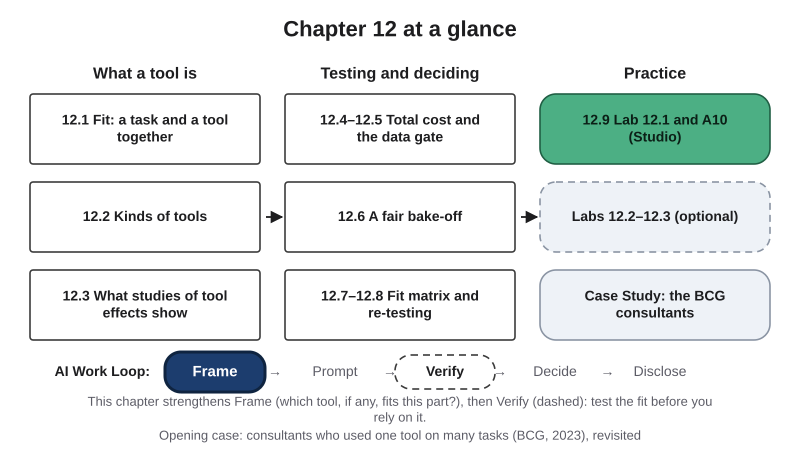{#fig-12-1 fig-alt="Chapter map: what a tool is (12.1–12.3), testing and deciding (12.4–12.8), practice (12.9, labs, case); Work Loop with Frame highlighted."}

**Chapter 12 at a glance.** You can reach many AI tools: chat assistants, AI inside email and documents, AI search, coding assistants, tools built for one field, models you run yourself. Rankings say which is "best." This chapter shows why that question has no general answer: a tool fits a *part of a task*, with *your input*, at *a cost you accept*, on *a date*, or it does not. You will learn to describe a tool, read studies of tool effects, count the full cost, check data terms, test tools side by side, record decisions in a fit matrix, and keep your work portable.

**Time:** about 36 minutes for the Core sections, and about 48 minutes for the whole Core package (with the Opening Case, the Check Yourself boxes, section 12.9 and the Summary; the Case Study is designed to be read together in the concept session); longer if English is not your first language. The required Review Questions A (items 1, 2, 3, 6, 8 and 11) and Spaced Review items 1 and 2 take about 10 minutes. A10 takes about 13 minutes before the lab session and about 60 minutes after it, including about 7 minutes to read its brief and rubric. The recommended reading, Brynjolfsson, Li and Raymond (2025), adds about 15 minutes if you read its introduction and its section on how often agents followed the tool's suggestions. Core sections are examinable; Studio sections are hands-on work; Deep sections and the two short cases are optional. Answers to Check Yourself, the faded examples and odd-numbered end-of-chapter questions are in Appendix E.

**The question of this chapter:** *Which AI tool should you use?* The Chapter Summary answers it.

## Opening Case: A Study You Met in Chapter 1 {.unnumbered}

Chapter 1 described an experiment with consultants at Boston Consulting Group (BCG), a management consulting firm. (If you read the sections of the study recommended in Chapter 11, you also saw its hardest task.) It holds two findings you have not met yet.

In 2023, 758 BCG consultants took part in a preregistered experiment, meaning the researchers wrote down their plan and measures before collecting results (Dell'Acqua et al., 2023, 2026). After a first task without AI, each consultant was randomly assigned to one of three groups: no AI; GPT-4, a large language model; or GPT-4 plus a short **prompt-engineering overview**, videos and documents on how to prompt it well. Everyone with AI used the same model, in the version available at the end of April 2023, with the provider's default options: its default *system prompt* (instructions the provider adds, which users do not see) and its default *temperature* (an option that changes how often less likely words are picked) (Dell'Acqua et al., 2023).

Chapter 1 gave you the headline: on 18 tasks inside the tool's frontier, AI raised the consultants' work; on one task outside it, consultants with AI were less often correct. The two new findings come from that one outside task.

**First**, the group that had been taught to prompt the tool was correct least often. About 85% of consultants without AI reached the correct answer. With GPT-4, about 70% did; with GPT-4 and the overview, about 60% (Dell'Acqua et al., 2023, Table 4). The gap between the two AI groups was smaller than either group's gap from the no-AI group: the authors call it significant only at a loose (10%) threshold.

**Second**, two sets of graders scored how good each recommendation was, on a scale from 1 to 10. Recommendations made with AI scored *higher* than those made without it, whether the recommendation was right or wrong (Dell'Acqua et al., 2023, Table 6 and Figure 8).

A study of a 2023 model still matters for its method: one tool, many tasks, and correctness measured apart from how good the work looked.

**The puzzle.** If the overview helped people use the tool, why did that group do no better, and probably worse, on the task outside the tool's frontier? And if graders could not tell wrong recommendations from right ones by their quality, how would you have noticed? Sections 12.1 and 12.6 answer these questions, and the Case Study returns to the consultants who got the task right.

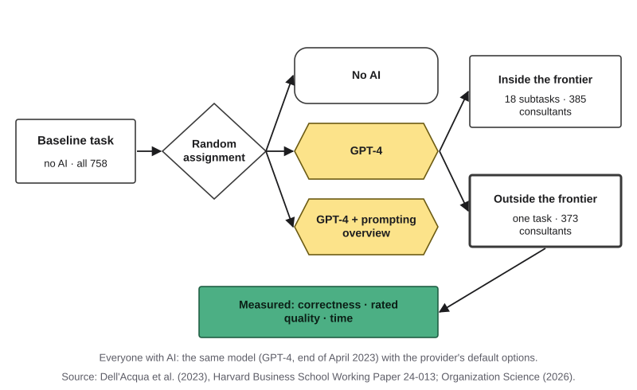{#fig-12-2 fig-alt="Design: a baseline task, then random assignment to no AI, GPT-4, or GPT-4 plus overview; an 18-subtask experiment and a one-task experiment."}

## Learning Objectives {.unnumbered}

Framework tags refer to the UNESCO (United Nations Educational, Scientific and Cultural Organization) AI Competency Framework for Students and the AI Fluency framework.

After this chapter you will be able to:

- **O1 — Explain**, with the jagged-frontier evidence, why fit belongs to a task, a tool, a way of using it and a date, not to a tool alone. *(LO2 · AI Fluency: Delegation · UNESCO: AI techniques and applications, Understand)*
- **O2 — Differentiate** AI tools by kind (chat assistant, AI in a productivity suite, AI search, coding assistant, domain tool) and by how the model is reached (closed service, open-weight, local), using what each tool receives, what it can do and whose terms cover it. *(LO2 · AI Fluency: Delegation · UNESCO: AI techniques and applications, Understand)*
- **O3 — Attribute** differences in the results of AI tool studies to their setting, measure, users and date. *(LO2 · AI Fluency: Discernment)*
- **O4 — Evaluate** a tool's total cost of use and its data terms for a given task, applying the data terms as a gate before any quality score. *(LO5, LO2 · AI Fluency: Diligence · UNESCO: ethics of AI, Apply)*
- **O5 — Conduct** a fair bake-off of at least two tools, or one tool and no AI, on typical, different and edge test inputs, scoring correctness, polish and time separately. *(LO2 · AI Fluency: Discernment, Description)*
- **O6 — Produce** A10: a task × tool fit matrix with a data gate, scored evidence, a fit decision and rung for each part, a re-test trigger and an AI Use Declaration. *(LO2, LO5 · AI Fluency: Delegation, Diligence)*

::: {.callout-note title="Warm-up (ungraded)"}
Answer from what you know today. You will come back to these in the Chapter Summary.

1. A model is ranked first on a public leaderboard. Will it be the best tool for a task in your major?
2. Consultants used one AI tool, with the same options, on two tasks from the same kind of work. Could the tool help on one and hurt on the other?
3. A free AI tool and a tool your institution provides give the same answer to your question. Name one thing that could still differ between them.

For each answer, write how sure you are, from 0 to 100%.
:::

## 12.1 Fit Belongs to a Task and a Tool Together {#sec-12-1 .unnumbered}

[Core]{.path}

Chapter 1 described the **jagged technological frontier**: the uneven boundary between tasks an AI tool handles well and tasks it handles poorly, even among tasks that look equally hard. It also named three things that move the frontier for you: the task, the tool and the date.

A frontier is drawn for *one* tool. A tool that can calculate, receives your files or searches the web has a different frontier, so one part of a task can sit on different sides for two tools.

**Task–tool fit** is how well one tool, used in one way, meets one task's success criteria within your limits of data and cost, on a given date. Fit belongs to a pairing, not to a tool: this part, this tool, this way of using it, today.

**A prompting overview did not move this tool's frontier on this task.** On the BCG task outside the frontier, the group given the overview was correct least often: about 60%, against about 70% for GPT-4 alone and about 85% without AI.^[From the working paper's Table 4, column 1: 84.4% without AI; 13.9 and 24.5 percentage points lower for the two AI groups (Dell'Acqua et al., 2023).] A **percentage point** is the simple difference between two percentages. The gap between the two AI groups is significant only at a loose (10%) threshold, and this is one task with one model in 2023, so read it as a warning, not a law.

Inside the frontier, the overview helped: that group scored highest and copied more of the tool's output, and there copying went with *better* scores (Dell'Acqua et al., 2023, Appendix C). On the outside task, the authors report that consultants who did worse adopted the output with less questioning. This book reads the two together: trusting a capable tool's output helped on one side of the frontier and hurt on the other. The overview did not make the tool able to do the one task.

That does not make prompting useless. How you use a tool is part of fit; a prompt that makes the tool work through the interview notes might change the result, and only a test would show it (section 12.6). Public rankings measure other people's questions, not your part (Deep 12.B).

::: {.callout-note title="Worked Example: One Part, Two Tools"}
**Field:** Engineering. *Featuring Sam (mechanical engineering), captain of the robotics club, who checks units on everything since one bad lab grade.* *(Constructed example.)*

Sam tries two tools on the club's parts order (Chapter 6). **Tool A**: a chat assistant under institutional terms, no calculation feature. **Tool B**: a chat assistant under consumer terms that runs calculations in code; he gives it only public information.

**Part 1, a short update email to sponsors.** Both drafts are clear and correct after a fact check: inside the frontier for both.

**Part 2, a unit conversion.** A motor's *stall torque*, its twisting force when held still, is listed as 41 ounce-inches (oz-in), a US unit. Sam needs it in newton-meters (N·m), the metric unit, and knows the answer: about 0.29 N·m. Tool A gives 2.9 N·m, ten times too large. Tool B runs the conversion in code and gives 0.29 N·m, in one run.

**Verdict:** for the same part, outside Tool A's frontier and inside Tool B's, on this date and on one test.
:::

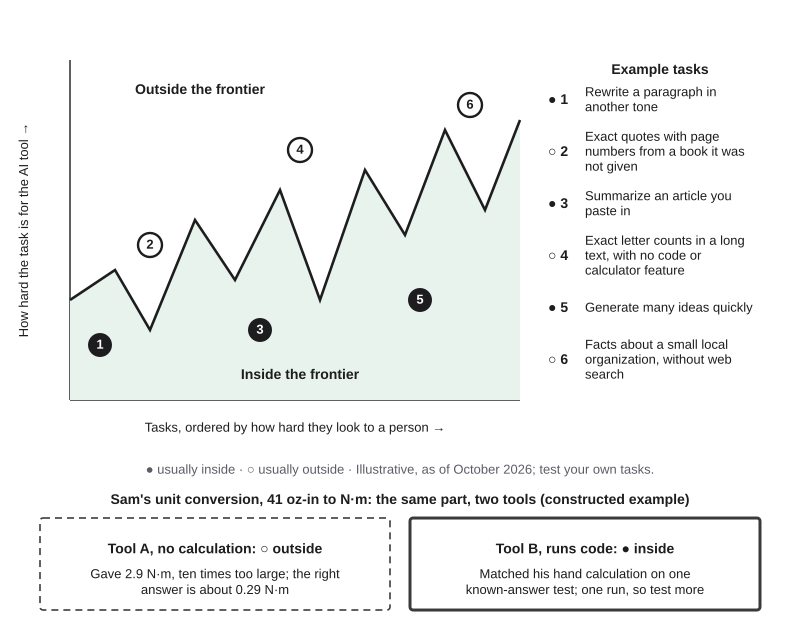{#fig-12-3 fig-alt="The jagged frontier map from Chapter 1, with two callouts for Sam's unit conversion: Tool A outside, ten times too large; Tool B inside, matched."}

::: {.callout-note title="Faded Example: Two Parts, Two Tools"}
**Field:** History. A history student has two parts of a task: (1) summarizing a transcribed 1890s letter that he pastes in, and (2) naming the archive that holds the original letter, which he already knows is a county historical society. He has a chat tool without search and an AI search tool.

**Part 1, prediction and test (filled):** inside the frontier for both, because the text is pasted in; test it by checking each summary sentence against the letter (Chapter 9).

**Part 2, prediction for each tool, and the test:** _______________________
:::

::: {.callout-important title="Your Turn (feeds A10)"}
Split the task you will use for A10 into two or three parts. For each part, predict which side of each tool's frontier it falls on, and write the test that would show it. This becomes A10 item 1.
:::

::: {.callout-tip title="Check Yourself 12.1"}
1. Define task–tool fit, and say why it is not a property of a tool alone.
2. On the BCG task outside the frontier, what happened to the group given the prompting overview, and how sure can we be about that gap?
3. A classmate says, "Copying good AI output always helps." Use the BCG results to answer.
:::

## 12.2 Kinds of AI Tools, and What Each One Receives {#sec-12-2 .unnumbered}

[Core]{.path}

This book uses **AI tool** for the software you use: a model plus what the tool adds to the model's context window, what it can do, where the model runs and whose terms cover it. Those are the four questions to ask of any tool. The **provider** is the company or institution that runs the tool.

Recall from Chapter 3 that the **context window** is the space for everything a language model receives in one turn, measured in *tokens* (units of text: a word, part of a word or a symbol). Tools differ mostly in what they put there. **Retrieval** is a system's search of a collection, such as the web or a set of files, that adds the passages it finds to the context window. **Tool use** is a model producing a request to run other software, such as a calculator or a search engine, whose result is added to the context window. So two tools built on the same model can behave very differently.

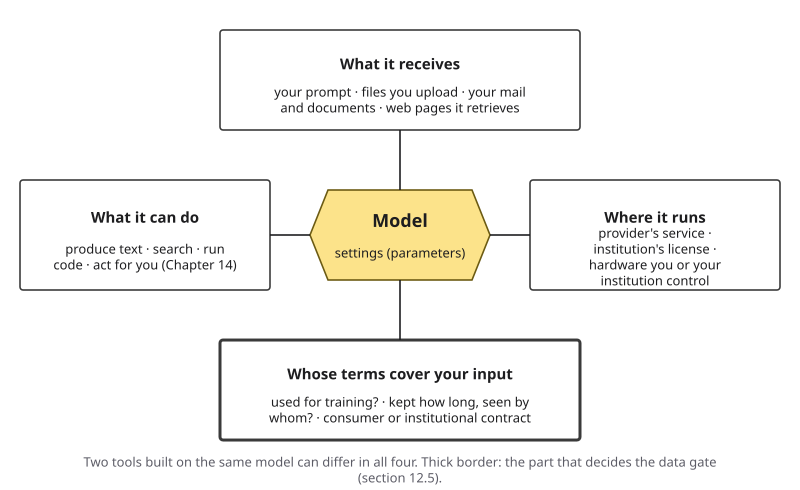{#fig-12-5 fig-alt="A model hexagon surrounded by four boxes: what it receives, what it can do, where it runs, and whose terms cover your input."}

| Kind of tool | What it receives | What it can do | Typical fit, and a typical risk |
|---|---|---|---|
| Chat assistant | Your prompt and anything you paste or upload | Produce text; some can search or run code | Drafting and explaining; it receives only what you give it |
| AI in a productivity suite | Your email, documents or spreadsheets, where you allow it | Draft and summarize inside those files | Work on your own files; it may receive more than the part needs |
| AI search | Pages it retrieves from the web | Produce an answer with links (Chapter 9) | Finding sources; a link does not show support |
| Coding assistant | Your code and files in an editor | Suggest or write code | Routine code; plausible code can still be wrong |
| Domain tool | A field's records or documents | Answer or draft within that field | Field-specific work; built for a field is not the same as tested on your task |

A **domain tool** is a tool built for one field, often given that field's records or documents. Chapter 11's rule holds for every kind: the less you can inspect, the more you must recalculate yourself. Media tools are Chapter 13's topic; tools that carry out steps on their own (*agents*, systems in which the model directs its own steps) are Chapter 14's.

**How the model is reached.** A closed model is used only through a service, its developer's or a partner's; whose terms cover you depends on who runs the tool you use, not who built the model. An **open-weight model** is a model whose settings (parameters), called its weights, can be downloaded and run under a *license*, the terms that say what you may do with it; Meta (July 2024) and OpenAI (August 2025) released such models (Meta, 2024; OpenAI, 2025). A **local model** is an open-weight model run on hardware that you or your institution control, so your input need not go to the model's provider. It needs a capable computer, and its quality varies by task (Deep 12.A).

::: {.callout-note title="What your institution provides"}
Many colleges, universities and employers provide or approve AI tools for their students or staff, often at no cost to you and under institutional terms: for example, an enterprise chat assistant with data protection when you sign in with your institution's account. Your institution's IT office is the place to find which tools it provides or approves, and for which data. The list changes, so check it each term and note the date you read it.

*In Compass (optional) and on your course site:* notes on the tools you can reach this term.
:::

::: {.callout-note title="Worked Example: Sam Sorts His Tools"}
*Constructed example.* Sam lists the tools he can reach, using the four questions.

| Tool | Kind | Receives | Can do | Runs where; whose terms |
|---|---|---|---|---|
| Tool A | Chat assistant | What he pastes | Produce text | Provider's service; institutional terms |
| Tool B | Chat assistant | What he pastes; web pages | Search; run code | Provider's service; consumer terms |
| Document editor's AI feature | Productivity suite | His open document | Draft, summarize | Provider's service; institutional terms |
| Design program's AI feature | Domain tool | His design files | Suggest shapes | Vendor's service; the club's license |
| A model on the club's lab computer | Local, open-weight | What he types | Produce text | The club's hardware; the model's license |

**Two differences that matter most for the parts order:** Tool B can calculate and search, Tool A cannot; Tool A's terms are institutional, Tool B's are not.
:::

::: {.callout-note title="Faded Example: A Design Student's Tools"}
**Field:** Arts and design. A design student lists four tools: a chat assistant; an image editor's AI feature that edits the image she opens; an AI search tool; and a font-pairing website that suggests fonts from a fixed list. All four run on their providers' services under consumer terms. **First tool (filled):** chat assistant; receives what she pastes; produces text; provider's service under consumer terms. Classify the other three, and name the two differences that matter most for a poster: _______________________
:::

::: {.callout-important title="Your Turn (feeds A10)"}
List the tools you can reach, starting with one your institution provides or approves, if any, with each tool's kind, what it receives, and where it runs. This becomes A10's tool column.
:::

::: {.callout-tip title="Check Yourself 12.2"}
1. Name the four questions that describe an AI tool.
2. How can two tools built on the same model behave differently?
3. A club installs an open-weight model on its own lab computer. Is it a local model, and whose terms cover what members type?
:::

## 12.3 What Studies of Tool Effects Show, and Why They Differ {#sec-12-3 .unnumbered}

[Core]{.path}

**Predict first.** Experienced developers, working on their own projects, estimate that an AI coding tool will make them faster. Afterwards, they still feel faster. Were they?

Studies of AI tools at work often seem to disagree because they measure different things. Before you use a result, ask five questions: **What was the setting** (a designed task or real work)? **What was measured, and was the tool given at random?** **Who used the tool?** **Which tool, and when?** **Who ran the study?**

| Study | Setting and users | Tool and date | Measure | Result |
|---|---|---|---|---|
| Customer support (Brynjolfsson et al., 2025) | Real chats at one software firm; more than 5,000 agents, about 1,600 of them with the tool | A domain tool: an assistant built on a GPT-family model, further trained on the firm's past support chats, giving reply suggestions; rolled out mostly from November 2020 to February 2021 | Issues resolved per hour | Higher productivity, most for less experienced agents (Chapter 1). Agents followed about 38% of suggestions on average; gains were larger for those who followed more |
| Coding, lab task (Peng et al., 2023) | 95 freelance developers recruited, 70 finished; one designed task, a small web server | A coding assistant; 2022 | Time to finish | 55.8% faster with the tool, within a wide plausible range (21% to 89%) |
| Coding, own projects (Becker et al., 2025) | 16 experienced developers; 246 real tasks on projects they knew well | AI coding tools of early 2025 | Time per task, AI allowed or not, assigned at random per task | 19% *longer* with AI allowed |

In the customer-support study, the tool was built for the job and many users were new to it. The lab task was small and well defined, and its authors included researchers at the tool's maker, which is worth knowing, though it does not make the result wrong. In the third study, experts worked on large projects they knew well.

The third study answers the prediction. The developers forecast that AI would cut their time by 24%, and afterwards believed it had cut it by about 20%; measured, their tasks took 19% longer (Becker et al., 2025). Its authors at METR (Model Evaluation and Threat Research, a nonprofit) caution against generalizing beyond early-2025 tools in this setting. In February 2026 they reported that a new round pointed toward a speedup, but judged it unreliable, because many developers who did not want to work without AI declined to take part (METR, 2026).

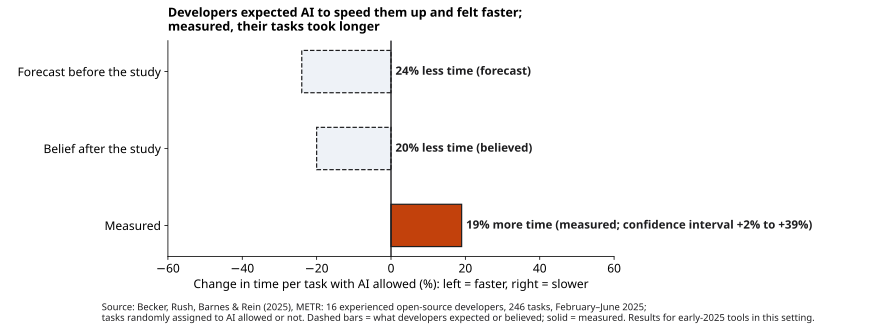{#fig-12-7 fig-alt="Bars, early 2025: developers forecast 24% less time, afterwards believed 20% less time; measured time was 19% longer with AI allowed."}

A study tells you about *its* task and users; your own test tells you about yours. And your feeling of speed is not a measurement.

::: {.callout-note title="Worked Example: Which Study Is Closest to the Club?"}
*Constructed reasoning.* Sam wants an AI coding tool for the club's robot code: new, small code; mostly beginners; newer tools than early 2025. The experienced-developer study is least like his setting; the lab study is closer, but its task was designed to be well defined. **Conclusion:** neither answers his question. He will time a real club task with and without the tool, counting checking time.
:::

::: {.callout-note title="Faded Example: An AI Tutor Study"}
**Field:** Education. A student teacher reads a constructed study summary: "In fall 2025, 400 first-year students in one large statistics course were randomly given an AI tutor tool for homework, or not. Those with it scored 4 points higher on the final exam." **Setting (filled):** one semester of homework in one large university course. **Measure (filled):** final exam scores. **Users, tool and date, and one way her ninth-grade classroom differs:** _______________________
:::

::: {.callout-important title="Your Turn (feeds A10)"}
Which study in this section has the setting closest to your A10 task? Name one way your result could differ from it. You will use this sentence in A10's judgment.
:::

::: {.callout-tip title="Check Yourself 12.3"}
1. List the five questions to ask before you use a study's result.
2. The table has three studies. Why do the two coding studies not contradict each other?
3. What did the developers in the 2025 study believe, and what was measured?
:::

## 12.4 What a Tool Really Costs {#sec-12-4 .unnumbered}

[Core]{.path}

"It's free" is a common reason for choosing a tool, but price is only one part of the cost. This book calls the whole of it the **total cost of use**: the price, plus usage limits, plus the time you spend checking outputs, plus the time you spend learning the tool, plus what you give up in data (section 12.5), plus the cost of switching later (section 12.8).

**Price comes in four common forms.** A *free tier* is a no-cost level of a product, with limits such as a number of messages per day or fewer features. A *paid subscription* charges a monthly fee. A *university or employer license* is paid by the institution, so it is free to you, but it is tied to your enrollment or your job. *Pay per use* means software sends requests through an **API** (application programming interface, a channel through which software, not a person, sends requests), and the provider charges per token received and produced (Chapter 3).

**The largest cost is often your checking time.** This book calls it the **verification cost**: the time and effort needed to confirm that an output meets your criteria. A tool that drafts in one minute but needs ten minutes of checking can cost more than doing the part yourself. On the BCG task outside the frontier, the consultants with AI finished faster than those without it, and were more often wrong (Dell'Acqua et al., 2023).

In other words, a fast tool is cheap only if its output is quick to check. So always compare against a **no-AI baseline**: the time a part of the task takes you without any AI tool, done well enough to meet your criteria. An honest estimate is enough; time it only if the part is short.

*In Compass (optional) and on your course site:* current price forms and limits, by tool and term.

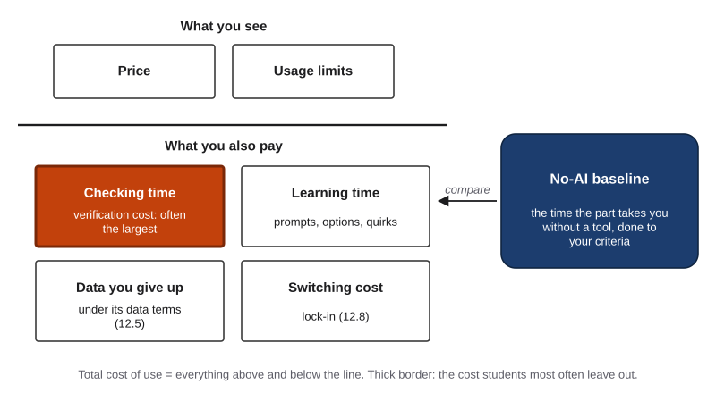{#fig-12-8 fig-alt="Above a line: price and limits. Below it: checking time, learning time, the data you give up, switching cost; beside it, a no-AI baseline."}

::: {.callout-note title="Worked Example: Twenty Datasheets"}
*Constructed numbers, for teaching.* A *datasheet* is a maker's one- or two-page list of a part's ratings. The club needs one-page summaries of 20 public motor datasheets. Sam times one of each approach.

| Approach | Per datasheet | For 20 | Notes |
|---|---|---|---|
| No AI (his baseline) | 10 min reading and typing | 200 min | — |
| Tool A (institutional license) | 1 min + 6 min checking | 140 min | Free to him while enrolled |
| Tool B (free tier) | 1 min + 8 min checking links | 180 min | Stops at a daily limit; two days |

Tool A costs least, but only because checking a summary is faster than writing one. For the torque calculation, the opposite holds: his own spreadsheet takes 5 minutes, and checking any tool's answer means redoing the calculation anyway. **Decision:** a tool for the summaries; no AI for the calculation.
:::

::: {.callout-note title="Faded Example: A Tax-Season Intern"}
**Field:** Accounting. An intern summarizes 10 public annual filings for a client file. **Price and limits (filled):** the firm's licensed tool, no limit; a free tool, 20 messages a day, enough for this job. **Times (filled):** writing a summary herself, 15 minutes; with either tool, 1 minute to draft plus 8 minutes to check the licensed tool's summary, or 12 minutes to check the free tool's, which mixes up two years' figures more often. **Total for each approach, and the lower total cost:** _______________________
:::

::: {.callout-important title="Your Turn (feeds A10)"}
Estimate the cost row for your A10 task: price form and limits for each tool, your checking time, and your no-AI baseline.
:::

::: {.callout-tip title="Check Yourself 12.4"}
1. List the parts of the total cost of use.
2. A tool drafts a lab summary in 1 minute; checking it takes 14 minutes; writing it yourself takes 12. Which costs less, and which part of the total cost decided it?
3. Why should every comparison include a no-AI baseline?
:::

## 12.5 Data Terms Decide Which Tools You May Use {#sec-12-5 .unnumbered}

[Core]{.path}

Before you ask whether a tool is good at a part, ask whether you may give it the input. A tool's **data terms** are the parts of its terms and its options that say what happens to what you type and upload. They differ between providers and often between plans from one provider.

**Three questions about the tool:**

1. **Training.** Is your input used to train or improve the provider's models? Is that the default, and can you *opt out*, that is, turn it off?
2. **Retention and access.** How long is your input kept (its *retention*), and who can see it: the provider's reviewers, your institution's administrators?
3. **Whose contract.** Are you covered by **consumer terms**, which you accept as an individual, or by **institutional terms**, a contract between the provider and your university or employer, which often promises not to train on your data?

**One question about your input:** what is its **data class**, the category an institution assigns to information by how much harm its release could cause? Institutions name and draw their classes differently, often in three or four levels; this book uses three. **Public** information is meant for anyone, such as press releases, public websites and published papers. **Internal or confidential** information is not meant for the public, though its release would usually cause limited harm, such as internal email, unpublished drafts and student or employee ID numbers. **Restricted or legally protected** information is protected by law, contract or policy, and its release could seriously harm people, such as Social Security numbers, medical information and education records. In the United States, two laws stand behind many such records: FERPA (the Family Educational Rights and Privacy Act) protects students' education records, and HIPAA (the Health Insurance Portability and Accountability Act) protects health information held by most health care providers and health plans.

Put together, the answers form a **data gate**: a check, made before any quality test, of whether a tool's data terms fit the class of the input. In this book, the gate works as in the table.

| Input | Consumer terms (for example, a free tier) | Institutional terms (for example, a tool your institution provides or approves) |
|---|---|---|
| Public information | Yes | Yes |
| Your own non-sensitive work; material your course provides; de-identified data (names and identifiers removed) | Yes, if you accept the tool's training and retention terms | Yes |
| Personal data about other people (names, contact details), and internal or confidential information | No | Only if the part needs it and your institution's rules allow it; ask its IT office if unsure |
| Restricted or legally protected information, including FERPA and HIPAA records | No | No, for any work in this book |

*The rows are this book's reading of common guidance, built on three generic classes; in this book, an input's data class is its row. Your institution's or employer's own classification decides; this table is a starting floor. A field rule (a placement policy, an IRB (institutional review board) protocol, a consent form, HIPAA's de-identification standard, an employer's policy) can still say no to an input the table allows.*

A tool that fails the gate is out for that part, however good its outputs. Often you can pass by changing the input: remove the names, use placeholders, or describe the problem without the confidential details.

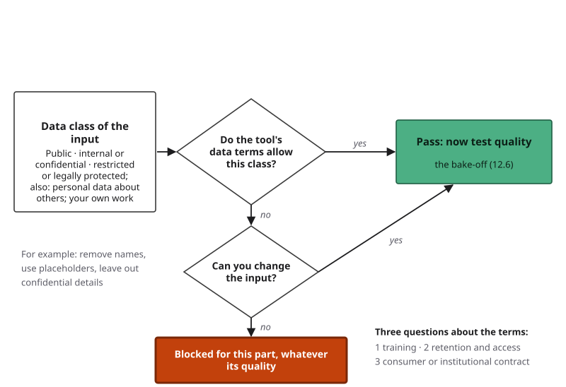{#fig-12-9 fig-alt="Decision diagram: the input's data class, then do the tool's terms allow it? Yes: test quality. No: can you change the input? Yes: pass; no: blocked."}

::: {.callout-note title="Data terms of three providers (as of October 2026)"}
- **Anthropic** asked consumer-plan users, from August 28, 2025, to choose whether their chats may train its models; if they agree, new or resumed chats are kept up to five years, otherwise 30 days. Business, government, education and API services were excluded (Anthropic, 2025).
- **OpenAI**'s individual plans let users turn off training on their chats, though a thumbs-up or thumbs-down can still make that conversation usable; by default, it does not train on its business, education and API services' data (OpenAI, n.d.-a, n.d.-b).
- **Microsoft** says that with enterprise data protection, Copilot Chat prompts and responses are not used to train the underlying models; web search queries fall under separate terms (Microsoft, 2026).

If your institution provides a tool, its IT office can tell you how to confirm that you are signed in under institutional terms (some tools show a protection badge) and which data the tool may receive.
:::

::: {.callout-note title="Worked Example: Thank-You Emails"}
*Constructed example.* Sam wants help drafting thank-you emails to the club's sponsors from a spreadsheet with each contact's name, email address and phone number.

**Data class:** personal data about other people. **Tool B** (consumer terms): no, for this input. **Tool A** (institutional terms): only if the part needs the data.

The drafting does not need the names. So Sam gives Tool A a template with placeholders, such as [Name] and [Company], and merges the names by hand. With the names removed, the input is his own non-sensitive work, and either tool would pass the gate.
:::

::: {.callout-note title="Faded Example: Survey Comments"}
**Field:** Public health. A student has 300 comments from a survey published by a city health department, with no names or other identifiers. She can use a free consumer tool whose terms allow training by default, with an opt-out, and a tool her institution provides. **Data class (filled):** public. **Can each tool receive it, and is there any reason to opt out anyway?** _______________________
:::

::: {.callout-important title="Your Turn (in Lab 12.1)"}
In the lab session, answer the three questions for two tools, citing the page or card you read and its date.
:::

::: {.callout-tip title="Check Yourself 12.5"}
1. Name the three questions about a tool's data terms and the one question about your input.
2. You want a tool to fix the grammar in a lab report you wrote, with no data about other people. Which kinds of terms may receive it, and on what condition?
3. Name two ways to pass the gate by changing the input.
:::

## 12.6 Test the Fit: A Fair Bake-off {#sec-12-6 .unnumbered}

[Core]{.path}

A **bake-off** (a borrowed cooking-contest word) is a side-by-side test of two or more tools, and where possible no AI, on the same part of a task: on *my* inputs, which option meets *my* criteria at the lowest total cost?

A bake-off is fair only if **it changes only the tool**:

- the same task frame and success criteria (Chapter 5), written before you start;
- the same prompt, word for word;
- the same **test inputs**: a small set of different inputs a prompt is tried on (typical, different, edge) to see whether it works beyond one case (Chapter 5). An *edge* input is the unusual but possible case;
- a fresh chat for each run, with the tool's saved settings for you switched off or the same in every tool: **standing instructions**, instructions you write once, in a tool's options or a project, that the tool adds to every conversation in that scope, and **memory**, a product feature that saves notes about a user, or draws on past chats, and adds them to later conversations; it adds text and does not train the model;
- the tool, the model if shown, and the date, recorded for every run;
- a second run where it is cheap, because outputs vary from run to run (Chapter 3).

**Score three things separately.** **Correctness:** does each criterion hold, checked with an **independent check**, evidence that no AI tool produced: a source with an author or publisher you can name, or your own recalculation or reasoning from known inputs (Chapter 8)? **Polish:** how finished the output looks and reads, on a five-point scale: 1 rough, 3 usable after edits, 5 ready to send. **Time:** including the time you spent checking.

Why separately? On the BCG task outside the frontier, recommendations made with AI received quality ratings about 18% to 25% above the no-AI average, while the share of correct recommendations fell (Dell'Acqua et al., 2023). Judged by quality alone, the worse option looked better. Chapter 11 called the risk **automation bias**: the tendency to over-rely on automated output, following it when it is wrong or missing what it did not flag.

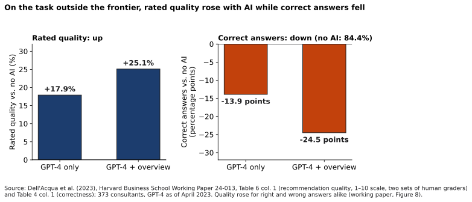{#fig-12-10 fig-alt="Two panels, BCG outside task: rated quality up 17.9% and 25.1% with AI; correct answers down 13.9 and 24.5 points, from 84.4% without AI."}

The **edge input** often matters most, because it is where a tool is likely to fill a gap with something that was not there. Sam met this in Chapter 4, when a tool gave a stall torque, and a datasheet revision, that did not exist.

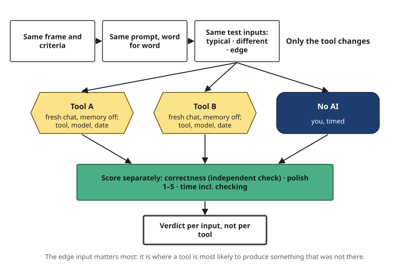{#fig-12-11 fig-alt="Process: same frame and criteria, same prompt, same three test inputs, fresh chats in Tool A, Tool B and no AI; score correctness, polish, time."}

::: {.callout-note title="Worked Example 1: The Datasheet Bake-off"}
*Constructed example; mirrors the concept session's demonstration.* Part: a one-page summary of a public motor datasheet. **Criteria:** C1 every number matches the datasheet, with units; C2 values given in metric units, correctly converted; C3 missing values marked "not given"; C4 one page, as a table. **Inputs:** typical, a metric datasheet; different, a US-unit datasheet from another maker; edge, a datasheet that does not list stall torque.

| Input | Tool A (pasted text) | Tool B (with web search) |
|---|---|---|
| Typical | 4/4 · polish 5 · 7 min | 4/4 · 5 · 9 min |
| Different | 3/4: C2 not met (torque ten times too large) · 5 · 8 min | 4/4 · 5 · 9 min |
| Edge | 4/4: "not given" · 5 · 6 min | 3/4: C3 not met; stall torque filled from a web page about another motor · 5 · 10 min |

**Verdict, per input:** Tool A needs a unit check on US-unit sheets; Tool B's edge failure is the more dangerous kind, because the invented value looked real.
:::

::: {.callout-note title="Worked Example 2: A Caption, Where Quality Is a Judgment"}
**Field:** Marketing. *(Constructed example.)* Let's take a task where quality is partly a matter of taste. A marketing student tests two tools on a 30-word caption for a campus food pantry. Much of a caption is judgment, so she writes checkable criteria for the rest: C1 hours and location match the pantry's web page (an independent check); C2 no promise the pantry has not made; C3 at most 30 words. Polish she rates 1–5 with the anchors above, with two classmates. **Inputs:** typical, regular hours; different, a holiday closure; edge, a notice with no hours. **Result:** both tools 3/3 on the typical input; on the edge input, one invents "open daily 9–5" (C1 not met, polish 5). **Verdict:** the most polished caption was the wrong one.
:::

::: {.callout-note title="Faded Example: Coding Open-Ended Answers"}
**Field:** Sociology. A student compares two tools for sorting 40 open-ended answers from a public dataset into five themes, against his own coding. **Typical input (filled):** Tool 1 sorted 36 correctly; Tool 2, 35; both polish 4. **Edge input:** five answers that fit no theme. Tool 1 put all five under "Other"; Tool 2 forced each one into a theme. Score each tool on the edge input and write the verdict: _______________________
:::

::: {.callout-important title="Your Turn"}
Lab 12.1 is your bake-off (section 12.9).
:::

::: {.callout-tip title="Check Yourself 12.6"}
1. What must stay the same in a fair bake-off?
2. Two tools both score polish 5 on a caption, but one invented the store hours. Which scores tell you this, and why must they be kept apart?
3. Why does the edge input often matter most?
:::

## 12.7 Decide with a Fit Matrix {#sec-12-7 .unnumbered}

[Core]{.path}

A bake-off tests one part; real tasks have several, and they rarely fit the same tool. A **fit matrix** is a table whose rows are the parts of a task and whose columns are the tools you tested plus **no AI**; each cell holds a fit decision, its rung and its reason.

**Four fit decisions:**

- **use**;
- **use with a named check** (say which check);
- **use only as a lead**: a starting point that you then verify somewhere else;
- **do not use**.

In the no-AI column, "use" means you do the part yourself.

**The rung** is the step of the Delegation Ladder you work on: the book's arrangement of three ways of working with AI over a floor of no AI, ordered by how hard it is to check what the AI contributed before it takes effect (Chapter 5).

- **Floor:** no AI; you do the part yourself.
- **Automation:** the AI carries out a part you define, and you check the output.
- **Augmentation:** you and the AI shape the part together, turn by turn.
- **Agency:** you configure AI to carry out future tasks on your behalf, including for other people (Chapter 14).

**Decide cell by cell.** Chapter 11's decision matrix compared options against weighted criteria. A fit matrix differs in two ways: the data gate is a veto, so a blocked cell stays blocked however well the tool scored; and each part gets its own decision, so there is nothing to add up across parts.

Chapter 11's **sensitivity check** still helps: a sensitivity check is changing one choice in an analysis to see whether the result changes. Here, change one thing, such as the stakes of a part or the time you allow, and see whether a cell's decision flips. Mark a cell "predicted" only if you did not test it, and "tested once" if you ran it only once.

Every decision also carries a **re-test trigger** (section 12.8).

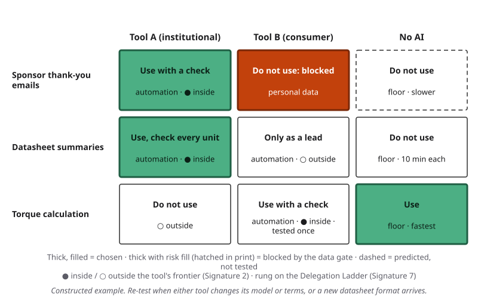{#fig-12-12 fig-alt="Three parts by Tool A, Tool B and no AI: emails with Tool A; datasheets with Tool A plus a unit check; torque by hand. One cell blocked."}

::: {.callout-note title="Worked Example: Sam's Matrix"}
*Constructed example.* Each cell: decision · rung · reason.

| Part | Tool A (institutional) | Tool B (consumer) | No AI |
|---|---|---|---|
| Sponsor thank-you emails | **Use with a named check** · automation · placeholders; check facts and tone | Do not use · — · blocked for the contact list (personal data); not tested with placeholders | Do not use · floor · predicted: three times slower, no better |
| Datasheet summaries | **Use with a named check** · automation · check every number and unit | Use only as a lead · automation · invented a value on the edge input | Do not use · floor · 10 min each against 7 |
| Torque calculation | Do not use · — · wrong conversion | Use with a named check · automation · tested once; checking means redoing it | **Use** · floor · fastest, and already checked |

**Re-test triggers:** a new version of either tool; a datasheet format he has not tested; a change in either tool's terms.
:::

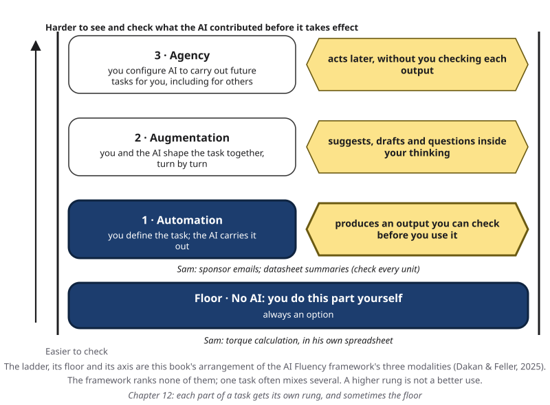{#fig-12-13 fig-alt="The Delegation Ladder with Sam's parts: automation for the emails and datasheet summaries; the floor, no AI, for the torque calculation."}

::: {.callout-note title="Faded Example: A Lesson Plan"}
**Field:** Education. A student teacher's matrix has three parts and two tools plus no AI. Her results: (1) a reading passage at the right level: Tool 1 passed the school's reading-level check on all three test inputs; Tool 2 failed it on the edge input; writing it herself takes 40 minutes. (2) Ten comprehension questions: both tools wrote two questions the passage cannot answer; she writes good ones in 15 minutes. (3) An answer key: checking either tool's key means answering every question herself. **First row (filled):** Tool 1, use with a named check (reading level) · automation; Tool 2, use only as a lead · automation; no AI, do not use · floor · 40 minutes. **Fill the other two rows:** _______________________
:::

::: {.callout-important title="Your Turn"}
A10 is your fit matrix (section 12.9 and the Application Assignment).
:::

::: {.callout-tip title="Check Yourself 12.7"}
1. What are the four fit decisions?
2. A tool scores 4/4 on every input, but the input is a classmate's medical note. What goes in the cell, and why does the score not matter?
3. When should a cell be marked "predicted", and when "tested once"?
:::

## 12.8 Lock-in, Switching and Re-testing {#sec-12-8 .unnumbered}

[Core]{.path}

A fit you tested last month may not hold today, because tools change under you. This book calls this **drift (in a tool or model over time)**: a change in how a named model or tool behaves on the same inputs over time, often after its provider updates it. (Chapter 9's *drift* was a change in a claim as it is retold; this is a different sense.)

The evidence is direct. Researchers gave the March 2023 and June 2023 versions of two named models, GPT-4 and GPT-3.5, the same 1,000 numbers, half of them prime, and asked whether each was prime. GPT-4 was correct on about 84% in March and 51% in June, about what guessing scores on a set that is half prime; GPT-3.5 moved the opposite way, from about 50% to 76% (Chen, Zaharia & Zou, 2024). The authors trace much of GPT-4's change to the June version no longer working step by step as the prompt asked: a change in behavior more than a loss of ability. Both were sold as "GPT-4"; only a dated version label told them apart. One narrow math task does not show how much every task drifts. In other words, a tool's name tells you who made it, not how it behaves today. Providers also **retire** models (Case Study, short case 2).

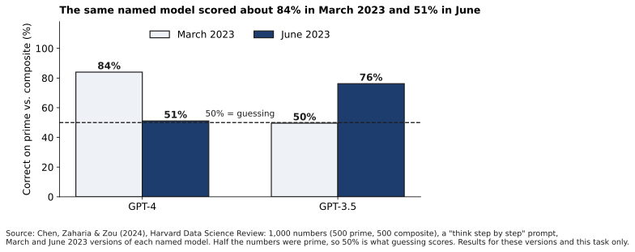{#fig-12-14 fig-alt="Two pairs of bars, March and June 2023, 1,000 numbers: GPT-4 fell from 84% to 51% correct; GPT-3.5 rose from 50% to 76%. 50% = guessing."}

**Lock-in** is the effort and cost that keep you on a tool after a better fit appears. It builds up from:

- your **chat history**, if the only copy is in the tool;
- **standing instructions** and **memory** (section 12.6), which hold your preferences inside one tool;
- files and setups that live inside one service;
- habits, and the time it took to learn the tool;
- licenses that end, for example when you leave a school or a job.

**Keep your work portable.** Store your task frames, prompts, test inputs and criteria in your own files, so you can re-run a bake-off in any tool in minutes, and export what you need. Then decide in advance what will send you back to testing. A **re-test trigger** is an event that should make you test a fit again: a model update or retirement, a change in price or terms, a new kind of input, or a change of job or school.

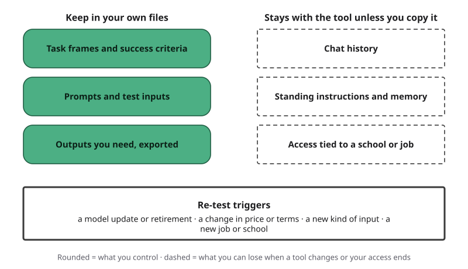{#fig-12-15 fig-alt="Two columns: what you keep in your own files, what stays with the tool. Below, four re-test triggers: update, terms, new input, new job."}

::: {.callout-note title="Worked Example: The Handover Note"}
*Constructed example.* Sam is a senior. Before he graduates, he writes a handover note for next year's captain. It holds the datasheet prompt, the three test inputs and the four criteria, in the club's shared folder; the club project's standing instruction from Chapter 6, copied out of the tool; Sam's matrix with its dates; and a line: "Re-test the datasheet cells when either tool changes its model, and before using any new tool." His own access to the institutional tool may end when he graduates, so nothing the club needs lives only in his account.
:::

::: {.callout-note title="Faded Example: A Study Tool"}
**Field:** Nursing. A nursing student uses one tool for flashcards from her own lecture notes. Next term she starts pharmacology, the tool's provider has announced a new model, and she will switch from her laptop to a shared lab computer. **Re-test triggers (two filled):** the new model; drug names the tool has not handled before. **Two more, from the facts above or from section 12.8's list:** _______________________
:::

::: {.callout-important title="Your Turn (feeds A10)"}
Name one thing you would lose if your main AI tool disappeared tomorrow, and how you would keep it. Then write the re-test trigger for A10 item 6.
:::

::: {.callout-tip title="Check Yourself 12.8"}
1. Define drift in a tool or model over time, and say what the 2023 prime-number test did and did not show.
2. Name four sources of lock-in.
3. A tool you rely on announces a new model next month. What do you do, and what makes it quick?
:::

## 12.9 The Tool Bake-off (Lab 12.1 and A10) {#sec-12-9 .unnumbered}

[Studio]{.path}

A10 is one record in this chapter's order. You bring a real task split into parts, with the frame and three test inputs for the part you test; in the lab you read data terms with your team and run your bake-off; afterward you finish. The record: task and frame → data class → tools → data gate for each tool (three questions, cited) → runs on three test inputs → scores (correctness with independent checks, polish, time) → cost row with a no-AI baseline → matrix decisions with rungs and reasons → re-test trigger → judgment → AI Use Declaration.

Valid results that can earn full marks include "neither tool fits this part," "the tools tied," "no AI was faster once checking was counted" and "the gate blocked the better tool."

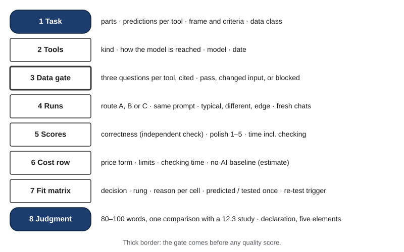{#fig-12-16 fig-alt="A10 sheet: task and data class, a gate row per tool, run rows with correctness, polish and time, a cost row, the matrix and a re-test trigger."}

::: {.callout-note title="Worked Example: One of Sam's Rows"}
*Constructed.* Edge input, Tool B: C1 met (checked against the datasheet); C2 met; C3 **not met**: stall torque filled from a page about another motor (independent check: the maker's datasheet lists none); C4 met. Polish 5. Time 10 min including checking.
:::

::: {.callout-note title="Faded Example: A Partly Filled Sheet"}
**Task (filled):** a 100-word abstract for a biology lab report the student wrote; data class: own non-sensitive work. **Gate row (filled):** Tool A, institutional terms, pass; Tool B, consumer terms, pass (no data about others). **Typical-input row (filled):** Tool A 3/3 · polish 4 · 6 min; Tool B 2/3 (dropped the sample size) · polish 5 · 7 min. **Edge input:** a report whose results section is missing; Tool A wrote "results not provided"; Tool B wrote results that do not exist. Score the edge row: _______________________ (The full sheet is in the book's companion files.)
:::

::: {.callout-tip title="Check Yourself 12.9"}
1. In what order does A10 put the gate and the quality scores, and why?
2. Name two results that are valid even though no tool "wins".
:::

## Deep 12.A: Open Weights, Open Source and Running a Model Yourself {#sec-12-deep-a .unnumbered}

[Deep]{.path}

"Open" is used for very different releases. The Open Source Initiative (OSI), the body that maintains the best-known definition of open-source software, published version 1.0 of an Open Source AI Definition on October 28, 2024. It asks for three things, each under terms that allow use, study, change and sharing: detailed information about the training data, enough for a skilled person to build a substantially equivalent system (information about the data, not necessarily the data itself); the complete code used to train and run the system; and the model's parameters, such as its weights (Open Source Initiative, 2024).

Many releases called "open" provide only the third: the weights, under a license that may limit some uses. This book calls those releases **open-weight**. You can run them, and often adapt them, but you cannot fully see or rebuild how they were made.

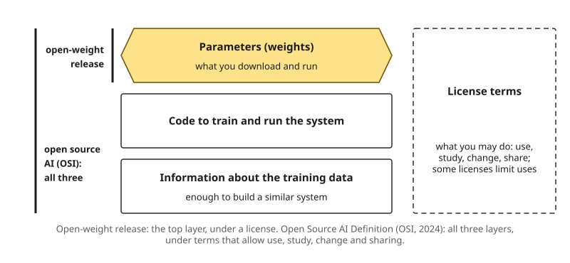{#fig-12-21 fig-alt="Layers: weights, code to train and run, training-data information, plus license terms. Open-weight gives the first; open source AI asks for all."}

**What running a model yourself changes.** Your input can stay on hardware that you or your institution control, so it need not go to the model's provider. That can widen what passes the data gate (section 12.5), if your institution's rules agree. **What it does not change.** You need memory and a capable computer; small models that fit on a laptop often do worse on hard parts than large hosted ones; you take over updates; and the license still applies (licenses are Chapter 18's topic). A local model is one more column in your fit matrix, and it needs the same bake-off as any other.

## Deep 12.B: Beyond One Study: Field Experiments, National Data and Leaderboards {#sec-12-deep-b .unnumbered}

[Deep]{.path}

**Field experiments.** Three companies, Microsoft, Accenture and an anonymous large firm, gave a random subset of their developers an AI coding assistant, GitHub Copilot, as part of normal work in 2022 and 2023. Pooled across 4,867 developers, those with the tool completed about 26% more tasks, counted as pull requests (units of finished code submitted for review); each experiment alone was noisy, and results varied across the three. Less experienced developers adopted the tool more and gained more (Cui et al., 2026). Apply section 12.3's questions: the tool's parent company was one of the three firms, and some authors work there; and a count of finished units is not a measure of their quality.

**National data.** In Denmark, researchers linked surveys of about 25,000 workers in 11 occupations to official earnings and hours records. Through 2024, the adoption of AI chatbots had no detectable effect on earnings or recorded hours, ruling out effects larger than 2%, and workers reported average time savings of about 3% (Humlum & Vestergaard, 2026). Large gains in one task do not have to add up to large changes across a whole job.

**Leaderboards.** A **benchmark** is a standard test used to compare models (Chapter 5). A **leaderboard** is a ranking of models by benchmarks or by crowd votes. An audit of one popular crowd-vote leaderboard, covering 2 million comparisons, 243 models and 42 providers from January 2024 to April 2025, reported that undisclosed private testing let a few providers test many versions before release and publish only the best score; in a single month it counted 27 private versions from one provider (Singh et al., 2025). The leaderboard's operators answered on May 9, 2025: they accepted some recommendations, such as marking pre-release scores as provisional, and disputed several claims, including the paper's count of open models (LMArena, 2025). Whatever the details, a ranking scores models on other people's questions. It can start a shortlist; only your bake-off settles fit.

## Hands-on Labs {.unnumbered}

The labs say what to do, not which buttons to press. Full lab sheets are in the book's companion files. Use a tool your institution provides or approves (for example, an enterprise chat assistant with data protection) where you can. You never need to create a new account: dated outputs of a second tool are provided. Use only public information, your own non-sensitive work or the provided material; never put personal data about other people, internal or confidential information, or restricted or legally protected information into a prompt.

*In Compass (optional) and on your course site:* step-by-step notes for current tools. *In Compass and in the book's companion files:* the lab pages for Labs 12.1 to 12.3.

### Lab 12.1: Tool Bake-off (Studio · 75 minutes · lab session) {.unnumbered}

**Before the lab (about 13 minutes):** split your A10 task into two or three parts; for the part you will test, write the frame with 3–4 success criteria and three test inputs (typical, different, edge); name the input's data class (section 12.5).

1. **Briefing (10 min).** Fit belongs to a task and a tool together (@fig-12-3); the data gate (@fig-12-9); the bake-off rules (@fig-12-11); correctness and polish scored separately (@fig-12-10), with polish on the 1-to-5 scale.
2. **Terms jigsaw (12 min).** In a *jigsaw*, each team member studies one piece and teaches it to the others. Each member reads one tool's dated terms card (the cards include one tool under institutional terms) and answers the three data-terms questions; the team fills one gate table.
3. **Runs (33 min, individual).** Run your prompt in two tools, or one tool and your own no-AI work, on your three inputs. Score each output as you go. Check the typical input's correctness with an independent check. If time runs short, finish the edge input afterward.
4. **Share and critique (15 min).** Each team shows one output whose polish and correctness disagreed, and one gate decision.
5. **Exit (5 min).** Name one part of your task you will keep on the floor (no AI), and why.

### Lab 12.2: Data-Terms Reading Sprint (Check It · optional) {.unnumbered}

Answer the three data-terms questions for three tools from their own pages, with the date you read each page: about 20 minutes with the lab's cards, and up to an hour if you read the providers' full pages, especially in a second language. Compare your answers with a classmate's. Where did you disagree, and which page settles it?

### Lab 12.3: Re-test an Old Fit (Explore · 20 minutes · optional) {.unnumbered}

Rerun the final prompt from your Chapter 5 assignment (A3) on its test inputs, in the same tool, twice per input. Record the model and the date. Did anything change beyond ordinary run-to-run variation? Has a re-test trigger fired?

## Case Study: How the Consultants Who Got It Right Worked {.unnumbered}

This case, designed to be read together in the concept session, asks a new question of the BCG experiment: how did the consultants who got the outside task right use the tool?

**The trap, in two lines.** The task asked for a recommendation to a company's chief executive: which brand had the most potential for growth. The spreadsheet looked complete, but the interview notes held details that pointed to a different answer from the one the authors expected AI to give when prompted with the exercise instructions, the data and the interviews (Dell'Acqua et al., 2023).

**Two ways of working.** Among the consultants who were correct while using AI, the authors describe two patterns. **Centaurs**, named after the creature of Greek myth that is half human and half horse, divided the work: they decided which parts to give the tool and which to keep, switching between the two. **Cyborgs**, named after the part-human, part-machine beings of science fiction, worked with the tool more closely, at the level of sentences and subtasks, for example starting a sentence for the tool to complete (Dell'Acqua et al., 2023).

A follow-up study of the same task, with 244 consultants, described a third pattern, **self-automators**, who handed whole workflows to the tool in one or two exchanges with little review. In the authors' own summaries, about 60% of the consultants worked as cyborgs, 27% as self-automators and 14% as centaurs, and centaurs were the most accurate of the three groups (reported: Randazzo et al., 2025; Candelon et al., 2026).

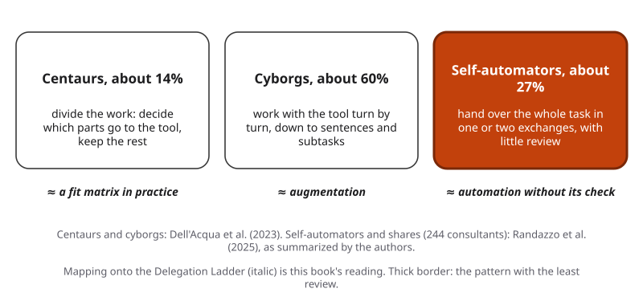{#fig-12-17 fig-alt="Three modes: centaurs divide the work, cyborgs work turn by turn, self-automators hand over the whole task; mapped by this book onto the ladder."}

**On the fit matrix and the ladder** (this book's reading). A centaur's way of working is a fit matrix in practice: some parts automated and checked, some kept on the floor. A cyborg's is augmentation. A self-automator's is automation without the check that the automation rung assumes.

With AI, the ideas consultants produced on the creative tasks were also less varied (homogenization: becoming more alike; Chapter 10) (Dell'Acqua et al., 2023).

**Limits** (this book's reading of the design the authors report). One firm; GPT-4 as of April 2023; tasks designed by the researchers; one outside task, chosen to be outside.

**Labels (Chapter 4's rules).** The Failure Taxonomy Tree is the book's diagram that sorts AI failures into five branches, each with smaller leaves; the failure-to-harm chain is the links by which an AI error becomes a harm: the output is wrong, it is not checked before use, someone relies on it, and a loss follows. On the tree, the tool's outputs on the outside task are a hallucination (fluent output that is not supported by the model's input or by facts), of the kind that contradicts its input (the interview notes) or of the wrong-reasoning kind: the authors say only that the task was designed so that GPT-4 would err in its analysis. Either label is **inferred** (dashed), because the paper does not report the outputs each consultant saw. On the failure-to-harm chain, links 2 and 3 (not checked; relied on) are **documented** by the authors' own statement: consultants who did worse adopted the output with less questioning, the pattern Chapter 11 calls automation bias. The harm stopped at wrong recommendations in an experiment.

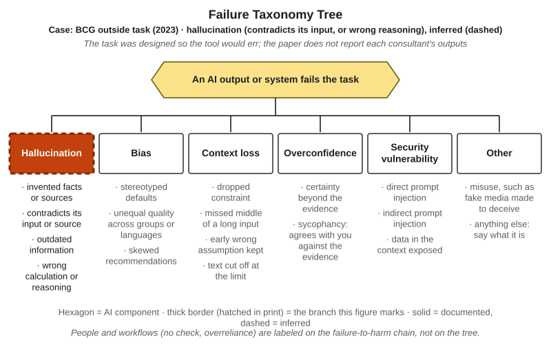{#fig-12-18 fig-alt="The Failure Taxonomy Tree with hallucination marked by a dashed thick border and the tag C09 BCG outside task (2023), inferred."}

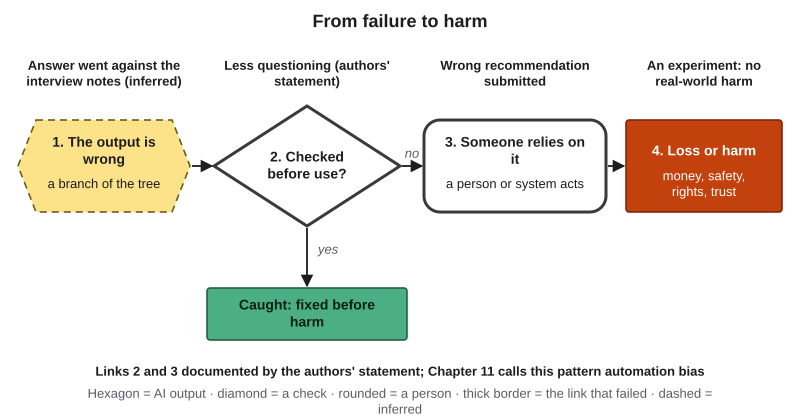{#fig-12-19 fig-alt="Failure-to-harm chain: output wrong (inferred, dashed); not checked and relied on, documented by the authors; an experiment, so no real-world harm."}

**One wording question.** The 2023 working paper says consultants with AI were "19 percentage points" less likely to be correct, the average of drops of about 14 and 25 points from a no-AI rate of about 84%. The 2026 journal abstract says "19% less likely" (Dell'Acqua et al., 2023, 2026). A 19-point drop from 84% is about a 23% relative drop, so the two wordings are not the same claim (Case Study Question 4).

::: {.callout-note title="Short case 1 (optional): Tools built for law (Magesh et al., 2025)"}
[Deep]{.path}

In a preregistered test, researchers asked more than 200 legal questions of AI research tools from two legal publishers, LexisNexis and Thomson Reuters, and of GPT-4, between March and May 2024. The publishers' tools, which retrieve real legal sources before answering, produced fewer hallucinations than GPT-4. Still, each hallucinated on between 17% and 33% of queries. One tool was accurate on 65% of queries; another on about 40%; the third gave incomplete answers, refusals or answers without sources, on more than 60% (Magesh et al., 2025).

Both publishers objected. LexisNexis said the tests predated an April 2024 upgrade and that its own testing found fewer hallucinations; Thomson Reuters said the tool with the "more than 60%" result is not meant for this kind of research, and later gave the researchers access to its research tool, which the published study includes (reported: Ambrogi, 2024; Magesh et al., 2025).

Chapter 8 used this study for its error rates. Here it has a different job: a tool built for your field can fit better than a general chatbot and still not fit, a tool used outside its intended scope is a fit question too, and tools fail in different ways. A wrong answer and a refusal carry different costs.
:::

::: {.callout-note title="Short case 2 (optional): When a model is retired"}
[Deep]{.path}

**OpenAI (confirmed).** In August 2025, when it launched a newer model, OpenAI removed GPT-4o from ChatGPT, then restored it for some paying users. On January 29, 2026, it announced that GPT-4o and three other older models would leave ChatGPT on February 13, 2026, saying that only 0.1% of users still chose GPT-4o each day; at the time, the models stayed available to software through its API (OpenAI, 2026). On October 14, 2026, it told developers that GPT-4o would leave the API on January 14, 2027 (OpenAI, n.d.-c). Chapter 4 described an earlier event: in April 2025, OpenAI withdrew an update to the same model after users reported overly agreeable answers.

**Anthropic (confirmed).** Anthropic's model-deprecation page says that requests to retired models fail, that it gives at least 60 days' notice before retiring a publicly released model, and that developers should test replacement models on their tasks well before a retirement date. For example, on June 30, 2025 it notified developers that Claude Opus 3 would be retired on January 5, 2026 (Anthropic, n.d.).

Two providers, one lesson, as of October 2026: a retirement is a re-test trigger you can see coming, if your prompts and test inputs live in your own files.
:::

## Ethics Lens: Who Pays, and Who Decides for Others? {.unnumbered}

**Who pays, and with what?** Paid tiers, free tiers and institutional licenses give different people different tools, and different data terms. When the only option a student can afford is a consumer tier, this book's reading is that the student may pay with data instead of money. Access is also unequal. In a survey of 18,000 Danish workers in 11 occupations, fielded from November 2023 to January 2024, women were 16 percentage points less likely than men in the same occupation to have used ChatGPT for work, and many workers said employer restrictions or a need for training held them back (Humlum & Vestergaard, 2025).

**Who decides for others?** When a manager, a school or a club chooses one tool for everyone, the people whose parts of the work sit outside that tool's frontier, or whose data its terms do not cover, bear the cost of the choice (this book's reading). Sam's handover note is a small version of this: next year's members will inherit his choices. Recording why each cell was decided, and when to re-test it, lets them disagree with him.

## Career Connection {.unnumbered}

| Role | How task–tool fit shows up | A question to ask |
|---|---|---|
| Information technology (IT) procurement or vendor analyst | Runs bake-offs with the organization's own test inputs; treats data terms as a gate in contracts | What would our edge case do to each tool? |
| Operations or team manager | Rolls out tools by task, not by team | Which of our tasks sit outside this tool's frontier? |
| Marketing coordinator | Drafts captions and posts with AI; checks every fact against the client's own pages | Is this polished line also true? |
| Psychology research assistant | Uses AI to sort open-ended survey answers; checks the sort against a hand-coded sample; keeps identifiable data out of consumer tools | Which answers did the tool force into a category? |
| Biology lab technician | Uses AI to draft protocols and summaries; checks every quantity and unit against the source | Does the output survive a known-answer test? |
| Mechanical or manufacturing engineer | Checks AI features in design and simulation software against hand calculations and units | Is this a calculation I should keep on the floor? |
| Paralegal or legal researcher | Uses tools built for law and checks every cited source (short case 1) | Is this answer wrong, incomplete or right? |
| Software developer | Uses coding assistants and measures time including review | Am I faster, or do I only feel faster? |

## From the Field {.unnumbered}

**Disclosure:** I am a founder of OptiWisdom, which develops software for businesses, including AI tools. OptiScorer was developed at OptiWisdom, a company I founded, under my management.

In 2020 I wrote an encyclopedia entry about OptiScorer, a scoring engine: a product that predicts numbers such as the chance that a customer will leave or will pay late (Seker, 2020). Read it as what it is: a vendor's argument, from 2020, for a ready-made, automated service over models built by hand for each project. Then test it with this chapter's lens.

The entry describes three periods of machine-learning practice. First, until the late 1990s and early 2000s, nearly every project was coded from scratch. Then came libraries and no-code tools; the entry names KNIME, RapidMiner and SPSS Modeler. Then came automated machine learning, which tries many algorithms and their options automatically. The entry gives several reasons a business might prefer an automated service. A hand-built model ages as conditions and data change, so it must be rebuilt at intervals. A person doing the analysis by hand sees the data. One model rarely fits a whole business. Experts are scarce. And a central update can bring new algorithms to many businesses at once, going live only where they perform better (Seker, 2020).

**The lens, applied** (this book's reading, written in 2026). *Whose terms cover the data?* The entry's privacy reason, that no analyst sees the data, moves the question rather than closing it: the data still goes into someone's system, so the data gate of section 12.5 applies. *What bake-off would show fit?* A ready-made service fits a business only if it beats that business's own baseline on its typical, different and edge cases. The vendor's own tests are not the customer's independent check; by section 12.3's question "who ran the study?", they are evidence about the vendor's setting. *Does the fit last?* "Models age" is the 2020 form of drift. The entry's condition, that new algorithms go live only where they perform better, is a test run by the vendor on its own criteria; for the business, each central update is still a re-test trigger for its own bake-off (section 12.8). The entry concerns predictive scoring, not generative AI, but the trade-off between ready-made and custom is the one a fit matrix makes part by part.

## Chapter Summary {.unnumbered}

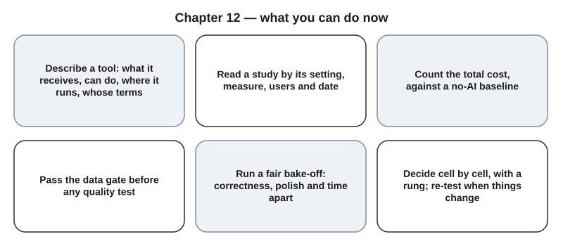{#fig-12-20 fig-alt="Six cards: describe the tool, read studies by setting, count the full cost, pass the data gate, run a fair bake-off, decide cell by cell and re-test."}

**The chapter's question:** *Which AI tool should you use?* There is no general answer, only one for a part of a task, with a given input, on a given date. Check first whether a tool's data terms allow your input. Then try the part with the same test inputs in two or more tools, and without AI, scoring correctness, polish, time and cost separately. Choose a rung for each part, and keep your prompts and test inputs in your own files so you can re-test when the tool, the task or the terms change. The evidence from 2023 to 2026 shows real gains, real losses and results that change, each specific to the tasks and users studied.

**Return to the Opening Case.** Why did the overview group do no better on the outside task? The overview raised scores and copying inside the frontier; it did not make the tool able to do the one task, and those who did worse questioned the output less (section 12.1). The gap between the AI groups was small: a warning from one task, not a law. How would you have noticed the wrong recommendations? By scoring correctness separately from quality, with an independent check against the interview notes (section 12.6).

**Revisit your Warm-up.** (1) Will the top-ranked model be best for your task? *Not necessarily: a ranking scores other people's questions; only a bake-off on your inputs shows fit (sections 12.1, 12.6; Deep 12.B).* (2) Could one tool help on one task and hurt on another? *Yes: in the BCG study, the same tool with the same options did both (section 12.1).* (3) What could differ between a free tool and a tool your institution provides that give the same answer? *Their data terms: whether your input is used for training, how long it is kept, and whose contract covers it (section 12.5).* Compare these with your confidence ratings.

You can now explain fit, differentiate tools, attribute differences between studies, evaluate cost and data terms gate first, conduct a fair bake-off, and produce a fit matrix with rungs, reasons and re-test triggers.

### Key Terms {.unnumbered}

AI tool · bake-off · data class · data gate · data terms · domain tool · drift (in a tool or model over time) · fit matrix · leaderboard (Deep) · local model · lock-in · no-AI baseline · open-weight model · provider · re-test trigger · task–tool fit · total cost of use · verification cost

## End-of-Chapter Package {.unnumbered}

<!-- Each item: objective · LO · revised Bloom level. Odd-numbered answers → appendix/answers.md (Appendix E, via docs/production/handoff/ch12.md); even-numbered → private/ch12-answers-even.md. Review A distractors draw on M1–M6 (blueprint §4); MC keys rotated: A1 c, A3 a, A4 d, A6 b, A8 c, A9 b, A11 d, A12 a. -->

### Review Questions A: Terms and Concepts {.unnumbered}

Items 4, 5, 7, 9, 10, 12 and 13 are optional practice.

1. *(O1 · LO2 · Understand)* A friend says her AI tool "has been great at everything in my internship so far." Which reply fits task–tool fit best?\
   (a) Then it will probably fit the next task as well, since it has fit every task so far.\
   (b) Then keep the same prompts, because skill with a tool usually settles whether it fits.\
   (c) Fit is judged part by part, so test it on the next part before relying on it.\
   (d) Then it probably ranks near the top of the public leaderboards for models.
2. *(O1 · LO2 · Understand)* A manager says, "After a prompting workshop, our team can use our AI tool for every task." Reply using the BCG result, including how sure we can be about it.
3. *(O2 · LO2 · Understand)* A clinic buys a documentation tool built for clinical notes. What does "built for the field" tell you?\
   (a) It receives the field's records and formats, but its fit to your task still has to be tested.\
   (b) The vendor has tested it on notes like your clinic's, so a bake-off adds little.\
   (c) Its answers are likely to be more accurate than a chatbot's on most tasks you give it.\
   (d) Its terms are likely to be institutional, so patient information can usually be entered.
4. *(O2 · LO2 · Analyze)* A student runs an open-weight model on her own laptop. Which statement fits best?\
   (a) Because the weights are open, she can see how the model was trained and on what data.\
   (b) Because the model runs on her laptop, it is likely to match large hosted models in quality.\
   (c) Because the weights are open, the license puts few limits on how she may use the model.\
   (d) Her input need not go to the provider, but the model's fit to her task still needs a test.
5. *(O3 · LO2 · Analyze; optional)* A vendor's study says its writing tool saves "professionals" 40% of their time. Write three questions from section 12.3 you would ask before believing the result applies to you.
6. *(O3 · LO2 · Analyze)* A 2023 lab study found a coding assistant made developers 55.8% faster; a 2025 study found experienced developers took 19% longer with AI. Which explanation fits best?\
   (a) The 2025 tools were weaker than the 2023 tool, which suggests that coding tools stopped helping.\
   (b) The settings differed: one designed task for freelancers, experts on large, familiar projects.\
   (c) One of the two studies is probably wrong, because both of them measured coding assistants.\
   (d) The developers in 2025 had no training in the tools, and that likely explains the difference.
7. *(O4 · LO2 · Understand; optional)* Besides price, name two parts of the total cost of use that a free tier can make larger, and explain one of them.
8. *(O4 · LO5 · Apply)* A tool wrote the best summaries in your bake-off. Its consumer terms allow training on your input, and your input lists classmates' names and email addresses. What should you do first?\
   (a) Use it, since its summaries scored best and the names are only first names and addresses.\
   (b) Ask the tool whether it will keep the names private, and go ahead if its answer is yes.\
   (c) Remove the names and addresses, or use a tool under institutional terms only if the part needs them.\
   (d) Run more test inputs, so that the comparison between the tools becomes more reliable.
9. *(O4 · LO5 · Understand)* What usually distinguishes institutional terms from consumer terms?\
   (a) Institutional terms let you enter records protected by law, such as education records.\
   (b) They are a contract with your school or employer, often promising no training on your data.\
   (c) Institutional terms apply when you pay for the tool yourself, as with a subscription.\
   (d) Institutional terms usually keep your input for less time, so what you type matters much less.
10. *(O6 · LO2 · Apply; optional)* Name three sources of lock-in in your own use of AI tools, and one way to reduce one of them.
11. *(O5 · LO2 · Understand)* Why should a bake-off score correctness and polish separately?\
    (a) Polish is too subjective to measure reliably, so it is best left out of a fair comparison.\
    (b) Correctness needs an expert in the field to judge, while polish is something anyone can judge.\
    (c) Tools that produce polished output tend to be less accurate, so polish is a warning sign.\
    (d) Polished output can hide errors: in the BCG study, quality ratings rose as correctness fell.
12. *(O6 · LO2 · Understand)* Why is a fit matrix decided cell by cell instead of by adding up scores?\
    (a) The data gate can block a cell whatever its scores, and each part gets its own decision.\
    (b) Weighted totals mislead in most cases, so Chapter 11's decision matrices are best avoided.\
    (c) A fit matrix records only the rung for each cell, so it has no scores that could be added.\
    (d) Totals hide which tool the user enjoys, and how a tool feels to use is what decides fit.
13. *(O6 · LO2 · Apply; optional)* A study tool you have used all term starts giving shorter, vaguer answers after an update. Name the concept, and write two re-test triggers you would add to your list.

### Review Questions B: Case Questions {.unnumbered}

1. *(O2 · LO2 · Analyze)* A museum's education team can reach five tools: a chat assistant under the museum's institutional terms, the AI feature of the museum's document editor, a free AI search tool, a collections database with an AI answer feature, and an open-weight model on the museum's own server. Differentiate them with the four questions. Which two differences matter most for drafting gallery labels from the museum's catalog records?
2. *(O1 · LO2 · Apply)* A hospital pharmacy technician has four tasks: drafting a staff reminder about a new storage rule, converting a dose table from milligrams to micrograms, summarizing a public drug-safety notice, and naming which shelf a drug is stored on. No patient data is involved. He has two tools: one with a calculation feature and one without. Predict, for each tool, which side of its frontier each task falls on, and design one known-answer test.
3. *(O4 · LO5 · Evaluate)* A psychology research intern has survey answers that include respondents' email addresses. They want to group the answers by theme with a free consumer tool or with the lab's institutional tool. Apply the data gate with the section 12.5 table, and say how they could change the input.
4. *(O5, O3 · LO2 · Evaluate)* A classmate compares two tools by giving each a different prompt, running each once, and choosing the one whose answer "looked more professional." He cites a study by one tool's maker showing large time savings. Critique his bake-off and his evidence, and write a better plan.
5. *(O6 · LO2 · Evaluate)* A small bakery used one AI tool to draft its weekly newsletter and order emails. The provider retires the model the bakery used, and the replacement writes differently. What should the owner re-test, and what had locked the bakery in?

### Review Questions C: Interpretive Questions {.unnumbered}

1. *(O1, O6 · LO2 · Evaluate)* "A department should license one AI tool for every employee." Take a position, using fit per task and tool (you may also draw on the Ethics Lens).
2. *(O4 · LO5 · Evaluate)* "Free consumer AI tools are good enough for students, because they cost nothing." Take a position, using total cost of use and data terms.
3. *(O3 · LO2 · Evaluate)* "You can trust your own sense of whether an AI tool makes you faster." Take a position, using the 2025 developer study and its 2026 update.

### Spaced Review {.unnumbered}

Come back to these a few days after reading, without looking back. They connect this chapter to Chapters 11 and 10. Items 3 and 4 are optional practice.

1. *(Chapter 11 · LO5 · Apply)* A classmate adds up equally weighted scores in a fit matrix to pick one tool for every part. What hidden assumption does equal weighting make, and what would Chapter 11's sensitivity check change to test it?
2. *(Chapter 11 · LO3 · Analyze)* An app store's star rating is used as a stand-in for "this tool fits my task." Answer Chapter 11's three proxy questions for it.
3. *(Chapter 10 · LO4 · Evaluate)* Sam's sponsor update was drafted with Tool A, then checked and edited by him. Use Chapter 10's three questions to decide whether he discloses the AI help, and how.
4. *(Chapter 10 · LO4 · Understand)* Why might ten robotics clubs' sponsor reports, drafted with the same tool, sound alike? Name the effect.

<!-- Spaced Review checked against the written chapters: Ch. 11 §11.5 sensitivity check (L265) and §11.3 three proxy questions (L180–184); Ch. 10 §10.7 three questions and §10.4 homogenization. -->

### Discussion Questions {.unnumbered}

1. *(Ethics · O4 · LO5 · Evaluate)* When a free tool is the only one a student can afford, is paying with data a fair trade? Who should make it fairer?
2. *(Career · O6 · LO2 · Analyze)* How does an employer in your field choose AI tools, and what would you add to its process after this chapter?
3. *(Interdisciplinary · O2 · LO2 · Analyze)* Domain tools exist for law, medicine and design. What would a fair bake-off look like in each field, and what would its edge input be?
4. *(Society · O1 · LO5 · Evaluate)* Should a university license one AI tool for all students, several, or none? Who gains and who loses in each case?
5. *(Learning · O6 · LO2 · Evaluate)* Where are you locked in today, in tools, habits or files, and what would it take to switch?

### Application Assignment: A10 Tool and Task Fit Matrix {.unnumbered}

**Due:** when your instructor sets it. *(O6 · LO2, LO5 · Create)* You start it in the lab session (section 12.9). Expect about 13 minutes before the lab and about 60 minutes after it, including reading this brief and rubric.

**Choose one route.** All three can earn full marks, and none needs a new account.

- **Route A, two tools:** your own task, in two tools (one your institution provides or approves, where you can).
- **Route B, one tool and no AI:** your own task, in one tool and done by you without AI.
- **Route C, provided outputs:** the provided task in the book's companion files, with its provided inputs and the dated outputs of two tools. Use the provided task in every column, not your own.

**What to submit:**

1. **Task and frame:** your task (or the provided one) split into **two or three parts**, with your prediction for each part and each option (inside or outside the tool's frontier); for the part you test, the task frame with 3–4 success criteria (Chapter 5) and the **data class** of its input (section 12.5).
2. **Tools:** for each tool, its kind, how the model is reached, the model name if shown, and the date.
3. **Data gate:** for each tool, the three data-terms questions answered with the page or lab card you read and its date; your gate decision for this input: pass, pass after changing the input (say how), or blocked.
4. **Bake-off record:** the same prompt, word for word, on three test inputs (typical, different, edge), each in a fresh chat with memory and standing instructions off: 6 runs in Route A; 3 runs plus your own no-AI work on all three inputs in Route B; all 6 provided outputs in Route C. A repeat run on the edge input is optional. For each output: correctness per criterion, polish (1 rough · 3 usable after edits · 5 ready to send), and time including checking. For the **typical and edge** inputs, name the **independent check** behind each correctness score. Paste the outputs or attach excerpts.
5. **Cost row:** for each tool, its price form and limits (from its own pages or the lab cards, dated), your checking time, and your **no-AI baseline** for the typical input (an estimate is fine; time it only if it takes under 10 minutes).
6. **Fit matrix:** parts × (tools + no AI). In every cell: a fit decision (use · use with a named check · use only as a lead · do not use), its rung (floor, automation, augmentation) and a one-line reason. Mark untested cells "predicted" and single-run cells "tested once". Add one **re-test trigger** for the part you tested.
7. **Judgment (80–100 words):** which option you would use for each part and why; one sentence comparing your result with the section 12.3 study whose setting is closest to yours; what remains uncertain.
8. **AI Use Declaration, with all five elements:** (1) the tools you used; (2) for what purpose; (3) which outputs you accepted, rejected or revised; (4) how you verified them; (5) where your own judgment shaped the work. If you used no AI tools, say so.

**Privacy:** follow the section 12.5 table: no personal data about other people and no internal or confidential information in a consumer tool, and no restricted or legally protected information in any tool. Valid results that can earn full marks include "neither tool fits," "the tools tied," "no AI was faster once checking was counted" and "the gate blocked the better tool."

**Rubric (10 points)**

| Criterion (points) | Exemplary | Proficient | Developing | Beginning |
|---|---|---|---|---|
| **Task and design (3)** | 3: all five elements present and sound: parts with predictions; 3–4 testable criteria; an accurate data class; typical, different and edge inputs that do their jobs; route and tool details | 2: one element missing or weak (for example, an "edge" input that is typical) | 1: two or three elements missing or weak | 0: more than three missing or weak |
| **Bake-off record (1.5)** | 1.5: every required run, the same prompt in fresh chats, and every output scored for correctness, polish and time separately | 1: one problem (one run missing, or one output with a single combined score) | 0.5: two or three problems, or different prompts in different tools | 0: more than three problems, or no record |
| **Cost and data gate (1.5)** | 1.5: for every tool, price form, limits and checking time; a no-AI baseline; all three data-terms questions with source and date; a gate decision that follows from them | 1: one element missing or undated | 0.5: two or three elements missing, or a gate decision that lets an input through against the section 12.5 table (this caps the criterion at 0.5) | 0: more than three missing |
| **Verification (2)** | 2: every correctness score on the typical and edge inputs backed by a named independent check; errors described, or "none found" with how you checked | 1.5: one of those scores without an independent check, or one error not described | 1: two or more of those scores without an independent check, but at least one checked | 0: no independent checks |
| **Matrix and trigger (1)** | 1: every cell has a decision, a rung and a reason, with "predicted" and "tested once" marked; one re-test trigger | 0.75: one cell incomplete, or the trigger missing | 0.5: two or three cells incomplete | 0: more than three cells incomplete, or no matrix |
| **Judgment and declaration (1)** | 1: the judgment covers each part, the comparison with a 12.3 study and what remains uncertain; all five declaration elements | 0.75: one of these items missing | 0.5: two or three missing | 0: more than three missing |

**Alternative assignment** (for students who prefer not to use AI tools). Follow Route C: score the provided outputs of two tools on the provided task, do the no-AI column yourself and time it, and answer the data-terms questions from the two tools' public pages or the dated cards. Same rubric; the declaration states "no AI tools used."

### Mini-Project (optional): A Tool Diary {.unnumbered}

For three weeks, log each AI use: the part of the task, the tool, your prediction (inside or outside its frontier), the result, and any re-test trigger you noticed. At the end, write 200 words on one fit that changed. The diary can become a portfolio piece (Chapter 20).

### Case Study Questions {.unnumbered}

1. *(O1 · LO2 · Analyze)* What made the BCG outside task a trap? Why did the spreadsheet seem complete, and what did the interview notes do to the right answer?
2. *(O6 · LO2 · Evaluate)* Which way of working, centaur, cyborg or self-automator, would you adopt for the outside task, and why? Use the fit matrix and the ladder.
3. *(O1 · LO1 · Apply)* Label the case on the Failure Taxonomy Tree and the failure-to-harm chain. Which hallucination leaf would you choose, and why are the tree label inferred and the chain links documented?
4. *(O3 · LO3 · Evaluate)* The working paper says "19 percentage points" less likely; the journal abstract says "19% less likely." What is the difference, which wording would you use, and what would you check?
5. *(O4 · LO2 · Evaluate; optional, uses short case 1)* One legal tool gave many incomplete answers and another many wrong ones. Which failure would cost a law firm more, and how would a bake-off show it?

## Further Reading {.unnumbered}

- Dell'Acqua et al. (2023), sections 3.2 and 3.3: the outside task and the centaur and cyborg patterns, in the authors' words (recommended).
- Brynjolfsson, Li and Raymond (2025), the introduction and section VI.A on adherence (recommended).
- Becker et al. (2025) and METR (2026): a randomized study of experienced developers, and its authors' own account of why the next round was hard to measure.
- Chen, Zaharia and Zou (2024): how the same named models changed between March and June 2023.
- Magesh et al. (2025), open access: a preregistered test of legal research tools.
- Open Source Initiative (2024): what "open source" means for AI.

*In Compass (optional):* a fit-matrix builder, a data-terms drill with dated excerpts, the Chapter 12 quiz and the lab pages.

## References {.unnumbered}

Ambrogi, B. (2024, May 28). *Stanford will augment its study finding that AI legal research tools hallucinate in 17% of queries, as some raise questions about the results*. LawSites. https://www.lawnext.com/2024/05/stanford-will-augment-its-study-finding-that-ai-legal-research-tools-hallucinate-in-17-of-queries-as-some-raise-questions-about-the-results.html

Anthropic. (2025, August 28). *Updates to consumer terms and privacy policy*. https://www.anthropic.com/news/updates-to-our-consumer-terms

Anthropic. (n.d.). *Model deprecations*. Claude Platform Docs. Retrieved October 18, 2026, from https://platform.claude.com/docs/en/about-claude/model-deprecations

Becker, J., Rush, N., Barnes, B., & Rein, D. (2025). *Measuring the impact of early-2025 AI on experienced open-source developer productivity* (arXiv:2507.09089). arXiv. https://arxiv.org/abs/2507.09089

Brynjolfsson, E., Li, D., & Raymond, L. R. (2025). Generative AI at work. *The Quarterly Journal of Economics, 140*(2), 889–942. https://doi.org/10.1093/qje/qjae044

Candelon, F., Kellogg, K. C., Lifshitz, H., & Randazzo, S. (2026, January 30). Are you a cyborg, a centaur, or a self-automator? Why businesses need the right kind of "humans in the loop" in AI. *Fortune*. https://fortune.com/2026/01/30/ai-business-humans-in-the-loop-cyborg-centaur-or-self-automator/

Chen, L., Zaharia, M., & Zou, J. (2024). How is ChatGPT's behavior changing over time? *Harvard Data Science Review, 6*(2). https://doi.org/10.1162/99608f92.5317da47

Cui, K. Z., Demirer, M., Jaffe, S., Musolff, L., Peng, S., & Salz, T. (2026). The effects of generative AI on high-skilled work: Evidence from three field experiments with software developers. *Management Science*. Advance online publication. https://doi.org/10.1287/mnsc.2025.00535

Dell'Acqua, F., McFowland, E., III, Mollick, E., Lifshitz-Assaf, H., Kellogg, K. C., Rajendran, S., Krayer, L., Candelon, F., & Lakhani, K. R. (2023). *Navigating the jagged technological frontier: Field experimental evidence of the effects of AI on knowledge worker productivity and quality* (Harvard Business School Working Paper No. 24-013). https://ssrn.com/abstract=4573321

Dell'Acqua, F., McFowland, E., III, Mollick, E., Lifshitz, H., Kellogg, K. C., Rajendran, S., Krayer, L., Candelon, F., & Lakhani, K. R. (2026). Navigating the jagged technological frontier: Field experimental evidence of the effects of artificial intelligence on knowledge worker productivity and quality. *Organization Science, 37*(2), 403–423. https://doi.org/10.1287/orsc.2025.21838

Humlum, A., & Vestergaard, E. (2025). The unequal adoption of ChatGPT exacerbates existing inequalities among workers. *Proceedings of the National Academy of Sciences, 122*(1), e2414972121. https://doi.org/10.1073/pnas.2414972121

Humlum, A., & Vestergaard, E. (2026). *Still waters, rapid currents: Early labor market transformation under generative AI* (NBER Working Paper No. 33777, revised March 2026). National Bureau of Economic Research. https://www.nber.org/papers/w33777

LMArena. (2025, May 9). *Our response to "The Leaderboard Illusion" writeup*. https://arena.ai/blog/our-response/

Magesh, V., Surani, F., Dahl, M., Suzgun, M., Manning, C. D., & Ho, D. E. (2025). Hallucination-free? Assessing the reliability of leading AI legal research tools. *Journal of Empirical Legal Studies, 22*(2), 216–242. https://doi.org/10.1111/jels.12413

Meta. (2024, July 23). *Introducing Llama 3.1: Our most capable models to date*. https://ai.meta.com/blog/meta-llama-3-1/

METR. (2026, February 24). *We are changing our developer productivity experiment design*. https://metr.org/blog/2026-02-24-uplift-update/

Microsoft. (2026). *Enterprise data protection in Microsoft Copilot and Microsoft Copilot Chat*. Microsoft Learn. Retrieved October 18, 2026, from https://learn.microsoft.com/en-us/microsoft-365/copilot/enterprise-data-protection

Open Source Initiative. (2024, October 28). *The Open Source AI Definition 1.0*. https://opensource.org/ai/open-source-ai-definition

OpenAI. (2025, August 5). *Introducing gpt-oss*. https://openai.com/index/introducing-gpt-oss/

OpenAI. (2026, January 29). *Retiring GPT-4o, GPT-4.1, GPT-4.1 mini, and OpenAI o4-mini in ChatGPT*. https://openai.com/index/retiring-gpt-4o-and-older-models/

OpenAI. (n.d.-a). *How your data is used to improve model performance*. OpenAI Help Center. Retrieved October 18, 2026, from https://help.openai.com/en/articles/5722486-how-your-data-is-used-to-improve-model-performance

OpenAI. (n.d.-b). *Enterprise privacy at OpenAI*. Retrieved October 18, 2026, from https://openai.com/enterprise-privacy/

OpenAI. (n.d.-c). *Deprecations*. OpenAI Developers. Retrieved October 18, 2026, from https://developers.openai.com/api/docs/deprecations

Peng, S., Kalliamvakou, E., Cihon, P., & Demirer, M. (2023). *The impact of AI on developer productivity: Evidence from GitHub Copilot* (arXiv:2302.06590). arXiv. https://arxiv.org/abs/2302.06590

Randazzo, S., Lifshitz, H., Kellogg, K. C., Dell'Acqua, F., Mollick, E., Candelon, F., & Lakhani, K. R. (2025). *Cyborgs, centaurs and self-automators: The three modes of human-GenAI knowledge work and their implications for skilling and the future of expertise* (Harvard Business School Working Paper No. 26-036). https://ssrn.com/abstract=4921696

Seker, S. E. (2020). OptiScorer: Otomatik makine ogrenmesi ile skorlama [OptiScorer: Scoring with automated machine learning]. *YBS Ansiklopedi, 8*(1), 1–13.

Singh, S., Nan, Y., Wang, A., D'Souza, D., Kapoor, S., Ustun, A., Koyejo, S., Deng, Y., Longpre, S., Smith, N. A., Ermis, B., Fadaee, M., & Hooker, S. (2025). The leaderboard illusion. In *Advances in Neural Information Processing Systems 38* (pp. 86910–86964). https://doi.org/10.52202/085713-2620
