# Multimodal AI: Images, Audio and Video {#sec-ch13}

<!-- Status: v2 (2026-10-18), chapter agent, stage 5 revision after four independent reviews (docs/editorial/ch13-dev-memo.md), plus a light Mode B voice pass. v1 kept in build/ch13/ch13-v1-prereview.qmd. From blueprint v0.2 (approved under D19). Deep chapter: not examinable (D20). Featured student: Hana only (they/them; docs/characters.md); other people are unnamed. Figures: figures/scripts/ch13_figures.py (new reusable modality_tokens(), generation_pipeline(), media_checklist(); imports work_loop, llm_anatomy, failure_tree, failure_chain, verification_funnel, hop_chain) and ch13_charts.py (published values in data/ch13_*.csv). Case C10: primary record build/ch13/src/lcq9.txt; reported tier build/ch13/src/cnn_*.txt. All of Hana's files, prompts and outputs are constructed examples. -->

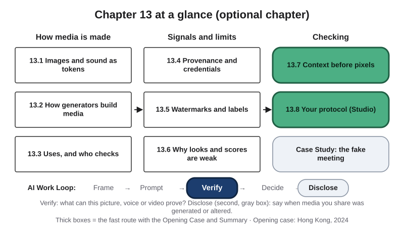{#fig-13-1 fig-alt="Chapter map: how media is made (13.1–13.3), signals and limits (13.4–13.6), checking (13.7–13.8, labs, case); Work Loop with Verify highlighted."}

**Chapter 13 at a glance.** This is an optional chapter. It pairs well with Chapter 12, and the book does not treat it as exam material. Chapter 8 taught you to check a claim in a text. This chapter asks what changes when the claim is a picture, a voice or a video, and what does not.

**Time, at a steady pace (150 words a minute); allow more if you read more slowly or are reading in a second language:**

- **Fast route, about 24 minutes:** this page with the "Plain words" box, the Warm-up, the Opening Case, section 13.7 (it starts with a recap of 13.2–13.6), section 13.8, and the Chapter Summary. It stands on its own.
- **Full route, about 57 minutes:** everything from this page through the Case Study, not counting the labs. About 66 minutes with the Ethics Lens, Career Connection, From the Field and Summary.
- **Extra, all optional:** Your Turn boxes, the four labs (15–35 minutes each), the end-of-chapter questions (about 15 minutes to read, an hour to answer) and the verification protocol (about 80–100 minutes).

If you are reading it alongside Chapter 12, start with the fast route and read the rest before Chapter 15, which returns to this chapter's opening case. Worked examples show every step, faded examples leave some steps for you, and Your Turn and Check Yourself boxes are ungraded practice. Answers to Check Yourself, the faded examples and odd-numbered end-of-chapter questions are in Appendix E.

::: {.callout-note title="Plain words for this chapter"}
- **Token:** a unit of text (a word, part of a word, or a symbol) that a language model receives and produces (Chapter 3). **Context window:** the space for everything a language model receives in one turn, measured in tokens (Chapter 3).
- **Generative AI:** AI that produces new content, such as text, images, audio or code (Chapter 2).
- **Deepfake:** synthetic media (images, audio or video generated or substantially altered by AI) that realistically shows a real person, or a real event, saying, doing or happening in a way that did not happen (section 13.2).
- **Content credentials:** a provenance record attached to a file under the C2PA standard: signed statements about how the file was made and edited (section 13.4). **Watermark (media):** a pattern, visible or hidden, that a tool places in the image, audio or video it produces, which a matching detector can later test for (section 13.5).
- **Lead:** in this chapter, a clue about where to look next, not a conclusion.
- **Hallucination:** fluent output that is not supported by the model's input or by facts. An *extrinsic* hallucination adds something the input can neither support nor contradict (Chapter 4).
- **Failure Taxonomy Tree and failure-to-harm chain:** the tree sorts AI failures into five branches plus "other"; the chain's four links are output wrong, checked before use?, someone relies on it, loss. A label is *documented* if the evidence shows it and *inferred* if it is this book's reading (Chapter 4).
- **Independent check:** evidence that no AI tool produced: a source with an author or publisher you can name, or your own recalculation or reasoning from known inputs. **Primary source:** the original record a claim comes from. **Verdict:** one of five: supported, partly supported, unsupported, contradicted, cannot verify. **Stopping rule:** stop checking when the evidence is strong enough for what depends on the claim (Chapter 8).
- **Lateral reading:** leaving a page early to see what outside sources say about who is behind it. An **outside source** is not written or paid for by whoever is behind the page (Chapter 9).
- **False positive (of a detector):** something made by a person that a detector labels AI-generated (adapted from Chapter 10). **Disclosure (of AI use):** telling the people who rely on a message how AI was involved in making it, in a form and place they will see. **Process evidence:** the record of how you made something: notes, drafts, version history, and your ability to explain your choices (adapted from Chapter 10).
- **Data gate:** checking a tool's data terms before you give it an input; if the terms do not fit the input, the tool is out for that input (adapted from Chapter 12).
:::

**The question of this chapter:** *If seeing and hearing are no longer proof, how do you decide what to believe, and what to act on?* The Chapter Summary returns to it.

::: {.callout-note title="Warm-up (ungraded)"}
1. You give a chat tool a photo. Does the model receive the photo as you see it, including when and where it was taken?
2. Someone sends you a video clip as proof that an event happened last week. Name one check that does not depend on how real the clip looks.
3. An image online has no AI label and no watermark. Does that make it more likely to be real? How sure are you of your answer (0–100%)?

You will revisit your answers in the Chapter Summary.
:::

## Opening Case: A Meeting Where Everyone Else Was Fake {.unnumbered}

In late January 2024, the Hong Kong police received a fraud report. The government later described the case to Hong Kong's legislature, calling the person who reported it "the informant" (Hong Kong SAR Government, 2024); CNN described a finance employee at a multinational company's Hong Kong office (Chen & Magramo, 2024). The employee had received a phishing email, a message designed to trick its reader, from someone posing as the chief financial officer of the head office in the United Kingdom. The email invited the employee to a group video conference about confidential transactions. As instructed, the employee authorized transfers to five local bank accounts. The loss was about HK$200 million (Hong Kong SAR Government, 2024), roughly US$25.6 million in CNN's conversion (Chen & Magramo, 2024).

The government's reply says the video conference was **pre-recorded**. After investigating, the police believe it was generated from public video clips and voices of the impersonated officer, downloaded from the internet. Because the meeting was pre-recorded, there was no real interaction between the employee and the fraudster. After giving the instruction, the fraudster ended the meeting with an excuse and sent further payment instructions by instant messaging (Hong Kong SAR Government, 2024). The reply does not say how the police reached their view.

News reports from the police briefing in February 2024 add details that are not in the government's later account. According to CNN, the employee had first suspected the message was phishing, because it spoke of a secret transaction. He stopped doubting after the call, because the people on screen looked and sounded like colleagues he recognized. CNN wrote that the fraud was only discovered when the employee later checked with the company's head office (Chen & Magramo, 2024). In May 2024, the British engineering firm Arup confirmed to CNN that it was the company. A spokesperson said that "fake voices and images were used" and that none of the firm's internal systems had been compromised (Magramo, 2024).

The government's written reply is the primary record. The news reports are *reported* facts: a named outlet citing the police or the company. The two accounts fit together: the reports describe a call with several people on screen; the later reply adds that it was pre-recorded, with no real interaction. This chapter keeps both and says which is which.

Here is the puzzle. **The employee doubted an email, but believed a video call. Why was the call more convincing, when it could be built from public clips, and what check would have worked when looking and listening did not?** Sections 13.2, 13.6 and 13.7 answer it; the Case Study returns to the meeting.

## Learning Objectives {.unnumbered}

Each objective names the book's learning outcome it serves: LO1 is the outcome on explaining what AI systems are, how they work in outline and how they fail; LO5 is the outcome on applying privacy, security, fairness, transparency and human-oversight principles; LO3 is the outcome on verifying outputs. Framework tags refer to the AI Fluency framework (Dakan & Feller, 2025), the UNESCO (United Nations Educational, Scientific and Cultural Organization) AI Competency Framework for Students, and the AI4K12 initiative's "Five Big Ideas in AI."

After this chapter you will be able to:

- **O1 — Explain** how a multimodal model receives images and sound as tokens, and how generators produce new media. *(LO1 · UNESCO: AI techniques and applications, Understand · AI4K12: Perception)*
- **O2 — Distinguish** generated or altered media from a record of an event. *(LO1 · AI Fluency: Discernment)*
- **O3 — Evaluate** a multimodal use in your field by who relies on the output and which check it needs. *(LO5 · AI Fluency: Diligence, Discernment)*
- **O4 — Differentiate** what a provenance signal shows when it is present from what its absence shows. *(LO5 · AI Fluency: Discernment · UNESCO: Ethics of AI, Apply)*
- **O5 — Assess** whether media can be trusted, using source, channel and context checks before looks or scores. *(LO5, LO3 · AI Fluency: Discernment, Diligence)*
- **O6 — Create** a personal verification protocol for media and the requests it carries. *(LO5 · AI Fluency: Diligence · UNESCO: Ethics of AI, Apply)*

## 13.1 Many Kinds of Input, One Kind of Model {#sec-13-1 .unnumbered}

[Deep]{.path}

*Deep sections are optional and not examinable. Featuring Hana (they/them), an media arts and design sophomore with a history minor, who works as a freelance illustrator and runs a zine, a small self-published magazine.*

Photos, voice notes and screen recordings now go into AI tools as easily as text. Recall Chapter 3: a language model receives text as **tokens** and produces text one token at a time. Everything it receives in one turn shares the **context window**.

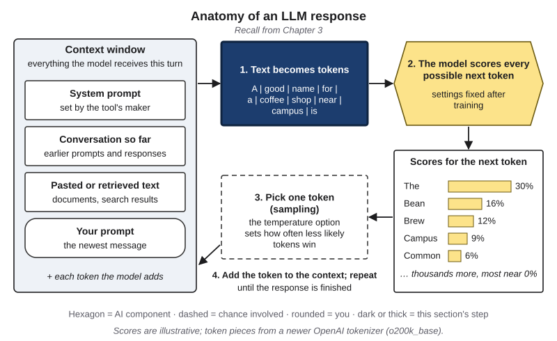{#fig-13-3a fig-alt="Anatomy of a language-model response with the tokens stage highlighted: text split into tokens, then scored, picked and added."}

A **modality** is a kind of data, such as text, images, audio or video. A **multimodal model** is a model that receives or produces more than one kind of data, such as text, images, audio or video. How does a picture fit into a system built for tokens?

It is turned into tokens. A widely used approach cuts an image into small squares, called **patches**, about 14 to 32 pixels on a side (16 in the original research; a *pixel* is one dot of color). Each patch is turned into a list of numbers that the model receives the way it receives a text token (Dosovitskiy et al., 2021). An **image token** is a small square patch of an image, turned into numbers that a multimodal model receives the way it receives text tokens. Sound can be handled the same way. A *codec*, a program that compresses audio, can turn each short slice of sound into a code. An **audio token** is a short slice of sound compressed into a code that a model can receive or produce like a text token (Wang et al., 2023). Image tokens, audio tokens and your words then share one context window.

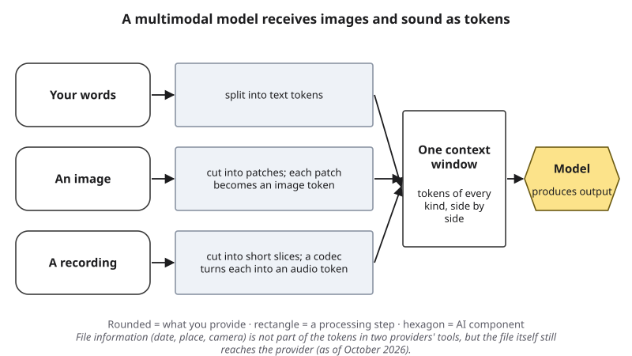{#fig-13-3b fig-alt="Three lanes: text to text tokens, image to patches to image tokens, audio to slices to audio tokens; all enter one context window, then the model."}

::: {.callout-note title="Dated box: images as tokens (as of October 2026)"}
Two providers' documentation shows the idea. One counts one image token for each 28 × 28-pixel patch, so a 1,000 × 1,000-pixel image costs about 1,296 tokens, and it shrinks larger images to a cap before processing (Anthropic, n.d.). Another covers images with 32 × 32-pixel patches on its newer models and uses larger tiles on older ones (OpenAI, n.d.). Both state that their models do not process an image's metadata; one also mentions file names. These rules change. In Compass (optional): current limits by tool.
:::

Three consequences follow. First, the model receives a grid of patches, shrunk first if the image is large, not your file. Small text and fine detail can be lost when a large image is shrunk. Second, information stored *in* the file, such as the date or the camera, is not part of what the model receives (section 13.4). The file itself, with that information, still goes to the provider, so location data in a photo reaches the company even if the model never uses it. Third, what the model produces is generated from those tokens, so a description can contain errors, just as text output can. In other words: the model works from a resized copy, and its description is a draft.

::: {.callout-note title="Worked Example: Hana's Streetcar"}
*Constructed example.* Let's take a scan of a drawing. For the zine's history issue, Hana drew a 1920s Dallas streetcar by hand, working from a public archive photo. They want a quick description of the scan.

**Step 1 — The data gate first.** Hana's drawings are their work, and they do not want them used for training. They read the data terms of two tools and choose a tool their institution provides or approves (for example, an enterprise chat assistant with data protection), whose terms say prompts are not used to train its foundation models (Chapter 12). They remove the scan's location data. The data gate is passed.

**Step 2 — What the model received.** A scan resized to roughly 1,500 image tokens, plus the prompt. Not the file's date, not their name, not the paper texture.

**Step 3 — Check the output.** The description says "a streetcar on route 3." Hana's drawing says route 8, in small numerals that were lost in resizing. Everything else matches. **Conclusion:** the description is a draft; every detail gets checked against the drawing.
:::

::: {.callout-note title="Faded Example: An Anatomy Poster"}
*Constructed example.* A nursing student photographs a public anatomy poster on a hallway wall. The photo is 4,000 pixels wide; the poster's 20 labels are in small print near the edges. She asks a tool to list the labeled bones.

**Done for you:** *What the model receives:* a photo shrunk to the tool's cap, as image tokens, and the prompt; no file information.

**Your turn:** Which labels are most at risk, and why? _______________ How would you check the list? _______________
:::

::: {.callout-important title="Your Turn"}
Pick one image you might give a tool. List what the model will receive (patches, your prompt) and what it will not (file date, location, who made it). Which detail in your image is most at risk?
:::

::: {.callout-tip title="Check Yourself 13.1"}
1. What is an image token?
2. Why can a small number in a large photo be lost before the model receives it?
3. Name one thing stored in an image file that, according to two providers, their models do not process, and say who still receives it.
:::

## 13.2 How Generators Make Images, Sound and Video {#sec-13-2 .unnumbered}

[Deep]{.path}

Generators now make pictures for marketing, voices for audiobooks and short videos for social media. A text generator produces likely next tokens. Many image generators work differently, but they share one property with text generation: the output is *built*, not looked up.

Many image generators are **diffusion models**. A **diffusion model** is a generator that starts from random noise and removes it step by step, guided by a prompt, until an image (or audio or video) appears. *Noise* here means random speckle, like static on an old television. During training, the procedure takes very many images with captions, adds noise to them, and adjusts the model's settings so that it gets better at predicting and removing that noise (Ho et al., 2020). To generate, the model starts from pure noise and removes a little at each of many steps; the prompt steers each step toward an image that fits the caption. Many systems do this in a compressed version of the image, called a *latent*, to save computing, and then decode it into pixels at the end (Rombach et al., 2022). Other generators predict image tokens one after another, the way a language model predicts text (for example, Yu et al., 2022).

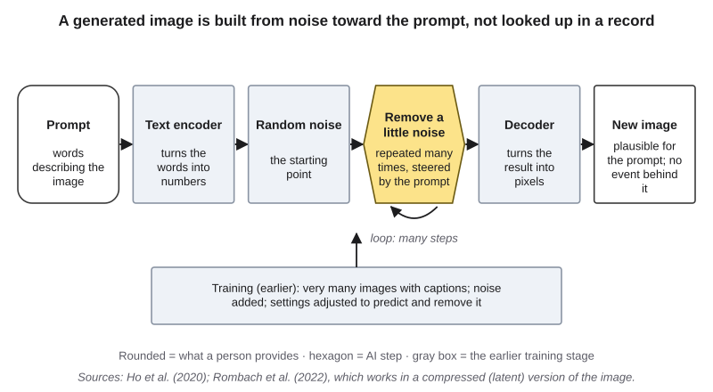{#fig-13-4 fig-alt="Pipeline: prompt, text encoder, random noise, repeated denoising steps, decoder, new image; a gray lane shows training on captioned images."}

Voices can be generated too. In 2023, Microsoft researchers described a system that produced speech in the voice of a speaker it had not been trained on, from a three-second recording of that person. It predicted audio tokens one after another, the way a language model predicts text tokens, and a decoder turned them into sound; it was trained on 60,000 hours of English speech (Wang et al., 2023). Chapter 15 covers how cloned voices are used in scams. Video generators add a harder demand: many frames, single still pictures, that must stay consistent from one moment to the next.

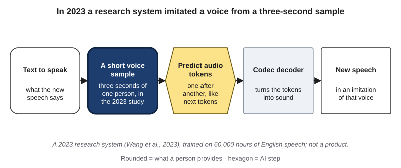{#fig-13-5 fig-alt="Voice pipeline: text plus a three-second voice sample, audio tokens predicted one by one, codec decoder, speech in that voice."}

Three terms name what these systems can make. **Synthetic media** means images, audio or video generated or substantially altered by AI. A **deepfake** is synthetic media that realistically shows a real person, or a real event, saying, doing or happening in a way that did not happen. **Voice cloning** is using AI to produce new speech that imitates a particular person's voice from samples of it. In the Opening Case, the police believe the raw material was public video clips and voices of one executive (Hong Kong SAR Government, 2024).

The most important point follows from how these systems work. A camera records light that came from an event. A generator produces what is *plausible* for a prompt. So a generated picture can look exactly like a photograph and record nothing at all. For example, a generated "site photo" in an engineering report and a generated "street scene" in a history zine can both look real; neither shows anything that happened.

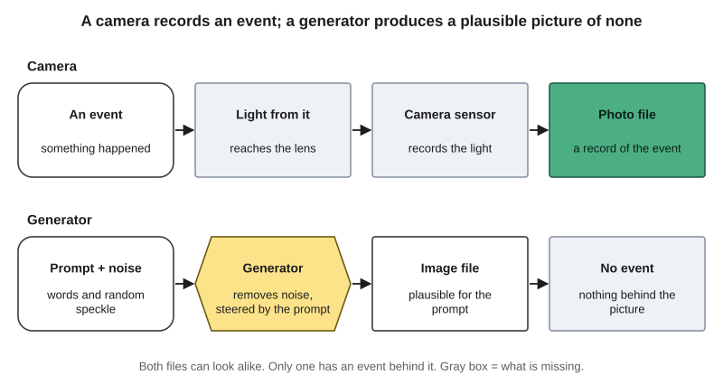{#fig-13-6 fig-alt="Two lanes: event, light, camera sensor, photo file; prompt and noise, generator, image file; a gray box says no event behind the second file."}

**Is a generated image a collage of training images?** Usually not: outputs are new samples. But *memorization*, reproducing a training image almost exactly, is real, if rare. Researchers extracted more than a thousand training images, including photos of individual people and company logos, from image diffusion models by generating many images and filtering them; it worked mostly for images that appeared many times in the training data (Carlini et al., 2023). Whether training on people's work is lawful is a question for Chapter 18.

**Whose picture of the world?** A model reproduces patterns in its training data. In one study, prompts that named only an occupation or a trait, with no mention of identity, still produced images that reinforced stereotypes about race and gender. Neither requests for counter-stereotypical images nor the tools' *guardrails*, the built-in limits on what they produce, prevented it (Bianchi et al., 2023). Chapter 16 treats bias in depth.

::: {.callout-note title="Worked Example: Hana Tests a Generator Once"}
*Constructed example.* Hana draws by hand first, always, and never uses image generation for client work without telling the client. They object to training on artists' work without consent. Still, clients and zine readers ask them about these tools, and they want to answer from experience, so they decide to test one once.

**Step 1 — Set limits.** No artist's name or style in the prompt; none of their own drawings uploaded. Prompt: "a 1920s Dallas streetcar, ink drawing."

**Step 2 — Map the output to the pipeline.** The result is a plausible streetcar. Its route sign shows letters that spell nothing, a common kind of generated detail: plausible shapes, no record behind them.

**Step 3 — Conclude.** Hana writes in the zine's notes: "Looks like evidence, records nothing." They keep drawing by hand.
:::

::: {.callout-note title="Faded Example: A Product Mockup"}
*Constructed example.* A marketing intern places a photo of a real water bottle, taken by the company's photographer, into a generated beach scene with sky, sand and a sunset, for a social-media mockup.

**Done for you:** *The bottle:* a record of the real product (it came from a product photo).

**Your turn:** Which parts of the image record nothing? _______________ What should the post say, and why (Chapter 10)? _______________
:::

::: {.callout-important title="Your Turn"}
Name one kind of image or recording in your field whose value depends on its being a record of an event (for example, a site photo, an interview recording, a lab image). What would it cost if a generated one were passed off as real?
:::

::: {.callout-tip title="Check Yourself 13.2"}
1. In two or three sentences, describe how a diffusion model makes an image.
2. Define deepfake and voice cloning.
3. Why is a realistic image not evidence that its scene happened?
:::

## 13.3 Uses That Help, and Who Checks Them {#sec-13-3 .unnumbered}

[Deep]{.path}

Multimodal tools do useful work every day. **Alt text** is a short text alternative for an image that tells a reader who cannot see it what they need to know from it. **Closed captions** are on-screen text of a video's speech and important sounds, which viewers can turn on or off. **Transcription (speech recognition)** is turning spoken audio into written text.

The Web Content Accessibility Guidelines (WCAG), published by the World Wide Web Consortium (W3C), require for conformance that non-text content presented to users has a text alternative "that serves the equivalent purpose" (success criterion 1.1.1, Level A, the same in versions 2.1 and 2.2; W3C, 2024). Law and policy make such standards binding.

::: {.callout-note title="Dated box: accessibility rules for public universities (as of October 2026)"}
In 2024, the U.S. Department of Justice adopted WCAG 2.1 Level AA as the web standard for state and local government entities, including public universities, under Title II of the Americans with Disabilities Act (ADA) (U.S. Department of Justice, 2024). In April 2026, it extended the compliance date for entities serving 50,000 or more people from April 24, 2026 to April 26, 2027, and for smaller entities to April 26, 2028 (U.S. Department of Justice, 2026).
:::

What do the people who rely on these tools say? In a two-week diary study, 16 blind and low-vision participants used an AI scene-description app for their own goals, some of which surprised the researchers, such as avoiding contact with dangerous objects; they rated their satisfaction at about 2.8 on a scale of 1 to 5, and the authors concluded that descriptions still needed significant improvement (Gonzalez Penuela et al., 2024). In interviews with 14 visually impaired users of the Be My AI app, participants valued learning about details they had not known were there and being able to find things out on their own; they also met hallucinations and misreadings of social situations and identities, and checked them against their own knowledge of a place or with a sighted person (Xie et al., 2025).

Transcription shows the same two sides. In April and May 2023, researchers ran 13,140 short audio segments of speech through a public speech-recognition service. Most of the transcribed speech was highly accurate. But 187 of the 13,140 segments (about 1.4%) reliably produced invented phrases or sentences that no one had said; across the two runs, 312 transcriptions contained such inventions, which the authors put at roughly 1% of transcriptions. Of those 312, 38% contained harmful content: violence, false associations or false authority. Inventions were more common for people with aphasia, a language disorder in which speech can include longer pauses. After updates, 12 of the 187 segments still produced inventions in December 2023 (Koenecke et al., 2024). An invented sentence in a transcript is an extrinsic hallucination (Chapter 4).

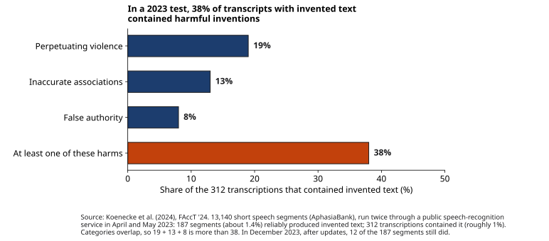{#fig-13-8 fig-alt="Bars for 312 transcripts with invented text: 19% violence, 13% false associations, 8% false authority; 38% with at least one harm (they overlap)."}

Put together, these studies point to one rule. **The person who relies on a multimodal output often cannot check it, so the author must.** For example, a screen-reader user cannot compare your alt text with the image, and a viewer who is deaf or hard of hearing cannot compare captions with the speech. The check falls on whoever publishes the output.

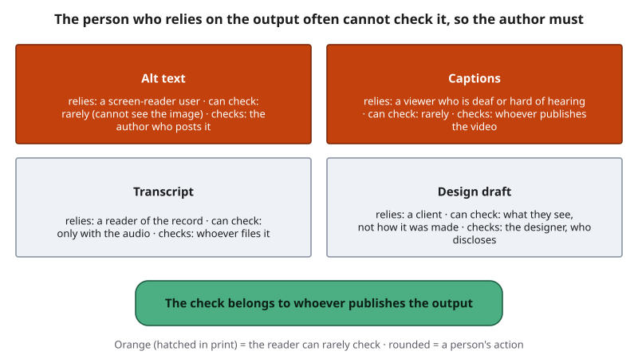{#fig-13-7 fig-alt="Four uses (alt text, captions, transcript, design draft); for each, who relies on it, whether they can check it, and who must check it."}

A routine that works: write the purpose first (what must the reader of this alt text or caption learn?), let a tool draft if you like, check every claim against the image or the audio yourself, and disclose AI help where your setting expects it (Chapter 10). Before you upload a recording of other people's voices or faces, run the data gate (Chapter 12); privacy is Chapter 15's subject.

::: {.callout-note title="Worked Example: Alt Text for the Zine"}
*Constructed example.* Let's take the streetcar drawing again. Hana writes alt text for it on the zine's web page.

**Step 1 — Purpose first, in their own words:** readers need to know that it is a hand-drawn streetcar on Elm Street in the 1920s.

**Step 2 — The tool's draft:** "A watercolor photograph of a vintage streetcar on a busy city street."

**Step 3 — Check each claim:** "watercolor" is wrong (ink); "photograph" is wrong (a drawing); "busy" is not in the picture. **Final:** "Hand-drawn ink illustration of a 1920s streetcar on Elm Street, Dallas, with shopfronts behind it."
:::

::: {.callout-note title="Faded Example: Lecture Captions"}
*Constructed example.* A teaching assistant turns on automatic captions for a recorded statistics lecture. In the lecture, the instructor says "Bayes' rule," "a p-value below 0.05" and "a sample of 30 students."

**Done for you:** *Check 1, names and technical terms:* "Bayes" appears as "bays" twice; fixed.

**Your turn:** Check 2, numbers and units: what would you look for in these three phrases? _______________ Who is harmed if the captions stay wrong? _______________
:::

::: {.callout-important title="Your Turn"}
For one multimodal use in your field, name who relies on the output, whether they can check it, and who must. Write it in one sentence.
:::

::: {.callout-tip title="Check Yourself 13.3"}
1. Define alt text in your own words.
2. In the 2023 transcription study, what share of the 312 transcriptions with inventions contained harmful content?
3. Why does the check on alt text fall on the author?
:::

## 13.4 Provenance: Where a File Came From {#sec-13-4 .unnumbered}

[Deep]{.path}

If looking cannot settle where an image came from, records can help. **Provenance** is a record of where a piece of content came from and how it was changed. **Metadata** is data about a file, such as when, where and with what it was made.

In February 2021, Adobe, Arm, the BBC, Intel, Microsoft and Truepic founded the Coalition for Content Provenance and Authenticity (C2PA) to set a standard for this kind of record (Microsoft, 2021). **Content credentials** are a provenance record attached to a file under the C2PA standard: signed statements about how the file was made and edited. A credential can say, for example, "captured with this camera," "edited with this program" or "generated with this AI tool." The statements are signed digitally by the tool or device that made them, and they are tied to the file by a *hash*, a short fingerprint computed from the file's contents, so that a change to the file shows (C2PA, 2026).

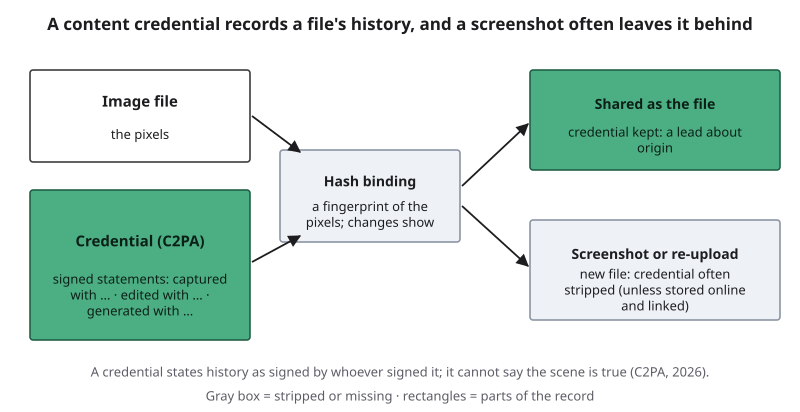{#fig-13-9 fig-alt="A file with a signed credential bound by a hash; shared as a file it keeps it; as a screenshot it is often stripped (gray box), unless stored online."}

A valid credential is evidence of a file's history, as stated by whoever signed it. The standard itself says that provenance cannot tell you whether content is true, accurate or factual (C2PA, 2026). For example, a real photo of a staged scene can carry a perfect credential.

Credentials also go missing. Metadata is often *stripped*, or removed, when files are shared, for example by social media platforms, sometimes on purpose to protect privacy (National Institute of Standards and Technology [NIST], 2024). This book reads a screenshot the same way: it makes a new file, which carries no credential unless the original's record was also stored online and linked by an invisible watermark, which the standard allows (C2PA, 2026); in this book's reading, few tools support it yet (as of October 2026). So, on its own, **a missing signal proves nothing**.

::: {.callout-note title="Dated box: credentials in one maker's phones (as of October 2026)"}
Some devices now add credentials at capture. Google says that its Pixel 10 phones add content credentials to every photo taken with the Pixel Camera app (Google, 2025a). Adoption varies by device, app and platform. In Compass (optional): which tools add or display credentials.
:::

::: {.callout-note title="Worked Example: A Credential That Did Not Travel"}
*Constructed example.* Hana adds content credentials to a scan of a drawing before posting it, so the record says: scanned from paper, contrast adjusted, no AI tool used. A classmate shares a screenshot of the post in a group chat. Hana inspects the screenshot: no credential. **Conclusion:** the credential helps people who receive the original file; the screenshot did not carry it.
:::

::: {.callout-note title="Faded Example: Three Photos for the Student Paper"}
*Constructed example.* A student newspaper's photo editor receives three photos of a campus event. Photo A carries a valid credential signed by a camera at capture. Photo B carries no credential. Photo C carries a credential that names an AI image tool.

**Done for you:** *Photo A:* strong evidence of where the file came from; the caption still needs checking.

**Your turn:** What does Photo B's missing credential show? _______________ What does Photo C's credential show? _______________
:::

::: {.callout-important title="Your Turn"}
Check one image you made yourself (no people in it) for content credentials (Lab 13.3). Then take a screenshot of it and check again. What changed?
:::

::: {.callout-tip title="Check Yourself 13.4"}
1. What is the difference between provenance and truth?
2. Why does a missing credential prove nothing on its own?
3. What ties a credential to its file?
:::

## 13.5 Watermarks and Labels {#sec-13-5 .unnumbered}

[Deep]{.path}

A second kind of signal sits inside the media itself. A **watermark (media)** is a pattern, visible or hidden, that a tool places in the image, audio or video it produces, which a matching detector can later test for.

Hidden watermarks are designed to survive compression and cropping better than metadata does. But they have limits. A watermark exists only where the maker chose to add one. Editing can weaken or remove a mark (NIST, 2024). *Open-weight* models, whose settings anyone can download and run, need not add one at all. A watermark can usually be checked only with its maker's detector or a partner's: Google reported in May 2025 that more than 10 billion pieces of content had been watermarked with its SynthID system, and opened a detector portal to early testers (Google, 2025b). Platform labels, such as "made with AI," depend on these signals or on what the uploader declares.

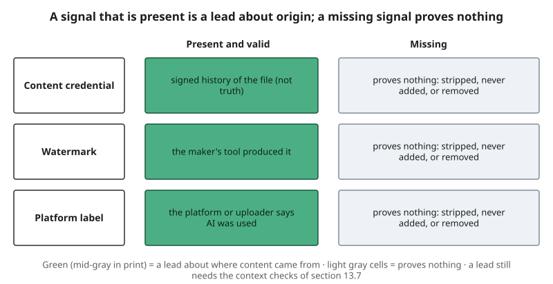{#fig-13-10 fig-alt="Grid: credential, watermark, platform label; present means a lead about origin; missing means it proves nothing (gray cells)."}

So one two-sided rule covers credentials, watermarks and labels. **A signal that is present and valid is a lead about where content came from. A missing signal proves nothing.** In other words, use signals when you find them, and never treat their absence as a sign that media is real.

::: {.callout-note title="Worked Example: The Collective's Rule"}
*Constructed example.* Hana's zine collective accepts hand-drawn work only. An application arrives with drawings and no credential or watermark. The collective notices that no signal could ever prove a drawing is hand-made, and that judging applicants by suspicion would be unfair (Chapter 10). So it writes a rule for **every** applicant, Hana included: send process evidence, such as photos of sketches and scans of the paper pages. **Conclusion:** a missing signal decides nothing; the rule asks everyone for the same evidence.
:::

::: {.callout-note title="Faded Example: Labeled Renders"}
*Constructed example.* An engineering design firm's product renders carry a provider's visible "AI-generated" label in the bottom-right corner.

**Done for you:** *What the label shows:* that the tool which made the image says it was generated.

**Your turn:** What does the label not show? _______________ What happens to it if someone crops the corner? _______________
:::

::: {.callout-important title="Your Turn"}
An image you want to share has no label, no watermark you can find and no credential. Write one sentence on what you know about its origin from those signals, and one on what you would check instead.
:::

::: {.callout-tip title="Check Yourself 13.5"}
1. Define a watermark (media).
2. Give two reasons an AI-generated image may carry no watermark.
3. State the two-sided rule for provenance signals.
:::

## 13.6 Why Looking and Detector Scores Are Weak {#sec-13-6 .unnumbered}

[Deep]{.path}

::: {.callout-note title="Predict first"}
Researchers drew faces from a pool of 800: 400 photos of real people and 400 made by a face generator from 2020. Each participant classified 128 of them. What share did people classify correctly? And after training with feedback?
:::

In the study, 315 participants classified the faces correctly 48.2% of the time, about the same as guessing. A second group of 219 participants, trained with examples and told after every face whether they were right, reached 59.0% (Nightingale & Farid, 2022). Training added about 11 percentage points (this book's calculation). Voices are hard too: in English and Mandarin, listeners correctly identified 73% of the speech deepfakes they heard, and training helped only a little; the authors note that their deepfakes came from older methods (Mai et al., 2023). In another experiment, 210 people could not reliably detect deepfake videos, tended to call them authentic, and overestimated their own skill (Köbis et al., 2021). Groups do better than individuals: across 15,016 participants, ordinary people judging one set of videos were about as accurate as a leading detection model, though their errors differed (Groh et al., 2022).

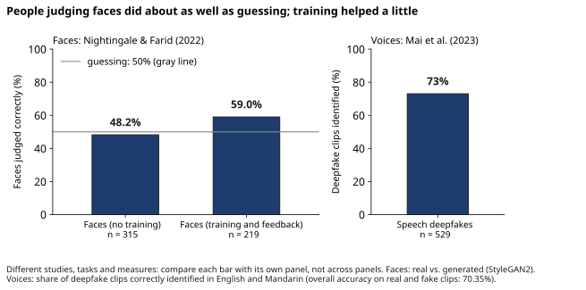{#fig-13-11 fig-alt="Two panels: faces judged correctly 48.2%, after training 59.0%, guessing 50%; separately, 73% of speech deepfakes identified."}

What about tools? A **deepfake detector** is a tool that gives a score for how likely an image, audio or video is to have been generated or altered by AI. A 2025 *benchmark* (a standard test used to compare tools) called Deepfake-Eval-2024 collected media that social-media users and users of a detection service had flagged as possibly AI-made in 2024, both real and fake, and the authors labeled it: over 100 hours of video and audio and about 2,000 images (Chandra et al., 2025). They report detection quality as the area under the curve (AUC), a score where 0.5 means guessing and 1.0 means perfect. Nine open-source detectors had scored between 0.87 and 1.00 on the test data from their original publications, re-run by the authors. On the 2024 media, they scored between 0.43 and 0.63. The best of 22 commercial tools, which the authors kept anonymous, did better: 0.79 for video, 0.93 for audio (partly, the authors say, because of how they labeled audio) and 0.90 for images. Still, none was right 90% of the time; the authors estimate that trained human analysts are right at least that often. The authors built the benchmark with TrueMedia.org, a nonprofit deepfake-detection service (closed to the public in January 2025; TrueMedia.org, 2025).

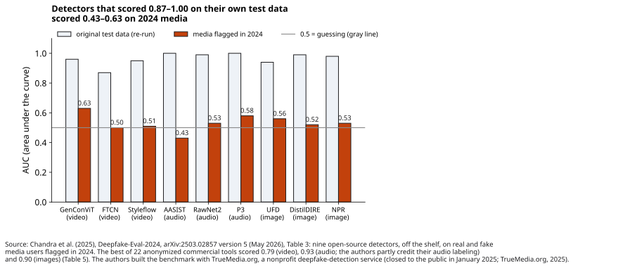{#fig-13-12 fig-alt="Paired bars for nine detectors: AUC on original test data 0.87 to 1.00, on 2024 media 0.43 to 0.63; solid gray line at 0.5, guessing."}

Detectors also make the opposite mistake. A **false positive** labels a person's real work as AI-made, and a United States government report notes that such errors can be extremely damaging to the people affected (NIST, 2024). For example, Chapter 10 (section 10.6) showed text detectors flagging essays by second-language writers, and in Chapter 2 (section 2.5) Hana questioned an app that claimed "97% accuracy" at telling human from AI illustrations.

And a general chat tool is not a detector. One provider's documentation states that its model cannot determine whether an image is AI-generated and should not be relied on to detect synthetic images (Anthropic, n.d.). Since November 2025, another provider's chat app can check an uploaded image for that company's own watermark (Google, 2025c); that shows only whether that company's tools made the file, and a "no" proves nothing about other generators. Asking a chatbot "is this real?" otherwise gets you a fluent answer, not a test.

None of this makes looking useless. A garbled sign or an impossible shadow is worth noticing. But a look or a score is a **lead**, like Chapter 8's uncertainty signals, not a verdict.

::: {.callout-note title="Worked Example: Hana Rereads the 97% Claim"}
*Constructed example.* The app from Chapter 2 now advertises "97% accuracy against the latest generators." Hana asks three questions. **Tested on what?** The page names one test set from 2024. **Tested on work like mine?** Hand-drawn scans are not mentioned. **How often is human work called AI-made?** Not reported. **Conclusion:** a lead at best; the collective keeps its process-evidence rule.
:::

::: {.callout-note title="Faded Example: A Vendor's Claim"}
*Constructed example.* A social-science research team plans to screen interview videos with a detector whose vendor reports "99% accuracy" on its own, unnamed benchmark. The vendor's page reports no false-positive rate.

**Done for you:** *Question 1, tested on what?* The vendor's own benchmark, not named: unknown media, unknown date.

**Your turn:** What does the missing false-positive rate mean for real interviews? _______________ What would a false positive cost a participant? _______________
:::

::: {.callout-important title="Your Turn"}
Write down how confident you are that you could spot a generated face (0–100%). Compare it with the 48.2% result. What does the gap, if any, tell you?
:::

::: {.callout-tip title="Check Yourself 13.6"}
1. What did training change in the face study, and by how much?
2. What happened to open-source detectors' AUC on media from 2024?
3. Why is a detector's false positive harmful?
:::

## 13.7 Context Before Pixels {#sec-13-7 .unnumbered}

[Deep]{.path}

::: {.callout-note title="Recap of 13.2–13.6 (fast route: start here)"}
- **Built, not recorded (13.2):** a generator produces what is plausible for a prompt; a realistic picture or voice records nothing by itself. A **deepfake** is synthetic media that realistically shows a real person, or a real event, saying, doing or happening in a way that did not happen.
- **Who relies, who checks (13.3):** readers of alt text (a short text alternative for an image), captions and transcripts often cannot check them, so the author must.
- **Signals (13.4–13.5):** **content credentials** are a provenance record attached to a file under the C2PA standard: signed statements about how the file was made and edited; a **watermark (media)** is a pattern, visible or hidden, that a tool places in the image, audio or video it produces, which a matching detector can later test for. A signal that is present is a lead about origin; a missing signal proves nothing; a credential records history, not truth.
- **Looks and scores (13.6):** people judging faces did about as well as guessing (48.2% correct), and open-source detectors fell to about guessing on 2024 media; both are leads, not verdicts.
:::

*Featuring Hana (they/them), an media arts and design student and freelance illustrator who runs a zine, a small self-published magazine.*

If looks and scores are weak, what works? The same habits that work for text, applied to media. The rule of this section: **check the source, the channel and the context before the pixels.**

**1. Source and channel.** Who sent this, and through which channel? Can you reach that person or organization another way? An **out-of-band check** is confirming a request or a claim through a separate channel you already trust, not one the message provides. For example: the number on a signed contract, a company directory, or walking to a colleague's desk. In the Opening Case, every instruction came through channels the fraudsters controlled: the email, the meeting and the instant messages (Hong Kong SAR Government, 2024). The fraud came to light, according to CNN, when the employee later checked with the head office (Chen & Magramo, 2024). This book reads that as a channel the fraudsters did not control, and reads the case this way: a check through a known channel before the first transfer would likely have exposed the fraud.

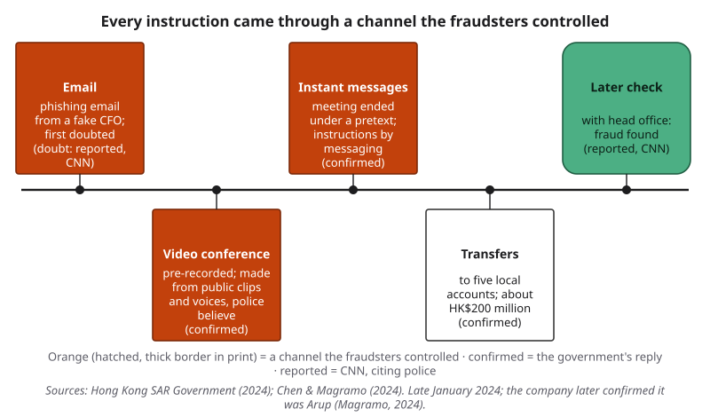{#fig-13-2 fig-alt="Timeline: phishing email, pre-recorded video conference, instant messages with instructions, transfers, later check with head office; tiers marked."}

The Hong Kong fraud is an example of **social engineering**: manipulating people, rather than breaking into systems, to get them to give money, access or information. Arup said that none of its internal systems were compromised (Magramo, 2024). Generated media made an old trick cheaper and more convincing.

**2. Earliest version.** Has this image or clip appeared before? **Reverse image search** is searching with an image, instead of words, to find where it or similar images appear online, including its earliest version. For a video, pause on one clear frame, take a screenshot of it, and search with that. Reverse image search is the multimodal form of Chapter 9's lateral reading and tracing a claim upstream: you leave the image and see where else it lives. In Compass (optional): reverse-search steps for several tools.

**3. Outside sources.** If the media shows an event, is anyone else reporting it: officials, local news, other people who were there?

**4. Provenance signals.** Check for credentials and watermarks: present is a lead, a missing signal proves nothing.

**5. Content clues, last.** Then look closely. Clues can confirm what the context showed, but rarely settle it alone.

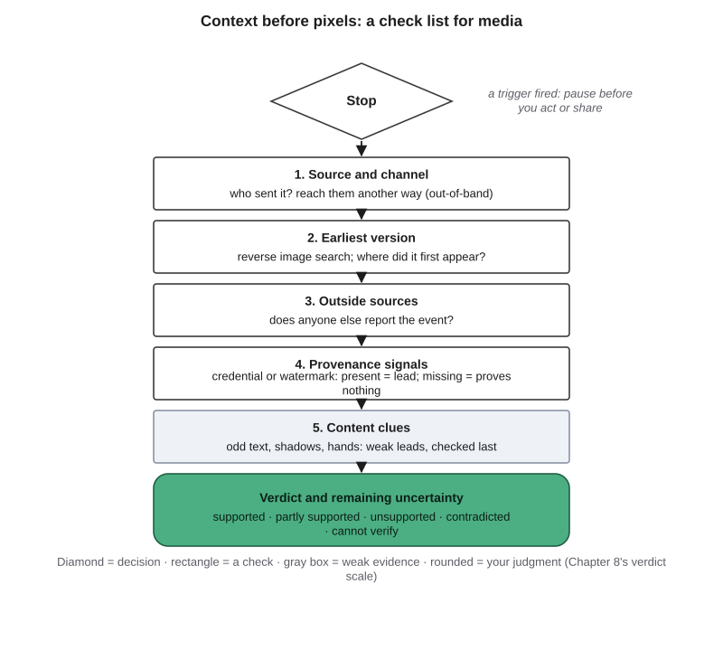{#fig-13-13 fig-alt="Check list: stop; source and channel; earliest version; outside sources; provenance signals; content clues (gray, weak); verdict."}

Much misleading media needs no AI. A **cheap fake** is media manipulated without generative AI, such as a real photo with a false caption or date, a slowed-down video or a simple edit (Paris & Donovan, 2019). In a study of media in published fact checks collected up to November 2023, most misleading media used no AI at all: context manipulations, real media presented with a false context, were still the majority. AI-generated images had been rare until spring 2023 and then rose quickly (Dufour et al., 2024). Context checks catch both kinds.

These steps are Chapter 8's funnel applied to media. For a picture or a recording, the primary source is the original file from the person who made it, or the person, reached through a channel you trust.

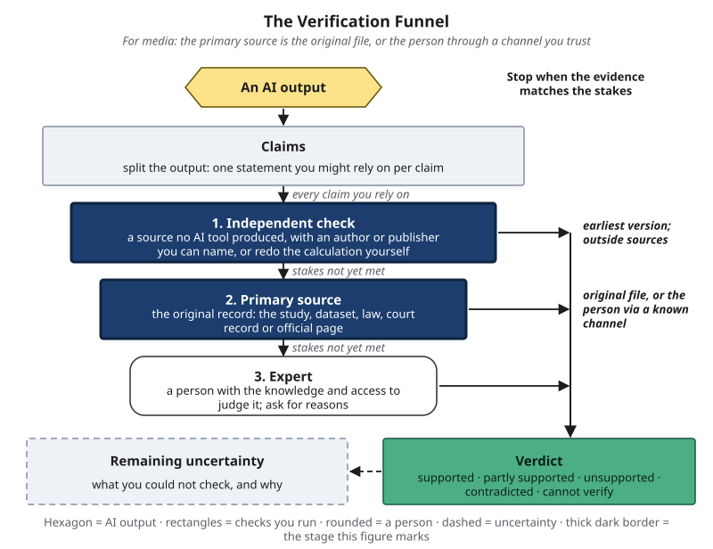{#fig-13-14 fig-alt="Verification Funnel, independent check and primary source highlighted; notes: earliest version, outside sources; original file or the person."}

::: {.callout-note title="Worked Example: An \"1890s Photograph\""}
*Constructed example.* Let's take a striking image. A zine reader emails Hana a "photograph of downtown Dallas in the 1890s" for the history issue.

**Step 1 — Source and channel:** the reader found it in a social-media post; no photographer, no archive named.

**Step 2 — Earliest version:** a reverse image search finds a 2025 post on an AI-art forum, where the poster labeled it as made with an image generator. That is positive evidence about its origin.

**Step 3 — Outside sources:** none of the public archives or city histories that Hana checks shows the image.

**Step 4 — Signals and clues:** no credential; a shop sign's letters spell nothing, which fits Step 2.

**Verdict:** *contradicted* as an 1890s photograph. **Remaining uncertainty:** low; the forum label could be wrong, but the missing archive record and the clues point the same way. Hana thanks the reader and does not use it.
:::

::: {.callout-note title="Worked Example: A Photo That Checks Out"}
*Constructed example.* The same week, another reader sends a 1920s photo of the Elm Street streetcar line, saying it comes from the city library's digital archive.

**Step 1 — Source and channel:** the reader names the archive; Hana opens the archive's own website, not the link in the email, and finds the photo there. **Step 2 — Earliest version:** the archive's catalog record gives the photographer, the year and the donor. **Step 3 — Outside sources:** a city history book lists the same line in that decade.

**Verdict:** *supported* as a 1920s photo of the Elm Street line. **Remaining uncertainty:** the exact year. Checking is not only debunking: it also lets you use the real thing with confidence.
:::

::: {.callout-note title="Faded Example: A Voice Message to Accounts Payable"}
*Constructed example.* An accounts-payable clerk, the employee who pays a company's bills, gets a voice message that sounds like the company's controller, its chief accountant. The message comes from an unknown number and asks her to change a supplier's bank details today, before the supplier's next payment.

**Done for you:** *Step 1, source and channel:* she calls the controller on the number in the company directory.

**Your turn:** What should happen to the request while she waits? _______________ What written rule would make this check routine for every bank-detail change? _______________
:::

::: {.callout-important title="Your Turn"}
Think of an image or clip you saw shared this month. Which of the five steps could you have run in two minutes? Which would have mattered most?
:::

::: {.callout-tip title="Check Yourself 13.7"}
1. Define an out-of-band check and give an example.
2. What is a cheap fake? Why do context checks catch it?
3. Why do content clues come last?
:::

## 13.8 Your Verification Protocol (Optional Artifact) {#sec-13-8 .unnumbered}

[Studio]{.path}

The checks work only if you run them, and the moment you most need them is the moment of pressure. The police advice in the Hong Kong case mixes a looking test with habits that do not depend on looks. Its first tip is to ask the person to turn their head on camera and watch for anything abnormal, which is a lead at best. The others: test the other person's identity through the content of the conversation; verify with a phone call when a relative or friend asks for money by video or audio; and use a scam-checking tool or helpline when in doubt (Hong Kong SAR Government, 2024). This book adds one condition: a call counts only if you place it to a number you already have. A **verification protocol** is rules you write in advance for when and how you check media and media-borne requests before you act on them.

A protocol has six parts:

1. **Triggers:** the situations that start it, such as money, passwords or files requested; urgency or secrecy; a new or unexpected channel; strong emotion; media offered as proof; media you are about to publish or cite.
2. **Pause:** what you do first (for example, "no action for ten minutes, and no reply in the same channel"). If the request is real, a short wait rarely costs much; if it is fake, the wait is what saves you.
3. **Channels, named in advance by role:** "the number on the signed contract," "the department directory." Write roles, not real numbers: numbers change, and a written list of real numbers can be copied or faked, while a role points you to the current, trusted listing.
4. **Checks by stakes:** the steps of section 13.7, and where you stop for low, medium and high stakes (Chapter 8's stopping rule).
5. **Record:** the verdict and what remains uncertain.
6. **Disclosure:** what you say, and where, when media you share or deliver was generated or altered (Chapter 10).

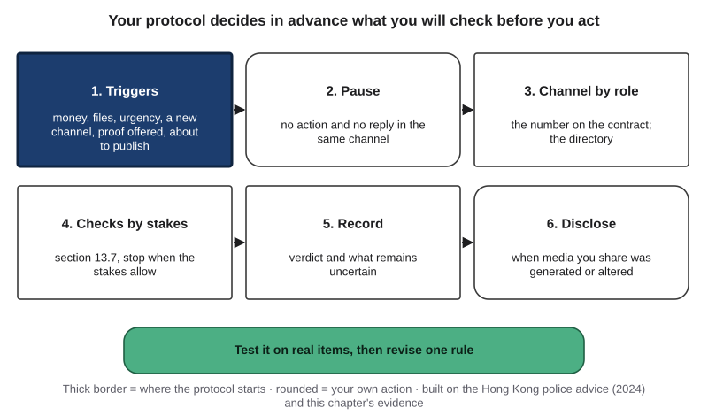{#fig-13-15 fig-alt="Protocol card: triggers, pause, out-of-band channel by role, checks by stakes, record verdict and uncertainty, disclose; a test strip below."}

::: {.callout-note title="Worked Example: Hana's Protocol Meets a Mural Clip"}
*Constructed example.* A classmate sends Hana a video clip "proving" that the city painted over a downtown mural, a large painting on an outside wall, last week. Hana wants to mention it in the zine.

**Trigger:** media offered as proof, which Hana is about to publish. **Pause:** nothing goes in the zine yet.

**Checks:** *Source:* the classmate got it from a repost. *Earliest version:* a reverse search on a screenshot of one frame finds the same clip uploaded in 2019, showing a different wall. *Outside sources:* the city's public notices and local news report no removal; a local paper's photo from this month shows the mural still there.

**Verdict:** the clip itself is real footage, but the claim that comes with it is *contradicted*: a cheap fake by caption. **Record:** three checks, 12 minutes. **Revision:** Hana adds "a repost with no original" as a trigger.
:::

::: {.callout-note title="Faded Example: A Club's Social-Media Manager"}
*Constructed example.* A student club's social-media manager writes a protocol before reposting images. The club posts about campus events about three times a week; reposts of breaking news have caused two corrections this term.

**Done for you:** *Triggers:* breaking news; an image of a crowd or a disaster; a request from an account she does not know.

**Your turn:** Pause rule: _______________ Checks for high stakes: _______________ Disclosure rule for the club's own edited images: _______________
:::

::: {.callout-important title="Your Turn"}
The optional artifact below asks you to write and test your own protocol. It assumes sections 13.4–13.5 or the recap at the start of 13.7. Start now: list three triggers that fit your life.
:::

::: {.callout-tip title="Check Yourself 13.8"}
1. Why write a protocol in advance instead of deciding in the moment?
2. Why are channels named by role, not by number?
3. Which part of the protocol covers media you make yourself?
:::

## Hands-on Labs {.unnumbered}

All four labs are optional and can be done at home. The labs say what to do, not which buttons to press. In Compass (optional): current tool steps for reverse image search and for reading content credentials. **Rules for every lab:** no item may show an identifiable person, including you, and no photo may show your home or where you live; run the data gate (Chapter 12) before you upload anything, remembering that an uploaded file and its location data reach the provider; never generate an image, voice or video of a real person (the only exception is Lab 13.4's clips, made for these labs with the speakers' written consent).

### Lab 13.1: Describe It, Then Check (Studio · 25 minutes · optional) {.unnumbered}

*(O3 · LO5 · Evaluate)* *10-minute version: steps 1–3.*

1. **Choose an image (2 min):** your own drawing, chart, or photo of an object or a public place, with no people and not your home, or a provided image (in the book's companion files).
2. **Data gate (5 min):** check the tool's terms on training with uploads, and remove location data if you can; if you did Lab 12.2, reuse your notes.
3. **Your alt text first (5 min):** one sentence of purpose, then your alt text.
4. **Tool draft and check (8 min):** ask a tool for alt text; mark each claim keep, fix or cut against the image.
5. **Decide (5 min):** which version should a screen-reader user get, and why?

*Audio extension (optional, 10 more minutes):* transcribe the provided clip, recorded for this lab by a consenting speaker, and mark every word that differs from the provided script.

### Lab 13.2: Trace an Image (Check It · 35 minutes · optional) {.unnumbered}

*(O5 · LO5, LO3 · Evaluate)* *10-minute version: one item.* Four provided, dated items with no people in them (buildings, landscapes, objects), each with a claim attached. Some are authentic as captioned; some are not. For each, run the check list (@fig-13-13): source and channel, earliest version, outside sources, signals, clues (about 7 minutes per item). Write a verdict with remaining uncertainty; then open the answer key and note which step settled each item.

### Lab 13.3: Read the Credentials (Check It · 20 minutes · optional) {.unnumbered}

*(O4 · LO5 · Analyze)* *10-minute version: steps 1–2.*

1. Inspect the provided file with a public credential viewer: what does it say, and who signed it?
2. Take a screenshot of the file and inspect the screenshot. What changed? (On some phones, the screenshot gets a new credential of its own; if so, compare the two.)
3. Inspect one image you made yourself (no people). Write one sentence on what its credential, or a missing one, shows.

### Lab 13.4: The Ear Test (Break It · 15 minutes · optional) {.unnumbered}

*(O5 · LO5 · Evaluate)* *10-minute version: five clips.* Ten provided short clips, recorded for this lab by speakers who consented, some replaced by synthetic versions made with their written consent. Before each, write your answer (real or synthetic) and your confidence. Then score yourself. Compare the share of synthetic clips you caught with the 73% of deepfakes caught in Mai et al. (2023), and compare your average confidence with your accuracy (Chapter 7's calibration of your own confidence: how closely your confidence matches how often you are right). One sentence: what does this mean for a phone call asking you to act? *Non-audio route:* judge the provided transcript-and-spectrogram pairs (a spectrogram is a picture of a sound's pitches over time), or skip without penalty.

## Case Study: The Meeting, Revisited {.unnumbered}

*Case file: cases/C10-arup-deepfake.md.*

**What the record shows.** The government's written reply to the legislature is the primary record (Hong Kong SAR Government, 2024). It states that the conference was pre-recorded; that the police believe it was generated from downloaded public clips and voices of the impersonated officer; that there was no real interaction; that the employee, as instructed, authorized transfers to five local accounts and lost about HK$200 million; and that the fraudster ended the meeting with an excuse and continued by instant messaging. It does not name the company, the tools used or how the clips were edited.

**What was reported.** CNN, citing the police briefing, reported the employee's first doubt and why he stopped doubting; a senior police superintendent told the public broadcaster Radio Television Hong Kong (RTHK), as reported by CNN, that everyone the employee saw in the video conference was fake. CNN itself wrote that the fraud was discovered only when the employee later checked with head office (Chen & Magramo, 2024). In May, Arup confirmed to CNN that it was the company and that its internal systems had not been compromised; RTHK, citing police, reported 15 transactions (Magramo, 2024). As of October 2026, we found no public report of an arrest or a recovery in this case.

**Two accounts, one event.** First reports describe a video conference with several people on screen; the government's reply, months later, adds that it was pre-recorded with no interaction. The accounts fit together; the later one is narrower and more exact. Use the primary record for what it states and say "reported" for the rest.

**Labels (Chapter 4).** The deepfake is an AI output used to deceive. On the Failure Taxonomy Tree, the case sits on the **other** branch, leaf "misuse, such as fake media made to deceive," **documented**: the record states that the police believe the conference was generated from clips and voices to impersonate the officer. It is not hallucination; the media did what its makers intended. On the failure-to-harm chain, **link 2, "checked before use?"**, failed: the transfers followed the instructions (confirmed), and no check with head office came before them (reported). **Link 4**, the loss, is confirmed. Chapter 15 adds the payment-control side.

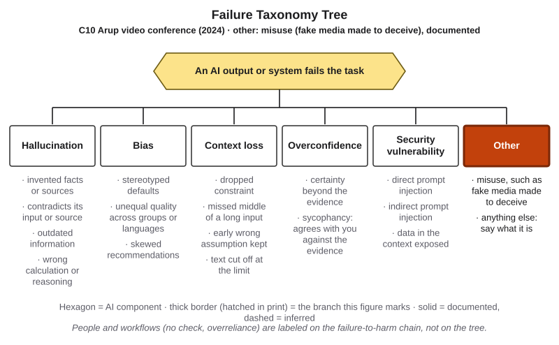{#fig-13-16 fig-alt="Failure Taxonomy Tree, other branch highlighted; tag: C10 Arup video conference, 2024: misuse, fake media made to deceive, documented."}

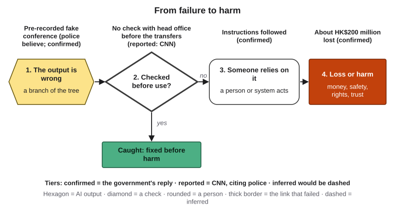{#fig-13-17 fig-alt="Chain: fake pre-recorded conference; checked before use? failed: no check with head office (reported); instructions followed; HK$200 million lost."}

### Short case 1: An explosion that did not happen (2023) {.unnumbered}

On the morning of May 22, 2023, an image of smoke near the Pentagon spread on Twitter, partly through accounts that looked like news services, and major U.S. stock indices dipped briefly before recovering. The Pentagon Force Protection Agency and the Arlington County fire department said there was no explosion or incident. An open-source investigator at Bellingcat pointed to visual flaws, but also to something stronger: no first-hand witnesses and no other images or video had surfaced (Bond, 2023). Context settled it, not pixels. Label: other (misuse), **inferred**, because who made the image, and why, is not documented.

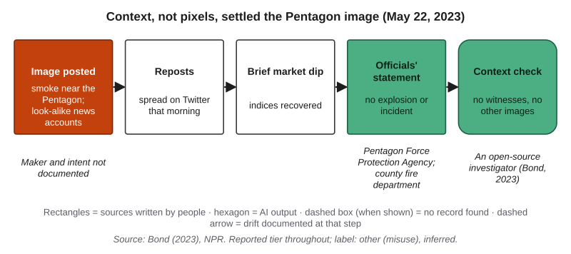{#fig-13-18 fig-alt="Hops: image posted by look-alike news accounts; spread on Twitter that morning; brief market dip; officials' statement; no witnesses or other images."}

### Short case 2: A voice on the phone (2024) {.unnumbered}

In January 2024, before New Hampshire's presidential primary, voters received robocalls, automated phone calls that play a recorded message, with an AI-generated voice imitating President Biden. Investigators traced the calls through phone-network records, with help from an industry group that traces robocalls and two call-blocking companies, to a Texas company and a phone carrier; researchers attributed the voice to one AI voice tool, a link the state said it could not confirm (Johnson, 2024). The Federal Communications Commission (FCC) ruled in February 2024 (adopted February 2, released February 8) that AI-generated voices are "artificial" under the federal law that restricts robocalls (FCC, 2024a). In this case, records, not listening, identified the calls. In September 2024 the FCC fined the political consultant who admitted arranging the calls $6 million, in an order that states the voice was AI-generated (FCC, 2024b); a state jury acquitted him of state charges in June 2025 (Bookman, 2025). The legal questions belong to Chapter 18. Label: other (misuse), documented.

## Ethics Lens: Whose Face, Whose Voice, Whose Work? {.unnumbered}

*Content note: this section mentions sexual images made without consent, without details.*

**The people depicted.** Generated media can place real people's faces and voices in scenes they never took part in. The most harmful case is intimate imagery made without consent. In the United States, the TAKE IT DOWN Act, signed on May 19, 2025, requires covered platforms to remove reported nonconsensual intimate images within 48 hours, a duty enforceable from May 19, 2026 (as of October 2026; WilmerHale, 2026). Chapters 15 and 18 take this up.

**The artists whose work trained the models.** Artists hold a range of views. In a 2024 survey of 459 artists, most respondents said developers should disclose which artworks are used in training and that AI outputs should not belong to the model's makers; the authors describe a tension between the tools' possible benefits and harms for artists (Lovato et al., 2024). One survey is not every artist, but these concerns are reasoned, not a fear of change. Some artists use protection tools: Glaze, built with user studies involving more than 1,000 artists, adds small changes to images meant to disrupt the copying of a style (Shan et al., 2023). Later researchers showed that, as tested, simple edits could defeat such protections (Hönig et al., 2025). Artists can still act: contracts that say whether AI may be used, disclosure to clients, content credentials on their own work, and collective rules like Hana's. Whether training on artists' work is lawful, and on what terms, is Chapter 18's subject.

**Trust itself.** When fakes are common, real evidence can be dismissed. The **liar's dividend** is the benefit a person gains by dismissing real recordings as fake when fakes are common (Chesney & Citron, 2019). Checking protects the real as well as exposing the fake. Law is moving here too. The European Union's AI Act requires providers to mark AI-generated content in a machine-readable way and deployers to disclose deepfakes (Regulation (EU) 2024/1689, Art. 50). As of October 2026, these duties have applied since August 2, 2026, and systems already on the market have until December 2, 2026 for the marking duty (Regulation (EU) 2026/1744; Chapter 18).

*Discussion:* when, if ever, is it acceptable to generate an image of a real person, and who should decide?

## Career Connection {.unnumbered}

The descriptions below are illustrations, not labor-market data.

| Occupation | How the chapter's ideas show up | A question to ask at work |
|---|---|---|
| Fact-checker or open-source investigator | Finds the earliest version of images and clips; checks them against other records | What would we expect to find if this were real, and did we find it? |
| Accessibility specialist or captioner | Writes and reviews alt text and captions; checks AI drafts against the media | Who relies on this, and who checked it? |
| Illustrator or graphic designer | Discloses AI use to clients; adds credentials to delivered work; writes AI clauses into contracts | What does the client expect to be hand-made? |
| Paralegal or litigation support specialist | Gathers the original files and their history when photos or recordings are offered as evidence | Where is the original file, and who has held it? |
| Archivist or museum staff member | Records the provenance of historical images; answers requests about questionable "old photos" | Which record shows where this image came from? |
| Medical scribe or health information technician | Checks AI transcripts of clinical speech before they enter a record (never in a personal AI tool) | Which errors in this transcript could harm a patient? |

## From the Field {.unnumbered}

<!-- Based on the author's encyclopedia entry (Şeker, 2015), "Dijital Varlık ve Enformasyon Toplumu", YBS Ansiklopedi 2(2), 12–16, June 2015, read from Drive 1lXos207zGxsCOkXfVYoFcRGPlpb4bbzO on 2026-10-18 (build/ch13/ftf-dijital-varlik.md); translated and paraphrased from Turkish. Facts limited to sections 1–1.4 of the entry; present-day connections marked. Not commercial: no D16 disclosure. Registry: docs/production/ftf-sources.md (editor to register). -->

In 2015 I wrote an encyclopedia entry on digital assets and the information society (Şeker, 2015). It began with a broad definition: any value that can be represented digitally, in ones and zeros, is a digital asset, whether a picture, a piece of music or a text.

The entry described **digital-asset metadata**: extra data that records an asset's content, type, producer and date, used to classify and manage it. It noted that as assets become more varied, the metadata grows, and that over time the metadata, such as catalogs and indexes, becomes an asset in its own right. It also argued that digital assets have two kinds of value. One is material: a photographer can sell a picture. The other the entry called sentimental, and its examples concern reputation. If a photographer's work is deleted, or copied by someone else without permission, there is a material loss; if someone with bad intentions takes over a business's website and publishes news against the business, the greater loss is to reputation, brand and customer relationships. The entry observed that attacks of this second kind, such as fake accounts created in a person's name, were rising quickly with social media. Finally, it described systems that manage assets by ownership, access and copyright terms.

*Present-day connections, which are this book's and not the 2015 entry's:* the producer-and-date metadata of 2015 is what content credentials now sign, and what platforms often strip (section 13.4). The photographer whose work is copied without permission is where artists' objections to training data begin (Ethics Lens). And a fake account in 2015 and a generated colleague on a video call in 2024 attack the same asset: a person's identity and the trust others place in it. The entry does not discuss AI or deepfakes.

## Chapter Summary {.unnumbered}

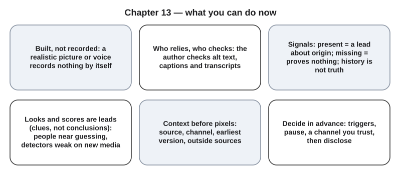{#fig-13-19 fig-alt="Six cards: built not recorded; who relies, who checks; signals present or missing; looks and scores are leads; context first; decide in advance."}

**The chapter's question:** *If seeing and hearing are no longer proof, how do you decide what to believe, and what to act on?* Treat a picture, a voice or a video as a claim, not as proof. Check it the way you check any claim: start with where it came from and through which channel it reached you, look for its earliest version and for outside sources, treat a content credential or watermark as a lead when it is present (a missing signal proves nothing), and use your eyes, ears and detector scores last, as leads. When media asks you to act, confirm with the person through a channel you already trust. Decide your triggers in advance, because pressure is when people skip the checks.

**Return to the Opening Case.** The call was more convincing than the email because a face and a voice feel like a record, and generated ones look and sound like one (sections 13.2 and 13.6). The check that exposed the fraud, too late, was a later check with head office (reported). This book reads it as a channel the fraudsters did not control, and reads the case as one where the same check, run before the first transfer, would likely have prevented the loss (section 13.7).

**Revisit your Warm-up.** (1) Does the model receive the photo as you see it? *No:* it receives a grid of image tokens, shrunk first if the photo is large, and two providers say their models do not process the file's metadata, though the file still reaches the provider (section 13.1; fast-route readers can skip this one). (2) One check that does not depend on how real the clip looks? *Its source, its earliest version (a reverse image search on a screenshot of one frame), or outside reports of the event* (section 13.7). (3) Does a missing label make an image more likely to be real? *No:* a missing signal proves nothing (section 13.5).

You can now:

- **Explain** how a multimodal model receives images and sound, and how generators produce media.
- **Distinguish** generated or altered media from a record of an event.
- **Evaluate** a multimodal use by who relies on it and who must check it.
- **Differentiate** what a provenance signal shows when present from what its absence shows.
- **Assess** media using source, channel and context before looks or scores.
- **Create** a verification protocol for media and the requests it carries.

### Key Terms {.unnumbered}

alt text · audio token · cheap fake · closed captions · content credentials · deepfake · deepfake detector · diffusion model · image token · liar's dividend · metadata · modality · multimodal model · out-of-band check · provenance · reverse image search · social engineering · synthetic media · transcription (speech recognition) · verification protocol · voice cloning · watermark (media)

## End-of-Chapter Package {.unnumbered}

<!-- Each item: objective · LO · revised Bloom level. Odd-numbered answers and all Check Yourself and faded-example keys → Appendix E (docs/production/handoff/ch13.md); even-numbered → private/ch13-answers-even.md. Multiple-choice keys: A2 c, A4 a, A6 d, A8 b, A10 c, A12 a (rotated); distractors from M1–M6 (blueprint v0.2), named in the keys. Deep chapter: practice only, not examinable (D20). -->

This chapter is optional and not examinable. The questions below follow the exam's format, so they are good practice for the reasoning the exams do test.

### Review Questions A: Terms and Concepts {.unnumbered}

1. *(O1 · LO1 · Remember)* Define a multimodal model and give two modalities.
2. *(O1 · LO1 · Understand)* You give a chat tool a large photo of a notice board. Which statement fits section 13.1?\
   (a) The model receives the full-resolution file, including its date and location.\
   (b) The model receives the file as you see it, so its description is faithful.\
   (c) The model receives a resized grid of image tokens; small text may be lost.\
   (d) The model receives the file's metadata, so its description can give the date the photo was taken.
3. *(O1 · LO1 · Understand)* In your own words, describe how a diffusion model produces an image from a prompt.
4. *(O2 · LO1 · Understand)* A photorealistic image shows a flood in your town. Which statement is accurate?\
   (a) Its realism is not evidence; a generator can produce it with no event behind it.\
   (b) Its realism is strong evidence, because generators mostly reuse pieces of real photos.\
   (c) It can be treated as real unless a detector scores it as generated.\
   (d) It can be treated as real, because it carries no AI label or watermark.
5. *(O2 · LO1 · Analyze)* Researchers extracted some training images from image diffusion models (Carlini et al., 2023). Why does that finding not make a generated image a record of an event?
6. *(O3 · LO5 · Understand)* Why does section 13.3 say the author, not the reader, must check alt text?\
   (a) Because tools rarely make errors in alt text, so the check is a quick formality.\
   (b) Because a detector can check alt text automatically before readers see it.\
   (c) Because a fluent description shows that the tool received the image as the author sees it.\
   (d) Because a reader who cannot see the image cannot compare the text with it.
7. *(O3 · LO5 · Apply)* In the 2023 transcription study, about 1.4% of segments reliably produced invented text. What does that mean for who must check a transcript before it is filed, and why?
8. *(O4 · LO5 · Understand)* An image arrives with a valid content credential from a camera. Which conclusion fits section 13.4?\
   (a) The image is true, because a valid credential certifies that the scene is accurate.\
   (b) It is strong evidence of where the file came from; the scene and caption still need checking.\
   (c) It proves nothing, because platforms usually strip credentials anyway.\
   (d) It shows that the image was generated by AI, since credentials mark AI-made files.
9. *(O4 · LO5 · Understand)* State the two-sided rule for provenance signals and give one reason an AI-generated image may carry no watermark.
10. *(O5 · LO5 · Understand)* In the 2022 face study, what happened after training with feedback?\
    (a) Accuracy reached about 90%, so trained viewers can rely on looking.\
    (b) Accuracy stayed near guessing, so only a detector score can settle such cases.\
    (c) Accuracy rose from 48.2% to 59.0%, a small gain.\
    (d) Accuracy rose to near certainty for anyone who looked carefully.
11. *(O5 · LO5 · Understand)* Explain why a detector's score is a lead and not a verdict, using the Deepfake-Eval-2024 results.
12. *(O5 · LO5 · Apply)* A video call from "your manager" asks you to send confidential files today. What is the best first step?\
    (a) Confirm with your manager through a channel you already trust.\
    (b) Ask a chat tool whether the video looks generated.\
    (c) Watch the face closely for flaws before deciding.\
    (d) Send the files, since a video is harder to fake than an email.

### Review Questions B: Case Questions {.unnumbered}

1. *(O1 · LO1 · Apply)* A museum educator asks a tool to describe a photo of a painting for a gallery guide. List what the model receives and does not receive, and the two checks you would run on its description.
2. *(O3 · LO5 · Evaluate)* A public-health office auto-captions a vaccination video in English and Spanish. Who relies on the captions, can they check them, and what review would you require before posting?
3. *(O4 · LO5 · Analyze)* A news intern receives two images of a storm: one carries a credential naming an AI image tool, the other has no credential. Write what each signal shows and what you would check next for each.
4. *(O5 · LO5, LO3 · Evaluate)* In a dispute about a neighborhood parking lot, a resident posts a video "showing" a delivery truck damaging a fence last night. You find: (1) a reverse search on a screenshot of one frame finds the same clip uploaded in 2022 from another city; (2) no damage report was filed with the lot's owner or the police; (3) the account that posted it was created yesterday. Apply the check list in section 13.7 and give a verdict with its remaining uncertainty.

### Review Questions C: Interpretive Questions {.unnumbered}

1. *(O2 · LO1, LO5 · Evaluate)* "Because AI images can look real, photographs should no longer be accepted as evidence of anything." Take a position, using sections 13.2, 13.4 and 13.7.
2. *(O4 · LO5 · Evaluate)* "Social platforms should be required to label every AI-generated image." Take a position, using what labels, watermarks and credentials can and cannot do.

### Spaced Review {.unnumbered}

Come back to these a few days after reading. Items 1 to 4 come from the chapters you read before this one; item 5 connects to Chapter 12, which pairs with this chapter.

1. *(Chapter 11 · LO3 · Understand)* Automation bias is the tendency to over-rely on automated output. A detector reports "92% likely real" for a clip with no known source. How could automation bias lead someone to share it?
2. *(Chapter 11 · LO3 · Analyze)* A proxy is a clue that stands in for something else. How is "it looks realistic" a proxy for "it is real," and why can the proxy fail?
3. *(Chapter 10 · LO4 · Understand)* Section 10.6 showed detectors flagging second-language writers. What is the equivalent risk for illustrators like Hana?
4. *(Chapter 10 · LO4 · Apply)* A designer delivers a client mockup with a generated background. Using section 10.7, what should the designer disclose, and where?
5. *(Chapter 12 · LO5 · Apply)* A student wants to upload a recording of a group meeting to a transcription tool. What does the data gate ask before the upload?

### Discussion Questions {.unnumbered}

1. *(Ethics · O2 · LO5 · Evaluate)* When, if ever, is it acceptable to generate an image or voice of a real person, and who should decide?
2. *(Ethics · O3 · LO5 · Evaluate)* Should artists' work be usable for training without consent? What would a fair arrangement look like? (Chapter 18 returns to the law.)
3. *(Career · O5 · LO5 · Apply)* How will people in your intended field check images or recordings in five years?
4. *(Interdisciplinary · O3 · LO5 · Analyze)* What makes good alt text for an artwork, a scientific figure and an engineering drawing? What differs, and why?
5. *(O5 · LO5 · Evaluate)* The liar's dividend lets people dismiss real evidence. Which habit in this chapter protects real evidence best?

### Application Assignment (optional): Verification Protocol {.unnumbered}

*(O6 · LO5, LO3 · Create)* Optional and ungraded unless your instructor chooses to give feedback; it is not one of the book's numbered portfolio assignments (A1–A14). It assumes sections 13.4–13.5 or the recap at the start of 13.7. **Time:** about 80–100 minutes, at any time before you reach Chapter 15 (allow more if you work more slowly or are working in a second language): about 5 minutes to read this brief and rubric, 10 for scope and triggers, 10 for channels and checks, 12–18 for each of three test items, 5 for the disclosure rule, 8 for the revision and its re-check, and 7 for the declaration. A one-page template is in the book's companion files. It can serve as evidence in the risk review (A12, Chapter 15) and in your personal code of practice (Chapter 21).

**What to build:**

1. **Scope:** three situations in your study, work or life where images, audio or video could reach you and matter. At least one must be a media-evidence situation: a recording or image offered as proof, an image you would cite, or a request for files.
2. **Triggers:** at least four signals that start your protocol.
3. **Pause and channel rule:** what you do first, and the out-of-band channels you will use, named by role, never by real numbers or addresses.
4. **Checks by stakes:** which checks you run, in which order, and where you stop for low, medium and high stakes, with what each provenance signal can and cannot show.
5. **Test record:** apply the protocol to the two provided dated items in the book's companion files (no people in them; not the Lab 13.2 items) and to one item of your own. Your own item should be one whose origin you can prove, so you can check your verdict against the truth: for example, an image you made, with the original file and when and where you made it; it must show no person's face or voice. For each item: triggers fired, checks run, findings, verdict and remaining uncertainty, and time spent. The keys to the provided items are in Appendix E; read them only after your record is written.
6. **Revision:** one change you made after the test, and why.
7. **Disclosure rule:** what you will say, and where, when media you share or deliver was generated or altered.
8. **AI Use Declaration:** tools, purpose, what you accepted, rejected or revised, how you verified it, and where your own judgment shaped the work.

Do not generate images, audio or video of any real person, do not upload other people's faces or voices, and do not test the protocol by deceiving anyone.

**Rubric (10 points)**

| Criterion (points) | Exemplary | Proficient | Developing | Beginning |
|---|---|---|---|---|
| **Task: scope, triggers, rules (3)** | 3: three situations including a media-evidence one; at least four triggers; pause and channel rule by role; checks ordered by stakes with stopping points; a disclosure rule | 2: all parts present; one part vague (checks not ordered, or no stopping points) | 1: one required part missing | 0: two or more required parts missing |
| **Process: test (1.5)** | 1.5: three items tested, each with triggers, checks, findings, verdict, remaining uncertainty and time | 1: three items tested; one element missing for one item | 0.5: fewer than three items, or verdicts without the checks behind them | 0: no test record |
| **Process: revision (1.5)** | 1.5: one revision tied to a test result, with what changed and why, and the affected item re-checked | 1: a revision with what changed and why; item not re-checked | 0.5: a revision without a reason | 0: no revision |
| **Verification (2)** | 2: every verdict rests on checks outside the item (source, channel, earliest version, outside sources); signals read correctly both ways; looks and scores treated as leads | 1.5: as Exemplary, with one signal misread (for example, a missing signal treated as evidence) | 1: some verdicts rest only on looking, listening or a score | 0: no checks behind the verdicts |
| **Declaration and judgment (2)** | 2: all five declaration elements and a specific statement of which rule you are least sure you would follow under pressure, and why | 1.5: all five elements; a general statement | 1: two to four elements | 0: zero or one element |

**Alternative assignment** (for students who prefer not to handle synthetic media or AI tools, or cannot reach them): build the same protocol and test it on the provided case packet (written versions of P1 and P2 plus one further dated case, none from Lab 13.2, with printed search results, credential readouts and outside reports), without running any tool. Same rubric: *Process: test* is the protocol applied to the three packet cases; *Verification* uses the packet's outside evidence; the declaration states "no AI tools used" if so.

### Mini-Project (optional): A Three-Week Media Log {.unnumbered}

*(O5, O6 · LO5 · Evaluate)* For three weeks, log each image, clip or call you nearly acted on or shared: the trigger, the checks you ran, the verdict and the time it took. At the end, write half a page on which trigger fired most and which check settled most cases. The log can feed your portfolio (Chapter 20) and your code of practice (Chapter 21).

### Case Study Questions {.unnumbered}

1. *(O5 · LO3 · Analyze)* The first reports and the government's reply describe the meeting in different detail. What does each say, and how should you write about the meeting today?
2. *(O5 · LO5 · Apply)* Label the case on the tree and the chain, stating which facts are confirmed and which are reported.
3. *(O6 · LO5 · Evaluate)* Which single rule from section 13.8 would most likely have stopped the transfers? Mark your answer as your reading of the case.
4. *(O5 · LO5 · Analyze)* Why did context, not pixels, settle the Pentagon image?
5. *(O5 · LO5 · Analyze)* How were the 2024 robocalls traced, and what does that case show about how the calls were identified?

## Further Reading and Compass Links {.unnumbered}

- Hong Kong SAR Government (2024): the government's reply on deepfake frauds, with the police's advice for checking video calls.
- NIST (2024), *Reducing Risks Posed by Synthetic Content*: a clear overview of provenance, watermarks and detection, and their limits.
- C2PA (2026): the explainer for the content-credentials standard, including what it does not claim.
- Koenecke et al. (2024): the transcription study, with examples of invented sentences.
- Chandra et al. (2025): the benchmark of media flagged in 2024 (read version 5, 2026).
- Paris & Donovan (2019): the report that named "cheap fakes."
- Lovato et al. (2024): what 459 artists said about AI art, training and ownership.
- In Compass (optional): the check list as a step-by-step reveal (@fig-13-13); a credential "before and after screenshot" demo; Lab 13.1–13.4 pages.

## References {.unnumbered}

Anthropic. (n.d.). *Vision*. Claude Docs. Retrieved October 18, 2026, from https://platform.claude.com/docs/en/build-with-claude/vision

Bianchi, F., Kalluri, P., Durmus, E., Ladhak, F., Cheng, M., Nozza, D., Hashimoto, T., Jurafsky, D., Zou, J., & Caliskan, A. (2023). Easily accessible text-to-image generation amplifies demographic stereotypes at large scale. In *Proceedings of the 2023 ACM Conference on Fairness, Accountability, and Transparency* (pp. 1493–1504). https://doi.org/10.1145/3593013.3594095

Bond, S. (2023, May 22). Fake viral images of an explosion at the Pentagon were probably created by AI. *NPR*. https://www.npr.org/2023/05/22/1177590231/fake-viral-images-of-an-explosion-at-the-pentagon-were-probably-created-by-ai

Bookman, T. (2025, June 13). Political operative who admitted to creating fake Biden robocalls found not guilty. *New Hampshire Public Radio*.

C2PA. (2026). *C2PA and Content Credentials explainer* (Specification version 2.3). Coalition for Content Provenance and Authenticity. Retrieved October 18, 2026, from https://spec.c2pa.org/specifications/specifications/2.3/explainer/Explainer.html

Carlini, N., Hayes, J., Nasr, M., Jagielski, M., Sehwag, V., Tramèr, F., Balle, B., Ippolito, D., & Wallace, E. (2023). Extracting training data from diffusion models. In *Proceedings of the 32nd USENIX Security Symposium* (pp. 5253–5270). USENIX Association.

Chandra, N. A., Lee, H., Murtfeldt, R., Qiu, L., Karmakar, A., Tanumihardja, E., Farhat, K., Caffee, B., Lee, C., Choi, J., Paik, S., Kim, A., & Etzioni, O. (2025). *Deepfake-Eval-2024: A multi-modal in-the-wild benchmark of deepfakes circulated in 2024* (arXiv:2503.02857v5). arXiv. https://arxiv.org/abs/2503.02857

Chen, H., & Magramo, K. (2024, February 4). Finance worker pays out $25 million after video call with deepfake 'chief financial officer'. *CNN*. https://edition.cnn.com/2024/02/04/asia/deepfake-cfo-scam-hong-kong-intl-hnk/index.html

Chesney, R., & Citron, D. (2019). Deep fakes: A looming challenge for privacy, democracy, and national security. *California Law Review, 107*, 1753. https://doi.org/10.15779/Z38RV0D15J

Dakan, R., & Feller, J. (2025). *AI fluency: Framework & foundations*. Anthropic.

Dosovitskiy, A., Beyer, L., Kolesnikov, A., Weissenborn, D., Zhai, X., Unterthiner, T., Dehghani, M., Minderer, M., Heigold, G., Gelly, S., Uszkoreit, J., & Houlsby, N. (2021). An image is worth 16x16 words: Transformers for image recognition at scale. In *International Conference on Learning Representations (ICLR 2021)*. https://openreview.net/forum?id=YicbFdNTTy

Dufour, N., Pathak, A., Samangouei, P., Hariri, N., Deshetti, S., Dudfield, A., Guess, C., Hernández Escayola, P., Tran, B., Babakar, M., & Bregler, C. (2024). *AMMeBa: A large-scale survey and dataset of media-based misinformation in-the-wild* (arXiv:2405.11697). arXiv. https://arxiv.org/abs/2405.11697

Federal Communications Commission. (2024a). *Implications of artificial intelligence technologies on protecting consumers from unwanted robocalls and robotexts* (Declaratory Ruling FCC 24-17, CG Docket No. 23-362; adopted February 2, 2024, released February 8, 2024).

Federal Communications Commission. (2024b). *In the matter of Steve Kramer* (Forfeiture Order FCC 24-104; adopted September 26, 2024). https://www.fcc.gov/document/fcc-issues-6m-fine-nh-robocalls

Gonzalez Penuela, R. E., Collins, J., Bennett, C., & Azenkot, S. (2024). Investigating use cases of AI-powered scene description applications for blind and low vision people. In *Proceedings of the 2024 CHI Conference on Human Factors in Computing Systems* (pp. 1–21). ACM. https://doi.org/10.1145/3613904.3642211

Google. (2025a, September). *How Pixel and Android are bringing a new level of trust to your images with C2PA Content Credentials*. https://blog.google/security/pixel-android-trusted-images-c2pa-content-credentials/

Google. (2025b, May). *SynthID Detector — a new portal to help identify AI-generated content*. https://blog.google/technology/ai/google-synthid-ai-content-detector/

Google. (2025c, November 20). *How we're bringing AI image verification to the Gemini app*. https://blog.google/technology/ai/ai-image-verification-gemini-app/

Groh, M., Epstein, Z., Firestone, C., & Picard, R. (2022). Deepfake detection by human crowds, machines, and machine-informed crowds. *Proceedings of the National Academy of Sciences, 119*(1), e2110013119. https://doi.org/10.1073/pnas.2110013119

Ho, J., Jain, A., & Abbeel, P. (2020). Denoising diffusion probabilistic models. *Advances in Neural Information Processing Systems, 33*, 6840–6851.

Hong Kong SAR Government. (2024, June 26). *LCQ9: Combating frauds involving deepfake* [Press release]. https://www.info.gov.hk/gia/general/202406/26/P2024062600192.htm

Hönig, R., Rando, J., Carlini, N., & Tramèr, F. (2025). Adversarial perturbations cannot reliably protect artists from generative AI. In *International Conference on Learning Representations (ICLR 2025)*. https://arxiv.org/abs/2406.12027

Johnson, D. B. (2024, February 6). New Hampshire authorities trace Biden AI robocall to Texas-based telecom. *CyberScoop*. https://cyberscoop.com/lingo-life-biden-ai-robocall/

Köbis, N. C., Doležalová, B., & Soraperra, I. (2021). Fooled twice: People cannot detect deepfakes but think they can. *iScience, 24*(11), 103364. https://doi.org/10.1016/j.isci.2021.103364

Koenecke, A., Choi, A. S. G., Mei, K. X., Schellmann, H., & Sloane, M. (2024). Careless Whisper: Speech-to-text hallucination harms. In *Proceedings of the 2024 ACM Conference on Fairness, Accountability, and Transparency* (pp. 1672–1681). https://doi.org/10.1145/3630106.3658996

Lovato, J., Zimmerman, J., Smith, I., Dodds, P., & Karson, J. (2024). Foregrounding artist opinions: A survey study on transparency, ownership, and fairness in AI generative art. *Proceedings of the AAAI/ACM Conference on AI, Ethics, and Society, 7*(1), 905–916. https://doi.org/10.1609/aies.v7i1.31691

Magramo, K. (2024, May 16; updated May 17). British engineering giant Arup revealed as $25 million deepfake scam victim. *CNN*. https://edition.cnn.com/2024/05/16/tech/arup-deepfake-scam-loss-hong-kong-intl-hnk/index.html

Mai, K. T., Bray, S., Davies, T., & Griffin, L. D. (2023). Warning: Humans cannot reliably detect speech deepfakes. *PLOS ONE, 18*(8), e0285333. https://doi.org/10.1371/journal.pone.0285333

Microsoft. (2021, February 22). *Technology and media entities join forces to create standards group aimed at building trust in online content*. https://news.microsoft.com/source/2021/02/22/technology-and-media-entities-join-forces-to-create-standards-group-aimed-at-building-trust-in-online-content/

National Institute of Standards and Technology. (2024). *Reducing risks posed by synthetic content: An overview of technical approaches to digital content transparency* (NIST AI 100-4). https://doi.org/10.6028/NIST.AI.100-4

Nightingale, S. J., & Farid, H. (2022). AI-synthesized faces are indistinguishable from real faces and more trustworthy. *Proceedings of the National Academy of Sciences, 119*(8), e2120481119. https://doi.org/10.1073/pnas.2120481119

OpenAI. (n.d.). *Images and vision*. OpenAI API documentation. Retrieved October 18, 2026, from https://developers.openai.com/docs/guides/vision

Paris, B., & Donovan, J. (2019). *Deepfakes and cheap fakes: The manipulation of audio and visual evidence*. Data & Society. https://datasociety.net/library/deepfakes-and-cheap-fakes/

Regulation (EU) 2024/1689 of the European Parliament and of the Council of 13 June 2024 laying down harmonised rules on artificial intelligence (Artificial Intelligence Act). *Official Journal of the European Union*, L, 12.7.2024. http://data.europa.eu/eli/reg/2024/1689/oj

Regulation (EU) 2026/1744 of the European Parliament and of the Council amending Regulation (EU) 2024/1689 (Digital Omnibus on AI). *Official Journal of the European Union*, L, 24.7.2026. https://eur-lex.europa.eu/eli/reg/2026/1744/oj

Rombach, R., Blattmann, A., Lorenz, D., Esser, P., & Ommer, B. (2022). High-resolution image synthesis with latent diffusion models. In *Proceedings of the IEEE/CVF Conference on Computer Vision and Pattern Recognition* (pp. 10684–10695).

Şeker, S. E. (2015). Dijital varlık ve enformasyon toplumu [Digital asset and information society]. *YBS Ansiklopedi, 2*(2), 12–16.

Shan, S., Cryan, J., Wenger, E., Zheng, H., Hanocka, R., & Zhao, B. Y. (2023). Glaze: Protecting artists from style mimicry by text-to-image models. In *Proceedings of the 32nd USENIX Security Symposium* (pp. 2187–2204). USENIX Association.

TrueMedia.org. (2025, January 7). *We're shutting down our deepfake detector and open-sourcing our technology*. https://truemedia.org/post/shutting-down-truemedia

U.S. Department of Justice. (2024). Nondiscrimination on the basis of disability; Accessibility of web information and services of state and local government entities (Final rule). *Federal Register, 89*, 31320. https://www.federalregister.gov/documents/2024/04/24/2024-07758

U.S. Department of Justice. (2026). Extension of compliance dates for the web content and mobile application accessibility rule (Interim final rule). *Federal Register, 91*, 20902 (April 20, 2026; document 2026-07663).

W3C. (2024). *Web Content Accessibility Guidelines (WCAG) 2.2* (W3C Recommendation, first published October 5, 2023; edition of December 12, 2024). https://www.w3.org/TR/WCAG22/

Wang, C., Chen, S., Wu, Y., Zhang, Z., Zhou, L., Liu, S., Chen, Z., Liu, Y., Wang, H., Li, J., He, L., Zhao, S., & Wei, F. (2023). *Neural codec language models are zero-shot text to speech synthesizers* (arXiv:2301.02111). arXiv. https://arxiv.org/abs/2301.02111

WilmerHale. (2026, June 15). *The TAKE IT DOWN Act goes live* [Client alert]. https://www.wilmerhale.com/en/insights/client-alerts/20260615-the-take-it-down-act-goes-live

Xie, J., Yu, R., Zhang, H., Billah, S. M., Lee, S., & Carroll, J. M. (2025). Beyond visual perception: Insights from smartphone interaction of visually impaired users with large multimodal models. In *Proceedings of the 2025 CHI Conference on Human Factors in Computing Systems* (pp. 1–17). ACM. https://doi.org/10.1145/3706598.3714210

Yu, J., Xu, Y., Koh, J. Y., Luong, T., Baid, G., Wang, Z., Vasudevan, V., Ku, A., Yang, Y., Ayan, B. K., Hutchinson, B., Han, W., Parekh, Z., Li, X., Zhang, H., Baldridge, J., & Wu, Y. (2022). *Scaling autoregressive models for content-rich text-to-image generation* (arXiv:2206.10789). arXiv. https://arxiv.org/abs/2206.10789
