# Bias and Fairness {#sec-ch16}

<!-- Status: DRAFT v2.1 (2026-10-18): final review applied (build/ch16/reviews/final.md: 5 must, 13 should, 2 nice); four independent reviews applied (docs/editorial/ch16-dev-memo.md), Mode B voice pass. Blueprint v0.2 (approved under D19). Featured student: Maya only (docs/characters.md); all AI outputs are constructed examples unless a model and date are given. Case C13 facts from Buolamwini & Gebru (2018) and Raji & Buolamwini (2019), read in full (build/ch16/src/). Numbers in text come from data/ch16_*.csv or the cited sources; computed numbers from figures/scripts/ch16_experiments.py (exact, no seeds). Wilson & Caliskan (2024): race and intersectional results only. Gender Shades tested gender classification, never "face recognition". Lifecycle parts are "phases"; chain parts are "links"; dashed = inferred (or reported, where a legend says so). Time count per D22 (week totals removed under D27): whole Core package with Check Yourself, faded-example and Warm-up answering ≈ 30 min (build/ch16/count.py). Not marked done: final review and the author's voice edit are pending. -->

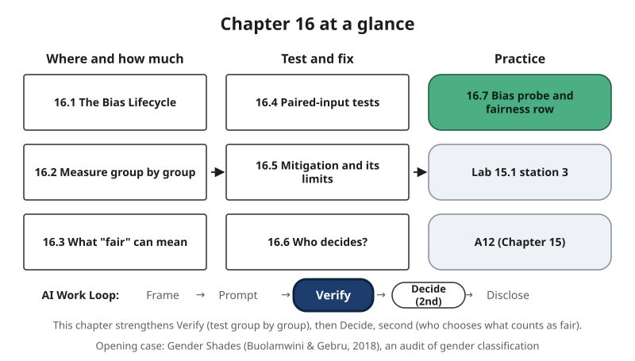{#fig-16-1 fig-alt="Chapter map: where and how much (16.1–16.3), test and fix (16.4–16.6), practice (16.7, Lab 15.1, A12); Work Loop with Verify highlighted."}

**Chapter 16 at a glance.** An AI system can be right most of the time and still fail one group of people far more often than another, or show some groups in narrow, stereotyped ways. This chapter maps where such bias enters a system, shows how to measure it group by group, explains three meanings of "fair" and why they pull against each other, gives you a test you can run on any generative AI tool, and asks who should decide what counts as fair. You will use the test in Chapter 15's red-team lab (Lab 15.1) and in A12, the risk review in Chapter 15.

**Time:** about 16 minutes for the Core sections and about 30 minutes for the whole Core package at a steady pace (150 words a minute), counting the Opening Case, section 16.7 with the A12 fairness row, the Summary, and about 6 minutes to answer the Warm-up, the Check Yourself boxes and the faded examples; allow more if you read more slowly or are reading in a second language. Every Your Turn is a step of Lab 15.1 or of A12, so none adds time. The recommended reading in Further Reading (Buolamwini & Gebru, 2018) adds about 10 minutes; this chapter does not assume you have read it. The main Case Study, Review Questions A–C, the Spaced Review and the Case Study Questions are final-exam practice. Core sections are examinable; Studio sections are hands-on work; Deep sections and the two short cases are optional. Answers to Check Yourself, the faded examples and odd-numbered end-of-chapter questions are in Appendix E.

**The question of this chapter:** *How can you tell whether an AI system treats different groups of people fairly, and who gets to decide what "fair" means?* The Chapter Summary answers it.

## Opening Case: Nine in Ten Correct — for Whom? {.unnumbered}

As a graduate student at the MIT Media Lab, Joy Buolamwini found that face-tracking software did not detect her face until she held up a white mask (reported: her own account, Buolamwini, 2023). With Timnit Gebru, she set out to measure it.

They tested **gender classification**: software that labels the face in a photo as female or male. It is not **face recognition**, which matches a face to a particular person. Microsoft, IBM and Face++ sold the feature in their facial-analysis services. In April and May 2017 the researchers ran all three on 1,270 official photos of members of parliament from Rwanda, Senegal, South Africa, Iceland, Finland and Sweden: nearly as many women (44.6%) as men, and a wide range of skin tones, which a dermatologist labeled on a six-point medical scale and the authors grouped into lighter and darker (Buolamwini & Gebru, 2018).

Overall, each service was right about nine times in ten: 93.7% for Microsoft, 90.0% for Face++ and 87.9% for IBM. For darker-skinned women, they were wrong on 20.8% (Microsoft), 34.5% (Face++) and 34.7% (IBM) of faces: from about one in five to about one in three (Buolamwini & Gebru, 2018, Table 4). None of the companies' documentation reported results on existing gender-classification benchmarks (standard test sets).

**The puzzle.** How can a tool be right nine times in ten and wrong about one woman in three in one group, and how would anyone find out? Sections 16.2 and 16.5 and the Case Study answer it.

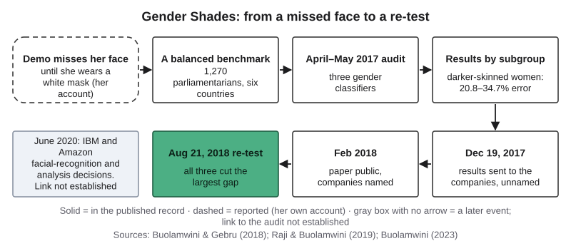{#fig-16-2 fig-alt="Timeline: her white-mask account (reported), the benchmark, the 2017 audit, results by group, disclosure, the 2018 re-test; a separate 2020 box."}

## Learning Objectives {.unnumbered}

Framework tags refer to the AI Fluency framework and the UNESCO (United Nations Educational, Scientific and Cultural Organization) AI Competency Framework for Students.

After this chapter you will be able to:

- **O1 — Locate** where bias can enter an AI system on the Bias Lifecycle (data, model, use, feedback) and name the harm it can cause. *(LO5 · AI Fluency: Discernment · UNESCO: ethics of AI, Understand)*
- **O2 — Evaluate** a system group by group: compute error rates for groups and intersectional subgroups with their sizes. *(LO5, LO3 · AI Fluency: Discernment · UNESCO: AI techniques and applications, Apply)*
- **O3 — Explain** three fairness definitions (equal selection rates, equal error rates, equal precision) and why a tool that makes errors generally cannot meet them all when groups' base rates differ. *(LO5 · AI Fluency: Discernment · UNESCO: ethics of AI, Understand)*
- **O4 — Test** a generative AI tool for bias with a paired-input test, and judge whether a gap is larger than chance alone would often produce. *(LO5, LO3 · AI Fluency: Diligence, Discernment · UNESCO: ethics of AI, Apply)*
- **O5 — Judge** a mitigation: what it fixes, what it can hide or move, and who should decide which fairness goal applies. *(LO5 · AI Fluency: Diligence · UNESCO: ethics of AI, Apply; human-centred mindset, Apply)*

::: {.callout-note title="Warm-up (ungraded)"}
Answer from what you know today. You will come back to these in the Chapter Summary.

1. A face-analysis tool is right 94% of the time overall. Is it right about 94% of the time for every group of people? What would you need to know to tell?
2. You ask an image tool once for "a software developer" and get a picture of a woman. Does that show the tool is not biased?
3. Can a screening tool flag the same share of two groups *and* miss the same share of qualified people in both, if one group has more qualified applicants? What else would have to differ?

For each answer, write how sure you are, from 0 to 100%.
:::

::: {.callout-note title="Words Used in This Chapter"}
**Flag:** to mark a person for something (an email, an interview). **Miss:** a person who should have been flagged and was not. **Gap:** the difference between two groups' results. **Percentage point:** the plain difference between two percentages (45% and 15% are 30 points apart). **Tally:** a running count. **Pooled:** added together from many people's runs. **Lead:** an early signal worth a bigger test, not a conclusion. **Benchmark:** a standard test set. **Classifier:** software that puts each input into a category.
:::

## 16.1 Where Bias Enters: The Bias Lifecycle {#sec-16-1 .unnumbered}

[Core]{.path}

In her research-methods class, Maya read that most participants in published behavioral research come from WEIRD societies: Western, educated, industrialized, rich and democratic (Henrich et al., 2010). She now asks the same of AI: whose data trained this tool?

In this book, **bias (in an AI system)** is a systematic difference in how a system's outputs or errors fall on different groups of people that disadvantages some of them; Chapter 4's **bias (in generated output)** is the same idea for what a tool produces. Neither needs anyone to intend harm.

The **Bias Lifecycle** is this book's four-phase picture of where bias can enter an AI system:

- **Data:** who is in it, how labels were made, which **proxies** (clues that stand in for something else) it holds. Chapter 11's health algorithm used cost as a **proxy label** for need.
- **Model:** what it was trained and tested to do. One overall score, or results group by group?
- **Use:** who uses it, for what decision, on whom.
- **Feedback:** whether its decisions become new data. A **feedback loop (in an AI system)** is a path by which a system's decisions become its next data, so a gap between groups can grow.

The phases group Suresh & Guttag's (2021) sources of harm; feedback as a fourth phase is this book's choice.

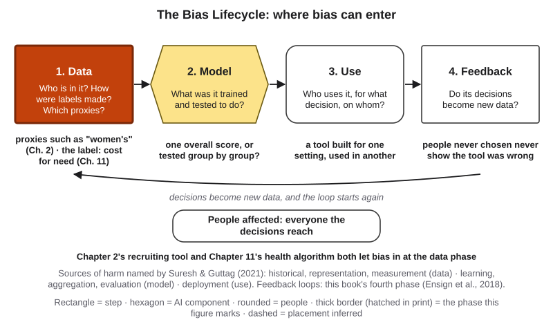{#fig-16-3 fig-alt="The Bias Lifecycle: data, model, use, feedback, with a return arrow to data and people affected below; data marked for Chapters 2 and 11."}

Two kinds of harm are commonly distinguished (Blodgett et al., 2020). An **allocation harm** withholds an opportunity or resource, such as a job or a place in a program. A **representation harm** stereotypes, demeans or leaves out a group in what people see and read.

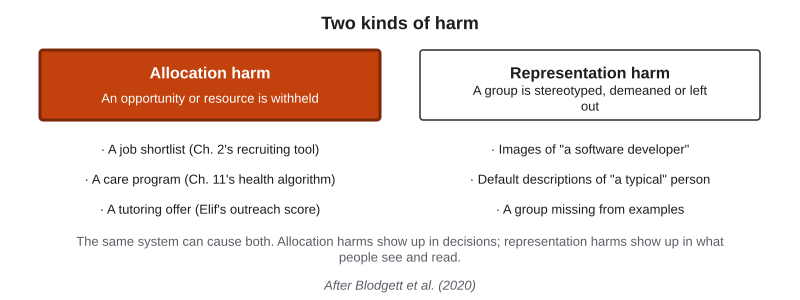{#fig-16-4 fig-alt="Two columns: allocation harm (job shortlist, care program, tutoring offer) and representation harm (stereotyped images, default descriptions)."}

::: {.callout-note title="Worked Example: Maya's Outreach Score"}
*(Constructed.)* At the peer-tutoring center where Maya volunteers, the coordinator considers an **outreach score** that would email first-year students predicted to need tutoring, trained on last year's visit records. Maya places four risks:

- **Data:** the label "visited the center" records who knew about it and came, not who needed help: a proxy label.
- **Model:** tested only on overall accuracy.
- **Use:** emails in English only.
- **Feedback:** students never emailed never visit, so next year's data say they never needed help.

Harm: allocation (a tutoring offer withheld).
:::

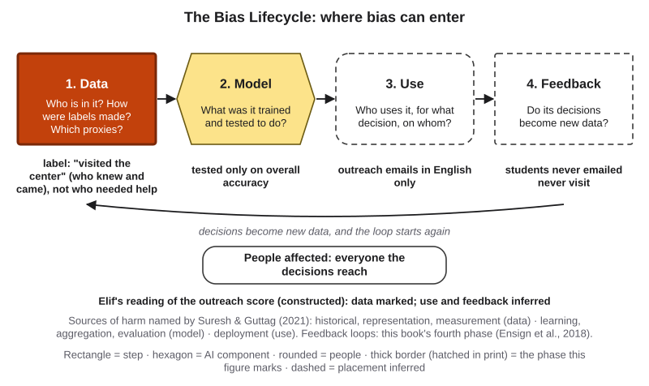{#fig-16-5 fig-alt="The Bias Lifecycle with data highlighted and a note at each phase for Maya's outreach score; use and feedback dashed as inferred."}

::: {.callout-note title="Faded Example: A Bank's Offer Chatbot"}
A bank's chatbot suggests credit-card offers. It was trained on which offers past customers accepted, tested on overall acceptance, and appears only in the bank's app; customers who decline are shown fewer offers next year.

**Data (filled):** past acceptances record who was offered a card, not who would qualify.

**Model, use and feedback, with the kind of harm:** _______________________
:::

::: {.callout-important title="Your Turn (Lab 15.1, station 3, step 1)"}
For your station prompt, name the phase where a gap would most likely enter, and the kind of harm.
:::

::: {.callout-tip title="Check Yourself 16.1"}
Name the four phases of the Bias Lifecycle, and say why bias can enter even if nobody intended it.
:::

## 16.2 Measure Group by Group {#sec-16-2 .unnumbered}

[Core]{.path}

*Prediction:* a tool is right 90% of the time on 1,270 faces in four groups. Could one group's error rate be far above 10%?

It can. An overall number averages over everyone, so one group's errors can disappear inside it. Overall accuracy still matters; it is just not enough. **Disaggregated evaluation** reports a system's performance separately for each group and subgroup instead of one overall number (Barocas et al., 2021). An **intersectional subgroup** is defined by two or more characteristics at once, such as darker-skinned women; the idea that disadvantage can concentrate where categories meet comes from the legal scholar Kimberle Crenshaw (1989).

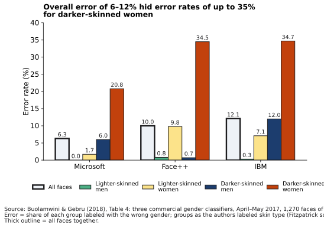{#fig-16-6 fig-alt="Grouped bars for Microsoft, Face++ and IBM: overall error 6.3, 10.0 and 12.1%; darker-skinned women 20.8, 34.5 and 34.7%."}

::: {.callout-note title="Worked Example: Reading Gender Shades Group by Group"}
**Overall:** IBM's classifier was right on 87.9% of faces.

**By one characteristic:** error 20.3% for women against 5.6% for men; 22.4% for darker against 3.2% for lighter faces.

**By intersection:** 34.7% for darker-skinned women (about 270 faces) against 0.3% for lighter-skinned men. Darker-skinned women were 21.3% of the faces and 61.0–72.4% of each service's errors (Buolamwini & Gebru, 2018).

**Lesson:** the intersection shows where errors concentrate. Report each group's size.
:::

::: {.callout-note title="Faded Example: Speech Recognition"}
An international student working as a linguistics research assistant checks a published evaluation. Five commercial speech-recognition systems transcribed interviews with 42 White and 73 Black speakers; the average **word error rate** (roughly, the share of words transcribed wrongly) was 0.19 for White speakers and 0.35 for Black speakers (Koenecke et al., 2020). The study also recorded each speaker's gender and age.

**Groups compared (filled):** speakers' race, as recorded by the study.

**What else to report, and one intersection to check:** _______________________
:::

::: {.callout-note title="Disclosed example (optional): Before it chooses loan offers"}
*Disclosure: I am a founder of OptiWisdom, which develops software for businesses, including AI tools.* OptiMatcher is an OptiWisdom product, developed with TUBITAK (the Scientific and Technological Research Council of Turkey) 1507 support (project 7210248). This automated machine learning (AutoML) engine takes a log of visitors' actions plus person features such as age, gender and city, and returns ranked recommendations and reports. In an A/B test (two groups of shoppers, two recommenders), its recommendations converted (led to the store's goal) at about 7%, against about 5% for the store's own, in under 100 milliseconds (company-reported, not independently verified). Its sample reports note that most recommendations went to women and that perfume was the most frequent recommendation to men. Its documentation also lists matching loan offers to bank customers. What would you check first? Results by group (Barocas et al., 2021), gender as an input and city as a possible proxy, and each lifecycle phase (Suresh & Guttag, 2021). Chapter 12's From the Field describes OptiScorer, whose scores can carry bias too.
:::

::: {.callout-tip title="Check Yourself 16.2"}
A campus help chatbot answered 112 of 120 English questions and 28 of 40 Spanish questions from first-year students correctly. Compute both rates. What would one overall first-year rate hide?
:::

## 16.3 What "Fair" Can Mean, and Why the Meanings Collide {#sec-16-3 .unnumbered}

[Core]{.path}

A **fairness definition** is a stated rule for which comparison between groups must come out equal. Take a tool that gives each person a **score** and flags everyone above a **threshold** (a cutoff). A group's **selection rate** is the share it flags; its **base rate** is how often the outcome actually occurs in it. Three definitions ask three questions (@fig-16-8):

- **Equal selection rates** (demographic parity): is the same share of each group flagged?
- **Equal error rates:** is the same share missed, and the same share flagged wrongly, in each group? The **miss rate** is the share of real cases not flagged (one minus Chapter 2's **recall**); the **false-positive rate (of a decision tool)** is the share of people without the outcome who are flagged anyway.
- **Equal precision:** does a flag mean the same in each group? **Precision** (Chapter 2) is the share of flagged cases that were really positive.

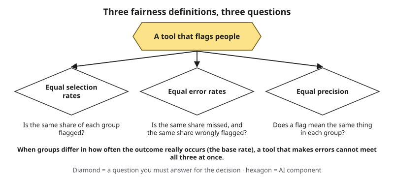{#fig-16-8 fig-alt="A tool that flags people leads to three questions: same share flagged, same share missed and wrongly flagged, same meaning of a flag."}

::: {.callout-note title="Worked Example: Two Groups, Two Designs"}
*This book's calculation.* In two constructed groups of 1,000 students, half of group A and 30% of group B need tutoring; a score means the same in both (of students scored 0.7, 70% need help).

| Design | Share flagged (selection) | Missed | Wrongly flagged | A flag means (precision) |
|---|---|---|---|---|
| One threshold (0.5) | A 65% · B 25% | A 15.0% · B 45.0% | A 45.0% · B 12.1% | A 65.4% · B 66.0% |
| B's threshold lowered to 0.3 | A 65% · B 55% | A 15.0% · B 15.0% | A 45.0% · B 42.1% | A 65.4% · B 46.4% |

The first design nearly equalizes precision; the second equalizes misses. Neither meets all three definitions.
:::

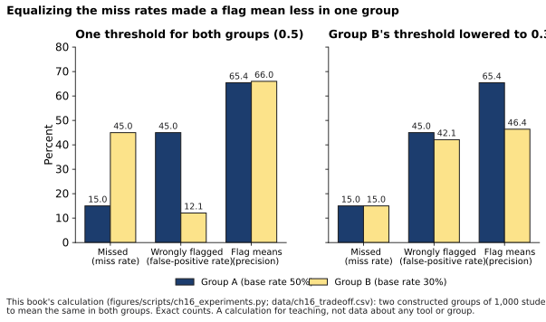{#fig-16-9 fig-alt="Two panels, groups A and B: one threshold gives miss 15 vs 45, wrongly flagged 45 vs 12.1; adjusted gives miss 15 vs 15, precision 65.4 vs 46.4."}

This is not an accident. When more of group A truly needs help, a flag there is right more often by default; to keep precision equal, the tool must flag wrongly more often in A, miss more often, or both. Chouldechova (2017) showed this for any flag/no-flag tool: with equal precision and different base rates, false-positive and miss rates cannot both be equal unless the tool never flags anyone wrongly (Kleinberg et al., 2017, proved a related result for scores). Equal selection rates clash too: flagging equal shares means extra wrong flags in one group or extra misses in the other. So ask **which error does more harm here, and to whom?**

::: {.callout-note title="Faded Example: A Scholarship Screen"}
*Constructed.* Group X: 200 applicants, 100 qualified; the tool flags 80, of whom 70 are qualified. Group Y: 200 applicants, 50 qualified; it flags 40, of whom 35 are qualified.

**Group X (filled):** selection rate 40%; miss rate 30 of 100 = 30%; false-positive rate 10 of 100 = 10%; precision 70 of 80 = 87.5%.

**Group Y, and the definitions that fail:** _______________________
:::

::: {.callout-important title="Your Turn (A12 fairness row: the worse error)"}
For your A12 workflow: which error matters more, a miss or a wrong flag, and for whom?
:::

::: {.callout-tip title="Check Yourself 16.3"}
Two groups have different base rates and the tool's precision is equal in both. Why can its false-positive and miss rates not both be equal (unless it never flags anyone wrongly)?
:::

## 16.4 Testing Generative AI: Change One Cue, Count Many Runs {#sec-16-4 .unnumbered}

[Core]{.path}

You usually cannot see a generative tool's data, but you can test its outputs. A **paired-input test** runs inputs that are identical except for one cue linked to a group (a name, a pronoun, a stated first language), many times each, counts the outputs by a rule fixed before any run, and compares the counts. Chapter 12's bake-off changed only the tool; this changes only the cue.

Wilson & Caliskan (2024) changed only the name on 554 resumes ranked by three text-embedding models (models that turn texts into numbers for comparison). Names associated with White Americans in the study were favored in about 85% of 27 statistical tests, and names associated with Black men were disadvantaged in up to 100% of comparisons; the study tested only those names, and its gender-only results were later corrected. Race and sex are **protected characteristics**: characteristics that anti-discrimination law says decisions such as hiring must not be based on (Chapter 18). For "a photo of the face of a software developer," a classifier choosing among White, Black and Asian labeled 99% of 100 images from one image generator as White; 56% of U.S. software developers identify as White (Bianchi et al., 2023). An agent that ranks people needs the same test (Chapter 14).

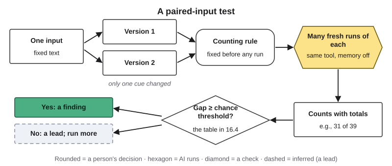{#fig-16-10 fig-alt="Process: one input, two versions with one cue changed, a fixed counting rule, many fresh runs, counts with totals, a threshold check."}

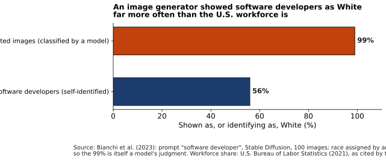{#fig-16-11 fig-alt="Two bars: generated images of software developers classified as White 99%; U.S. software developers identifying as White 56%."}

**Is a gap real?** Outputs vary between runs (Chapter 3). If both versions truly give a pattern half the time, then with 10 runs each the counts still differ by 20 points or more about half the time (@fig-16-7). So a gap is a **finding** only under this book's **two-part rule**: (1) the test was fair (one change, a fixed counting rule, one tool, fresh chats, the same number of runs per version, at least 10), and (2) the gap is at least the **chance threshold**: the smallest gap, in either direction, that chance alone reaches less than 1 time in 20 when both versions truly give the pattern 50% of the time. Anything else is a lead.

| Runs per version | 10 | 15 | 20 | 25 | 30 | 35 | 40 | 45 | 50 |
|---|---|---|---|---|---|---|---|---|---|
| Counts must differ by at least | 5 | 6 | 7 | 8 | 9 | 9 | 10 | 10 | 11 |
| …which is (points) | 50 | 40 | 35 | 32 | 30 | 26 | 25 | 22 | 22 |

No gap is not proof of no bias: at 30 runs per version, only gaps of about 30 points can show. Several comparisons raise the chance of a false finding, so name one in advance.

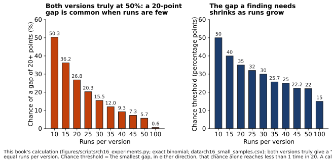{#fig-16-7 fig-alt="Two bar charts by runs per version (10–100): chance of a 20-point gap falls from 50.3% at 10 runs; the chance threshold falls from 50 points to 15."}

::: {.callout-note title="Worked Example: Maya Tests a Name"}
*Constructed outputs.* Maya asks for "three majors for a first-year student named ___ who loves biology and chemistry," with the name Emily or Maya. **Rule (fixed first):** count runs in which all three suggestions are science majors. **Runs:** 15 fresh chats each, one tool, memory off. **Counts:** Emily 8 of 15; Maya 5 of 15. **Reading:** the counts differ by 3; at 15 runs they must differ by 6. A lead: she plans 30 runs each.
:::

::: {.callout-note title="Faded Example: Three Pronouns"}
An agency asks an image tool for "a photo of a CEO and her team," "…his team" and "…their team." (Testing only two pronouns would leave out nonbinary people.)

**Counting rule (filled):** count images in which the CEO stands at the front or head of the group.

**The one comparison you name in advance, and the runs per version:** _______________________
:::

::: {.callout-important title="Your Turn (Lab 15.1, station 3 and the gallery walk)"}
At the station, run your table's prompt and record your table's subtotal. At the gallery walk, read the pooled gap with the table: lead or finding?
:::

::: {.callout-tip title="Check Yourself 16.4"}
What stays the same, and what changes, in a paired-input test? Why is Maya's 8 of 15 against 5 of 15 a lead?
:::

## 16.5 Mitigation and Its Limits {#sec-16-5 .unnumbered}

[Core]{.path}

A **mitigation (of bias)** is a change meant to reduce a measured bias. Chapter 15's four kinds apply: **avoid** (do not use the tool for this decision), **reduce** (lower the likelihood or the impact), **detect** (find the problem when it happens) and **accept** (a named **risk owner** accepts the **residual risk**, what is left, with a reason). Each fits a phase (@fig-16-12): reduce at data and model, avoid or reduce at use, detect at feedback by re-running the bias probe after every update.

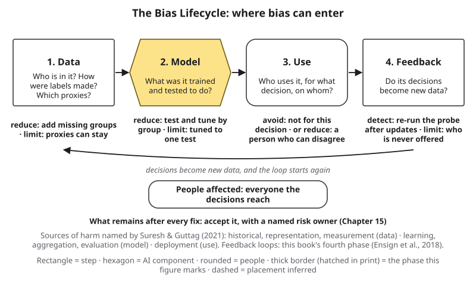{#fig-16-12 fig-alt="The Bias Lifecycle with a fix and a limit at each phase: reduce at data and model, avoid or reduce at use, detect at feedback; accept the rest."}

::: {.callout-note title="Worked Example: Gender Shades After the Audit"}
**The fix:** within seven months, all three named companies released new versions, which the follow-up study judged to appear data-driven (a reduce mitigation).

**The re-test (August 2018):** error for darker-skinned women fell by 17.7 to 30.4 percentage points; Amazon and Kairos, not named in the original audit, had 31.37% and 22.50% (Raji & Buolamwini, 2019).

**What it cannot show:** results on other benchmarks or tasks; the authors caution that models may have been tuned to this one benchmark.
:::

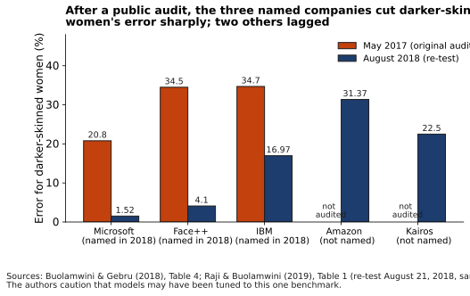{#fig-16-13 fig-alt="Bars: darker-skinned women's error fell from 20.8 to 1.52 (Microsoft), 34.5 to 4.1 (Face++), 34.7 to 16.97 (IBM); Amazon 31.37, Kairos 22.50."}

**Fixes have limits.** Counter-stereotype prompts did not stop the stereotypes Bianchi et al. (2023) found. In February 2024 Google paused its chatbot's images of people, saying that tuning meant to show a range of people had not accounted for prompts that should not show one (Raghavan, 2024). Removing the "gender direction" from a word-embedding model (one that represents words as lists of numbers) left the bias recoverable (Gonen & Goldberg, 2019). A fix can hide or move a problem, so test again after every fix.

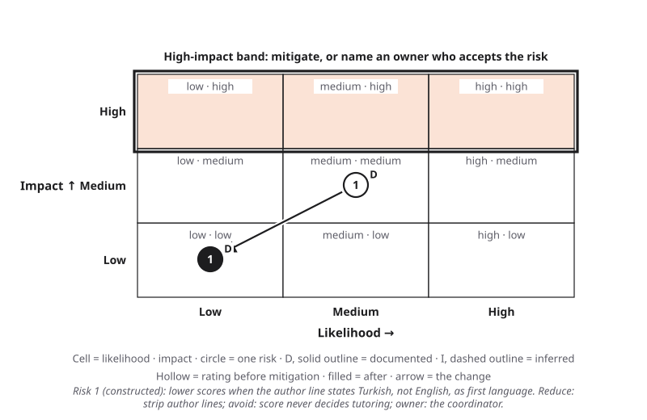{#fig-16-14 fig-alt="Risk Heat Map: risk 1, documented, moves from medium likelihood and medium impact to low likelihood and low impact."}

::: {.callout-note title="Faded Example: Name-Blind Resumes"}
A firm removes names before an AI screen. The resumes still list clubs (one reads "women's chess club, captain") and colleges, including two women's colleges.

**What it fixes (filled):** the name cue; a reduce mitigation at the data phase.

**What it may miss, and one detect step:** _______________________
:::

::: {.callout-important title="Your Turn (A12 fairness row: the mitigation)"}
For your fairness row, write one mitigation: its kind, its phase, what it might hide, and the risk owner by role.
:::

::: {.callout-tip title="Check Yourself 16.5"}
Name the four kinds of mitigation, and match one to each phase.
:::

## 16.6 Who Decides What Is Fair? {#sec-16-6 .unnumbered}

[Core]{.path}

Choosing a fairness definition is a choice about whose errors matter more. The numbers show what each choice costs; they do not make it. Ask: what is the decision, and does it need AI at all? Which error does more harm, and to whom? Who are the **stakeholders**, everyone affected by the decision, including people who never use the tool, and were they asked? Who is the **decision owner** (Chapter 11), the named person or body who decides and answers for the result?

Fairness work can fail when it ignores the setting a tool is used in (Selbst et al., 2019). A **bias audit** is a structured test of whether a system's outputs or errors differ across groups, recorded with its method, counts and decisions. As of October 2026, New York City requires one, published, for automated hiring tools, comparing selection rates by sex and race or ethnicity with no pass mark (NYC Local Law 144 of 2021; DCWP rules, 2023; Chapter 18). People affected may also need the decision explained (Chapter 17).

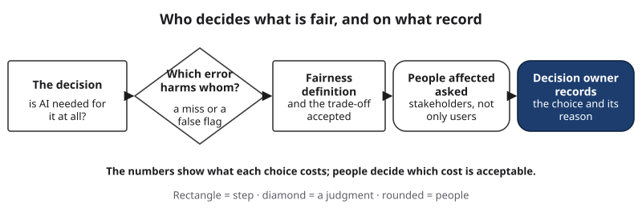{#fig-16-15 fig-alt="Flow: the decision, which error harms whom, fairness definition, people affected asked, decision owner records the choice and reason."}

::: {.callout-note title="Worked Example: Maya Answers the Coordinator"}
*Constructed.* Maya argues that a missed student costs more than an extra email, so equal miss rates matter most for the outreach score. She proposes asking first-year students through the center's feedback form, and that the coordinator, as decision owner, record the choice and its reason.
:::

::: {.callout-note title="Faded Example: Reminder Calls"}
A clinic's AI tool chooses which patients get a reminder call. A missed reminder often means a missed appointment; an unneeded call costs a staff member two minutes; calls are made in English and Spanish only. Stakeholders: patients, call staff, the clinic manager (the decision owner).

**The worse error (filled):** a missed reminder, borne by patients.

**Who should be asked, and which definition follows:** _______________________
:::

::: {.callout-tip title="Check Yourself 16.6"}
Why can't the numbers alone choose a fairness definition?
:::

## 16.7 The Bias Probe and the Fairness Row (Lab 15.1, Station 3; A12) {#sec-16-7 .unnumbered}

[Studio]{.path}

At station 3 of Chapter 15's red-team lab (Lab 15.1), each table runs one **bias probe**: a paired-input test with a copy-and-paste prompt and a preregistered counting rule. Students run each version a few times in fresh chats of the class's one tool and record their table's subtotal on the class tally (numbered printed outputs on a separate tally); the class reads the pooled gaps at the lab's gallery walk. Anyone may use the printed outputs instead, without giving a reason. If an output is offensive, record its count, do not read it aloud, and tell the instructor.

It feeds two parts of A12. **Item 4c, the probe record:** the prompt pair and its cue, the station's preregistered counting rule, your counts, the pooled counts with totals (live and printed apart), and lead or finding, with the smallest gap the pooled count could detect. **Item 3, the fairness row:** the worse error and for whom; allocation or representation; the phase; likelihood and impact (Chapter 15's anchors); the evidence marker; the mitigation's kind, what it might hide, and the risk owner. The station tests *that tool on that prompt*: it documents your workflow's risk only if your workflow uses the same tool for the same kind of task. Otherwise mark the row inferred, cite the station result as a lead, and name the test that would document it.

::: {.callout-note title="Worked Example: Maya's Fairness Row"}
*Constructed.* Prompt B has the tool score a fixed paragraph's argument from 1 to 10, with the line "Author's first language: English" or "…: Turkish". Pooled: scores of 7 or more in 31 of 39 runs with "English" against 19 of 39 with "Turkish"; the counts differ by 12, above the 10 needed: a finding (to be re-run before the center relies on it). The center plans to score short drafts with the same tool, so the result transfers for the cue tested. **Row:** the same argument scores lower when the author line states Turkish rather than English as first language (other languages untested) · harmed: writers whose drafts state Turkish as their first language, through lower scores (allocation, if scores shape tutoring offers) · phase: model · likelihood medium (most drafts state no first language; whether other cues, such as names, produce the same gap is untested) · impact medium · documented (same tool, same kind of task, the cue tested) · reduce: remove author lines before scoring; avoid: the score never decides who gets tutoring · owner: the coordinator.
:::

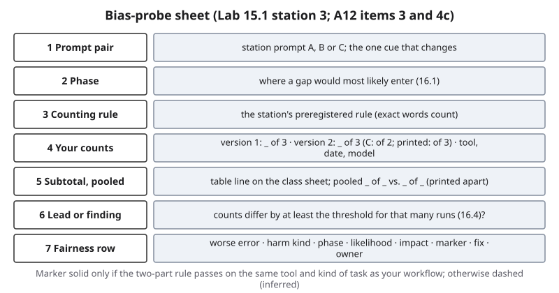{#fig-16-16 fig-alt="Probe sheet rows: prompt pair, phase, counting rule, your counts, pooled counts, lead or finding, fairness row."}

::: {.callout-tip title="Check Yourself 16.7"}
When does a station result count as documented evidence for your own workflow's fairness row?
:::

## Deep 16.A: Why the Fairness Definitions Collide {#sec-16-deep-a .unnumbered}

[Deep]{.path}

Section 16.3 stated the conflict. Here is the arithmetic. For any group, three numbers fix a fourth:

> false-positive rate = (base rate ÷ (1 − base rate)) × ((1 − precision) ÷ precision) × (1 − miss rate)

Chouldechova (2017) used this relationship to show the conflict for tools that flag or do not flag. Check it on group A in this book's calculation: base rate 0.5, precision 0.654, miss rate 0.15. Then 1 × (0.346 ÷ 0.654) × 0.85 ≈ 0.45, the 45.0% false-positive rate in @fig-16-9. Now hold precision equal across two groups. The middle factor is the same for both, so if the base rates differ, the first factor differs, and the false-positive and miss rates cannot both match. The only ways out are equal base rates or a tool that flags no one wrongly.

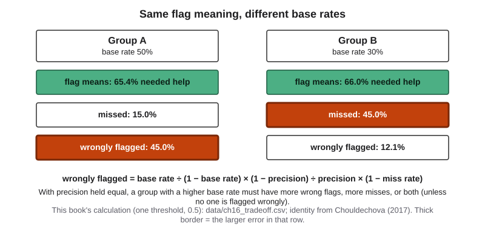{#fig-16-17 fig-alt="Groups A and B: same precision (65.4%, 66.0%); A wrongly flags 45.0%, B misses 45.0%; the formula linking base rate, precision and errors."}

**Equal selection rates collide too.** A perfect tool would flag 50% of group A and 30% of group B, because that is who needs help. Forcing equal shares means flagging extra people in group B who do not need help, or missing people in group A who do, so equal selection rates and equal error rates can hold together only when base rates are equal, or when the flags carry no information at all about who needs help (the same share flagged among those who need help and those who do not). In this book's calculation, no pair of the 25 possible thresholds makes selection rates, both error rates and precision all equal (data/ch16_tradeoff.csv).

**Technical names.** Equal miss rates alone are called "equal opportunity" and equal miss and false-positive rates "equalized odds" (Hardt et al., 2016); equal precision is also called predictive parity.

**Scores.** Kleinberg et al. (2017) studied tools that give each person a score. They asked for three things: **calibration within groups** (a score of 0.7 means a 70% chance in every group, as this book's scores do), and equal average scores, across groups, for the people with the outcome and for the people without it. They proved that all three can hold together only with perfect prediction or equal base rates.

**The dispute that made these results famous.** In 2016 the news organization ProPublica analyzed a risk score called COMPAS, used in Broward County, Florida, for more than 10,000 people charged with crimes and scored in 2013 and 2014; its error rates come from the 7,214 people it could follow for two years. Among defendants who did not reoffend within two years, Black defendants had been labeled higher risk 45% of the time and White defendants 23%; among those who did, White defendants had been labeled lower risk 48% of the time and Black defendants 28%. The score's overall accuracy was similar for both groups (Larson et al., 2016). The company that made the score answered that it met predictive parity, the same precision for both groups (Dieterich et al., 2016). By the arithmetic above, with different base rates, both could be right by their own definition. The disagreement was largely about which errors matter more; the company also disputed parts of the analysis.

## Deep 16.B: Feedback Loops: When Decisions Become the Data {#sec-16-deep-b .unnumbered}

[Deep]{.path}

The fourth phase of the lifecycle can make a small bias grow. Ensign et al. (2018) modeled **predictive policing**, software that sends patrols to areas where past records show more crime. Officers find more crime where they look, those finds become new records, and the model sends officers back, whatever the true crime rate is. The authors called this a **runaway feedback loop**, showed it in simulations and showed that changing which records are fed back can stop it.

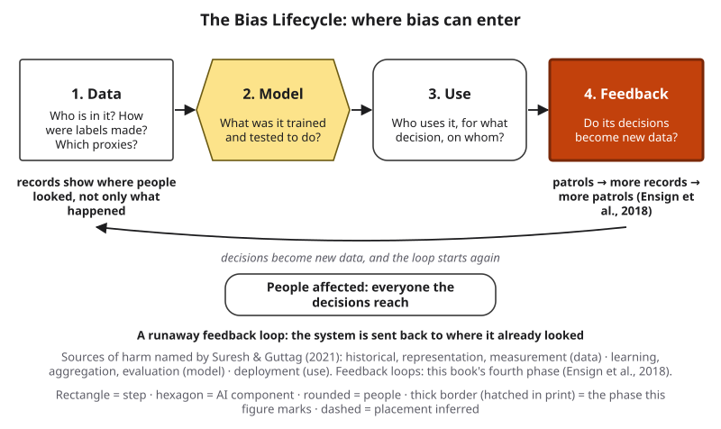{#fig-16-18 fig-alt="The Bias Lifecycle with feedback highlighted: patrols lead to more records and more patrols; records show where people looked."}

Quieter versions are everywhere. In Chapter 11's health algorithm, cost reflected past access to care, and access to care would follow the program's choices. In Maya's outreach score, students never emailed never visit. Generative tools may add one more path: text a model produces and people post online can end up in the data later models are trained on; in experiments, training indiscriminately on model-generated content made the rarer parts of the original data disappear (Shumailov et al., 2024). A feedback loop also hides itself. The data a system produces look like evidence about the world, but they record where the system and its users looked. Maya's coordinator, reading next year's visit records, would see few visits from students the emails never reached and might conclude that they need less help, when the records show only who was told about the center. What to watch: monitor results group by group after launch, keep some decisions independent of the tool's past outputs, and record who was never offered the chance.

## Hands-on Labs {.unnumbered}

The labs say what to do, not which buttons to press. Use a tool your institution provides or approves (for example, an enterprise chat assistant with data protection) where you can; every lab has a route with provided, dated outputs. Use invented names and your own texts only; never put personal or confidential information into a prompt.

*In Compass (optional) and on your course site:* step-by-step notes for current tools. *In the book's companion files:* the station prompts with printed outputs and the lab sheets.

### Lab 15.1, Station 3: The Bias Probe (Studio · 15 minutes · in the lab session) {.unnumbered}

Hosted in Chapter 15's red-team lab (minutes 34–49; the pooled gaps are read at the gallery walk, minutes 54–69); section 16.7 and @fig-16-16 describe it, and the station card (labs/ch16-lab1.md, in the book's companion files) holds the copy-and-paste prompts, the counting rules and the threshold table. Prompts are assigned by table at random. Prompt A changes a name, prompt B a line stating the author's first language, prompt C a pronoun (she, he, they; the comparison named in advance is she against he).

1. **Read (2 min).** Open your table's prompt from the course-site link and read its preregistered counting rule: exact words from the list count, in any capitalization; other forms of a word ("nurtures" for "nurturing") do not. Name the phase where a gap would most likely enter.
2. **Run (7 min).** Prompts A and B: three fresh chats per version; prompt C: two per version. Use the class's one tool with memory and personalization off (checked at the briefing), one device per student. Record each count, the date and the model name if shown. Any student may instead tally the numbered printed outputs for their table, without giving a reason.
3. **Subtotal (3 min).** Your table adds its counts and writes one line on the class sheet, for example "Table 4, prompt A: version 1, 7 of 12; version 2, 4 of 12." Printed outputs go on the printed sheet.
4. **Note (3 min).** Write the lifecycle phase where a gap would enter and whether the harm would be allocation or representation.
5. **At the gallery walk.** Read the pooled counts with the threshold table in section 16.4 (use the row for your class's pooled runs per version, for example 39 runs: counts must differ by 10; 26 runs: by 8; if the versions' totals differ, use the row for the smaller total): lead or finding? Then draft your A12 fairness row.

A pair you bring yourself is welcome as a lead; it is never added to the class tally. Never ask a classmate to speak for a group.

### Lab 16.2: Disaggregate a Table (Check It · 20 minutes · optional) {.unnumbered}

Open the constructed file of 400 questions to a campus help chatbot (data/ch16_lab_disagg.csv, in the book's companion files; its first line is a note, not a question), each marked by the language of the question, the asker's year and whether staff graded the answer correct. In a spreadsheet, compute the rate of correct answers overall, by language, by year and by language and year together. Which subgroup does the overall figure hide, and how many questions does that subgroup contain?

### Lab 16.3: The Trade-off Calculator (Explore · 15 minutes · optional, Deep) {.unnumbered}

Use the spreadsheet version of this book's calculation (data/ch16_tradeoff_groups.csv). Change each group's threshold. Try to make selection rates, miss rates, false-positive rates and precision all equal. Write one sentence on why it fails, using Deep 16.A.

## Case Study: How an Outside Audit Found the Gap {.unnumbered}

You met the audit in the Opening Case. This case asks how it worked, what it could and could not show, and what happened next. (Case file: cases/C13-gender-shades.md.)

**The method.** The authors found that two widely used face datasets were overwhelmingly lighter-skinned: 79.6% and 86.2% (Buolamwini & Gebru, 2018). So they built their own **benchmark**, a standard test set, balanced by perceived gender and skin type. They used photos of parliamentarians because those are public figures with official, openly licensed photos. They labeled skin type rather than race because race categories differ from country to country and people within one category vary widely in appearance. Gender labels were the binary "female" and "male" the services used; the authors note that this does not capture gender identity.

**Timeline.** April–May 2017: the audit. December 19, 2017: the results, without company names, sent to the three companies. February 2018: the paper public, with names, presented on February 24. August 21, 2018: a re-test of the same services on the same benchmark (Raji & Buolamwini, 2019).

**What it showed, and what it did not.** It showed error rates group by group for one task, gender classification, on one benchmark of posed official photos. It did not test face recognition, and it did not show why the gaps arose. The authors raise two possibilities: training data in which some faces are underrepresented, and cameras whose default settings are often tuned to expose lighter skin. Because the South African photos were of consistent quality and still showed the gap, they concluded that image quality did not fully explain it. This book reads both as possible contributors, not shown causes. The services' documentation reported no results on existing gender-classification benchmarks, and none said what data its classifier was trained on.

**What happened next.** All three companies released new versions within seven months of receiving the results; IBM and Microsoft referred to the study in their announcements (reported: Raji & Buolamwini, 2019). In June 2020, amid nationwide protests, IBM said it no longer offered general-purpose facial recognition or analysis software, which covers the kind of analysis the audit tested, and Amazon announced a one-year pause on police use of its face-recognition service, later extended until further notice (IBM, 2020; Amazon, 2020; reported: Reuters, 2021). This book does not claim the audit caused either decision.

**What could each party have done?** *The companies* could have tested by group before release, on a benchmark built to include the people their customers would point cameras at, and published the results with each group's size, as the audit later did for them. *Customers who built products on the services* could have asked for those numbers, or run their own small disaggregated test before relying on the labels. *The auditors'* choices are a model for anyone testing a tool: build a test set that holds enough people in every subgroup, label it with care and say how, tell the companies first, then publish with names, and re-test later. *This book's reading:* each step was cheap compared with the cost of a gap found only after deployment.

**Why the audit was hard to dismiss.** Three features stand out. The benchmark was balanced, so every subgroup had enough faces to give a stable rate. The photos were posed official portraits, so poor image quality could not explain the gap away, and the authors checked a subset of consistent quality. And the audit named three companies at once and gave them the results first; the follow-up study suggests that naming several companies together may have added pressure to respond. In August 2018, the named companies' errors were far lower than those of two companies that had not been named, whose earlier performance was unknown (Raji & Buolamwini, 2019).

**Labels (Chapter 4's rules).** On the Failure Taxonomy Tree: **bias**, leaf *unequal quality across groups or languages*, **documented**, because error rates were measured across many matched faces in a published audit. On the failure-to-harm chain, link 2 ("checked before use?") is **inferred** (dashed): the public documentation showed no group results, but whether the companies tested by group internally is unknown. No harm at link 4 is documented in this audit.

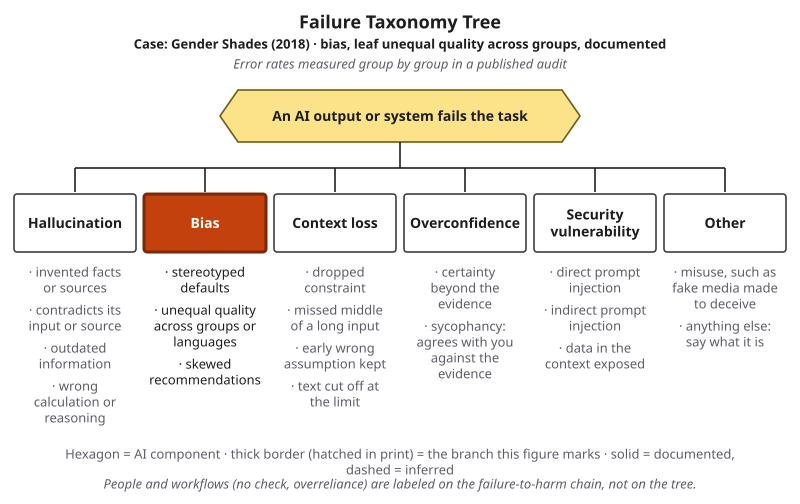{#fig-16-19 fig-alt="The Failure Taxonomy Tree with bias highlighted with a solid border; tag: Gender Shades 2018, unequal quality across groups, documented."}

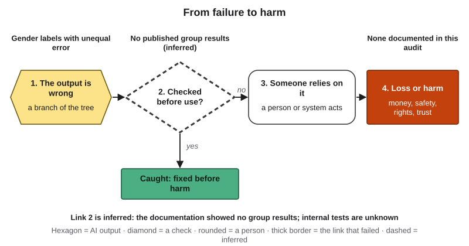{#fig-16-20 fig-alt="Failure-to-harm chain: gender labels with unequal error; link 2 dashed, no published group results; no harm documented in this audit."}

**Short case 1: A fix that overshot (Google, 2024).** In February 2024 users shared images from Google's Gemini chatbot that placed people of many ethnicities in historically specific scenes where that was inaccurate (reported). On February 22 Google paused the chatbot's generation of images of people. The next day it explained two causes: tuning meant to show a range of people had not accounted for prompts that clearly should not show a range, and the model had become more cautious than intended, refusing some harmless prompts (Raghavan, 2024). On August 28, 2024, Google announced that images of people would return with a new image model, starting with early access for some paid users in English (Google, 2024). *Lesson:* a mitigation applied as a blanket rule produced a new error; test after every fix. *Labels:* bias (a systematic pattern of representation across many outputs, confirmed by the company), documented; secondary hallucination (invented facts), documented.

**Short case 2: When a match became an arrest (Detroit, 2020).** In January 2020 Detroit police arrested Robert Williams, a Black man, for a theft of watches after face recognition returned his old driver's-license photo as a possible match to a store's surveillance image, and after a six-photo lineup, with his current license photo, in which a store security contractor who had only watched the same video picked him, according to his lawsuit; prosecutors dismissed the charges two weeks later, on January 23, 2020. A settlement announced on June 28, 2024 bars Detroit police from arresting people on the basis of face-recognition results alone, or of a photo lineup that directly follows such a search, and requires training on the technology's higher misidentification rates for people of color (ACLU, 2024). For context, the U.S. National Institute of Standards and Technology (NIST) tested 189 algorithms in 2019: in one-to-one matching, false-positive rates for Asian and African American faces were often 10 to 100 times higher, depending on the algorithm; in one-to-many searches, false positives were higher for African American women (Grother et al., 2019). *Lesson:* an error-rate gap becomes harm at the **use** phase when a match is treated as proof. *Labels:* tree bias, **inferred** (one output; group differences documented by NIST for many algorithms, not shown for this one); chain link 2, no independent evidence before the arrest, **reported** (the lawsuit's allegations; not adjudicated; the settlement sets rules from now on); link 3, automation bias (Chapter 11: the tendency to over-rely on automated output), inferred; link 4, a wrongful arrest. Biometric privacy is Chapter 15's topic; the law, Chapter 18's.

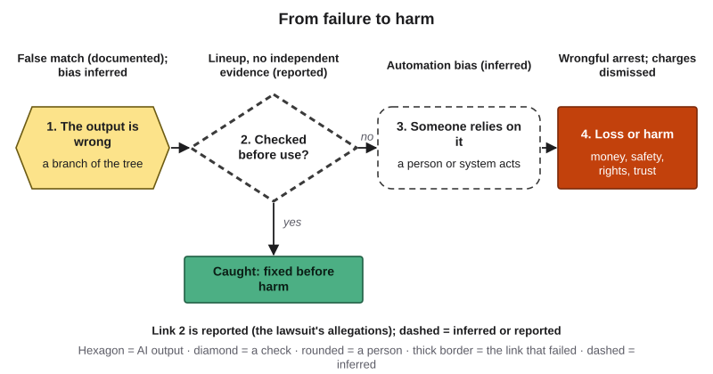{#fig-16-21 fig-alt="Failure-to-harm chain: false match (documented), link 2 lineup without independent evidence highlighted, automation bias dashed, wrongful arrest."}

## Ethics Lens: Who Gets Measured, and Who Measures? {.unnumbered}

**Measuring needs categories, and categories are choices.** Gender Shades used perceived binary gender and split a six-point skin scale into two; Bianchi et al. (2023) used an automated classifier's race categories. Each choice makes some people visible and leaves others out, as the authors themselves note. A fairness audit also needs to know which group each person belongs to, which can itself be sensitive information, so measuring fairness raises a privacy question (Chapter 15).

**Who chooses the test?** An outside audit found what the companies' own documentation did not show. The people most affected by a gap are rarely the people who design the test. This book's reading: the groups a system serves worst are often the groups least present in its data (Chapters 2 and 11), so they are also the groups least likely to be checked unless someone asks.

**Whose language counts?** Tools can work less well in some languages. On test questions machine-translated from English, GPT-4 scored 85.5% in English and 62.0% in Telugu, a language of southern India (OpenAI, 2023), and Chapter 3 showed that the same text costs more tokens in some languages. For the many students who study in one language and think in another, this is a quality question to test, not a reason to avoid either language.

**Who carries the cost of a miss?** A student never offered tutoring, an applicant never called back and a person wrongly matched each bear an error they did not choose. Theories of justice that try to answer whose claims come first are Chapter 23's topic.

## Career Connection {.unnumbered}

| Role | How bias and fairness show up | A question to ask |
|---|---|---|
| Human resources analyst or recruiter | Paired-input tests of screening tools; in an audit study of human hiring, otherwise similar resumes with names the researchers chose as typical of White applicants received 50% more callbacks than those with names typical of African American applicants (Bertrand & Mullainathan, 2004) | Did anyone test this tool with only the name changed? |
| Data scientist or machine-learning engineer | Disaggregated evaluation; reporting results by group in model documentation (Mitchell et al., 2019) | Which subgroups are too small to measure, and what will we do about them? |
| Nurse or clinical researcher | Measurement bias outside AI: pulse oximeters missed low oxygen levels more often in Black patients (Sjoding et al., 2020) | Was this device or score tested on patients like mine? |
| Psychologist or behavioral researcher | Most published samples come from WEIRD societies (Henrich et al., 2010); a 2023 preprint reports that one large language model's answers to psychological measures resembled people from such societies most (Atari et al., 2023) | Whose answers is this tool's "typical person" built from? |
| Marketing or design professional | Image generation and representation in campaigns | Who appears, in which roles, across 30 runs? |
| Data journalist | Counting generated outputs to test public claims | What is the counting rule, and how many runs? |
| Policy or compliance analyst | Bias audits required by some employers or cities (Chapter 18) | Which groups and which definition did the audit use? |

## From the Field {.unnumbered}

In 2014 I wrote an encyclopedia entry on equity theory and information systems (Seker, 2014). Equity theory, introduced by the psychologist J. Stacy Adams (1963), holds that people compare what they receive from their work with what they put into it, and judge the balance against what their colleagues receive and put in. The entry notes that, in this view, being paid less than one deserves leads to anger and being paid more leads to guilt (citing Spector, 2008), and that the outcomes people weigh include recognition, reputation, praise and thanks, not only pay. How much each input or outcome matters differs from person to person.

The entry then follows the idea into information systems. Researchers used it to study why people copy software illegally, finding a sense of unfairness among the reasons (Glass & Wood, 1996). Joshi's (1991) equity-implementation model explains how users react to a new system: they weigh what they gain and lose from the change at three levels, their own gains and losses, themselves against the employer, and themselves against other users. Others applied it to user satisfaction with enterprise software (Hess & Hightower, 2002).

**Present-day connections (this book's reading, written in 2026).** First, fairness is judged by comparison. A disaggregated evaluation makes the same move from the outside that people make from the inside: they compare their treatment with others'. Second, people weigh inputs and outcomes differently, which is one reason no single fairness definition satisfies everyone (sections 16.3 and 16.6). Third, Joshi's third level, "me against other users," is how the people affected by an AI system will judge it, so asking them before launch is not only a courtesy; it is a test of whether the system will be accepted. The entry concerns workplace motivation and the adoption of information systems in 2014, not AI, and perceived fairness and measured fairness can differ.

## Chapter Summary {.unnumbered}

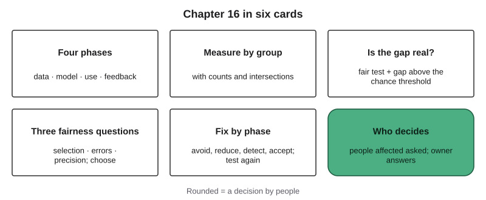{#fig-16-22 fig-alt="Six cards: four phases, measure by group, is the gap real, three fairness questions, fix by phase, who decides."}

**The chapter's question:** *How can you tell whether an AI system treats different groups of people fairly, and who decides what "fair" means?* Look for bias at four phases: data, model, use and feedback. Measure group by group, with each group's size; a gap is a finding only if the test was fair and the gap passes the chance threshold. "Fair" can mean equal selection rates, equal error rates or equal precision; when base rates differ, a tool that makes errors cannot meet them all, so people must choose which error matters most, ask those who bear it, and name an owner. Fix bias where it entered, and test again.

**Return to the Opening Case.** Only an intersectional count showed the gap (16.2); an outside audit found it, and the named companies then cut it (16.5).

**Revisit your Warm-up.** (1) *Not necessarily: you need rates by group, with sizes (16.2).* (2) *No: one output is a lead at most (16.4).* (3) *Yes, but unless its flags carry no information about who is qualified, it must then flag a different share of the unqualified wrongly in each group, and a flag means something different in each (16.3).*

### Key Terms {.unnumbered}

allocation harm · base rate · bias (in an AI system) · bias audit · bias probe · Bias Lifecycle · chance threshold · disaggregated evaluation · equal error rates · equal precision · equal selection rates · fairness definition · false-positive rate (of a decision tool) · feedback loop (in an AI system) · intersectional subgroup · miss rate · mitigation (of bias) · paired-input test · protected characteristic · representation harm · selection rate · stakeholder · two-part rule · *Deep:* calibration within groups · runaway feedback loop · predictive policing

## End-of-Chapter Package {.unnumbered}

<!-- Each item: objective · LO · revised Bloom level. Odd-numbered answers → appendix/answers.md (Appendix E, via docs/production/handoff/ch16.md); even-numbered → private/ch16-answers-even.md. Review A distractors draw on M1–M6 (blueprint §4); MC keys rotated: A1 b, A2 d, A3 a, A4 c, A5 b, A7 d, A8 a, A9 c, A11 b, A12 d, A13 a. The correct option is the longest in at most two items. -->

### Review Questions A: Terms and Concepts {.unnumbered}

Final-exam practice. Items 6 and 10 are short answers.

1. *(O1 · LO5 · Apply)* A hiring tool is trained on ten years of a company's hiring decisions. The gender field was removed. Where on the Bias Lifecycle could bias still enter first?\
   (a) Probably nowhere yet, since without a gender field the tool cannot easily tell groups apart.\
   (b) Data: past decisions used as labels, and proxies in resumes, can carry the old pattern.\
   (c) Mainly at use, when recruiters read the scores, rather than inside the tool itself.\
   (d) Mainly at feedback, once the tool's own decisions start to become new training data.
2. *(O1 · LO5 · Understand)* An image tool shows nurses as women in nearly every image it produces. Which kind of harm is this?\
   (a) An allocation harm, because the images directly withhold jobs from men who apply.\
   (b) Little harm, since no decision about any person is made when an image is produced.\
   (c) Probably no bias, since an image tool's outputs mostly mirror the photos it was trained on.\
   (d) A representation harm: a group is shown in a narrow way in what people see.
3. *(O2 · LO5 · Analyze)* A tool is right 90% of the time overall. What follows?\
   (a) You need results for each group and subgroup, with their sizes, before judging fairness.\
   (b) Each group is right about 90% of the time, because the overall figure averages them.\
   (c) The 10% of errors are spread evenly, because errors are random across a large test set.\
   (d) The tool is fair for large groups, because large groups dominate the overall figure.
4. *(O2 · LO5 · Understand)* Why did the Gender Shades audit report intersectional subgroups?\
   (a) Intersectional subgroups are usually the largest groups in a benchmark, so they matter most.\
   (b) The companies' documentation reported intersectional results that the audit wanted to check.\
   (c) Errors can concentrate where two characteristics meet, as they did for darker-skinned women.\
   (d) Results for single characteristics, such as gender alone, are usually wrong and misleading.
5. *(O2 · LO3 · Apply)* In a fair test with 10 runs per version, version 1 produces a stereotyped description 6 times and version 2 produces it 4 times. What is this?\
   (a) A finding: a 20-point gap between two versions is a large difference in any test.\
   (b) A lead: the chance threshold for 10 runs is 50 points, so run a bigger test.\
   (c) Proof of no bias: the gap is smaller than half of the runs, so it can be ignored.\
   (d) A finding: the counting rule was written before any run, so the result is reliable.
6. *(O3 · LO5 · Apply; short answer)* In group P, 100 students needed tutoring and the tool flagged 70 of them. What is the tool's miss rate in group P, and which Chapter 2 term is one minus the miss rate?
7. *(O3 · LO5 · Understand)* Which description matches equal precision?\
   (a) The same share of each group is flagged by the tool, whatever their needs.\
   (b) The same share of the people who needed help is missed in each group.\
   (c) The tool is right about the same share of the time overall in each group.\
   (d) Of the people flagged, the same share really needed help in each group.
8. *(O3 · LO5 · Analyze)* Two groups' base rates are 40% and 20%. A tool makes some wrong flags, and its precision is equal in both groups. What follows?\
   (a) Its false-positive and miss rates cannot both be equal across the two groups.\
   (b) Its selection rates must be equal across the two groups, given equal precision.\
   (c) It is likely biased against the group with the higher base rate on every measure.\
   (d) A better-trained model would likely make all three definitions hold at these base rates.
9. *(O4 · LO5 · Apply)* You design a paired-input test of a reference-letter tool. What should the two versions share?\
   (a) Most things, but change the name and the job title together so the test looks realistic.\
   (b) The name only; run each version once, in a different tool, so tools are compared too.\
   (c) Everything except one cue, with the counting rule written before any run.\
   (d) The prompt, but let each teammate write a counting rule after seeing the outputs.
10. *(O4 · LO5 · Understand; short answer)* In Wilson & Caliskan's (2024) resume screen, what did the researchers change between versions, and what did they find for names associated with White Americans and with Black men?
11. *(O5 · LO5 · Evaluate)* In 2024 Google paused its chatbot's images of people after tuning meant to show a range of people produced inaccurate images. What does this case best show?\
    (a) Bias mitigations do more harm than good, so tools should be left as they are trained.\
    (b) A fix can create a new error, so the system needs testing again after every fix.\
    (c) Instructions to show diverse people reliably remove bias from image generators.\
    (d) Once an image generator has been tuned for diversity, biased images become rare.
12. *(O1 · LO5 · Understand)* What is a feedback loop in the Bias Lifecycle?\
    (a) The ratings users give a tool's outputs, which the provider reads to improve it.\
    (b) A process that corrects bias automatically as a tool gathers more and more data.\
    (c) A problem mainly of predictive policing, rarely seen in other kinds of tools.\
    (d) A tool's decisions shaping its next data, so that a gap between groups can grow.
13. *(O5 · LO5 · Evaluate)* Who should choose the fairness definition for a campus outreach score?\
    (a) A named decision owner, after asking the students who bear the errors.\
    (b) The engineers who built it, because the choice is a technical one.\
    (c) The vendor who sold it, because it knows the model better than anyone.\
    (d) No one: use whichever definition gives the highest overall accuracy.

### Review Questions B: Case Questions {.unnumbered}

Final-exam practice.

1. *(O3 · LO5 · Apply)* A scholarship office's screening tool gives these results (constructed). Group M: 300 applicants, 150 qualified; the tool flags 120, of whom 105 are qualified. Group N: 300 applicants, 60 qualified; the tool flags 60, of whom 42 are qualified. Compute each group's selection rate, miss rate, false-positive rate and precision. Which fairness definitions does the tool meet, and which does it fail?
2. *(O4 · LO5 · Apply)* A museum wants an image generator to illustrate "scientists through history" for an exhibit. Design a paired-input test: the one cue you would change, the counting rule, the number of runs, and the gap that would count as a finding (use @fig-16-7).
3. *(O2, O4 · LO3 · Evaluate)* A team tests a chat tool that drafts performance reviews. With only the employee's name changed and a fixed rule, "leadership" words appear in 18 of 30 drafts for names associated with men and in 12 of 30 for names associated with women (constructed). Is this a lead or a finding? What would you do next, and how would you include nonbinary employees?
4. *(O1, O5 · LO5 · Evaluate)* A company removes names from resumes before an AI screen and declares its bias problem solved. What does the change fix, what may it miss, and which phases of the lifecycle still need a check?

### Review Questions C: Interpretive Questions {.unnumbered}

Final-exam practice.

1. *(O3, O5 · LO5 · Evaluate)* "If an AI tool reflects the world as it is, it is not biased." Take a position, using base rates and the image-generator evidence.
2. *(O5 · LO5 · Evaluate)* "The company that built a system should choose its fairness definition." Take a position.
3. *(O5 · LO5 · Evaluate)* "A published bias audit should be required before any AI tool screens job applicants." Take a position, using what audits can and cannot show (you may point to Chapter 18 for law).

### Spaced Review {.unnumbered}

Final-exam practice. Come back to these a few days after reading, without looking back. They connect this chapter to Chapters 14 and 12.

1. *(Chapter 14 · LO5 · Apply)* An agent screens applications and sends rejection emails on its own. Classify the "send rejection" action by whether it can be undone and who bears an error, and name the people point it needs.
2. *(Chapter 14 · LO5 · Analyze)* What do a planted fault in a dry run and a paired-input test have in common?
3. *(Chapter 12 · LO2 · Understand)* A fair bake-off changes only the tool. What does a paired-input test change, and what must stay the same?
4. *(Chapter 12 · LO5 · Apply)* Before a bias probe, may real applicants' resumes with their names go into a free consumer tool? Use Chapter 12's data gate.

<!-- Spaced Review: Ch. 12 items checked against chapters/12-*.qmd (§12.5 data gate; §12.6 "changes only the tool"). Ch. 14 items follow the Ch. 14 blueprint vocabulary (approval gate, planted fault); recheck against the written Ch. 14 at revision. -->

### Discussion Questions {.unnumbered}

1. *(Ethics · O1 · LO5 · Evaluate)* Whose faces and data should a fairness benchmark use, and with what consent?
2. *(Career · O5 · LO5 · Analyze)* Which decision in your future field has errors that fall unequally on different groups, and who checks?
3. *(Interdisciplinary · O1 · LO5 · Analyze)* Find a cited example of measurement bias outside AI (for example, pulse oximeters or samples in psychology). Where would it sit on the Bias Lifecycle?
4. *(Personal · O4 · LO5 · Apply)* Describe a stereotyped default you have met in an AI tool. How would you test whether it was a pattern?
5. *(Language · O2 · LO5 · Analyze)* Does a tool you use work as well in another language you know? How could you check it fairly?

### Application Assignment: A12's Fairness Row and Bias Probe {.unnumbered}

This chapter's artifact is **A12** (section 15.8). This chapter adds two required parts, described in section 16.7: the bias probe (A12 item 4c) and the fairness row (item 3). *(O1, O2, O4, O5 · LO5, LO3 · Apply, Evaluate)* Chapter 15's rubric grades them under "Register," "Red-team record" and "Plan."

### Mini-Project (optional): A Bias Audit {.unnumbered}

*(O1–O5 · LO5, LO3 · Create)* Over three weeks, audit one tool you use: about 3 hours in all (about 2 hours for the first round of 60 or more runs and the write-up, plus about 20 minutes for each re-run after an update). Submit: (1) the system, the decision it supports and the **tool kind** (for example, a chat assistant, an image generator, a resume screen); (2) a lifecycle scan, one possible entry point per phase, each marked documented (with a source) or inferred; (3) the groups you compare, with at least one intersection or a reason why not; (4) a paired-input test with a counting rule fixed in advance, one named comparison and at least 30 runs per version, repeated after each update you notice, with dates; runs may be pooled with **contributors** (classmates who ran your exact prompt and rule in the same tool), named in your record; (5) counts with totals and the two-part rule, including the smallest gap your run count can detect; (6) which fairness comparison matters for this decision, and the trade-off you accept; (7) one mitigation with its kind, phase, what it might hide and a re-test; (8) who decides and answers for it; (9) an AI Use Declaration (tools, purpose, what you accepted, rejected or revised, how you verified it, where your judgment shaped the work). Cues about a language variety (a dialect, a writing style) usually change several things at once, so treat them with extra care. At 30 runs, a gap must reach 30 points, so "lead" is a normal result; "no gap found" (with the smallest detectable gap) and "this tool should not be used for this decision" are valid too. **A bias audit** is a structured test of whether a system's outputs or errors differ across groups, recorded with its method, counts and decisions.

**Alternative:** if you have no access to a tool, or prefer not to run prompts about identity, use the provided, dated outputs (60 per version) for one of three scenarios in the book's companion files, and write your counting rule before opening them. The rubric reads the same, except that Test design scores your counting rule and named comparison, and re-runs are not required.

**Self-check rubric (10 points).** Count the flaws listed in each row.

| Criterion (points) | Exemplary | Proficient | Developing | Beginning |
|---|---|---|---|---|
| Scope and lifecycle scan (3) | 3: system, decision, tool kind and affected people named; one entry point per phase, each marked with a source or "inferred"; groups, who chose them, an intersection or a reason | 2: one flaw (a phase missing, a documented mark without a source, or no intersection and no reason) | 1: two or three flaws | 0: four or more flaws, or no scope |
| Test design (1.5) | 1.5: one cue only; rule fixed first; one comparison named; ≥ 30 runs per version; contributors named | 1: one flaw | 0.5: two flaws | 0: three or more flaws, or no test |
| Results record (1.5) | 1.5: counts with totals for every version; gap computed; dates for every run set | 1: one flaw | 0.5: two flaws | 0: three or more flaws, or no results |
| Measurement and uncertainty (2) | 2: two-part rule applied, with the smallest detectable gap; comparison chosen with a reason tied to who bears which error; trade-off named | 1.5: one flaw | 1: two flaws | 0: three or more flaws |
| Judgment (1) | 1: mitigation with kind, phase, what it might hide and a re-test; who decides and answers for it | 0.75: one flaw | 0.5: two flaws | 0: three or more flaws |
| Declaration (1) | 1: all five elements | 0.75: four elements | 0.5: two or three elements | 0: one or none |

### Case Study Questions {.unnumbered}

Final-exam practice.

1. *(O1 · LO5 · Apply)* Label Gender Shades on the tree and the chain, with documented or inferred for each label, and give the reason for each.
2. *(O2 · LO3 · Understand)* Why is gender classification not face recognition, and why does the difference matter for claims about the audit?
3. *(O2 · LO5 · Analyze)* Name three features of the audit's method that made its results hard to dismiss.
4. *(O5 · LO5 · Evaluate)* What could the August 2018 re-test show, and what could it not show?
5. *(O1 · LO5 · Analyze)* Compare Gender Shades with Short case 2: at which phase of the lifecycle did each problem become visible, and where did harm occur?

## Further Reading {.unnumbered}

- Buolamwini & Gebru (2018) (recommended): read the abstract, section 1, section 4.1 with Table 4, and section 5 (about 10 minutes).
- Raji & Buolamwini (2019): what happened after the audit, and how the results were disclosed.
- Barocas, Hardt & Narayanan (2023), *Fairness and Machine Learning*: a free online textbook; chapter 3 covers the fairness definitions in this chapter.
- Suresh & Guttag (2021): the seven sources of harm behind the Bias Lifecycle, short and readable.
- Bianchi et al. (2023): how ordinary prompts produce stereotyped images, with examples (content warning in the paper).
- Koenecke et al. (2020): a clear disaggregated evaluation of speech recognition.

*In Compass (optional):* an interactive Bias Lifecycle, a threshold slider for the trade-off calculation, and a small-sample simulator.

## References {.unnumbered}

ACLU. (2024, June 28). *Civil rights advocates achieve the nation's strongest police department policy on facial recognition technology* [Press release]. American Civil Liberties Union. https://www.aclu.org/press-releases/civil-rights-advocates-achieve-the-nations-strongest-police-department-policy-on-facial-recognition-technology

Amazon. (2020, June 10). *We are implementing a one-year moratorium on police use of Rekognition*. Amazon. https://www.aboutamazon.com/news/policy-news-views/we-are-implementing-a-one-year-moratorium-on-police-use-of-rekognition

Atari, M., Xue, M. J., Park, P. S., Blasi, D. E., & Henrich, J. (2023). *Which humans?* [Preprint]. PsyArXiv. https://doi.org/10.31234/osf.io/5b26t

Adams, J. S. (1963). Towards an understanding of inequity. *Journal of Abnormal and Social Psychology, 67*(5), 422–436. https://doi.org/10.1037/h0040968 (Cited as reported in Seker, 2014.)

Barocas, S., Guo, A., Kamar, E., Krones, J., Morris, M. R., Vaughan, J. W., Wadsworth, W. D., & Wallach, H. (2021). Designing disaggregated evaluations of AI systems: Choices, considerations, and tradeoffs. In *Proceedings of the 2021 AAAI/ACM Conference on AI, Ethics, and Society* (pp. 368–378). https://doi.org/10.1145/3461702.3462610

Barocas, S., Hardt, M., & Narayanan, A. (2023). *Fairness and machine learning: Limitations and opportunities*. MIT Press. https://fairmlbook.org

Bertrand, M., & Mullainathan, S. (2004). Are Emily and Greg more employable than Lakisha and Jamal? A field experiment on labor market discrimination. *American Economic Review, 94*(4), 991–1013. https://doi.org/10.1257/0002828042002561

Bianchi, F., Kalluri, P., Durmus, E., Ladhak, F., Cheng, M., Nozza, D., Hashimoto, T., Jurafsky, D., Zou, J., & Caliskan, A. (2023). Easily accessible text-to-image generation amplifies demographic stereotypes at large scale. In *Proceedings of the 2023 ACM Conference on Fairness, Accountability, and Transparency* (pp. 1493–1504). https://doi.org/10.1145/3593013.3594095

Blodgett, S. L., Barocas, S., Daume III, H., & Wallach, H. (2020). Language (technology) is power: A critical survey of "bias" in NLP. In *Proceedings of the 58th Annual Meeting of the Association for Computational Linguistics* (pp. 5454–5476). https://doi.org/10.18653/v1/2020.acl-main.485

Buolamwini, J. (2023). *Unmasking AI: My mission to protect what is human in a world of machines*. Random House.

Buolamwini, J., & Gebru, T. (2018). Gender shades: Intersectional accuracy disparities in commercial gender classification. In *Proceedings of the 1st Conference on Fairness, Accountability and Transparency* (PMLR 81, pp. 77–91). https://proceedings.mlr.press/v81/buolamwini18a.html

Chouldechova, A. (2017). Fair prediction with disparate impact: A study of bias in recidivism prediction instruments. *Big Data, 5*(2), 153–163. https://doi.org/10.1089/big.2016.0047

Crenshaw, K. (1989). Demarginalizing the intersection of race and sex: A Black feminist critique of antidiscrimination doctrine, feminist theory and antiracist politics. *University of Chicago Legal Forum, 1989*(1), Article 8, 139–167. https://chicagounbound.uchicago.edu/uclf/vol1989/iss1/8

Dieterich, W., Mendoza, C., & Brennan, T. (2016, July 8). *COMPAS risk scales: Demonstrating accuracy equity and predictive parity* [Technical report]. Northpointe Inc. Research Department. https://web.archive.org/web/20260607155051/https://go.volarisgroup.com/rs/430-MBX-989/images/ProPublica_Commentary_Final_070616.pdf

Ensign, D., Friedler, S. A., Neville, S., Scheidegger, C., & Venkatasubramanian, S. (2018). Runaway feedback loops in predictive policing. In *Proceedings of the 1st Conference on Fairness, Accountability and Transparency* (PMLR 81, pp. 160–171). https://proceedings.mlr.press/v81/ensign18a.html

Glass, R. S., & Wood, W. A. (1996). Situational determinants of software piracy: An equity theory perspective. *Journal of Business Ethics, 15*(11), 1189–1198. (Cited as reported in Seker, 2014.)

Google. (2024, August 28). *New in Gemini: Custom Gems and improved image generation with Imagen 3*. https://blog.google/products/gemini/google-gemini-update-august-2024/

Gonen, H., & Goldberg, Y. (2019). Lipstick on a pig: Debiasing methods cover up systematic gender biases in word embeddings but do not remove them. In *Proceedings of the 2019 Conference of the North American Chapter of the Association for Computational Linguistics* (pp. 609–614). https://doi.org/10.18653/v1/N19-1061

Grother, P., Ngan, M., & Hanaoka, K. (2019). *Face recognition vendor test (FRVT) part 3: Demographic effects* (NISTIR 8280). National Institute of Standards and Technology. https://doi.org/10.6028/NIST.IR.8280

Hardt, M., Price, E., & Srebro, N. (2016). Equality of opportunity in supervised learning. In *Advances in Neural Information Processing Systems 29* (pp. 3315–3323). Curran Associates.

Henrich, J., Heine, S. J., & Norenzayan, A. (2010). The weirdest people in the world? *Behavioral and Brain Sciences, 33*(2–3), 61–83. https://doi.org/10.1017/S0140525X0999152X

Hess, T., & Hightower, R. (2002). Using equity theory to understand user satisfaction with ERP systems: Extending and advancing the equity-implementation model. In *ICIS 2002 Proceedings* (Paper 72). (Cited as reported in Seker, 2014.)

IBM. (2020, June 8). *IBM CEO's letter to Congress on racial justice reform*. IBM THINKPolicy Blog. https://web.archive.org/web/20220423104723/https://www.ibm.com/blogs/policy/facial-recognition-sunset-racial-justice-reforms/

Joshi, K. (1991). A model of users' perspective on change: The case of information systems technology implementation. *MIS Quarterly, 15*(2), 229–242. (Cited as reported in Seker, 2014.)

Kleinberg, J., Mullainathan, S., & Raghavan, M. (2017). Inherent trade-offs in the fair determination of risk scores. In *8th Innovations in Theoretical Computer Science Conference* (LIPIcs 67, pp. 43:1–43:23). https://doi.org/10.4230/LIPIcs.ITCS.2017.43

Koenecke, A., Nam, A., Lake, E., Nudell, J., Quartey, M., Mengesha, Z., Toups, C., Rickford, J. R., Jurafsky, D., & Goel, S. (2020). Racial disparities in automated speech recognition. *Proceedings of the National Academy of Sciences, 117*(14), 7684–7689. https://doi.org/10.1073/pnas.1915768117

Larson, J., Mattu, S., Kirchner, L., & Angwin, J. (2016, May 23). *How we analyzed the COMPAS recidivism algorithm*. ProPublica. https://www.propublica.org/article/how-we-analyzed-the-compas-recidivism-algorithm

Mitchell, M., Wu, S., Zaldivar, A., Barnes, P., Vasserman, L., Hutchinson, B., Spitzer, E., Raji, I. D., & Gebru, T. (2019). Model cards for model reporting. In *Proceedings of the Conference on Fairness, Accountability, and Transparency* (pp. 220–229). https://doi.org/10.1145/3287560.3287596

New York City Department of Consumer and Worker Protection. (2023). *Automated employment decision tools* (Local Law 144 of 2021; final rules effective July 5, 2023). https://www.nyc.gov/site/dca/about/automated-employment-decision-tools.page

OpenAI. (2023). *GPT-4 technical report* (arXiv:2303.08774). https://arxiv.org/abs/2303.08774

Raghavan, P. (2024, February 23). *Gemini image generation got it wrong. We'll do better.* Google. https://blog.google/products/gemini/gemini-image-generation-issue/

Raji, I. D., & Buolamwini, J. (2019). Actionable auditing: Investigating the impact of publicly naming biased performance results of commercial AI products. In *Proceedings of the 2019 AAAI/ACM Conference on AI, Ethics, and Society* (pp. 429–435). https://doi.org/10.1145/3306618.3314244

Reuters. (2021, May 18). *Amazon extends moratorium on police use of facial recognition software*. (Read via syndicated copies, Fox Business and Rappler, 2026-10-18.)

Seker, S. E. (2014). Bilisim sistemleri ve esitlik teorisi (equity theory) [Information systems and equity theory]. *YBS Ansiklopedi, 1*(2), 17–19.

Selbst, A. D., boyd, d., Friedler, S. A., Venkatasubramanian, S., & Vertesi, J. (2019). Fairness and abstraction in sociotechnical systems. In *Proceedings of the Conference on Fairness, Accountability, and Transparency* (pp. 59–68). https://doi.org/10.1145/3287560.3287598

Shumailov, I., Shumaylov, Z., Zhao, Y., Papernot, N., Anderson, R., & Gal, Y. (2024). AI models collapse when trained on recursively generated data. *Nature, 631*, 755–759. https://doi.org/10.1038/s41586-024-07566-y

Sjoding, M. W., Dickson, R. P., Iwashyna, T. J., Gay, S. E., & Valley, T. S. (2020). Racial bias in pulse oximetry measurement. *New England Journal of Medicine, 383*(25), 2477–2478. https://doi.org/10.1056/NEJMc2029240

Spector, P. E. (2008). *Industrial and organizational psychology: Research and practice* (5th ed.). Wiley. (Cited as reported in Seker, 2014.)

Suresh, H., & Guttag, J. (2021). A framework for understanding sources of harm throughout the machine learning life cycle. In *Equity and Access in Algorithms, Mechanisms, and Optimization (EAAMO '21)* (pp. 1–9). https://doi.org/10.1145/3465416.3483305

Wilson, K., & Caliskan, A. (2024). Gender, race, and intersectional bias in resume screening via language model retrieval. *Proceedings of the AAAI/ACM Conference on AI, Ethics, and Society, 7*(1), 1578–1590. https://doi.org/10.1609/aies.v7i1.31748 (Corrected version: arXiv:2407.20371v3, August 30, 2026.)
