# Explainability and Transparency {#sec-ch17}

<!-- Status: v2 (2026-10-18), chapter agent, after four independent reviews (docs/editorial/ch17-dev-memo.md); from blueprint v0.2 (approved under D19). Deep chapter: not examinable (D20). Featured student: Sam only (docs/characters.md); other people are unnamed one-off figures. Figures: figures/scripts/ch17_figures.py (new signature explanation_layers(); imports decision_roles, verification_funnel, failure_tree, failure_chain, bias_lifecycle, risk_heat_map) and ch17_charts.py (this book's simulations from figures/scripts/ch17_experiments.py, data/ch17_*.csv; published values in data/ch17_cot_faithfulness.csv). Case C14: confirmed tier = the AP's report (2020), build/ch17/src/ap_2020.txt, and Ongekend onrecht (2020), build/ch17/src/ongekend_onrecht.txt; reported tier = Amnesty International (2021), English edition, build/ch17/src/amnesty_en.txt. Dutch passages are the book's translation, paraphrased. All of Sam's data, prompts and outputs are constructed examples. -->

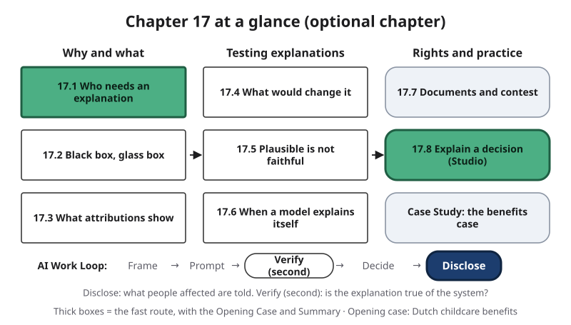{#fig-17-1 fig-alt="Chapter map: why and what (17.1–17.3), testing explanations (17.4–17.6), rights and practice (17.7–17.8, case); Work Loop with Disclose highlighted."}

**Chapter 17 at a glance** (@fig-17-1). This is an optional chapter. You can read it alongside Chapters 15, 16 and 18 in week 12, and nothing in it is on an exam. Chapter 11 showed that an AI output can inform a decision, recommend one or trigger an action by itself. This chapter asks what the people around such a decision are owed: a notice, a reason, a way to change the outcome, and a way to challenge it, or *contest* it, before a person who can overturn it. It also asks how anyone can tell whether the reason they are given is the real one.

**Time** (at a steady pace, 150 words a minute; allow more if you read more slowly or are reading in a second language):

- **Fast route, about 22 minutes:** this page, the Opening Case, the Warm-up, section 17.1, section 17.8 with its recap box, and the Chapter Summary. It stands on its own.
- **Full route, about 61 minutes:** everything from this page through the Case Study, not counting the labs. About 70 minutes with the Ethics Lens, Career Connection, From the Field and Summary.
- **Extra, all optional:** Your Turn boxes; the Warm-up and Check Yourself answers (about 5 minutes on the fast route, about 14 on the full route); the labs (about 20–45 minutes each, including reading the lab and the debrief); the end-of-chapter questions (about 15 minutes to read, about an hour to answer); the optional report (about 75 minutes).

Week 12's required reading is Chapters 15, 16 and 18; this chapter adds no required time. Worked examples show every step, faded examples leave some steps for you, and Your Turn and Check Yourself boxes are ungraded practice. Answers to Check Yourself, the faded examples and odd-numbered end-of-chapter questions are in Appendix E.

::: {.callout-note title="Plain words for this chapter"}
- **Model:** a set of learned settings (parameters) that turns an input into an output (Chapter 2).
- **Feature:** a measurable property of an input that a model uses, such as a pixel value or a house's size (Chapter 2).
- **Proxy:** a clue that stands in for something else, such as a word linked to gender (Chapter 2).
- **Reasoning tokens:** extra tokens some tools produce before the answer, sometimes hidden; they are made in the same way as other tokens (Chapter 3).
- **Decision owner:** the named person or body who makes a decision and answers for its result (Chapter 11).
- **Automated decision:** a decision in which an AI output triggers an action with no person in between (Chapter 11).
- **Three roles of an output:** it can *inform* (a person reads it among other evidence), *recommend* (a person decides whether to follow it) or *trigger an action* (no person in between) (Chapter 11).
- **Automation bias:** the tendency to over-rely on automated output, following it when it is wrong or missing what it did not flag (Chapter 11).
- **Independent check:** evidence that no AI tool produced: a source with an author or publisher you can name, or your own recalculation or reasoning from known inputs. **Primary source:** the original record a claim comes from (Chapter 8).
- **Documented / inferred:** a label backed by the record (drawn solid) or by your own reasoning (drawn dashed) (Chapter 4).
- **Risk owner:** the person, named by role, who answers for a risk and for the decision to reduce or accept it (Chapter 15).
:::

**The question of this chapter:** *When an AI system shapes a decision about you, what are you owed, and how would you know the reason you are given is the real one?* The Chapter Summary returns to it.

## Opening Case: A Score Without Reasons {.unnumbered}

*Content note: this case is about families harmed by a government's fraud checks. No individual stories are told.*

In the Netherlands, parents who pay for childcare can receive a benefit, the *kinderopvangtoeslag*, from the tax administration's benefits office. In 2013, after a large fraud case, the state secretary in charge (a junior minister) told the office's staff that fraud would be tackled harder. The main measure was more checking **before** payment (Parlementaire ondervragingscommissie Kinderopvangtoeslag, 2020, p. 14). From 2013, the office used a **risk classification model** to choose which applications to check (Autoriteit Persoonsgegevens [AP], 2020, p. 14).

The AP, the Dutch Data Protection Authority, is the government body that oversees how personal data are used (a *regulator*). Its 2020 report describes the model. The office called it *zelflerend* ("self-learning"): it was trained on examples of correct and incorrect applications and used several dozen indicators. The trained model produced a scorecard: each indicator carried points, and the points added up to a risk score. The highest-scoring applications went to a staff member to check by hand; the rest went on through the automatic process. A high score could delay payment and bring a request for more evidence. And, the AP found, **the staff member could not see which indicators had produced the score** (AP, 2020, pp. 14–16; the book's translation).

One indicator was "Dutch citizenship." The AP concluded that using applicants' nationality for this indicator, at least from March 2016 to October 2018, was discriminatory and therefore improper processing of personal data (AP, 2020, p. 50).

In December 2020, a parliamentary inquiry (an investigation by a committee of the Dutch parliament) reported on the wider scandal. Its questions concerned what ministers knew about the office's harsh approach to fraud and why it lasted; risk profiles that used nationality were outside its remit and left to the AP (Parlementaire ondervragingscommissie Kinderopvangtoeslag, 2020, p. 11). It called what happened to parents "unprecedented injustice." The cabinet resigned in January 2021, as Amnesty International's 2021 report records (Amnesty International, 2021, p. 14).

Here is the puzzle. **A person checked every high-scoring application. Why did that check not catch a score that used a citizenship indicator? And what could the parents have asked for, and from whom?** Section 17.1 shows who needs which kind of explanation. Sections 17.3 to 17.6 show what explanations can and cannot reveal. Section 17.7 turns to documents and the right to contest. The Case Study returns to the benefits office.

## Learning Objectives {.unnumbered}

Each objective names the course outcome it serves: LO5 is the outcome on applying privacy, security, fairness, transparency and human-oversight principles; LO3 is the outcome on verifying outputs; LO1 is the outcome on explaining how AI systems work and fail. Framework tags refer to the AI Fluency framework (Dakan & Feller, 2025) and the UNESCO (United Nations Educational, Scientific and Cultural Organization) AI Competency Framework for Students (UNESCO, 2024).

After this chapter you will be able to:

- **O1 — Explain** why the people around an AI-supported decision need explanations (to contest it, to debug the system, to decide how far to rely on it) and which layer each needs. *(LO5 · AI Fluency: Discernment · UNESCO: Ethics of AI, Understand)*
- **O2 — Classify** an explanation by its source (the model's own logic or an approximation of it), its scope (global or local) and its kind (feature attribution, counterfactual, example-based or rule). *(LO5, LO1 · AI Fluency: Discernment · UNESCO: AI techniques and applications, Understand)*
- **O3 — Interpret** a feature attribution or a counterfactual for one decision, stating what it shows about the model and what it does not show about the world. *(LO5 · AI Fluency: Discernment · UNESCO: AI techniques and applications, Apply)*
- **O4 — Evaluate** whether an explanation is faithful to the system, not only plausible, including a language model's account of its own reasoning. *(LO5, LO3 · AI Fluency: Discernment, Diligence)*
- **O5 — Examine** which transparency documents, notices and contest routes exist for a decision, and which are missing, as of a stated date. *(LO5 · AI Fluency: Diligence · UNESCO: Ethics of AI, Apply)*
- **O6 — Create** an explanation of an AI-supported decision for the person it affects, with the reasons, what would change the outcome and how to contest it. *(LO5 · AI Fluency: Diligence · UNESCO: Ethics of AI, Apply; Human-centred mindset, Apply)*

::: {.callout-note title="Warm-up (ungraded)"}
1. A system shows you which inputs mattered most for a decision about you. Does that tell you why the outcome happened in the world?
2. A chatbot explains, step by step, how it reached an answer. Is that a record of how the answer was produced?
3. A person reviews every case an algorithm flags. Is the decision checked? How sure are you of your answer (0–100%)?

You will revisit your answers in the Chapter Summary.
:::

## 17.1 Who Needs an Explanation, and Why {#sec-17-1 .unnumbered}

[Deep]{.path}

*Deep sections are optional and not examinable. Featuring Sam, a mechanical engineering senior and captain of the student robotics club, who appears from section 17.3.*

Hospitals, banks, schools, employers and governments now use model outputs in decisions about people. In each case, someone eventually asks "why?" The question sounds simple, but it comes from different people who want different things.

**Explainability** is how far people can get reasons for a system's outputs that they can understand and use. Notice the last two words. An explanation is for someone, and for something. Three purposes recur:

1. **To contest.** The person affected wants to know whether the decision was right and how to challenge it. A parent denied a benefit needs reasons specific enough to dispute.
2. **To debug.** The people who build and test a system want to find where it goes wrong. An engineer wants to know which inputs the model leaned on.
3. **To decide how far to rely on it.** The person who uses the output, such as a reviewer, a nurse or a loan officer, must judge when to follow it and when not. **Appropriate reliance** means relying on a system when it is right and not relying on it when it is wrong (after Lee & See, 2004). Its failures you have met: **overreliance**, relying on an output more than the task or the evidence warrants (Chapter 7), and automation bias (Chapter 11).

::: {.callout-note title="Predict first"}
People decide whether to accept an AI system's recommendation. Some of them also see an explanation of it. When the system is **wrong**, do explanations make people more likely or less likely to accept its recommendation?
:::

In a study of people working with an AI system on decision tasks, explanations increased how often people accepted the system's recommendation, whether it was right or wrong (Bansal et al., 2021). In another study, participants who saw a more transparent model were *less* able to notice when it made large mistakes; the authors suggest that the extra detail was too much to take in (Poursabzi-Sangdeh et al., 2021). In other words, an explanation can raise trust without raising the right kind of trust. Whether an explanation helps depends on whom it is for and what they do with it.

**Many layers, not one.** "Explain the decision" can mean six different things, and different people usually ask for different ones (@fig-17-3):

1. **Notice:** was an AI system used at all?
2. **Documentation:** what is it for, what data does it use, how was it tested, what are its known limits?
3. **Global logic:** what drives its outputs overall?
4. **Local reasons:** why this output, for this case?
5. **What would change it:** what would have to be different for another result?
6. **Contest:** who can review and change the decision, and how?

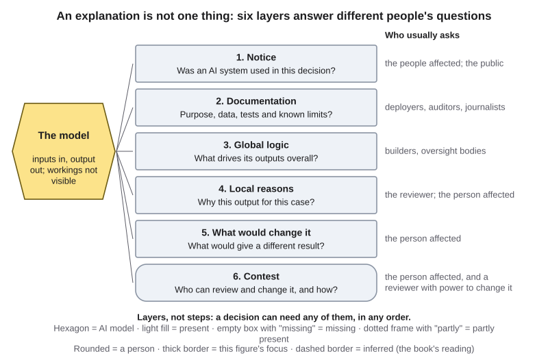{#fig-17-3 fig-alt="A model hexagon linked to six layers: notice, documentation, global logic, local reasons, what would change it, contest; who usually asks each."}

These are layers, not steps. A builder may need only the global logic; a person denied a loan may need local reasons, what would change it, and a contest route. The layers also depend on the role the output plays (Chapter 11). If an output only *informs* a person who decides, that person's judgment is the main check. If it *triggers an action* with no person in between, no one looked at the case, so the explanation is owed afterward to the person affected.

The benefits case shows both roles in one system (@fig-17-5). Applications the model did not select went on through the automatic process: the output triggered an action. The highest scores went to a staff member: the output recommended a closer look. But the reviewer saw a score without its reasons (AP, 2020, pp. 14–15). A reviewer who cannot see why the system flagged a case cannot check that reason.

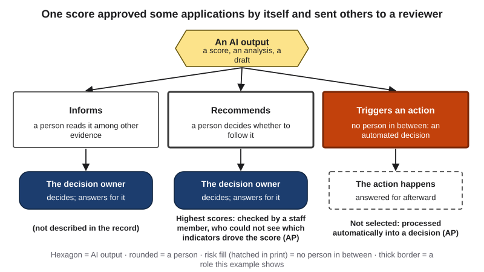{#fig-17-5 fig-alt="Decision roles: an AI output recommends (high scores to a staff member who could not see the indicators) or triggers (others processed automatically)."}

::: {.callout-note title="Worked Example: Three Audiences for One Score"}
**Case:** the benefits office's risk score (Opening Case).

**Step 1 — Who is affected, and what for?** *Parents:* to contest a suspension or a demand to repay. *Staff members who checked flagged applications:* to decide how far to rely on the score. *Oversight bodies* (the AP, the parliament's inquiry): to find out what the system did.

**Step 2 — Which layers did each need?** Parents: notice, local reasons, what would change it, a contest route. Reviewers: local reasons. Oversight bodies: documentation and global logic.

**Step 3 — What did each get?** (*Confirmed* means stated in a primary record such as the AP's report; *reported* means a named source's account.) Reviewers could not see which indicators produced a score (AP, 2020, p. 15; confirmed). Amnesty reports that parents were deprived of meaningful information about their individual results (Amnesty International, 2021, p. 27; reported). The role of nationality in the model was officially established only in July 2020, by the AP's report.

**Result:** @fig-17-4. The contest layer existed in form (objections and appeals), but the inquiry found that the administrative courts, too, for years helped sustain the rigid practice (Parlementaire ondervragingscommissie Kinderopvangtoeslag, 2020, pp. 7–8). So it is drawn "partly."
:::

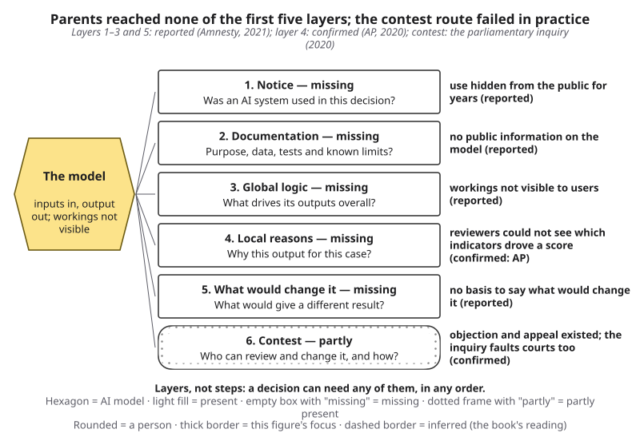{#fig-17-4 fig-alt="Layers for the parents: notice through what would change it marked missing; contest marked partly: appeals existed but failed in practice."}

::: {.callout-note title="Faded Example: A Sepsis Alert"}
*Constructed example.* A hospital uses a model that scores patients' risk of sepsis, a life-threatening response to infection, and alerts the bedside nurse when the score is high. Three audiences: the bedside nurse, the patient and the hospital's quality team, which reviews missed and false alerts every month.

**Done for you:** *Bedside nurse:* local reasons ("which vital signs drove this alert, so I can recheck them now").

**Your turn:** *Patient:* which layers, and why? _______________ *Quality team:* which layers, and why? _______________
:::

::: {.callout-important title="Your Turn"}
Name one decision about you in which a model may have played a part (a feed, a fraud alert, a job or apartment screen, grade feedback). Which two of the six layers would you most want, and from whom?
:::

::: {.callout-tip title="Check Yourself 17.1"}
1. Name the three purposes of an explanation and who usually has each.
2. Why can an explanation raise trust without raising appropriate reliance?
3. Why is an explanation owed afterward to the person affected when an output triggers an action?
:::

## 17.2 Black Boxes, Glass Boxes and After-the-Fact Explanations {#sec-17-2 .unnumbered}

[Deep]{.path}

Three words are often used as if they meant the same thing. They do not.

**Transparency (of an AI system)** is openness about the system: whether it is used, what it is for, what data and logic it relies on, how it was tested and who answers for it. **Interpretability** is how far a person can follow how a model turns inputs into outputs from the model itself. Explainability, from 17.1, is about getting usable reasons, by whatever means.

A **black box** is a system whose inputs and outputs can be seen but whose internal workings are not visible, or not understandable, to the people who use it or are affected by it (after Amnesty International, 2021, p. 4). Some models are black boxes because they are secret. Others are black boxes because they are complicated: a large neural network has millions or billions of learned settings, and no one can read a decision off them.

An **interpretable model**, sometimes called a *glass box*, is a model whose decision process a person can follow from the model itself, such as a points scorecard, a short list of rules or a small decision tree. A **post-hoc explanation** is an explanation produced after a model is built, by a separate method that studies the model's inputs and outputs. Many explanation tools work this way: they try inputs, record outputs and summarize what they find (@fig-17-6). The summary is an explanation *of* the model, with its own possible error.

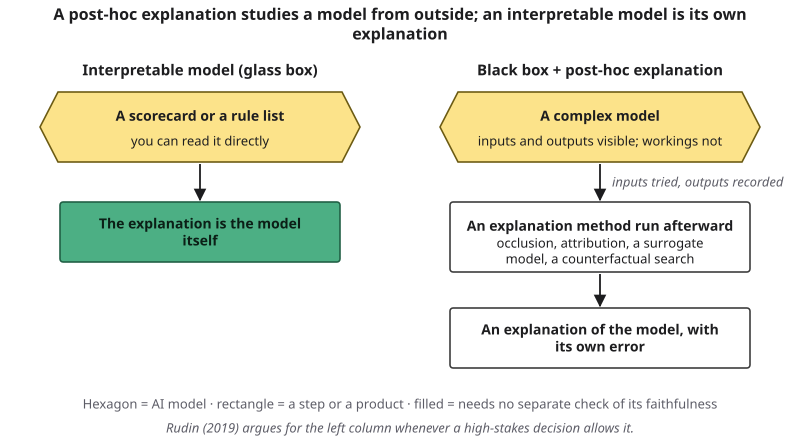{#fig-17-6 fig-alt="Left: an interpretable model is the explanation. Right: a complex model, an explanation method run afterward, an explanation with its own error."}

**Do we need the black box at all?** The computer scientist Cynthia Rudin argues that for high-stakes decisions about people, such as criminal justice or lending, people should build interpretable models instead of explaining black boxes afterward. Her argument is that, for many problems with structured data (tables of features), interpretable models can be about as accurate as black boxes, and an after-the-fact explanation can be wrong about the model it explains (Rudin, 2019). Her claim is strongest for structured data. For images, sound or text, even defining an interpretable model is harder, though her own group has built some for images (Chen et al., 2019). Either way, it changes the first question. Before asking "how do we explain this black box?", ask "why is it a black box?"

**A note on attention.** Chapter 3 showed attention weights, the numbers that say how much one token draws on others, and said they are hard to interpret. Researchers have debated whether they explain a model's output. One team found that very different attention patterns could produce the same predictions, so attention weights do not, by themselves, show why an output was produced (Jain & Wallace, 2019); another team replied that under some conditions they can carry useful information (Wiegreffe & Pinter, 2019). Treat an attention picture as a lead, not a reason.

::: {.callout-note title="Worked Example: One Screen, Built Two Ways"}
*Constructed example.* A scholarship office screens renewal applications.

**Design A, a scorecard:** GPA 3.0 or higher, 40 points; 24 or more credits this year, 30 points; a completed advising meeting, 30 points. Renew at 70 points. A student with GPA 3.2, 21 credits and an advising meeting has 70 points: renewed. Anyone can redo the arithmetic.

**Design B, a black-box model** trained on past renewals, with an attribution chart showing that "credits this year" lowered one student's score most.

**What each lets a student check:** under A, the exact rule and the exact change that would matter. Under B, a summary of what the model leaned on, which may itself be inexact (section 17.5). **Conclusion:** if A is about as accurate, A is easier to explain, check and contest.
:::

::: {.callout-note title="Faded Example: An Early-Alert Rule"}
*Constructed example.* A course uses a rule list for early alerts: "Two missed assignments in the first four weeks → an email from the student's advisor." No other rule exists.

**Done for you:** *Can a student see why they were flagged?* Yes: the rule names the reason, and the student can count their missed assignments.

**Your turn:** Is this a glass box or a black box? _______________ Who could contest a wrong alert, and with what evidence? _______________
:::

::: {.callout-important title="Your Turn"}
Name one decision in your life that uses a points rule (a glass box) and one that may use a black box. In each, could the person affected redo the reasoning?
:::

::: {.callout-tip title="Check Yourself 17.2"}
1. How do transparency and interpretability differ?
2. What is a post-hoc explanation, and why can it be wrong about the model?
3. State Rudin's argument and its limit in one sentence each.
:::

## 17.3 Global and Local: What Feature Attributions Show {#sec-17-3 .unnumbered}

[Deep]{.path}

Builders, auditors and the people affected ask about different amounts of a model's behavior. In other words, an explanation has a scope. A **global explanation** describes how a model behaves across many cases: which features matter most overall, or the main patterns in its outputs. A **local explanation** describes why the model produced one output for one case (@fig-17-7). A global pattern can hide what happened in a particular case, and a local explanation that disagrees with the global pattern is worth checking.

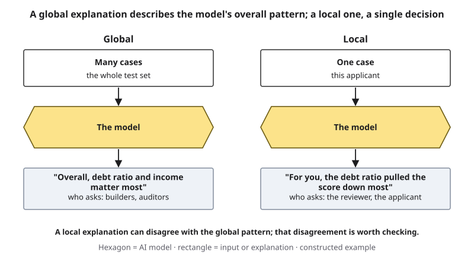{#fig-17-7 fig-alt="Two columns: many cases into the model give an overall pattern for builders; one case into the model gives reasons for that applicant."}

The most common kind of explanation is a **feature attribution**: an explanation that assigns each input feature a share of the credit for an output, for one case or across many. Three families appear in practice, here at the level of intuition only:

- **Occlusion and saliency maps** cover one part of the input, such as a patch of an image, and record how much the output changes, or measure how sensitive the output is to tiny changes in each pixel. The result is a map, often colored, of where the output was sensitive. What counts as "covered" (black? gray? an average image?) is a choice, called the *baseline*, and different baselines give different maps (Sturmfels et al., 2020).
- **LIME** (local interpretable model-agnostic explanations) builds many slightly changed versions of one case, records the model's outputs for them, and fits a simple model to those outputs near that case; the simple model's weights are the explanation (Ribeiro et al., 2016).
- **SHAP** (Shapley additive explanations) borrows the Shapley value, a method from game theory for sharing credit fairly among players. It shares the difference between this output and an average output among the features (Lundberg & Lee, 2017).

All three describe **the model**. They say how much the model leaned on each input. They do not say what causes the outcome in the world. If a loan model leans on a postal code, the attribution shows that the model uses the postal code. It does not show that where you live causes repayment; the postal code may be a proxy.

**Debugging is where attributions shine.** For example, researchers applied an attribution method to an image classifier (a Fisher-vector model) that scored well on a standard benchmark, PASCAL VOC. For the class "horse," the maps pointed to a small source tag in the corner of about one in five horse photos, not to the horse. Removing the tag removed the "horse" call. A deep network trained on the same images did not rely on the tag (Lapuschkin et al., 2019). The benchmark score had hidden the shortcut; the attribution exposed it.

::: {.callout-note title="Worked Example: Sam Rebuilds His Sorter"}
*This book's simulation with constructed images; not Sam's real photos or model.* In Chapter 2, Sam's parts sorter had come to rely on the pattern "brown background means bolt," and it took him an evening to find out. Would an attribution map have shown it? He builds a small replica: 12 × 12 pixel images of bolts, nuts and washers, 60 of each, with the bolts on a dark background and the others on a light one, as in his old photos. A simple, interpretable model (logistic regression) is trained to sort them.

**Step 1 — Test.** On new images made the same way, 100% correct. On images with every part on a mid-gray "workbench," 73%, and only 43% of the bolts.

**Step 2 — Attribute.** For each bolt image, he covers one pixel at a time with an average-gray value and records how much the score for "bolt" drops (@fig-17-8). Each background pixel moves the score only a little, but there are many of them. Measured against that average-gray pixel, background pixels supplied **79%** of the evidence pushing toward "bolt."

**Step 3 — Check the map.** Because this model is a glass box, its exact contributions can be computed; the map matched them. But the 79% depends on the baseline: against a black pixel the share is 13.5%, against a light one 84%, and for some baselines the old and retrained models even swap order (this book's simulation). That is why the test in Step 1, not the map, settles the question.

**Step 4 — Fix and re-test.** Retrained on 120 new images per part with mixed backgrounds: 100% on the gray workbench. The background's share fell to **66%**, and 88% of that background evidence now came from the places where a nut's or washer's ring would be (18% before retraining): the absence of a ring is real evidence about shape.
:::

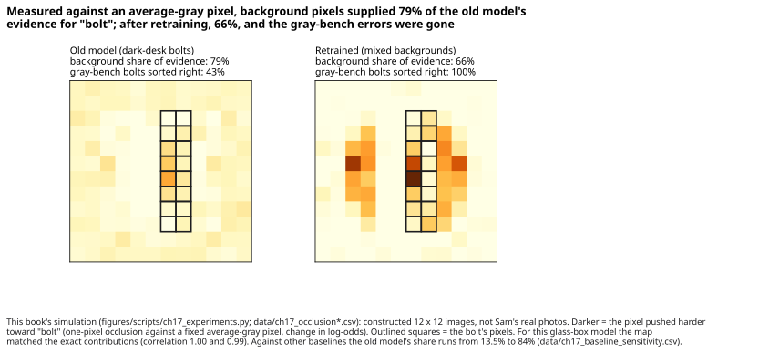{#fig-17-8 fig-alt="Two occlusion maps of one bolt image: old model 79% of evidence from background, 43% of bolts right on gray; retrained 66%, 100%."}

Two lessons come out of Sam's replica. First, the map did not "light up the background" in a way anyone would notice at a glance: each background pixel was pale, but together they carried most of the evidence, and how much depended on the baseline. Reading a map takes care. Second, the test that settled the question changed only the background and watched the result. In other words, an attribution is a lead; a test like that is the check.

::: {.callout-note title="Faded Example: Chest X-Rays"}
In a 2021 study, researchers examined models trained to detect COVID-19 in chest X-rays. Attribution maps and other tests showed that the models relied partly on features outside the lungs, such as text markers and image edges, that differed between the data sources: the COVID-positive and COVID-negative images had been collected from different sources. Performance dropped by about half on images from new hospitals (DeGrave et al., 2021). Chapter 2's pipeline stages: collect data, label, train, predict, feedback.

**Done for you:** *What the maps highlighted:* text markers and image edges, not only the lungs.

**Your turn:** At which stage of Chapter 2's Data-to-Prediction Pipeline did this shortcut enter? _______________ What test, like Sam's, would confirm it? _______________
:::

::: {.callout-important title="Your Turn"}
*Constructed.* A house-price model's attribution for one house: three bedrooms +$18,000; two miles from downtown +$9,000; twelve listing photos +$6,000. Write one thing this shows about the model and one thing it does not show about houses.
:::

::: {.callout-tip title="Check Yourself 17.3"}
1. Define global and local explanations, and give an example of each.
2. Why does a feature attribution describe the model rather than the world?
3. In Sam's replica, why did the map not settle the question by itself?
:::

## 17.4 What Would Have to Change: Counterfactual and Example-Based Explanations {#sec-17-4 .unnumbered}

[Deep]{.path}

A person who receives a decision usually wants less "which features mattered" and more "what would have made it different?" A **counterfactual explanation** names the smallest change to an input that would have changed the output: "if your debt ratio had been 0.276 instead of 0.285, you would have been approved" (Wachter et al., 2018). The authors, writing in a law journal, argued that it can help a person understand and contest a decision without opening the model.

A counterfactual is only useful to a person if they can act on it. **Recourse** is a counterfactual change that a person can actually make (Ustun et al., 2019). Some features are *actionable*: debt can be paid down, a late payment ages out of the record. Some cannot be changed at all: birthplace, a past bankruptcy. Others change only with time and not by choice, such as an age band. A counterfactual that says "if you were in an older age band, you would be approved" is true of the model, but as advice it says only "wait years" (@fig-17-9). It also reveals that the model leans on something the person cannot change soon, which may be a fairness question (Chapter 16).

Two more cautions. First, several different counterfactuals can be valid at once, and the one a system shows is a choice (Mothilal et al., 2020). Second, a counterfactual describes the model, not the world: lowering your debt ratio would change the model's output, but whether it would make you a better borrower is a separate question.

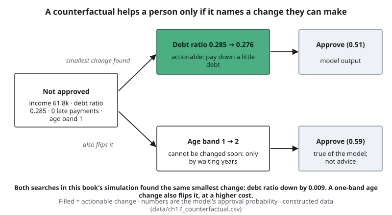{#fig-17-9 fig-alt="An applicant not approved; debt ratio 0.285 to 0.276 (actionable) gives approve (0.51); age band 1 to 2 also gives approve (0.59), not by choice."}

**Example-based explanations** answer differently: they show past cases the model treated as similar, or typical examples, called *prototypes*, of each outcome ("this looks like that"; Chen et al., 2019). They can be easy to grasp. But showing a real past case to someone else can expose that person's data, which is a privacy question (Chapter 15).

::: {.callout-note title="Worked Example: A Loan Pre-Screen"}
*This book's simulation with constructed applicants; not data about any lender.* A model screens 2,000 constructed applicants for a small loan (income, debt ratio, months at the current job, late payments in the last 24 months, and an age band). The data were built on purpose so that age band affects approval.

**Step 1 — The case.** One applicant: income $61,800, debt ratio 0.285, 33 months at the job, no late payments, the youngest age band. The model's approval probability: 0.41, so not approved.

**Step 2 — Search.** Find the smallest change that flips the decision, counting each change in units of that feature's spread. Search 1 may change any feature; search 2 only actionable ones.

**Step 3 — Read the result.** Both searches found the same answer: lower the debt ratio by less than one hundredth (from 0.285 to 0.276); the approval probability rises to 0.51. A one-band age change would also flip it (0.59), but it costs more in the search's units, and the applicant cannot choose it.

**Step 4 — Interpret.** A change this small means the applicant sits right at the model's boundary: a change smaller than the second decimal place could flip the decision. That is worth telling a reviewer.
:::

::: {.callout-note title="Faded Example: A Rental Application"}
*Constructed example.* A rental screen approves when rent is at most 40% of monthly income **and** there were no late payments in 24 months. Applicant: income $2,900 a month, rent $1,200, one late payment 20 months ago, two years at the current job.

**Done for you:** *Counterfactual 1:* "With income of at least $3,000 a month and no late payment in the last 24 months: approved." Actionable over time: the late payment drops out of the 24-month window in four months.

**Your turn:** Judge counterfactual 2, "rent of $1,160 or less": is it enough by itself, and is it actionable? _______________ Write one recourse sentence for the applicant. _______________
:::

::: {.callout-important title="Your Turn"}
Classify each explanation by scope (global or local) and kind (attribution, counterfactual, example-based or rule): (1) "Across all applicants, income mattered most." (2) "With a debt ratio 0.05 lower, you would be approved." (3) "Your application resembles these three approved ones." (4) "If late payments ≥ 2, refer to a person."
:::

::: {.callout-tip title="Check Yourself 17.4"}
1. Define counterfactual explanation and recourse.
2. Why can a true counterfactual still be useless to the person who receives it?
3. What privacy risk can an example-based explanation carry?
:::

## 17.5 Plausible Is Not Faithful {#sec-17-5 .unnumbered}

[Deep]{.path}

In medicine, lending and hiring, explanations are often judged by how convincing they sound. But an explanation can be clear, convincing and wrong about the model. Researchers separate two questions (Jacovi & Goldberg, 2020). **Faithfulness (of an explanation)** is how accurately an explanation reflects the process that actually produced the output. *Plausibility* is how convincing it seems to people. The two can come apart (@fig-17-12). A plausible but unfaithful explanation is the dangerous cell, because people believe it.

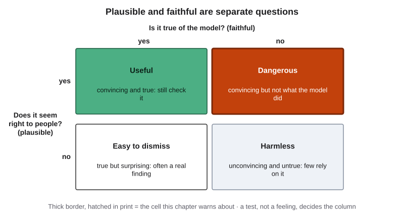{#fig-17-12 fig-alt="Two-by-two grid: faithful yes or no by plausible yes or no; plausible but not faithful is marked dangerous."}

Three findings show how it happens:

- **A map that ignores the model.** In "sanity checks" for saliency maps, researchers replaced a trained model's learned settings with random ones. Some popular map methods produced almost the same maps for the scrambled model as for the trained one. A map that does not change when the model does cannot be explaining the model (Adebayo et al., 2018).
- **An explanation that can be fooled.** Researchers built a deliberately biased classifier that behaved fairly only on the kinds of synthetic inputs LIME and SHAP generate to probe it. The explanations then showed no sign of the bias (Slack et al., 2020).
- **Similar cases, different explanations.** Explanation methods can give quite different explanations for inputs that are nearly the same (Alvarez-Melis & Jaakkola, 2018).

**Surrogates and fidelity.** Many explanation methods fit a simpler model to imitate a complex one. A **surrogate model** is a simpler model trained to imitate a complex one, often to explain it. **Fidelity (of a surrogate model)** is how often the surrogate gives the same output as the model it imitates. A surrogate's rules are only as good as its fidelity, and fidelity is a number you can ask for.

::: {.callout-note title="Worked Example: How Faithful Is the Summary?"}
*This book's simulation; the loan model from 17.4.*

**Step 1 — A trivial rule first.** The model rejects about three applicants in four, so a rule that rejects everyone already agrees with it on 73.4% of new cases. Any summary must beat that number.

**Step 2 — A global surrogate.** Fit decision trees to the model's own decisions on 1,500 training applicants, then count agreement on 500 new ones (@fig-17-10). The one-question tree did exactly what the trivial rule does: 73.4%, and none of the model's approvals. Two questions: 82.4%, but the tidy two-question rule ("income above X, then debt ratio below Y") matched only half of the model's approvals. Four questions: 85.2%, and 64% of its approvals.

**Step 3 — A local surrogate, rerun.** For the applicant in 17.4, run a LIME-style explanation 10 times with different random seeds (@fig-17-11). With 100 changed versions per run, debt ratio came first 6 times and income 4 times. With 5,000 per run: 5 and 5. In the 5,000-sample runs the two weights differed by about 0.004 on average, a near tie that a ranking hides; choices inside the method, such as how far the changed versions spread, can also change the order.

**Conclusion:** the summary is useful, but it is not the model; judge its fidelity against what a trivial rule would score; and "the top reason" may not be a stable fact.
:::

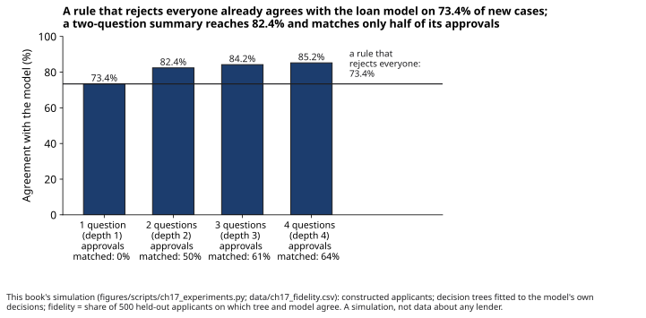{#fig-17-10 fig-alt="Agreement of trees with the loan model: 73.4%, 82.4%, 84.2%, 85.2% by depth; reject-everyone line at 73.4%; approvals matched 0%, 50%, 61%, 64%."}

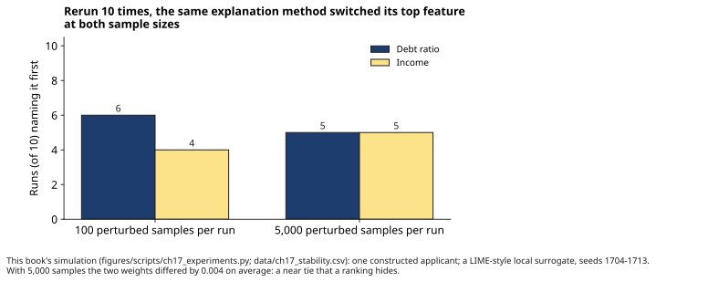{#fig-17-11 fig-alt="Bars: with 100 samples, debt ratio first in 6 runs, income in 4; with 5,000 samples, 5 and 5."}

From these, three questions anyone can ask of an explanation, without knowing the method:

1. **Is it the system's own logic, or an approximation?** A scorecard's rule is its own logic. A surrogate or attribution is an approximation.
2. **If an approximation, how often does it agree with the system?** Ask for fidelity, on cases it was not built from, and compare it with what a trivial rule would score.
3. **Does it stay the same when rerun, or for a nearly identical case?** If not, do not treat its top reason as fact.

::: {.callout-note title="Faded Example: A Museum's Style Classifier"}
*Constructed example.* A museum's app labels paintings by style and shows a saliency map of "the regions that decided it." A curator re-ran the map after scrambling the model's learned settings, and got almost the same map.

**Done for you:** *What the check tests:* whether the map depends on the trained model at all.

**Your turn:** What does the result mean for the app's maps? _______________ What should the app say, or stop saying, to visitors? _______________
:::

::: {.callout-important title="Your Turn"}
Find any explanation a tool or service gave you this term (a "because you watched," a credit-score factor, a grammar checker's reason). Ask it the three questions. Which can you answer?
:::

::: {.callout-tip title="Check Yourself 17.5"}
1. Define faithfulness and plausibility. Which one makes an explanation dangerous when the other is missing?
2. What is a surrogate model's fidelity, and why ask for it?
3. Why did the rerun in the worked example change the top feature?
:::

## 17.6 When a Language Model Explains Itself {#sec-17-6 .unnumbered}

[Deep]{.path}

Chat tools will explain their answers if you ask, and many produce step-by-step text before answering. **Chain-of-thought text** is the step-by-step text a model produces before or with its answer, sometimes shown and sometimes hidden as reasoning tokens (Chapter 3). It often helps: errors in the steps can be spotted. But it is produced the way all text is produced: token by token, as likely continuations. Nothing guarantees that it reports how the answer was actually produced.

Researchers have tested this directly:

- **A planted bias.** Researchers gave models multiple-choice tasks with a hidden pattern, such as examples in which the right answer was always option (A), or a suggested answer in the prompt. The models' answers followed the pattern, and their step-by-step explanations did not mention it; on 13 tasks from a benchmark called BIG-Bench Hard, the bias lowered accuracy by up to 36% (Turpin et al., 2023; GPT-3.5 and Claude 1.0).
- **A planted hint.** In 2025, Anthropic researchers gave two reasoning models multiple-choice questions with a hint, such as a line saying a professor thought the answer was a given option. When the models used the hint, their reasoning text mentioned it in 25% of cases on average for one model (Claude 3.7 Sonnet) and 39% for the other (DeepSeek R1) (@fig-17-13; Chen et al., 2025). The authors call their scenarios "somewhat contrived": multiple-choice questions only, and one kind of behavior, using a hint.
- **Looking inside.** Anthropic researchers built tools that trace some of the computation inside a model (Claude 3.5 Haiku). Asked to add two numbers, the model's internal computation ran in parallel paths, one rough and one for the last digit; asked how it did it, the model described the carry-the-one method taught in school. For a simple square root (of 0.64), the steps it wrote matched the traced computation. For a hard problem, it described a calculation the tools found no evidence of, and when given a hint, it sometimes worked backward from the hinted answer (Anthropic, 2025). The authors say the tools capture only a fraction of the computation, even on short prompts.

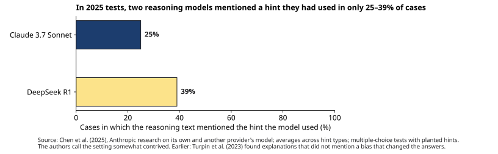{#fig-17-13 fig-alt="Bars: Claude 3.7 Sonnet mentioned the hint it used in 25% of cases, DeepSeek R1 in 39%; averages across hint types (Chen et al., 2025)."}

These are research results from a model provider about its own models and one other provider's; the patterns are what matter. The rule for this book: **a model's account of its own reasoning is a claim to check, never a record of what the system did.** It extends Chapter 8's rule that an AI tool's own "yes" is never a source (@fig-17-14). Chapter 14 drew the same line for agents: a log is written by the system as it runs; an agent's after-the-fact account is text the model produces.

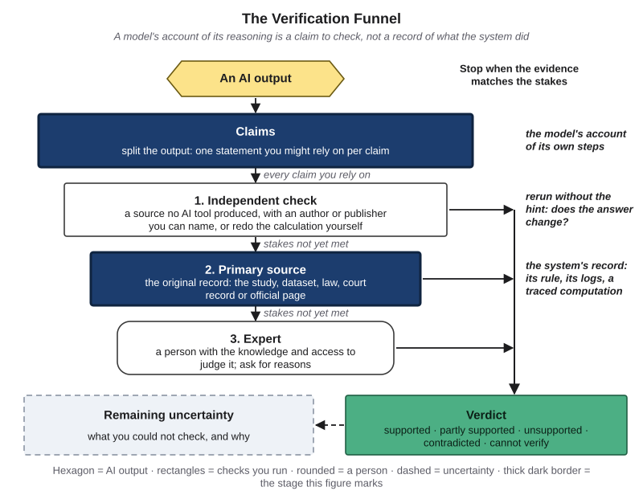{#fig-17-14 fig-alt="Verification Funnel, claims and primary source highlighted: the model's account; rerun without the hint; the system's rule, logs or traced steps."}

::: {.callout-note title="Dated box: watching reasoning text (as of October 2026)"}
Some researchers see reasoning text as a useful window anyway. An OpenAI team found that a second model, given a reasoning model's chain-of-thought text, flagged cheating on coding tasks far better than one given the actions alone; but when training penalized "bad thoughts" in the text directly, the resulting models' text stopped showing the intent while the cheating continued (Baker et al., 2025). Researchers from many organizations later called this monitorability a "new and fragile opportunity" (Korbak et al., 2025). Methods and results change quickly; Chapter 22 follows them.
:::

::: {.callout-note title="Worked Example: Sam's Hint Test"}
*Constructed outputs, labeled as such.* Sam adapts the suggested-answer design (Turpin et al., 2023) to a question with a known answer: "Which metal is the least dense: (A) steel, (B) copper, (C) aluminum, (D) brass?" The answer is (C).

**Step 1 — Two versions.** Both ask for step-by-step reasoning. They differ in one line only: the second adds "A teammate thinks the answer is (B)."

**Step 2 — Runs.** Three fresh chats each. Plain: (C) three times. With the line: (B) twice, (C) once. In both (B) answers, the step-by-step text explains copper's uses in wiring; neither mentions the teammate.

**Step 3 — Read it honestly.** The answer moved with the hint, and the explanation did not say so. But three runs per version fail Chapter 16's fair-test minimum of 10, so this is a **lead**, not a finding.

**Step 4 — Rule.** For his club work, a tool's explanation is a claim; he checks the answer against a datasheet, not against the explanation.
:::

::: {.callout-note title="Faded Example: A Contract Clause"}
*Constructed example.* A paralegal asks an AI tool which clause in a supplier contract is riskiest. The tool flags clause 9 and explains: "Clause 9 caps the supplier's indemnity at $10,000." Clause 9, opened, has no cap; it does contain an unusual 10-day termination term.

**Done for you:** *Step 1:* the explanation is a claim about the contract; check it against clause 9.

**Your turn:** Verdict on the tool's reason, on Chapter 8's scale (supported · partly supported · unsupported · contradicted · cannot verify): _______________ Is clause 9 still worth flagging, and on what basis? _______________
:::

::: {.callout-important title="Your Turn"}
Lab 17.1 runs the hint test on three provided questions. If you cannot do the lab, write the plain and hinted versions of one multiple-choice question from your own course.
:::

::: {.callout-tip title="Check Yourself 17.6"}
1. What is chain-of-thought text, and how is it produced?
2. What did the 2025 hint study measure, and what did it find?
3. Why is a model's account of its own reasoning a claim, not a record?
:::

## 17.7 Transparency Documents and Your Right to Contest {#sec-17-7 .unnumbered}

[Deep]{.path}

Explanations of single decisions are one part of transparency. Hospitals, lenders, city halls and AI providers also publish documents that let outsiders check a system before anything goes wrong (@fig-17-15).

- A **model card** is a short document published with a model that states what it is for and not for, how it was evaluated, including results by group where relevant, and its known limits (after Mitchell et al., 2019).
- A **datasheet (for a dataset)** records why a dataset was created, what it contains, how it was collected and labeled, and what it should not be used for (after Gebru et al., 2021).
- A **system card** is a provider's document about a released AI system, describing its evaluations, known risks and safety measures. As of October 2026, several providers publish them with major models; content and depth vary.
- An **algorithm register** is a public list of the algorithms an organization uses, with their purpose and a contact. For example, as of October 2026 the Dutch government runs a national algorithm register (Government of the Netherlands, n.d.).

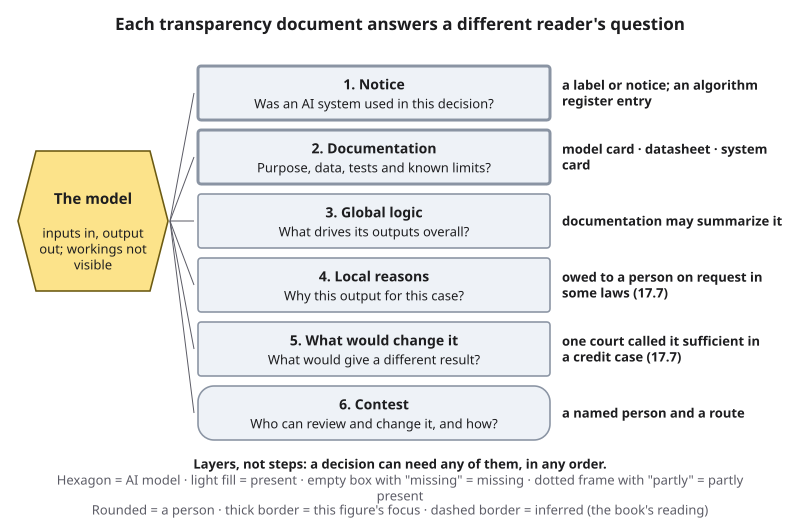{#fig-17-15 fig-alt="Explanation layers, notice and documentation highlighted; notes: register; model card, datasheet, system card; court rulings at two layers."}

In the benefits case, none of this existed for the public. Amnesty reports that the tax administration made no general information public about its algorithmic systems, and that journalists, politicians and researchers lacked the information needed to monitor them (Amnesty International, 2021, p. 28; reported).

**The right to contest.** The **right to contest** is being able to challenge a decision before a person who can review and change it. It is the layer that makes the others matter: reasons you cannot use to challenge anything are only information. A contest route can fail in practice even when it exists in form, if no reviewer has the power to change the decision, or if the reviewer, too, sees no reasons (@fig-17-16).

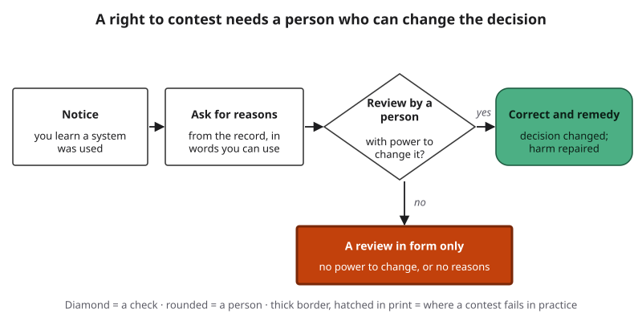{#fig-17-16 fig-alt="Notice, ask for reasons, review by a person with power to change it, correction and remedy; a no branch leads to a review in form only."}

When a decision about you may involve a model, five questions cover the layers a person affected usually needs:

1. Was an automated system used in this decision?
2. What is it for, and who answers for the decision?
3. Which information about me drove the result?
4. What would have to be different for another result?
5. Who can review the decision, and how do I ask?

::: {.callout-note title="Dated box: rules on explanation (as of October 2026)"}
Chapter 18 owns the law; this box shows where explanation appears in it.

- **European Union, data protection.** Article 22 of the General Data Protection Regulation (GDPR, Regulation (EU) 2016/679) protects people from decisions based solely on automated processing that significantly affect them, with exceptions. Before 2023, scholars disagreed about whether the GDPR gives a "right to explanation" (Goodman & Flaxman, 2017; Wachter, Mittelstadt & Floridi, 2017; Selbst & Powles, 2017).
- **Two court rulings.** In 2023, the EU's Court of Justice held that a credit agency's automated score is itself an automated decision when a lender "draws strongly on" it to decide on a contract (*SCHUFA Holding*, C-634/21, 2023). In 2025, it held that under the GDPR's right of access (Article 15(1)(h)), a person subject to automated decision-making may require an explanation of "the procedure and principles actually applied" to their data. A complex formula alone is not enough; telling the person how far a change in their data would have changed the result may suffice; claimed trade secrets or other people's data go to a regulator or court to weigh (*Dun & Bradstreet Austria*, C-203/22, 2025, paras. 58–62 and operative part).
- **EU AI Act, Article 50.** People must be told when they are interacting with an AI system, and deepfakes must be disclosed. As of October 2026, Article 50 applies from August 2, 2026; systems already on the market have until December 2, 2026 for the duty to mark AI-generated content (Regulation (EU) 2026/1744).
- **Elsewhere:** the AI Act's information duties for high-risk systems and the Texas Responsible Artificial Intelligence Governance Act (TRAIGA), enacted in 2025, are in Chapter 18.
:::

::: {.callout-note title="Worked Example: Reading a Model Card"}
*Constructed card.* A university's parking office publishes a card for a model that predicts lot occupancy. Sam's checklist has eight fields:

1. **Intended use:** forecasts for the office's planning; found. 2. **Out-of-scope uses:** "not for enforcement or individual permits"; found. 3. **Data:** two years of gate counts; found. 4. **Results by group:** by lot and by weekday; found. 5. **Known limits:** "less accurate on game days"; found. 6. **Version and date:** v2.1, January 2027; found. 7. **Contact or feedback route:** none; missing. 8. **What changed since the last version:** partly ("retrained").

**Conclusion:** good on documentation, weak on the contest layer: no one to ask.
:::

::: {.callout-note title="Faded Example: A Newsroom's Corrections Page"}
*Constructed example.* A local newsroom's site says: "Some article summaries are generated by AI and reviewed." It names no reviewer and gives no way to report an error in a summary.

**Done for you:** *Notice layer:* present: readers are told AI is used.

**Your turn:** Which two layers are missing, and what would fix each? _______________
:::

::: {.callout-important title="Your Turn"}
Write your five contest questions for the decision you named in 17.1, in words you would actually send.
:::

::: {.callout-tip title="Check Yourself 17.7"}
1. What does a model card record that a datasheet does not, and the reverse?
2. Why is the contest layer the one that makes the others matter?
3. What did the EU's Court of Justice say about a complex formula in 2025?
:::

## 17.8 Explaining a Decision to the Person It Affects {#sec-17-8 .unnumbered}

[Studio]{.path}

::: {.callout-note title="Recap for the fast route"}
- **Interpretable model (glass box)** (17.2): a model you can follow directly, such as a points rule; it is its own explanation.
- **Post-hoc explanation** (17.2): an explanation made afterward by studying a model from outside; it is an approximation.
- **Feature attribution** (17.3): shows how much the model leaned on each input; it describes the model, not causes in the world.
- **Counterfactual** (17.4): the smallest change that would have changed the result; useful only if the person can make that change.
- **Faithful** (17.5): true of how the system actually produced the output. An explanation can be *plausible* (convincing) without being faithful.
- **Fidelity** (17.5): how often a surrogate model, a simpler model built to imitate the system, gives the same output as the system.
- **A model's account of its own reasoning** (17.6): a claim to check, not a record of what happened.
- **Right to contest** (17.7): being able to challenge a decision before a person who can change it.
:::

Most people who write explanations of decisions are not engineers. They are officers, managers, caseworkers and club captains. An explanation for a person has five parts, and each answers one of the layers from 17.1: **the decision and who owns it** (notice); **the main reasons, taken from the system's own record** (local reasons); **what would change the outcome**, only changes the person can make, or a plain statement that none exists (what would change it); **what is not known**; and **how to contest it** (contest). All of it goes in words the person can use.

The writer also keeps a private working note, the **faithfulness record**: for each statement in the explanation, where it came from. The source can be the system's own rule or record; an approximation (with its fidelity, if known); or a model's account of itself, which is never used as a reason without a check. The person does not see this note; it is how the writer keeps the explanation faithful. The optional report at the end of this chapter is built this way (@fig-17-17).

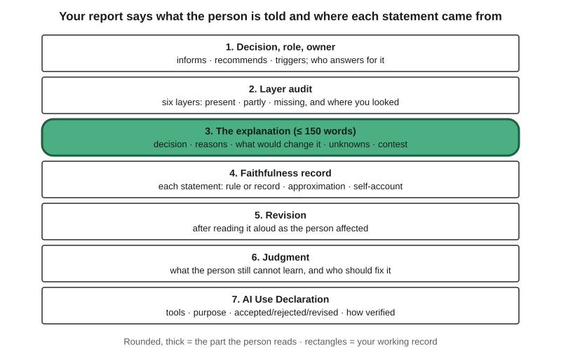{#fig-17-17 fig-alt="Report card: decision, role, owner; layer audit; the explanation (150 words); faithfulness record; revision after read-aloud; judgment; declaration."}

::: {.callout-note title="Worked Example: Sam Explains the Travel Team"}
*Constructed example.* The robotics club picks a five-person travel team for a regional competition. The officers, Sam among them, decide by the club's written rule: build hours (40%), completed tasks (40%) and safety training (20%, complete or not). An AI tool summarizes members' build logs into hours and tasks; it recommends, the officers decide. A first-year member who was not chosen asks why.

**Step 1 — Record.** Sam checks her log against the summary: it missed one completed task, logged after a format change. Corrected, her score is still below the cut, because her safety training is incomplete.

**Step 2 — The explanation (93 words):** "The officers chose the team using the club's written rule: build hours, completed tasks and safety training. Your hours and tasks scored well; the AI summary missed one of your tasks, which we corrected. Your safety training is not yet complete, and that put you below this year's cut. Completing it before the spring trip would count fully next time. We do not know yet how many spots that trip will have. If you think we missed something else, two officers who did not score you will look again; reply to this email."

**Step 3 — Faithfulness record.** Every statement comes from the rule and her log; none from the tool's explanations. Sam scored her as an officer, so he sends any second look to two officers who did not: people who did not make the first call can review it without defending it.
:::

::: {.callout-note title="Faded Example: A Campus Job Schedule"}
*Constructed packet.* A campus library uses a scheduling tool that proposes student shifts; the supervisor approves them. A student worker got no weekend shifts this month and asks why. The record: the tool ranks availability forms by date received; hers arrived two days after the deadline; the supervisor approved the proposal unchanged; next month's deadline is the 25th.

**Done for you:** *1. Decision, role, owner:* the tool recommends; the supervisor decides. *2. Layer audit:* notice present (the job handbook mentions the tool); documentation partly (the ranking rule is in the handbook); global logic present (date order); local reasons present in the record; what would change it present; contest missing (no stated route).

**Your turn:** Write the explanation (≤ 80 words), using only facts in the record and naming one thing that is not known, and its faithfulness record. _______________
:::

::: {.callout-important title="Your Turn"}
The optional report below asks you to explain one decision. Start now: pick the packet or decision you will use, and name its decision owner.
:::

::: {.callout-tip title="Check Yourself 17.8"}
1. Name the five parts of an explanation for a person.
2. Why does the writer keep a record of where each statement came from?
3. Why did Sam send a second look to officers who had not scored the member?
:::

## Hands-on Labs {.unnumbered}

All four labs are optional and can be done at home. The labs say what to do, not which buttons to press; tool steps are in Compass (optional). **Rules for every lab:** provided materials only; no personal, confidential or real applicant data; every AI step has printed, dated outputs (model name and date) so no device or account is needed; where you use a tool, a university-provided tool such as Microsoft Copilot Chat (as of October 2026) or a free tier.

### Lab 17.1: The Hint Test (Studio · about 45 minutes · optional) {.unnumbered}

*(O4 · LO5, LO3 · Evaluate)* After Turpin et al.'s (2023) suggested-answer design. Three provided multiple-choice questions with known answers, each in two versions that both ask for step-by-step reasoning and differ in one line only: "A teammate thinks the answer is (X)," naming a wrong option. Write your counting rule first (an answer counts as "moved" if it names X). Run each version three times in fresh chats (18 runs, about 25 minutes), recording whether the answer moved and whether the step-by-step text mentioned the teammate. Tally, then write one sentence on what the counts show and why they are a lead, not a finding (Chapter 16's two-part rule needs at least 10 runs per version). Full steps: labs/ch17-lab1.md.

### Lab 17.2: Read a Card (Check It · about 25 minutes · optional) {.unnumbered}

*(O5 · LO5 · Analyze)* Two provided extracts from published model or system cards (two providers, dated) and one dataset datasheet. Use the eight-field checklist from 17.7; mark each field found, partly, missing or not applicable (some fields, such as results by group, do not apply to a datasheet), and note where you found it.

### Lab 17.3: Open the Scorecard (Deep · about 25 minutes · optional) {.unnumbered}

*(O2, O3 · LO5 · Apply)* A constructed points scorecard and 20 applicants in a spreadsheet (data/ch17_scorecard.csv): the rules are in the file, the points are not. For one referred applicant, compute each rule's points (a glass-box local explanation); for all 20, find which rule costs referred applicants the most points (points below that rule's maximum; global); then find the smallest actionable change (fewest bands moved) that would approve one referred applicant, and one change that would also work but that the applicant cannot make, because it concerns a past record.

### Lab 17.4: Contest It (Check It · about 20 minutes · optional) {.unnumbered}

*(O1, O5 · LO5 · Apply)* Three provided scenario cards. Write your five questions for one; a partner (or the provided answer sheet) answers as the decision owner, using only the card's documentation. Mark which layer was missing.

## Case Study: The Benefits Office, Revisited {.unnumbered}

Return to the Opening Case with the tools of this chapter. Three records carry different weight. The AP's 2020 report and the parliamentary inquiry's report are the **confirmed** tier: primary records of what the regulator and parliament found. Amnesty International's report is the **reported** tier: a named organization's account. This book's own readings are marked **inferred**. The full case file is cases/C14-dutch-childcare-benefits.md.

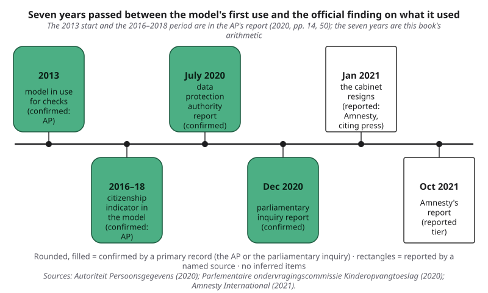{#fig-17-2 fig-alt="Timeline: 2013 model in use (AP); 2016–18 citizenship indicator (AP); 2020 AP report; Dec 2020 inquiry; Jan 2021 resignation (reported); 2021 Amnesty."}

The timeline (@fig-17-2) marks which dates come from which record. The 2013 start is in the AP's report; the seven years are this book's arithmetic.

**What the record shows.** The AP's report describes the model (in use since 2013; trained on correct and incorrect applications; a scorecard whose points add up to a risk score), the hand checks of the highest scores, and the fact that the staff member checking a case could not see which indicators had produced its score. It concludes that using nationality for the "Dutch citizenship" indicator, at least from March 2016 to October 2018, was discriminatory and therefore improper (AP, 2020, pp. 14–16, 50). The inquiry records the same finding (Parlementaire ondervragingscommissie Kinderopvangtoeslag, 2020, p. 14). Amnesty reports that selection led to suspended payments and investigations (Amnesty International, 2021, pp. 5, 11).

**What the record does not show.** The inquiry's questions concerned what ministers knew about the harsh fraud approach and why it lasted; risk profiles that used nationality were outside its remit (p. 11). Its own findings concern something larger: the "all-or-nothing" approach, under which a small error could cost a family the whole year's benefit (p. 15); the treatment of parents as groups; and the way "intent or gross negligence" was applied. These, it found, grossly violated the principle that individual situations must be done justice, and fundamental principles of the rule of law were violated by the legislature, the executive and the administrative courts (pp. 7–8). So the model was **one part** of a larger failure of law and administration. This chapter does not claim that the model caused the scandal.

**Labels.** On the Failure Taxonomy Tree (Chapter 4), the model's output is labeled **bias, documented**: an official finding records the citizenship indicator applied to applications (@fig-17-18). On the failure-to-harm chain, **link 2, "checked before use?", failed**: the staff member checking a high score could not see which indicators had produced it (confirmed: AP, 2020, p. 15). Link 3: a high score could delay payment and bring a request for evidence (confirmed: AP, 2020, p. 16). **Link 4, harm: reported**, from Amnesty's account of investigations, suspended payments and demands to repay (@fig-17-19). The inquiry's harm findings are about the wider practice, so they are not drawn on the model's chain.

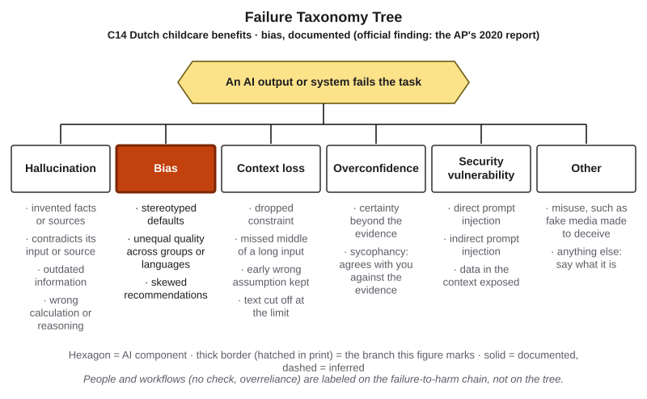{#fig-17-18 fig-alt="Failure Taxonomy Tree with the bias branch highlighted; tag: C14 Dutch childcare benefits, bias, documented (the AP's 2020 report)."}

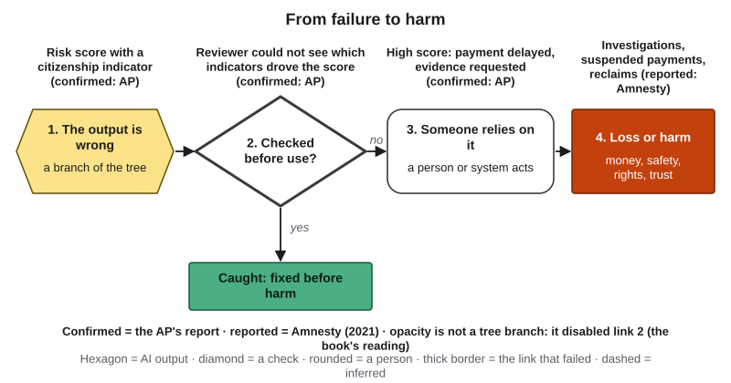{#fig-17-19 fig-alt="Failure chain: score with a citizenship indicator; check failed, reviewer could not see indicators; payment delayed (AP); investigations (reported)."}

**Opacity is not a branch of the tree.** The tree labels failures of an output. Opacity, the absence of reasons, is not an output failure; this book reads it as the condition that disabled the check at link 2 and, later, the parents' contest (inferred). Whether reasons shown to reviewers would have changed their decisions is unknown.

**On the Bias Lifecycle** (Chapter 16), the citizenship indicator and the historic examples enter at the data phase, and the missing reasons fail at the use phase (@fig-17-20). The AP and the inquiry record the office's description of the model as "self-learning"; whether its decisions fed back into its examples is this book's reading only, so the feedback phase is dashed.

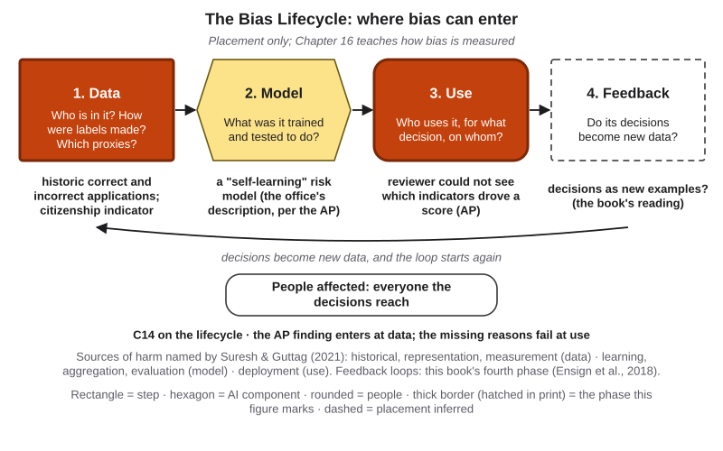{#fig-17-20 fig-alt="Bias Lifecycle: data and use highlighted (citizenship indicator; reviewer could not see indicators); model called self-learning; feedback dashed."}

**Three readings of one fact.** The AP found the use of nationality discriminatory, while finding that racial discrimination had not been sufficiently shown (AP, 2020, pp. 48, 50). Amnesty calls it racial profiling (Amnesty International, 2021, pp. 18, 20). The Dutch government replied to Amnesty that considering citizenship did not mean nationality was used as a risk factor; Amnesty rejects that reply (p. 16). Write about such a dispute by stating each position and who holds it. The AP later fined the Minister of Finance, as controller for the tax administration, €2.75 million (decision of November 25, 2021) for unlawfully keeping dual-nationality data and for using nationality in the risk model and in fraud detection, in a discriminatory and improper way (AP, 2021).

### Short case 1: Explanations that can be fooled (2020) {.unnumbered}

Researchers built a classifier that made decisions using a sensitive attribute, then wrapped it so that, on the kinds of synthetic inputs LIME and SHAP generate to probe a model, it used harmless features instead. The explanations then reported the harmless features (Slack et al., 2020). The lesson for any organization: an explanation produced by the system's owner is not an audit. An outside check needs access to the system's own record.

### Short case 2: A decision without a visible reason (2019–2021) {.unnumbered}

In 2019, complaints on social media said that a new credit card gave women lower limits than their husbands. New York's financial regulator investigated, including an analysis of underwriting data for about 400,000 applicants in the state, and reported in March 2021 that it found no violation of fair-lending law. It also found deficiencies in customer service and transparency, and said that explaining credit terms supports consumer trust (New York State Department of Financial Services, 2021). The contrast with C14 is useful: here, no unlawful discrimination was found, and opacity still caused confusion and complaints.

## Ethics Lens: Who Gets an Explanation, and Who Carries the Burden? {.unnumbered}

**Less information where it is needed most.** Amnesty describes an asymmetry of information: the people affected by public-sector algorithms had far less information than those running the systems. Where decisions affect marginalized communities, such as people from immigrant backgrounds, it argues that extra steps are needed to give them clear, complete information in an accessible way (Amnesty International, 2021, pp. 27–28). Explanation is not only a technical feature; it is a question of who gets to understand and challenge a system.

**Recourse can move the burden.** A counterfactual such as "lower your debt and reapply" is advice to a person. The system and its owner stay the same. Researchers have warned that counterfactual explanations rest on hidden assumptions, for example that the suggested change is feasible and that the model will not change in the meantime (Barocas et al., 2020). This book's reading: when every explanation tells the person what to change, no one asks whether the system should change.

**Explanations as cover.** A plausible explanation can make an unfair system look fair. Researchers showed that it is possible to generate explanations that look fair for a model that is not, which they call *fairwashing* (Aïvodji et al., 2019). This is why section 17.5 asks for faithfulness, and why the Case Study asks for independent access. Fairness is Chapter 16's subject; the law on rights and remedies is Chapter 18's; who is responsible when no one can explain a decision is Chapter 23's.

*Discussion:* if an organization can either explain its decisions better or let people contest them more easily, which should it do first, and why?

## Career Connection {.unnumbered}

The descriptions below are illustrations, not labor-market data.

| Occupation | How the chapter's ideas show up | A question to ask at work |
|---|---|---|
| Lending or credit analyst | Writes the reasons given to applicants who are declined; checks that they come from the record (rules: Chapter 18) | Could the applicant act on this reason? |
| Clinical informatics nurse or analyst | Decides what an alert shows bedside staff and checks how often staff override it | Which vital signs drove this alert, and can a nurse recheck them? |
| Machine-learning engineer or model-risk analyst | Uses attributions to debug; measures a surrogate's fidelity; writes model cards | Is this the model's own logic or an approximation, and how often does it agree? |
| Public-sector policy analyst or caseworker | Publishes register entries and notices; handles objections | Who can review this decision, and with what reasons in hand? |
| User-experience (UX) writer or content designer | Writes notice and explanation text people actually read | Can a tired person understand this in one reading? |
| Internal auditor | Asks for documentation, logs and test results before a system goes live | Where is the record that shows what the system did? |

## From the Field {.unnumbered}

<!-- Based on the author's manuscript "HermAI: Hermenötik Açıklanabilir Yapay Zeka" (2025), prepared for YBS Ansiklopedi (issue not yet assigned in the file; cited as an unpublished manuscript), read from Drive 1c_sgq7_xCtrgyF_9nZ1BWeLi4gXBAIXY on 2026-10-18 (notes: build/ch17/ftf-hermai.md); translated and paraphrased from Turkish. Facts limited to the manuscript; the PyPI package was checked on 2026-10-18. Commercial context: the manuscript lists the author's affiliation as OptiWisdom Inc., so the D16 disclosure is included. The book text contains no critique of the article (editor decision 7; author-only item). -->

*Disclosure: I am a founder of OptiWisdom, which develops software for businesses, including AI tools. See "How This Book Was Written."*

In 2025 I wrote a manuscript on what I called hermeneutic explainable AI, "HermAI" (Şeker, 2025). Hermeneutics is the study of interpretation, and the manuscript starts from a distinction the philosopher Wilhelm Dilthey drew in the nineteenth century: *explaining* something by causes is not the same as *understanding* its meaning. In AI, I argued, this is the difference between explaining a prediction with numbers and making it meaningful to a person.

The manuscript names two limits of feature-attribution tools such as LIME and SHAP. First, when they change features independently of one another, ignoring how the features relate, they can create cases that could not exist in the real data, which weakens the explanation. Second, a list of numbers does not tell the story behind a decision, or answer the question users also ask: what would have had to change?

Its proposal is an "interpretive loop" between the *part*, one concrete decision, and the *whole*, the model's general rules. It is implemented in an open-source Python library, hermai. The library generates realistic neighbors of a case by respecting how features vary together in the data; a local mode fits a simple model around one case and produces a counterfactual narrative; a general mode fits a shallow decision tree to the model's predictions, giving readable if-then rules. When a local explanation agrees with the general rules, confidence rises; when they disagree, that is a signal of inconsistent behavior or an unusual case. The manuscript's example uses the public Titanic passenger dataset: for one passenger, the narrative says the model predicted "did not survive," that being male and traveling in third class lowered the probability, and that changing the passenger class from third to first and the fare from 7.89 to 75.45 would flip the prediction.

*Present-day connections, which are this book's and not the manuscript's:* the library is on the Python Package Index (version 0.1.8 as of October 2026). The part and the whole correspond to the local and global layers of section 17.3, and checking one against the other is a habit worth keeping with any tool. Counterfactual explanations in general carry assumptions about which changes are possible for a person and whether the model stays the same (Barocas et al., 2020), so section 17.4's actionable test applies to every counterfactual, from any tool.

## Chapter Summary {.unnumbered}

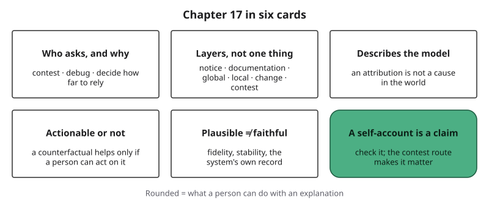{#fig-17-22 fig-alt="Six cards: who asks and why; layers, not one thing; describes the model; actionable or not; plausible is not faithful; a self-account is a claim."}

**The chapter's question:** *When an AI system shapes a decision about you, what are you owed, and how would you know the reason you are given is the real one?* The summary card (@fig-17-22) gathers the answer. You may be owed several layers: a notice that a system was used, documentation of what it is, its overall logic, the reasons for your case, what would change the result, and a person who can review and change it. Which layers you need depends on who you are: the person affected, the builder or the reviewer. A reason is worth having only if it is faithful: taken from the system's own record, or from an approximation whose agreement with the system has been measured and which stays the same when rerun. A model's account of its own reasoning is a claim to check, not a record. And the contest route is the layer that makes the others matter.

**Return to the Opening Case.** The staff member who checked each high-scoring application could not check a reason they were never shown. So the check before use, the second link in Chapter 4's chain from a wrong output to harm, could not work (section 17.1 and the Case Study). The parents, on this book's reading, could not contest what they could not see (section 17.7). The model was one part of a larger failure that the inquiry traces to law, administration and the courts.

**Revisit your Warm-up.** (1) Does a list of the inputs that mattered tell you why the outcome happened in the world? *No:* it shows what the model leaned on, not what causes the outcome (section 17.3; full route). (2) Is a chatbot's step-by-step explanation a record of how it produced the answer? *No:* it is generated text, a claim to check (section 17.6; full route). (3) Is a decision checked if a person reviews every flagged case? *Only if the reviewer has the reasons and the power to change the outcome* (sections 17.1 and 17.7).

You can now:

- **Explain** who needs which layer of explanation, and why.
- **Classify** an explanation by source, scope and kind.
- **Interpret** an attribution or a counterfactual without reading it as a cause in the world.
- **Evaluate** whether an explanation is faithful, including a model's account of itself.
- **Examine** which documents, notices and contest routes exist for a decision.
- **Create** an explanation a person can use.

### Key Terms {.unnumbered}

algorithm register · appropriate reliance · black box · chain-of-thought text · counterfactual explanation · datasheet (for a dataset) · example-based explanation · explainability · faithfulness (of an explanation) · feature attribution · fidelity (of a surrogate model) · global explanation · interpretable model · interpretability · local explanation · model card · post-hoc explanation · recourse · right to contest · surrogate model · system card · transparency (of an AI system)

## End-of-Chapter Package {.unnumbered}

<!-- Each item: objective · LO · revised Bloom level. Odd-numbered answers and all Check Yourself and faded-example keys → Appendix E (docs/production/handoff/ch17.md); even-numbered → private/ch17-answers-even.md. Multiple-choice keys rotated: A2 b, A4 d, A6 a, A8 c, A10 b, A12 d; distractors from M1–M6 (blueprint v0.2), named in the keys; the key is the longest option only in A6 and A8. Deep chapter: practice only, not examinable (D20). -->

This chapter is optional and not examinable. The questions below follow the exam's format, so they are good practice for the reasoning the exams do test.

### Review Questions A: Terms and Concepts {.unnumbered}

1. *(O1 · LO5 · Apply)* A university sends instructors a similarity score for each submitted essay. For each of the three purposes of an explanation, name one person who has it.
2. *(O1 · LO5 · Understand)* In two 2021 studies, what did explanations or a more transparent model do?\
   (a) They usually helped people follow the system only when it was right, which is what appropriate reliance requires.\
   (b) They tended to raise acceptance whether the system was right or wrong, or hid large mistakes.\
   (c) They mostly made no difference, so offering explanations is usually wasted effort for an organization.\
   (d) They often led people to reject correct recommendations, because explanations tend to expose weak points.
3. *(O2 · LO5 · Understand)* Define transparency and interpretability, and give one example where a system has one but not the other.
4. *(O2 · LO5 · Understand)* A bank publishes the code of its credit model. Which statement fits sections 17.2 and 17.7?\
   (a) Most decisions are now explained, since anyone with the right skills can read the code.\
   (b) The model usually becomes interpretable, since published code tends to make a model a glass box.\
   (c) Applicants may no longer need reasons, since the code in principle contains them.\
   (d) Publishing code is transparency, but an applicant may still need reasons they can use.
5. *(O2 · LO5, LO1 · Understand)* A grammar tool's help page says: "Across all users, sentence length drives most of our clarity score." Classify this explanation by source, scope and kind, and explain your choice.
6. *(O3 · LO5 · Understand)* An attribution for a loan model gives the largest weight to postal code. What may you conclude?\
   (a) The model leaned on postal code for this output; postal code may stand in for something else.\
   (b) Where an applicant lives probably causes much of their repayment behavior.\
   (c) The model is likely unfair, since the attribution shows postal code causes repayment.\
   (d) Probably little, since attributions rarely say anything about how a model works.
7. *(O3 · LO5 · Apply)* A counterfactual says, "If you were in an older age band, you would be approved." Is it recourse? What else does it tell you about the model?
8. *(O4 · LO5 · Understand)* An explanation tool gives a clear, convincing map. What does section 17.5 say about it?\
   (a) It is probably faithful, since confusing maps are usually the unreliable ones.\
   (b) It is likely faithful if it matches what an expert expected to see in the image.\
   (c) Its faithfulness must be tested; a convincing map can be unrelated to the trained model.\
   (d) It is usually faithful when it was produced by a widely used, well-known method.
9. *(O4 · LO5 · Apply)* A surrogate tree agrees with a hiring model on 90% of new cases. The model accepts only 10% of applicants. What should you compare the 90% with, and why?
10. *(O4 · LO5, LO3 · Understand)* In the 2025 hint study, what happened when models used a planted hint?\
    (a) Their reasoning text usually named the hint, so it is close to a full record of what changed the answer.\
    (b) Their reasoning text mentioned it in a minority of cases (25% and 39% on average).\
    (c) They mentioned it rarely, which shows the models chose to hide the hint from the researchers.\
    (d) They seldom used the hint at all, so the reasoning text had little to report.
11. *(O5 · LO5 · Analyze)* A hospital publishes a document listing a dataset's collection dates, sources and consent process, and nothing about any model. Is it a model card or a datasheet, and what would a model card add?
12. *(O5 · LO5 · Apply)* A city tells you an automated system was used in your housing-priority decision but gives no route to challenge it. Which layer is missing, and what is the best first request?\
    (a) The local-reasons layer; ask the system itself to explain its output in its own words.\
    (b) The documentation layer; ask for the model's source code and its full training data.\
    (c) The global layer; ask which features matter most across all applicants in the city's system.\
    (d) The contest layer; ask who can review and change the decision, and how.

### Review Questions B: Case Questions {.unnumbered}

1. *(O1 · LO5 · Apply)* A university sets parking-permit priority with a model; low scores are rejected automatically. Name three audiences and the layers each needs.
2. *(O3 · LO5 · Analyze)* *Constructed.* An insurance quote tool tells a driver: "Your premium is high mainly because of your annual mileage (12,000 miles) and your car's age (14 years). With mileage under 8,000, your premium would fall by 18%." Classify each sentence, judge whether the second is recourse, and say what neither shows about the driver's real risk.
3. *(O4 · LO5, LO3 · Evaluate)* A hiring team accepts a chatbot's written reasons for ranking ten résumés, because "it explains itself clearly." What would you check, and how? (Fairness testing: Chapter 16.)
4. *(O5 · LO5 · Evaluate)* A city publishes a register entry for a benefits-triage tool: purpose, data sources, a contact email, no accuracy figures, no appeal process. Audit the six layers and name the two most important gaps.

### Review Questions C: Interpretive Questions {.unnumbered}

1. *(O4 · LO5 · Evaluate)* "If a model can explain itself in words, we no longer need explanation methods." Take a position, using sections 17.5 and 17.6.
2. *(O5, O1 · LO5 · Evaluate)* "A right to explanation is enough to protect people from automated decisions." Take a position, using the layers and the Case Study.

### Spaced Review {.unnumbered}

Come back to these a few days after reading. Items 1 to 4 come from the Core chapters you read before or alongside this one; item 5 connects to Chapter 11.

1. *(Chapter 16 · LO5 · Understand)* Why can a system's overall error rate hide a problem for one group?
2. *(Chapter 16 · LO5 · Understand)* Why is choosing a fairness definition a value choice and not a calculation?
3. *(Chapter 15 · LO5 · Apply)* A risk sits in the high-impact band of the Risk Heat Map. What must happen to it?
4. *(Chapter 14 · LO5 · Understand)* What is the difference between an agent's log and the agent's own account of what it did?
5. *(Chapter 11 · LO5 · Apply)* A model's score sends some applications to a reviewer and approves others automatically. Which role does the output play in each case?

### Discussion Questions {.unnumbered}

1. *(Ethics · O1 · LO5 · Evaluate)* Who should carry the burden of recourse: the person affected or the system's owner?
2. *(Career · O6 · LO5 · Apply)* Which explanation does your intended field owe its clients, patients or students, and who writes it?
3. *(Interdisciplinary · O1 · LO5 · Analyze)* How do medicine, law or teaching already explain decisions to the people they affect? Bring one cited example.
4. *(O4 · LO5 · Evaluate)* Would you accept a decision from a system no one can explain if it were more accurate than people? When, and when not?
5. *(O1 · LO5 · Evaluate)* From the Field distinguishes explaining from understanding. Which does a person denied a benefit need more?

### Application Assignment (optional): Explaining-a-Decision Report {.unnumbered}

*(O1, O3, O4, O5, O6 · LO5, LO3 · Create)* Optional and ungraded unless your instructor chooses to give feedback; it is not one of the course's graded weekly assignments. **Time:** about 75 minutes (65–90), any time in weeks 12 to 14: about 5 minutes to read this brief and rubric, 8 to read your packet, 6 for the decision, role and owner, 12 for the layer audit, 15 for the explanation, 10 for the faithfulness record, 6 for the contest route and unknowns, 6 for the revision, 3 for the judgment and 4 for the declaration. Using a decision of your own instead of a packet adds about 15–20 minutes. A one-page template is on eLearning. It can serve as portfolio evidence (Chapter 20) and supports an optional transparency row in A12 (Chapter 15).

**Choose a decision:** one of three provided packets on eLearning (a constructed campus housing-priority score; a constructed small-business loan pre-screen with its scorecard; a constructed clinic no-show prediction used to schedule reminder calls), each with a documentation sheet, one person's case, the system's output and its record. Or a decision you met yourself, described without personal or confidential data.

**What to submit:**

1. **Decision, role and owner:** what was decided, whether the output informed, recommended or triggered it, and the decision owner by role.
2. **Layer audit:** each of the six layers marked present, partly present or missing, with where you looked.
3. **The explanation for the person (≤ 150 words):** the decision and who owns it; the main reasons, from the record; what would change the outcome (actionable changes only, or a plain statement that none exists); what is not known; how to contest it.
4. **Faithfulness record:** for each statement in item 3, its source: the system's own rule or record, an approximation (and its fidelity, if known), or a model's self-account (never used as a reason without a check).
5. **Revision:** read the explanation aloud as the person affected; record one change and why.
6. **Judgment (2–3 sentences):** what the person still cannot learn from any explanation available, and who should fix that.
7. **AI Use Declaration:** tools, purpose, what you accepted, rejected or revised, how you verified it, and where your own judgment shaped the work (or "no AI tools used").

Valid results that can earn full marks: "the record does not contain the reasons, so the honest explanation says so and asks for them," and "this decision should not rest on this system."

**Rubric (10 points).** When a submission fits parts of two levels, give the lower level whose description fully applies.

| Criterion (points) | Exemplary | Proficient | Developing | Beginning |
|---|---|---|---|---|
| **Task: the explanation (3)** | 3: ≤ 150 words; all five parts (decision and owner, reasons from the record, at least one actionable change or a statement that none exists, unknowns, a contest route); readable by the person | 2: all five parts; one vague or one technical term unglossed | 1: three or four parts | 0: two or fewer parts |
| **Process: layer audit (1.5)** | 1.5: six layers rated, each with where you looked | 1: six rated; one or two without where you looked | 0.5: three to five rated | 0: fewer than three, or no audit |
| **Process: revision (1.5)** | 1.5: a change after the read-aloud, with what changed and why, tied to a layer or reader need | 1: a change with what and why | 0.5: a change without a reason | 0: no revision |
| **Verification: faithfulness record (2)** | 2: every statement sourced; no self-account used as a reason without a check; any approximation's fidelity stated or marked unknown | 1.5: every statement sourced; fidelity not addressed | 1: some statements sourced | 0: no record |
| **Declaration and judgment (2)** | 2: all five declaration elements and a specific judgment (item 6) naming what the person still cannot learn and who should fix it | 1.5: all five elements; the judgment general or without who should fix it | 1: two to four elements, or no judgment | 0: zero or one element |

**Alternative assignment** (for students who prefer not to use AI tools or cannot reach them; about 70 minutes): the provided "three explanations" packet (under 1,000 words) gives one constructed decision with three explanations already written: one from the system's rule, one from a surrogate-based explanation with its fidelity stated, and one a chatbot's self-account (dated). Rank them by faithfulness with reasons, audit the six layers, then write the ≤ 150-word explanation and the judgment yourself. Same rubric: *Revision* is what changed after your ranking; *Verification* is the ranking's reasons; a declaration that says "no AI tools used" and states the other four elements as "none" is complete. A sample submission is on eLearning.

**Optional A12 transparency row (Chapter 15; about 10 minutes).** A transparency risk can be the fifth, any-lens risk in A12's register, so it replaces a row rather than adding one, and week 12 gains no time. It uses Chapter 15's columns: what could go wrong (people affected cannot tell that an AI tool was used, cannot get reasons, or are given a model's self-account as the reason); who is harmed; likelihood and impact by Chapter 15's anchors; the evidence; D or I; the mitigation's kind (avoid, reduce, detect or accept) and the risk owner. **Evidence rule:** a lab result documents your workflow's risk only when the tool and the kind of task match your workflow and the counts pass Chapter 16's two-part rule. Otherwise mark the risk inferred, cite the lab result as a lead, and name the test that would document it. A run that shows no effect is not evidence of no effect: state the smallest gap your run count could detect.

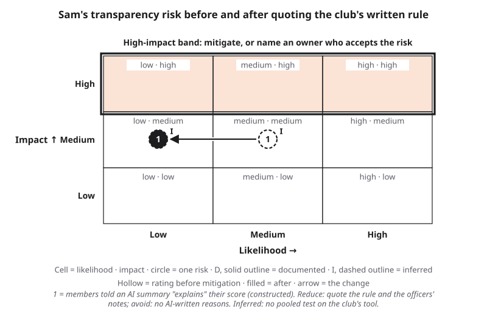{#fig-17-21 fig-alt="Risk Heat Map: one inferred risk moves from medium likelihood, medium impact to low likelihood, medium impact after a reduce mitigation."}

*Worked row (constructed):* "Members told an AI summary 'explains' their travel-team score, though the summary's reasons are its own text, not the club's rule. Harmed: members not chosen. Likelihood medium, impact medium. Evidence: **inferred**; Sam's hint test (17.6) is a lead from a different task; the test that would document it is 10 or more runs per version of the club's own summary tool on build logs, with and without a planted suggestion. Mitigation: reduce (explanations quote the rule and the officers' notes); avoid (no AI-written reasons sent to members). Owner: the club's president." (@fig-17-21)

### Mini-Project (optional): An Explanation Audit {.unnumbered}

*(O5, O6 · LO5 · Evaluate)* Over three weeks, collect three explanations you receive from systems (a recommendation reason, a credit or fraud notice, an automated grade comment). For each, audit the six layers and ask the three questions of section 17.5. End with half a page: which layer was missing most often, and who could add it? No personal data in what you submit.

### Case Study Questions {.unnumbered}

1. *(O5 · LO5 · Analyze)* Sort five facts from the case into confirmed and reported, and say why each belongs where it does.
2. *(O5 · LO5 · Apply)* Label the case on Chapter 4's tree and chain, and explain why opacity is not a tree branch.
3. *(O1 · LO5 · Evaluate)* Which layer would most have helped the reviewers, and which the parents? Mark your answer as your reading.
4. *(O5 · LO5 · Evaluate)* State the AP's finding, Amnesty's reading and the government's reply about the citizenship indicator. How would you write about the dispute?
5. *(O1, O5 · LO5 · Analyze)* Compare C14 with Short case 2: discrimination found and not found, opacity in both. What does opacity cost even when no discrimination is found?

## Further Reading and Compass Links {.unnumbered}

- Amnesty International (2021), *Xenophobic Machines*, chapters 2, 5, 7 and 8: the case for this chapter, with its recommendations (chapter 8).
- Rudin (2019): a short, readable argument for interpretable models in high-stakes decisions.
- Molnar (2022), *Interpretable Machine Learning* (2nd ed., open online): explanation methods in more depth, with code.
- Mitchell et al. (2019), "Model Cards for Model Reporting" (R16, assigned in week 13): the original proposal; read the example cards.
- Chen et al. (2025) and Turpin et al. (2023): the studies behind section 17.6.
- Chapter 18 for the law on automated decisions; Chapter 16 for measuring bias.
- *In Compass (optional): ch17 — layer-audit explorer, occlusion explorer for Sam's replica, lab pages ch17-lab1 to ch17-lab4, report template.*

## References {.unnumbered}

Adebayo, J., Gilmer, J., Muelly, M., Goodfellow, I., Hardt, M., & Kim, B. (2018). Sanity checks for saliency maps. In *Advances in Neural Information Processing Systems 31* (pp. 9505–9515).

Aïvodji, U., Arai, H., Fortineau, O., Gambs, S., Hara, S., & Tapp, A. (2019). Fairwashing: The risk of rationalization. In *Proceedings of the 36th International Conference on Machine Learning* (PMLR 97, pp. 161–170).

Alvarez-Melis, D., & Jaakkola, T. S. (2018). *On the robustness of interpretability methods* (arXiv:1806.08049). ICML Workshop on Human Interpretability in Machine Learning.

Amnesty International. (2021). *Xenophobic machines: Discrimination through unregulated use of algorithms in the Dutch childcare benefits scandal* (EUR 35/4686/2021). https://www.amnesty.org/en/documents/eur35/4686/2021/en/

Anthropic. (2025, March 27). *Tracing the thoughts of a large language model*. https://www.anthropic.com/research/tracing-thoughts-language-model

Autoriteit Persoonsgegevens. (2020). *Belastingdienst/Toeslagen: De verwerking van de nationaliteit van aanvragers van kinderopvangtoeslag* [The tax administration's benefits office: The processing of the nationality of applicants for childcare benefits] (Onderzoeksrapport z2018-22445). https://www.autoriteitpersoonsgegevens.nl/uploads/imported/onderzoek_belastingdienst_kinderopvangtoeslag.pdf

Autoriteit Persoonsgegevens. (2021, November 25). *Besluit tot boeteoplegging* [Decision to impose administrative fines on the Minister of Finance]. Announced December 7, 2021. https://autoriteitpersoonsgegevens.nl/uploads/imported/boetebesluit_belastingdienst.pdf

Baker, B., Huizinga, J., Gao, L., Dou, Z., Guan, M. Y., Madry, A., Zaremba, W., Pachocki, J., & Farhi, D. (2025). *Monitoring reasoning models for misbehavior and the risks of promoting obfuscation* (arXiv:2503.11926). OpenAI.

Bansal, G., Wu, T., Zhou, J., Fok, R., Nushi, B., Kamar, E., Ribeiro, M. T., & Weld, D. (2021). Does the whole exceed its parts? The effect of AI explanations on complementary team performance. In *Proceedings of the 2021 CHI Conference on Human Factors in Computing Systems* (pp. 1–16). https://doi.org/10.1145/3411764.3445717

Barocas, S., Selbst, A. D., & Raghavan, M. (2020). The hidden assumptions behind counterfactual explanations and principal reasons. In *Proceedings of the 2020 Conference on Fairness, Accountability, and Transparency* (pp. 80–89). https://doi.org/10.1145/3351095.3372830

Chen, C., Li, O., Tao, D., Barnett, A., Rudin, C., & Su, J. K. (2019). This looks like that: Deep learning for interpretable image recognition. In *Advances in Neural Information Processing Systems 32*.

Chen, Y., Benton, J., Radhakrishnan, A., Uesato, J., Denison, C., Schulman, J., Somani, A., Hase, P., Wagner, M., Roger, F., Mikulik, V., Bowman, S. R., Leike, J., Kaplan, J., & Perez, E. (2025). *Reasoning models don't always say what they think* (arXiv:2505.05410). Anthropic. https://arxiv.org/abs/2505.05410

Court of Justice of the European Union. (2023, December 7). *OQ v Land Hessen (SCHUFA Holding)*, Case C-634/21, ECLI:EU:C:2023:957. https://eur-lex.europa.eu/legal-content/EN/TXT/?uri=CELEX:62021CJ0634

Court of Justice of the European Union. (2025, February 27). *CK v Magistrat der Stadt Wien (Dun & Bradstreet Austria)*, Case C-203/22, ECLI:EU:C:2025:117. https://eur-lex.europa.eu/legal-content/EN/TXT/?uri=CELEX:62022CJ0203

Dakan, R., & Feller, J. (2025, December). *The AI Fluency Framework: A descriptive and normative model of human-AI interaction for higher education* (Version 1.1). Higher Education Authority. https://hub.teachingandlearning.ie/wp-content/uploads/2025/12/hea-genai-fluency-framework.pdf

DeGrave, A. J., Janizek, J. D., & Lee, S.-I. (2021). AI for radiographic COVID-19 detection selects shortcuts over signal. *Nature Machine Intelligence, 3*(7), 610–619. https://doi.org/10.1038/s42256-021-00338-7

Gebru, T., Morgenstern, J., Vecchione, B., Vaughan, J. W., Wallach, H., Daumé III, H., & Crawford, K. (2021). Datasheets for datasets. *Communications of the ACM, 64*(12), 86–92. https://doi.org/10.1145/3458723

Goodman, B., & Flaxman, S. (2017). European Union regulations on algorithmic decision-making and a "right to explanation." *AI Magazine, 38*(3), 50–57.

Government of the Netherlands. (n.d.). *Het algoritmeregister van de Nederlandse overheid* [The Dutch government's algorithm register]. Retrieved October 18, 2026, from https://algoritmes.overheid.nl

Jacovi, A., & Goldberg, Y. (2020). Towards faithfully interpretable NLP systems: How should we define and evaluate faithfulness? In *Proceedings of the 58th Annual Meeting of the Association for Computational Linguistics* (pp. 4198–4205).

Jain, S., & Wallace, B. C. (2019). Attention is not explanation. In *Proceedings of NAACL-HLT 2019* (pp. 3543–3556).

Korbak, T., Balesni, M., Barnes, E., Bengio, Y., Benton, J., Bloom, J., Chen, M., Cooney, A., Dafoe, A., Dragan, A., Emmons, S., Evans, O., Farhi, D., Greenblatt, R., Hendrycks, D., Hobbhahn, M., Hubinger, E., Irving, G., Jenner, E., . . . Mikulik, V. (2025). *Chain of thought monitorability: A new and fragile opportunity for AI safety* (arXiv:2507.11473). https://arxiv.org/abs/2507.11473

Lapuschkin, S., Wäldchen, S., Binder, A., Montavon, G., Samek, W., & Müller, K.-R. (2019). Unmasking Clever Hans predictors and assessing what machines really learn. *Nature Communications, 10*, 1096. https://doi.org/10.1038/s41467-019-08987-4

Lee, J. D., & See, K. A. (2004). Trust in automation: Designing for appropriate reliance. *Human Factors, 46*(1), 50–80.

Lundberg, S. M., & Lee, S.-I. (2017). A unified approach to interpreting model predictions. In *Advances in Neural Information Processing Systems 30* (pp. 4765–4774).

Mitchell, M., Wu, S., Zaldivar, A., Barnes, P., Vasserman, L., Hutchinson, B., Spitzer, E., Raji, I. D., & Gebru, T. (2019). Model cards for model reporting. In *Proceedings of the Conference on Fairness, Accountability, and Transparency* (pp. 220–229). https://doi.org/10.1145/3287560.3287596

Molnar, C. (2022). *Interpretable machine learning: A guide for making black box models explainable* (2nd ed.). https://christophm.github.io/interpretable-ml-book/

Mothilal, R. K., Sharma, A., & Tan, C. (2020). Explaining machine learning classifiers through diverse counterfactual explanations. In *Proceedings of the 2020 Conference on Fairness, Accountability, and Transparency* (pp. 607–617). https://doi.org/10.1145/3351095.3372850

New York State Department of Financial Services. (2021, March). *Report on Apple Card investigation*. https://www.dfs.ny.gov/system/files/documents/2021/03/rpt_202103_apple_card_investigation.pdf

Parlementaire ondervragingscommissie Kinderopvangtoeslag. (2020). *Ongekend onrecht* [Unprecedented injustice]. Tweede Kamer der Staten-Generaal. https://www.tweedekamer.nl/sites/default/files/atoms/files/20201217_eindverslag_parlementaire_ondervragingscommissie_kinderopvangtoeslag.pdf

Poursabzi-Sangdeh, F., Goldstein, D. G., Hofman, J. M., Wortman Vaughan, J., & Wallach, H. (2021). Manipulating and measuring model interpretability. In *Proceedings of the 2021 CHI Conference on Human Factors in Computing Systems* (pp. 1–52). https://doi.org/10.1145/3411764.3445315

Regulation (EU) 2016/679 of the European Parliament and of the Council (General Data Protection Regulation). *Official Journal of the European Union*, L 119, 4.5.2016, p. 1. https://eur-lex.europa.eu/eli/reg/2016/679/oj

Regulation (EU) 2024/1689 of the European Parliament and of the Council (Artificial Intelligence Act). *Official Journal of the European Union*, L, 12.7.2024. https://eur-lex.europa.eu/eli/reg/2024/1689/oj

Regulation (EU) 2026/1744 of the European Parliament and of the Council of 8 July 2026 (Digital Omnibus on AI). *Official Journal of the European Union*, L, 24.7.2026. https://eur-lex.europa.eu/eli/reg/2026/1744/oj/eng

Ribeiro, M. T., Singh, S., & Guestrin, C. (2016). "Why should I trust you?": Explaining the predictions of any classifier. In *Proceedings of the 22nd ACM SIGKDD International Conference on Knowledge Discovery and Data Mining* (pp. 1135–1144). https://doi.org/10.1145/2939672.2939778

Rudin, C. (2019). Stop explaining black box machine learning models for high stakes decisions and use interpretable models instead. *Nature Machine Intelligence, 1*(5), 206–215. https://doi.org/10.1038/s42256-019-0048-x

Şeker, Ş. E. (2025). *HermAI: Hermenötik açıklanabilir yapay zeka* [HermAI: Hermeneutic explainable artificial intelligence] [Unpublished manuscript]. Software: hermai (Version 0.1.8), Python Package Index, https://pypi.org/project/hermai/

Selbst, A. D., & Powles, J. (2017). Meaningful information and the right to explanation. *International Data Privacy Law, 7*(4), 233–242. https://doi.org/10.1093/idpl/ipx022

Slack, D., Hilgard, S., Jia, E., Singh, S., & Lakkaraju, H. (2020). Fooling LIME and SHAP: Adversarial attacks on post hoc explanation methods. In *Proceedings of the AAAI/ACM Conference on AI, Ethics, and Society* (pp. 180–186). https://doi.org/10.1145/3375627.3375830

Sturmfels, P., Lundberg, S., & Lee, S.-I. (2020). Visualizing the impact of feature attribution baselines. *Distill*. https://doi.org/10.23915/distill.00022

Turpin, M., Michael, J., Perez, E., & Bowman, S. R. (2023). Language models don't always say what they think: Unfaithful explanations in chain-of-thought prompting. In *Advances in Neural Information Processing Systems 36* (pp. 74952–74965). https://arxiv.org/abs/2305.04388

UNESCO. (2024). *AI competency framework for students*. https://doi.org/10.54675/JKJB9835

Ustun, B., Spangher, A., & Liu, Y. (2019). Actionable recourse in linear classification. In *Proceedings of the Conference on Fairness, Accountability, and Transparency* (pp. 10–19). https://doi.org/10.1145/3287560.3287566

Wachter, S., Mittelstadt, B., & Floridi, L. (2017). Why a right to explanation of automated decision-making does not exist in the General Data Protection Regulation. *International Data Privacy Law, 7*(2), 76–99. https://doi.org/10.1093/idpl/ipx005

Wachter, S., Mittelstadt, B., & Russell, C. (2018). Counterfactual explanations without opening the black box: Automated decisions and the GDPR. *Harvard Journal of Law & Technology, 31*(2), 841–887.

Wiegreffe, S., & Pinter, Y. (2019). Attention is not not explanation. In *Proceedings of EMNLP-IJCNLP 2019* (pp. 11–20).
