# Intellectual Property, Law and Governance {#sec-ch18}

<!-- Status: DRAFT v2 (2026-10-18) after four independent reviews (build/ch18/reviews/: subject-expert, pedagogy, student-panel, fact-check; docs/factcheck/ch18.csv) and editor decisions 1–9; dev memo docs/editorial/ch18-dev-memo.md. Blueprint v0.2. Featured student: Hana only (they/them; docs/characters.md); all AI outputs and constructed rules are labeled. Case C15 facts from the Third Circuit opinion (Sept 29, 2026) and the trial-court opinion (Feb 11, 2025), both read in full (build/ch18/src/). Legal status lines that can still change say "as of October 2026" and are rows in data/ch18_legal_status.csv (refresh list). Dashed = inferred (or reported, in the storyboard's legend only). Time: build/ch18/count.py (D22 amended; the brief's standard rates). Not legal advice. Not marked done: final review and the author's voice edit are pending. -->

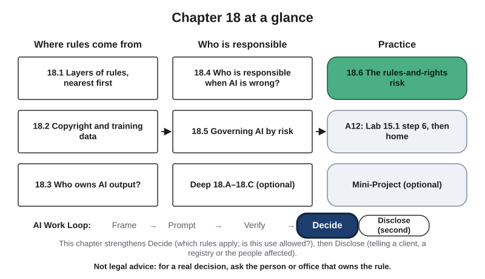{#fig-18-1 fig-alt="Chapter map: where rules come from (18.1–18.3), who is responsible (18.4–18.5), practice (18.6, A12); Work Loop with Decide highlighted."}

**Chapter 18 at a glance.** Every AI use happens under rules: laws, terms and policies. This chapter covers copyright in training and output, responsibility for AI errors, EU and U.S. regulation, and one A12 risk (Chapter 15).

**Time:** about 16 minutes for the Core sections 18.1–18.5 and about 29 minutes for the whole Core package (this page, the Opening Case, the Warm-up, sections 18.1–18.6 with Check Yourself, the Summary), at a steady pace (150 words a minute), with about 5 minutes of answering; allow more if you read more slowly or are reading in a second language. Your Turns are Lab 15.1 step 6 prompts. Faded examples, Review Questions A–C, the Spaced Review and the Case Study Questions are final-exam practice; Discussion Questions are for class; R14 and R15 are recommended. The Case Study, Ethics Lens, Career Connection, From the Field, the Deep sections and Labs 18.1–18.3 are optional. Legal citations in parentheses are not examinable. Answers to Check Yourself, the faded examples and odd-numbered end-of-chapter questions are in Appendix E.

**The question of this chapter:** *Who sets the rules for AI — on training data, on outputs, on mistakes and on risky uses — and how do you find the ones that apply to you?* The Chapter Summary answers it.

## Opening Case: Training on a Competitor's Summaries {.unnumbered}

Thomson Reuters owns Westlaw, a legal-research service whose editors write **headnotes**: short summaries of a point of law in a court decision. Ross Intelligence, a start-up (a new small company), asked to license Westlaw's content for an AI legal-search tool and was refused, because it was a competitor (*Thomson Reuters v. Ross*, trial court, 2025).

Ross then had about 25,000 training memos written, each a legal question with passages from court decisions marked as good or poor answers; the writers used Westlaw headnotes to frame the questions. Ross's tool did not write new text; it returned passages from court decisions, which copyright does not protect (*Thomson Reuters v. Ross*, appeals court, 2026).

Thomson Reuters sued in 2020. In February 2025 the trial court held that copying 2,243 headnotes to train the tool was not "fair use," a legal exception explained in section 18.2. On September 29, 2026 the appeals court agreed. As of October 2026, Ross had asked for more time to seek a rehearing and planned to ask the Supreme Court to review the case (reported: Ambrogi, 2026; Davis, 2026).

**The puzzle.** In 2025 two other federal judges ruled for AI companies that trained models on books: one held it fair use; the other found fair use on the record before him, warning that it would often fail. Why the difference? Section 18.2 answers it.

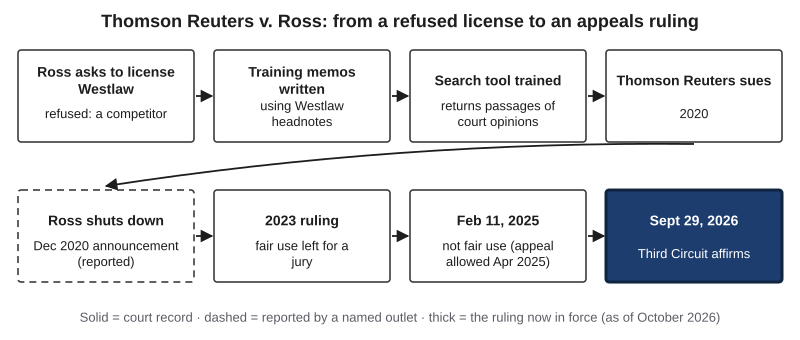{#fig-18-2 fig-alt="Timeline in eight boxes: license refused, memos from headnotes, tool trained, lawsuit 2020, shutdown (reported), 2023, 2025 and 2026 rulings."}

::: {.callout-note title="How U.S. courts work, in one box"}
A **trial court** (a federal district court) hears a case first. An **appeals court** reviews trial courts in its region; the **Third Circuit** covers Delaware, New Jersey, Pennsylvania and the U.S. Virgin Islands. A **holding** is what a court decides to settle the case; it **binds** the courts below (they must follow it) and is only **persuasive** elsewhere. **Affirmed** means the appeals court agreed. When the Supreme Court **declines to review** a case, the ruling stands and nothing new is decided. A **rehearing** asks the same appeals court, often with all its judges, to decide the case again.
:::

## Learning Objectives {.unnumbered}

Framework tags refer to the AI Fluency framework and the UNESCO (United Nations Educational, Scientific and Cultural Organization) AI Competency Framework for Students.

After this chapter you will be able to:

- **O1 — Differentiate** the layers of rules that apply to an AI-assisted task on the Regulation Map. *(LO5 · AI Fluency: Diligence · UNESCO: ethics of AI, Understand)*
- **O2 — Analyze** a training-data dispute with the four fair-use factors, using the 2025–2026 decisions. *(LO5 · AI Fluency: Discernment · UNESCO: ethics of AI, Understand)*
- **O3 — Determine** which parts of an AI-assisted work copyright can protect and what to disclose when registering it. *(LO5, LO4 · AI Fluency: Diligence, Description · UNESCO: ethics of AI, Apply)*
- **O4 — Judge** whether a disclaimer or an oversight step moves responsibility for an AI system's error. *(LO5 · AI Fluency: Diligence · UNESCO: human-centred mindset, Apply)*
- **O5 — Apply** the EU AI Act's risk tiers, and a dated U.S. or Texas rule, to an AI use. *(LO5 · AI Fluency: Discernment · UNESCO: ethics of AI, Apply)*

::: {.callout-note title="Warm-up (ungraded)"}
Answer from what you know today.

1. A photo is posted publicly online with no copyright notice. May anyone use it to train an AI model?
2. You write a detailed prompt and an image tool produces a picture. Who owns the picture?
3. A company's chatbot gives a customer wrong information, and the chat window says "AI may make mistakes." Who is responsible?

For each answer, write how sure you are, from 0 to 100%.
:::

## 18.1 Rules Come in Layers, Nearest First {#sec-18-1 .unnumbered}

[Core]{.path}

**This chapter is not legal advice;** for a real decision, ask the person or office that owns the rule.

Several layers of rules apply to every AI use at once. **Law** is the set of rules made by a government and enforced by courts or agencies: **statutes** (passed by a legislature), **regulations** (made by an agency, or adopted by the EU), **executive orders** (a president's or governor's instructions to government) and **case law** (court decisions that later courts follow). **Jurisdiction** is the area, such as a country, a state or a city, whose law applies.

Closer to you are **agreements**: a tool's **terms of service** (the contract a provider sets for using its tool), a **license** (permission to use something on stated conditions) and contracts. Closest is your organization's **policy**: the written rules of your course, university or employer. **Governance** is the rules, roles and checks that decide how AI may be used and who is responsible for it. The **Regulation Map** pictures these layers.

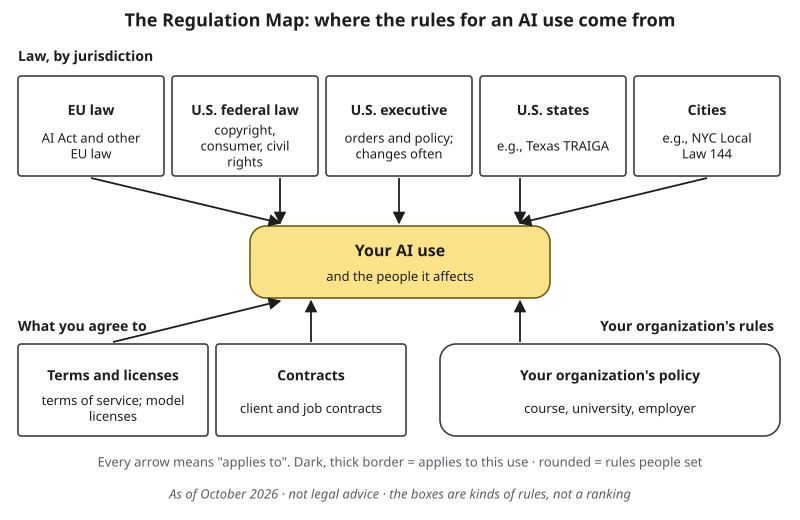{#fig-18-3 fig-alt="Regulation Map: five law boxes (EU, U.S. federal law, executive policy, states, cities), terms, contracts and your policy pointing to your AI use."}

**The nearest layer.** UT Dallas policy UTDSP5017 (March 2025) lets each instructor permit, partly permit or prohibit AI use in the syllabus; where permitted, students cite and verify AI output (The University of Texas at Dallas, 2025). This course's three zones (Chapter 1) are its choice. Which data may enter which tool follows the university's data classes (the table in section 12.5).

**Privacy law, applied to you.** **FERPA** (the Family Educational Rights and Privacy Act) protects students' education records, such as grades (U.S. Department of Education, n.d.). A tutor or student employee who sees them may share them only as the university's rules allow; in this course, that means no AI tool (the table in section 12.5). **HIPAA** (the Health Insurance Portability and Accountability Act) protects health information held by health plans, most health-care providers and the companies that handle it for them (U.S. Department of Health and Human Services, n.d.); in a clinical placement, patient information falls under it and the placement's rules. Other people's personal data may need their consent before you share it. Many states have privacy laws for businesses; Texas's, the Texas Data Privacy and Security Act (in force since July 1, 2024), does not apply to state agencies such as a public university (Texas Department of Information Resources, n.d.).

**A working rule.** Follow the strictest rule that applies, and when a rule is unclear, ask its owner in writing and keep the answer.

::: {.callout-note title="Worked Example: Hana's Menu Job"}
**Field:** Arts and design. *Featuring Hana (arts and technology; they/them), a freelance illustrator.* *(Constructed example.)*

A bakery owner asks Hana for menu illustrations "like the ones an image generator makes." Hana places the job on the map:

- **U.S. federal law (copyright, section 18.2):** who will own the drawings and the owner's generated draft?
- **Contract:** Hana's AI clause: no AI image generation without the client's written agreement.
- **Your organization's policy:** Hana's rule: tell the client first.
:::

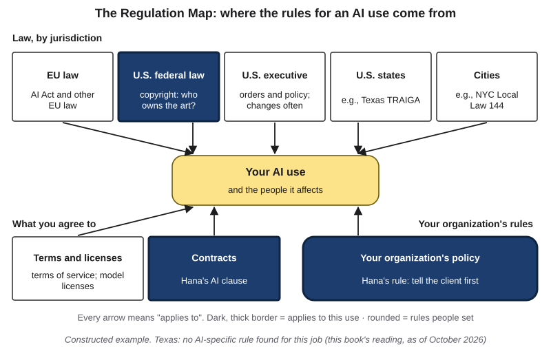{#fig-18-4 fig-alt="Regulation Map with U.S. federal law, contracts and organization policy highlighted, each with a note for Hana's menu job."}

::: {.callout-note title="Faded Example: A Patient Leaflet"}
**Field:** Health. A nursing student wants an AI tool to summarize a hospital's patient leaflet for a class presentation. Facts: the leaflet was handed out on the ward during her clinical placement, so it is a placement document; it says "© [hospital]"; the placement's rules forbid taking placement documents off site; she planned to use a free tool whose terms (constructed) say uploads may be used to train its models; the university offers a university-provided tool such as Microsoft Copilot Chat (as of October 2026).

**Policy layer (filled):** the placement rule forbids taking the leaflet off site, so the plan stops here unless the placement says otherwise.

**The terms question, if the placement allowed it (copyright comes in section 18.2):** _______________________
:::

::: {.callout-important title="Your Turn (Lab 15.1, step 6, prompt a; about 1 minute)"}
On your data-flow map, list one rule in each layer that may apply to your workflow (law; agreements; your organization's policy), and who owns each rule.
:::

::: {.callout-tip title="Check Yourself 18.1"}
1. Your course allows AI help for an essay, and a tool's terms allow file uploads. The article you want to upload comes from your employer's internal newsletter, which your employer forbids sharing outside the company. Which rule decides, and why?
:::

## 18.2 Copyright and Training Data: The Fair-Use Question {#sec-18-2 .unnumbered}

[Core]{.path}

*Prediction:* would a court treat training on bought books and on pirated copies the same?

**Copyright** is the legal right of the author of an original work to control copying, adaptation, distribution, public performance and public display. It arises automatically when the work is written down, recorded or saved, and it protects expression, not ideas or facts (17 U.S.C. §§ 102, 106; *Feist v. Rural Telephone*, 1991). The **public domain** holds works that copyright no longer protects, or never did. **Infringement** is using a protected work in one of those ways without permission or a legal exception. Uploading a whole copyrighted text to an AI tool makes a copy, which needs permission or an exception such as fair use.

**Fair use** is a U.S. legal exception that permits some uses of a protected work without permission, decided case by case by weighing four factors (17 U.S.C. § 107): (1) the purpose of the use, including whether it is commercial and whether it is **transformative**, adding a new purpose rather than standing in for the original; (2) the nature of the work, creative or factual; (3) how much was used, and whether that was needed; (4) the effect on the market for the work.

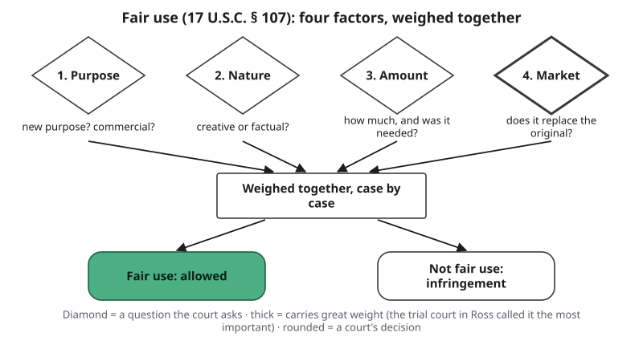{#fig-18-5 fig-alt="Four diamonds (purpose, nature, amount, market; market thick) lead to 'weighed together', then fair use or not fair use."}

::: {.callout-note title="Worked Example: Ross, Factor by Factor"}
**Field:** Law. The appeals court weighed the four factors this way (*Thomson Reuters v. Ross*, 2026):

- **Purpose:** against fair use. Same purpose as Westlaw, a competing research tool, so "minimally transformative, at best."
- **Nature:** slightly for. Headnotes are more factual than creative.
- **Amount:** against. Whole headnotes copied, though the court decisions are free. The trial court had decided this factor the other way.
- **Market:** against. A competitor to Westlaw that harmed a developing market for licensing headnotes as AI training data.

**Result:** not fair use. In a footnote the court distinguished AI models that generate new text; that remark is not a holding.
:::

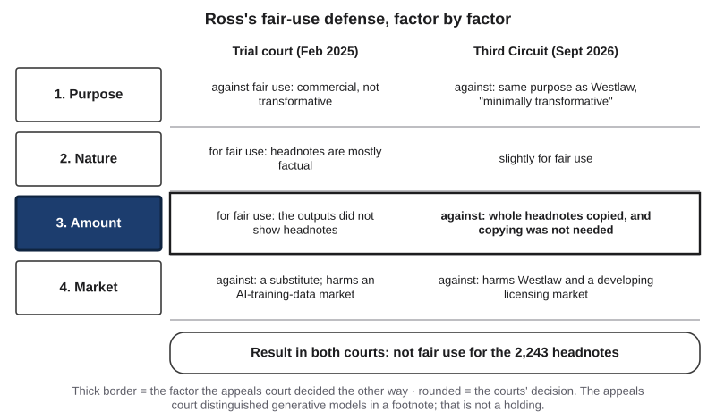{#fig-18-6 fig-alt="Four factors in two columns, trial court 2025 and appeals court 2026; factor 3 boxed as decided differently; result in both: not fair use."}

Other cases had other facts. In *Bartz v. Anthropic* (June 2025), a trial court held that training a model on books was fair use, calling it "exceedingly transformative," and so was scanning books the company had bought; keeping a central library of pirated copies was a separate use, and not fair use. The case settled for $1.5 billion, about $3,000 per work before fees and costs, with final approval in July 2026; as of October 2026, appeals of that order were pending (*Bartz v. Anthropic*, 2025, 2026). In *Kadrey v. Meta* (June 2025), another trial court ruled for Meta only because the authors had made the wrong arguments. As of October 2026, no U.S. appeals court had ruled on training a generative model.

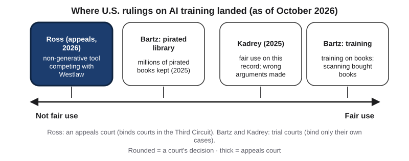{#fig-18-7 fig-alt="Scale from not fair use to fair use: Ross (appeals) and Bartz's pirated library at not fair use; Kadrey and Bartz's training toward fair use."}

::: {.callout-note title="Faded Example: Two Ways to Get Books"}
**Field:** Publishing. A company trains a language model. Use A: it bought print books, scanned them and trained on the scans; no output was shown to reproduce the books. Use B: it downloaded millions of pirated books and kept them in a permanent central library, including books it never used for training. The judge treated keeping that library as a use separate from training.

**Factor 1 for use A (filled):** transformative, according to the court in *Bartz*: training to produce new text is a different purpose from reading the books.

**Factor 1 for use B, and which use the court found fair:** _______________________
:::

::: {.callout-important title="Your Turn (Lab 15.1, step 6, prompt b; about 1 minute)"}
On your map, mark every place where your workflow copies someone else's work: an upload, a paste, a stored file.
:::

::: {.callout-tip title="Check Yourself 18.2"}
1. The appeals court in *Ross* and the trial court in *Bartz* reached different results on training. Name one fact that differed.
:::

## 18.3 Who Owns AI Output? {#sec-18-3 .unnumbered}

[Core]{.path}

**Ownership (of a text)**, from Chapter 10, means you can explain and stand behind every sentence. **Authorship (in copyright)** is the legal status of having created the expression in a work; in U.S. law only a human can be an author.

In *Thaler v. Perlmutter* (2025), an appeals court held that a work listed as made by an AI system alone could not be registered; the Supreme Court declined to review it in March 2026. **Registration** with the U.S. Copyright Office is optional, but needed before suing over a U.S. work (17 U.S.C. § 411(a)).

The Copyright Office's report on copyrightability (2025; R14) concluded that AI used as an assisting tool does not affect protection; purely AI-generated material is not protected; with current technology, prompts alone do not give enough control; and a person's own expression in the output, a creative selection or arrangement, and creative changes can be protected, case by case. When you register a work with more than a little AI-generated material, you identify it and claim only your own part (U.S. Copyright Office, 2023).

Short phrases and slogans are not protected by copyright at all (37 C.F.R. § 202.1(a)). And a name or logo used as a brand is a **trademark**: a word, name, logo or other sign that identifies who offers goods or services, protected for the business that uses it in trade, whoever designed it. A drawn logo's artwork may also have copyright if a person drew it with enough originality.

If a tool's terms say you own the output, this book's reading is that terms settle rights between you and the provider; they cannot create a copyright the law does not grant.

::: {.callout-note title="Worked Example: Hana's Menu Cover"}
**Field:** Arts and design. *Featuring Hana.* *(Constructed example.)*

The bakery owner brings a cover image made with an image generator and asks Hana to "finish it." Hana uses it only as a layout reference and draws a new illustration by hand.

- **The generated draft:** not protected; the owner's prompts were the only human input.
- **Hana's drawing:** Hana's own expression, protected.
- **The owner's arrangement of text and pictures:** at most thin protection, as an arrangement.
- **The logo:** as a brand, a trademark of the bakery; its artwork may also have copyright if a person drew it.
:::

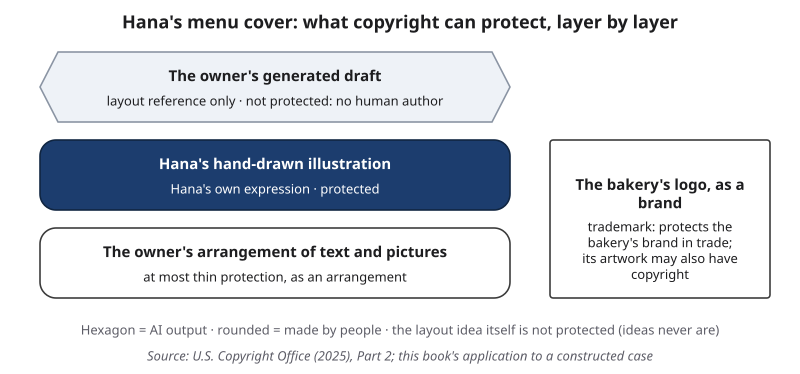{#fig-18-8 fig-alt="Layers: generated draft (not protected), Hana's hand drawing (protected), the owner's arrangement (thin); the logo under trademark and copyright."}

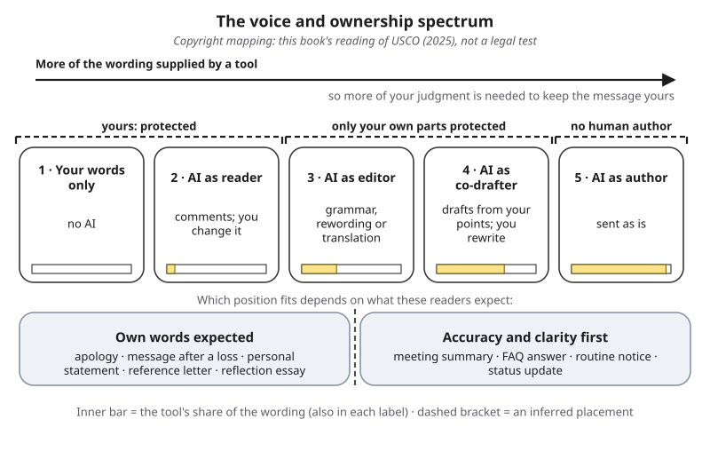{#fig-18-9 fig-alt="Chapter 10's five-position spectrum with dashed brackets: positions 1–2 protected, 3–4 only your own parts, 5 no human author."}

::: {.callout-note title="Faded Example: A Product Description"}
**Field:** Marketing. An intern asks a chat tool for a 150-word product description of a water bottle. She keeps it, rewrites two of its sentences in her own words and adds one sentence of her own about the bottle's design story. The company may register the text.

**The tool's text as produced (filled):** not protected; she did not control its expression.

**Her rewritten and added sentences, and what to disclose if the company registered the text:** _______________________
:::

::: {.callout-important title="Your Turn (Lab 15.1, step 6, prompt c; about 1 minute)"}
Who owns your workflow's output, and could it copy someone else's work? Note it on your list.
:::

::: {.callout-tip title="Check Yourself 18.3"}
1. A tool's terms say "you own the output." Why does that not make you its author under copyright law?
:::

## 18.4 Who Is Responsible When AI Is Wrong? {#sec-18-4 .unnumbered}

[Core]{.path}

**Liability** is legal responsibility to make up for harm or to pay a penalty. A **provider** (Texas law says developer) builds an AI system or puts it on the market; a **deployer** uses it in its own work, such as a company with a website chatbot; a user works with the output. The model is not a legal person and has no duties.

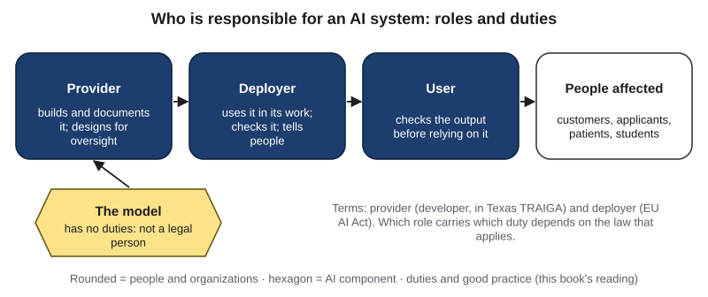{#fig-18-10 fig-alt="Provider, deployer, user and people affected in a row, each with one duty; the model as a hexagon labeled not a legal person."}

**This book's reading, from one decision:** the organization that deploys an AI tool is responsible for what it tells people, as for any other statement it makes. Chapter 4 told the story: a British Columbia small-claims tribunal held an airline responsible for its chatbot's wrong answer like any page of its website (*Moffatt v. Air Canada*, 2024); it is one decision, not a general rule. In Chapter 8's case, a court penalized lawyers who filed AI-invented citations unchecked (*Mata v. Avianca*, 2023).

**Disclaimers.** Whether "AI may make mistakes" would have changed the airline case was not decided. This book's reading, inferred: a label tells readers how a message was made; it does not hand them the job of checking it (Chapter 10).

**Oversight is a duty.** For high-risk uses, the EU AI Act requires systems designed for human oversight and deployers who give that job to competent, trained people with authority; as of October 2026, from December 2, 2027 for listed uses (August 2, 2028 for regulated products). An approval gate (Chapter 14) meets such a duty.

::: {.callout-note title="Worked Example: A Return Window"}
**Field:** Retail. *(Constructed example.)* An online shop's AI assistant tells a customer that the return window is 60 days. The posted policy says 30. The chat window says "AI responses may contain errors." The customer returns the item on day 45, and the shop refuses the refund.

- **Link 2:** no one checked the assistant's policy answers against the policy page before launch: the link that failed.
- **Who is responsible:** the shop, as deployer, by this book's reading of the airline case; the label did not hand the checking to the customer (inferred).
:::

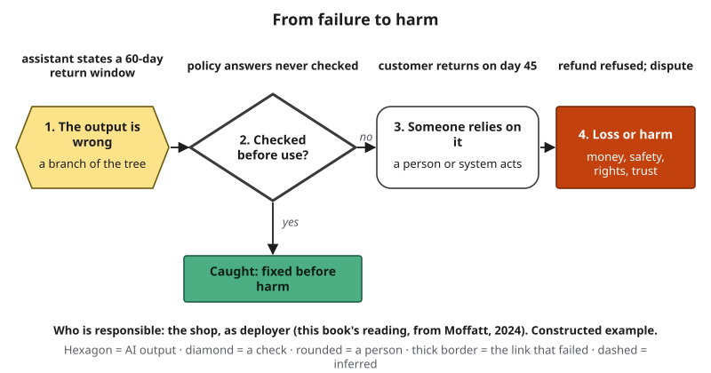{#fig-18-11 fig-alt="Failure-to-harm chain: wrong return window, policy answers never checked (link 2 thick), customer relies, refund dispute; the shop is responsible."}

::: {.callout-note title="Faded Example: A Listing"}
**Field:** Real estate. An agent posts an AI-drafted home listing that says 1,850 square feet; the appraisal in the agent's file says 1,580. The agent did not check the draft. A buyer makes an offer based on the size.

**Link 2 (filled):** the agent did not check the draft against the appraisal before posting.

**Who is responsible, by this book's reading, and one check that would have caught it:** _______________________
:::

::: {.callout-important title="Your Turn (Lab 15.1, step 6, prompt d; about 1 minute)"}
If your workflow's output were wrong, who would be responsible for it? Name the role.
:::

::: {.callout-tip title="Check Yourself 18.4"}
1. Why does this book call "the deployer is responsible" its reading rather than a rule?
:::

## 18.5 Governing AI by Risk {#sec-18-5 .unnumbered}

[Core]{.path}

*Prediction:* in the EU, which is regulated more tightly: an exam tool that flags cheating, or one that reads students' emotions from their faces?

The **EU AI Act** (Regulation (EU) 2024/1689) sets duties by risk. This book groups its rules into four tiers (the Act itself does not use that word):

- **Prohibited practices:** uses the Act bans, applying since February 2, 2025, such as inferring people's emotions from their faces or voices at work or in education (except for medical or safety reasons) and social scoring.
- **High-risk systems:** listed uses such as admission, grading, test monitoring and screening job applicants, plus AI in regulated products; providers and deployers carry duties of risk management, documentation and oversight.
- **Transparency duties:** a provider must design a system that talks with people so that they are told it is AI; generated content must be marked; and deepfakes must be labeled. A **deepfake** is **synthetic media** (images, audio or video generated or substantially altered by AI) that realistically shows a real person, or a real event, saying, doing or happening in a way that did not happen; the Act's label duty also covers realistic fakes of real objects and places.
- **Minimal risk:** most uses, such as spam filters, with no new duties beyond a general duty to support AI literacy.

The Act also reaches providers abroad whose systems are sold or used in the EU.

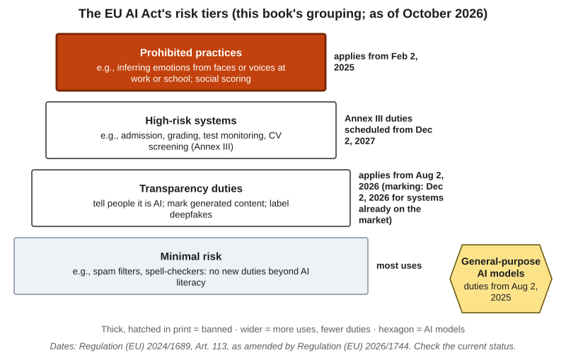{#fig-18-12 fig-alt="Four stacked tiers: prohibited (thick), high-risk, transparency, minimal, each with examples and dates; a box for general-purpose models."}

::: {.callout-warning title="Status box: as of October 2026 (check the current status)"}
1. **EU:** an amending law, Regulation (EU) 2026/1744, moved the high-risk duties to December 2, 2027 for listed uses and August 2, 2028 for regulated products; transparency duties apply from August 2, 2026 (for systems already on the market, the marking duty from December 2, 2026).
2. **U.S. federal:** no single AI law; existing laws apply, such as copyright, consumer protection and the federal ban on job discrimination (Title VII of the Civil Rights Act). A December 2025 presidential order set up a federal challenge to state AI laws (Executive Order 14365).
3. **Texas:** the state's AI law (TRAIGA, the Texas Responsible Artificial Intelligence Governance Act, in force January 1, 2026) bans some intentional uses, such as manipulating people toward self-harm, and requires a "governmental agency" and health-care providers to tell people they are dealing with AI; its exclusion of universities covers another term, so whether that duty reaches public universities is unsettled (this book's reading). A 2025 law (Senate Bill 1964) requires state agencies to disclose public-facing AI unless a reasonable person would already know; because Texas law's definition of "state agency" includes public universities, this book reads the duty as covering them (Texas S.B. 1964, 2025).
4. **New York City:** since July 5, 2023, an employer using an automated hiring tool needs a yearly bias audit, a published summary and notice to candidates (Local Law 144; New York City Department of Consumer and Worker Protection, n.d.).
:::

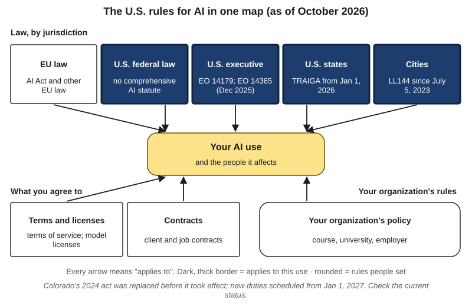{#fig-18-13 fig-alt="Regulation Map with U.S. federal law, executive policy, states and cities highlighted, each with a dated note."}

::: {.callout-note title="Worked Example: Four Uses on the Tiers"}
**Field:** Education and technology.

- An exam tool that infers students' emotions from their faces on camera: **prohibited**.
- An exam tool that flags possible cheating during tests: **high-risk** (duties scheduled from December 2, 2027, as of October 2026).
- A help-desk chatbot: **transparency**; its provider must design it to tell users they are talking with AI.
- A spam filter: **minimal**.
:::

::: {.callout-note title="Faded Example: Two U.S. Uses"}
**Field:** Government and human resources. (a) A Texas state agency launches a chatbot for residents' questions. (b) A New York City employer uses a tool that scores job applicants' résumés and advances the top 20% to interviews.

**(a) (filled):** TRAIGA requires the agency to tell residents they are dealing with AI (as of October 2026).

**(b) The rule, and what it requires before use:** _______________________
:::

::: {.callout-important title="Your Turn (Lab 15.1, step 6, prompt e; about 1 minute)"}
If your workflow were used in the EU, which tier would it fall in? Name one U.S. or Texas rule that may apply, with its date.
:::

::: {.callout-tip title="Check Yourself 18.5"}
1. Which tier is each tool in — one that infers students' emotions from their faces, and one that flags possible cheating — and what does that mean for whether each may be used at all?
:::

## 18.6 The Rules-and-Rights Risk (A12) {#sec-18-6 .unnumbered}

[Studio]{.path}

A12's register (Chapter 15) has five risks; this chapter supplies the **rules-and-rights risk**: "risk of breaking [a named rule] or of [a named person] losing [a named right]," with the rule's own text as evidence. A **right** is something a law or agreement lets a person control or claim, such as copyright or privacy. You draft it in Lab 15.1, step 6 (minutes 49–54), and finish it at home in about 3 minutes.

1. **Scratch list:** your answers to prompts a–e on your data-flow map (@fig-18-14). Where to look: the tool's terms; the syllabus and UTDSP5017; the university's data classes; an employer's, client's or placement's policy; one law from this chapter.
2. **Choose** the rule with the **highest stakes** (whose breach would harm people most or be hardest to undo); name its layer and write the risk, with who is harmed.
3. **Evidence:** D only if you opened the rule's own text for this tool and data and cite its section; for a law, I with a reason is acceptable ("read this chapter's summary, not the statute"). A provided scenario's rules paragraph (section 15.7) counts as the rule's text.
4. **Rate, mitigate, ask:** likelihood and impact (Chapter 15's anchors); a mitigation with a risk owner; the rule's owner with your question. End: "This records which rules to check and whom to ask; it is not a legal opinion."

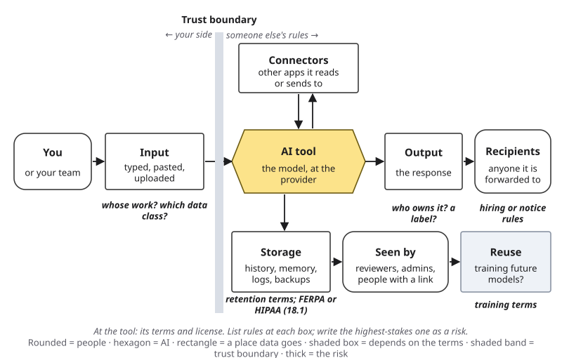{#fig-18-14 fig-alt="Chapter 15's data-flow map with a rules note at the input, storage, reuse, output and recipients boxes."}

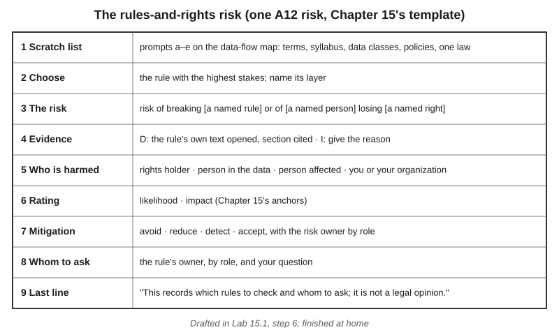{#fig-18-15 fig-alt="Nine-row sheet: scratch list, choose and name the layer, the risk, evidence D or I with reason, harm, rating, mitigation, whom to ask, disclaimer."}

::: {.callout-note title="Worked Example: Hana's Rules-and-Rights Risk"}
*Featuring Hana, who runs a small zine (constructed; the form and terms are invented).* Hana plans AI-drafted alt text for contributors' scanned drawings. The submission form permits printing and posting only; the tool's terms (§ 4) let uploads train models.

**Risk:** risk of contributors losing their right to decide how copies of their drawings are used (copyright) · **rule and layer:** the form and terms § 4 (agreements) · **harmed:** contributors · **evidence:** D (both opened) · **rating:** medium, medium · **mitigation:** reduce: a no-training tool and an AI line on the form; owner: Hana, as editor · **ask:** the provider, "Does the no-training option cover images?" · Not a legal opinion.
:::

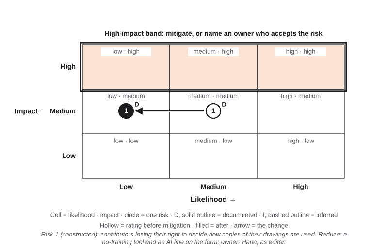{#fig-18-16 fig-alt="Risk Heat Map: risk 1, documented, moves from medium likelihood and medium impact to low likelihood and medium impact."}

::: {.callout-note title="Faded Example: A Club's Sign-up Assistant"}
*Constructed (Chapter 15's club scenario).* A campus club's AI sign-up assistant stores members' names and emails. The club's constitution (§ 3) says member data is for club business only; the tool's terms (§ 5) allow training on inputs. You opened both.

**Filled:** risk of members losing control of their contact details, used beyond club business (constitution § 3), because the tool's terms (§ 5) allow training · layer: your organization's policy · D.

**Your part:** who is harmed, the rating, a mitigation with its owner, and the rule's owner with your question: _______________________
:::

::: {.callout-tip title="Check Yourself 18.6"}
1. When is the rules-and-rights risk's evidence D, and when is I with a reason acceptable?
:::

## Deep 18.A: Licenses, "Open" Models and Terms of Service {#sec-18-deep-a .unnumbered}

[Deep]{.path}

Chapter 12 introduced the **open-weight model**: a model whose settings (parameters), called its weights, can be downloaded and run under a license. "Open" is a license question. The Open Source Initiative's definition of open source AI (version 1.0, October 2024) asks for the freedom to use, study, change and share a system, with access to its weights, its code and enough information about its training data to build a similar system (Open Source Initiative, 2024). Many models released with open weights come with licenses that limit some uses or users, so the label "open" does not tell you what you may do; the license text does.

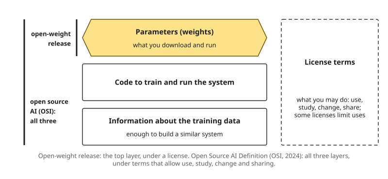{#fig-18-17 fig-alt="Three layers (weights, code, data information) beside a box for license terms; open-weight covers the top layer, open source AI all three."}

Terms of service matter for the same reason. Read three things before you build anything on a tool: what the terms say about who holds rights in outputs; whether your inputs may train future models (Chapter 12's data terms); and how the provider may change the terms later. Some providers promise business customers that they will defend them against copyright claims over outputs, under conditions. For example, Microsoft's Customer Copyright Commitment says Microsoft will defend commercial customers against certain third-party intellectual-property claims about output from covered products, for some products only if the customer has used the required safety mitigations (Microsoft, 2026); OpenAI announced a similar commitment for business customers in 2023 (OpenAI, 2023). The conditions are part of the contract you would rely on.

**Reading a license: a constructed example.** A campus chess club wants to run an open-weight model on a club laptop to answer members' questions about club rules. The model's license (constructed for this example) allows free use and changes, requires anyone who shares a changed version to include the license, forbids some listed uses, and requires a separate agreement for services with more than a stated number of monthly users. Read layer by layer: the club may run and adapt the model; if it shares its changed version, the license travels with it; its use is not on the forbidden list; the user threshold is far above a club's size. Two things the license does not settle: whether the club's own documents may be used as context (that is the club's rule, and Chapter 12's data gate) and whether the answers are right (that is verification, Chapter 8). The license answers "may we?"; it never answers "is it good?"

The From the Field section below adds a 2014 view from software buying: plan for the whole life of what you adopt, not only its price today.

## Deep 18.B: Faces, Voices and Labels {#sec-18-deep-b .unnumbered}

[Deep]{.path}

Laws on synthetic media protect the people shown and the public; they do not settle whether training was lawful. **Synthetic media** are images, audio or video generated or substantially altered by AI; **voice cloning** is using AI to produce new speech that imitates a particular person's voice from samples of it.

**United States.** The TAKE IT DOWN Act, signed on May 19, 2025, made it a federal crime to publish intimate images of a person without consent, including AI-generated ones, and requires platforms to remove such images within 48 hours of a valid request (TAKE IT DOWN Act, 2025); the Federal Trade Commission began enforcing the platform duty on May 19, 2026 (Federal Trade Commission, 2026). In February 2024 the Federal Communications Commission (FCC) ruled that AI-generated voices are "artificial" under the federal law that restricts robocalls (FCC, 2024a). Chapter 13 told the New Hampshire case: the FCC fined the political consultant who arranged AI-voiced robocalls imitating President Biden $6 million in September 2024 (FCC, 2024b), and a state jury acquitted him of state charges in June 2025 (Bookman, 2025). The same conduct was judged under two laws with two results. Texas's TRAIGA bans developing or distributing AI with the sole intent of producing sexual deepfakes of real people or child sexual abuse material (Texas H.B. 149, 2025, § 552.057).

**European Union.** The AI Act requires deepfakes to be labeled (Art. 50). As of October 2026, the 2026 amending law added two prohibitions scheduled to apply from December 2, 2026: AI systems that produce non-consensual intimate images of identifiable people, and AI-generated child sexual abuse material (Regulation (EU) 2026/1744).

**What this means for you.** Before you generate an image, voice or video of a real person, ask for their consent, and check the rules of the place you will post it: a course, a club, a platform. A label that says "AI-generated" is required in some places and helpful everywhere, but it does not make a harmful fake acceptable. If a fake of you or someone you know appears online, the platform's reporting route is the first step; campus offices can help.

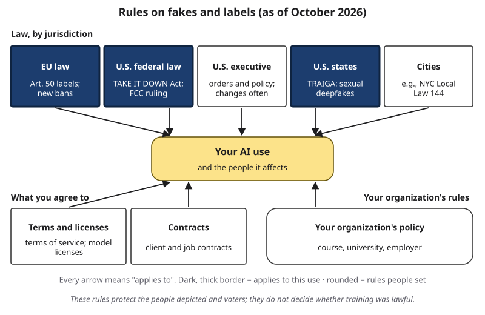{#fig-18-18 fig-alt="Regulation Map with EU law, U.S. federal law and states highlighted, noting Art. 50 labels, TAKE IT DOWN Act, FCC ruling and TRAIGA."}

## Deep 18.C: Beyond the United States, the Federal–State Tension and the Dates {#sec-18-deep-c .unnumbered}

[Deep]{.path}

**No general fair use elsewhere.** Many countries have no general fair-use test; they list specific exceptions. The EU allows text and data mining of lawfully accessed works unless the rights holder has reserved its rights in a machine-readable way, an **opt-out** (Directive (EU) 2019/790, Art. 4). The AI Act adds that providers of general-purpose AI models must have a policy to respect such opt-outs and publish a summary of the content used for training (Art. 53). In November 2025 a court in Munich held that song lyrics memorized in a model and reproduced in its answers infringed; the mining exception covered collecting the training data, not those copies (*GEMA v. OpenAI*, 2025; reported; under appeal). Japan's Copyright Act (Art. 30-4) allows using a work when the aim is not to enjoy the thoughts or feelings it expresses, such as data analysis, unless the use unreasonably harms the owner's interests (Copyright Act of Japan, Art. 30-4). The UK case in Short case 1 below shows a third approach. The same training run can be judged under several laws.

**The federal–state tension in the United States.** In July 2025 the U.S. Senate voted 99 to 1 to remove from a budget bill a proposed 10-year pause on enforcing state AI laws (U.S. Senate, 2025). Federal policy has shifted with administrations: a January 2025 order set a policy of removing barriers to AI development (Executive Order 14179); an April 2025 order told federal agencies to deprioritize enforcement based on **disparate impact**, a practice that falls more heavily on a protected group without a job-related reason, while private lawsuits under Title VII remain possible (Executive Order 14281; reported). In December 2025 an executive order (14365) set up a Justice Department task force to challenge state AI laws the administration considers burdensome; in April 2026 the department joined a company's lawsuit against Colorado's law, which Colorado then replaced before it took effect (SB 26-189, May 2026; new duties scheduled from January 1, 2027) (reported). An executive order directs the federal government; it does not by itself change a state's law (this book's reading). As of October 2026, Congress had passed no law replacing state AI laws.

**The EU dates.** The 2026 amending law moved only the high-risk dates (@fig-18-19). As of October 2026, the right to an explanation of decisions made with high-risk systems in the listed areas (Art. 86) was not amended, but the duties for those systems now apply from December 2, 2027, so when the right can be used in practice is a question of interpretation.

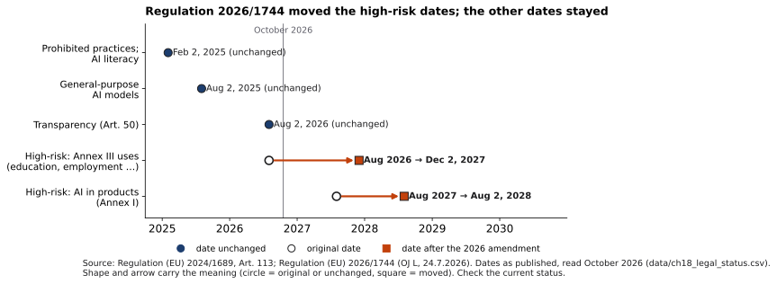{#fig-18-19 fig-alt="Dates chart: four EU AI Act duty groups unchanged; Annex III moved from Aug 2026 to Dec 2027 and Annex I from Aug 2027 to Aug 2028."}

**Keeping current.** This chapter's status lines will age. A habit that lasts longer than any one fact: for each rule you rely on, write down where you read it, the section and the date, and check the primary source again before a decision that matters. A rule's own page (the court's opinion, the legislature's bill page, the regulator's site) is the primary source in the sense of Chapter 8; a news story or a law firm's summary is a lead to it. When two summaries disagree, the rule's own text decides, and a date tells you which summary is older.

## Hands-on Labs {.unnumbered}

The labs say what to do, not which buttons to press. Use a university-provided tool such as Microsoft Copilot Chat (as of October 2026) where you can; no lab needs one. Never put personal or confidential information into a prompt. The A12 risk is drafted in Lab 15.1, step 6 (Chapter 15); these labs are optional.

*In Compass (optional) and on eLearning:* step-by-step notes for current tools and the lab sheets.

### Lab 18.1: Read the Terms (Explore · 20 minutes · optional) {.unnumbered}

For one AI tool you use, find on the provider's own pages what its terms say about (1) who holds rights in outputs, (2) whether your inputs may train its models, (3) what you may not use it for, and (4) how the terms can change. Record the page, the section and the date. Compare with a classmate's tool. Change nothing in your account during the lab. **Deliverable (ungraded):** a four-row table, one row per question, each with a quoted phrase under 15 words or a paraphrase, the section and the date. **Accessibility:** a printed set of dated, glossed excerpts from two providers' terms is on eLearning if you prefer not to search.

### Lab 18.2: Fair-Use Factor Sort (Check It · 15 minutes · optional) {.unnumbered}

On the lab sheet are eight short constructed uses, such as study flashcards made from your own textbook, a parody, a news-summary product and a training run on purchased books. For each, write which way each factor leans and why. Then compare with the decisions in section 18.2. The answers discuss reasoning, not verdicts. **Debrief:** which factor changed your mind most often, and which use would you want a lawyer to look at before going ahead?

### Lab 18.3: Find the Rule's Owner (Apply · 15 minutes · optional) {.unnumbered}

Pick one AI use in your field, job or club. List the rules that may apply, layer by layer, on the Regulation Map, and the owner of each rule (an office, a manager, a client, a regulator). Write the one question you would put to the owner of the strictest rule. This feeds the optional Mini-Project. Use only rules you can read yourself; if a rule is not written down, note that, because an unwritten rule has no text to cite.

## Case Study: The First Appeals Ruling on AI Training {.unnumbered}

You met the case in the Opening. This case asks what the courts decided, what they did not, and how to label it. (Case file: cases/C15-thomson-reuters-ross.md.)

**Timeline.** Ross asked to license Westlaw's content and was refused. About 25,000 training memos were written using Westlaw headnotes. Thomson Reuters sued in 2020. Ross announced in December 2020 that it would shut down and went offline in January 2021 (reported: Ambrogi, 2020). In 2023 the trial court left fair use for a jury. On February 11, 2025 the same judge revised that ruling: he found that Ross had copied 2,243 headnotes and rejected fair use. On April 4, 2025 he allowed an immediate appeal on two questions: are the headnotes original, and was the use fair? On September 29, 2026 the Third Circuit affirmed (*Thomson Reuters v. Ross*, 2025, 2026).

**What the courts decided.** The headnotes are original enough to be protected, each as a work of its own. Copying them to train a tool built for the same purpose as Westlaw, and sold in competition with it, was not fair use. Both courts found market harm, including harm to a market for licensing training data: the trial court called this factor the most important, and the appeals court described that market as developing fast. The appeals court also held that copying whole headnotes was more than Ross needed, because the court decisions are free.

**What they did not decide.** Both courts said the tool was not generative. The trial judge wrote that only non-generative AI was before him; the appeals court noted, in a footnote, that the models in cases such as *Bartz* can generate new expression and that the Justice Department had filed a statement about generative AI in a separate pending case. Neither remark decides a generative-AI case. The ruling binds courts in the Third Circuit; elsewhere it is persuasive only. As of October 2026, Ross had asked for more time to seek a rehearing and planned to ask the Supreme Court to review the case (reported: Ambrogi, 2026; Davis, 2026).

**Labels.** This is an input-side harm: the copying sits at the input. No output was wrong, so the Failure Taxonomy Tree does not apply. On Chapter 15's data-flow map, the training path runs from the memos (input) to training the tool (reuse); the outputs were passages from court decisions, not headnotes.

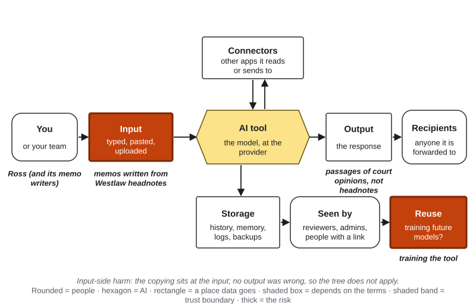{#fig-18-20 fig-alt="Data-flow map with input and reuse highlighted: memos written from Westlaw headnotes, training the tool; outputs are passages of opinions."}

**Why it matters if you never train a model.** You probably will not build a legal search engine. But the same questions come up whenever you copy someone's work into an AI workflow: an article pasted into a summarizer, a dataset uploaded for analysis, a set of images used as examples. Ask the court's questions on a small scale. Why am I copying this, and does my use serve the same purpose as the original? How much do I need? Would my use replace something the owner sells or licenses? And what do my course, my employer and the tool's terms say first?

**What it leaves open.** Whether training a generative model on protected works is fair use; how courts will treat outputs that come close to a training work; and whether licensing markets for training data, which both courts weighed, will count as a market the law protects. As of October 2026, cases on those questions were still pending in trial courts.

**What could each party have done?** *Ross* could have licensed data from another source, used only the free court decisions, or had memos written without headnotes and kept a record showing it. *Thomson Reuters* had refused a license; the courts did not fault that. *A company building on licensed data today* can keep records of where each training item came from. This book's reading: a record of data sources costs little compared with a lawsuit.

**Short case 1: The same question in another country (Getty Images v. Stability AI, UK, 2025).** Getty Images sued Stability AI in England over the Stable Diffusion image model. Getty dropped its claim about training, because the training took place outside the UK. On November 4, 2025 the High Court held that the model's weights are not an "infringing copy" under UK law, because they do not store or reproduce the works. It found limited trade-mark infringement where some older versions of the model produced images showing Getty's watermarks, a finding the judge described as historic and extremely limited in scope. In December 2025 Getty was given permission to appeal on the "infringing copy" point; as of October 2026, no appeal ruling had been given (reported) (*Getty Images v. Stability AI*, 2025). *Labels:* the training question is input-side and was not decided; the watermark images are outputs that reproduced a sign from the training images: on the tree, *other*, documented by the judgment.

**Short case 2: A law on paper and in practice (New York City, 2025).** Chapter 16 met Local Law 144's "bias audit." In December 2025 the New York State Comptroller's audit found the city's enforcement from July 2023 to June 2025 ineffective. The city agency received two complaints. Reviewing companies listed by outside researchers, it found one instance of non-compliance where the auditors found at least 17 potential ones. And when the auditors made 12 test calls to the city's 311 help line to file a complaint, only three reached the city agency (Office of the New York State Comptroller, 2025). *Lesson (this book's reading):* governance needs an owner who checks; a rule nobody enforces protects little. *Labels:* none on the tree; a governance case.

## Ethics Lens: Lawful Is Not the Same as Fair {.unnumbered}

**Whose work trained it, and who gets paid?** Hana opposes training on artists' work without their consent; that is Hana's view, and many artists share it (Chapter 13). There are three common positions. *Permission first:* train only on works licensed or offered for training. *Opt-out:* train unless the rights holder says no, as the EU's mining rule allows (Deep 18.C). *Pay afterward:* train, and compensate through licensing deals or settlements.

The law answers narrower questions. In *Bartz*, the settled claims concerned pirated copies downloaded and kept, not training, which the trial court had found fair; the money goes to the works' rights holders, authors and publishers (this book's reading of the rulings). Whether that is fair to authors is a question the rulings did not ask.

**Your own work as training data.** The question is not only about famous authors. Some tools' terms allow what you type or upload to train future models (Chapter 12's data terms). Your essays, code and drawings are your work too. Choosing a tool whose terms exclude training, or turning on the option that excludes it, is how you give or withhold consent for your own work today.

**Who checks that the rules work?** A rule protects people only if someone owns it and checks it. Short case 2 showed a city law with little enforcement. Inside organizations the same thing happens: a written AI policy that no one reads, updates or enforces gives a feeling of safety without the safety. This book's reading: a good policy names its owner, a date to review it, and how people can report a problem without fear.

**Who writes what a model learns from?** Westlaw's editors wrote the headnotes Ross used. Artists drew the images in training sets. People whose work is used often have the least say in how. Creativity, authorship and responsibility as philosophical questions are Chapter 23's topic.

## Career Connection {.unnumbered}

| Role | How law and governance show up | A question to ask |
|---|---|---|
| Paralegal or lawyer | Professional rules on AI use: the American Bar Association's Formal Opinion 512 (2024) on competence and confidentiality with generative AI; filings checked before use (Mata, Chapter 8) | Who checked every citation in this filing? |
| Human resources specialist | Bias audits and notices for hiring tools (NYC Local Law 144); anti-discrimination law | Does our screening tool need an audit or a notice here? |
| Designer or illustrator | Copyright in AI-assisted work, registration disclosure, client contracts (Hana) | Which parts of this deliverable did a person author? |
| Compliance or risk analyst | EU AI Act tiers for products sold in Europe; governance records | Which tier is this use in, and who owns the record? |
| Software engineer | Model licenses and terms; records of training-data sources | What does the license let us do, and for how long? |
| Health administrator | HIPAA (section 18.1) and Texas TRAIGA's disclosure duty for health-care providers | How do patients learn they are talking with AI? |
| Journalist or publisher | Licensing deals and lawsuits over training data | Was this archive licensed for training? |

## From the Field {.unnumbered}

In 2014 I wrote an encyclopedia entry on where organizations get their software (Şeker, 2014). It describes five sources: software firms that build custom or packaged products, large integrated enterprise systems, cloud services, open-source software and in-house development. For choosing among them it lists these criteria: cost, functionality, the availability and speed of support, flexibility, documentation and ease of installation. The entry cites Laudon and Laudon's textbook as its source (Laudon & Laudon, 2012). It adds that cost is more than the price: maintenance, add-ons, and the license and management costs of the operating system the software needs.

On open source, the entry gives my market experience at the time. Open-source code lets a customer adapt the software. I wrote that I had once been a firm defender of open source and had moved away from it, because I saw "open source" used more as a marketing tool than as the good-faith idea of free software it began as. I named practices I had seen: keeping the newest version commercial and the older one open, and giving the software away while selling documentation or services. And I wrote what vendors should not do: give a firm free software, make it dependent, then charge more than paid software would cost. I advised buyers to plan budgets for at least five to ten years.

**Present-day connections (this book's reading, written in 2026).** First, "open" on an AI model can mean very different licenses (Deep 18.A): read the license, not the label. Second, a free tier or a free model can become a dependency, so check how the terms can change before you build a workflow on them (Chapter 12). Third, the long view applies to AI tools as it did to software. The entry concerns business software in 2014, not AI; open licenses also give real freedoms, such as studying and changing the code, which my 2014 view did not dwell on. *Disclosure: I am a founder of OptiWisdom, which develops software for businesses, including AI tools. See "How This Book Was Written."*

## Chapter Summary {.unnumbered}

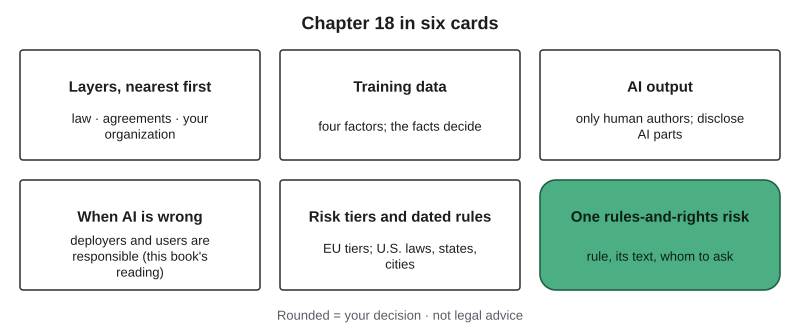{#fig-18-21 fig-alt="Six cards: layers nearest first, training data, AI output, when AI is wrong, risk tiers and dated rules, one rules-and-rights risk."}

**The chapter's question, answered:** several layers of rules apply at once; follow the strictest and ask its owner. Fair use in training depends on the facts. Copyright protects what people author. In this book's reading, those who deploy and rely on AI are responsible for its errors. The EU sets duties by risk tier; the U.S. relies on existing laws and a few state and city rules.

**Revisit your Warm-up.** (1) *Not automatically: the photo is still protected, and fair use depends on the facts (18.2).* (2) *Probably no one, if your prompt was your only input; your own changes can be protected (18.3).* (3) *In this book's reading, the deploying company; a disclaimer does not move the duty to check (18.4).* Compare with your confidence ratings.

### Key Terms {.unnumbered}

affirmed · appeals court · authorship (in copyright) · case law · copyright · deepfake · deployer · disclaimer · EU AI Act · executive order · fair use · FERPA · governance · high-risk AI system · HIPAA · holding · infringement · jurisdiction · law · liability · license · policy (of an organization) · prohibited practice · provider (of an AI system) · public domain · registration (copyright) · Regulation Map · right (in the rules-and-rights risk) · rules-and-rights risk · statute · terms of service · trademark · transformative (use) · synthetic media · transparency duty · trial court · *Deep:* disparate impact · opt-out (text and data mining) · voice cloning

## End-of-Chapter Package {.unnumbered}

<!-- Each item: objective · LO · revised Bloom level. Odd-numbered answers → appendix/answers.md (Appendix E, via docs/production/handoff/ch18.md); even-numbered → private/ch18-answers-even.md. Review A distractors draw on M1–M6 (blueprint §3). MC keys rotated: A1 c, A2 a, A3 d, A4 b, A5 c, A7 a, A8 d, A9 b, A10 c, A12 a, A13 d. The correct option is the longest in at most two items (A10, A12). Review A tests tier reasoning, not dates. -->

### Review Questions A: Terms and Concepts {.unnumbered}

Items 6 and 11 are short answers.

1. *(O1 · LO5 · Apply)* Your course syllabus prohibits AI for an essay; your part-time employer allows a tool for work emails. You want to use the tool for the essay. What applies?\
   (a) The employer's rule, because an employer's policy outranks a course syllabus.\
   (b) No rule, because no law forbids using AI to help write an essay.\
   (c) The syllabus: for coursework, the course's rule is the one that applies.\
   (d) Both equally, so you may choose whichever rule you prefer.
2. *(O2 · LO5 · Understand)* A photo is posted online with no copyright notice. What follows?\
   (a) It is probably protected anyway, because copyright arises when a work is fixed.\
   (b) It is in the public domain, because it was published online without any copyright notice.\
   (c) Anyone may train on it, because public posts are free to copy.\
   (d) It is free to use in non-commercial projects, because only sales need permission.
3. *(O2 · LO5 · Understand)* Which question belongs to fair use's fourth factor?\
   (a) Was the work mostly creative or mostly factual?\
   (b) Was the copier's use commercial or nonprofit?\
   (c) How much of the work was copied?\
   (d) Does the use harm the market for the work?
4. *(O2 · LO5 · Analyze)* Why did the appeals court find Ross's use minimally transformative?\
   (a) Because Ross's tool generated new legal text from the headnotes.\
   (b) Because Ross used the headnotes for the same purpose as Westlaw.\
   (c) Because headnotes are short, so copying them was only a minor use.\
   (d) Because headnotes are factual, so no use of them can transform them.
5. *(O2 · LO5 · Analyze)* In *Bartz v. Anthropic* (2025), what did the trial court hold?\
   (a) All copying of books for AI was unlawful, whatever the source of the copies.\
   (b) All copying of books for AI was lawful, whatever the source of the copies.\
   (c) Training was fair use, but keeping a library of pirated copies was not.\
   (d) Training was lawful only because the company had bought every book it used.
6. *(O3 · LO5 · Understand; short answer)* What did the U.S. Copyright Office conclude about prompts alone, and what parts of an AI-assisted work can be protected?
7. *(O3 · LO5 · Apply)* A team writes a four-word slogan with no AI help. Can it register the slogan for copyright?\
   (a) No: short phrases and slogans are not protected by copyright; trademark may apply.\
   (b) Yes: a person wrote it, so copyright protects it automatically from the moment it was written.\
   (c) Yes, but only if the team can prove that no AI tool suggested any of its words.\
   (d) No: copyright never protects anything written for business use.
8. *(O3 · LO4 · Understand)* A tool's terms say "you own the output." What follows?\
   (a) You are its author under copyright law, because the contract with the provider says so.\
   (b) The provider can never claim anything about the output again.\
   (c) The output cannot copy anyone's work, because the provider owns the risk.\
   (d) The terms settle rights with the provider but cannot create a copyright.
9. *(O4 · LO5 · Understand)* In the airline chatbot case (*Moffatt v. Air Canada*), who was held responsible for the chatbot's wrong answer?\
   (a) The chatbot's maker, because the model produced the error.\
   (b) The airline, which ran the chatbot on its own website.\
   (c) The customer, who should have checked the policy page.\
   (d) No one, because a chatbot's statements are not binding.
10. *(O4 · LO5 · Understand)* A shop adds "AI responses may contain errors" to its chatbot. By this book's reading, what does the label do?\
    (a) It moves the duty to check the answers onto the customers.\
    (b) It makes the chatbot's provider liable instead of the shop.\
    (c) It tells readers how answers are made; the shop is still responsible for them.\
    (d) It breaks the EU AI Act's transparency duties for chatbots.
11. *(O5 · LO5 · Understand; short answer)* Name the EU AI Act tier of a résumé-screening tool used by an employer, and one duty its deployer has.
12. *(O5 · LO5 · Analyze)* Which use is prohibited under the EU AI Act, not just high-risk?\
    (a) A tool that infers students' emotions from webcam video in class, used for no medical or safety reason.\
    (b) A tool that flags possible cheating during tests.\
    (c) A tool that ranks applicants for admission.\
    (d) A chatbot that answers students' questions.
13. *(O5 · LO5 · Understand)* A U.S. company sells an AI hiring tool to employers in Germany. Does the EU AI Act reach it?\
    (a) No, because the company is not based in the European Union.\
    (b) No, because hiring tools are minimal risk under the Act.\
    (c) Only if the company opens an office in the European Union.\
    (d) Yes, because the system is sold and used in the EU.

### Review Questions B: Case Questions {.unnumbered}

1. *(O1, O3 · LO5 · Apply)* A student wants to upload a full chapter of a copyrighted textbook to a free consumer AI tool to make flashcards. Walk the layers (course, university, terms, copyright) and the data-flow map, name the rule at each layer, and propose a route that respects them.
2. *(O2 · LO5 · Analyze)* A start-up trains a model on a newspaper's articles, without a license, to produce news summaries that it sells to the newspaper's readers. Reason through factors 1 and 4 using *Ross*, *Bartz* and *Kadrey*. What facts would change your answer?
3. *(O4 · LO5 · Evaluate)* A property-management company's chatbot tells a tenant there is no pet fee; the lease says $50 a month. The chat window carries a disclaimer. Who is responsible, by this book's reading, which link failed, and what check would have helped?
4. *(O5 · LO5 · Apply)* Classify on the EU tiers: a tool that ranks video job interviews for an employer in France; a museum's audio-guide chatbot; a call-center tool that infers employees' emotions from their voices. Then name the U.S. rule, with its date, for a Texas public hospital's patient chatbot and for a New York City employer's video-interview scoring tool.

### Review Questions C: Interpretive Questions {.unnumbered}

1. *(O2 · LO5 · Evaluate)* "AI companies should have to pay for every work they train on." Take a position, using the three positions in the Ethics Lens and the 2025–2026 decisions.
2. *(O4 · LO5 · Evaluate)* "A clear disclaimer should be enough to protect a company that deploys a chatbot." Take a position.
3. *(O3 · LO4 · Evaluate)* "If a tool's terms say you own the output, you are its author." Take a position.

### Spaced Review {.unnumbered}

Come back to these a few days after reading, without looking back. They connect this chapter to Chapters 14, 12 and 11.

1. *(Chapter 14 · LO5 · Apply)* What design lets a person stop an agent's action before it takes effect, and what must that person be able to do?
2. *(Chapter 14 · LO5 · Analyze)* If a company must show what its AI agent did, why is a log better evidence than the agent's own report?
3. *(Chapter 12 · LO5 · Apply)* You run an open-weight model on your own laptop. What does that change for the data gate, and what does the license still decide?
4. *(Chapter 11 · LO5 · Understand)* A hiring manager uses a scoring tool to build a shortlist. Who is the decision owner, and why does that matter for responsibility?

### Discussion Questions {.unnumbered}

1. *(Ethics · O2 · LO5 · Evaluate)* Should artists be able to opt out of AI training, or should developers have to ask first?
2. *(Career · O1 · LO5 · Analyze)* Which rules in your intended field govern AI use, and who owns them?
3. *(Interdisciplinary · O3 · LO5 · Analyze)* Compare how copyright treats a photograph, a recipe and a dataset. Bring one cited source.
4. *(Policy · O5 · LO5 · Evaluate)* Should Texas or the federal government set AI rules for Texas employers? Why?
5. *(Personal · O1 · LO4 · Apply)* Describe a time a rule close to you (a course, a job, a club) was stricter than the law. Why might that be?

### Application Assignment: A12's Rules-and-Rights Risk {.unnumbered}

This week's artifact is **A12, the responsible AI risk review**, in section 15.7. This chapter adds one required risk to its register: the **rules-and-rights risk**, drafted in Lab 15.1, step 6, and finished at home in about 3 minutes. *(O1, O3, O4, O5 · LO5 · Apply, Evaluate)* Chapter 15's rubric grades it under "Register," and its mitigation under "Plan."

**Write it in Chapter 15's template:** "risk of breaking [a named rule] or of [a named person] losing [a named right]," with the rule's layer and who is harmed; likelihood and impact by Chapter 15's anchors; the evidence, **D only if you opened the rule's own text for the tool and data your workflow uses and cite its section** (for a law, I with a reason is acceptable; a provided scenario's rules paragraph counts as the rule's text); a mitigation of a named kind with a risk owner by role; the rule's owner with your question; and the not-a-legal-opinion line (section 18.6).

### Mini-Project (optional): A Policy Comparison Note {.unnumbered}

Compare two rules that govern **the same AI use**: two universities' published student AI guidance; two employers' or professional bodies' published AI policies in your field; or two jurisdictions' laws for one use (for example, the EU AI Act and Texas TRAIGA for a public agency's chatbot). In 600–800 words: (1) the use and why it matters in your field; (2) each rule's owner, **scope** (whom and what it covers), date and primary source with section numbers; (3) a side-by-side table: who it covers, what it requires or forbids, disclosure, oversight and **enforcement** (who checks and what happens if the rule is broken); "none stated" is an acceptable cell; (4) where they agree, differ or leave gaps; (5) which you would follow if both applied, and why; (6) one question for each rule's owner; (7) an AI Use Declaration (tools, purpose, what you accepted, rejected or revised, how you verified it, where your judgment shaped the work). The note says it is not legal advice. Expect about 3 to 4 hours. Without time for your own sources, use the provided pair of dated policy excerpts on eLearning.

**Self-check rubric (10 points).**

| Criterion (points) | Exemplary | Proficient | Developing | Beginning |
|---|---|---|---|---|
| Use and rules identified (3) | 3: one use explained for your field; both rules' owner, scope and date; primary sources with sections | 2: all present; one rule without a date or section | 1: one rule from a summary only, or the use not stated | 0: no identifiable use or rules |
| Comparison table (1.5) | 1.5: all five dimensions for both rules, each traceable to a section | 1: one dimension missing or two cells untraceable | 0.5: two or more dimensions missing | 0: no table |
| Agreement, difference and gaps (1.5) | 1.5: one of each, tied to the table | 1: two of the three, tied to the table | 0.5: one, or not tied to the table | 0: none |
| Verification and dating (2) | 2: every legal statement dated and checked against its source; one summary claim corrected or confirmed | 1.5: dated and sourced; nothing checked beyond a summary | 1: some statements undated or unsourced | 0: no sources or dates |
| Judgment and declaration (2) | 2: a reasoned choice; one question per owner; the not-legal-advice line; all five declaration elements | 1.5: all parts; the choice without a reason or one question missing | 1: choice or questions missing, or two to four declaration elements | 0: neither, and zero or one declaration element |

### Case Study Questions {.unnumbered}

1. *(O2 · LO5 · Apply)* Place C15 on the data-flow map and explain in one sentence why the Failure Taxonomy Tree does not apply.
2. *(O2 · LO5 · Analyze)* Why did both courts stress that Ross's tool was not generative, and why is the footnote not a holding?
3. *(O2 · LO5 · Analyze)* How did the two courts reason about factors 3 and 4?
4. *(O2 · LO5 · Evaluate)* What did the appeals ruling settle, whom does it bind, and what did it leave open?
5. *(O2, O5 · LO5 · Analyze)* Compare *Ross* with *Getty v. Stability AI*: the same question under two laws. What decided each?

## Further Reading {.unnumbered}

- U.S. Copyright Office (2025), *Copyright and Artificial Intelligence, Part 2: Copyrightability*, R14 (recommended): read the Executive Summary, pages ii–iii (about 5 minutes).
- R15 (recommended): this chapter's status box in section 18.5 is the summary; the primary texts are Texas H.B. 149 (2025), sections 552.051–552.057, and the EU AI Act, Article 5, Article 50 and Annex III (about 10 minutes for the sections named).
- *Thomson Reuters v. Ross* (3d Cir. 2026): the appeals opinion is short and readable; sections on the four factors.
- Office of the New York State Comptroller (2025): how a city enforced its hiring-tool law.
- The University of Texas at Dallas (2025), UTDSP5017: the university's policy on generative AI in academic work.
- Regulation (EU) 2024/1689, Article 5 and Annex III: the lists of banned and high-risk uses, short enough to read whole.
- Open Source Initiative (2024): what "open" should mean for AI, in a short definition.

*In Compass (optional):* an interactive Regulation Map with a "pick your use" overlay, a fair-use factor sorter and an EU tier classifier with dated notes.

## References {.unnumbered}

Ambrogi, R. (2020, December 11). Legal research company ROSS to shut down under pressure of Thomson Reuters lawsuit. *LawSites*. https://www.lawnext.com/2020/12/legal-research-company-ross-to-shut-down-under-pressure-of-thomson-reuters-lawsuit.html

Ambrogi, R. (2026, October 2). ROSS says it will ask Supreme Court to review 3rd Circuit ruling for Thomson Reuters in copyright case. *LawSites*. https://www.lawnext.com/2026/10/ross-says-it-will-ask-supreme-court-to-review-3rd-circuit-ruling-for-thomson-reuters-in-copyright-case.html

American Bar Association, Standing Committee on Ethics and Professional Responsibility. (2024, July 29). *Formal opinion 512: Generative artificial intelligence tools*. https://www.americanbar.org/content/dam/aba/administrative/professional_responsibility/ethics-opinions/aba-formal-opinion-512.pdf

*Bartz v. Anthropic PBC*, 787 F. Supp. 3d 1007 (N.D. Cal. 2025) (No. C 24-05417 WHA) (order on fair use, June 23, 2025, Dkt. 231).

*Bartz v. Anthropic PBC*, No. 4:24-cv-05417-AMO (N.D. Cal. July 20, 2026) (order granting final approval of class action settlement, Dkt. 680).

Bookman, T. (2025, June 13). Political operative who admitted to creating fake Biden robocalls found not guilty. *New Hampshire Public Radio*. https://www.nhpr.org/nh-news/2025-06-13/political-operative-fake-biden-robocalls-nh-primary-found-not-guilty

Copyright Act of Japan (Act No. 48 of 1970), Art. 30-4 (official English translation, Japanese Law Translation). https://www.japaneselawtranslation.go.jp/

Davis, W. (2026, October 12). AI company plans to seek new hearing in copyright battle. *MediaPost*. https://www.mediapost.com/publications/article/418680/ai-company-plans-to-seek-new-hearing-in-copyright.html

Directive (EU) 2019/790 of the European Parliament and of the Council of 17 April 2019 on copyright and related rights in the Digital Single Market. *Official Journal of the European Union*, L 130, 92–125.

Executive Order No. 14179. (2025). Removing barriers to American leadership in artificial intelligence. *Federal Register, 90*, 8741.

Executive Order No. 14281. (2025). Restoring equality of opportunity and meritocracy. *Federal Register, 90*, 17537.

Executive Order No. 14365. (2025). Ensuring a national policy framework for artificial intelligence. *Federal Register, 90*, 58499.

Federal Communications Commission. (2024a). *Implications of artificial intelligence technologies on protecting consumers from unwanted robocalls and robotexts* (Declaratory Ruling FCC 24-17, CG Docket No. 23-362; adopted February 2, 2024, released February 8, 2024).

Federal Communications Commission. (2024b). *In the matter of Steve Kramer* (Forfeiture Order FCC 24-104; adopted September 26, 2024). https://docs.fcc.gov/public/attachments/FCC-24-104A1.pdf

Federal Trade Commission. (2026, May 19). *FTC begins enforcing the TAKE IT DOWN Act* [Press release]. https://www.ftc.gov/news-events/news/press-releases/2026/05/ftc-begins-enforcing-take-it-down-act

*Feist Publications, Inc. v. Rural Telephone Service Co.*, 499 U.S. 340 (1991).

*GEMA v. OpenAI*, Landgericht München I, No. 42 O 14139/24 (November 11, 2025); appeal pending, Oberlandesgericht München, No. 6 U 3662/25 e. https://www.gesetze-bayern.de/

*Getty Images (US) Inc. v. Stability AI Ltd* [2025] EWHC 2863 (Ch) (November 4, 2025); consequentials [2025] EWHC 3343 (Ch).

*Kadrey v. Meta Platforms, Inc.*, 788 F. Supp. 3d 1026 (N.D. Cal. 2025) (No. 3:23-cv-03417-VC) (order of June 25, 2025, Dkt. 598).

Laudon, K. C., & Laudon, J. P. (2012). *Management information systems: Managing the digital firm* (12th ed.). Prentice Hall. (Cited in Şeker, 2014, as 2011.)

*Mata v. Avianca, Inc.*, 678 F. Supp. 3d 443 (S.D.N.Y. 2023) (No. 1:22-cv-01461-PKC) (opinion and order on sanctions, June 22, 2023, ECF 54). https://storage.courtlistener.com/recap/gov.uscourts.nysd.575368/gov.uscourts.nysd.575368.54.0_4.pdf

Microsoft. (2026). *Customer Copyright Commitment required mitigations*. Microsoft Learn. Retrieved October 18, 2026, from https://learn.microsoft.com/en-us/azure/foundry/responsible-ai/openai/customer-copyright-commitment

*Moffatt v. Air Canada*, 2024 BCCRT 149 (Civil Resolution Tribunal, British Columbia, February 14, 2024). https://decisions.civilresolutionbc.ca/crt/crtd/en/525448/1/document.do

New York City Department of Consumer and Worker Protection. (n.d.). *Automated employment decision tools (AEDT)*. Retrieved October 18, 2026, from https://www.nyc.gov/site/dca/about/automated-employment-decision-tools.page

Office of the New York State Comptroller. (2025, December 2). *Enforcement of Local Law 144 – Automated employment decision tools* (Report 2024-N-6). https://www.osc.ny.gov/files/state-agencies/audits/pdf/sga-2026-24n6.pdf

Open Source Initiative. (2024). *The Open Source AI Definition 1.0*. https://opensource.org/ai/open-source-ai-definition

OpenAI. (2023, November 6). *New models and developer products announced at DevDay*. https://openai.com/index/new-models-and-developer-products-announced-at-devday/

Regulation (EU) 2024/1689 of the European Parliament and of the Council of 13 June 2024 laying down harmonised rules on artificial intelligence (Artificial Intelligence Act). *Official Journal of the European Union*, L, 12.7.2024. https://eur-lex.europa.eu/eli/reg/2024/1689/oj

Regulation (EU) 2026/1744 of the European Parliament and of the Council of 8 July 2026 amending Regulations (EU) 2024/1689, (EU) 2018/1139 and (EU) 2023/1230 as regards the simplification of the implementation of harmonised rules on artificial intelligence (Digital Omnibus on AI). *Official Journal of the European Union*, L, 24.7.2026. https://eur-lex.europa.eu/eli/reg/2026/1744/oj/eng

Şeker, Ş. E. (2014). Yazılımların kaynakları [Sources of software]. *YBS Ansiklopedi, 1*(2), 5–8.

TAKE IT DOWN Act, Pub. L. No. 119-12 (2025).

Texas Department of Information Resources. (n.d.). *Texas Data Privacy and Security Act*. Retrieved October 18, 2026, from https://dir.texas.gov/technology-legislation/texas-data-privacy-and-security-act

Texas H.B. 149, 89th Leg., Reg. Sess. (2025) (Texas Responsible Artificial Intelligence Governance Act), enrolled. https://capitol.texas.gov/tlodocs/89R/billtext/html/HB00149F.htm

Texas S.B. 1964, 89th Leg., Reg. Sess. (2025), enrolled; Tex. Gov't Code §§ 2054.003(13), 2054.707. https://capitol.texas.gov/tlodocs/89R/billtext/html/SB01964F.htm

*Thaler v. Perlmutter*, No. 23-5233 (D.C. Cir. March 18, 2025), cert. denied, No. 25-449 (U.S. March 2, 2026).

The University of Texas at Dallas. (2025, March 24). *UTDSP5017: Generative AI use in academic work*. Policy Navigator. Retrieved October 18, 2026, from https://policy.utdallas.edu/utdsp5017

The University of Texas at Dallas. (n.d.). *UTDBP3096: Information security and acceptable use*. Policy Navigator. Retrieved October 18, 2026, from https://policy.utdallas.edu/utdbp3096

*Thomson Reuters Enterprise Centre GmbH v. Ross Intelligence Inc.*, No. 1:20-cv-613-SB (D. Del. February 11, 2025) (memorandum opinion, D.I. 770). https://www.ded.uscourts.gov/sites/ded/files/opinions/20-613_5.pdf

*Thomson Reuters Enterprise Centre GmbH v. Ross Intelligence Inc.*, No. 25-2153 (3d Cir. September 29, 2026). https://www2.ca3.uscourts.gov/opinarch/252153p.pdf

U.S. Copyright Office. (2023). Copyright registration guidance: Works containing material generated by artificial intelligence. *Federal Register, 88*, 16190.

U.S. Copyright Office. (2025). *Copyright and artificial intelligence, Part 2: Copyrightability*. https://www.copyright.gov/ai/Copyright-and-Artificial-Intelligence-Part-2-Copyrightability-Report.pdf

U.S. Department of Education. (n.d.). *Family Educational Rights and Privacy Act (FERPA)*. Retrieved October 18, 2026, from https://studentprivacy.ed.gov/ferpa

U.S. Department of Health and Human Services. (n.d.). *Summary of the HIPAA Privacy Rule*. Retrieved October 18, 2026, from https://www.hhs.gov/hipaa/for-professionals/privacy/laws-regulations/index.html

U.S. Senate. (2025, July 1). Roll call vote 363 (119th Congress, 1st session): amendment striking the moratorium on state AI-law enforcement (99–1). https://www.senate.gov/

17 U.S.C. §§ 102, 106, 107, 411(a). 37 C.F.R. § 202.1(a).
