# AI Across Disciplines: Field Guides {#sec-ch19}

<!-- Status: REVISION v2 (2026-10-18) after four independent reviews (build/ch19/reviews/; dev memo docs/editorial/ch19-dev-memo.md) and a light Mode B voice pass. Blueprint v0.2 (approved under D19). Featured students: Marcus (main thread) and all five in the field guides (docs/characters.md); Marcus's examples never contain patient information. All AI outputs are constructed examples unless a model and date are given; tools are described by kind. Cases C22–C28 (docs/production/case-ids.md). Numbers come from the cited primary records or data/ch19_*.csv; the TPMG scribe line uses only the abstracts the editor read (build/sources/nejm-catalyst-ambient-scribes.md). Not marked done: final review and the author's final voice edit are pending. -->

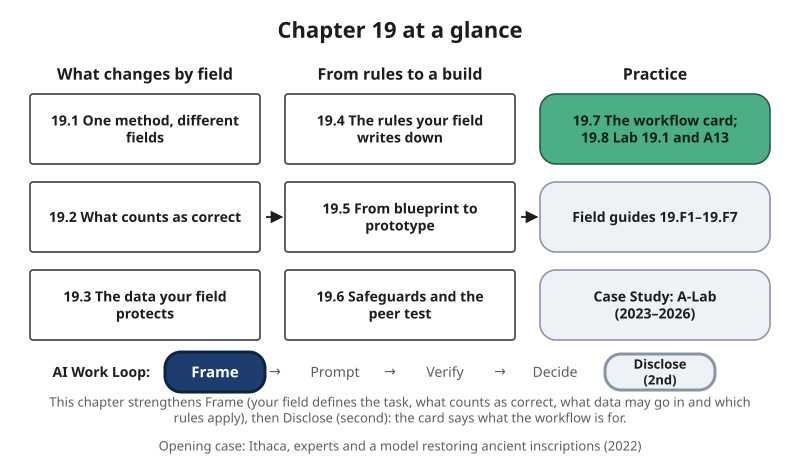{#fig-19-1 fig-alt="Chapter map: what changes by field (19.1–19.3), from rules to a build (19.4–19.6), practice (19.7–19.8, guides, case); Work Loop, Frame highlighted."}

**Chapter 19 at a glance.** Every earlier chapter taught a method that works in any major. This chapter asks what changes when you carry that method into your own field, and how you show that a workflow you built is ready for its job. You will read your field's row of a map of AI uses, name who can confirm a result, find the data your field protects and the rules it writes down, build and test a small prototype, ask someone from another field to try it, and write a card that says what it is for and not for.

**How the boxes work.** A *worked example* shows a full solution. A *faded example* gives you the first step and leaves the rest to you; the answers are in Appendix E. A *Your Turn* box is a step of the pre-lab, the lab or A13.

**Time:** the Core sections take about 22 minutes at a steady pace (150 words a minute); the whole Core package, with the Opening Case, section 19.8, your guide and one other, the Case Study, the Summary and answering the Warm-up and Check Yourself, about 52. Allow more if you read more slowly or in a second language. Add about 4 minutes for the recommended part of the model-card paper (Further Reading), about 12 for the pre-lab and about 64 for A13 at home, including its brief and the fairness runs (7 minutes less if your workflow describes no people). Faded examples, Review Questions A–C, the Spaced Review and the Case Study Questions are practice for a final review; Discussion Questions are for class. The other five guides, the Ethics Lens, Career Connection, From the Field, the Deep sections and Labs 19.2–19.3 are optional. Only Core sections are examinable. Answers to Check Yourself, the faded examples and odd-numbered end-of-chapter questions are in Appendix E.

**The question of this chapter:** *What changes when you bring AI into your own field, and how do you show that your workflow is ready to use?* The Chapter Summary answers it.

## Opening Case: Seventy-Two Percent {.unnumbered}

Ancient Greek **inscriptions**, texts cut into stone, are among the main sources for the history of the ancient Mediterranean. Many are damaged: letters are worn away or broken off, and the place and date are often unknown. **Epigraphy** is the study of such texts. Filling the gaps is slow, expert work that other specialists then check.

In March 2022, a team from DeepMind, Ca' Foscari University of Venice, Harvard's Center for Hellenic Studies, the Athens University of Economics and Business and the University of Oxford described **Ithaca**, a deep neural network trained on 78,608 Greek inscriptions from a public database (Assael et al., 2022). Ithaca does three things: it suggests the missing letters, the region where a text was written, and when.

The team tested it on texts with characters hidden on purpose, so the right answers were known. Two ancient-history graduate students with training in epigraphy worked on the same texts alone and then with Ithaca's top 20 suggestions in front of them. Measured by **top-1 accuracy**, the share of restorations whose first suggestion was fully right, the two experts alone scored 25.3%, Ithaca alone 61.8%, and the experts using Ithaca 71.7% (Assael et al., 2022, Table 1). Ithaca also placed texts in the right one of 84 regions 70.8% of the time and dated them to within about 30 years on average.

The authors describe Ithaca as designed to assist and expand the historian's workflow. Its restorations are offered as ranked options for a specialist to weigh, not as answers. This was one test, in one field, with two experts and texts damaged on purpose.

**The puzzle.** If the model alone beat the experts by a wide margin, why should historians stay in charge? And why did the pair beat both? Section 19.2 and the Chapter Summary give this book's reading.

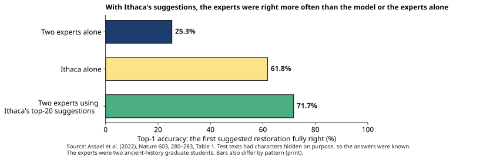{#fig-19-5 fig-alt="Bar chart of top-1 restoration accuracy: two experts alone 25.3%, Ithaca alone 61.8%, the experts using Ithaca's suggestions 71.7%."}

## Learning Objectives {.unnumbered}

Framework tags refer to the UNESCO (United Nations Educational, Scientific and Cultural Organization) AI Competency Framework for Students and the AI Fluency framework.

After this chapter you will be able to:

- **O1 — Explain** why oversight follows the kind of use more than the field, and where a field's rules raise the floor, using the Discipline × Use Map. *(LO6, LO5 · AI Fluency: Discernment · UNESCO: ethics of AI, Understand)*
- **O2 — Analyze** a task in your field to determine what counts as a correct result, who can confirm it, and which data must not go into an AI tool. *(LO6, LO3; LO5 · AI Fluency: Diligence, Discernment)*
- **O3 — Apply** the rules nearest you to determine what an AI use in your field requires, and record each rule with its source and date. *(LO5, LO6 · AI Fluency: Diligence · UNESCO: ethics of AI, Apply)*
- **O4 — Build** a working prototype of a workflow for your field and test it on three inputs with safeguards built in. *(LO6, LO2 · AI Fluency: Delegation, Description · UNESCO: AI system design, Create)*
- **O5 — Evaluate** a prototype through a peer test by someone from another field, and revise it on the evidence. *(LO6; LO2 · AI Fluency: Discernment, Diligence)*
- **O6 — Produce** a workflow card that says what a workflow is for and not for, what it was tested on and where it fails, with a short defense for a non-specialist. *(LO6; LO5 · AI Fluency: Description, Diligence · UNESCO: AI system design, Create)*

::: {.callout-note title="Warm-up (ungraded)"}
Answer from what you know today. You will come back to these in the Chapter Summary.

1. Would you check an AI summary the same way in a nursing course and in a history course? Why or why not?
2. You remove every name from a set of survey answers. May they now go into any AI tool?
3. Your workflow worked on your own test. Is it ready for other people to use?

For each answer, write how sure you are, from 0 to 100%.
:::

## 19.1 One Method, Different Fields {#sec-19-1 .unnumbered}

[Core]{.path}

*Featuring Marcus (nursing), who never enters patient information into any AI tool, and says so.*

A nursing student, a historian and an engineer can all use the same AI Work Loop from Chapter 1: frame, prompt, verify, decide, disclose. A **discipline** is a field of study and work with its own questions, methods and standards. Four things change from field to field:

1. what counts as a correct result, and who can confirm it (section 19.2);
2. which data the field protects (section 19.3);
3. which rules the field writes down (section 19.4);
4. who bears an error: only you, or a patient, a client, a student or a reader.

A **field guide** is a one-page summary of those answers for one field, plus its typical uses and a career note. Seven guides follow section 19.8, with a list that matches majors to guides. Read the one nearest your major and one other.

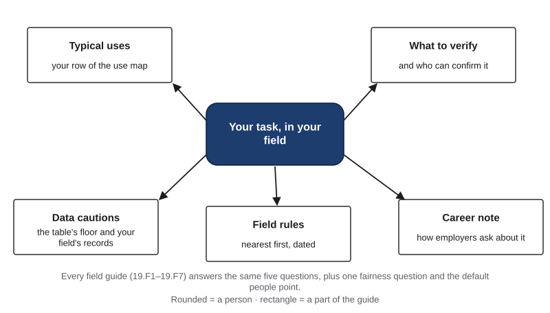{#fig-19-3 fig-alt="Your task in your field, linked to five parts: typical uses, what to verify and who can confirm it, data cautions, field rules, career note."}

The **Discipline × Use Map** is a table of fields against kinds of AI use. Each cell shows the default **people point**, who checks and when, for a student's coursework:

- **log review:** a person reviews the record afterward;
- **check point:** a person inspects an intermediate result before later steps build on it;
- **approval gate:** the work pauses until a named person approves, edits or rejects it;
- **keep with a person:** no AI in the decision.

Chapter 14's third people point, the stop point, is a condition inside a build, not a map level (section 19.5).

The map draws four uses whose default differs by field: drafting text, analyzing data, code or calculations, and images, audio or video. Two uses are the same in every field, so they are printed as one line under it: summarizing sources is a check point, and advising or deciding about people stays with a person.

**What the map shows:** the use matters more than the field, except where a field's rules raise the floor, that is, set a stricter minimum. For example, health's row has approval gates for drafting text and for calculations, because coursework in health includes placement work whose words and numbers can reach a patient. A practice set that reaches no one is a check point against the course's answer key. The map is this book's reading, as of October 2026: a default that your field's rules and your instructor override.

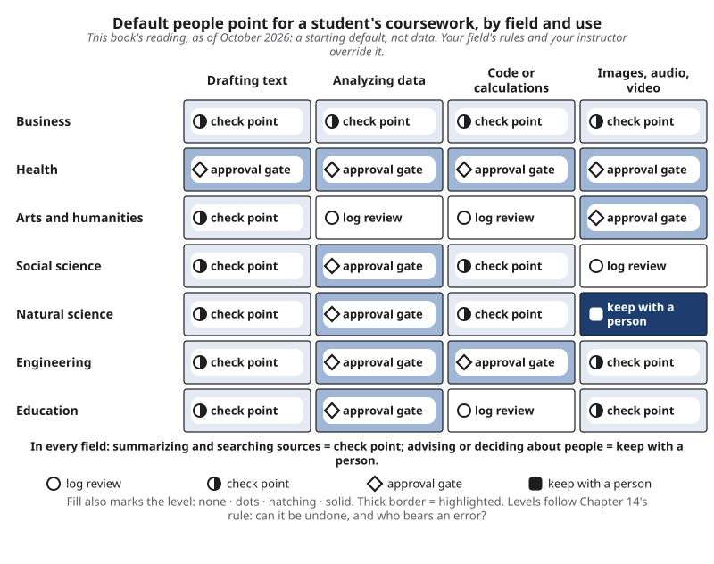{#fig-19-2 fig-alt="Grid of seven fields by four uses (drafting, data, code, images); cells read log review, check point, approval gate or keep with a person."}

*Note.* The levels follow Chapter 14's rule (can it be undone, and who bears an error?). The map is not Chapter 15's Risk Heat Map, and it rates checking, not tool quality (task–tool fit, Chapter 12).

::: {.callout-note title="Worked Example: Marcus Reads His Row"}
**Field:** Nursing. *(Constructed example.)* Let's take three of Marcus's uses.

- **A study summary of a textbook chapter:** check point; he checks it against the chapter.
- **A practice dose calculation:** health's default is an approval gate, because calculations usually reach a patient. His practice set reaches no one, so it is a check point: he recomputes each answer by formula against the course's answer key and uses no dose he has not checked.
- **Anything about a real patient:** keep with a person, by placement rules and his own rule.
:::

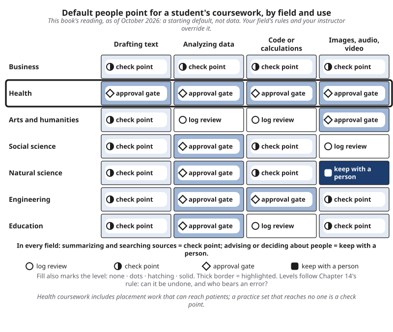{#fig-19-4 fig-alt="The Discipline × Use Map with the Health row outlined: approval gate for drafting, data, calculations and media."}

::: {.callout-note title="Faded Example: Lucia's Row"}
**Field:** Accounting. Lucia drafts customer replies at her support job in the company's approved AI tool (Chapter 15). She is also treasurer of the accounting students' association.

**Drafting a customer reply (filled):** check point; customers read it, so she checks it before it is sent. **Analyzing the association's budget, which the board will use to vote on spending:** the map's default for business, and whether the Business guide's override applies: _____ **Choosing which members receive a scholarship:** _____
:::

::: {.callout-important title="Your Turn (pre-lab)"}
Place your A13 task on your field's row. Name the cell, and give one reason.
:::

::: {.callout-tip title="Check Yourself 19.1"}
1. Name the four things that change from field to field.
2. Why is health drafting an approval gate on the map when business drafting is a check point?
:::

## 19.2 What Counts as Correct, and Who Can Say So {#sec-19-2 .unnumbered}

[Core]{.path}

*Featuring Hana (media arts and design, history minor), who draws by hand first, always.*

Every field has its own evidence for "correct." For example, a historian goes to the archive record, a chemist to the raw data and a repeat of the experiment, an engineer to the standard, and a nurse to the drug reference and the licensed clinician. **Verification authority** is the source or person a field accepts as able to confirm a result: a primary record, a standard, a replication, a licensed professional or a trained specialist.

Chapter 8's terms still apply. An **independent check** is evidence that no AI tool produced: a source with an author or publisher you can name, or your own recalculation or reasoning from known inputs. A **primary source** is the original record a claim comes from: the study, the dataset, the law, the court record, the official page of the organization that sets the rule. In other words, what changes is *which* source counts, and whether you can do the check yourself.

**Back to Ithaca.** The paper presents Ithaca's restorations as plausible suggestions, never as certain, and its first suggestion was still wrong in about 38% of restorations (Assael et al., 2022). This book's reading: historians stay in charge because in epigraphy trained people are the verification authority, and the pair did best because people who could judge a suggestion chose among ranked ones; the paper does not test this explanation. The main Case Study shows a similar pattern in chemistry.

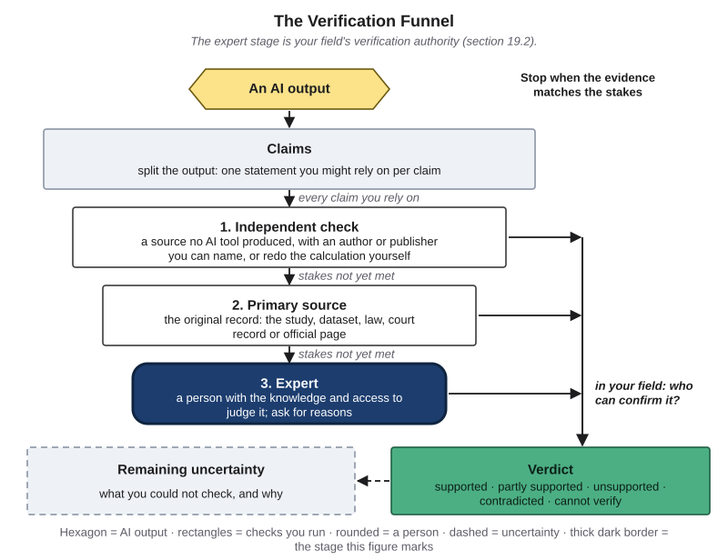{#fig-19-6 fig-alt="Verification Funnel with the expert stage highlighted and the note: in your field, who can confirm it?"}

**Name the authority before you build.** Then sort your checks: those you can do yourself (a recalculation, a primary record), and those that need a qualified person (a clinician, a licensed engineer, a methods advisor).

::: {.callout-note title="Worked Example: A Date in a Caption"}
**Field:** History. *(Constructed example.)* For the history issue of their zine, Hana asks a chat tool to summarize a scanned 1920s newspaper page. The summary dates a streetcar line's opening to 1921.

- **Verification authority:** the page itself and the archive's catalog record.
- **Check:** the page, dated 1922, reports the line opening that week.
- **Verdict:** contradicted.

Hana corrects the caption from the page and cites the archive, not the summary.
:::

::: {.callout-note title="Faded Example: A Rated Speed"}
**Field:** Engineering. Sam's datasheet summary gives a club motor's rated speed as 5,300 revolutions per minute (rpm). **Verification authority (filled):** the manufacturer's datasheet, revision dated March 2026, which lists 5,000 rpm. **The check, and the verdict:** _____
:::

::: {.callout-important title="Your Turn (pre-lab)"}
Name your A13 task's verification authority, and one check you can do yourself.
:::

::: {.callout-tip title="Check Yourself 19.2"}
1. Define verification authority, and give one example from a field other than yours.
2. In this book's reading, why should historians stay in charge of Ithaca's restorations, even though the model alone scored higher?
:::

## 19.3 The Data Your Field Protects {#sec-19-3 .unnumbered}

[Core]{.path}

*Featuring Marcus.*

Before you test a tool, ask whether you may give it the input. Chapter 12 called this the **data gate**: a check, made before any quality test, of whether a tool's data terms fit the class of the input. An input's **data class** is its row in Chapter 12's table, which is built on a generic three-level classification (public; internal or confidential; restricted or legally protected). Here are the table's rows, unchanged.

| Input | Consumer terms (for example, a free tier) | Institutional terms (for example, a tool your institution provides or approves) |
|---|---|---|
| Public information | Yes | Yes |
| Your own non-sensitive work; material your course provides; de-identified data (names and identifiers removed) | Yes, if you accept the tool's training and retention terms | Yes |
| Personal data about other people (names, contact details), and internal or confidential information | No | Only if the part needs it and your institution's or employer's rules allow it; ask your institution's IT office if unsure |
| Restricted or legally protected information, including FERPA and HIPAA records | No | No, at this book's floor |

*The rows are this book's reading, built on a generic three-level classification; in this book, an input's data class is its row. Your institution's or employer's own classification decides; this table is a starting floor.*

**The table is a starting floor.** A field rule can still say no to an input the table allows: a placement policy, an institutional review board protocol, a consent form, HIPAA's (the Health Insurance Portability and Accountability Act's) own de-identification standard or an employer's policy.

Every field has such records. **Protected health information** falls under HIPAA; **education records**, a school's records about a student, under FERPA (the Family Educational Rights and Privacy Act). Research with people runs under **informed consent**, a participant's agreement after being told what happens to their data, approved by an **institutional review board** (IRB), a committee that approves and oversees research with people. Clients' files fall under contracts and professional duties.

Chapter 15's habits apply: **de-identification**, removing names and obvious identifiers, is a start, not a guarantee of anonymity; send only what a part needs (**data minimization**), or a **constructed case**, an invented example built for practice.

::: {.callout-note title="Worked Example: Marcus's Inputs"}
**Field:** Nursing. *(Constructed example.)*

- **His textbook's drug tables and his own notes:** course material and his own work. They pass the floor, and he uses a tool his institution provides.
- **A detail from his placement, even without names:** the floor would allow de-identified data, but his placement's rule says no information about patients goes into any outside tool. **Blocked.**

He builds practice cases from the textbook instead.
:::

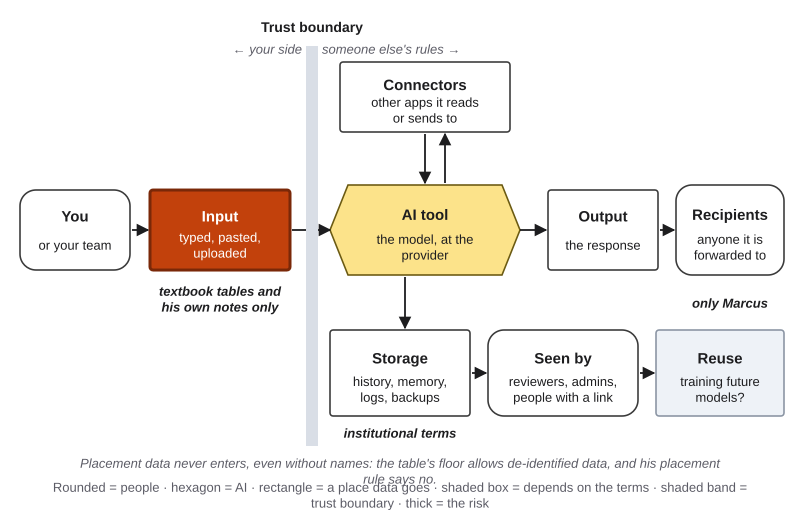{#fig-19-7 fig-alt="Data-flow map with the input box highlighted: textbook tables and his own notes only; institutional terms; placement data never enters."}

::: {.callout-note title="Faded Example: Survey Answers"}
**Field:** Psychology. Maya wants help sorting 60 open-ended answers from her research-methods class survey. Some answers name classmates; the consent form says responses stay with the course team. **Data class, her row of the table (filled):** personal data about other people. **The gate, and a change to the input that would pass it:** _____
:::

::: {.callout-important title="Your Turn (pre-lab)"}
Give your A13 input's data class and gate decision, and any field rule that changes it.
:::

::: {.callout-tip title="Check Yourself 19.3"}
1. Why can an input pass Chapter 12's table and still be blocked in your field?
2. Name two kinds of records that a field protects, and the rule behind each.
:::

## 19.4 The Rules Your Field Writes Down {#sec-19-4 .unnumbered}

[Core]{.path}

*Featuring Marcus.*

Chapter 18 sorted rules into three layers: law; what you agree to (terms, licenses, contracts); and your organization's policy. For a student, read them **nearest first**:

1. your course syllabus and instructor;
2. your program or department;
3. a placement site or employer;
4. your profession's code and **licensing board** (the state body that grants **licensure**, permission to practice, and sets each profession's **scope of practice**, what its members may do);
5. journals and funders, when you publish or apply;
6. law, federal and state.

Start nearest because those rules are the most specific to your work, you can ask the people who wrote them, and they are often the strictest. Follow the strictest rule that applies, and ask the rule's owner when one is unclear (Chapter 18). If you will study or work outside the United States, your home country's rules fit into the same layers; read them nearest first too.

Dated examples, as of October 2026: the U.S. National Institutes of Health (NIH) bars its peer reviewers from using generative AI to analyze or write critiques of grant applications (NIH, 2023); the International Committee of Medical Journal Editors (ICMJE) says AI tools cannot be authors and their use must be disclosed (ICMJE, 2026); in Texas, a health-care provider must tell a patient when AI is used in their care (TRAIGA, the Texas Responsible Artificial Intelligence Governance Act, from January 1, 2026; Chapter 18); and the Texas Board of Professional Engineers and Land Surveyors (TBPELS) advises licensees not to rely on AI without their own oversight and review, and says they remain responsible for what they seal (TBPELS, 2024).

In other words, most of these rules say three things: **who checks, who discloses, and what data may go in.** Those are exactly what a prototype must build in (sections 19.5–19.6).

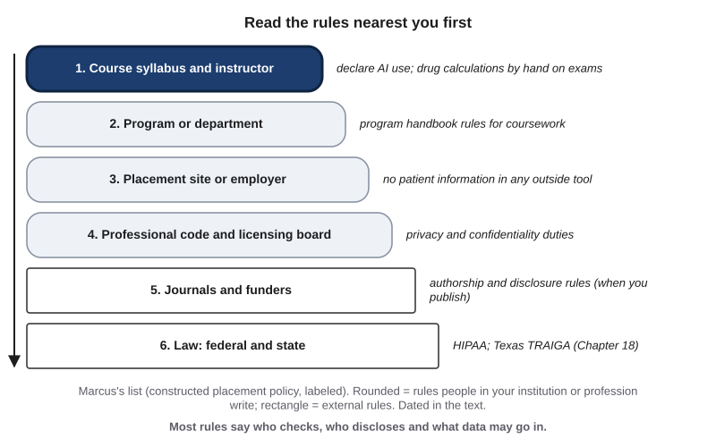{#fig-19-8 fig-alt="Six stacked rule sources from nearest to farthest: syllabus, program, placement or employer, professional code and board, journals and funders, law."}

::: {.callout-note title="Worked Example: Marcus's Rule List"}
**Field:** Nursing. *(Constructed example; the program and placement policies are invented for practice.)*

1. **Syllabus:** declare AI use; drug calculations by hand on exams.
2. **Program handbook:** AI tools may help with study, not with graded care plans.
3. **Placement policy:** no patient information in any outside tool.
4. **Professional code:** the nurse protects patients' privacy and confidentiality (American Nurses Association, 2025, Provision 3.1).
5. **Law:** HIPAA; and, once a tool's output reaches patients, Texas's disclosure duty (Chapter 18).

What they require of his workflow: textbook input only, his own check of every result, and a declaration.
:::

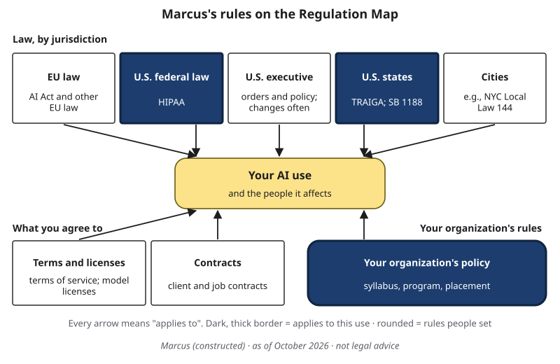{#fig-19-22 fig-alt="Regulation Map with U.S. federal law (HIPAA), U.S. states (TRAIGA; SB 1188) and organization (syllabus, program, placement) highlighted for Marcus."}

::: {.callout-note title="Faded Example: The Tutoring Center"}
**Field:** Education. Maya volunteers at the campus peer-tutoring center. Facts: the course she tutors allows AI for explanations, not for graded answers (its syllabus); the center's session notes name each student she tutors. **Rule 1, the nearest (filled):** the center's guidance: tutors explain and ask questions; they do not give answers to graded work *(constructed)*. **Two more rules, nearest first, and what each requires:** _____
:::

::: {.callout-important title="Your Turn (pre-lab)"}
Write one rule that applies to your A13 task, with its source, its date and what it requires.
:::

::: {.callout-tip title="Check Yourself 19.4"}
1. In what order should you read the rules that apply to you, and why start nearest?
2. Name the three things most field rules say.
:::

## 19.5 From Blueprint to Working Prototype {#sec-19-5 .unnumbered}

[Core]{.path}

*Featuring Marcus. This example mirrors the concept session's demonstration.*

A **prototype** is the smallest working version of a workflow, built so that someone can run it, check it and change it; it is not a finished product. A build needs no programming:

- a **prompt template**: a prompt written for a recurring task, with fixed parts that stay the same each time and placeholders for the parts that change;
- a **prompt chain**: a fixed sequence of prompts that you run one after another, where each step's output becomes the next step's input and you check the result between steps;
- a tool set up with **standing instructions** (instructions you write once, in a tool's options or a project, that the tool adds to every conversation in that scope) and chosen files;
- a spreadsheet with an AI feature, or an automated workflow in a **sandbox**, a separate test copy where changes do not reach real data or people (Chapter 14).

The build answers the field guide: inputs pass the data gate and your field's rules; every output has a named check against your verification authority; there is at least one people point (an approval gate, a check point or a **stop point**, a condition at which a run halts and hands control back to a person); and nothing sends, publishes, pays or deletes.

**Test it on three real inputs.** **Test inputs** are a small set of different inputs a prompt is tried on (typical, different, edge) to see whether it works beyond one case. *Real* means actual tasks from your field (your own work, course material, public or constructed data), never personal or confidential data. Take the edge case from where your field knows errors happen.

**Decide fit part by part.** Chapter 12's fit matrix still works: each part of the workflow gets its own decision, and "no AI" is a valid cell.

**A11 and A13.** A11 is a design tested on paper, for any recurring task; oversight is what is graded. A13 (Chapter 19) is a working prototype in your own discipline, run on three real inputs with a peer test. You may start A13 from your A11 design, but A13 is graded only on the new build, runs and peer test.

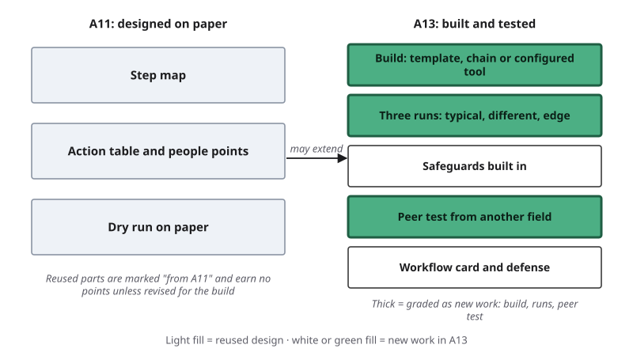{#fig-19-9 fig-alt="Two lanes: A11 step map, action table, paper dry run (reused, no credit unless revised); A13 build, three runs, safeguards, peer test, card (new)."}

::: {.callout-note title="Worked Example: Marcus's Pharmacology Review, Written Out"}
**Field:** Nursing. *(Constructed example; a tool his institution provides.)* A three-step prompt chain. Steps 1 and 3 are templates; {TABLE}, {QUESTIONS} and {MY ANSWERS} are placeholders.

```
Step 1. You are helping a nursing student review for an exam. Using only
the drug table below, write 10 numbered practice questions. Each asks for
one drug's class, its main use or one listed side effect. Do not ask about
anything the table does not state.
Table: {TABLE}

Step 2. (No AI.) Answer the 10 questions from memory.

Step 3. Mark each answer right or wrong using only the table. For each
mark, give the table row you used and one plain-language reason.
Questions: {QUESTIONS}
My answers: {MY ANSWERS}
Table: {TABLE}
```

**His check point:** after step 3, he compares every mark with the table himself. **Inputs:** typical, one drug class; different, a table that mixes US and metric units; edge, two drugs whose names look alike. On the edge run, question 7 swaps the two names; his check point catches it.
:::

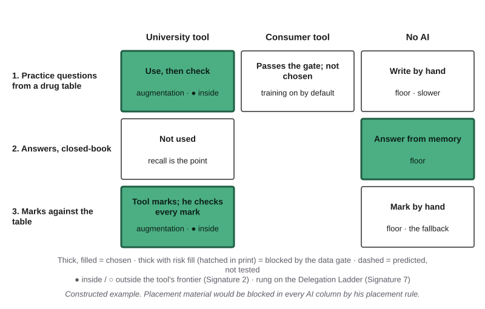{#fig-19-10 fig-alt="Fit matrix: three parts by institution's tool, consumer tool and no AI; chosen: tool for questions and marks, no AI for answers."}

::: {.callout-note title="Faded Example: A Lab-Report Checker"}
**Field:** Chemistry. A chemistry major builds a template that checks a lab report's calculations against the raw data she pastes in. Facts: her reports compute concentrations in moles per liter from volumes in milliliters and masses in grams, and a percent yield; her instructor says milliliter-to-liter slips are the most common error. **Step 1 (filled):** the template asks the tool to list every number in the results section next to the calculation it should come from. **Her three test inputs (typical, different, edge):** _____
:::

::: {.callout-important title="Your Turn (Lab 19.1)"}
In the lab session, build your prototype and run your three inputs.
:::

::: {.callout-tip title="Check Yourself 19.5"}
1. What makes a prototype different from a finished product?
2. Which parts of an A11 blueprint can A13 reuse, and why do they not earn points a second time?
:::

## 19.6 Safeguards and the Peer Test {#sec-19-6 .unnumbered}

[Core]{.path}

*Featuring Marcus and Hana.*

Your own tests share your blind spots. A **peer test** is a test in which a person from another field runs your prototype on an input of their choosing, within its stated scope and with only your instructions, and records where it confused them or failed. Someone from another field is useful because they read your words as a non-specialist would. In the lab, bring two or three inputs inside your scope for your peer to choose from.

**Four safeguards** travel with every prototype:

1. **The data gate,** passed: the table's floor, then your field's rules (section 19.3).
2. **A people point**, and a **hard gate**, one the system enforces, where an error would fall on other people (Chapter 14).
3. **One field rule,** applied, with its source and date (section 19.4).
4. **A fairness check** when your workflow describes or affects people: a small **paired-input test**, a test that runs inputs identical except for one cue linked to a group, many times each, counts the outputs by a rule written before any run, and compares the counts (Chapter 16). Name the cue, such as a name. With three runs each, any gap is a **lead**, a gap worth a bigger test but not a conclusion. If no group cue enters, say so in one line.

Record the tool kind, the model name if shown, and the date of every run. One study ran the same prompt on a chat model in April, June and July 2023; the July results differed substantially from April's, partly because the provider had updated the model under the same name in June (Bisbee et al., 2024). Record the date, not only the name.

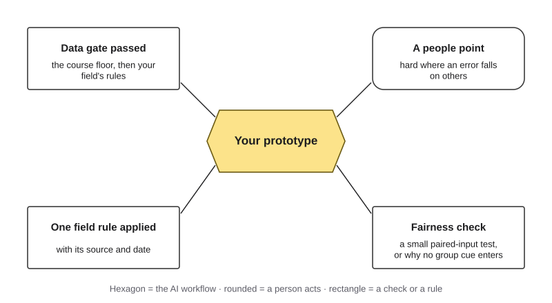{#fig-19-11 fig-alt="A prototype hexagon linked to four safeguards: data gate passed, a people point, one field rule applied, a fairness check."}

**Recording a peer test.** A sentence frame helps: "With input ___, at step ___, I expected ___ but saw ___. I was confused by ___."

::: {.callout-note title="Worked Example: Hana Tests Marcus's Workflow"}
*(Constructed example.)* Hana, who keeps a written verification protocol for their zine, picks one of the three drug tables Marcus brought. The marks are right, but they cannot tell *why* an answer was marked wrong: the tool's reasons use clinical abbreviations. Hana's record: "With the cardiac drugs table, at step 3, I expected a reason I could follow but saw 'ACEi, AE: cough.' I was confused by the abbreviations." Marcus adds one instruction, "spell out every abbreviation", reruns Hana's input, and Hana can follow it.

**Fairness check:** his drug tables describe no people, so no group cue enters. He records that line.
:::

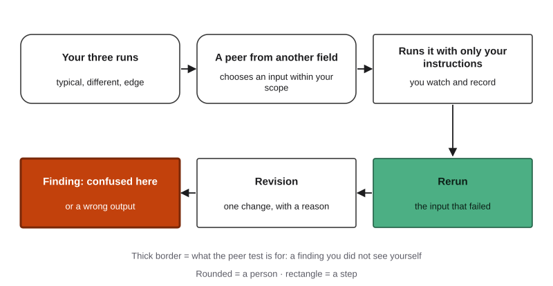{#fig-19-12 fig-alt="Six steps: your three runs, a peer from another field picks an input, runs it with only your instructions, finding (thick), revision, rerun."}

::: {.callout-note title="Faded Example: Feedback on Tutoring Notes"}
**Field:** Education. Maya's workflow drafts encouraging feedback on practice answers for the tutoring center *(constructed)*. Feedback describes a student, so she runs one practice answer with two first names, 3 runs each, and counts encouraging sentences. **Result (filled):** 3, 3 and 2 with one name; 3, 3 and 3 with the other. **What this result can and cannot show, and her next step:** _____
:::

::: {.callout-important title="Your Turn (Lab 19.1)"}
In the lab, peer-test a partner's prototype from another field, and have yours tested.
:::

::: {.callout-tip title="Check Yourself 19.6"}
1. Why should your peer tester come from another field?
2. When does a prototype need a fairness check, and what does a small one show?
:::

## 19.7 Say What It Is For: The Workflow Card {#sec-19-7 .unnumbered}

[Core]{.path}

*Featuring Marcus.*

A 2019 paper by Mitchell and colleagues (Further Reading) introduced the **model card**: a short document published with a model that states what it is for and not for, how it was evaluated, including results by group where relevant, and its known limits (after Mitchell et al., 2019). Its nine sections are model details, intended use, factors, metrics, evaluation data, training data, quantitative analyses, ethical considerations, and caveats and recommendations. Its central argument: report results for each group and condition, not one overall number.

A **workflow card** is this book's five-field version for a student workflow. Write *not for* first, so that no one relies on the workflow where it was never tested:

- **Not for:** uses outside its scope.
- **For:** the intended use and user.
- **Tested on:** the three inputs, the peer test, the tool kind, the model name if shown, and the date.
- **Results:** per input, with the check used.
- **Limits and safeguards:** what was not tested; what the tool learned from, if known; the people points; the field rule.

A workflow is ready only for the uses its card states: outside them there is no evidence. Writing down limits does not make the work look weak; it tells others where they can rely on it. But a card only informs; the gates and checks are what protect. The main Case Study shows how much one word can carry: when an automated lab's paper was corrected, the word "novel" went, and the claim changed with it.

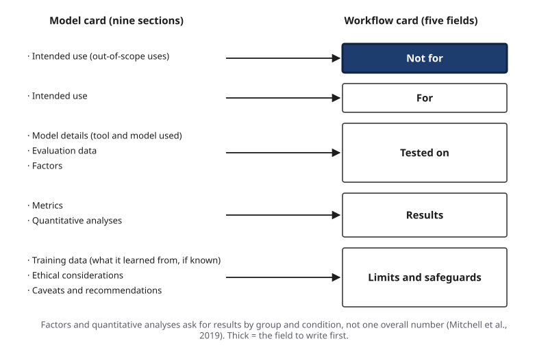{#fig-19-13 fig-alt="Nine model-card sections grouped into five workflow-card fields: not for (highlighted), for, tested on, results, limits and safeguards."}

::: {.callout-note title="Worked Example: Marcus's Card"}
*(Constructed example.)*

- **Not for:** patient care; real dose calculations; anyone's grades.
- **For:** my own exam review, from my textbook's drug tables.
- **Tested on:** three tables (typical, different, edge) and Hana's peer test; a tool my institution provides; model name and date recorded.
- **Results:** typical and different, all 10 marks right; edge, question 7 swapped two look-alike names, caught at my check point; after the revision, all 10 right.
- **Limits and safeguards:** one tool and one model; combination drugs not tested; I check every mark; no group cue enters.
:::

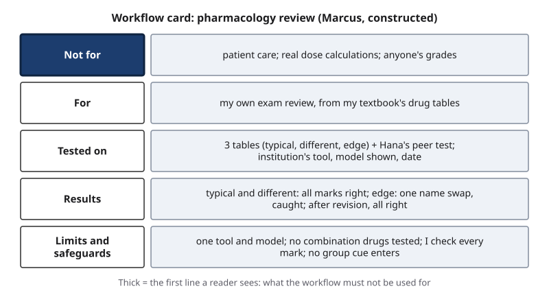{#fig-19-14 fig-alt="Workflow card with five rows; 'Not for: patient care; real dose calculations; anyone's grades' is first and thick."}

::: {.callout-note title="Faded Example: Sam's Card"}
**Field:** Engineering. Sam's prototype summarizes one motor datasheet for the robotics club *(constructed)*. His runs: a metric datasheet, right; a US-unit datasheet, right after his unit check; a datasheet with no stall-torque value, where the tool produced a value that is not on the datasheet, caught at his check. **Not for (filled):** safety-critical design or any purchase decision on its own. **For (filled):** comparing club motors before an order. **Tested on, results, and limits:** _____
:::

::: {.callout-important title="Your Turn (A13)"}
Write your workflow card, with the *not for* line first.
:::

::: {.callout-tip title="Check Yourself 19.7"}
1. Define a model card, and say which line of a workflow card to write first, and why.
2. Why is a workflow "ready" only for the uses on its card?
:::

## 19.8 Discipline Sprint (Lab 19.1 and A13) {#sec-19-8 .unnumbered}

[Studio]{.path}

A13 is one record. Before the lab session, write your field answers and three test inputs; in the lab, build, run and peer-test; at home, check, revise, rerun, and write the card and the defense. Full-mark results include "this step stays with a person" and "the edge input failed, and the card now excludes it."

The record: task and field answers → the build → three runs with checks → safeguards → peer test → revision and rerun → workflow card → defense (one result and one limit from your card) → AI Use Declaration.

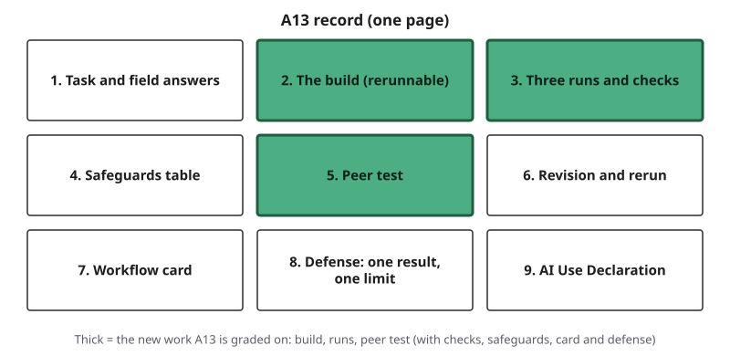{#fig-19-15 fig-alt="A13 record as nine boxes; build, three runs and peer test are thick: the new work A13 is graded on."}

::: {.callout-note title="Worked Example: Marcus's A13, All Nine Parts (Abridged)"}
*(Constructed.)*

1. **Task and field answers:** weekly pharmacology review; done when every mark is checked. Authority: the textbook's table. Data: course material (passes); placement data blocked. Rule: his course syllabus (declare AI). Cell: check point; he agrees, since nothing reaches a patient.
2. **Build:** the three-step chain in section 19.5, written out; a tool his institution provides; model name as shown; date.
3. **Runs:** typical (cardiac drugs) 10/10 marks right; different (mixed units) 10/10; edge (look-alike names) question 7 swapped the names. Check: the table; verdict contradicted.
4. **Safeguards:** gate passed; check point (Marcus, every mark); rule applied (declaration); no group cue enters.
5. **Peer test:** Hana picked the cardiac table and was confused by the abbreviations (Hana's sentence-frame record quoted).
6. **Revision:** "spell out abbreviations" and "give each drug's class beside its name"; reruns of Hana's input and the edge table: 10/10.
7. **Card:** as in section 19.7.
8. **Defense (excerpt):** "It drafts practice questions; I answer them myself and check every mark against my textbook. On look-alike names it once swapped two drugs, so I check every name, and it is not for real doses."
9. **Declaration:** all five elements.
:::

::: {.callout-note title="Faded Example: A Partly Filled A13 Sheet"}
**Field:** Business. Lucia's reconciliation-practice workflow for her accounting course *(constructed figures)*. **Filled:** task (practice matching bank-statement and ledger lines); verification authority (her textbook's answer key); data class (course material); build (a two-step template); run 1, typical, 12 of 12 lines matched, checked against the key. **Facts for the rest:** run 2 used a statement with one reversed entry; the output matched it as an ordinary line. In the peer test, Sam wrote: "the output used the word 'reconcile' for two different steps." **To complete:** run 2's check and verdict, run 3 (an edge input you choose, with what you would check), and the revision the peer test calls for. _____
:::

::: {.callout-tip title="Check Yourself 19.8"}
1. What does A13 grade, and what does it not grade a second time?
2. Why must your defense cite a limit as well as a result?
:::

## Field Guides {#sec-19-guides .unnumbered}

[Studio]{.path}

Each guide answers the five questions of @fig-19-3 for one field, adds a fairness question and a short real case, and ends with a career note. Read the guide nearest your major and one other; the rest are optional. The guides are reference material: exam items supply any field facts they need. Rules are dated as of October 2026 and change; check the issuing body's page before you rely on one.

**Which guide is yours?** Find your major's broad field of study (names of majors vary by institution):

- **Business:** accounting, business administration, finance, marketing, management, information systems → Business (health-care management: read Health too).
- **Health:** nursing, public health, speech-language pathology and audiology, health-care studies → Health. Pre-health students in another major: read Health too.
- **Arts and humanities:** history, literature, languages, philosophy, media arts and design, animation and games, visual and performing arts → Arts and humanities.
- **Social sciences:** psychology, cognitive science, child development, economics, political science, criminology, sociology, public policy → Social science.
- **Natural sciences and mathematics:** biology, chemistry, physics, mathematics, earth and environmental sciences, neuroscience → Natural science.
- **Engineering and computing:** engineering → Engineering; computer science → Engineering, where coursework code is a check point unless it is safety-relevant.
- **Education:** teacher preparation and education studies → Education.
- **Interdisciplinary or undecided:** the guide for the field you are considering.

If your major sits between two guides, read both and note one difference.

### 19.F1 Business {#sec-19-f1 .unnumbered}

*Featuring Lucia (accounting), who works in customer support and is saving to sit for the CPA exam.*

**Typical uses (your row):** drafting customer and internal messages (check point); summarizing reports and filings (check point); analyzing figures for a decision (check point in coursework; an approval gate once the analysis moves money or reaches customers); spreadsheet formulas and code (check point); marketing images and copy (check point, with disclosure); decisions about people, such as hiring, credit or discounts (keep with a person).

**What to verify, and who can confirm it:** in accounting and finance, source documents, the ledger, the audit trail and a forecast's stated conditions; a licensed certified public accountant (CPA) for professional opinions. In marketing, the client's brief, the brand guide and evidence for every product claim; a typical edge case is a claim such as "clinically proven," which needs proof the tool cannot supply.

**Data cautions:** customer and client data under contracts (Chapter 15); employer confidential data; other internal or confidential information. Lucia drafts replies only in her employer's approved tool.

**Field rules, nearest first:**

- the course syllabus; your employer's AI policy;
- for CPAs in public practice, the American Institute of CPAs' confidential client information rule: no disclosure of confidential client information without the client's specific consent; for outside service providers, such as an AI tool, a confidentiality agreement with the provider or the client's consent first (AICPA Code 1.700.001 and 1.700.040, as quoted by Blatch, 2015);
- the Federal Trade Commission's actions against deceptive claims about AI products (Operation AI Comply, September 2024; in December 2025 the FTC set aside its final order against the writing tool Rytr, one of the five cases, while the other deception cases stand) (FTC, 2024, 2025).

**Fairness question:** does a workflow that touches customers or applicants treat names, languages or neighborhoods differently (Chapter 16)? Marketing copy that names or targets a group describes people: run the paired-input check with the audience cue, such as "for retirees" against "for students."

**Case C23: Zillow Offers (2021).** From February 2021, Zillow said, its Zestimate, which it described as using AI including a deep-learning network, became the *initial* cash offer for a limited subset of homes in more than 20 markets (Zillow Group, 2021a). On November 2, 2021, it announced it would wind down Zillow Offers: it had been unable to forecast home prices accurately, missing in both directions; it wrote down about $304 million of inventory in the third quarter, expected $240–265 million more in losses and would cut about 25% of its staff (Zillow Group, 2021b, 2021c). Zillow did not blame an algorithm; "the algorithm failed" is the press's reading, so the AI's part is **inferred**. **What to verify in business:** the conditions a forecast was built for. *Labels:* tree "other" (a forecast used outside the conditions it was built for), inferred; chain link 4, loss, documented.

**Career note:** accountants, analysts and marketers may be asked to show how they checked AI-assisted work, not only that they used it.

### 19.F2 Health {#sec-19-f2 .unnumbered}

*Featuring Marcus (nursing), who never enters patient information into any AI tool, and says so.*

**Typical uses (your row; placement work can reach patients):** drafting text a patient will read (approval gate by a licensed clinician); summarizing guidelines and studies (check point); analyzing health data (approval gate); dose calculations (approval gate; a check point against the key for a practice set); clinical images and recordings (approval gate); deciding about patients (keep with a person).

**What to verify, and who can confirm it:** clinical guidelines and drug references; the patient record, never an AI summary of it; the licensed clinician.

**Data cautions:** protected health information under HIPAA; placement and hospital policies; even de-identified cases may be blocked by a field rule (section 19.3).

**Field rules, nearest first:**

- course and placement policy; the hospital's approved-tools list;
- the nursing code's privacy and confidentiality duty (American Nurses Association, 2025, Provision 3.1);
- HIPAA;
- in Texas, a health-care provider must tell a patient when AI is used in their care (TRAIGA, effective January 1, 2026; Chapter 18), and a practitioner who uses AI in diagnosis must review all AI-created records and disclose the use (S.B. 1188, effective September 1, 2025; Tex. Health & Safety Code § 183.005).

**Fairness question:** was the tool validated on patients like yours, and are its results reported by group (Chapter 16)?

**Case C24: a sepsis model at a new hospital (2021).** Epic, a widely used electronic-health-record vendor, reported in its internal documentation that its sepsis model separated cases from non-cases with an area under the curve (AUC, from 0.5 for chance to 1.0 for perfect) of 0.76–0.83. Researchers at Michigan Medicine, a hospital system using the model, checked it on 38,455 hospitalizations of 27,697 patients from December 2018 to October 2019: the AUC was 0.63, and sepsis occurred in 2,552 hospitalizations (7%). At the alert threshold the hospital studied (a score of 6 or more), the model missed 67% of the sepsis cases and alerted in 18% of hospitalizations (Wong et al., 2021). This was one site and the 2018–19 version; the vendor disputed the findings (reported; Reuter, 2021). As of October 2026, a second version of the model has been validated separately at four health systems, with AUC from 0.82 to 0.92 by site and most alerts still not sepsis (Wong et al., 2026). **What to verify in health:** whether a tool's reported accuracy holds on your patients, in your version. *Labels:* tree "other" (a prediction model below its reported accuracy at a new site), documented; chain link 3, alert burden, inferred; no harm documented.

*Another kind of evidence:* a large medical group's own staff reported that an ambient AI scribe, which drafts visit notes for physicians to edit, saved documentation time over 2.5 million uses; these are commentaries, not independent trials (Tierney et al., 2024, 2025; reported by the deploying organization).

**Career note:** clinical informatics roles review AI tools before they enter approved systems.

### 19.F3 Arts and Humanities {#sec-19-f3 .unnumbered}

*Featuring Hana (media arts and design, history minor), a freelance illustrator who draws by hand first, always.*

**Typical uses (your row):** drafting and editing (check point, with disclosure, Chapter 10); summarizing sources, archives and translations (check point); counting or sorting your own notes or a public corpus (log review); small scripts on your own copy of a public text (log review); images, audio or video shown as real or made for a client (approval gate); decisions about people (keep with a person).

**What to verify, and who can confirm it:** the primary source and the archive record; editions; the artist's own process evidence; a trained specialist, such as an epigrapher or a paleographer.

**Data cautions:** unpublished manuscripts; archive permissions; other artists' work and copyright (Chapter 18); clients' files.

**Synthetic media** are images, audio or video generated or substantially altered by AI; a **deepfake** is synthetic media that realistically shows a real person, or a real event, saying, doing or happening in a way that did not happen.

**Field rules, nearest first:** course policy; archive or museum terms; client contracts (Hana's AI clause, Chapter 18); your style guide on citing AI, for example the Modern Language Association's (MLA's) guidance, revised in August 2025 (MLA Style Center, 2025); copyright (Chapter 18).

**Fairness question:** whose languages, scripts and archives does the tool handle well, and whose poorly?

**Case C22: Ithaca (2022)** is the Opening Case. Its sequel, Aeneas (2025), works on Latin inscriptions; its authors report that historians using it outperformed both historians and the model alone on restoring texts and on attributing them to a region (Assael et al., 2025). **What to verify in the humanities:** the specialist chooses among ranked suggestions. *Labels:* none on the tree (a positive research result).

**Career note:** archivists and digital-humanities specialists use models to propose readings; the primary record decides.

### 19.F4 Social Science {#sec-19-f4 .unnumbered}

*Featuring Maya (psychology), who traces research claims to their sources.*

**Typical uses (your row):** drafting (check point); summarizing literature (check point); coding or analyzing participant data (approval gate); analysis code (check point: rerun it on data with a known answer); charts of your own public data (log review); decisions about people (keep with a person).

**What to verify, and who can confirm it:** the data and its **codebook** (the document that says what each variable and answer code means); replication; a **preregistration** (a plan for the analysis, posted before the data are seen); the IRB protocol; a methods advisor.

**Data cautions:** participant data under consent and an IRB protocol; small groups whose answers can identify someone (Chapter 15).

**Field rules, nearest first.** Each line says what applies to a survey task like Maya's.

- **Course and lab rules, the IRB protocol and the consent form** decide where participants' answers may go.
- **The federal rule for research with people** generally requires informed consent (45 CFR 46.116); a change to an approved study, such as adding an AI tool, needs IRB approval first (45 CFR 46.108(a)(3)(iii)).
- **Your institution's IT and information-security guidelines** may say which tools, if any, may receive FERPA or HIPAA information; ask your institution's IT office. At this book's floor, it stays out of every tool (section 19.3).
- **For survey research,** a task force of the American Association for Public Opinion Research (AAPOR) asks researchers to disclose which tasks used AI, how many human respondents took part, and how humans checked the work (Rothschild et al., 2026).

**Fairness question:** does the tool flatten the variation between groups that your study is about?

**Case C25: silicon samples (2023–2024).** Argyle et al. (2023) gave GPT-3 backstories of real respondents from the American National Election Studies (ANES) and another U.S. survey. They reported that it reproduced subgroup patterns closely enough to call it "algorithmic fidelity."

Bisbee et al. (2024) gave ChatGPT 3.5 Turbo personas of 2016 and 2020 ANES respondents and asked for 0–100 **feeling-thermometer** ratings (how warmly a person feels toward a group) of 11 groups. The averages were close to the survey's, but the answers varied far less. Of the regression coefficients, 48% differed significantly from the survey's, about a third of those with the opposite sign. Small wording changes shifted the results, and the same prompt rerun in July 2023 gave substantially different results from April's.

**What to verify in social science:** variation and reproducibility, not only averages.

*Labels:* tree "bias" (a skew across matched outputs: too little variation), documented. The authors call the narrow spread "overconfidence"; that is their word, not a tree label, because there is no evidence about expressed certainty.

**Career note:** survey and user researchers test AI-coded answers against human coding before they report.

### 19.F5 Natural Science {#sec-19-f5 .unnumbered}

*Featuring Lucia, in her general-education science course, and a chemistry major (a one-off figure).*

**Typical uses (your row):** drafting reports (check point); summarizing literature (check point); analyzing data before a result leaves the lab (approval gate); code (check point: test it on cases with known answers); images that are data, such as micrographs, gels and spectra (keep with a person: they are evidence), while diagrams are a check point, disclosed; decisions about people (keep with a person).

**What to verify, and who can confirm it:** the raw data; the instrument record; replication; peer review; your lab instructor or supervisor.

**Known error patterns:** units (milliliters vs. liters, Fahrenheit vs. Celsius); a daylight-saving clock change inside a time series; a missing control; a species or compound with two names.

**Data cautions:** unpublished results; lab notebooks; collaborators' data.

**Field rules, nearest first:**

- lab and course rules;
- journal and publisher policies: Springer Nature's policy, for example, does not permit AI authorship or photorealistic AI-generated images (Springer Nature, n.d.);
- funders: NIH bars its peer reviewers from using generative AI to analyze or write critiques of applications (NIH, 2023), and since September 2025 it does not consider applications substantially developed by AI to be the applicant's original ideas (NIH, 2025).

**Fairness question:** whose samples, sites or species are missing from the data the tool learned from?

::: {.callout-note title="Worked Example: Lucia's Day-Length Lab"}
**Field:** Earth science (general education). *(Constructed example.)* For her science course's seasons unit, Lucia asks a chat tool to compute day length from a table of sunrise and sunset times for one city, March 1–20. **Cell:** analyzing data, an approval gate before it leaves the lab; for her lab report, her instructor is the approver. **Authority:** the table itself and her own recalculation. **Edge input:** the table crosses the daylight-saving change on March 14. The tool's day lengths are right, but its note says days grew "an hour longer overnight." **Check:** she recalculates March 13–15 by hand: the clock moved, not the sun. **Verdict:** contradicted; she corrects the note and adds "daylight-saving change" to her card's limits.
:::

**Case:** the main Case Study, C26 (A-Lab), is this guide's case.

**Career note:** research technicians re-check automated instrument analysis before results leave the lab.

### 19.F6 Engineering {#sec-19-f6 .unnumbered}

*Featuring Sam (mechanical engineering), who double-checks units on everything.*

**Typical uses (your row):** drafting (check point: numbers and units); summarizing datasheets and standards (check point); analysis behind a design decision (approval gate); safety-relevant code and calculations (approval gate; coursework code that is not safety-relevant is a check point); diagrams and renders (check point); decisions about safety or people (keep with a person).

**What to verify, and who can confirm it:** the standard; the datasheet; tests and measurement; a licensed professional engineer who directs the work and **seals** it, stamping it as their own professional responsibility.

**Data cautions:** employer and client designs; export-controlled technical data; source code (Samsung, Chapter 15).

**Field rules, nearest first:**

- course and club rules; your employer's policy;
- Texas rules let an engineer seal work done personally or under their direct supervision, and standards they have reviewed and selected (22 TAC § 137.33(b));
- TBPELS's 2024 opinion: licensees should not rely on AI without their own oversight and review, should use it only where they already have competence, remain responsible for what they seal, and should be aware of how a tool uses and stores client data (TBPELS, 2024);
- the National Society of Professional Engineers' code bars signing documents not prepared under the engineer's direction and control (NSPE, 2019);
- export-control rules for technical data.

**Fairness question:** who uses the product, and was it tested with them (bodies, languages, abilities)?

**Case C27: Tesla's Autopilot recall (2023–2024).** On December 12, 2023, Tesla filed a recall of 2,031,220 vehicles because, in certain circumstances, the controls of Autosteer, a driver-assistance feature, "may not be sufficient to prevent driver misuse"; the remedy was a free **over-the-air** software update, sent to the cars remotely; Tesla recalled while not agreeing with the agency's analysis (Tesla, 2023). The National Highway Traffic Safety Administration (NHTSA) closed its investigation on April 25, 2024: of the 956 crashes it analyzed, 467 remained in scope, including 13 with fatalities (14 deaths), and it described a critical safety gap between what drivers expected and what the system could do. The same day it opened a query into whether the remedy was adequate (NHTSA, 2024a, 2024b); as of October 2026, NHTSA's record shows that query open. **What to verify in engineering:** that the human's role in an automated system is designed and tested, not assumed. *Labels:* the tree does not apply, because no AI output was wrong; the defect is in the design of the human's controls. Chain link 2, controls insufficient, documented by the recall; link 3, overreliance, documented by NHTSA.

Sam's A13 extends his Chapter 14 agent with one new build: the read-only datasheet step, with his check point (@fig-19-20).

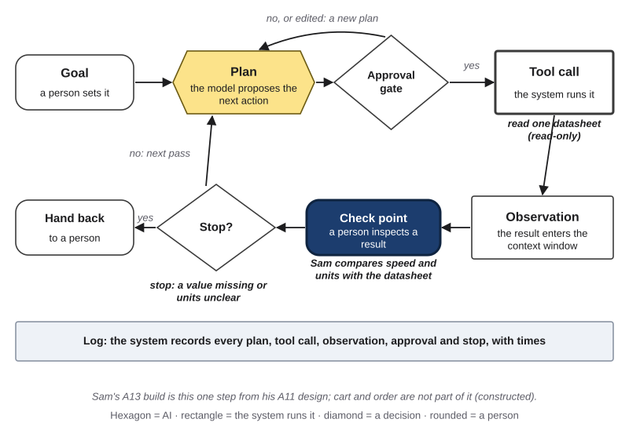{#fig-19-20 fig-alt="Agent loop with tool and check point highlighted: read one datasheet, Sam compares speed and units; stop if a value is missing."}

**Career note:** quality and test engineers design and test the human's part of automated systems.

### 19.F7 Education {#sec-19-f7 .unnumbered}

*Featuring Maya, who volunteers at the campus peer-tutoring center.*

**Typical uses (your row):** drafting lesson materials and practice quizzes (check point: students study from them); summarizing sources (check point); analyzing student data (approval gate); small scripts that format your own course material (log review); classroom media (check point; synthetic media disclosed); feedback that counts and grades (keep with a person).

**What to verify, and who can confirm it:** the curriculum standard; the answer key; the teacher; evidence of learning, not only correct answers (Chapter 7).

**Data cautions:** education records under FERPA, such as a center's notes about the students it serves; minors' data; students' own work, which belongs to them.

**Field rules, nearest first:** course and center rules; school or district policy; FERPA; for tools used by children under 13, the Children's Online Privacy Protection Rule (COPPA), amended in 2025 with compliance due by April 22, 2026.

**Fairness question:** does feedback change with a student's name or dialect (Chapter 16)?

**Case C28: Tutor CoPilot (2024–2025).** In a preregistered (planned and posted in advance) **randomized controlled trial**, a study that assigns participants to groups by chance, run in grades 3–6 in one Southern U.S. school district (March 27 – May 17, 2024), about 900 tutors were randomized. The tool was tutor-facing only: it showed a tutor three suggested replies generated by GPT-4, which the tutor could edit or ignore; students did not use or see the tool. With 783 tutors and 1,013 students in the analysis, students of tutors with access to the tool were 4 percentage points more likely to master the lesson's topic on an exit ticket (62% to 66%), though tutors used the tool in only about 3 of 10 of their sessions; for students of lower-rated tutors, the gain was 9 points (56% to 65%). The study did not show an effect on end-of-year tests. It cost about $20 per tutor per year; the authors note suggestions that did not fit the grade level and disclose that one author had worked part-time with the tutoring provider (Wang et al., 2025, a working paper not peer reviewed as of October 2026). **What to verify in education:** learning, and whose words reach the student. *Labels:* none on the tree; the tutor is the gate (the design).

**Career note:** instructional designers and tutoring coordinators decide who sees AI suggestions: the teacher, or the learner.

## Deep 19.A: Who Uses AI in Which Fields? {#sec-19-deep-a .unnumbered}

[Deep]{.path}

Adoption differs by field, and adoption is not the same as fit. In April 2025, Anthropic published an analysis of 574,740 student conversations with its chat tool, drawn from accounts with higher-education email addresses over 18 days and sorted by subject with an automated, privacy-preserving tool (Handa et al., 2025). Computer science made up 38.6% of the conversations but 5.4% of U.S. bachelor's degrees; business 8.9% of conversations against 18.6% of degrees; health professions 5.5% against 13.1% (the report's introduction gives 36.8% for computer science; its chart gives 38.6%).

Read such data with Chapter 12's questions: one company's users, one tool, one period, and the company's own classification of subjects. It shows who used one tool, not who would benefit, and not whether the use fit the task. A field with little use may have strict data rules (health), little need, or poor tool fit.

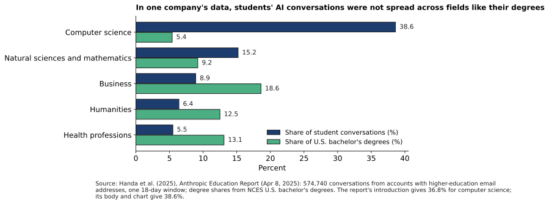{#fig-19-21 fig-alt="Paired bars for five subject groups: share of student conversations vs. share of U.S. degrees; computer science 38.6% vs. 5.4%."}

## Deep 19.B: Model Cards in Practice {#sec-19-deep-b .unnumbered}

[Deep]{.path}

Mitchell et al. (2019) proposed model cards. How are they written in practice? A study of 32,111 model cards on Hugging Face, a public site that hosts AI models, found that the training section was the most often filled and that environmental impact, limitations and evaluation were the least often filled (Liang et al., 2024). In the authors' preprint, the evaluation section was filled in 15.4% of cards and limitations in 17.4%. In other words, the sections a user most needs, how the model was tested and where it fails, are the ones most often missing.

The rest of the model-card paper explains *factors* (the groups and conditions results should be reported for) and *quantitative analyses* (results broken down by those factors), with its example cards in Figures 2 and 3. If you read the whole paper, compare its example cards with the cards you open in Lab 19.2. Chapter 17 (Deep) places model cards among other transparency documents, such as datasheets for datasets.

## Hands-on Labs {.unnumbered}

The labs say what to do, not which buttons to press. Full lab sheets are in the book's companion files, and everything you need to do them is printed here. Never put personal or confidential information into a workflow you test. Inputs may be in any language, with English glosses for your peer. In Compass (optional): lab pages ch19-lab1 to ch19-lab3, with notes for current tools.

### Lab 19.1: Discipline Sprint (Studio · 75 minutes · in the lab session) {.unnumbered}

**Before the lab session (about 12 minutes):** for one recurring task from your major or intended career, write on the pre-lab sheet your guide (your "field" for pairing), your field answers (verification authority; data class and gate, with any field rule that changes it; one written rule with its source and date; your map cell) and your three test inputs, typical, different and edge, written out in full. Bring two or three more inputs inside your scope for your peer test. These are the Your Turns of sections 19.1–19.4. *Alternative route:* choose your provided scenario (posted by your instructor before the lab) and classify its four inputs instead.

1. **Briefing (5 min).** The five-part frame (@fig-19-3), your row of the map (@fig-19-2), the four safeguards (@fig-19-11) and the peer-test rules: run only within the stated scope, use no personal data, record what happens, and do not fix the prototype while you test it. Your instructor pairs students by guide from the pre-lab sheets.
2. **Build and run (30 min, individual, in mixed-field teams of 3–4).** Build your prototype in a tool your institution provides or approves, or use the provided outputs (no-device route). Run your three inputs. Record each output, the tool kind, the model name if shown, and the date. *Checkpoint at minute 20:* at least one run recorded.
3. **Peer test (20 min, in pairs from different guides).** Your partner picks one of the inputs you brought and runs your prototype with only your written instructions. You watch and record, using the sentence frame in section 19.6. Swap at minute 10. If no partner from another guide is available, your instructor confirms it on your sheet, and a same-guide peer counts in full.
4. **Share and critique (10 min).** Each team places its members' cells on the class poster of the map and discusses one cell where two fields disagreed.
5. **Exit (10 min).** Write one change you will make, and one use your card will exclude. Photograph your sheet: it records the lab runs and the peer test for A13.

**If you missed the lab:** ask any classmate from another guide to run your prototype before A13 is due, or use the instructor's office hours as your peer test, and record which you did.

### Lab 19.2: Read a Real Model Card (Check It · 20 minutes · optional) {.unnumbered}

Open two published model cards from two different providers (links in Compass and in the book's companion files). For each, mark which of the model card's nine sections it fills, partly fills or leaves out. Write one "not for" line that one of the cards should have had, and say what evidence would support it.

### Lab 19.3: Cross-Field Swap (Explore · 20 minutes · optional) {.unnumbered}

Run a classmate's prototype from another field on an input from your own field, deliberately outside its stated scope. No personal data. Record what happens, and write one sentence on why the "not for" line on its card matters.

## Case Study: Novel, Then Corrected {.unnumbered}

*Case C26. Case file: cases/C26-a-lab-correction.md.* This case shows how a field's own verification authority settled a claim that an automated analysis had made.

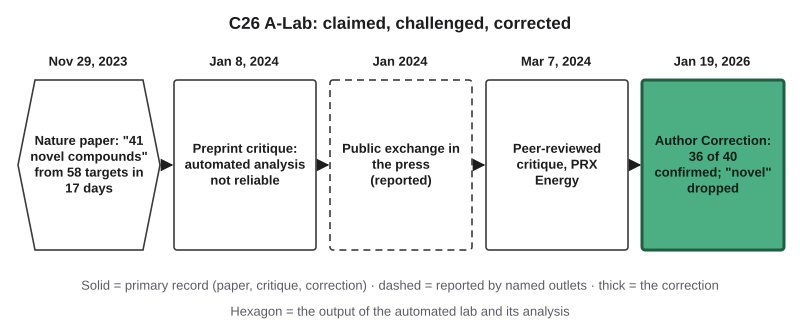{#fig-19-16 fig-alt="Timeline: Nov 2023 paper claims 41 novel compounds; Jan and Mar 2024 critiques; press exchange (dashed, reported); Jan 2026 correction."}

**The claim.** In November 2023, a team from the University of California, Berkeley, Lawrence Berkeley National Laboratory and Google DeepMind described the A-Lab in *Nature*. Robots made inorganic powders from model-proposed recipes, and software read the results from **X-ray diffraction** patterns, the way a powder scatters X-rays, which reveals its crystal structure. Over 17 days, the paper's abstract said, the lab "realized 41 novel compounds from a set of 58 targets" (Szymanski et al., 2023).

**The challenge.** In January 2024, solid-state chemists posted a critique, peer-reviewed and published in March (Leeman et al., 2024). They argued that the automated analysis of the patterns was not yet reliable and that many products were known, disordered versions of the predicted compounds; they concluded that the work had found no new materials. In the press, one critic called for retraction, and one of the paper's senior authors said the critique had errors (reported; Quach, 2024).

**The correction.** On January 19, 2026, *Nature* published an Author Correction (Szymanski et al., 2026). One compound was removed because it had mistakenly been included in the models' training data; the corrected article reports 36 compounds from 57 targets. After publication, the authors re-analyzed the diffraction patterns by hand: this confirmed 36 of the 40 reported successes, and the other 4 were inconclusive from X-ray diffraction alone and were excluded. The title now reads "…synthesis of inorganic materials," and the authors wrote that "novel" had meant new to the prediction platform, not necessarily new to science. The paper was corrected, not retracted.

**Labels.** Chapter 4 labels each case on the **Failure Taxonomy Tree** (which kind of failure) and the **failure-to-harm chain** (where a check could have stopped it), each label *documented* (a primary record shows it) or *inferred* (the book's reading).

- **Tree: other** (automated identifications not confirmed on expert re-analysis: 4 of 40), **documented** by the Author Correction. It is not hallucination: the identifications were not fluent generated text, and the 4 were found inconclusive, not shown false.
- **Not a tree label: "novel."** It is a disclosure problem: a word that claimed more than the evidence.
- **Chain, link 2, "checked before use?": inferred.** The original methods describe automated identification, with manual analysis when the automated fit was poor; a manual re-analysis of every pattern is documented only after publication.
- **Chain, link 4:** no harm beyond a corrected scientific record.

So what? An automated step produced results faster than experts could check them, and the claim outran the checks. The field's own channels caught up.

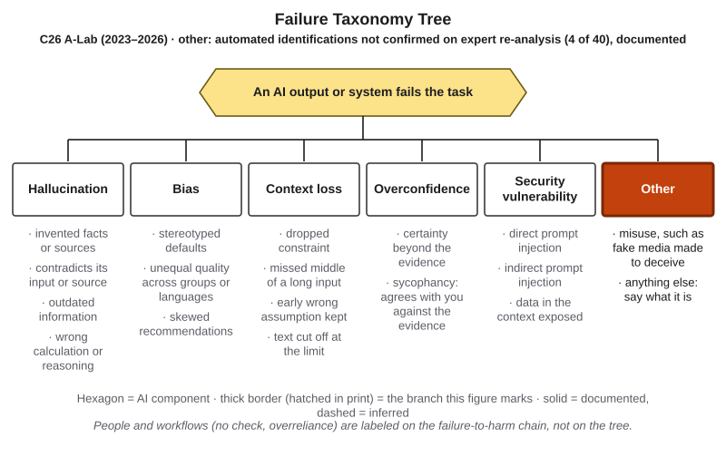{#fig-19-17 fig-alt="Failure Taxonomy Tree with Other highlighted, solid: automated identifications not confirmed on expert re-analysis, 4 of 40, documented."}

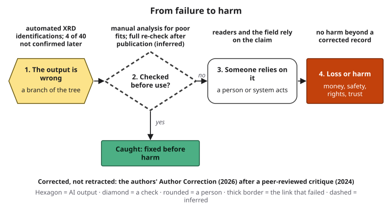{#fig-19-18 fig-alt="Failure-to-harm chain: automated identifications; link 2 dashed, full re-check only after publication (inferred); no harm beyond a correction."}

## Ethics Lens: Who Carries the Risk When AI Enters a Field? {.unnumbered}

The people an AI workflow affects in a field are often not the people who chose it: patients, students, research participants, clients, drivers. Field rules exist largely to protect them, which is why they say who checks, who discloses and what data may go in. Responsibility stays with the named or licensed person who relies on the output; a tool does not carry it (Chapter 18). Benefits are uneven too. Tools work better in some languages and some fields than in others, and the people with the least well-served language or field may also have the least say. Ask, for your own workflow: who did not choose it, and what would an error cost them?

## Career Connection {.unnumbered}

Employers may ask how you use AI in your field. Your A13 is an answer you can show (Chapter 20).

| Occupation (guide) | How this chapter's ideas show up | A question an employer may ask about your A13 |
|---|---|---|
| Staff accountant, auditor or marketer (Business) | Checks AI-assisted analysis and claims against source documents; keeps client data inside approved tools | What did you check every output against? |
| Nurse or clinical informatics specialist (Health) | Reviews AI tools before they enter approved clinical systems | What is your workflow not for? |
| Archivist or digital-humanities specialist (Arts and humanities) | Uses models to suggest readings; the primary record decides | Who in your field could confirm the result? |
| Survey or user researcher (Social science) | Tests whether AI-coded or AI-simulated answers keep the real variation | How did results change across runs? |
| Research technician (Natural science) | Re-checks automated instrument analysis before results leave the lab | Which step did a person re-check? |
| Quality or test engineer (Engineering) | Designs the human's role in automated systems and tests it | What did your edge input show? |
| Instructional designer or tutoring coordinator (Education) | Keeps AI suggestions with the teacher or tutor | Whose words reached the learner: yours or the tool's? |

## From the Field {.unnumbered}

In 2016, I wrote an encyclopedia entry on **sentiment analysis**, software that classifies the feeling a text expresses, at first simply as positive, negative or neutral (Seker, 2016). Among the hard problems the entry listed were sarcasm and implied feeling, negation, several subjects in one sentence, and one I want you to remember here: **domain dependency**. The same words mean different things in different domains. The entry's example: a film whose plot moves unpredictably is being praised; a car that moves unpredictably is being faulted.

The entry also noted that the right method depended on the application: fast statistical methods for streaming social-media posts, slower language-based methods where accuracy mattered more. It added that success rates were lower for Turkish than for English. And it reported a 2013 benchmark from *The Guardian*, given by the technology chief of a social-media data company: people judged sentiment with about 85% accuracy, while about 70% was then the best the software industry reached (Burn-Murdoch, 2013). Read those numbers as a 2013 benchmark, not as today's figures.

**Read it with this chapter** (this book's reading, written in 2026). Domain dependency is the reason this chapter has field guides. A general tool's output has to be read with your field's meaning of its words; in medicine, for example, a "positive" test result is often bad news. And measuring software against how well people do the same task works, in this book's reading, as an early way of naming a verification authority. The entry is about text classification in 2016, not about today's generative tools; the design question carried over.

**About the entry:** *Adapted from a literature review I wrote in 2016 as a consultant to a TUBITAK-supported industrial R&D project (no. 3150106) at a Turkish e-commerce company.* (TUBITAK is the Scientific and Technological Research Council of Turkey; R&D means research and development.)

## Chapter Summary {.unnumbered}

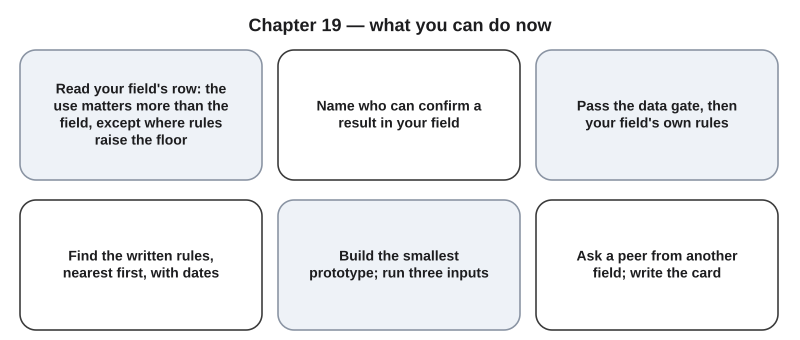{#fig-19-19 fig-alt="Six cards: read your row; name who confirms; pass the gate and field rules; rules nearest first; build and run three inputs; peer test and card."}

**The chapter's question:** *What changes when you bring AI into your own field, and how do you show that your workflow is ready to use?* The method stays: frame, prompt, verify, decide, disclose. Four things change: what counts as correct and who can confirm it, which data your field protects, which written rules apply, and who bears an error; the use matters more than the field, except where a field's rules raise the floor. So build the smallest workflow that works, test it on three inputs with safeguards, have a peer from another field run it, revise, and write a card: it is ready only for the uses on the card.

**Return to the Opening Case.** This book's reading: historians should stay in charge because trained people are epigraphy's verification authority, and Ithaca's first suggestion was still wrong in about 38% of restorations (section 19.2). The pair may have beaten both because people who can judge a ranked list combine well with a model that produces one; the paper does not test why. A workflow, likewise, needs a named check, not just a strong model (sections 19.5–19.6).

**Revisit your Warm-up.** (1) *Same method, different source: a drug reference and a clinician in nursing, the archive record in history (section 19.2).* (2) *Not necessarily: the table is the floor, and a consent form or IRB protocol can still say no (section 19.3).* (3) *Only for the uses on its card, after three inputs and a peer test (sections 19.5–19.7).* Compare these with your confidence ratings.

### Key Terms {.unnumbered}

discipline · Discipline × Use Map · field guide · informed consent · institutional review board (IRB) · licensure · model card · peer test · people point · prototype · scope of practice · verification authority · workflow card

## End-of-Chapter Package {.unnumbered}

<!-- Each item: objective · LO · revised Bloom level. Odd-numbered answers, Check Yourself keys and faded-example keys → appendix/answers.md (Appendix E, via docs/production/handoff/ch19.md); even-numbered → private/ch19-answers-even.md. MC keys rotated: A1 b, A3 d, A4 a, A6 c, A7 d, A9 b, A10 a, A11 c (2 each of a–d). Option lengths checked by script: the key is the longest option in at most two items. Distractor sources: A1 a M1, c M5, d over-gating; A3 a M2 (a tool's check), b M5, c M2; A4 b/c/d M3; A6 a/b M4 reversed, d M1; A7 a/b double credit, c misreading of reuse; A9 a M5, c grading, d certification; A10 b/c M6, d M6 (card = safety); A11 a/b over-reading, d cue misconception (Ch. 16). Review A, B and C, the Spaced Review, all faded examples, the Discussion Questions and the Case Study Questions are final-exam practice (D24, amended). -->

*Everything in this package except the Application Assignment is practice for a final review (or optional discussion); it is not part of the chapter's time estimate.*

### Review Questions A: Terms and Concepts {.unnumbered}

1. *(O1 · LO6 · Understand)* What does the Discipline × Use Map show about oversight?\
   (a) That each field needs its own method, so skills from one field rarely carry over.\
   (b) That the use matters more than the field, unless a field's rules raise the floor.\
   (c) That fields with more AI use need fewer checks, as their students practice more.\
   (d) That most student uses of AI need an approval gate before anyone uses the output.
2. *(O1 · LO6 · Remember)* Name the four things that change from field to field.
3. *(O2 · LO6 · Understand)* What is a field's verification authority?\
   (a) The AI tool that the field's professionals most often use to check results.\
   (b) The test you run yourself on three inputs before you show anyone a result.\
   (c) A careful general reader, who can usually confirm a result in most fields.\
   (d) The source or person the field accepts as able to confirm a result.
4. *(O2 · LO5 · Apply)* Chapter 12's table allows de-identified data under consumer terms. A nursing student's placement policy forbids any patient information in outside tools. May the student paste a de-identified case from placement into a free chat tool?\
   (a) No: the table is a starting floor, and the placement rule can still say no.\
   (b) Yes: de-identified data passes the table, so the placement rule falls away.\
   (c) Yes, if the student uses an institution-approved tool instead of a free one.\
   (d) Yes, if the student also removes the patient's age and the date of care.
5. *(O2 · LO5 · Understand)* Why is de-identification "a start, not a guarantee"? Give one example from a field.
6. *(O3 · LO5 · Apply)* Which rule should a student read first, and why?\
   (a) Federal law, because it overrides the rules a course or employer writes.\
   (b) The professional code, because it applies to the whole profession at once.\
   (c) The course syllabus, because it is most specific to the student's work.\
   (d) The tool's own terms, because they say what the tool is allowed to do.
7. *(O4 · LO6 · Understand)* A student extends an A11 blueprint into A13. How are the reused parts graded?\
   (a) In full again, because they are part of the A13 record the student submits.\
   (b) At half value, because the A11 rubric already gave them points one time.\
   (c) Not at all, so the student has to take them out of the A13 record first.\
   (d) Only if revised for the build; otherwise they are marked "from A11."
8. *(O4 · LO6 · Remember)* Name the three kinds of test input, and say what each is for.
9. *(O5 · LO6 · Understand)* What is a peer test for?\
   (a) To show the workflow works, since a second success makes it reliable.\
   (b) To find what your own tests miss, through a reader from another field.\
   (c) To let a classmate grade the prototype before the instructor reviews it.\
   (d) To have an expert in the field certify the workflow before it is used.
10. *(O6 · LO6 · Understand)* What is the main purpose of a workflow card's "not for" line?\
    (a) To mark uses where no one should rely on it without new tests.\
    (b) To protect the student from blame if someone later misuses it.\
    (c) To show the instructor that the student has read the field's rules.\
    (d) To make the workflow safe, since a stated limit usually stops misuse.
11. *(O5 · LO5 · Understand)* Maya runs one practice answer with two first names, 3 runs each, and sees a one-sentence difference. What can she conclude?\
    (a) The workflow treats the two names differently, so it is biased against one.\
    (b) The workflow treats the two names the same, because the gap is so small.\
    (c) Three runs each cannot tell a real difference from ordinary variation.\
    (d) Names are not a fairness cue, so the result says little about fairness.
12. *(O6 · LO6 · Remember)* Define a model card, and name its central argument about results.

### Review Questions B: Case Questions {.unnumbered}

1. *(O1, O2 · LO6 · Analyze)* A city-planning intern wants an AI tool to summarize 400 public comments on a zoning change for a staff report. Some comments name neighbors; the city has its own AI policy for staff. Place the use on the map, name the verification authority, and decide the data gate, nearest rule first.
2. *(O2, O4 · LO6 · Apply)* An agriculture student builds a workflow that suggests the pest in a photo of a leaf. In the student's county, the extension office's plant diagnostic lab confirms identifications from samples. Write three test inputs (typical, different, edge), and say who could confirm a result.
3. *(O3 · LO5 · Apply)* A music-education major plans a workflow that drafts practice feedback for middle-school students from their recordings during a teaching placement. The course syllabus allows AI for drafting with disclosure; the placement school's policy requires parental consent for recordings. List the rules nearest first, say what each requires, and decide where a person must stay.
4. *(O4, O6 · LO6 · Create)* A journalism student builds a workflow that transcribes recorded interviews and pulls quotations. Name the check every quotation needs, one thing consent must cover, and the "not for" line of its card.

### Review Questions C: Interpretive Questions {.unnumbered}

1. *(O1, O5 · LO6 · Evaluate)* "AI literacy is the same in every field, so field guides are unnecessary." Take a position, using the map, verification authority and the From the Field entry.
2. *(O3, O6 · LO5 · Evaluate)* "If a licensed professional reviews every output, the field's risks are handled." Take a position, using approval fatigue (Chapter 14), the sepsis-model case (Health guide) and the workflow card.

### Spaced Review {.unnumbered}

1. *(Chapter 15 · LO5 · Apply)* On Chapter 15's data-flow map, which boxes does Marcus's pharmacology input pass through, and which box does his placement rule keep empty?
2. *(Chapter 15 · LO5 · Understand)* What is a risk owner, and who would own the residual risk that a look-alike drug name slips past Marcus's check?
3. *(Chapter 16 · LO5 · Understand)* Why is one run with each name a lead and not a finding?
4. *(Chapter 18 · LO5 · Remember)* Name Chapter 18's three layers of rules, and say which one a student usually meets first.
5. *(Chapter 14 · LO5 · Understand)* Marcus's template says "always check the drug name." Is that a hard or a soft gate? What would make his check point hard?

### Discussion Questions {.unnumbered}

1. *(Ethics · O1 · LO5 · Evaluate)* Who in your field bears the errors of an AI tool without having chosen it? What would they want on your workflow card?
2. *(Career · O6 · LO6 · Apply)* Find one job posting or professional-body page in your field that mentions AI. What does it ask for, and how would your A13 answer it? Cite it.
3. *(Interdisciplinary · O2 · LO3 · Analyze)* Compare the verification authority of two fields, with one cited example from each. Where does one field's check fail to transfer to the other?
4. *(Language · O5 · LO5 · Evaluate)* Does the main AI tool in your field work as well in another language you know? How could you test it fairly (Chapter 16)?
5. *(Your row · O1 · LO6 · Evaluate)* Which cell of the map would you change for your own field, and what rule or evidence supports the change?

### Application Assignment: A13 Domain Workflow Prototype {.unnumbered}

**Due:** when your instructor sets it. *(O4–O6 · LO6; LO5, LO2 · Create)* About 12 minutes before the lab session and about 64 minutes after it, including about 6 minutes to read this brief and rubric and about 7 minutes for the fairness runs if your workflow describes people.

**A11 and A13.** A11 is a design tested on paper, for any recurring task; oversight is what is graded. A13 (Chapter 19) is a working prototype in your own discipline, run on three real inputs with a peer test. You may start A13 from your A11 design, but A13 is graded only on the new build, runs and peer test. In this book, that means the build, the runs and the peer test, **with the checks, safeguards, card and defense that belong to them.** Mark any part you reuse "from A11"; it earns points only if you revised it for the build and a run or the peer test shows it working on the build.

**Real inputs** means actual tasks from your field (your own work, course material, public or constructed data). Use a tool your institution provides or approves (for example, an enterprise chat assistant with data protection), or a free tier whose terms pass your data gate. Switch off or simulate every send, publish, payment and deletion. **No personal, confidential, patient, student or client data:** a submission that contains any is returned for resubmission before it is graded.

**What to submit:**

1. **Task and field answers (at most 150 words):** one recurring task from your major or intended career, with its goal and **done-criteria** (how you would know a run succeeded); your field's verification authority; your input's data class and gate decision, with any field rule that changes it; one written rule that applies, with its source, date and what it requires; your cell on the Discipline × Use Map and whether you agree with it.
2. **The build,** written out so someone else could run it (template, chain, configured tool with its standing instructions and files listed, or another build); tool kind, model name if shown, and date.
3. **Three runs:** typical, different and edge inputs (your lab runs count), each with the output, the check you used against your field's verification authority, and a verdict.
4. **Safeguards (one table):** the data gate; at least one people point (approval gate, check point or stop point; hard or soft; the role); the field rule you applied; one fairness check (a paired-input test, 2 × 3 runs, cue named, recorded as a lead) or one sentence on why no group cue enters.
5. **Peer test:** a classmate from another guide ran your prototype on an input they picked from those you brought, within your stated scope; what they did, and what confused them or failed (the sentence frame in section 19.6 helps).
6. **Revision:** one change you made because of a run or the peer test, and a rerun of the input that failed.
7. **Workflow card (at most 100 words):** not for · for · tested on · results · limits and safeguards.
8. **Defense for a non-specialist (80–100 words):** why the workflow fits its stated use in your field; cite one result and one limit from your card.
9. **AI Use Declaration:** tools, purpose, what you accepted, rejected or revised, how you verified it, and where your own judgment shaped the work.

Valid results that can earn full marks: "a fixed template is enough"; "this step stays with a person"; "the edge input failed, and the card now excludes it." Tool-specific steps are in Compass; no click paths in the book.

**Rubric (10 points)**

| Criterion (points) | Exemplary | Proficient | Developing | Beginning |
|---|---|---|---|---|
| **Build and field design (3)** | 3: a build someone else could rerun, with tool kind and date, and all eight items: four field answers (authority, gate, dated rule, cell) and four safeguards (gate, people point shown working, rule applied, fairness check or reason) | 2: seven of the eight items, or one detail needed to rerun the build missing | 1: five or six items, or seven items and one rerun detail missing, or the build cannot be rerun from the record | 0: four or fewer items, or no working build |
| **Test runs (1.5)** | 1.5: three runs that do their jobs (typical; a real difference; a real edge case for the field), each with output and date | 1: two such runs | 0.5: one such run | 0: none |
| **Peer test (1.5)** | 1.5: all three parts: a peer from another guide (or an instructor-confirmed same-guide peer) ran it on an input they picked; what they did and what confused them recorded; linked to the revision | 1: two of the three parts | 0.5: one part | 0: none |
| **Verification (1.5)** | 1.5: all three runs have a named check against the field's verification authority and a verdict | 1: two runs | 0.5: one run | 0: none |
| **Revision (0.5)** | 0.5: a change, its reason and a rerun of the failed input | 0.4: two of the three | 0.2: one | 0: none |
| **Workflow card (0.5)** | 0.5: all five fields, with a specific "not for" | 0.4: four fields, or five with a vague "not for" | 0.2: two or three fields | 0: one or none |
| **Defense (0.5)** | 0.5: all three: 80–100 words (± 10), one result and one limit cited, clear to a non-specialist | 0.4: two of the three | 0.2: one | 0: none |
| **AI Use Declaration (1)** | 1: all five elements | 0.75: four elements | 0.5: two or three elements | 0: zero or one element |

**Alternative assignment** (for students who prefer not to use an AI tool, who cannot pass a data gate with their own task, or whose task involves data they may not share). Choose one of **seven provided field scenarios**, one per field guide, in the book's companion files (your instructor may also post them before the lab session); each has four provided inputs and three dated outputs (model and date labeled), one per kind of input. Your pre-lab: classify the four inputs and write the field answers for the scenario. Then work forward: write the build that would run the scenario; check the provided outputs; design the safeguards; have a peer from another guide work through your build with one provided input of their choosing; revise the build; write the card, defense and declaration. The rubric reads this way:

- **Build and field design:** your written build and the field answers for the scenario.
- **Test runs:** 1.5 = the four inputs classified as typical, different or edge, each with a reason, plus one input you add with its predicted output; 1 = one of these parts missing; 0.5 = two missing; 0 = none.
- **Peer test:** unchanged; the provided input your peer picks counts as theirs.
- **Verification:** the three provided outputs, each with a named check and a verdict.
- **Revision:** your revised build's predicted output for the input that failed, checked against the authority, counts as the rerun.
- **Workflow card, Defense, AI Use Declaration:** unchanged.

### Mini-Project (optional): Field Watch {.unnumbered}

For three weeks, collect one dated item from your field each week: an AI rule, a case or a job posting. Place each on your row of the Discipline × Use Map and note whether it moves a cell. At the end, write 200 words on the change you would make to your field's guide. The watch feeds your portfolio (Chapter 20) and your personal code of practice (Chapter 21).

### Case Study Questions {.unnumbered}

1. *(O2 · LO3 · Apply)* Place the A-Lab facts in tiers: which are confirmed by a primary record, which reported, which this book's reading?
2. *(O2 · LO3 · Analyze)* Label the case on the Failure Taxonomy Tree and the failure-to-harm chain, with documented or inferred for each, and explain why it is not hallucination.
3. *(O6 · LO5 · Analyze)* What did the word "novel" claim in 2023, and what did the correction change?
4. *(O2 · LO6 · Evaluate)* Who in materials science had the authority to settle the claim, and through which channels?
5. *(O6 · LO6 · Create)* Write the "not for" and "limits" lines of a workflow card for the A-Lab's automated analysis step.

## Further Reading and Compass Links {.unnumbered}

- **Recommended:** Mitchell et al. (2019), "Model cards for model reporting." Start with the abstract and Figure 1 (the one-page summary of the nine sections), about 500 words, about 4 minutes; Figure 2 (an example card) and the rest are suggested if you want more. Question: which of the nine sections would most change how you use a model?
- Assael et al. (2022), on Ithaca: the human-and-model evaluation (Opening Case).
- Szymanski et al. (2026), the A-Lab Author Correction: one page that shows how a field corrects a claim.
- Bisbee et al. (2024), on synthetic survey respondents: why averages are not enough.
- Wong et al. (2021, 2026), on validating a vendor's clinical model at a new site, and again for a new version.
- In Compass (optional): the Discipline × Use Map with a "my row" editor; the workflow-card template; the peer-test checklist; the Chapter 19 quiz; Lab 19.1–19.3 pages.

## References {.unnumbered}

American Nurses Association. (2025). *Code of ethics for nurses* (Provision 3.1, Privacy and confidentiality). https://codeofethics.ana.org/provision-3-1

Argyle, L. P., Busby, E. C., Fulda, N., Gubler, J. R., Rytting, C., & Wingate, D. (2023). Out of one, many: Using language models to simulate human samples. *Political Analysis, 31*(3), 337–351. https://doi.org/10.1017/pan.2023.2

Assael, Y., Sommerschield, T., Cooley, A., Shillingford, B., Pavlopoulos, J., Suresh, P., Herms, B., Grayston, J., Maynard, B., Dietrich, N., Wulgaert, R., Prag, J., Mullen, A., & Mohamed, S. (2025). Contextualizing ancient texts with generative neural networks. *Nature, 645*(8079), 141–147. https://doi.org/10.1038/s41586-025-09292-5

Assael, Y., Sommerschield, T., Shillingford, B., Bordbar, M., Pavlopoulos, J., Chatzipanagiotou, M., Androutsopoulos, I., Prag, J., & de Freitas, N. (2022). Restoring and attributing ancient texts using deep neural networks. *Nature, 603*, 280–283. https://doi.org/10.1038/s41586-022-04448-z

Bisbee, J., Clinton, J. D., Dorff, C., Kenkel, B., & Larson, J. M. (2024). Synthetic replacements for human survey data? The perils of large language models. *Political Analysis, 32*(4), 401–416. https://doi.org/10.1017/pan.2024.5

Blatch, M. L. (2015, March 1). AICPA's revised confidentiality rule and Sec. 7216. *Journal of Accountancy*. https://www.journalofaccountancy.com/issues/2015/mar/aicpa-confidentiality-rule.html

Burn-Murdoch, J. (2013, June 10). Social media analytics: Are we nearly there yet? *The Guardian*. https://www.theguardian.com/news/datablog/2013/jun/10/social-media-analytics-sentiment-analysis

Children's Online Privacy Protection Rule, 90 Fed. Reg. 16918 (April 22, 2025).

Federal Trade Commission. (2024, September 25). *FTC announces crackdown on deceptive AI claims and schemes* [Press release]. https://www.ftc.gov/news-events/news/press-releases/2024/09/ftc-announces-crackdown-deceptive-ai-claims-schemes

Federal Trade Commission. (2025, December 22). *FTC reopens and sets aside Rytr final order in response to the Trump administration's AI Action Plan* [Press release]. https://www.ftc.gov/node/327399

Handa, K., Bent, D., Tamkin, A., McCain, M., Durmus, E., Stern, M., Schiraldi, M., Huang, S., Ritchie, S., Syverud, S., Jagadish, K., Vo, M., Bell, M., & Ganguli, D. (2025, April 8). *Anthropic education report: How university students use Claude*. Anthropic. https://www.anthropic.com/news/anthropic-education-report-how-university-students-use-claude

International Committee of Medical Journal Editors. (2026). *Recommendations for the conduct, reporting, editing, and publication of scholarly work in medical journals* (Section V: Use of AI in publishing). https://www.icmje.org/recommendations/

Leeman, J., Liu, Y., Stiles, J., Lee, S. B., Bhatt, P., Schoop, L. M., & Palgrave, R. G. (2024). Challenges in high-throughput inorganic materials prediction and autonomous synthesis. *PRX Energy, 3*, 011002. https://doi.org/10.1103/PRXEnergy.3.011002

Liang, W., Rajani, N., Yang, X., Ozoani, E., Wu, E., Chen, Y., Smith, D. S., & Zou, J. (2024). Systematic analysis of 32,111 AI model cards characterizes documentation practice in AI. *Nature Machine Intelligence, 6*, 744–753. https://doi.org/10.1038/s42256-024-00857-z (numbers quoted from the preprint, arXiv:2402.05160)

Mitchell, M., Wu, S., Zaldivar, A., Barnes, P., Vasserman, L., Hutchinson, B., Spitzer, E., Raji, I. D., & Gebru, T. (2019). Model cards for model reporting. In *Proceedings of the Conference on Fairness, Accountability, and Transparency (FAT\* '19)* (pp. 220–229). ACM. https://doi.org/10.1145/3287560.3287596

MLA Style Center. (2025, August 13). *How do I cite generative AI in MLA style?* (Updated and revised). Modern Language Association. https://style.mla.org/citing-generative-ai/

National Highway Traffic Safety Administration, Office of Defects Investigation. (2024a, April 25). *ODI resume: EA22-002, Autopilot system driver controls* [Closing resume]. https://static.nhtsa.gov/odi/inv/2022/INCLA-EA22002-14498.pdf

National Highway Traffic Safety Administration, Office of Defects Investigation. (2024b, April 25). *ODI resume: RQ24-009, Recall 23V838 remedy effectiveness* [Opening resume]. https://static.nhtsa.gov/odi/inv/2024/INOA-RQ24009-12046.pdf

National Institutes of Health. (2023, June 23). *The use of generative artificial intelligence technologies is prohibited for the NIH peer review process* (Notice NOT-OD-23-149). https://grants.nih.gov/grants/guide/notice-files/NOT-OD-23-149.html

National Institutes of Health. (2025, July 17). *Supporting fairness and originality in NIH research applications* (Notice NOT-OD-25-132). https://grants.nih.gov/grants/guide/notice-files/NOT-OD-25-132.html

National Society of Professional Engineers. (2019). *NSPE code of ethics for engineers*. https://www.nspe.org/career-growth/nspe-code-ethics-engineers

Protection of Human Subjects, 45 C.F.R. § 46.108(a)(3)(iii) (IRB review of changes in approved research).

Protection of Human Subjects, 45 C.F.R. § 46.116 (General requirements for informed consent).

Quach, K. (2024, January 31). 'Novel' AI-made materials not actually new – study. *The Register*. https://www.theregister.com/2024/01/31/ai_chemistry_research_disputed/

Reuter, E. (2021, June 23). Popular sepsis prediction model works "substantially worse" than claimed, researchers find. *MedCity News*. https://medcitynews.com/2021/06/popular-sepsis-prediction-model-works-substantially-worse-than-claimed-researchers-find

Rothschild, D., Marlar, J., Amaya, A., Barari, S., Buskirk, T., Cobb, C., Gennai, J., Hillygus, D., Korlakai Vinayak, R., Krupenkin, M., Lee, S., Steiger, D., & Webb, B. (2026, May 8). *Responsible AI integration in survey research* [Task force report]. American Association for Public Opinion Research. https://aapor.org/wp-content/uploads/2026/05/Responsible-AI-Integration-In-Survey-Research.pdf

Seker, S. E. (2016). Duygu analizi (Sentimental analysis). *YBS Ansiklopedi, 3*(3), 21–36.

Springer Nature. (n.d.). *Artificial intelligence (AI)* [Editorial policy]. Nature Portfolio. Retrieved October 18, 2026, from https://www.nature.com/nature-portfolio/editorial-policies/ai

Szymanski, N. J., Rendy, B., Fei, Y., Kumar, R. E., He, T., Milsted, D., McDermott, M. J., Gallant, M., Cubuk, E. D., Merchant, A., Kim, H., Jain, A., Bartel, C. J., Persson, K., Zeng, Y., & Ceder, G. (2023). An autonomous laboratory for the accelerated synthesis of novel materials [Title as published in 2023; changed by the 2026 Author Correction]. *Nature, 624*, 86–91. https://doi.org/10.1038/s41586-023-06734-w

Szymanski, N. J., Rendy, B., Fei, Y., Kumar, R. E., He, T., Milsted, D., McDermott, M. J., Gallant, M., Cubuk, E. D., Merchant, A., Kim, H., Jain, A., Bartel, C. J., Persson, K., Zeng, Y., & Ceder, G. (2026). Author Correction: An autonomous laboratory for the accelerated synthesis of inorganic materials. *Nature, 650*, E1. https://doi.org/10.1038/s41586-025-09992-y

Tesla, Inc. (2023, December 12). *Part 573 safety recall report 23V-838*. National Highway Traffic Safety Administration. https://static.nhtsa.gov/odi/rcl/2023/RCLRPT-23V838-8276.PDF

Texas Administrative Code, Title 22, § 137.33(b) (Sealing procedures).

Texas Board of Professional Engineers and Land Surveyors. (2024, November 14). *Policy advisory opinion regarding the use of artificial intelligence software by licensees under the Board's jurisdiction (Policy Advisory Request No. 71)*. https://www.pels.texas.gov/nm/2024/pao-71-response.pdf

Texas Responsible Artificial Intelligence Governance Act, H.B. 149, 89th Leg., Reg. Sess. (Tex. 2025) (Tex. Bus. & Com. Code § 552.051).

Texas S.B. 1188, 89th Leg., Reg. Sess. (Tex. 2025) (Tex. Health & Safety Code § 183.005).

Tierney, A. A., Gayre, G., Hoberman, B., Mattern, B., Ballesca, M., Kipnis, P., Liu, V., & Lee, K. (2024). Ambient artificial intelligence scribes to alleviate the burden of clinical documentation. *NEJM Catalyst Innovations in Care Delivery, 5*(3). https://doi.org/10.1056/CAT.23.0404

Tierney, A. A., Gayre, G., Hoberman, B., Mattern, B., Ballesca, M., Wilson Hannay, S. B., Castilla, K., Lau, C. S., Kipnis, P., Liu, V., & Lee, K. (2025). Ambient artificial intelligence scribes: Learnings after 1 year and over 2.5 million uses. *NEJM Catalyst Innovations in Care Delivery, 6*(5). https://doi.org/10.1056/CAT.25.0040

Wang, R. E., Ribeiro, A. T., Robinson, C. D., Loeb, S., & Demszky, D. (2025). *Tutor CoPilot: A human-AI approach for scaling real-time expertise* (EdWorkingPaper No. 24-1054; November 2025 version). Annenberg Institute at Brown University. https://doi.org/10.26300/81nh-8262

Wong, A., Otles, E., Donnelly, J. P., Krumm, A., McCullough, J., DeTroyer-Cooley, O., Pestrue, J., Phillips, M., Konye, J., Penoza, C., Ghous, M., & Singh, K. (2021). External validation of a widely implemented proprietary sepsis prediction model in hospitalized patients. *JAMA Internal Medicine, 181*(8), 1065–1070. https://doi.org/10.1001/jamainternmed.2021.2626

Wong, A., Currey, D., Schwinne, M., Park-Egan, B., Meyer, S., Gutting, A., Cao, J., Khan, S., Dantes, R., Pan, T., Buchman, T., Singh, K., Bhavani, S. V., Lyons, P. G., Sjoding, M. W., & Tarabichi, Y. (2026). Multicenter prospective validation of an updated proprietary sepsis prediction model. *JAMA Network Open, 9*(2), e260181. https://doi.org/10.1001/jamanetworkopen.2026.0181

Zillow Group. (2021a, February 25). *Zillow starts making cash offers for the Zestimate* [Press release]. https://s25.q4cdn.com/975009107/files/doc_news/Zillow-Starts-Making-Cash-Offers-For-the-Zestimate-2021.pdf

Zillow Group. (2021b, November 2). *Q3 2021 shareholder letter* (Form 8-K, Exhibit 99.3). U.S. Securities and Exchange Commission. https://www.sec.gov/Archives/edgar/data/1617640/000161764021000085/exhibit993.htm

Zillow Group. (2021c, November 2). *Zillow Group reports third-quarter 2021 financial results & shares plan to wind down Zillow Offers operations* (Form 8-K, Exhibit 99.1). U.S. Securities and Exchange Commission. https://www.sec.gov/Archives/edgar/data/1617640/000161764021000085/q32021991.htm
