# Your AI Portfolio and Career Narrative {#sec-ch20}

<!-- Status: REVISION v2 (2026-10-18) after four independent reviews (build/ch20/reviews/: subject expert, pedagogy, student panel, fact-check; docs/editorial/ch20-dev-memo.md) and a light Mode B voice pass; from blueprint v0.2 (approved under D19). Draft v1 kept at build/ch20/ch20-draft-v1.qmd. Featured student: Lucía (main thread); short cameos for Sam, Marcus, Elif and Hana (they/them) in 20.8 use established details only (docs/characters.md and chapter logs). All student work is constructed. Case C29 tiers: Anthropic's candidate guidance page (last updated July 10, 2025) = confirmed; the earlier rule (Fortune, Feb 4 and May 19, 2025), the head of talent's LinkedIn post (via Fortune), Amazon's guidelines (Business Insider, Feb 27, 2025) and Goldman Sachs's email (Fortune, Jun 11, 2025) = reported. Numbers from data/ch20_*.csv (NACE, Gray 2025, Figure 1; WEF 2025, pp. 5–6, 25, 97, 99). Workload per D23 and D25 at the standard answering rates (build/ch20/count.py). Not marked done: final review and the author's final voice edit are pending. -->

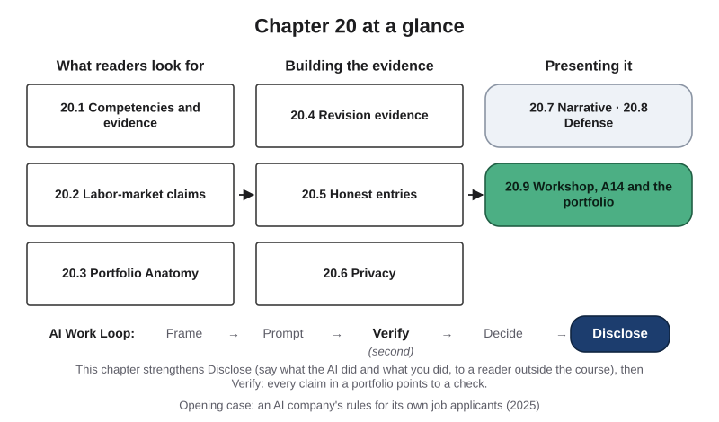{#fig-20-1 fig-alt="Chapter map: what readers look for (20.1–20.3), building the evidence (20.4–20.6), presenting it (20.7–20.9); Work Loop with Disclose highlighted."}

**Chapter 20 at a glance.** Across the earlier chapters you have produced work that only you, an instructor or a few classmates have seen. This chapter is about showing it to someone who has never met you: a recruiter, a hiring manager, an admissions committee. You will learn what employers say they look for, how to read labor-market numbers without hype, how a portfolio works as an argument, how to show revision and checking, how to say what the AI did and what you did, what must stay out of a portfolio, how to write a short career narrative and how to defend your work aloud in five minutes. The book's assignments are A1 to A14; section 20.3 lists them with the outcomes LO1 to LO7.

**Time:** about 32 minutes for the Core sections and about 43 minutes for the whole Core package, at a steady pace (150 words a minute); allow more if you read more slowly or are reading in a second language. For the workshop and A14: the Core package except section 20.2 (about 38 minutes; the Ethics Lens, Career Connection and From the Field add about 4 and can wait), the Warm-up and Check Yourself (about 5) and A14 (about 50), about 94 minutes in all. Section 20.2, the Case Study and the seven faded examples done at home (together about 23 minutes), and the review questions, can wait until you prepare for a final review. **Separately,** assembling the portfolio takes about 5.5 to 7.5 hours, spread over the weeks you work through the book (see its brief). Core sections are examinable; Studio sections are hands-on work; Deep 20.A is optional. Answers to Check Yourself, the faded examples and odd-numbered end-of-chapter questions are in Appendix E.

**The question of this chapter:** *What will convince a reader who has never met you that you can do this work, with AI, responsibly?* The Chapter Summary answers it.

::: {.callout-important title="Milestones for the portfolio"}
Several pieces of work meet at the end. Work back from the dates your instructor sets, or set your own if you are reading on your own.

- **At an early checkpoint your instructor sets:** the first version of your Failure Diary (Chapter 4). A good time to start choosing your six artifacts.
- **About a week before the portfolio is due:** six artifacts chosen.
- **A few days before it is due:** the reflection and the five revision entries other than A13 done.
- **Before the workshop:** A13 finished (Chapter 19).
- **Workshop (Lab 20.1):** bring A14 parts 1–3 in draft and your code-of-practice draft (Chapter 21, Part A).
- **When the portfolio is due:** A14, the code of practice and the final portfolio together.
- **After you submit:** your oral defense.
:::

## Opening Case: "Write the First Draft Yourself" {.unnumbered}

Some employers now say in writing how job applicants may use AI. One of the clearest examples comes from a company that builds AI models. In February 2025, and again in May, Fortune reported that Anthropic's job postings asked applicants not to use AI assistants when writing their applications (Burleigh, 2025a, 2025d). The stated reason was that the company wanted to see each applicant's own interest in the job and judge their communication without AI in between. The same postings said the company encourages staff to use AI once hired. This is **reported**: news coverage described the postings.

By July 2025 the rule had changed. The company's own page for candidates, last updated July 10, 2025, sets out its rules stage by stage (Anthropic, 2025). This part is **confirmed**: it is the company's own record.

- **Application materials:** write the first draft of your résumé and answers yourself; then you may use the company's AI model to refine them. Never use it to create experience you do not have.
- **Take-home assessments:** no AI, unless the company says that a particular assessment allows it.
- **Interview preparation:** AI is encouraged, for example to research the company or practice answers.
- **Live interviews:** no AI, unless the company says otherwise.

The page says the company wants to see candidates' real experience and how they think, and it asks candidates to be open about their AI use, as it says it is about its own use of AI in hiring. In a LinkedIn post that Fortune quoted, the company's head of talent, Jimmy Gould, called the approach intentional (reported; Burleigh, 2025c).

**The puzzle.** This company says its staff use its AI model every day. Why would it still ask applicants to write their own first drafts, forbid AI from supplying experience and, unless it says otherwise, allow no AI in a live interview? Sections 20.5 and 20.8 and the Case Study answer it.

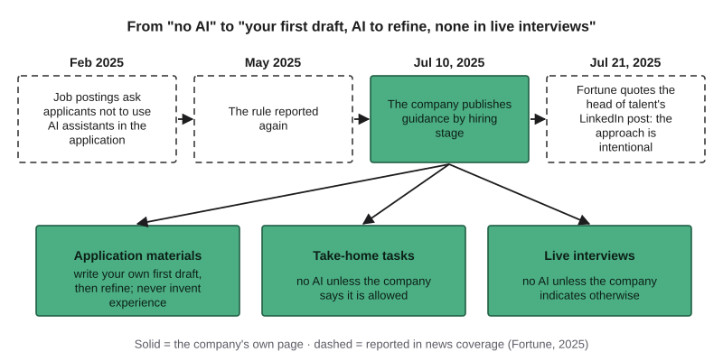{#fig-20-2 fig-alt="Timeline 2025: ban reported Feb and May; July 10 company page sets rules by stage; July 21 Fortune quotes approach as intentional. Three stage boxes."}

## Learning Objectives {.unnumbered}

Framework tags refer to the UNESCO (United Nations Educational, Scientific and Cultural Organization) AI Competency Framework for Students and the AI Fluency framework.

After this chapter you will be able to:

- **O1 — Explain** how NACE describes career readiness and **map** your artifacts to its competencies with evidence rather than self-ratings. *(LO7 · AI Fluency: Diligence · UNESCO: human-centred mindset, Apply)*
- **O2 — Evaluate** a labor-market claim by who made it, whom they asked, when, what was measured and whether it is a forecast, and **state** it exactly and dated. *(LO7, LO3 · AI Fluency: Discernment · UNESCO: human-centred mindset, Apply)*
- **O3 — Produce** revision evidence: before and after, what changed and why, and the verification trail. *(LO7, LO2, LO3 · AI Fluency: Diligence, Discernment)*
- **O4 — Write** entries and a career narrative whose every claim points to an artifact, with an AI Use Declaration that separates the AI's part from yours. *(LO7, LO4 · AI Fluency: Description, Diligence · UNESCO: ethics of AI, Apply)*
- **O5 — Apply** the data classes of Chapter 12's table to a portfolio's new readers: remove or replace classmates', employers' and clients' information and record permissions. *(LO7, LO5 · AI Fluency: Diligence · UNESCO: ethics of AI, Apply)*
- **O6 — Defend** your work in 3 + 2 minutes: answer "What did the AI do, and what did you do?" with a decision chain and evidence, and handle a question you cannot fully answer. *(LO7, LO6 · AI Fluency: Diligence · UNESCO: human-centred mindset, Create)*

::: {.callout-note title="Warm-up (ungraded)"}
Answer from what you know today. You will come back to these in the Chapter Summary.

1. Name one thing an employer can learn from a draft of your work that it cannot learn from the final version.
2. A post says: "AI will create 170 million jobs by 2030." What would you check first?
3. In an interview you are asked, "What did the AI do here?" Is "It wrote most of it and I checked it" a strong answer? Why or why not?

For the third, write how sure you are, from 0 to 100%.
:::

## 20.1 What Employers and Graduate Programs Look For {#sec-20-1 .unnumbered}

[Core]{.path}

*Featuring Lucía (accounting), who works part-time in customer support and is saving to sit for the CPA (Certified Public Accountant) exam.*

**Career readiness** is, in the words of NACE (the National Association of Colleges and Employers, a U.S. association of college career offices and employers), a foundation for showing the core competencies that prepare college graduates for success at work and for managing a career (NACE, n.d.; paraphrased). A **competency** here is a capability that shows in what you do, not a topic you studied. NACE lists eight; the summaries below are this book's paraphrases.

| NACE competency | In one line | A behavior that shows it |
|---|---|---|
| Career and self-development | Develop yourself and your career through learning, knowing your strengths and weaknesses, and building relationships | You set goals and act on feedback |
| Communication | Exchange information and ideas clearly with people inside and outside an organization | You explain your work so a newcomer can follow it |
| Critical thinking | Respond to needs by understanding the situation and analyzing relevant information logically | You gather information from several sources and weigh it |
| Equity and inclusion | Engage people from different backgrounds fairly and inclusively (shortened) | You seek out perspectives other than your own |
| Leadership | Use your own and your team's strengths to reach goals | You plan, run and evaluate a project |
| Professionalism | Keep effective work habits and act in the interest of the workplace and the wider community | You act with integrity and own your mistakes |
| Teamwork | Build working relationships toward shared goals while respecting different views | You deliver your part of shared work |
| Technology | Use technology ethically to work efficiently and reach goals | You choose the right tool for a task and know its limits |

As of October 2026, NACE marks the equity and inclusion competency as under review (NACE, n.d.).

**Why a list is not enough.** In 2024, NACE surveyed two different groups, 20,482 students (March to May) and 237 employers (August to September), and both rated how proficient recent graduates are in each competency. NACE does not publish the questions or say whether its student figures cover all respondents or only the 2,281 graduating seniors (Gray, 2025).

::: {.callout-important title="Predict first"}
What share of students rated recent graduates "very" or "extremely" proficient in communication? What share of employers? Write two numbers before you look at @fig-20-3.
:::

The answer: 78.1% of students and 53.5% of employers. The gap was 24.6 to 35.0 percentage points in communication, critical thinking, professionalism and leadership. Employers rated technology *higher* than students did (72.0% vs. 60.5%), and the two groups nearly agreed on teamwork. Different people answered, so the figures show a difference in views, not that any one student is wrong about themselves. NACE's own reading is that many students do not connect their coursework to the competencies employers seek, and so struggle to state them (Gray, 2025).

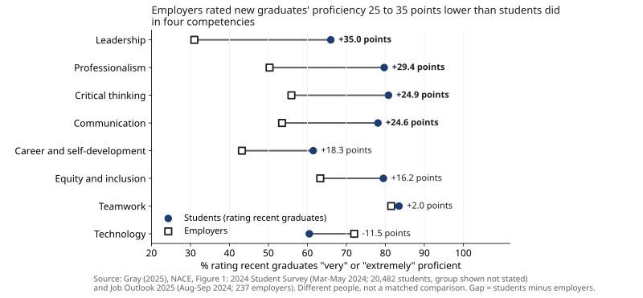{#fig-20-3 fig-alt="Dot chart, eight competencies: students rate graduates higher than employers in most; gaps largest in leadership (35); technology reversed."}

So a competency counts when a reader can see evidence of it. "Strong critical thinker" is a claim; "I checked the claims in an AI overview of my exam against official pages and found three contradicted" is evidence.

**Graduate, medical and professional schools** differ too much for one list: read the program's own application page, list what it asks for and map your evidence to each item.

::: {.callout-note title="Worked Example: Lucía's First Three Rows"}
**Field:** Accounting. *(Constructed example.)* Three of Lucía's artifacts, one evidence line each:

- **A5** (claim verification table) → critical thinking: "Split an AI overview of the CPA exam into six claims and checked them against the exam's and the state board's pages; three were contradicted."
- **A9** (decision matrix audit) → critical thinking: "Found two unlogged volunteer shifts that reversed which fundraiser looked best."
- **A12** (risk review) → professionalism: "Rated five risks in my team's AI-drafted replies and named an owner for each one that needed one."

She had planned to claim leadership too. She drops it: no artifact shows her running a project yet.
:::

::: {.callout-note title="Faded Example: A Marketing Student's Row"}
**Field:** Marketing. A student's A10 compared two AI tools for drafting social-media captions; one tool invented a product feature in two of five test inputs, so she chose the other and added a fact check before posting. **Competency (filled):** technology. **Evidence line:** _______________
:::

*Your Turn:* write the first two rows of your A14 map (section 20.3 lists the artifacts).

::: {.callout-tip title="Check Yourself 20.1"}
1. What does NACE's comparison show, and what can it not tell you about any one student?
:::

## 20.2 Reading Labor-Market Claims Without Hype {#sec-20-2 .unnumbered}

[Core]{.path}

*You may read this section later, with the Case Study, as preparation for a final review. It is examinable. If you use a labor-market sentence in A14, read it first.*

A **labor-market forecast** is an estimate of future jobs or skills, made by named people or organizations at a date. Before you repeat any labor-market number, ask who made it, whom they asked, when, what was measured, what caused it and whether it is a forecast or a count of something that happened.

Take the World Economic Forum's *Future of Jobs Report 2025*, published in January 2025 (World Economic Forum [WEF], 2025). It rests on a survey of over 1,000 employers that together employ more than 14 million workers, in 22 industry groups and 55 economies; the answers were collected in 2024, from May to September. Employers gave their expectations as percentages for their own workforces; the WEF turned these into millions of jobs. For 2025 to 2030, the report says:

- the WEF estimates that about **170 million** jobs will be created and about **92 million** displaced, equal to 14% and 8% of the roughly 1.2 billion jobs its dataset covers: net growth of 7%, or about **78 million**. Created plus displaced, 22% of those jobs, is what the report calls *churn*;
- these totals come from **all** the trends the survey asked about, such as wider digital access, the cost of living, the green transition and aging populations, not from AI alone. The report puts the jobs linked to AI and information processing at about 11 million created and 9 million displaced (WEF, 2025, p. 25);
- on average, 39% of workers' core skills are expected to change or become outdated;
- analytical thinking is the core skill employers rate highest: seven in ten companies call it essential; AI and big data top the list of fastest-growing skills;
- two-thirds of employers plan to hire people with specific AI skills, while 40% expect to reduce their workforce where AI can automate tasks.

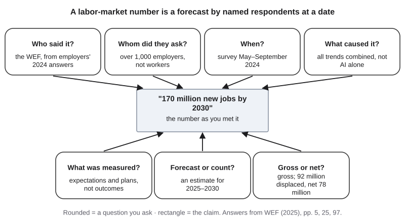{#fig-20-6 fig-alt="Claim '170 million new jobs by 2030' with seven questions: who said it, whom asked, when, caused by what, measured, forecast or count, gross or net."}

Read these numbers for what they are. The respondents are employers, mostly large ones; the report leaves small firms and informal work out of scope (WEF, 2025, p. 97). The numbers are expectations and plans collected in 2024, not outcomes. The WEF **extrapolated** them (estimated beyond what was measured) to the jobs in its dataset (Deep 20.A). And 170 million is a **gross** figure, before subtracting the 92 million displaced; the **net** figure is what remains. In other words, the report is the primary source for what these employers expected, not evidence of what will happen.

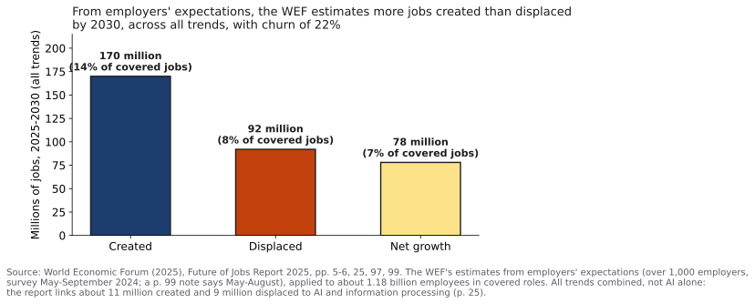{#fig-20-5 fig-alt="Bar chart, 2025–2030, all trends: 170 million jobs created (14%), 92 million displaced (8%), net 78 million (7%). WEF 2025 estimates."}

In a portfolio, a labor-market sentence is optional: one at most, exact, dated and attributed; "AI will…" only when quoting someone.

::: {.callout-note title="Worked Example: Lucía's Sentence"}
**Field:** Accounting. *(Constructed example.)* Lucía's first draft says: "AI is creating 170 million jobs, so accounting is safe." She checks it against the report. The number is gross; it covers jobs worldwide; it is an estimate; and it is not an AI number: it sums every trend the survey asked about, and the report puts AI and information processing at about 11 million jobs created and 9 million displaced. Her rewrite: "The World Economic Forum (2025), extrapolating from a 2024 survey of over 1,000 employers, estimated about 170 million jobs created and 92 million displaced worldwide from 2025 to 2030, across all trends." Then she cuts the sentence from her narrative. It is accurate now, but it says nothing about her.
:::

::: {.callout-note title="Faded Example: A Headline"}
**Field:** Journalism. A headline reads: "AI will wipe out 92 million jobs." **Who estimated it (filled):** the WEF, from employers' 2024 expectations, for 2025–2030. **Gross or net, what caused it and what the headline leaves out:** _______________
:::

*Your Turn:* Lab 20.3 (optional).

::: {.callout-tip title="Check Yourself 20.2"}
1. Why is "AI will create 170 million jobs" wrong in two ways?
:::

## 20.3 Portfolio Anatomy {#sec-20-3 .unnumbered}

[Core]{.path}

A **portfolio**, in this book, is a selection of your work, each piece with the evidence of how you made and checked it, presented for a reader outside the course. It works like an argument, not a scrapbook. **Portfolio Anatomy**, the book's Signature 12, is the book's diagram of a portfolio as an argument: a career narrative and an evidence map backed by entries (artifact, revision trace, verification trail, declaration), a reflection, a code of practice and an oral defense (@fig-20-7).

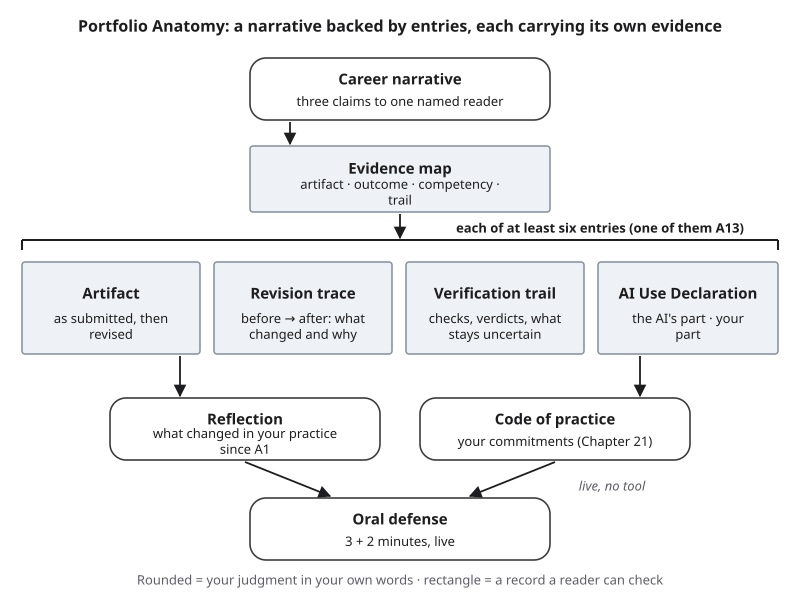{#fig-20-7 fig-alt="Portfolio Anatomy: narrative, evidence map, entries (artifact, revision trace, verification trail, declaration), reflection, code, oral defense."}

At the top is the **career narrative** (section 20.7). Under it, the **evidence map**: a table that lists each entry with the book's learning outcome it shows, the NACE competency it gives evidence of, and where the checks are. Each **entry** carries four things: the artifact, its revision trace (section 20.4), its verification trail (section 20.4) and an AI Use Declaration line (section 20.5). Across all entries sit a **reflection** on what changed in your practice since A1 and your **code of practice** (Chapter 21, §21.5). The **oral defense** (section 20.8) tests all of it, live.

::: {.callout-note title="The book's outcomes and artifacts"}
**Outcomes:** LO1 explain how AI works and fails · LO2 frame and iterate · LO3 verify · LO4 responsible use vs. outsourcing · LO5 privacy, security, fairness, oversight · LO6 design and defend a workflow in your field · LO7 present your work to an employer or graduate program.

**Artifacts:** A1 AI use baseline (LO4, LO7) · A2 concept map (LO1) · A3 prompt and iteration log (LO2) · A4 tutor-mode dialogue and reflection (LO4) · A5 claim verification table (LO3) · A6 source reliability review (LO3) · A7 annotated draft and revision trace (LO2, LO4) · A9 decision matrix audit (LO3, LO5) · A10 tool and task fit matrix (LO2, LO5) · A11 workflow blueprint (LO2, LO5) · A12 responsible AI risk review (LO5) · A13 domain workflow prototype (LO6) · A14 this chapter (LO7). There is no A8: the sequence leaves that slot for a midterm review (Chapter 10's Midterm Bridge).
:::

**Choosing six.** The final portfolio needs at least six revised artifacts, and one of them must be A13. Choose so that the six cover different outcomes, and include at least one with a documented failure or a decision *not* to use AI: it shows that you can find where a tool fails, which a polished final product hides. Prefer checks a reader could repeat. Your A14 entry is one of the six. Your Failure Diary or a Mini-Project can sit behind them as supporting evidence, and one optional project may replace one artifact.

**Layout and versions.** A front page with your narrative and map; one page per entry (excerpts, revision note, trail table, declaration line); the reflection; your code; the portfolio declaration. The course version stays on your course site; any public version must first pass section 20.6.

::: {.callout-note title="Worked Example: Lucía Chooses Six"}
**Field:** Accounting. *(Constructed example.)* A reason for each choice:

- **A1** (baseline): where she started, using AI for speed.
- **A5** (claim verification): the habit of checking before she sends.
- **A9** (decision audit): the hidden assumption in the fundraiser data.
- **A11** (workflow blueprint): the review step she proposed for AI-drafted replies at work (Chapter 14).
- **A12** (risk review): the risks in that workflow, rated (Chapter 15).
- **A13** (domain prototype): her reconciliation-practice workflow, peer-tested by a classmate (Chapter 19).

A3 stays as supporting evidence. She leaves out A10: two rows used her employer's ticket categories (section 20.6).
:::

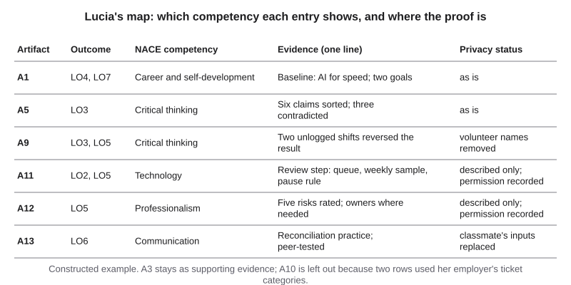{#fig-20-8 fig-alt="Table, six rows: A1, A5, A9, A11, A12, A13, each with outcomes, a NACE competency, one evidence line and a privacy status."}

::: {.callout-note title="Faded Example: A Pre-Med Biology Student's Seven"}
**Field:** Biology (pre-med). Seven candidates: A2 concept map (LO1); A4 tutor-mode reflection on enzyme kinetics (LO4); A5 claims about a vaccine study, one contradicted (LO3); A6 source review where the tool's summary was wrong (LO3); A9 a lab budget audit (LO3, LO5); A10 two tools for summarizing papers, "no AI" chosen for one task (LO2, LO5); A13 a lab-notebook checking workflow (LO6). **First choice (filled):** A13, required. **The other five, with a reason each:** _______________
:::

*Your Turn:* choose your six and write one reason for each (A14 part 1).

::: {.callout-tip title="Check Yourself 20.3"}
1. Why include an artifact with a documented failure or a "no AI" decision?
:::

## 20.4 Revision Evidence {#sec-20-4 .unnumbered}

[Core]{.path}

A final product hides the judgment behind it; a revision shows it. **Revision evidence** is the record, for one artifact, of the before, the after, the reason for the change and the check behind it.

From Chapter 10: a **revision trace** is a record of versions, from your notes or first draft to the tool's draft to your final version, with what changed, who or what proposed it, and why. **Process evidence** is the record of how you wrote: notes, earlier drafts, version history, revision trace, declaration, and your ability to explain your choices. This chapter adds a **verification trail**: the record of checks behind a result, with the sources or recalculations used, the verdicts reached and what remained uncertain. A verdict, from Chapter 8, is a judgment on the book's five-point scale: supported, partly supported, unsupported, contradicted or cannot verify. The checks in a trail should be **independent checks**: evidence that no AI tool produced, such as a source with an author or publisher you can name, or your own recalculation or reasoning from known inputs (Chapter 8). Asking the same tool again is not one.

Revisions come in four kinds:

- **corrected:** an error found and fixed;
- **strengthened:** a check added where there was none;
- **narrowed:** a claim cut back to what the evidence supports;
- **returned:** an AI step handed back to a person, or "no AI" chosen.

The "before" keeps your words as you submitted them, because it is the evidence of what changed: if you rewrote it, no reader could see the revision. One rule protects other people: replace classmates' names and data with placeholders, and say where you did (section 20.6). This is separate from any revision policy your course has for grades: a portfolio revision is scored only in the portfolio.

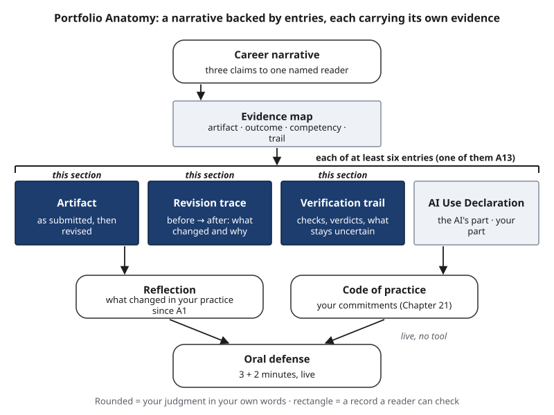{#fig-20-9 fig-alt="Portfolio Anatomy with three entry parts highlighted: artifact, revision trace and verification trail."}

::: {.callout-note title="Worked Example: Lucía's A5 Entry"}
**Field:** Accounting. *(Constructed example; the facts come from Chapter 8.)* Let's take Lucía's A5. In it, she checked claims from an AI overview of the CPA exam. Her row for claim 3, "75 to pass," read: "supported, 75%." It named no source. Her instructor's feedback asked which page said 75.

**After:** "Supported: the exam's frequently asked questions page and the state board's scoring page. 75 is a scaled score on a 0–99 scale, not a percentage correct. Checked October 2026." **What changed:** corrected (the unit) and strengthened (a named source). **Why:** the feedback. **Trail:** two rows, each with its page and date; remaining uncertainty: rules change, so she will check again when she applies.
:::

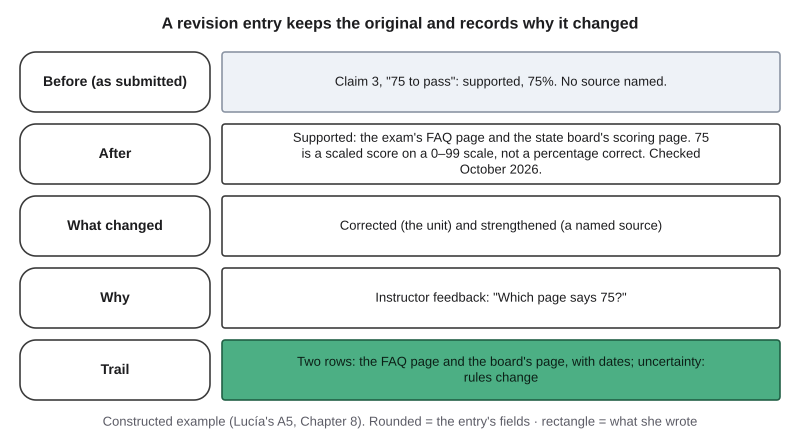{#fig-20-10 fig-alt="Five rows: before, after, what changed, why, trail, filled with Lucía's A5 claim about the CPA exam's passing score of 75."}

::: {.callout-note title="Faded Example: A Student Teacher's Paragraph"}
**Field:** Education. *(Constructed example.)* A student teacher's report on a reading assignment. *Before:* "Most of my students completed the reading." *Her mentor's note:* "How many is most?" *After:* "14 of 24 students (58%) handed in the reading log, according to my gradebook for that week." **What changed (filled):** narrowed: "most" became a count. **Why, and the check:** _______________
:::

*Your Turn:* write one revision entry for your portfolio.

::: {.callout-tip title="Check Yourself 20.4"}
1. Why must the "before" keep your words as you submitted them?
:::

## 20.5 Honest Entries and Declarations {#sec-20-5 .unnumbered}

[Core]{.path}

A **portfolio entry** is a short account of one piece of work for an outside reader: the situation and task, what you did, what the AI did, how you checked, the result and one limit. It adapts the STAR format (situation, task, action, result), which some employers recommend for answering interview questions about past work (Amazon, n.d.), and adds the two parts AI makes necessary: the AI's part and the check. An entry is about 80–130 words.

The entry ends with a line of **AI Use Declaration**: a short statement of which AI tools you used, for what, what you accepted, rejected or revised, how you verified it, and where your judgment shaped the work. The portfolio as a whole gets one more declaration, which also covers how you used AI, if at all, to assemble the portfolio itself.

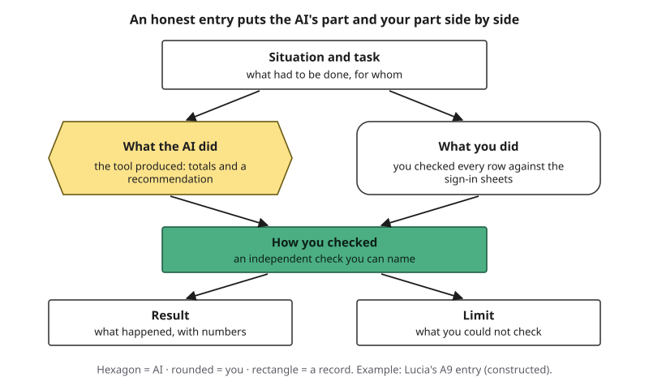{#fig-20-11 fig-alt="Entry diagram: situation and task; side by side what the AI did (hexagon) and what you did (rounded); how you checked; result; limit."}

Three rules keep an entry honest.

1. **Never let a tool supply experience you do not have.** The Opening Case's rule is a good test for every sentence: if you could not explain where it came from, it does not belong.
2. **Numbers come from the artifact,** not from memory or a tool's summary of it.
3. **"No AI used" and "I tried AI and rejected it, because…" are strong entries.** They show a decision based on evidence about the tool, which is the judgment a reader is looking for.

Using AI does not make the work less yours. **Ownership** (of a text) means having decided what a text says, and being able to explain, defend and stand behind every sentence in it and its consequences; it is not the same as legal authorship (Chapter 10). Keep the wording of entries and narrative yours, "your words only" or "AI as reader" on Chapter 10's spectrum (@fig-20-12): you will defend them aloud.

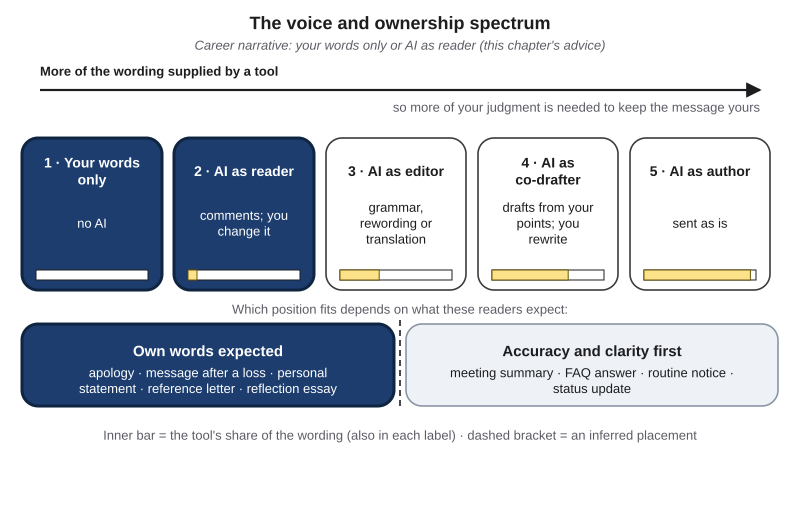{#fig-20-12 fig-alt="Voice and ownership spectrum with positions 1 (your words only) and 2 (AI as reader) highlighted, and the 'own words expected' readers band."}

::: {.callout-note title="Worked Example: Lucía's A9 Entry"}
**Field:** Accounting. *(Constructed example; from Chapter 11.)* "**Situation and task:** as treasurer of the accounting students' association, I compared last year's three fundraisers by money raised per volunteer hour, to help the board choose one to repeat. **AI's part:** a chat tool that can run code produced per-event totals and recommended the book swap. **My part:** I checked every row against the paper sign-in sheets and found two long book-swap shifts missing from the spreadsheet. **Check:** recalculation from the sign-in sheets. **Result:** with the real hours, the car wash came first; the board chose it. **Limit:** one year of data. **Declaration:** one chat tool, for the first analysis; recommendation rejected after checking."
:::

::: {.callout-note title="Faded Example: A Water-Quality Entry"}
**Field:** Environmental science. The student's lab record says: "Tool converted 12 readings from mg/L to ppm and flagged 2 as above the limit; I recalculated all 12 by hand; one flag was wrong because the tool used the wrong limit." **Situation and task (filled):** checking a semester of stream readings for a lab report. **AI's part (filled):** converted units and flagged readings. **What you did and how you checked:** _______________
:::

*Your Turn:* write your A14 entry (80–100 words).

::: {.callout-tip title="Check Yourself 20.5"}
1. Why is "I tried AI and rejected it, because…" a strong entry?
:::

## 20.6 Privacy When Your Work Leaves the Course {#sec-20-6 .unnumbered}

[Core]{.path}

From a nurse's case notes to an accountant's client files to a designer's commissions, every field holds information that is not yours to show. Sending work to a new reader is like pasting it into a new tool: it goes somewhere you do not control, and the reader may forward it. So the same data classes decide what goes into a portfolio.

A **data class** is the category an institution assigns to information by how much harm its release could cause; this book uses three generic levels: public; internal or confidential; and restricted or legally protected (Chapter 12). **Personal data** is information about an identified or identifiable person (Chapter 15). Two U.S. laws stand behind many protected records: FERPA (the Family Educational Rights and Privacy Act) protects students' education records, and HIPAA (the Health Insurance Portability and Accountability Act) protects health information held by health providers and insurers. Chapter 12's table, below, set the floor for what may go into an AI tool.

| Input | Consumer terms (for example, a free tier) | Institutional terms (for example, a tool your institution provides or approves) |
|---|---|---|
| Public information | Yes | Yes |
| Your own non-sensitive work; material your course provides; de-identified data (names and identifiers removed) | Yes, if you accept the tool's training and retention terms | Yes |
| Personal data about other people (names, contact details), and internal or confidential information | No | Only if the part needs it and your institution's or employer's rules allow it; ask your institution's IT office if unsure |
| Restricted or legally protected information, including FERPA and HIPAA records | No | No, at this book's floor |

*This table is the book's reading, built on a generic three-level classification. Your institution's or employer's own classification decides; this table is a starting floor.* A field rule, an employer's policy or a client's contract can still say no to something the table allows.

**For a public portfolio, read the table's consumer-terms column, and apply it more strictly:** a recruiter has no contract with you or with your institution. Only public information and your own non-sensitive work go out as they are. Three kinds of information need care.

- **Classmates'.** Peer-swap comments, the inputs and results of a peer test, group lab records. FERPA requires U.S. schools that receive federal education funds to protect students' education records; for you, the plain rule is that classmates' work and results are theirs to share, not yours. Replace names with placeholders, paraphrase the comment and keep *your* change.
- **An employer's.** Ticket data, internal policies, metrics, client names. Follow the strictest rule that applies, and ask its owner, your manager, in writing (§18.1). Describe the method and replace the details with **placeholders** (stand-ins such as "[product]").
- **Patients', research participants' and clients'.** Patients' and research participants' information: never. A client's confidential information: never. A client's *work*, such as an illustration you made for them: only with their written permission.

To **redact** is to remove or black out information so it cannot be read; to replace is to swap in placeholders; to describe is to explain the method without the data. No AI output was wrong here, so the Failure Taxonomy Tree does not apply (an input-side question, as in Chapter 15).

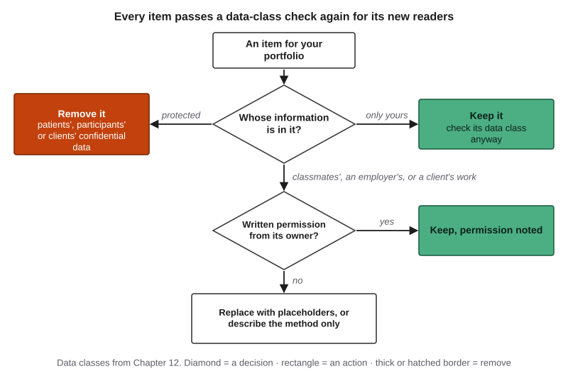{#fig-20-13 fig-alt="Flow: whose information? Only yours: keep. Protected data: remove. Others': written permission? Yes: keep, noted; no: placeholders or method only."}

::: {.callout-note title="Worked Example: Lucía's Public A12"}
**Field:** Business. *(Constructed example.)* Lucía's A12 rated five risks in her support team's workflow for AI-drafted replies. For the public version she asks her manager, in writing, who allows her to describe the method but not the data. She removes the company's name, the ticket text, the team's metrics and the wording of the internal refund policy, keeps her risk ratings with their reasons, and records the permission in her map. Her A11 describes the review step without the company's name.
:::

::: {.callout-note title="Faded Example: A Group Lab Record"}
**Field:** Hospitality. A student's lab record lists three teammates by name and includes a photo of a hotel's internal room-rate sheet from her summer job. **First fix (filled):** teammates' names replaced by "Teammate A, B, C." **Next fix, and why:** _______________ (Done in Lab 20.1.)
:::

*Your Turn:* the privacy pass in Lab 20.1.

::: {.callout-tip title="Check Yourself 20.6"}
1. Why does an item that was fine to submit need a second check before it goes into a public portfolio?
:::

## 20.7 The Career Narrative {#sec-20-7 .unnumbered}

[Core]{.path}

A **career narrative** is a short argument to one named reader: where you are going, shown by three pieces of evidence. It opens the portfolio and is often the only part a busy reader finishes. Write it for one reader you can name by role, such as "a recruiter at an accounting firm" or "the admissions committee of a particular program", not for everyone: claims, evidence and wording can then fit what that reader needs, and a narrative for everyone convinces no one in particular.

The structure is simple:

1. **Reader and purpose** in one sentence.
2. **Three claims,** each pointing to an entry on your evidence map.
3. **What you are learning next,** honestly.

Keep the wording yours (section 20.5). A labor-market sentence is optional, one at most, dated and attributed (section 20.2). For a graduate, medical or professional school, use the program's stated requirements as the frame. Do not invent goals you do not have: a reader will ask about them in the defense.

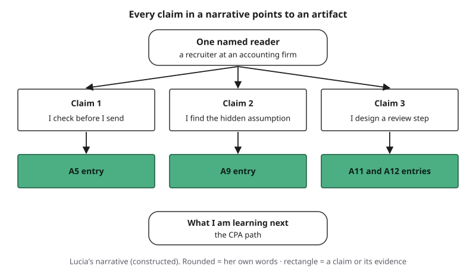{#fig-20-14 fig-alt="One named reader; three claims, each pointing to an entry: A5, A9, A11 and A12; then what I am learning next."}

::: {.callout-note title="Worked Example: Lucía's Narrative"}
**Field:** Accounting. *(Constructed example, about 170 words.)* "For a recruiter at an accounting firm. When this course began, I used AI to answer faster and trusted fluent replies (A1). I now check before I send. In A5, I traced the claims in an AI overview of the CPA exam to the exam's pages and the state board's rules; three were contradicted, and I corrected my own unchecked row after feedback. I look for what the numbers leave out. In A9, a tool recommended one fundraiser; the paper sign-in sheets showed two missing shifts, and with the real hours another came first. I design checks into AI-assisted work. At my support job, I proposed that AI-drafted replies about refunds, discounts or account changes wait for a person, with a weekly sample of the rest (A11), and I rated that workflow's risks (A12). Next, I am learning the rules that govern the work itself, on my way to the CPA exam. *Change after peer review:* I replaced 'I am detail-oriented' with the A9 example."
:::

::: {.callout-note title="Faded Example: A Psychology Major's Narrative"}
**Field:** Psychology. *Evidence map:* A6 (a source review that traced a claim about screen time and attention to the original study); A7 (a lab report with a revision trace); A13 (a survey-coding workflow peer-tested by a classmate). **Reader (filled):** the admissions committee of a research master's program, which asks for research experience and a writing sample. **First claim (filled):** "I trace claims to the original study (A6)." **Claims 2 and 3:** _______________
:::

*Your Turn:* your A14 narrative.

::: {.callout-tip title="Check Yourself 20.7"}
1. Why write the narrative for one named reader?
:::

## 20.8 The Oral Defense: What Did the AI Do, and What Did You Do? {#sec-20-8 .unnumbered}

[Core]{.path}

An **oral defense** is a short, live explanation of your work followed by questions, in which you show that you own it. A suggested format lasts about five minutes: about 30 seconds for one sentence of your narrative, about 90 seconds to walk through one entry, about 60 seconds for one revision and its check, then two minutes of questions (@fig-20-15). It mirrors the Opening Case's live interview: no AI tool and no script. One index card with key words and numbers (not sentences to read aloud) and your open portfolio are allowed. Three minutes is a limit, not a pace: speak at your own speed and plan less content if you need to.

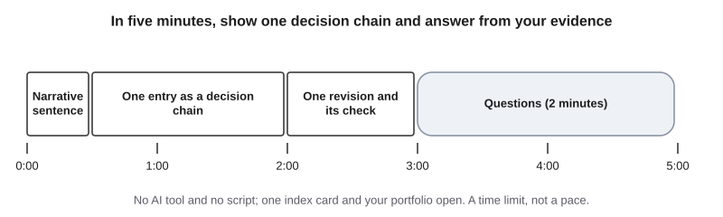{#fig-20-15 fig-alt="Timeline 0 to 5 minutes: narrative sentence, one entry as a decision chain, one revision and its check; then two minutes of questions."}

The question you should expect is "What did the AI do, and what did you do?" A strong answer is a **decision-chain answer**, an answer that gives five links: what you asked for, what the AI produced, what you kept, changed or rejected and why, how you checked, and who decided. "It wrote most of it and I checked it" leaves out every link a listener needs. You may also hear: Why this artifact? What would you check next? What did you leave out of the public version? Which part would you not trust a tool with again?

When you cannot answer a question, say what you know, what you would check and where. That is Chapter 8's **remaining uncertainty**, spoken aloud, and it is a strong answer: it shows you know the limits of your evidence and how to extend them.

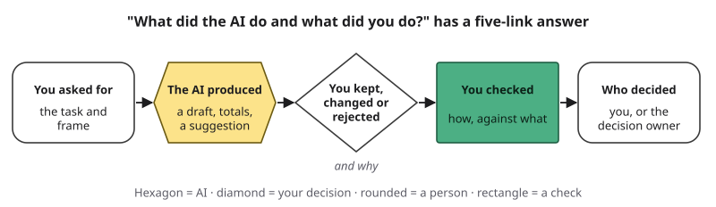{#fig-20-16 fig-alt="Chain of five links: you asked for; the AI produced; you kept, changed or rejected; you checked; who decided."}

::: {.callout-note title="Worked Example: Lucía's Chain, and Four More"}
*(Constructed examples.)* **Lucía (A9):** "I asked a chat tool to compare the three fundraisers per volunteer hour. It produced totals and recommended the book swap. I didn't accept that until I'd checked every row against the paper sign-in sheets; two long shifts were missing. With the real hours the car wash came first. The board decided."

**Sam (A11):** "In a live test, my agent placed a $312 order despite my instruction to ask first. Now it stops at a cart link; two officers place orders."

**Marcus (A4):** "The tool's explanation was smooth; my check questions showed I hadn't learned it. I stop when I'm too tired to try first. No patient information goes into any AI tool."

**Elif (A7):** "A tool turned 'used SPSS in a stats lab' into 'fluent SPSS user' in my application. I rejected it: I had used SPSS once."

**Hana (alt text, supporting evidence):** "A tool drafted alt text for our zine's page; I checked it claim by claim against my drawing." *(Hana uses they/them.)*
:::

::: {.callout-note title="Faded Example: A Coding Artifact"}
**Field:** Computer science. A commit note reads: "Asked assistant for a date-parsing function; it used the wrong month order for our data; I rewrote the parser and added three tests; TA approved the merge." **You asked for (filled):** a date-parsing function. **The AI produced (filled):** a function with the wrong month order. **Kept, changed or rejected; how checked; who decided:** _______________
:::

*Your Turn:* the defense rehearsal in Lab 20.1.

::: {.callout-tip title="Check Yourself 20.8"}
1. Name the five links of a decision-chain answer.
:::

## 20.9 Portfolio Workshop (Lab 20.1 and A14) {#sec-20-9 .unnumbered}

[Studio]{.path}

*Studio sections are hands-on work. This one happens in a workshop session (Lab 20.1); A14 and the portfolio are finished at home.*

The workshop works on one record, your A14 sheet (@fig-20-17): the evidence map, one entry, the narrative and the declaration. Partners read your map and mark one claim with no visible evidence; read your entry for 90 seconds and say what they believe you did; check your privacy; suggest one change to your narrative; and ask the defense question in a timed rehearsal. The workshop can also hold Chapter 21's suggested peer check of your code of practice. Valid results include "I chose not to use AI here" and "this claim is narrower now." Lucía's narrative in section 20.7 is the worked model for part 3.

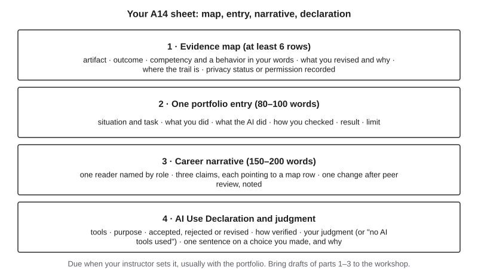{#fig-20-17 fig-alt="A14 sheet with four parts: evidence map of at least six rows, one portfolio entry, a 150–200-word career narrative, AI Use Declaration."}

The A14 template in the book's companion files is your faded example: its first map row is filled with the A10 row from section 20.1's faded example, and the rest is yours.

## Deep 20.A: How the *Future of Jobs* Numbers Are Made {#sec-20-deep-a .unnumbered}

[Deep]{.path}

The WEF's job numbers in section 20.2 come from a chain of steps, each with its own assumption (@fig-20-19). The survey had 38 questions, offered in 12 languages, and was answered by over 1,000 employers; the report's methods appendix says data collection ran over four months, from May to September 2024 (WEF, 2025, p. 97), while a note two pages later says May to August 2024 (p. 99). Respondents estimated how their workforce would change from 2025 to 2030, as percentages by role. The WEF then applied those percentages to employee counts from the International Labour Organization (ILOSTAT). The roles with enough survey answers cover about 1.18 billion employees, out of 2.18 billion in the ILO data; the WEF used employee counts because the responding firms employ people in formal rather than informal work (p. 99). That is how percentages from a survey become "170 million jobs."

Two definitions matter. **Net job growth** is the expected change in the size of the workforce: jobs created minus jobs displaced. **Labor-market churn** is jobs created plus jobs displaced, as a share of the starting total: (170 + 92) ÷ 1,180 ≈ 22%.

Forecasts also move between editions. The share of workers' skills expected to change within five years was 57% in the 2020 edition, 44% in 2023 and 39% in 2025; the report suggests one reason may be that more workers have completed training (WEF, 2025). A number from one edition is a snapshot of what respondents expected that year.

The report itself puts small enterprises and the informal sector out of its scope (p. 97). The book's reading, marked: expectations about AI were changing quickly in 2024. None of this makes the report useless. It tells you what a large group of employers expected and planned in 2024, which is exactly what you should say when you cite it.

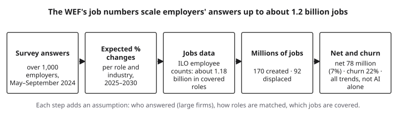{#fig-20-19 fig-alt="Five steps: survey answers; expected % changes; ILO employee data, about 1.18 billion in covered roles; millions created and displaced; net, churn."}

## Hands-on Labs {.unnumbered}

The labs say what to do, not which buttons to press. Full lab sheets are in the book's companion files. No lab needs an AI tool or an account. Never put a classmate's work, or any personal or confidential information, into an AI tool.

### Lab 20.1: Portfolio Workshop (Studio · 75 minutes · in class) {.unnumbered}

**Before the workshop:** draft A14 parts 1–3 and your code-of-practice draft (Chapter 21). Bring them on paper or on screen. Work in pairs inside your team; if your team has an odd number, one group of three works together, and the third person keeps time and asks the follow-up questions, rotating each step.

| Minutes | Step |
|---|---|
| 0–8 | Briefing: Portfolio Anatomy (@fig-20-7) and the decision-chain answer (@fig-20-16). Check Yourself 20.9, asked aloud: what does the partner do in the 90-second "employer read," and what do you learn from it? |
| 8–20 | **Map swap.** Your partner marks one competency claim on your map with no visible evidence. You fix it or cut it |
| 20–32 | **Employer read.** Your partner reads your entry for 90 seconds, turns it over and says what they believe you did and what the AI did. Compare with what you meant |
| 32–40 | **Privacy pass.** Do the 20.6 faded example first, then check each other's drafts with @fig-20-13: names, others' data, employer details. Record your changes: this record is your privacy self-check |
| 40–50 | **Narrative review.** Your partner suggests one change; you decide and note it (A14 part 3) |
| 50–65 | **Chapter 21 peer check** of your code of practice (a suggested activity; instructions in Chapter 21) |
| 65–75 | **Defense rehearsal:** 3 + 2 minutes each, timed; the partner asks "What did the AI do, and what did you do?" and one follow-up. A group of three uses 2 + 1 minutes each (the narrative sentence and one entry as a decision chain, then the defense question), about 9 minutes in all |

**No partner:** read your own entry aloud after a 10-minute break and write what a stranger would believe; use the privacy flow alone; record a timed rehearsal on your phone and listen once.

### Lab 20.2: Read a Real Posting (Explore · 20 minutes · optional) {.unnumbered}

Choose one public job posting or graduate, medical or professional program page in your field. List each thing it asks for. Next to each, name the entry on your map that gives evidence of it, or write "no evidence yet." Write one sentence on the gap you most want to close. Use only public pages; do not log in or apply.

### Lab 20.3: Trace a Labor-Market Headline (Check It · 20–35 minutes · optional) {.unnumbered}

Find one news story or post that cites the *Future of Jobs Report 2025*. Check its claim against the report's Key findings (pp. 5–6). Record: who estimated it, whom they asked, when, what caused it (all trends or AI), gross or net, your verdict (Chapter 8's scale) and what the headline left out. This is the Your Turn for section 20.2.

## Case Study: Your Experience, Your First Draft {.unnumbered}

*Case C29. Tiers: confirmed = the company's own page; reported = named news outlets. Read it with section 20.2, as preparation for a final review.*

**The rules.** Anthropic's guidance for candidates, last updated July 10, 2025, sets AI rules by hiring stage (confirmed; Anthropic, 2025). Applicants write the first draft of their résumé and application answers themselves and may then refine them with the company's AI model; they may not use it to invent experience. Take-home assessments allow AI only when the company says so; live interviews allow none unless the company indicates otherwise; preparation with AI is encouraged. The page also says the company does not use candidates' data to train its model or let the model make hiring decisions, and asks candidates who need accommodations for their interviews to tell their recruiter early.

**How it changed.** In February and May 2025, Fortune reported that the company's job postings asked applicants not to use AI assistants at all during the application, so that it could see their interest and communication without AI in between (reported; Burleigh, 2025a, 2025d). After the July guidance, Fortune quoted a LinkedIn post in which the head of talent, Jimmy Gould, called the approach intentional (reported; Burleigh, 2025c).

**What each rule protects.** This book's reading, marked as such: the first-draft rule protects evidence of the applicant's own thinking; the no-invention rule protects the truth of the record; the interview rule protects a moment in which the employer can see the person think without a tool, which is the page's own stated reason ("how you think"). The page allows what does not threaten these: preparation and polishing.

::: {.callout-note title="Short case (optional): Two interview rules from other large employers"}
On February 27, 2025, Business Insider reported internal Amazon recruiting guidelines saying that candidates could be disqualified for using generative AI tools during interviews unless explicitly permitted; the reasons given were an unfair advantage and the difficulty of assessing a candidate's own skills (reported; Kim, 2025). In June 2025, Fortune reported that Goldman Sachs's campus recruiting team had emailed applicants to its private investing academy in EMEA (Europe, the Middle East and Africa) that its interview process, which uses the HireVue video-interview platform, prohibits any outside sources, including ChatGPT or a search engine. A spokesperson, Jennifer Zuccarelli, said the same language goes to all campus applicants and that the firm wants to hear applicants "in their own voice" (reported; Burleigh, 2025b, citing eFinancialCareers).
:::

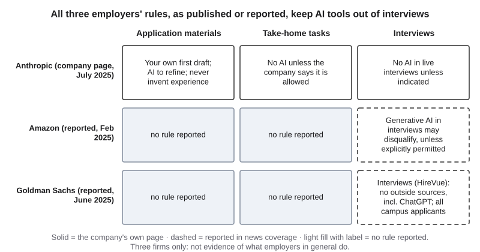{#fig-20-18 fig-alt="Three employers by three stages. Anthropic: rules for materials, take-home and live interviews. Amazon, Goldman Sachs: interview rules; gaps labeled."}

**Label.** No AI output was wrong in this case, so it has no label on the Failure Taxonomy Tree and no failure-to-harm chain: it is a case about rules, like the productivity study of Chapter 1. Three firms are not a survey: they show that some employers set such rules, not what employers in general do. Rules change, so all three are dated "as of October 2026."

**What a portfolio answers.** Your declaration answers the company's request for openness; your revision trace shows the first draft was yours; your entries contain only experience you had; and your oral defense is the live interview, without a tool.

## Ethics Lens: Transparency Runs Both Ways {.unnumbered}

Employers ask applicants to disclose their AI use; applicants can ask the same of employers. Employers can use software, some of it AI, to screen applications, and Chapter 2 told how one such tool, built from past hiring data, penalized résumés that included the word "women's" (case C02). The Opening Case's company says, on its own page, that its model does not make hiring decisions and that candidates' data does not train it (Anthropic, 2025). That is a claim you can hold a company to, and one you can look for on other employers' pages. Chapter 18 covers the laws that apply to automated decisions about people.

A second question, this book's reading, marked: a rule against AI polishing in written materials affects anyone who drafts with grammar or translation tools, whatever their skill. Elif writes important messages in Turkish first and drafts in English (Chapter 10); a first-draft rule lets her draft first and refine after, while a total ban would not. Who decides what counts as "your own voice," and what process evidence would settle the question? Discuss it with a classmate whose writing process differs from yours.

## Career Connection {.unnumbered}

| Occupation | How the chapter's ideas appear | A question to ask |
|---|---|---|
| Recruiter or talent-acquisition specialist | Reads portfolios and declarations; checks claims in interviews | Which claims on this page could I verify in five minutes? |
| Accountant or auditor (Lucía's field) | Working papers: every number traced to its source, like a verification trail | Where is the evidence behind this figure? |
| Illustrator or designer | A process portfolio; client permission before showing client work | Do I have written permission to show this? |
| Nurse | What can never appear: patient information; your placement's rules may forbid even de-identified case details outside approved systems | Is anything here from a placement? |
| Engineer | Design reviews: defending decisions to people who did not make them | Can I explain why this step has a person in it? |
| Graduate or medical admissions reader | Writing samples and statements read against the record | Does the statement match the work? |

## From the Field {.unnumbered}

In 2014 I wrote an encyclopedia entry on the knowledge economy (Şeker, 2014). It describes the economic value of knowledge as it passes between people, and, in a limited way, from people to machines. The entry draws on Peter Drucker's distinction between manual workers and **knowledge workers**, who work with their minds and produce knowledge and ideas. What sets knowledge workers apart, the entry says, is non-routine work that needs analysis, synthesis and creative thinking at every step: finding relationships in data, sorting complex and conflicting priorities, understanding cause and effect, going into detail and setting strategy. The entry adds a point that is easy to miss. Some tasks look routine but are valuable work, among them technical and customer support, handling customers' exceptional cases and answering open-ended requests. It also says knowledge is worth more when it is applied in a product or service than when it stays an idea.

**Read it with this chapter** (this book's reading, written in 2026). Lucía's customer-support job is one of the tasks the entry says look routine but are valuable. A portfolio entry is "applied knowledge" in the entry's sense: it shows judgment at work, not a topic studied. And in 2025, employers surveyed by the World Economic Forum named analytical thinking the top core skill, a dated echo of the entry's 2014 list, not a prediction it made. The entry is about knowledge management, not AI; the question it asks, what a person adds that the system does not, is the one a portfolio answers.

## Chapter Summary {.unnumbered}

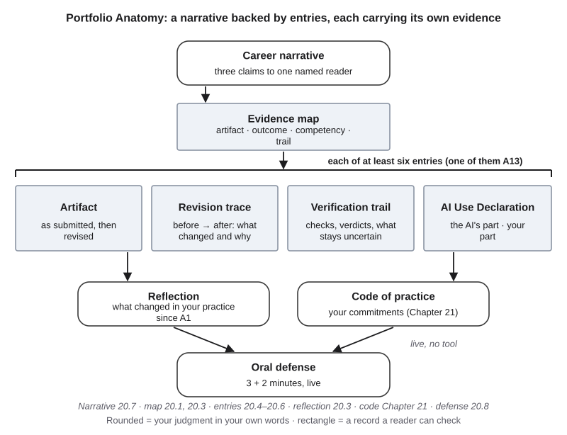{#fig-20-20 fig-alt="Portfolio Anatomy with section numbers: narrative 20.7, map 20.1 and 20.3, entries 20.4–20.6, reflection 20.3, code Chapter 21, defense 20.8."}

**The chapter's question:** *What will convince a reader who has never met you that you can do this work, with AI, responsibly?* Not a list of skills or tools: readers discount those, and in NACE's surveys employers were less positive about graduates' proficiency than students were in most competencies. What convinces is a few chosen pieces of work in which the reader can see the before and the after, what the AI did and what you did, how you checked and what you left out to protect others. A short narrative ties them together, every claim pointing to one of them, and the case closes when you explain any of it live, without a tool. Labor-market numbers can frame why it matters, if you say who estimated them, when, how and from what.

**Return to the Opening Case.** The company asks for first drafts, real experience and tool-free interviews because those are the evidence of the person; the page leaves preparation and polishing to AI (sections 20.5, 20.8 and the Case Study).

**Revisit your Warm-up.** (1) What a draft shows: *the judgment between the draft and the final version: what you changed, why and how you checked (section 20.4).* (2) "AI will create 170 million jobs": *who estimated it (the WEF, from employers' 2024 expectations); that it is an estimate for 2025–2030; that 92 million displacements come with it; and that it is not an AI number but all trends combined: the report links about 11 million created and 9 million displaced to AI and information processing (section 20.2).* (3) "It wrote most of it and I checked it": *weak; give the decision chain: what you asked for, what it produced, what you kept or rejected, how you checked and who decided (section 20.8).* Compare these with your confidence rating.

You can now map your work to what employers say they look for, read labor-market claims exactly, build revision evidence and honest entries, protect other people's information, write a narrative for one reader and defend your work in five minutes.

### Key Terms {.unnumbered}

career narrative · career readiness · competency (career) · decision-chain answer · evidence map · labor-market forecast · oral defense · Portfolio Anatomy · portfolio (course sense) · portfolio entry · redaction · revision evidence · verification trail

Deep 20.A: extrapolation (in labor-market forecasts) · labor-market churn · net job growth

## End-of-Chapter Package {.unnumbered}

<!-- Each item: objective · LO · revised Bloom level. Odd-numbered answers, Check Yourself keys and faded-example keys → appendix/answers.md (Appendix E, via docs/production/handoff/ch20.md); even-numbered → private/ch20-answers-even.md. MC keys rotated: A1 b, A2 d, A3 a, A4 c, A6 d, A8 a, A10 c, A11 b. The correct option is the longest only in A6 and A11. Distractor sources: A1 a M3, c/d narrow readings; A2 a/c M3 (overreading), b misreads importance as proficiency; A3 b gross for net (M4), c/d adding; A4 a/b/d M4; A6 a/b M1, c M6; A8 b–d acceptable uses (M2 inverse); A10 a/b M5, d over-redaction; A11 a/c/d M6. Review A, the Spaced Review, faded examples and the Case Study questions count as final-exam preparation (D23, D24). -->

### Review Questions A: Terms and Concepts {.unnumbered}

1. *(O1 · LO7 · Remember)* Which describes career readiness as NACE uses the term?\
   (a) A list of skills a student reports having, ranked by how confident the student feels.\
   (b) A foundation for showing the competencies that prepare graduates for work and careers.\
   (c) A score on an employer's test that predicts how well a graduate will do in a first job.\
   (d) The set of software tools a graduate can use, such as spreadsheets and chat tools.
2. *(O1 · LO7 · Analyze)* In NACE's 2024 surveys, 78.1% of students and 53.5% of employers rated recent graduates "very" or "extremely" proficient in communication. What does this show?\
   (a) Most students overrate their own communication skills by about 25 points.\
   (b) Employers in the survey rated communication as less important than students did.\
   (c) Students who answered are about 25% less proficient than they believe they are.\
   (d) The employers who answered were less positive about graduates' communication.
3. *(O2 · LO3 · Apply)* The WEF estimated about 170 million jobs created and 92 million displaced from 2025 to 2030. What is the expected net growth?\
   (a) About 78 million jobs, or 7% of the jobs in the report's dataset.\
   (b) About 170 million jobs, or 14% of the jobs in the report's dataset.\
   (c) About 262 million jobs, or 22% of the jobs in the report's dataset.\
   (d) About 92 million jobs, or 8% of the jobs in the report's dataset.
4. *(O2 · LO7 · Understand)* Who answered the survey behind the *Future of Jobs Report 2025*?\
   (a) A random sample of workers in 55 economies, interviewed about their jobs.\
   (b) Economists at the World Economic Forum, using official employment records.\
   (c) Over 1,000 employers, asked about their expectations for 2025 to 2030.\
   (d) Students and recent graduates, asked which skills they expect to need.
5. *(O1 · LO7 · Remember)* What is an evidence map, and what does each row contain?
6. *(O3 · LO7 · Understand)* What makes a revision count as evidence in a portfolio?\
   (a) The final version is clearly better written than the version you submitted.\
   (b) The revision was made after the course ended, so it shows growth.\
   (c) No AI tool was used at any point in making the revision.\
   (d) A reader can see the before, the after, the reason for the change and the check behind it.
7. *(O3 · LO3 · Understand)* How does a verification trail differ from a revision trace?
8. *(O4 · LO4 · Apply)* Which sentence in a portfolio breaks this chapter's honesty rule?\
   (a) "Led a five-person team," suggested by a tool, when you were one of five members.\
   (b) "A tool drafted the summary; I checked each figure against the source table."\
   (c) "I tried an AI tool for the outline and rejected it, because it missed the brief."\
   (d) "No AI tools were used for this entry," written about work done without them.
9. *(O4 · LO4 · Remember)* List the five elements of an AI Use Declaration.
10. *(O5 · LO5 · Apply)* Your A13 entry includes a classmate's peer-test inputs and results. What should the public version do?\
    (a) Keep them as they are, because the classmate agreed to test your prototype.\
    (b) Keep them, because they are part of an artifact you already submitted for a grade.\
    (c) Replace the classmate's name and inputs with placeholders and keep your own change.\
    (d) Remove the whole A13 entry, because any peer test makes it unsafe to publish.
11. *(O6 · LO6 · Understand)* Which is the strongest answer to "What did the AI do, and what did you do?"\
    (a) "The AI did most of the writing, and I checked it before I handed it in."\
    (b) "I asked for X, it gave Y, I rejected Z because…, I checked it against…, and I decided."\
    (c) "I used AI the way the course allows, so the work is fully mine."\
    (d) "I am not sure what the AI did, but the final version is correct."
12. *(O6 · LO7 · Evaluate)* In your defense you are asked a question you cannot fully answer. What should you say, and why is that a strong answer?

### Review Questions B: Case Questions {.unnumbered}

1. *(O1 · LO7 · Apply)* A nursing student's portfolio opens with "Skills: critical thinking, communication, teamwork, technology." Her artifacts include an A5 table that checked a drug-interaction claim against a prescribing label, an A7 revision trace for a patient-education leaflet she wrote from a textbook case, and an A13 study workflow peer-tested by an engineering student. (No patient data is involved.) Rewrite her skills line as three evidence-map rows.
2. *(O2 · LO3 · Evaluate)* A post says: "39% of skills will be useless by 2030, says the WEF." Check it against section 20.2 and rewrite it as one accurate, dated sentence.
3. *(O3, O4 · LO7 · Create)* A student's portfolio shows only this for A6: *Before:* "Source 3: reliable." *After:* "Source 3: a press release; lead only." Using his lab record ("checked the study itself; press release overstated the sample"), write the full revision entry: what changed, why, the trail and a declaration line.
4. *(O5 · LO5 · Apply)* A portfolio page shows a classmate's peer-test results with her name, a client's logo from a freelance poster and an internal sales chart from a summer job. Do a privacy pass: for each item, keep, replace, describe or remove, and why.

### Review Questions C: Interpretive Questions {.unnumbered}

1. *(O2 · LO7 · Evaluate)* "Labor-market forecasts do not belong in student portfolios." Agree or disagree, using section 20.2.
2. *(O4 · LO4 · Evaluate)* "Employers should ban AI in all application materials." Take a position, using the Opening Case and the Case Study.
3. *(O6 · LO6 · Evaluate)* "Oral defenses are unfair to students who are less confident speakers." Take a position, using the defense rubric and its alternative route as evidence.

### Spaced Review {.unnumbered}

1. *(Chapter 19 · LO6)* In a peer test, a person from another field runs your prototype on an input of their choosing, with only your instructions. Your tester got confused at step 3. How can this become revision evidence in your portfolio?
2. *(Chapter 19 · LO6)* Each field defines what counts as correct and who says so. For your A13, name that authority and say where it appears in your verification trail.
3. *(Chapter 18 · LO5)* Your employer's policy forbids describing its internal tools in public; the course allows it in your coursework. Which rule governs your public portfolio, and why?
4. *(Chapter 15 · LO5)* Draw the last two boxes of a data-flow map ("seen by" and "out") for a portfolio link you email to a recruiter. Which part leaves your control?

### Discussion Questions {.unnumbered}

1. *(Ethics)* Employers ask candidates to disclose AI use. What should candidates be able to ask employers about AI in hiring, and why?
2. *(Career)* What does a portfolio in your field usually contain? Bring one cited example (a professional association's guidance or a public portfolio).
3. *(Interdisciplinary)* A thesis defense, a design critique and an audit review are all oral defenses. What do they test that a written document cannot?
4. Which of your artifacts would you never show publicly, and why?
5. In a field whose everyday tools include AI, should a live interview still exclude it? What would you want the interviewer to see?

### Application Assignment: A14 Revision Evidence Map and Career Narrative {.unnumbered}

**Due:** when your instructor sets it, usually with the final portfolio. *(O1, O4 · LO7 · Create)* Bring drafts of parts 1–3 to the workshop (Lab 20.1). **About 50 minutes at home**, including reading this brief and rubric; allow more for a first draft or in a second language. The entry in part 2 is one of your portfolio's six. **No AI tool is required.** If you use one, the book's AI-use zones apply (§10.2), or your instructor's policy where it differs; for the narrative, this chapter recommends your words only or AI as reader.

**What to submit:**

1. **Evidence map** (at least 6 rows; these are your portfolio's entries): artifact; outcome (LO); one NACE competency and a behavior, in your words, matched to NACE's definition (section 20.1's table); what you revised (or will) and why, in one line; where the verification trail is; privacy status (as is / names replaced / described only / permission recorded).
2. **One portfolio entry** (80–100 words, section 20.5's format).
3. **Career narrative** (150–200 words) to one reader named by role (for example, "a recruiter at an accounting firm" or a particular graduate program): three claims, each pointing to a map row; one change after the workshop's peer review, noted in a line. A labor-market sentence is optional; if you use one, read section 20.2 first and make it exact, dated and attributed.
4. **AI Use Declaration and judgment:** tools, purpose, what you accepted, rejected or revised, how you verified it, and where your judgment shaped the work, or "no AI tools used"; plus one sentence naming a choice you made (an entry left out, a claim narrowed) and why.

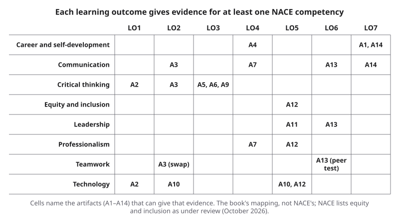{#fig-20-4 fig-alt="Grid: eight NACE competencies by LO1 to LO7; cells name the artifacts A1–A14 that can give evidence; the book's mapping, not NACE's."}

**Rubric (10 points, suggested scoring).** The book's artifact split: task (3) = evidence map; process evidence (3) = entry and narrative; verification (2); declaration and judgment (2) = declaration (1) + judgment (1). Each criterion is scored separately; where work fits parts of two levels, it receives the lower level that fully applies.

| Criterion (points) | Exemplary | Proficient | Developing | Beginning |
|---|---|---|---|---|
| **Evidence map (3)** | 3: ≥ 6 rows, all fields; each competency backed by a specific behavior and artifact; revision line says what and why; privacy status accurate | 2: ≥ 6 rows; one or two fields missing, or one competency without a specific behavior | 1: 4–5 rows, or two or more competencies asserted without a specific behavior | 0: fewer than 4 rows |
| **Entry and narrative (3)** | 3: entry has all six parts and separates the AI's part from yours; narrative to a reader named by role, 150–200 words, three claims tied to rows; change noted | 2: one entry part missing, or the entry or narrative outside its word range, or one claim untied, or the change not noted | 1: two or more entry parts missing, or no split of the AI's part and yours, or no named reader, or fewer than two claims tied | 0: entry or narrative missing |
| **Verification (2)** | 2: every claim traceable to an artifact; any labor-market sentence exact, dated and attributed; nothing beyond the evidence | 1.5: one untraceable claim, or an undated labor-market sentence | 1: two or three untraceable claims, or one overstated claim | 0–0.5: four or more untraceable claims, or two or more overstated |
| **Declaration (1)** | 1: all five elements, or "no AI tools used" | 0.75: four elements | 0.5: two or three | 0: zero or one |
| **Judgment (1)** | 1: the sentence names a choice and why | 0.75: choice named, reason vague | 0.5: choice implied only | 0: none |

A14 grades the entry's format; the portfolio grades its revision. **Alternative assignment:** if you prefer not to write for a career audience yet, or your artifacts cannot leave the course, write the same four parts for one **provided reader profile** in the book's companion files (a graduate program in your field, a campus employer or a scholarship committee), from the course versions of your artifacts only, with no public version. Same rubric.

### The Final Portfolio: Brief and Rubric {.unnumbered}

**Due:** when your instructor sets it (one PDF, slide file or web-page export, in the order of section 20.3's layout). *(O1–O5 · LO7 · Create)*

**Time:** about 5.5 to 7.5 hours, spread over several weeks, including the Failure Diary's first version and up to three artifacts revised for the first time (about 9 hours if all five non-A13 artifacts are); allow more if you are writing in a second language. About 1.5 to 2 hours fall in the last few days before the portfolio is due, so finish the reflection and the five non-A13 entries a few days earlier. Per requirement: this brief and rubric about 9 minutes; the Failure Diary's first version about 55 (Chapter 4); about 15 minutes for each of the five non-A13 entries whose artifact you already revised under your course's revision policy, if it has one, plus 30–40 for each artifact revised for the first time; about 45 for A13's entry, its further change and the rerun; about 60 for the reflection; about 27 to 29 to finish your code of practice (Chapter 21); about 10 each for the portfolio declaration and the privacy self-check; about 15 to assemble; about 25 to prepare and rehearse the defense.

**Contents:**

1. **Front:** your A14 narrative and evidence map.
2. **At least six revised artifacts** from A1–A13, including A13 and the artifact of your A14 entry, each with a revision entry (section 20.4), a verification trail and a declaration line. One may be replaced by an optional chapter project (the Failure Diary, a Mini-Project, Chapter 13's protocol, Chapter 17's report or Chapter 18's note). If your instructor allows it, an artifact you missed may be completed now and counted; its original grade does not change.
3. **A 2-page reflection** (about 800–1,000 words): what changed in how you use and check AI since A1; your two A1 goals, met or not, with evidence; one thing you do not yet trust yourself to do.
4. **Your personal AI code of practice,** as specified in Chapter 21 (§21.5 and its Application Assignment).
5. **A portfolio AI Use Declaration,** including how you used AI, if at all, to assemble the portfolio, and a privacy self-check: one line confirming you ran the section 20.6 checks (your Lab 20.1 record counts).

::: {.callout-note title="Worked Example: A Reflection Paragraph (Lucía)"}
*(Constructed example, one of about eight paragraphs.)* "My second A1 goal was to write an AI Use Declaration for every major assignment without being reminded. I met it from A9 on: each of my last five artifacts has one, and in A12 I wrote it before I started, as a plan. I did not meet it in A7, where I added the declaration only after feedback. What changed is when I think about it: I now decide what the tool may do before I open it, not after. What I still do not trust myself to do is judge a tax question under time pressure without checking the source."
:::

::: {.callout-note title="Worked Example: Lucía's Further Change to A13 (row 3)"}
*(Constructed example.)* A13 as submitted already had three runs, Sam's peer test and one revision. For the portfolio, Lucía adds **one new input**: a bank statement with one line duplicated by mistake. **Rerun:** the workflow matched both copies to the same ledger line and reported the statement as reconciled. **Further change:** she adds a step that compares line counts before matching, and a new limit to her workflow card (the "limits and safeguards" field from Chapter 19): "duplicate lines are flagged, not removed; I check every flag." **Rerun after the change:** the duplicate is flagged. One new input and a rerun are enough for this row.
:::

**Privacy.** When you submit, the privacy self-check confirms you ran the section 20.6 checks. The course version stays on your course site, where the instructor already sees your artifacts; replace classmates' names with placeholders anyway. Any **public** version must pass every check in section 20.6. If the instructor finds a classmate's personal data, confidential employer or client data, or any patient or research-participant information, a suggested policy is that the entry is withheld from grading and you have a short window your instructor sets (for example, 48 hours) to upload a redacted version, with no further penalty; an entry still not fixed when the window ends scores 0 on its rows, and nothing else is lost.

**Rubric (100 points, suggested scoring).** If your instructor uses the portfolio as a graded assessment, these points are one way to score it. Criteria are scored separately; score bands have no gaps; where work fits parts of two levels, it receives the lower level that fully applies.

| Criterion (points) | Exemplary | Proficient | Developing | Beginning |
|---|---|---|---|---|
| **1a Revision evidence: the five entries other than A13, named on your map (15 = 3 per entry)** | 3 per entry: before and after with what changed; a reason; a check exists; the change answers the reason | 2: one of the four missing, or the change does not answer the reason | 1: two of the four missing (for example, only the after, or no reason and no check) | 0: three or more missing, or no revision shown |
| **1b Reflection (10)** | 9–10: about 2 pages; both A1 goals with evidence; a change in practice tied to entries; one honest limit | 6–8: both goals addressed; evidence thin for one; limit generic | 3–5: goals or evidence missing; mostly a description of tasks | 0–2: missing or off-task |
| **2a Quality of the verification trails: the five non-A13 entries and the row-3 rerun (14)** | 12–14: every result traceable to named independent checks, with verdicts and remaining uncertainty | 8–11: one or two trails partial (a verdict without its source, or uncertainty unstated) | 4–7: half or fewer complete; verdicts without checks, or checks that only re-ask a tool | 0–3: no trails |
| **2b Portfolio declaration (6)** | 6: all five elements for the portfolio and a line per entry, consistent with the trails | 4–5: one element or one entry line missing | 2–3: two or more elements or entry lines missing, or generic | 0–1: missing |
| **3 Domain prototype: a further change beyond A13 as submitted (20)** | 17–20: a new finding, input, safeguard or card limit (a new line in your workflow card's limits field) beyond what A13 already graded, with a rerun and its result; remaining limits stated | 12–16: a further change with a rerun, but its reason or result thin, or limits unstated | 6–11: a further change without a rerun, or a rerun with no change made | 3–5: A13's current state documented for an outside reader, no further change; 0–2: missing, or only changes already graded in A13 |
| **4 Code of practice (15)** | Scored with Chapter 21's 15-point rubric (its Application Assignment) | | | |
| **5 Oral defense (20)** | Scored with the defense rubric below | | | |

No double credit: A13's own build, runs, peer test and first revision stay with A13's grade; row 1a scores the other five entries; row 2a scores the trails' quality, excluding A13's already-graded trail, while row 1a only asks whether a check exists; the narrative is graded only in A14; the code only through Chapter 21's rubric. **Alternative routes:** if A13 cannot be shown outside the course, use Chapter 19's provided scenario that you completed, with the same criterion; "no AI" entries and rules are valid at every criterion; for the defense, see below.

### The Oral Defense: Brief and Rubric {.unnumbered}

**When:** after you submit the portfolio, at a time your instructor sets (for example, a slot you sign up for on your course site). **Format (suggested):** about 30 seconds for one narrative sentence, about 90 seconds for one entry as a decision chain, about 60 seconds for one revision with its check, then 2 minutes of questions (sample questions are in section 20.8). No AI tool and no script. Your index card may hold key words, numbers and short phrases, not sentences to read aloud; keep your portfolio open.

**Support and alternative route.** You may speak at your own pace: the 3-minute limit is a limit on content, not a speed. With an approved accommodation through your institution's disability or accessibility office, or a documented conflict, you may give a recorded 3-minute presentation plus a live 2-minute conversation in person or by video; where an approved accommodation allows it, you may answer one question in writing within a set time. If English is your second language and you are worried about speaking, talk to your instructor early: the rubric scores structure and explanation, not accent, fluency or speed.

| Criterion (5 each) | Exemplary (5) | Proficient (4) | Developing (2–3) | Beginning (0–1) |
|---|---|---|---|---|
| **Decision chain** | Complete for one entry: asked, produced, kept/changed/rejected and why, checked, who decided | One link thin or missing, such as the decider unnamed | Two or more links missing; the AI's part and yours blurred | No chain; describes the topic only |
| **Evidence** | Shows the before and after and the trail; numbers match the portfolio | Evidence shown; one detail does not match | Evidence asserted, not shown | No evidence |
| **Answers** | From your own understanding; limits stated; for an unknown, says what you would check and where | Mostly sound; one answer vague | Partial; defers to the tool or the slide | Cannot answer about your own work |
| **Structure and explanation** | A non-specialist can follow the structure; terms explained; content fits the time | One unexplained term, or content cut off at the limit | Hard to follow, or most of the planned content not reached | Cannot be followed |

### Mini-Project (optional): A Public Portfolio Page {.unnumbered}

Over two weeks after the course, build a public page from your course portfolio. Keep a privacy log: every change you made for the public version, and why (section 20.6). Ask one person outside the course to read it for two minutes and tell you what they believe you can do. Not graded; not part of the course portfolio.

### Case Study Questions {.unnumbered}

1. *(O4 · LO4 · Analyze)* What does each of the company's three stage rules protect?
2. *(O4 · LO4 · Analyze)* Where do the three employers' rules agree, and where do the reports leave gaps? What can you conclude from three firms, and what not?
3. *(O4 · LO4 · Apply)* How does an AI Use Declaration answer the company's request for openness at each stage?
4. *(O6 · LO6 · Evaluate)* Why do all three rules keep AI out of the interview?
5. *(O6 · LO7 · Evaluate)* How does the oral defense in section 20.8 mirror the live interview, and how does it differ?

## Further Reading and Compass Links {.unnumbered}

- **Recommended:** NACE, "What is career readiness?": the definition and the eight competency definitions (about 330 words). Section 20.1 prints what A14 needs.
- **Recommended:** World Economic Forum (2025), *Future of Jobs Report 2025*, Key findings, pp. 5–6. Every number section 20.2 uses is printed there; Deep 20.A also uses the methods appendix (pp. 97–99); Lab 20.3 uses the report.
- Gray (2025), NACE: the perception gap behind @fig-20-3, with the survey details.
- Anthropic (2025): the candidate guidance in the Opening Case, as a model of stage-by-stage AI rules.
- In Compass (optional): Signature 12 step by step; an evidence-map builder; a labor-market claim checker; the Chapter 20 quiz; Lab 20.1–20.3 pages.

## References {.unnumbered}

Amazon. (n.d.). *Inside Amazon's recruitment process in the UK*. About Amazon UK. Retrieved October 18, 2026, from https://www.aboutamazon.co.uk/news/working-at-amazon/our-recruiters-offer-their-best-tips-for-interviewing-at-amazon

Anthropic. (2025, July 10). *Guidance on candidates' AI usage*. Retrieved October 18, 2026, from https://www.anthropic.com/candidate-ai-guidance

Burleigh, E. (2025a, February 4). AI company Anthropic's ironic warning to job candidates: 'Please do not use AI'. *Fortune*. https://fortune.com/2025/02/04/anthropic-tells-job-candidates-dont-use-ai-employer-trend/

Burleigh, E. (2025b, June 11). Goldman Sachs wants students to stop using ChatGPT in job interviews with the bank. *Fortune*. https://fortune.com/2025/06/11/goldman-sachs-students-ai-chatgpt-interviews-amazon-anthropic/

Burleigh, E. (2025c, July 21). $61.5 billion tech giant Anthropic has made a major hiring U-turn—now, it's letting job applicants use AI months after banning it from the interview process. *Fortune*. https://fortune.com/2025/07/21/billion-dollar-giant-anthropic-ai-ban-hiring-policy-change-job-seekers-interview-process/

Burleigh, E. (2025d, May 19). Anthropic issues ironic warning to job applicants—don't use AI when applying to our roles. *Fortune*. https://fortune.com/2025/05/19/ai-company-anthropic-chatbots-banned-hiring-job-applicants-communication/

Gray, K. (2025, January 13). *The gap in perceptions of new grads' competency proficiency and resources to shrink it*. National Association of Colleges and Employers. https://naceweb.org/career-readiness/competencies/the-gap-in-perceptions-of-new-grads-competency-proficiency-and-resources-to-shrink-it

Kim, E. (2025, February 27). Amazon loves AI, except when candidates use it in their job interviews. *Business Insider*. https://www.businessinsider.com/amazon-stop-people-using-ai-cheat-job-interviews-2025-2

National Association of Colleges and Employers. (n.d.). *What is career readiness?* Retrieved October 18, 2026, from https://www.naceweb.org/career-readiness/competencies/career-readiness-defined

Şeker, Ş. E. (2014). Bilgi ekonomisi [Knowledge economy]. *YBS Ansiklopedi, 1*(2), 14–17.

World Economic Forum. (2025, January). *Future of jobs report 2025*. https://reports.weforum.org/docs/WEF_Future_of_Jobs_Report_2025.pdf
