# Your Personal AI Code of Practice {#sec-ch21}

<!-- Status: REVISION v2 (2026-10-18) after four independent reviews (subject expert, pedagogy, student panel, fact-check) and the editor's decisions; see docs/editorial/ch21-dev-memo.md. Blueprint v0.2 (approved under D19). Featured students: Hana (they/them) and Marcus; all five close their arcs in one box in the Summary (docs/characters.md and the Ch. 13–20 logs). All codes in this chapter are constructed teaching examples. Case C21 (ACM Code of Ethics, 2018) from the ACM's 2018 booklet, read in full (build/ch21/src/acm-code-booklet.txt), and ACM's July 17, 2018 press release (archived capture); status as of October 2026 from ACM's code page as archived July 9, 2026. One quotation from the ACM sources only ("not an algorithm for solving ethical problems"). Read in two parts (D23, D25): Part A = opening page, Opening Case, Objectives, Warm-up, 21.1–21.4 with Check Yourself; 21.5 and the brief are code-writing time; Part B = Case Study onward. Faded examples, Review A, the Spaced Review, Case Study questions and the Final Bridge count as final-exam practice (D23, D24). Ch. 18 pointer is section 18.1. Dashed outlines mean inferred or reported only. Open checks are in docs/factcheck/ch21.csv (resolution_v2) and the handoff. Not marked done: final review and the author's voice edit are pending. -->

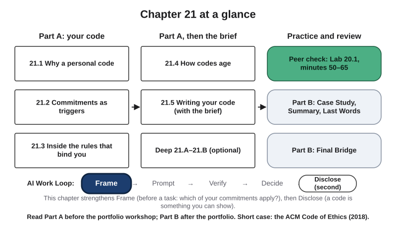{#fig-21-1 fig-alt="Chapter map: Part A your code (21.1–21.3), how codes age and the brief (21.4–21.5), practice and review; Work Loop with Frame highlighted."}

**Chapter 21 at a glance.** Through this book you have collected rules for working with AI. When your course ends, or when you work on your own, no syllabus will tell you when to use them. This chapter helps you choose the ones you will keep and write them as a short **personal AI code of practice**, part of your final portfolio. It ends with the Final Bridge, a review of Chapters 8 to 20 before a final review, and the book's last words.

**Time.** This chapter is read in two parts. Reading times are at a steady pace (150 words a minute); allow more if you read more slowly or are reading in a second language.

| Part | When | What | Time |
|---|---|---|---|
| **A** | Before the portfolio workshop (Lab 20.1) | This page, the Opening Case, Objectives and Warm-up, sections 21.1–21.4 with Check Yourself | About 29 min reading + 7 min answering the Warm-up and Check Yourself |
| Workshop draft | Before the portfolio workshop | Three commitments and a boundaries line (the 21.2 and 21.3 Your Turns) | About 15 min |
| Finishing the code | Before the portfolio is due | Section 21.5, the brief and rubric, the rest of the code | About 27–29 min (part of the portfolio's assembly time) |
| **B** | After the portfolio | Case Study, Chapter Summary, Last Words | About 7 min |
| Review practice | Before a final review | Faded examples, Review Questions A, Spaced Review, Case Study questions, Final Bridge | About 70 min (Final Bridge about 40) |

Part A and the workshop draft take about **51 minutes** together. The whole Core package of this chapter (both parts, section 21.5 and Check Yourself answering) takes about 45 minutes. Core sections are examinable; Studio sections are hands-on work; Deep sections are optional. Answers to Check Yourself, the faded examples and odd-numbered end-of-chapter questions are in Appendix E.

**The question of this chapter:** *When a course's rules end, which of them will you keep, and how will you know when to change them?* The Chapter Summary answers it.

::: {.callout-note title="Part A: read before the portfolio workshop"}
The Opening Case, the Learning Objectives and Warm-up, and sections 21.1 to 21.4. Section 21.5, the Deep sections and the labs follow; Part B starts at the Case Study.
:::

## Opening Case: A Profession Rewrites Its Rules {.unnumbered}

In June 2018 the Association for Computing Machinery (ACM), a professional society for people who work in computing, adopted a new version of its Code of Ethics and Professional Conduct. The ACM Council approved it on June 22, 2018. The version it replaced dated from 1992, about 26 years earlier (ACM, 2018a). ACM described the update as the result of a two-year process, with drafts published for comment (ACM, 2018b).

The 2018 booklet says why. The ACM president's preface explains that in 1992 many people saw computing work as purely technical, and the World Wide Web was in its infancy; by 2018, computing work could affect people's lives in ways that may not be intended or even predictable. The co-chairs of ACM's Committee on Professional Ethics, which organized the update, give an example: a reading app can meet the requirement of enlarging its text for readers with impaired vision and still fail them, if the instructions for doing so are printed in tiny type (ACM, 2018a).

The 2018 code fits on a few printed pages. Its principles are grouped in four sections, and each principle is followed by guidelines that explain how to apply it. It names machine learning: it asks for extraordinary care with the risks of machine-learning systems, and says that a system whose future risks cannot be reliably predicted needs its risks reassessed often as it is used, or should not be deployed (ACM, 2018a, principle 2.5). It says whom it is for: current and aspiring computing professionals, instructors, students, and anyone who uses computing in ways that affect others. And it says what it is not. In its own words, the code is "not an algorithm for solving ethical problems"; it is a basis for ethical decision-making (ACM, 2018a, Preamble).

As of October 2026, the 2018 code is still the ACM's current version (ACM's code page as archived on July 9, 2026).

**The puzzle.** A code written by a whole profession took about 26 years to update, and it still says that it cannot decide for you. If even that code needs judgment and revision, what should your own code contain, and how will you know when it is out of date? Sections 21.2 and 21.4 and the Case Study answer it.

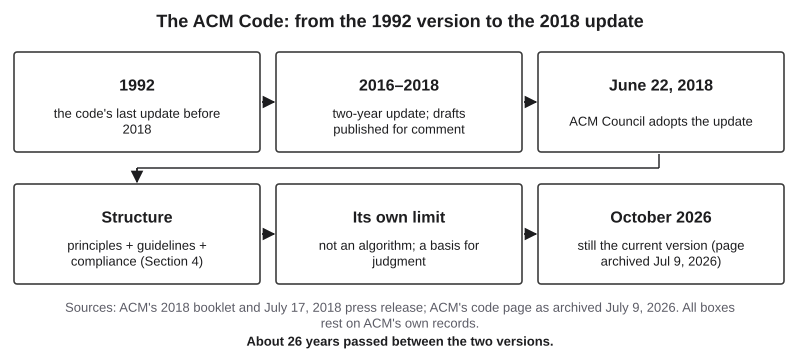{#fig-21-2 fig-alt="Timeline: 1992 code; 2016–2018 two-year update with drafts for comment; June 22, 2018 adoption; structure; not an algorithm; current in 2026."}

## Learning Objectives {.unnumbered}

Framework tags refer to the AI Fluency framework and the UNESCO (United Nations Educational, Scientific and Cultural Organization) AI Competency Framework for Students. The verb in bold is the objective's level in the revised Bloom taxonomy.

After this chapter you will be able to:

- **O1 — Distinguish** (Understand) a personal code of practice from policy, a professional code of ethics, a slogan and a dated tool note, and explain what each is for. *(LO7, LO4 · AI Fluency: Diligence · UNESCO: ethics of AI, Understand)*
- **O2 — Write** (Apply) commitments as triggers drawn from the book's methods and your own evidence. *(LO5, LO4 · AI Fluency: Delegation, Diligence)*
- **O3 — Judge** (Evaluate) a draft code with the trigger test and against the rules that bind you, and revise the lines that fail. *(LO5 · AI Fluency: Diligence · UNESCO: ethics of AI, Apply)*
- **O4 — Plan** (Create) how your code will age: a review date, review triggers, and dated notes kept apart from lasting commitments. *(LO7 · AI Fluency: Diligence)*
- **O5 — Produce** (Create) your personal AI code of practice for the final portfolio, with reasons, a boundaries line, a review plan and a declaration. *(LO7, LO4, LO5 · AI Fluency: Description, Diligence · UNESCO: ethics of AI, Create)*

::: {.callout-note title="Warm-up (ungraded)"}
Answer from what you know today. You will come back to these in the Chapter Summary.

1. Write one rule you already follow when you use AI. Could someone else check, afterward, whether you followed it?
2. Which rule from this book do you expect to still follow in a job five years from now? Why that one?
3. "A good code of practice names the exact tools and settings you use." Agree or disagree.

For each answer, write how sure you are, from 0 to 100%.
:::

## 21.1 Why a Personal Code {#sec-21-1 .unnumbered}

[Core]{.path}

Many fields now have rules about AI: an employer's, a client's, a profession's. None of them will tell you which habits from this book to keep. That choice is yours.

A **personal AI code of practice** is a short set of commitments you choose for how you will use AI in your own work, each written so that you recognize when it applies, with a date to review it. It sits next to four other kinds of text that look similar but do different jobs:

- **Policy:** rules someone with authority over your work sets: your instructor (for example, an instructor who adopts the three zones of section 1.5 and the coursework reading in section 10.2), an employer or a client.
- **A professional code of ethics:** a statement of principles a profession sets for its members, such as the ACM code in the Opening Case.
- **A slogan:** a good intention with no moment or action attached, such as "use AI responsibly."
- **A dated tool note:** a fact about a tool or a rule, true as of a date, such as which tool your institution provides.

A **scaffold** is temporary support that lets you do what you cannot yet do alone, withdrawn as you improve (Chapter 7). The book's artifacts, rubrics and declarations were scaffolds for its methods. Your code is the part you keep when the scaffolding comes down. The two personal goals you set in A1 are a good place to start: the ones that held may become commitments. (In European Union (EU) law, a "code of practice" can also be a document AI companies sign; see Deep 21.B.)

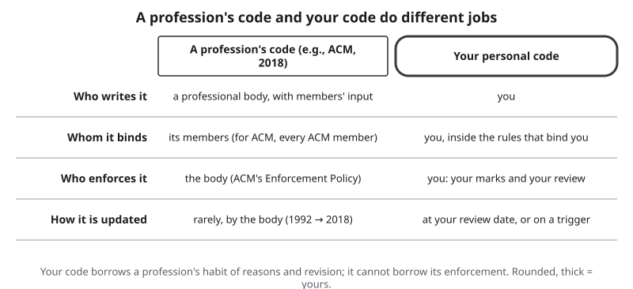{#fig-21-3 fig-alt="Table: a profession's code is written, enforced and rarely updated by a body for its members; your code is written by you and kept by your review."}

::: {.callout-note title="Worked Example: Marcus Sorts His Notes"}
**Field:** Nursing. *Featuring Marcus, a nursing junior who works some night shifts. Constructed example.*

Marcus collects six lines from his notes and sorts them.

| Line | Kind |
|---|---|
| "Any AI use during examinations is not acceptable." | Policy (his course, which uses the zones of section 1.5) |
| ACM principle 2.3: know and respect existing rules pertaining to professional work | Professional code (a principle's title) |
| "Use AI responsibly." | Slogan: no moment, no action |
| "Before I paste or upload anything into an AI tool, I check that it holds no information about a patient, even without a name." | Personal commitment (his rule, first stated in Chapter 15) |
| "My university provides an enterprise chat assistant to all students (as of October 2026)." | Dated tool note |
| "When I catch myself typing 'just tell me' in a study session, I stop the session and note it in my study log." | Personal commitment (from his Chapter 7 tutor session) |

Two of the six are his; the policy and the principle bind him anyway.
:::

::: {.callout-note title="Faded Example: A Marketing Student's Lines"}
**Field:** Business. *(Constructed example.)* A marketing student lists five lines. Facts: her internship's handbook says "Interns use only the company's approved AI tool"; her course syllabus says "AI drafting permitted with disclosure"; she wrote the other three herself.

| Line | Kind |
|---|---|
| "Interns use only the company's approved AI tool." | Policy (her employer) (filled) |
| "AI drafting permitted with disclosure." | _______ |
| "Be transparent." | _______ |
| "Before I post client copy that a tool drafted, I check every product claim against the client's fact sheet." | _______ |
| "The approved tool's free tier allows 50 messages a day (as of October 2026)." | _______ |
:::

::: {.callout-tip title="Check Yourself 21.1"}
1. What makes a line a personal commitment rather than a slogan?
2. Why does a personal code not replace policy or a professional code?
:::

## 21.2 Commitments as Triggers {#sec-21-2 .unnumbered}

[Core]{.path}

"Be honest about AI" is easy to agree with and easy to forget, because nothing tells you when it applies.

A **commitment** is a line in your code that states an action you will take. A **trigger (in a code of practice)** is the observable situation that tells you a commitment applies now. Write each commitment in one form:

> **When** [a moment I will notice], **I** [an action I or someone else can trace], **because** [my own evidence].

**Your own evidence** is something from your own work that shows why the line matters to you. To find it, open your Failure Diary (a dated record of AI failures you met, each with the test that showed it, a label and likely causes), your graded assignments and your lab records, and look for a moment that cost you time, a grade or a correction: two wrong dates in your A5 table, a planted fault your A11 dry run missed, a lab where a tool's answer changed between runs. If you wrote the optional Chapter 13 verification protocol, its log counts too. A rule can be part of the reason, but only together with your own evidence of why it matters to you.

The **trigger test** is three questions a line must pass: would you notice the moment at the time, could you or someone else trace afterward that you acted, and does the reason point to your own evidence? In more detail (@fig-21-4):

1. **Moment.** Would I notice it at the time, from something I can see: I am about to send, upload or publish; the input contains a person's data; a tool I set up can act for others?
2. **Action.** Could I or someone else tell afterward that I did it: a mark in a log, a saved check, a line in a declaration?
3. **Reason.** Does the "because" point to my own evidence?

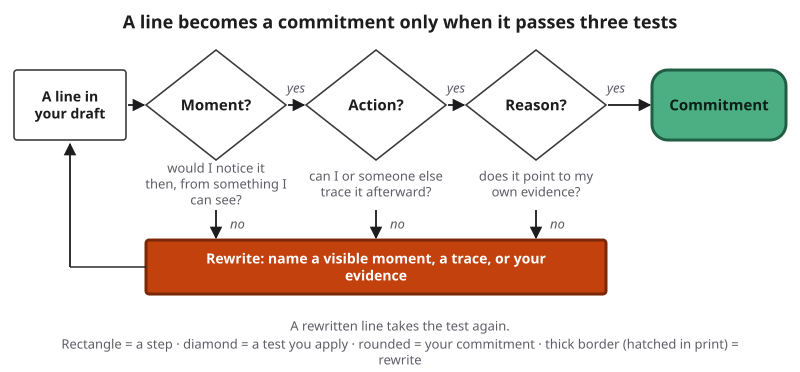{#fig-21-4 fig-alt="Flow: a line in your draft passes three diamonds, moment, action and reason, to become a commitment; a no at any diamond leads to rewrite."}

**Where triggers come from.** Each method in this book suggests at least one. Start from the method your own work showed you need.

| Method (chapter) | A cue you can see | A commitment it suggests |
|---|---|---|
| AI Work Loop (1) | Before I start a task whose result others will use | Write what a good result looks like before I prompt |
| Delegation Ladder (5) | Before a tool I set up acts later or for other people | A person sees each consequential action first (@fig-21-6) |
| Verification Funnel (8) | Before I send anything that carries a number, a name or a date others will rely on | Check it outside the tool; go to the primary source for any number, quotation or citation, or when the stakes are high |
| Data gate (12) | Before I paste or upload anything that is not public information | Use only a tool whose data terms fit its class |
| Approval gates (14) | When a workflow can send, pay, publish or delete | A hard gate and a named person |
| Risk Heat Map (15) | When I set up a new AI workflow | Rate its risks with evidence and name a risk owner for each one |
| Fairness checks (16) | When an output will describe, score or sort people | A paired-input test, or counts group by group, before I rely on it |
| Disclosure (10) | Before I send or submit work AI helped with | Answer the three questions of section 10.7; in coursework, the declaration |

The terms in the table, with the chapter that defined them:

| Term | Meaning | For example |
|---|---|---|
| Verification Funnel (8) | The book's diagram of three checks a claim can pass through (an independent check, the primary source, an expert), each outside the tool, taken only as far as the stakes require | A date in a report goes to the official record |
| Independent check (8) | Evidence that no AI tool produced: a source with an author or publisher you can name, or your own recalculation or reasoning from known inputs | You redo the sum yourself |
| Primary source (8) | The original record a claim comes from | The study itself, not a news story about it |
| Stakes (8) | What would be lost, by you or by someone else, if the claim were wrong | A wrong dose matters more than a wrong date in a club email |
| Data class (12) | The category an institution assigns to information by how much harm its release could cause; this book uses three generic levels: public; internal or confidential; restricted or legally protected | Student records are not public information |
| Data gate (12) | A check, made before any quality test, of whether a tool's data terms fit the class of the input | You read the terms before the first paste |
| Hard gate (14) | A gate the system enforces outside the model, so the action cannot run unless a person acts, or cannot run at all | An account with no saved card cannot pay |
| Risk owner (15) | The person who agrees in writing to carry a risk | The team lead signs for a remaining risk |
| Paired-input test (16) | Runs inputs that are identical except for one cue linked to a group, many times each, counts the outputs by a rule fixed before any run, and compares the counts | Two reference letters differing only in the name |

**Why the "when" matters.** Psychologists call a plan that links a goal you already hold to a cue in the world, in the form "if this situation arises, I will respond this way," an **implementation intention**. Reviews of hundreds of tests find that such plans help people act on goals they already hold, more so in the explicit if-then form (Gollwitzer & Sheeran, 2006; Sheeran et al., 2025). No study we found tested AI use or professional codes, so applying this to your code is this book's inference (Deep 21.A).

**Four required lines, then the rest.** Every code written with this book has at least one commitment each on **verification**, **data** and **disclosure**, and a fourth on **delegation and oversight, or risk, or fairness**, whichever your work most needs. Add others, up to seven in all, by the stakes in your field and by what your own record shows you forget. A line you cannot recall at the moment it matters will not help you.

::: {.callout-note title="Three kinds of trigger in this book"}
| Term | What it starts |
|---|---|
| Trigger (in a code of practice), this chapter | One of your commitments, now |
| Re-test trigger (Chapter 12) | Testing a tool's fit again |
| Trigger (in a verification protocol), Chapter 13 | Checking a piece of media before you act on it (if you read Chapter 13) |
:::

::: {.callout-note title="Worked Example: Hana's Values Become Triggers"}
**Field:** Arts and design. *Featuring Hana (media arts and design; they/them), a freelance illustrator who runs a small zine. Constructed example.*

Hana starts from three values and rewrites each as a commitment.

- **"Respect artists"** → *Before I use any AI image generation on a client job, I get the client's written agreement, because my contract clause requires it and a bakery client once arrived with a generated draft (Chapter 18).* Moment: any client job, before generation. Trace: the agreement on file. Reason: the clause together with Hana's own evidence, the bakery job.
- **"Protect my work"** → *Before I upload a drawing to any tool, I check its data terms and log the tool and the date, because comparing two tools' terms showed me how much they differ (Chapter 13).* Moment: the upload. Trace: the log line. Reason: Hana's own comparison.
- **"Be honest"** → *Before I send an invoice, I list any AI use in its notes, because clients already ask me about these tools (Chapter 13).* Moment: the invoice. Trace: the notes. Reason: what clients have asked Hana.

All three pass the test. An earlier draft of the first line began "When a client's brief mentions AI images"; it would miss briefs that say nothing about AI. A trigger must cover the whole rule it cites. Hana adds two more lines (@fig-21-5): one on tracing images before they are printed (verification), and a risk line: before contributors' scans go into any AI tool, Hana checks that the submission form tells contributors and that the tool does not train on uploads, because their Chapter 18 risk sheet found one tool's terms let uploads train models.
:::

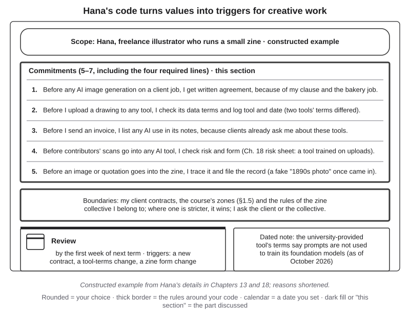{#fig-21-5 fig-alt="Hana's card: scope, five commitments starting Before, a boundaries line, a review by next term, a dated note on tool terms."}

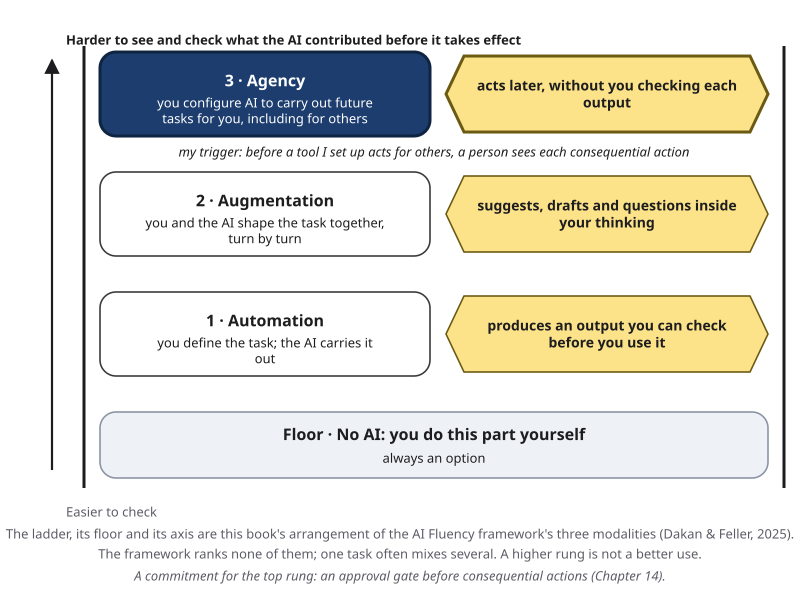{#fig-21-6 fig-alt="Delegation Ladder with the agency rung highlighted and a note: before a tool I set up acts for others, a person sees each consequential action."}

::: {.callout-note title="Faded Example: A Student Teacher's Values"}
**Field:** Education. *(Constructed example.)* A student teacher wants two commitments. Facts: he uses a chat tool to draft written feedback on middle-school essays; his placement school's guidance says student names and grades stay out of AI tools; in his first week, one AI draft repeated a student's name back in the feedback; in his A5 claim table, two of ten AI-stated facts about the state curriculum were wrong when he checked them against the curriculum document.

1. "Be fair to students" → *When I use AI to draft feedback on a student's essay, I remove the student's name and grade first and rewrite every sentence before it goes to the student, because a draft once repeated a student's name back to me.* Moment: drafting feedback (✓). Trace: the rewritten feedback and the stripped input (✓). Reason: his own first-week evidence (✓). (Filled.)
2. "Check facts" → *When ______, I ______, because ______.*
3. Apply the trigger test to your line 2 and mark each question.
:::

::: {.callout-important title="Your Turn (section 21.2; workshop draft, part 1)"}
Reread your two A1 goals. Then write three commitments in the "when, I, because" form, each from a different course method and each with your own evidence; at least two of them should be required lines. Apply the trigger test to each and mark it.
:::

::: {.callout-tip title="Check Yourself 21.2"}
1. "When I use AI, I am careful." Which of the three test questions does it fail, and why?
2. Why is "because the syllabus says so" not enough on its own as a reason?
3. Which four lines must every code written with this book contain?
:::

## 21.3 Your Code Inside the Rules That Bind You {#sec-21-3 .unnumbered}

[Core]{.path}

Your code is not the only set of rules you are under. Chapter 18 (section 18.1) described the layers: law, what you agree to (terms of service, licenses, contracts) and your organization's policy, the written rules of your course, institution or employer. Its working rule applies here unchanged: **follow the strictest rule that applies, and when a rule is unclear, ask its owner in writing and keep the answer.** A **rule's owner** is the person or office that can say what a rule means: your instructor, a manager, a client, a clinical instructor.

**Your code adds to the rules that bind you; it never loosens them.** It may be stricter than any rule you are under, never looser. For example, if your code says "drafting with AI is fine" and an assignment says no, the assignment wins.

Write this into your code as a **boundaries line**:

> This code works inside [the rules I am under]. Where one of them is stricter, it wins. When a rule is unclear, I ask [its owner, by role].

Name the rules; do not copy them: "my course's AI rules", not a restatement of them as if they were law. This chapter is not legal advice; for a real decision, ask the rule's owner.

**What if a rule seems wrong?** The ACM code addresses this for its members. Principle 2.3, paraphrased: rules judged unethical should be challenged; a professional should consider challenging a rule through existing channels before breaking it; and anyone who decides to break a rule must consider the consequences and accept responsibility (ACM, 2018a). Your code is not a reason to skip a rule, a review or a person's approval.

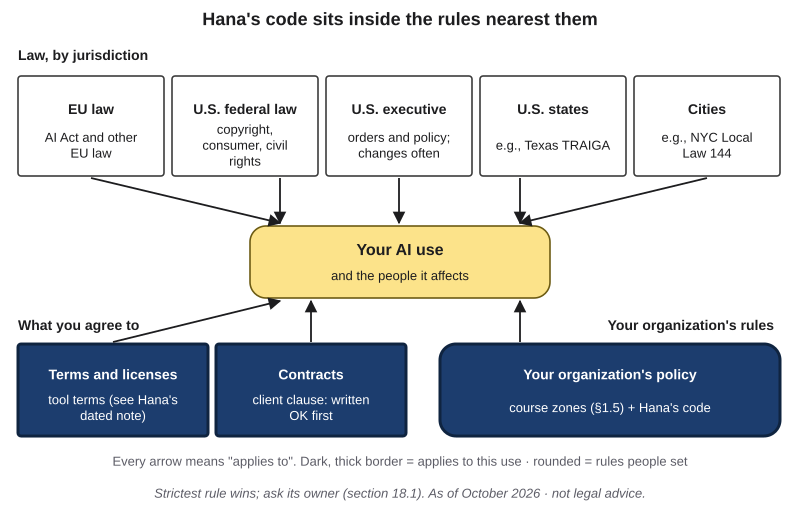{#fig-21-7 fig-alt="Regulation Map with terms, contracts and organization policy highlighted: tool terms, client clause, course AI rules plus Hana's code."}

::: {.callout-note title="Worked Example: Marcus's Boundaries Line"}
**Field:** Nursing. *Constructed example.*

Marcus checks his draft against the rules he is under. His clinical placement site's rules are stricter than his course's in places: no placement documents leave the site. His institution's data classes, with the table in section 12.5 as a starting floor, apply to anything he puts into a tool. His boundaries line:

> This code works inside my course's AI rules, my institution's data classes and my placement site's rules. Where one of them is stricter, it wins. When a rule is unclear, I ask my clinical instructor.

His first commitment, no information about a patient in any AI tool, even without a name, is stricter than any of these rules. Its reason is his own: his A12 data-flow map showed him that what he pastes is stored under the provider's rules, out of his control. He keeps the line: a personal line may be stricter, never looser.
:::

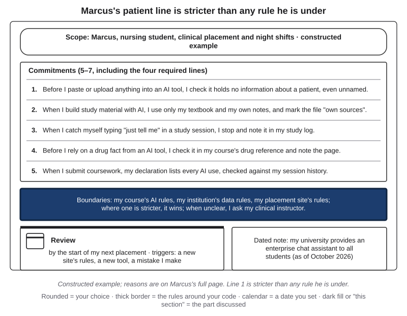{#fig-21-8 fig-alt="Marcus's card with the boundaries line highlighted: course AI rules, institution data rules, placement rules; ask the clinical instructor."}

::: {.callout-note title="Faded Example: A Finance Intern's Line"}
**Field:** Finance. *(Constructed example.)* Facts: an intern's draft code says "I use whichever AI tool is fastest." Their firm's handbook lists one approved AI tool for any work with client information; the handbook's owner is the compliance office. Last month the intern pasted a client's account summary into an unapproved tool and had to report it.

1. Which rule is stricter? *The firm's approved-tools list.* (Filled.)
2. Rewrite the line so it passes the trigger test and stays inside the handbook: ______.
3. Whom does the intern ask when the list is unclear? ______.
:::

::: {.callout-important title="Your Turn (section 21.3; workshop draft, part 2)"}
Write your boundaries line: the rules you are under (cited, not copied), "the stricter rule wins," and the owner you would ask, by role. Then check your three commitments: does any loosen a rule?
:::

::: {.callout-tip title="Check Yourself 21.3"}
1. Your code allows co-drafting; your instructor's assignment forbids it. Which applies, and why?
2. What three parts does a boundaries line contain?
:::

## 21.4 How Codes Age {#sec-21-4 .unnumbered}

[Core]{.path}

The ACM code went from 1992 to 2018 without an update. Your code will age faster, because tools change every few months. Keep what changes slowly apart from what changes fast, and set a date to look again.

**Three shelf lives.** This book dates its own content in three layers (@fig-21-9): ideas meant to last for years, practices that last one to two years, and tool details that last months. Your code can do the same. **Commitments** should last years: "before I send anything others will rely on, I check every claim that carries a number, a name or a date." **Practices**, such as a prompt template or a checklist, last a year or two. **Tool notes**, such as which tool, which model, its price, its data terms or a setting, last months. Keep tool facts out of your commitments and in **dated notes**. A dated note is a fact about a tool or a rule, written with the date it was true: "as of [month year]."

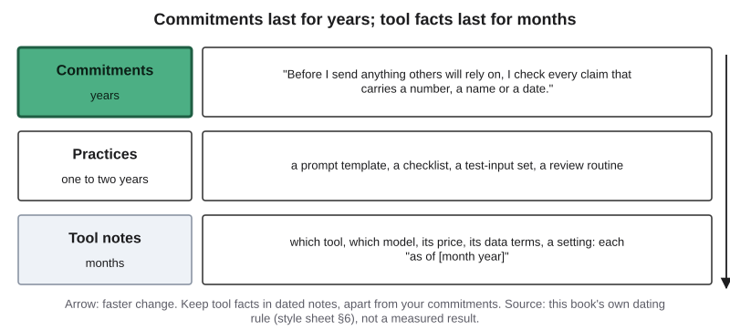{#fig-21-9 fig-alt="Three rows: commitments last years, practices one to two years, tool notes months, each with an example; an arrow marks faster change."}

**A review date.** A **review date** is the date by which you reread your whole code and keep, revise or retire each line. This book asks for one no more than six months ahead, and before a new job, internship, clinical placement or term, whichever comes first. If you have none of these ahead, six months is your date.

**Review triggers.** Some events should send you back before the date. Chapter 12 named them for tools: a **re-test trigger** is an event that should make you test a fit again: a model update or retirement, a change in price or terms, a new kind of input, or a change of job or school. All four apply to your code. Add two more: a new rule from someone who binds you, and a failure you met (a Failure Diary entry, or a mistake you caught too late).

**Keep marks.** Note, briefly, when a commitment applied and what you did. At the review, the marks show which lines did their job and which never came up (@fig-21-10). A code you never check behaves like what Chapter 14 called a **soft gate**: an instruction in the context asking the model to ask first or not to act, which the model receives as text and may not follow. In other words, an unread code is text you wrote, with nothing that makes you act on it. The ACM code asks for a similar habit in systems whose future risks cannot be reliably predicted: reassess them often as they are used (principle 2.5).

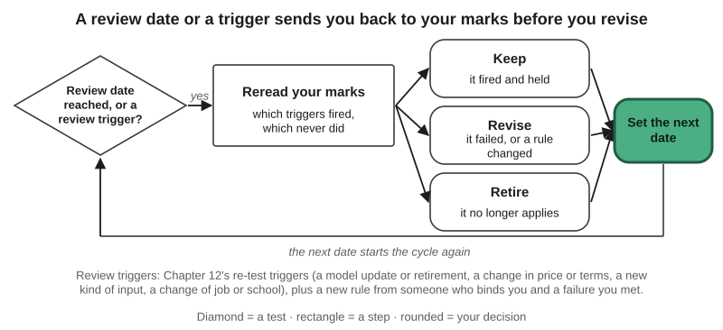{#fig-21-10 fig-alt="Cycle: review date or trigger, reread your marks, then keep, revise or retire each line, set the next date, and start again."}

::: {.callout-note title="Worked Example: Hana's Review Plan"}
*Constructed example.*

- **Review date:** the first week of next term.
- **Review triggers:** a new client contract; a change in the data terms of any tool Hana uses; a change to the zine's submission form (Chapter 18 proposed adding a line about AI tools).
- **Dated note:** "The terms of the tool my school provides say prompts are not used to train its foundation models (as of October 2026)" (Chapter 13).
- **Marks:** a line in Hana's job log each time a commitment applies: date, job, which line, what Hana did.
:::

::: {.callout-note title="Faded Example: A Co-op Student's Review Plan"}
**Field:** Engineering. *(Constructed example.)* Facts: a mechanical engineering student starts a co-op in May; his code names the one AI tool his lab allows, and its model; last month the tool's provider announced it will retire that model.

1. **Review date:** before his co-op starts, in May. (Filled.)
2. **Two review triggers from Chapter 12's list that already apply to him:** ______ and ______.
3. **Which line of his code should become a dated note:** ______.
:::

::: {.callout-important title="Your Turn (section 21.4; part of finishing your code)"}
Set your review date, write at least two review triggers, and move any tool fact from your commitments into a dated note.
:::

::: {.callout-tip title="Check Yourself 21.4"}
1. Why should the name of a tool you use appear in a dated note rather than in a commitment?
2. A new kind of input arrives at your job. Is that a reason to wait for your review date? Why or why not?
3. Why does a code need marks between reviews?
:::

## 21.5 Writing Your Code {#sec-21-5 .unnumbered}

[Studio]{.path}

*This section and the brief (Application Assignment) are read when you finish your code; their time is part of the code-writing time.*

Your code is one page. On it: your **scope** (who you are in this code: a student in your major, a job, freelance work, a club, and the date); **five to seven commitments** that pass the trigger test, each with a short reason; the **four required lines** (verification, data, disclosure, and one on delegation and oversight, risk or fairness); your **boundaries line**; your **review date and triggers**; any **dated notes**; and a declaration line. The card itself (scope, commitments with short reasons, boundaries, review) runs to about 300 words (@fig-21-11).

Bring your workshop draft (three commitments and a boundaries line) to a peer check. In the suggested format (**Lab 21.1**, which fits inside Chapter 20's portfolio workshop or runs on its own), a classmate reads your draft aloud and applies the trigger test line by line; you revise one line and record it before and after, with the question it failed and the question it now passes. Afterward, add the remaining commitments, including any required line still missing.

Your code goes in the portfolio beside your reflection, below your entries and their declarations (Chapter 20). In your defense, you may be asked to explain one line: why that moment, how you would show you acted, what evidence stands behind it.

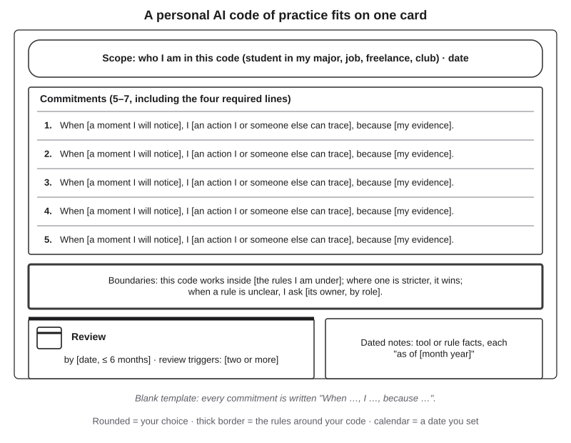{#fig-21-11 fig-alt="Blank card: scope; five numbered commitment lines in the when, I, because form; boundaries; a review box with a calendar; dated notes."}

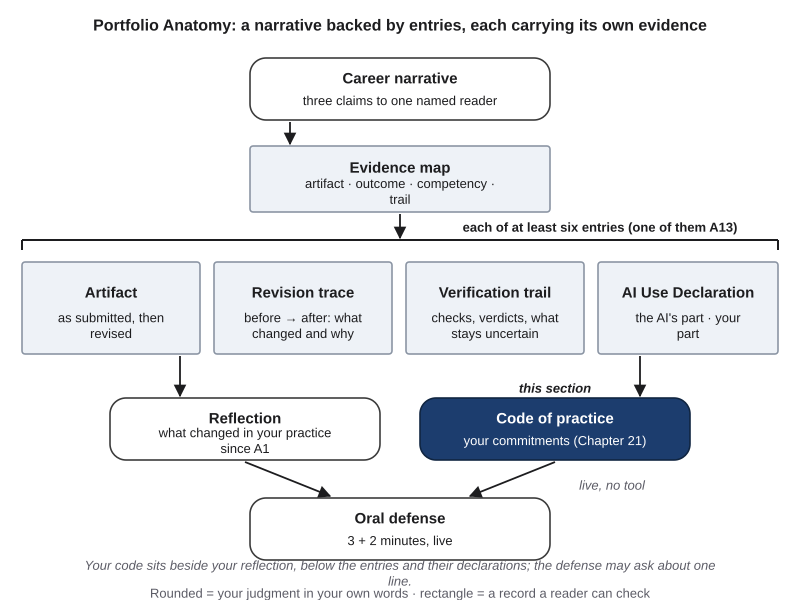{#fig-21-12 fig-alt="Portfolio Anatomy with the code of practice highlighted beside the reflection, below the entries with their declarations."}

::: {.callout-tip title="Check Yourself 21.5"}
1. What happens in the peer check (Lab 21.1), and what do you record from it?
:::

## Deep 21.A: Why If-Then Plans Help, and Their Limits {#sec-21-deep-a .unnumbered}

[Deep]{.path}

*Optional; not examinable.*

The "when, I, because" form borrows from research on goal pursuit. The psychologist Peter Gollwitzer called a plan that links a goal to a cue, in the form "if this situation arises, I will respond this way," an **implementation intention** (Gollwitzer, 1999). The account offered for why it helps is that the cue becomes easier to notice and the planned response starts with less deliberation.

Reviews that combine many studies (meta-analyses) estimate how much. Gollwitzer and Sheeran (2006) combined 94 independent tests and reported an average **effect size** of d = 0.65. An effect size is a standard way to say how large a difference is; by common conventions, 0.65 is between medium and large. Read it as a 2006 average across very different goals. A larger review almost two decades later combined 642 tests and reported effects from about d = 0.27 to d = 0.66 depending on whether the outcome was a thought, a feeling or a behavior, with larger effects when plans used the explicit if-then form, when people were highly motivated, and when they had rehearsed their plans (Sheeran et al., 2025). Both reviews include the theory's originators among their authors. An independent 2021 meta-analysis of if-then plans combined with mental contrasting (picturing the goal and then the obstacle), covering 21 studies, found a small-to-medium effect (g = 0.34) and signs of publication bias, so the true effects may be smaller (Wang et al., 2021).

**Limits, stated exactly.** These studies concern goals people already held, such as exercising, studying or health screening. No study we found tested AI use or professional codes of practice. So the claim that triggers make *your* code work is this book's inference from related evidence, not a finding. Rehearsal in these studies means repeating or picturing a plan soon after you form it; the nearest habit here is reading your commitments aloud in the peer check and rereading them often, not only at your review date (this book's inference). And an if-then plan does not choose your goals or replace judgment, which is the ACM code's point about itself.

## Deep 21.B: Three Things Called a "Code" {#sec-21-deep-b .unnumbered}

[Deep]{.path}

*Optional; not examinable.*

The word "code" covers at least three different documents.

| | Professional code of ethics | Regulatory code of practice | Personal code of practice |
|---|---|---|---|
| Example | ACM Code of Ethics and Professional Conduct (2018) | The EU's General-Purpose AI Code of Practice for providers of general-purpose AI models (2025) | Your code (this chapter) |
| Who writes it | A professional body, with members' input | Independent experts, in a process run by the European Commission's AI Office, with providers and other stakeholders consulted | You |
| Whom it binds | The body's members | Providers that choose to sign it (it is voluntary) | You, inside the rules that bind you |
| Who enforces it | The body (ACM has an Enforcement Policy) | Linked to providers' duties under the EU AI Act | You: your marks and review |
| How it changes | Rarely, by the body | As the Commission and signers decide | At your review date or on a trigger |

**Professional codes.** Many professions have one. Some have revised theirs in recent years; for example, the American Nurses Association released a revised Code of Ethics for Nurses in January 2025 (ANA, 2025), though not every revision addresses AI. Your field's code is worth reading before you write your own; Discussion Question 3 asks you to bring one, with its date and edition.

**Regulatory codes of practice.** In European Union law, a code of practice can be a voluntary document that companies sign to show how they meet duties in a regulation. The EU's code for providers of general-purpose AI models was published on July 10, 2025 (European Commission, 2025). Chapter 18 explains the AI Act; it does not discuss this code, and its status changes quickly.

**Personal codes.** Yours binds no one else and has no enforcer but you. What it borrows from the other two is the habit of giving reasons, naming whom it is for and revising on a schedule.

## Hands-on Labs {.unnumbered}

### Lab 21.1: Code Peer Check (Studio · 15 minutes · suggested within Lab 20.1) {.unnumbered}

In pairs, as a suggested activity inside Chapter 20's portfolio workshop or on its own. Each partner reads the other's workshop draft (three commitments and a boundaries line) aloud. For each commitment, the listener marks the three test questions (moment, action, reason) with a tick or a cross, checks the boundaries line ("which rule is stricter here?") and names one line to revise. Before you leave, write that line before and after; it is item 7 of your code's brief. No device or AI account is needed. Full steps: labs/ch21-lab1.md.

### Lab 21.2: Generic or Yours? (Check It · 20 minutes · optional) {.unnumbered}

Audit a provided, dated AI-generated "code of AI ethics for students" (model name and date on the sheet). Mark each line with one of the kinds in section 21.1 (policy restatement, professional code, slogan, dated tool note, commitment); count how many pass the trigger test; rewrite one line from your own evidence. If you prefer to generate your own example, use a tool your institution provides or approves (for example, an enterprise chat assistant with data protection) and no personal data. Nothing from the generated text goes into your code as is. Full steps: labs/ch21-lab2.md.

### Lab 21.3: How a Code Aged (Explore · 20–25 minutes · optional) {.unnumbered}

On a provided excerpt sheet, compare one principle (privacy or competence) in the ACM code's 1992 and 2018 versions: what was added, what was dropped, what the change suggests about what the field learned. Then write one review trigger for your own code: an event that would have sent you back to that principle. Full steps: labs/ch21-lab3.md.

*In Compass (optional): trigger-test drill; a card builder that exports a text version of your code; Lab 21.2 sample sheet.*

::: {.callout-note title="Part B: read after the portfolio"}
The Case Study, the Chapter Summary, the Last Words and the End-of-Chapter Package with the Final Bridge. The Ethics Lens, the Career Connection and From the Field are recommended.
:::

## Case Study: What a Profession's Code Can and Cannot Do {.unnumbered}

**The case (C21).** The Opening Case gave the facts: the ACM replaced its 1992 code with a version adopted on June 22, 2018 (ACM, 2018a). Here is how the code is built and what it says about its own limits.

**How it is built.** Principles are stated as responsibilities, and each is followed by guidelines that say what it means in practice. Section 1 holds general ethical principles (for example, avoid harm; be honest and trustworthy; respect privacy). Section 2 adds professional responsibilities, such as respecting existing rules (2.3), giving thorough evaluations of systems and their risks (2.5) and disclosing when a task is beyond one's competence (2.6). Section 3 is for leaders, including taking care when modifying or retiring systems people depend on (3.6). Section 4 is about compliance: members should uphold the code, and violations are treated as inconsistent with ACM membership and may be reported to the ACM (ACM, 2018a).

**What it says it cannot do.** The Preamble describes the code as a basis for ethical decision-making, not a procedure: several principles may apply to one issue, with different weight, and the public good is the main consideration. The co-chairs' preface adds that the principles are meant to be taken as a whole, and that applying them requires judgment (ACM, 2018a).

**What changed.** The 2018 version names machine-learning systems (extraordinary care with their risks) and asks that systems whose future risks cannot be reliably predicted be reassessed often in use, or not deployed (principle 2.5). This book reads the 26-year gap as a reminder that codes age more slowly than the fields they guide (inferred).

**Labels.** No AI output was produced and nothing failed, so this case has no label on the Failure Taxonomy Tree (Chapter 4's map of how AI output fails) and no link of the failure-to-harm chain: it is a governance document, used as a model of how a code is built and revised.

**Your decision.** The ACM revised its code once in 26 years; you can revise yours whenever you choose. Decide two things and write each in one sentence: how often you will review your code, given how fast the tools in your field change; and which one ACM principle named above you would turn into a commitment of your own. Case Study Question 3 asks you to defend both.

## Ethics Lens: A Code No One Reads {.unnumbered}

Does a code change what people do? Researchers at North Carolina State University tested one version of that question. They gave 105 professional software developers and 63 software engineering students eleven short scenarios about ethical choices at work. One group was asked to consider the ACM code before answering; a control group was not. The researchers found no significant difference in the answers the two groups gave (McNamara et al., 2018).

What does that show? That being asked to consider the code before a decision did not change answers in this setting. It does not show that codes never work: the study did not test codes written as triggers, codes people chose for themselves, training, or codes with enforcement behind them.

The finding is still a warning for this chapter. A code can become **ethics washing**: a statement of good principles that makes a person or company look responsible without changing what they do. A personal code invites the same risk. You can write five fine commitments, file them in your portfolio, and never read them again.

A second risk runs the other way: a code used as cover. "My code allows it" is not an answer to a client, a patient or an instructor who was not asked. The people your work affects did not write your code and cannot see it unless you show them. That is one reason this book asks for a boundaries line and a declaration: both point outward, to rules and readers that are not yours.

Two habits protect against both risks: write lines that can be checked (a moment, a traceable action, a reason), and keep marks and review them.

## Career Connection {.unnumbered}

How a personal code meets professional practice looks different in each field. These are illustrations of the method, not survey findings.

- **Nurse (Marcus's field).** A nurse works under the profession's code of ethics, the state's scope-of-practice rules and the employer's policies. A personal line such as "no information about a patient in any AI tool" sits inside all of them, and the employer's approved tools decide which systems may be used at all.
- **Illustrator or designer (Hana's field).** A freelancer's main rules are client contracts. A personal code makes the contract's AI clause a habit: written agreement before generation, disclosure in invoices, care with whose work goes into which tool.
- **Accountant (Lucía's field).** Accountants work under a professional conduct code, firm policies and clients' confidentiality. A trigger such as "before AI-drafted text reaches a client, I check every figure against the source document" turns a value into a step a reviewer can trace.
- **Engineer (Sam's field).** Engineers work under their profession's code and their employer's tool policies. A personal code adds the agent-era version: a hard gate before any tool that can order, send or change something.
- **Psychology (Elif's field).** Research assistants work under research-ethics review and data rules for participants' information; a volunteer like Elif at a peer-tutoring center handles other students' information under the center's rules. A personal code adds testing habits: changing one cue and counting runs before relying on a tool that describes people.
- **Teacher (education).** Schools increasingly publish guidance on AI for staff and students. A teacher's personal code adds what guidance rarely says: when feedback a tool drafted is rewritten before a student sees it, and how students' names and grades stay out of tools.

**In an interview.** An employer may ask how you use AI in your work. Two lines of your code and one portfolio entry that shows them in use (Chapter 20) make a better answer than "carefully."

## From the Field {.unnumbered}

In 2014 I wrote an encyclopedia entry on the **check sheet**, a simple tool from quality management (Şeker, 2014). The entry explains that a check sheet, also called a tally sheet and sometimes used in place of a checklist, has two purposes: to reduce errors while work is being done, and to collect data for later study. Its example is the pre-flight check of an aircraft: the items that must not be forgotten are prepared as a sheet and given to the inspection staff, and because they go through every item, no check is forgotten. When several people share one sheet, it also becomes a way to communicate; the entry's example is keeping a pool's chemical balance, where each person can see earlier checks, which chemical was added, by whom and when.

The entry stresses speed: a sheet is prepared in advance, with effort and careful thought, so that staff in the field can fill it in quickly. It lists what every check sheet should record: who filled it in, what each mark means, where it was filled in, and when, either a date and time or a linked event such as "before shipment." Counted by type, by location or by cause, the marks show patterns; counts by cause feed tools such as the fishbone diagram.

**Present-day connections (this book's reading, written in 2026).** A personal code of practice works like a check sheet for your own AI use. You prepare it when you have time to think, so that you can use it fast, under pressure, at the moment of the task. The entry's "when" field, a linked event such as "before shipment," is what this chapter calls a trigger: "before I send," "before I upload." Its "who" and "when" are your code's name and date. Its marks are what you reread at your review date. And the counts by cause lead where Chapter 4's From the Field led: to a fishbone diagram of why your failures happened. One limit is this book's, not the entry's: the entry concerns quality control, not AI or ethics, and a check sheet records and reminds; it does not decide for you.

## Chapter Summary {.unnumbered}

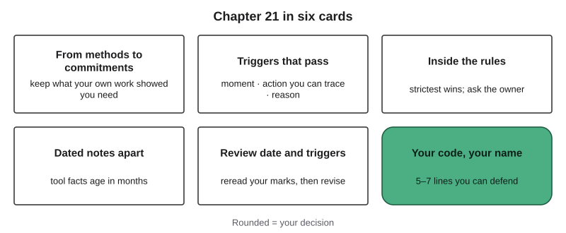{#fig-21-13 fig-alt="Six cards: from methods to commitments, triggers that pass, inside the rules, dated notes apart, review date and triggers, your code."}

**The chapter's question:** *When a course's rules end, which of them will you keep, and how will you know when to change them?* Keep the ones your own work showed you need, written as commitments with triggers you will recognize at the moment of use: a few, chosen by the stakes in your field, each with your own evidence as its reason (21.1–21.2). Your code sits inside the rules that bind you and never loosens them (21.3). Give it a review date and review triggers, keep tool facts in dated notes, and keep marks of when a commitment applied, because a code that is never used or reviewed protects no one (21.4).

**Return to the Opening Case.** The ACM's code was rewritten after about 26 years and still says it is not an algorithm. Your code will need judgment too, and it will need revising much sooner.

**Revisit your Warm-up.** (1) *A rule passes if it names a moment you would notice and an action someone could trace (21.2).* (2) *Whichever your own evidence supports; the commitment should outlast the tools (21.4).* (3) *Disagree: tool names belong in dated notes, which age in months (21.4).* Compare these with your confidence ratings.

::: {.callout-note title="Five Codes, First Lines"}
*Constructed examples. One commitment from each student's code, in the student's own words.*

- **Lucía** (accounting): *"Before an AI-drafted reply reaches a customer, I check every promise in it against the written policy, because a draft once offered a discount the policy did not allow (Chapter 1)."*
- **Marcus** (nursing): *"Before I paste or upload anything into an AI tool, I check that it holds no information about a patient, even without a name, because my A12 data-flow map showed me that what I paste is stored under someone else's rules."*
- **Elif** (psychology): *"Before I rely on, or recommend, a tool that describes or scores students at the tutoring center, I run a paired-input test that changes one cue and record the counts, because my 15-run test in Chapter 16 could show only a lead."*
- **Sam** (mechanical engineering): *"When a tool I set up can spend, send or delete, I put a hard gate and a named person before that action, because my agent once placed a $312 order despite an instruction to ask first (Chapter 14)."*
- **Hana** (media arts and design): *"Before I use any AI image generation on a client job, I get the client's written agreement, because my contract clause requires it and a bakery client once arrived with a generated draft (Chapter 18)."*
:::

### Key Terms {.unnumbered}

commitment (in a code of practice) · dated note · implementation intention (Deep) · own evidence (in a code of practice) · personal AI code of practice · professional code of ethics · review date · trigger (in a code of practice) · trigger test

## Last Words {.unnumbered}

This book began with five decisions you make whenever AI is involved in your work: frame the task, prompt the tool, verify what it produces, decide what to keep, and disclose how it was made. Every chapter since has added a method for one of those decisions, from checking a citation to placing a person before an agent's action.

The tools named in these pages will change; some will be renamed or retired before this edition is a year old. The five decisions are not about any tool. They are about who answers for the work, and that stays with you.

That is why this book ends with a code you write yourself. It is short, dated and yours to revise. Part VI, Chapters 22 and 23, is optional reading for anyone who wants to look further: at recent developments in the field and at the questions AI raises about minds, meaning and responsibility.

Before you close this book, put your review date in your calendar. On that day, reread your code and your marks, and decide for each line: keep, revise or retire.

## End-of-Chapter Package {.unnumbered}

<!-- Each item: objective · LO · revised Bloom level. Odd-numbered answers → appendix/answers.md (Appendix E, via docs/production/handoff/ch21.md); even-numbered → private/ch21-answers-even.md. Review A distractors draw on M1–M6 (blueprint §4): M1 A1, A12; M2 A2, A7, A8; M3 A6; M4 A9; M5 A10; M6 A3. MC keys: A1 c, A2 a, A3 d, A4 b, A6 c, A7 d, A8 a, A9 b, A10 b, A11 c, A12 a. The correct option is the longest in at most two items. Final Bridge MC keys: FB1 c, FB2 a, FB3 b, FB4 d, FB5 a. -->

*All of the End-of-Chapter Package, with the faded examples above, is practice for a final review.*

### Review Questions A: Terms and Concepts {.unnumbered}

Item 5 is a short answer.

1. *(O1 · LO7 · Understand)* Which line is a personal commitment?\
   (a) "Use AI ethically and responsibly in all of my work, every single day."\
   (b) "AI use during examinations is not acceptable in this course."\
   (c) "Before I submit work, I list every AI use in my declaration."\
   (d) "My college provides a chat assistant to students (as of October 2026)."
2. *(O1 · LO7 · Understand)* How does a personal code differ from a professional code of ethics?\
   (a) You write it and only you enforce it, inside the rules that bind you.\
   (b) It replaces the profession's code for the work you do on your own.\
   (c) It is enforced by your employer once you include it in your final portfolio.\
   (d) It is identical in purpose, but written in shorter and simpler sentences.
3. *(O3 · LO5 · Evaluate)* A classmate's code has fourteen commitments, one for every chapter. What is the main problem?\
   (a) None: more commitments make a person's work safer than a short list of lines could.\
   (b) A code may contain only the four required lines and nothing more.\
   (c) Codes longer than five lines break the course's written policy.\
   (d) Fourteen lines are hard to recall, so many will not come to mind when needed.
4. *(O2 · LO5 · Understand)* Why does each commitment end with "because …"?\
   (a) So that a reviewer can award more points for the length of each line.\
   (b) So that the line points to your own evidence and you can defend it.\
   (c) So that the code repeats the course policy that applies to each line.\
   (d) So that the commitment holds even when a stricter rule applies.
5. *(O2 · LO5 · Understand; short answer)* How does a trigger in a code of practice differ from a re-test trigger (Chapter 12)?
6. *(O4 · LO7 · Apply)* Mina last reviewed her code in January 2028 and set her next review for June. In March 2028 her firm adopts a new AI tool for client work. What should she do?\
   (a) Nothing: a code is finished once written, and hers already passed the test.\
   (b) Delete the code, because a new tool makes every earlier commitment out of date.\
   (c) Treat the new tool as a review trigger: reread her marks, then keep, revise or retire lines.\
   (d) Wait for her June review date, because a code is reviewed only on its date.
7. *(O3 · LO5 · Understand)* Which statement about a personal line that is stricter than every rule you are under is accurate?\
   (a) It must be removed, because a code may not go beyond the rules.\
   (b) It is allowed only if your employer approves it in writing first.\
   (c) It turns into a rule that binds your classmates once it is graded.\
   (d) It is allowed: a personal code may be stricter, but never looser.
8. *(O3 · LO5 · Understand)* What does ACM principle 2.3 say to do about a rule you judge unethical?\
   (a) Consider challenging it through existing channels first; if you break it, accept responsibility.\
   (b) Ignore it quietly, because ethical principles override any written rule you meet at work or in class.\
   (c) Follow it exactly as written, because written rules settle every ethical question that comes up at work.\
   (d) Replace it with your personal code, which from then on binds your whole organization and its staff.
9. *(O4 · LO7 · Understand)* Why should a tool's name and price go in a dated note?\
   (a) Because a commitment may not mention any AI tool or company at all.\
   (b) Because tool facts change in months, while commitments should last years.\
   (c) Because only dated notes are graded in the portfolio rubric for the code of practice.\
   (d) Because the course forbids naming any tool in coursework or portfolios.
10. *(O1 · LO4 · Understand)* In McNamara et al. (2018), one group was asked to consider the ACM code before answering ethical scenarios. What did the study report?\
    (a) More ethical answers, which shows that reading a code is enough on its own.\
    (b) No significant difference from a control group in the answers given.\
    (c) Less ethical answers, which shows that professional codes can do harm.\
    (d) Too few answers to report, because most participants refused.
11. *(O1 · LO7 · Understand)* What does the ACM code mean by saying it is not an algorithm for solving ethical problems?\
    (a) It cannot be applied to computing systems that use algorithms.\
    (b) It contains no rules, only examples that members may ignore.\
    (c) It is a basis for judgment: several principles may apply with different weight.\
    (d) It was written before machine learning existed, so it does not cover AI at all.
12. *(O2 · LO5 · Apply)* Which "because" passes the reason question?\
    (a) "… because in my A5 table two of ten AI-stated dates were wrong."\
    (b) "… because honesty is one of the values that matter most to me."\
    (c) "… because AI tools are known to make mistakes every now and then."\
    (d) "… because everyone who works in my field is expected to do this."

### Review Questions B: Case Questions {.unnumbered}

1. *(O1 · LO7 · Analyze)* A pharmacy technician lists six lines: "Protect patient privacy"; "The pharmacy's handbook: no patient data in unapproved software"; "Before I ask an AI tool about a drug interaction, I remove anything that identifies a customer, and I check the answer in the pharmacy's reference"; "The pharmacy's chatbot runs model X (as of March 2027)"; "Know and respect existing rules (ACM 2.3)"; "Be careful." Sort each line, and rewrite one slogan as a commitment. Facts for the rewrite: last month the technician caught an AI answer that listed the wrong maximum dose.
2. *(O2 · LO5 · Apply)* A journalism student's code has three lines: "Be accurate," "Be transparent," "Protect sources." Facts: she uses an AI tool to transcribe interviews; her student newspaper's policy requires disclosing AI-assisted reporting at the end of an article; last term a transcript misspelled an interviewee's name; before one interview, a source asked not to be named. Convert all three lines into commitments that pass the trigger test.
3. *(O3 · LO5 · Apply)* A student employee in a campus office writes, "I may use any AI tool for drafts." Facts: the office's written rule names one approved tool for anything involving students' records; the office manager owns the rule; last term the employee's own draft with a student's ID number ended up in a free tool's history. Fix the line and write the boundaries line.
4. *(O4 · LO7 · Apply)* A code written in 2025 says, "I draft in Tool Y's premium tier ($20 a month) with model Z." By 2027 model Z is retired and Tool Y's price has changed. Separate the dated notes from the commitments, and set a review date and two review triggers.

### Review Questions C: Interpretive Questions {.unnumbered}

1. *(O2 · LO5 · Evaluate)* "A code with triggers is just a checklist; real ethics is judgment." Take a position, using the ACM code's description of itself and the trigger test.
2. *(O3 · LO5 · Evaluate)* "If my code is stricter than my employer's rule, I am being unprofessional." Take a position.
3. *(O4 · LO7 · Evaluate)* "A code of practice should be written once, at graduation, and kept unchanged as a record of who you are." Take a position.

### Spaced Review {.unnumbered}

Come back to these a few days after reading, without looking back. They connect this chapter to Chapters 20 and 19.

1. *(Chapter 20 · LO7 · Understand)* In the Portfolio Anatomy, what does an entry's AI Use Declaration show a reader that the artifact alone does not? (Section 20.3.)
2. *(Chapter 20 · LO7 · Apply)* What does a revision trace show an employer about how you work with AI? (Section 20.4.)
3. *(Chapter 19 · LO6 · Apply)* Name one safeguard from your A13 workflow that could become a commitment in your code, and write it as a trigger. (Section 19.6.)
4. *(Chapter 19 · LO6 · Understand)* Chapter 19 says the Work Loop is the same in every field but four things change. Name them. (Section 19.1.)

### Discussion Questions {.unnumbered}

1. *(Ethics · O1 · LO4 · Evaluate)* Who benefits from your code: you, the people your work affects, or your employer? Can a code serve all three?
2. *(Career · O5 · LO7 · Apply)* Which line of your code would you show an employer, and which example from your portfolio would you pair with it?
3. *(Interdisciplinary · O1 · LO5 · Analyze)* Find your field's professional code (give its publisher, edition and date). Which of its principles already covers AI, and what would your code add?
4. *(Personal · O2 · LO4 · Analyze)* Describe a rule you once broke without noticing. What trigger would have caught it?
5. *(Future · O4 · LO7 · Evaluate)* After a year of work, what do you expect to add to your code, and what to retire?

### Application Assignment: Your Personal AI Code of Practice {.unnumbered}

**Due** with the final portfolio, when your instructor sets it. *(O5 · LO7, LO4, LO5 · Create)* Read Part A before the portfolio workshop, and bring your workshop draft (three commitments and a boundaries line: the 21.2 and 21.3 Your Turns) to the peer check (Lab 21.1). In the portfolio's suggested scoring, it is worth 15 of 100 points. No AI tool is required.

**Time.** Workshop draft about 15 minutes. Finishing, about 27–29 minutes of portfolio-assembly time: this brief and the rubric 6; section 21.5 2; the review plan (the 21.4 Your Turn) 4; two to four more commitments, including any required line still missing, 8–10; the trigger-test record 2; the declaration 3; laying out the page 2. About 42–44 minutes in all.

**AI use for this artifact.** Your instructor's or employer's policy decides. Where it is silent, this book suggests: drafting help from an AI tool is permitted with disclosure and verification; feedback on your draft and grammar-only edits are permitted and listed. Every commitment must be your own: you must be able to explain and defend each line in your oral defense without a tool, and each "because" must point to your own evidence. Where your instructor adopts this brief, it is the explicit permission that section 10.2's table asks for.

**What to submit:**

1. **Scope** (one line): who you are in this code (a student in your major, a job, freelance work, a club) and the date.
2. **Commitments:** five to seven, each written "When [moment], I [action], because [reason]," the reason pointing to your own evidence (A1–A14, a Failure Diary entry, a lab record), not only to a rule.
3. **Required lines:** at least one commitment each on **verification**, **data** (what goes into which tool) and **disclosure**, and a fourth on **delegation and oversight, or risk, or fairness**, whichever your work most needs.
4. **Boundaries line:** the rules your code works inside (cited, not copied), "where a rule is stricter, it wins," and whom you ask, by role.
5. **Review plan:** a review date (no more than six months ahead, or before your next job, placement or term, whichever comes first) and at least two review triggers.
6. **Dated notes** (optional): tool or rule facts, each "as of [month year]," kept apart from the commitments.
7. **Trigger-test record:** for each commitment, a tick for each of the three questions; and one line you revised after the peer check, before and after, with the question it failed and the question it now passes.
8. **AI Use Declaration** for the code: tools, purpose, what you accepted, rejected or revised, how you verified it, and where your own judgment shaped the work ("no AI tools used" if so).

One page; the card itself (scope, commitments with short reasons, boundaries, review) about 300 words. Submit in the course language. Never include personal or confidential data about anyone else.

**Rubric (15 points, suggested scoring).** The portfolio rubric (Chapter 20) scores the code of practice with this rubric. Criteria are scored separately. When a submission fits parts of two levels, give the lower level whose description fully applies. Without a trigger-test record (item 7), the first criterion is scored at Proficient at most.

| Criterion (points) | Exemplary | Proficient | Developing | Beginning |
|---|---|---|---|---|
| **Commitments as triggers (5)** | 5: five to seven commitments; each names a moment you would notice and an action you or someone else can trace; all pass the recorded test | 3.5: four commitments, or eight or more; or one line fails one or more test questions | 2: exactly three commitments; or from two lines up to half of the lines fail at least one question | 0.5–0: fewer than three commitments; or more than half of the lines fail or are slogans |
| **Grounding in your own evidence (4)** | 4: every reason points to your own evidence; all four required lines present | 3: one reason without your own evidence, or one required line present but failing a test question | 2: two or more reasons without your own evidence, or one required line missing, or two or more required lines failing a test question | 0.5–0: no reason points to your own evidence, or two or more required lines missing |
| **Fit with the rules that bind you (2)** | 2: the boundaries line names the rules you are under (cited), says the stricter rule wins and names an owner by role; no line loosens a rule | 1.5: one of those three elements missing | 1: two elements missing, or the line is too vague to apply | 0: no boundaries line, or a commitment is looser than a rule you are under |
| **Review plan and dated notes (2)** | 2: review date within the limit; two or more review triggers; tool facts only in dated notes | 1.5: one review trigger only, or one tool fact inside a commitment | 1: one of these missing: a review date, any review trigger, or a date within the limit; or two or more tool facts inside commitments | 0: no review plan, or two or more of the Developing faults |
| **Revision (1)** | 1: one before-and-after revision, with the question it failed and the question it now passes | 0.75: only one of those questions named | 0.5: no question named | 0: no revision |
| **Declaration (1)** | 1: all five declaration elements | 0.75: four elements | 0.5: two or three elements | 0: zero or one element |

A true "no AI tools used" declaration scores 1.

**Alternative assignment** (for students who prefer not to describe their own practice, or whose work involves information they may not share). Write the code for **a role** in your field from one of four role briefs in the book's companion files (a hospital unit clerk, a marketing intern, a lab research assistant, a freelance translator); reading a brief takes about 5 minutes. Each brief summarizes the role's rules and gives three dated incidents. Same items and rubric, read this way: "your own evidence" means the brief's incidents; the boundaries line uses the role's rules; the revision and the declaration are unchanged.

### Mini-Project (optional): A Code Log {.unnumbered}

For six weeks after the course, keep a check sheet for your code: each time a commitment applies, note the date, the line and what you did. At your review date, revise your code and write half a page on the line that never came up: was it unnecessary, or did you miss its moment?

### Case Study Questions {.unnumbered}

1. *(O1 · LO7 · Understand)* What does the 2018 code's preface say had changed since 1992?
2. *(O1 · LO7 · Analyze)* Why does the code describe itself as a basis for decision-making rather than a procedure, and what does that ask of its readers?
3. *(O4 · LO7 · Evaluate)* Defend the two decisions you wrote at the end of the Case Study: your review interval and the ACM principle you would turn into a commitment (write the commitment so it passes the trigger test).
4. *(O1 · LO7 · Understand)* Why does this case carry no label on the Failure Taxonomy Tree?

### Final Bridge: Chapters 8 to 20 {.unnumbered}

This bridge reviews Chapters 8 to 20 before a final review of the book's Core sections. Chapter 10's Midterm Bridge reviewed Chapters 1 to 7; Chapters 19 and 20 are practiced in this chapter's Spaced Review. The ten items below are spaced over Chapters 8 to 18, on ideas this chapter does not practice again. Answer without notes, then check: odd answers are in Appendix E; your instructor may share and review the rest. Allow about 40 minutes.

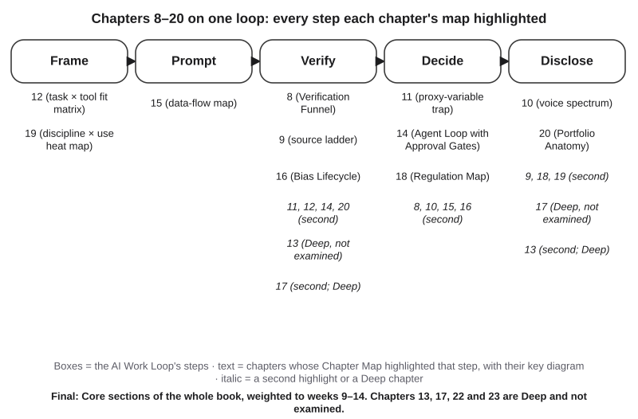{#fig-21-14 fig-alt="AI Work Loop with five steps; under each, chapters 8–20 whose maps highlighted it, main or second, with key diagrams; Chapters 13 and 17 Deep."}

The figure and the table list every step each chapter's map highlighted, main or second; second highlights are marked.

| Work Loop step | Chapters whose map highlighted it (key diagram) |
|---|---|
| Frame | 12 (task × tool fit matrix) · 19 (Discipline × Use Map) |
| Prompt | 15 (data-flow map) |
| Verify | 8 (Verification Funnel) · 9 (source ladder) · 16 (Bias Lifecycle) · 11, 12, 14 and 20 (second) · 13 (Deep, not examined) · 17 (second; Deep) |
| Decide | 11 (proxy-variable trap) · 14 (Agent Loop with Approval Gates) · 18 (Regulation Map) · 8, 10, 15 (Risk Heat Map) and 16 (second) |
| Disclose | 10 (voice and ownership spectrum) · 20 (Portfolio Anatomy) · 9, 18 and 19 (second) · 17 (Deep, not examined) · 13 (second; Deep) |

**Bridge A: Terms and concepts**

FB1. *(Chapter 8 · LO3 · Understand)* You ask a chat tool whether a source it cited exists, and it answers, "Yes, it is a real article." What does that answer count as?\
(a) An independent check, because you asked a second question in a new turn.\
(b) The primary source, because the tool named the article and its authors.\
(c) No evidence: a tool's own "yes" is never a source; check an index or open the work.\
(d) An expert's check, because the tool was trained on most of the published research in the field.\
*Missed it? Reread sections 8.2 and 8.3.*

FB2. *(Chapter 9 · LO3 · Understand)* A study reported that students who slept more had higher grades. An AI summary says the study "shows that more sleep raises grades." Which drift type is this?\
(a) Cause from correlation.\
(b) Dropped caveat.\
(c) Changed number.\
(d) Broadened claim, from a sample to everyone.\
*Missed it? Reread sections 9.4 and 9.5.*

FB3. *(Chapter 11 · LO3 · Understand)* An AI tool computes a club's dollars per volunteer hour from a log with two blank hour cells, and three ways of handling the blanks all pick the same "best" event. What does that agreement show?\
(a) The result is reliable: three different ways of handling the blanks reached the same answer.\
(b) Little on its own: each way of handling a blank is an assumption, and all can be wrong.\
(c) The blanks do not matter, because functions such as AVERAGE leave empty cells out of the result.\
(d) The tool made an error, because an analysis may not use a log that has missing values in it.\
*Missed it? Reread section 11.2.*

FB4. *(Chapter 12 · LO2 · Understand)* "Tool X tops a public ranking, so it is the best fit for summarizing my lab reports." Which response is best?\
(a) Agree: a public ranking tests many kinds of tasks, so it already covers lab reports and similar writing.\
(b) Agree, if the ranking is recent; rankings from the last month settle fit.\
(c) Disagree: rankings are paid advertising, so they say little about fit for my reports.\
(d) Disagree: fit belongs to one task and one tool, on a date; test it on your own reports.\
*Missed it? Reread sections 12.1 and 12.6.*

FB5. *(Chapter 16 · LO5 · Understand)* Why can a screening tool, in general, not give two groups equal selection rates, equal error rates and equal precision at the same time?\
(a) When it makes errors and the groups' base rates differ, the three cannot all hold.\
(b) The developers chose one definition and never tested the other two on their data.\
(c) Fairness definitions apply only to tools that take a protected characteristic as an input.\
(d) Any tool trained on past data is biased against every group equally.\
*Missed it? Reread section 16.3.*

**Bridge B: Case questions**

FB6. *(Chapter 14 · LO2 · Apply)* A 15-step automated workflow gets each step right 98% of the time. Using Chapter 14's calculation (each step independent), about what share of runs finish with no error? Its last step emails a supplier to place an order. Where would you put a person, and why? *Missed it? Reread sections 14.3 and 14.4.*

FB7. *(Chapter 15 · LO5 · Analyze)* A student club's treasurer pastes a spreadsheet of members into a free chat tool to find who has not paid dues. Names were removed; ZIP code, birth date, major and payment status remain. (a) Trace the data flow. (b) Explain why removing names was not enough. (c) Rate one risk on the Risk Heat Map and say whether the rating is documented or inferred. (d) Propose one mitigation (avoid, reduce, detect or accept) with a risk owner. (e) Say in one sentence why the Failure Taxonomy Tree does not apply. *Missed it? Reread sections 15.1, 15.2, 15.5 and 15.6.*

FB8. *(Chapter 18 · LO5 · Apply)* A bookstore's website chatbot, labeled "AI can make mistakes," tells a customer the return window is 60 days; the store's policy says 30. Who answers to the customer, does the label move that responsibility, and what could the store have done before launch? *Missed it? Reread section 18.4.*

**Bridge C: Interpretive questions**

FB9. *(Chapter 18 · LO5 · Evaluate)* "I wrote the prompt, so I own the image the tool made." Agree or disagree, using authorship. *Missed it? Reread section 18.3.*

FB10. *(Chapter 10 · LO4 · Evaluate)* "A message I co-drafted with an AI tool can never really be mine." Agree or disagree, using the voice and ownership spectrum. *Missed it? Reread section 10.2.*

## Further Reading and Compass Links {.unnumbered}

- ACM (2018a), *ACM Code of Ethics and Professional Conduct*: the booklet with the code, its guidelines and case studies; the Preamble and principles 2.3 and 2.5 take about 5 minutes, about 10 with the two prefaces.
- McNamara, Smith & Murphy-Hill (2018): the short study behind the Ethics Lens.
- Gollwitzer (1999): the original account of implementation intentions, readable without a psychology background.
- Sheeran, Listrom & Gollwitzer (2025): what more than 600 tests show about when if-then plans work.
- Your own field's professional code of ethics, with its date and edition (Discussion Question 3).

*In Compass (optional): trigger-test drill; code card builder; Final Bridge with feedback; Lab 21.2 sample sheet.*

## References {.unnumbered}

American Nurses Association. (2025). *Code of ethics for nurses*. American Nurses Association. https://www.nursingworld.org/news/news-releases/2025/code-of-ethics-for-nurses/

Association for Computing Machinery. (2018a). *ACM code of ethics and professional conduct* [Booklet]. Adopted by the ACM Council June 22, 2018. https://www.acm.org/binaries/content/assets/about/acm-code-of-ethics-booklet.pdf

Association for Computing Machinery. (2018b, July 17). *ACM releases updated code of ethics* [Press release]. https://www.acm.org/media-center/2018/july/acm-updates-code-of-ethics (archived at https://web.archive.org/web/20250913143144/https://www.acm.org/media-center/2018/july/acm-updates-code-of-ethics)

Dakan, R., & Feller, J. (2025, December). *The AI Fluency Framework: A descriptive and normative model of human-AI interaction for higher education* (Version 1.1). Higher Education Authority. https://hub.teachingandlearning.ie/wp-content/uploads/2025/12/hea-genai-fluency-framework.pdf

European Commission. (2025, July 10). *The General-Purpose AI Code of Practice*. https://digital-strategy.ec.europa.eu/en/policies/contents-code-gpai

Gollwitzer, P. M. (1999). Implementation intentions: Strong effects of simple plans. *American Psychologist, 54*(7), 493–503. https://doi.org/10.1037/0003-066X.54.7.493

Gollwitzer, P. M., & Sheeran, P. (2006). Implementation intentions and goal achievement: A meta-analysis of effects and processes. In M. P. Zanna (Ed.), *Advances in experimental social psychology* (Vol. 38, pp. 69–119). Academic Press. https://doi.org/10.1016/S0065-2601(06)38002-1

McNamara, A., Smith, J., & Murphy-Hill, E. (2018). Does ACM's code of ethics change ethical decision making in software development? In *Proceedings of the 2018 26th ACM Joint Meeting on European Software Engineering Conference and Symposium on the Foundations of Software Engineering* (pp. 729–733). https://doi.org/10.1145/3236024.3264833

Şeker, Ş. E. (2014). Kontrol sayfası (Control sheet). *YBS Ansiklopedi, 1*(4), 26–27.

Sheeran, P., Listrom, O., & Gollwitzer, P. M. (2025). The when and how of planning: Meta-analysis of the scope and components of implementation intentions in 642 tests. *European Review of Social Psychology, 36*(1), 162–194. https://doi.org/10.1080/10463283.2024.2334563

Wang, G., Wang, Y., & Gai, X. (2021). A meta-analysis of the effects of mental contrasting with implementation intentions on goal attainment. *Frontiers in Psychology, 12*, Article 565202. https://doi.org/10.3389/fpsyg.2021.565202
