# The State of the Art: Current Developments {#sec-ch22}

<!-- Status: v2 (2026-10-18), chapter agent, Stage 5 revision after four independent reviews (build/ch22/reviews/) and the editor's Stage 5 decisions (build/ch22/editor-decisions-stage5.md); changes listed in docs/editorial/ch22-dev-memo.md; v1 kept at build/ch22/ch22-draft-v1.qmd. Deep chapter: not examinable (D20); independence rules (D27) applied. Written as of October 2026 for edition 2027.1; rewritten each edition from the "As of October 2026" boxes, which draw their numbers from data/ch22_*.csv (as_of column) and data/ch22_dated_claims.csv. Featured student: Hana only (they/them; media arts and design; docs/characters.md); other people are unnamed. Figures: figures/scripts/ch22_figures.py (new signature capability_timeline(); imports work_loop pattern, agent_loop, modality_tokens, verification_funnel, failure_chain) and ch22_charts.py (data/ch22_*.csv; provenance and SHA-256 in data/ch22_meta.txt); this book's calculation in figures/scripts/ch22_calc.py. Case C31: build/ch22/c31-sources.md. All of Hana's files, prompts and outputs are constructed examples. -->

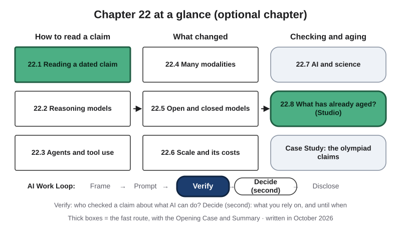{#fig-22-1 fig-alt="Chapter map: how to read a claim (22.1–22.3), what changed (22.4–22.6), checking and aging (22.7–22.8, case); Work Loop with Verify highlighted."}

**Chapter 22 at a glance** (@fig-22-1). This is an optional chapter, and nothing in it is on an exam. It is best read after Chapter 21, though anyone who has read Chapter 14 can follow it. The earlier chapters taught what stays true for years: how models are built, how they fail and how to check them. This chapter is about what changes every few months: what AI systems can do *now*, what they cost, and who says so. In the map, Verify and Decide are steps of the book's AI Work Loop (Frame, Prompt, Verify, Decide, Disclose; Chapter 1).

That makes it different from every other chapter. It was written in October 2026 for the 2027.1 edition, and parts of it will be out of date by the time you read it. That is the point. Each section teaches a way of reading current developments that will last, and then puts its dated facts in one box marked "As of October 2026." The last section asks you to check which of those facts have already aged.

**Time** (about 25 minutes for the fast route and about 58 minutes for the full route at a steady pace, 150 words a minute; allow more if you read more slowly or are reading in a second language):

- **Fast route, about 25 minutes:** this page, the Opening Case, the Warm-up, section 22.1 with its box, section 22.8 with its recap box, and the Chapter Summary. It stands on its own.
- **Full route, about 58 minutes:** everything from this page through the Case Study, not counting the labs. About 66 minutes with the Ethics Lens, Career Connection, From the Field and Summary.
- **Extra, all optional:** the Warm-up and Check Yourself questions (about 10 minutes); the nine faded examples (about 2 minutes each, 18 minutes in all) and Your Turn boxes; the labs (20–30 minutes each, including reading the lab and the debrief); the end-of-chapter questions (about 15 minutes to read and about 45–50 minutes to answer); the optional essay (about 90 minutes).

This chapter is optional, so it adds nothing to any required reading. Worked examples show every step, faded examples leave some steps for you, and Your Turn and Check Yourself boxes are ungraded practice. Answers to Check Yourself, the faded examples and odd-numbered end-of-chapter questions are in Appendix E.

::: {.callout-note title="Plain words for this chapter"}
- **Token:** a unit of text (a word, part of a word, or a symbol) that a language model receives and produces. **Reasoning tokens:** extra tokens some tools produce before the answer, sometimes hidden; they are made in the same way as other tokens and count toward context and cost (Chapter 3).
- **Settings (parameters) and pretraining:** a model is a set of learned settings (parameters) that turns an input into an output; pretraining is the first stage of training a language model on very large collections of text (Chapters 2 and 3).
- **Benchmark:** a standard test used to compare models (Chapter 5).
- **Agent vs. workflow:** an *agent* is a system in which the model directs its own steps and tool use toward a goal; in a *workflow*, people fixed the steps in advance (Chapters 3 and 6).
- **Tool use:** a model producing a request to run other software, such as a calculator or a search engine, whose result is added to the context window (Chapter 3).
- **Agent loop and observation:** the cycle an agent repeats: the model produces a plan for the next action, the system runs the tool call, and the result, the *observation*, is added to the context window, until a stop condition is met (Chapter 14).
- **Open-weight model:** a model whose settings (parameters), called its weights, can be downloaded and run under a license (Chapter 12).
- **Multimodal model:** a model that receives or produces more than one kind of data, such as text, images, audio or video (Chapter 13).
- **Independent check:** evidence that no AI tool produced: a source with an author or publisher you can name, or your own recalculation or reasoning from known inputs. **Primary source:** the original record a claim comes from (Chapter 8). **Outside source:** a source not written or paid for by whoever is behind the page you are checking (Chapter 9).
- **Verdict:** one of five: supported, partly supported, unsupported, contradicted, cannot verify (Chapter 8).
- **Jagged technological frontier:** the uneven boundary between tasks an AI tool handles well and tasks it handles poorly, even among tasks that look equally hard (Chapter 1).
:::

**The question of this chapter:** *When you read that AI "can now" do something, how do you tell what was measured, what was only claimed and what is a guess about the future, and how long will the answer stay true?* The Chapter Summary returns to it.

## Opening Case: Two Gold Medals, Three Kinds of Grading {.unnumbered}

Every July, secondary-school students from more than 100 countries sit the International Mathematical Olympiad (IMO): six proof problems over two days, four and a half hours a day. In 2025, AI developers tested their systems on the same problems.

On Saturday, July 19, 2025, OpenAI said that an experimental model of its own had solved five of the six 2025 problems, for 35 of 42 points: a gold-medal score. According to OpenAI, three former IMO medalists graded each proof (Wei, 2025). OpenAI had not officially entered the competition, so the IMO did not grade or certify these proofs. Reuters reported that the IMO had asked the cooperating companies to publish their results on July 28; OpenAI said an IMO board member had allowed it to publish after the closing ceremony (Reuters, 2025).

On Monday, July 21, Google DeepMind announced that an advanced version of its Gemini Deep Think system had also scored 35 of 42, writing its proofs in ordinary language within the time limit. The IMO's coordinators had graded and certified those proofs by the criteria used for students' work. DeepMind's own post added a limit: the IMO's review "does not extend to validating our system, processes, or underlying model" (Google DeepMind, 2025).

The IMO's president added another limit, reported by the news agency Agence France-Presse (AFP): the organizers could not check how much computing power the systems had used or whether people had been involved. AFP also gave the human context: of 641 students from 112 countries, about 10% won gold, and five scored a perfect 42 (Agence France-Presse [AFP], 2025). A third kind of grading appeared that week as well. ByteDance said the IMO had confirmed a score of 30 of 42 for Seed Prover, a system whose proofs were checked line by line by a computer program, after people had translated the problems into that program's language by hand and the system had worked for about three days (ByteDance Seed, 2025).

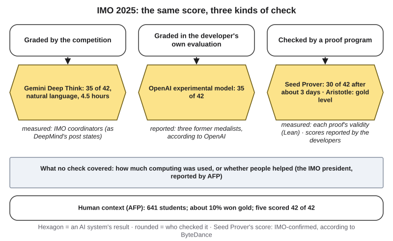{#fig-22-2 fig-alt="Three columns: graded by the competition (measured), by medalists per OpenAI (reported), by a proof program; below, what no check covered."}

Here is the puzzle (@fig-22-2). **Both 35-point statements may well be true. If you were writing about AI and mathematics, which would you cite, how would you phrase each one, and how long would your sentence stay accurate?** Section 22.1 gives you a method. Section 22.8 returns to the olympiad a year later, and the Case Study looks at all three kinds of check.

## Learning Objectives {.unnumbered}

Each objective names the book's learning outcome it serves: LO1 is the outcome on explaining what generative and agentic AI systems are, how they work in outline, and how and why they fail; LO3 is the outcome on verifying outputs and claims. Framework tags refer to the AI Fluency framework (Dakan & Feller, 2025), the UNESCO (United Nations Educational, Scientific and Cultural Organization) AI Competency Framework for Students (UNESCO, 2024) and the AI4K12 initiative's Five Big Ideas (Touretzky et al., 2019).

After this chapter you will be able to:

- **O1 — Distinguish** measured, reported and forecast claims about an AI development, each with its as-of date. *(LO1, LO3 · AI Fluency: Discernment · UNESCO: AI techniques and applications, Understand)*
- **O2 — Explain** what a reasoning model does differently from an earlier chat model and what outside evidence shows about its gains and limits. *(LO1 · UNESCO: AI techniques and applications, Understand · AI4K12: Learning)*
- **O3 — Interpret** a dated trend chart: a logarithmic axis, data points and a fitted trend line. *(LO1 · AI Fluency: Discernment · UNESCO: AI techniques and applications, Understand)*
- **O4 — Compare** open-weight and closed models on the measured capability gap and on what each lets users inspect and control. *(LO1 · AI Fluency: Delegation · UNESCO: AI techniques and applications, Understand)*
- **O5 — Evaluate** a claim about AI's energy use or a scientific discovery by what it counts and who checked it. *(LO1, LO3 · AI Fluency: Discernment, Diligence · UNESCO: Ethics of AI, Understand)*
- **O6 — Judge** which claims in a dated account have aged and what that means for work in your field. *(LO1 · AI Fluency: Diligence · UNESCO: Human-centred mindset, Apply)*

::: {.callout-note title="Warm-up (ungraded)"}
1. A company announces that its new model "matches PhD experts." What would you want to know before repeating the claim?
2. A model writes out its steps before it answers. Does that mean it makes fewer factual errors?
3. About how much electricity does one typical text question to a chat tool use: less than one minute of a laptop in use, about an hour, or about a day? How sure are you of your answer (0–100%)?

You will revisit your answers in the Chapter Summary.
:::

## 22.1 Reading a Dated Claim {#sec-22-1 .unnumbered}

[Deep]{.path}

News about AI arrives as **capability claims**: statements that a system can now do something, such as "solves olympiad problems," "completes two-hour software tasks" or "uses less energy than a light bulb." A capability claim is incomplete on its own. To use one, you need three tags.

**1. The as-of date.** An **as-of date** is the date on which a claim was made or measured, not the date on which you read it. A claim about AI that was true in 2024 may be false in 2026, and the reverse. Write the date into your sentence: "As of July 2025, …"

**2. The evidence status.** A claim's **evidence status** says who has checked it so far: measured, reported or forecast, with the book's own inference kept separate. It does not say whether the claim is true.

- **Measured:** tested, run or checked by someone other than the developer, with a method you can read. That someone is an *outside source* (Chapter 9's term: not written or paid for by whoever is behind the claim): a competition's own graders, an evaluation group such as METR (Model Evaluation and Threat Research, a nonprofit) or a computer program that checks proofs. An **outside evaluation** is a test of a system run by such a source.
- **Reported:** stated by the developer, or by a news outlet citing the developer: a launch post, a *system card* (a developer's published report on a model's tests and limits), a benchmark table in an announcement. The developer's page is the primary source for *what the developer claims*. It passes Chapter 8's independent check, because no AI tool produced it, but it is not an outside source.
- **Forecast:** a statement about the future, whoever makes it. A forecast by a careful outside body is still a forecast.
- **The book's inference:** what this book reads into the evidence, marked "this book reads …" as in every chapter (drawn dashed in figures).

Two variants appear in the boxes. An outside tracker that *compiles* scores, such as Stanford's annual AI Index, checks where the scores came from, not the systems; many of the scores it collects were reported by developers, so this book tags them **reported (compiled)** and you ask who ran the test. An **outside estimate** is a figure that an outside source calculated from assumptions it states rather than measured, as the International Energy Agency (IEA) and Epoch AI (a research group that tracks AI trends) do for energy and computing. It has an outside author, but its assumptions are the thing to check.

**3. Who could check it.** For a reported claim, name the outside source that could move it to measured: the competition, an evaluation group, peer reviewers, a *replication* (the same study repeated by another group).

**Trace first.** A claim that names no source (a sales page, a newsletter, a speaker at a meeting) has no status yet. Trace it to where it came from, as in Chapter 9, and tag the source you find; if you find none, write "no source given." Statuses are for claims about what a system can do or what it uses, such as a score or an energy figure. A fact about an event or a page (a prize was awarded, a paper passed peer review, a page stopped being updated) takes a case tier instead (see the box below).

None of the statuses means "true" or "false." A reported claim can be true; a measured one can be measured badly or on the wrong task. The status tells you how much checking stands behind the claim *so far*.

::: {.callout-note title="Two kinds of labels, two questions"}
You have used **case tiers** since Chapter 5: *confirmed* (in the primary record), *reported* (a named outlet or person says so) and *inferred* (the book's reading). The tiers ask: **is this fact in the primary record?** The evidence status asks: **who checked the capability?** The two can differ for the same sentence. DeepMind's blog post is the confirmed record of what DeepMind says, and the score it describes was graded by the IMO's coordinators, so the capability claim is *measured*, with the limits the post itself states. *Reported* appears in both lists with different meanings: as a tier, a named outlet says so; as a status, only the developer vouches for the capability. OpenAI's 35 of 42, as Reuters relayed it, is reported in both senses.
:::

This chapter's new signature diagram, the **Capability Timeline**, puts the three tags on a time line (@fig-22-3). Each box carries a date, a short claim and a status tag; a filled corner square means measured (or an outside estimate), an open one reported, and a light fill to the right of "now" means forecast. The diagram is built from a data file, so the next edition can redraw it with new events. @fig-22-4 shows the three tags on their own, with the crosswalk.

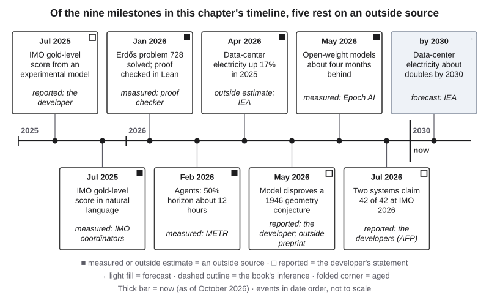{#fig-22-3 fig-alt="Timeline 2025–2030: nine boxes in date order, each with date, claim and status tag; a thick bar marks October 2026; one forecast box to its right."}

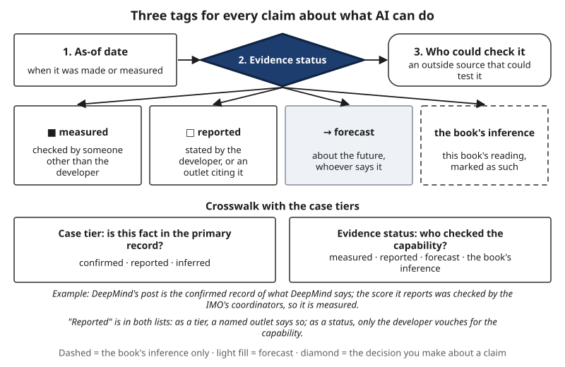{#fig-22-4 fig-alt="Three tags: as-of date, evidence status (measured, reported, forecast, the book's inference), who could check it; crosswalk with case tiers below."}

::: {.callout-note title="As of October 2026: five claims you will meet again"}
- **Agents (section 22.3):** the highest *time horizon* (the task length, in skilled people's time, that an agent completes half the time) that METR measured below its 16-hour limit for reliable estimates was about 12 hours, with a wide range of uncertainty (about 5 to 60 hours), for an Anthropic model released in February 2026. For tasks it completed four times in five, the figure was about 1.2 hours. *Measured: METR.*
- **Open models (22.5):** the best open-weight models trailed the best closed ones by about four months in 2026. *Measured: Epoch AI, May 2026.*
- **Electricity (22.6):** the world's data centers used about 485 terawatt-hours (TWh; one TWh is a billion kilowatt-hours) in 2025, with about 950 TWh expected by 2030. *Outside estimate, then forecast: IEA, 2026.*
- **One text prompt (22.6):** 0.24 watt-hours (Wh) for a median text prompt to Google's Gemini apps, counting the full serving system; a 50-watt laptop uses that much in about 17 seconds (this book's arithmetic). *Reported: Google, August 2025.*
- **The olympiad (22.8):** two companies said their systems scored a perfect 42 at the 2026 IMO. *Reported: the companies, as covered by AFP, July 2026.*
:::

::: {.callout-note title="Worked Example: Tagging the Olympiad Statements"}
**Claim A:** "An OpenAI model won gold at the 2025 IMO."
**Date:** July 19, 2025. **Status:** reported; according to OpenAI, three former medalists graded the proofs, and the IMO did not grade or certify them. **Who could check it:** the IMO's coordinators, by the same criteria as students. **Better sentence:** "OpenAI reported that an experimental model scored 35 of 42 on the 2025 IMO problems, graded by three former medalists, according to the company (Wei, 2025); the IMO did not certify the result (Reuters, 2025)."

**Claim B:** "Google DeepMind's Gemini Deep Think scored 35 of 42."
**Date:** July 21, 2025. **Status:** measured; the IMO's coordinators graded and certified the proofs. **What the check did not cover:** the system itself, the computing used, any human involvement. **Better sentence:** "In July 2025, an advanced Gemini Deep Think scored 35 of 42, a gold-medal score, as graded by the IMO's coordinators; the organizers could not check the computing used (Google DeepMind, 2025; AFP, 2025)."
:::

::: {.callout-note title="Faded Example: A Sales Page"}
*Constructed.* A software company's sales page, dated March 2026, says: "Our support agent resolves 80% of customer tickets with no human help." The page links to no study.

**Done for you:** *Date:* March 2026. *Status:* reported (the seller's own page; no method given).

**Your turn:** Who could check it, and what would you ask them to measure? Rewrite the sentence so that a reader sees its status. _______________
:::

::: {.callout-important title="Your Turn"}
Find one AI capability claim you saw this week (a headline, a post, an ad). Give it the three tags.
:::

::: {.callout-tip title="Check Yourself 22.1"}
1. Name the three tags this chapter adds to a capability claim.
2. Why can a developer's own page be a primary source without being an outside source?
:::

## 22.2 Reasoning Models {#sec-22-2 .unnumbered}

[Deep]{.path}

Chapter 3 described how some tools produce extra *reasoning tokens* before the answer, and Chapter 5 described a 2025 test of asking for step-by-step answers. Providers now sell whole model families built to do this by default. A **reasoning model** is the providers' name for a model trained to produce many intermediate tokens, often hidden, before its final answer. The name is a provider term, not a claim that the model reasons as a person does.

The idea behind it is **test-time compute**: more computation spent at the moment of answering a question, rather than only during training. A model that produces 5,000 tokens before answering does far more computation per answer than one that produces 50 (@fig-22-5). Developers report that answers often improve as this budget grows (Reuters, 2024), and the extra tokens cost time and money, because every token is computed and usually billed. Both 2025 olympiad results in the Opening Case came from systems their makers describe as reasoning models; OpenAI's account credits, in part, more computation at answer time (Wei, 2025).

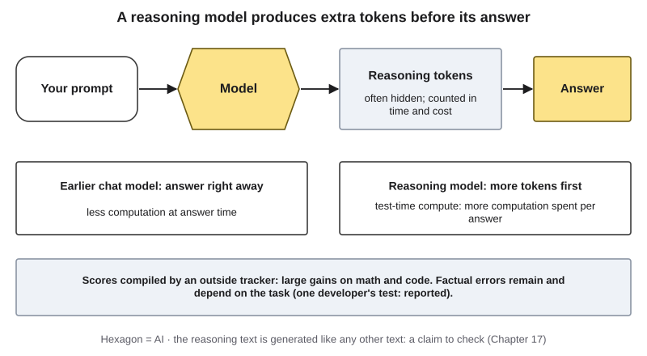{#fig-22-5 fig-alt="Prompt, model, reasoning tokens, answer. Earlier models answer at once; reasoning models produce more tokens first. Gains measured; errors remain."}

How was the behavior trained? One developer's account went through peer review. DeepSeek, a Chinese company, published in *Nature* how it trained such models with *reinforcement learning*: the training procedure rewarded answers that a program could check as right, such as math answers. A version trained only this way (R1-Zero), without worked examples of human reasoning, came to produce longer step-by-step outputs during training; the released R1 model added a small set of written examples and further training stages (Guo et al., 2025). Peer review checked the paper's description of its methods and results, not every later use of the model.

**What outside tests show.** Scores on hard tests rose fast in 2024, the year reasoning models arrived; that is a matter of timing, not a measured cause, because other changes, such as better agent software around the models, arrived at the same time (@fig-22-7 in the box below). The gains are largest where answers can be checked automatically: mathematics, science questions with one right answer, and code that either passes its tests or does not.

**What they do not show.** Writing out steps is not the same as getting facts right. In one developer's own 2025 test of questions about public figures (PersonQA), its newer reasoning model invented facts more often than its older one, while also answering more questions correctly; the developer said the newer model makes more claims overall, right and wrong, and that more research was needed to explain the result (@fig-22-6; OpenAI, 2025a). That is one test of one kind of question, not a rule about reasoning models. Whether reasoning models fail when puzzles get harder is a live dispute. Apple researchers reported, at the NeurIPS 2025 conference (a large annual research meeting on machine learning), that accuracy on several puzzle families collapsed beyond a level of difficulty (Shojaee et al., 2025). A comment posted on arXiv, a public site for papers before peer review, and later corrected by its author, argued that some failures came from limits on output length and from the grading method (Lawsen, 2025); the dispute is not settled. Chapter 17's rule still holds: the step-by-step text is generated like any other text, so it is a claim to check, not a record of how the answer was produced.

::: {.callout-note title="As of October 2026: reasoning models"}
- Top scores on three hard tests introduced in 2023 rose by 18.8 points (MMMU, college-level questions with images), 48.9 points (GPQA, graduate-level science questions) and 67.3 points (SWE-bench, fixing real software issues: 4.4% to 71.7%, this book's subtraction) between 2023 and 2024. *Reported (compiled): AI Index 2025* (Stanford HAI, 2025; @fig-22-7).
- On SWE-bench Verified, a subset of the same test whose tasks people checked by hand, top scores went from about 60% to near 100% in one year, close to the test's ceiling. *Reported (compiled): AI Index 2026* (Stanford HAI, 2026).
- PersonQA (questions about public figures), April 2025: o3 invented facts in 33% of answers and was accurate in 59%; o1, 16% and 47%; o4-mini, 48% and 36%. *Reported: the developer's own test* (OpenAI, 2025a; @fig-22-6).
- August 2025: the same developer reported that its next reasoning model made far fewer factual errors than o3 on its own tests, graded partly by another model (OpenAI, 2025b). *Reported.*
- DeepSeek's training method (R1-Zero and R1) published in *Nature*, September 2025, after peer review (Guo et al., 2025). *Confirmed: the published, peer-reviewed paper.*
- Reading models' reasoning text to catch misbehavior (Chapter 17): researchers from many organizations called it a "new and fragile opportunity" in July 2025 (Korbak et al., 2025). *This book's reading:* it found no later statement that changes that judgment.
:::

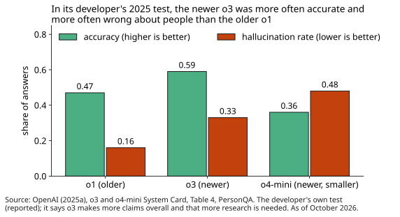{#fig-22-6 fig-alt="Bars for o1, o3, o4-mini: accuracy 0.47, 0.59, 0.36; hallucination rate 0.16, 0.33, 0.48 (OpenAI system card, 2025)."}

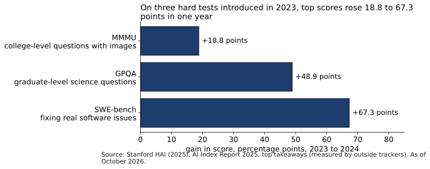{#fig-22-7 fig-alt="Horizontal bars: MMMU +18.8, GPQA +48.9, SWE-bench +67.3 percentage points from 2023 to 2024 (AI Index 2025)."}

::: {.callout-note title="Worked Example: Hana's Archive Date"}
*Constructed example; outputs constructed.* For the zine's history column, Hana asks two modes of the same chat tool, one their institution approves, when a downtown Dallas streetcar line opened, a fact they know from the city library's digital archive. The quick mode gives a year off by two. The reasoning mode shows a page of steps and gives the right year, but one step cites a "1921 city ordinance" that Hana cannot find in the archive's index.

**Hana's note:** right answer, unsupported step. They cite the archive, not the tool, and they file the episode under "the step text is a claim" (Chapter 17). They add a line to their clippings file: "Reasoning modes: one test, my own question, October 2026, not evidence about other tasks."
:::

::: {.callout-note title="Faded Example: A Tutor's Promise"}
*Constructed.* A private tutoring service's web page, dated September 2026, tells nursing students that its new reasoning model "doesn't hallucinate drug doses." No study is linked.

**Done for you:** *Date:* September 2026. *Status:* reported (the seller; no method). *What the chapter's evidence says:* reasoning models gain most where answers can be checked automatically; in one developer's test, a newer reasoning model invented facts about people more often than an older one, while also answering more questions correctly.

**Your turn:** What outside test would you want before relying on it, and what would you do in the meantime? _______________
:::

::: {.callout-important title="Your Turn"}
Ask a question you can check against a primary source in quick and reasoning modes, if your tool has both. Record what was right, and which step you could not verify.
:::

::: {.callout-tip title="Check Yourself 22.2"}
1. What is test-time compute, and why does it cost time and money?
2. Why does a reasoning model's step-by-step text not show that its facts are right?
:::

## 22.3 Agents and Tool Use {#sec-22-3 .unnumbered}

[Deep]{.path}

Chapter 14 showed how an agent repeats a loop of plan, tool call and observation, and why errors compound over steps. It also introduced METR's way of measuring agents: give them tasks that take skilled people a known amount of time, and find the task length at which an agent succeeds half the time. That length is the agent's **time horizon** (here, the 50% time horizon): the length of task, measured in how long skilled people take, that an agent is predicted to complete half the time. The 80% time horizon is the length it completes four times out of five.

The method stays useful even as the numbers change. Three habits help when you read a horizon chart (@fig-22-8):

- **Read the axis.** Horizon charts use a *logarithmic axis*: each step up is a multiple (for example, four times longer), not a fixed amount. A straight rising line on such an axis means steady doubling.
- **Separate data from trend.** The points are measurements; the line through them is a fitted trend. A trend extended past the last point is an *extrapolation*, a forecast drawn in the shape of data. This book draws trend lines dotted and labels them "trend, not data."
- **Compare 50% with 80%.** "Half the time" is not "reliably." In METR's data, the 80% horizon is several times shorter than the 50% horizon for the same model.

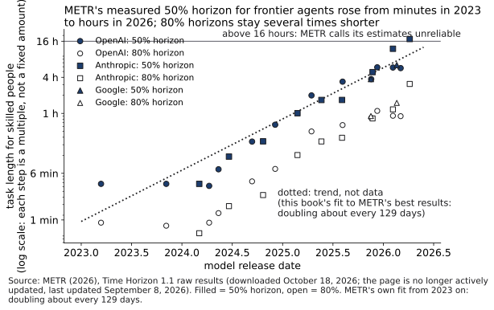{#fig-22-8 fig-alt="Log-scale scatter 2023–2026: 50% horizons (filled) for three providers rise from minutes to hours; 80% (open) lower; dotted trend; 16-hour line."}

**Agents that use a computer.** A **computer-use agent** is an agent whose observations are screenshots of a computer screen and whose actions are clicks, keystrokes and typed text. It runs the same loop as Chapter 14's agents, with the screen as the observation (@fig-22-9). OSWorld, a benchmark of everyday computer tasks such as editing a spreadsheet or changing a setting, measures such agents against people who did the same tasks.

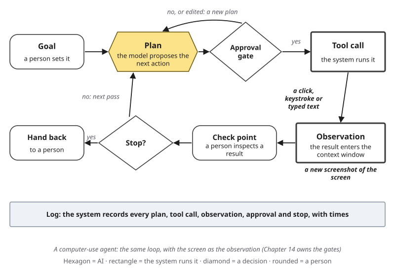{#fig-22-9 fig-alt="Agent loop: goal, plan, approval gate, tool call (a click or keystroke), observation (a new screenshot), check point, stop, hand back; log strip."}

**Shared plumbing.** Agents need a standard way to reach tools such as a calendar, a file store or a database. A **tool protocol** is a published format that lets a model's requests reach many tools in the same way. In December 2025, the Model Context Protocol from Anthropic, a tool protocol, moved into a new foundation hosted by the Linux Foundation, a nonprofit that hosts shared software, together with two other projects: AGENTS.md from OpenAI, a standard file of written instructions for coding agents (not a way to reach tools), and Block's goose, an open-source agent (Linux Foundation, 2025). How widely they are used is reported by the companies. A shared protocol makes it easier to connect an agent to many tools, which makes Chapter 14's least-privilege and approval-gate questions more pressing, not less.

**Saturation.** A benchmark is *saturated* when top systems score near its ceiling, so it can no longer separate them. METR reports that its own task set is near that point for the strongest agents: estimates above 16 hours are, in its words, unreliable with its current tasks.

::: {.callout-note title="As of October 2026: agents"}
- METR 50% / 80% time horizons, from its raw data (Time Horizon 1.1; the page's own text still quotes some older estimates): Gemini 3.1 Pro (Google, released February 2026) about 6.4 h / 1.5 h; GPT-5.4 (OpenAI, March 2026) about 5.7 h / 0.9 h; Claude Opus 4.6 (Anthropic, February 2026) about 12 h / 1.2 h, with a 50% range of about 5 to 60 hours. *Measured: METR* (METR, 2026; @fig-22-8).
- Claude Mythos Preview, early version (Anthropic, April 2026): about 17 h / 3.1 h. Above the 16 hours METR calls unreliable, so this book does not count it as a measurement and leaves it out of the trend.
- METR's fit: the 50% horizon doubled about every 129 days (range 104–158) from 2023 on, leaving out estimates above 16 hours. *Measured trend; any extension is a forecast.*
- METR's page says it is "no longer actively updated" (last update September 8, 2026). *Confirmed: METR's own page, checked October 18, 2026.*
- OSWorld: best agent success rose from about 12% to about 66% (*reported (compiled): AI Index 2026*; Stanford HAI, 2026); people completed over 72% of the tasks in the benchmark's original study, a baseline from the original task set (Xie et al., 2024).
:::

::: {.callout-note title="Worked Example: Hana Reads the Horizon Chart"}
*Constructed context; values from the box above.* Hana's zine column for local artists asks whether an agent could run a print shop's order intake. Hana reads METR's chart in three steps.

**1. Axis:** logarithmic; from about 1 hour to about 6 hours is roughly two and a half doublings. **2. Data or trend:** the point for each model is data; the dotted line is METR's trend, and anything right of the last point is a forecast. **3. 50% vs. 80%:** for the same models, 80% horizons are about one to three hours. **Column sentence:** "As of October 2026, the strongest agents completed software and research tasks that take people several hours about half the time, and tasks of an hour or two four times in five, on METR's tests; a print shop's intake is a different task and needs its own trial."
:::

::: {.callout-note title="Faded Example: The Maintenance Agent"}
*Constructed.* A college's facilities team reads: "AI agents can now handle eight-hour tasks," and proposes an agent that schedules all building maintenance.

**Done for you:** *Q1, which horizon?* The claim quotes a 50% horizon at best: half the time, on software and research tasks.

**Your turn:** *Q2:* What would the 80% horizon suggest? *Q3:* What trial and which gate (Chapter 14) would you ask for first? _______________
:::

::: {.callout-important title="Your Turn"}
Find one claim about what agents "can now do." Say whether it gives a 50% figure, an 80% figure or neither, and on whose tasks.
:::

::: {.callout-tip title="Check Yourself 22.3"}
1. What does a 50% time horizon of four hours mean, and what does it not mean?
2. On a horizon chart, how do you tell data from a forecast?
:::

## 22.4 Many Modalities {#sec-22-4 .unnumbered}

[Deep]{.path}

Chapter 13 explained how a **multimodal model** receives images and sound as tokens beside your words, and how generators build new media. Since then the direction of change has been toward *output* in more modalities: systems that produce video with matching sound, and voice assistants that answer in speech as you talk (@fig-22-10).

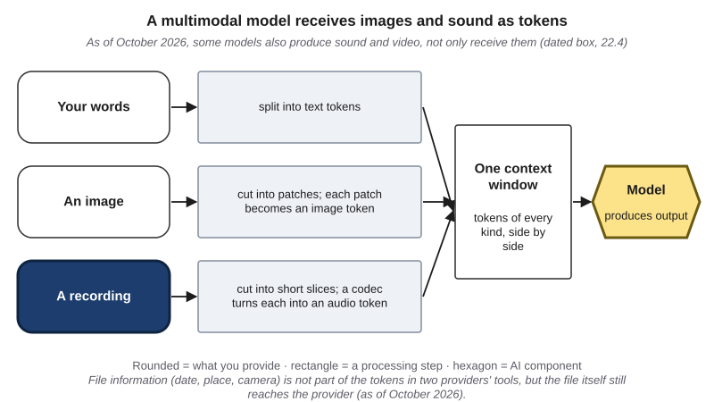{#fig-22-10 fig-alt="Chapter 13's diagram: text, image and audio lanes into one context window and a model; audio lane and model highlighted; note on new outputs."}

Two points from earlier chapters matter more as this happens. First, **realism is a reported quality, not accuracy.** A launch post that calls a video "lifelike" describes how it looks, not whether it shows anything that happened. Chapter 13's rule stands: a realistic image, voice or video is not evidence that an event took place. Second, **better generation makes Chapter 13's checks more important.** When looking and listening work less well, checking the source, the channel and the earliest version is what still works.

The method of 22.1 applies to multimodal claims as to any other. "Indistinguishable from a real voice" is a capability claim. Its as-of date, its status and who could check it (a listening test with people who did not know which clips were real, run by someone without a stake) decide how much weight it can carry. Chapter 13 described such tests for faces and voices; most launch claims about realism cite none.

::: {.callout-note title="As of October 2026: many modalities"}
- Video generation with sound in one pass from two providers: Google announced Veo 3, which "can also generate videos with audio," on May 20, 2025 (*reported: the developer*; Google, 2025); OpenAI released Sora 2 with synchronized dialogue and sound effects on September 30, 2025 (*reported: the developer, as covered by the press*; Decrypt, 2025).
- On reasoning questions that combine images and text, top scores now meet or exceed human baselines on some tests. *Reported (compiled): AI Index 2026* (Stanford HAI, 2026).
- The same report's example of jaggedness (Chapter 1's jagged frontier): the top model read analog clocks correctly 50.1% of the time. *Reported (compiled): AI Index 2026.*
:::

::: {.callout-note title="Worked Example: Hana Tags a Video Launch"}
*Constructed post; no real product.* For the zine column, Hana tags four claims from a video tool's launch post: (1) "Film-quality video with matching sound" — *reported*, a description of looks; who could check: viewers in a blind comparison. (2) "Clips up to 25 seconds" — *reported*, but easy to check; Hana marks it "check on the tool's own help page." (3) "Trained only on licensed footage" — *reported*; who could check: an outside audit; Chapter 18 explains why it matters to artists. (4) "Will replace stock video by 2028" — *forecast*. **Hana's column line:** "As of [date], the maker says …", never "the tool can …".
:::

::: {.callout-note title="Faded Example: Voices in a Course"}
*Constructed.* An instructional designer writes: "AI voices are now indistinguishable from human narrators, so students won't notice."

**Done for you:** *Tag 1, date:* none given; the claim needs one. *A fact you will need:* in a study that Chapter 13 (section 13.6) describes, listeners caught about 73% of speech deepfakes made with older methods, so about one in four passed as real (Mai et al., 2023).

**Your turn:** Tag its status (trace first: does it name a source?) and name who could check it. What does the listening study suggest about the claim's second half? _______________
:::

::: {.callout-important title="Your Turn"}
Take one claim about AI images, audio or video from a launch post. Is it about looks, about length or format, about training data, or about the future? Tag it.
:::

::: {.callout-tip title="Check Yourself 22.4"}
1. Why is "lifelike" a reported quality and not evidence that a video shows a real event?
2. Why do better generators make Chapter 13's checks more important?
:::

## 22.5 Open and Closed Models {#sec-22-5 .unnumbered}

[Deep]{.path}

Chapter 12 set out the basic choice. A *closed model* is used only through a service; an **open-weight model** is a model whose settings (parameters), called its weights, can be downloaded and run under a license; and a *local model* is an open-weight model run on hardware that you or your institution control. Chapter 12 also warned that "open" is used loosely, and that open weights are not the same as open-source AI.

What this chapter adds is the dated, measured question: **how far behind the best closed models are the best open-weight ones?** Two outside trackers answer it in different ways (@fig-22-11). The AI Index measured the gap on a *crowd-vote leaderboard*, where people compare two anonymous answers and pick the better; Chapter 12 (Deep 12.B) explains the limits of such rankings. Epoch AI measures the gap in time: how many months after a closed model reaches a level an open-weight model reaches it, using its own index built from many benchmarks.

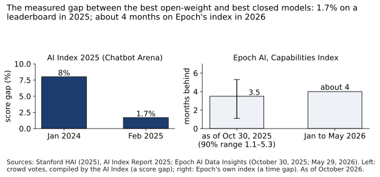{#fig-22-11 fig-alt="Left: leaderboard gap 8% (Jan 2024) to 1.7% (Feb 2025). Right: Epoch time gap 3.5 months (90% range 1.1–5.3) and about 4 months in 2026."}

Both say the same thing as of 2026: the gap is **months, not years**. Epoch's own caution matters: the gap varies, sometimes closes completely, and its uncertainty range is wide. Two further points keep the score in proportion.

**Scores are not the whole difference.** Open weights let an institution run a model on its own hardware, so inputs need not leave it, and let researchers study and adapt it. They do not reveal the training data, and the license still decides what you may do (Chapter 12, Chapter 18). A closed service may offer features, support and data terms that matter more for a given task than a few points of score.

**Release is a choice with stated reasons.** Developers who keep weights closed and those who release them both give reasons, often about safety, cost or openness. Those reasons are *reported*, and some are forecasts about how a model will be used. Chapter 12's *lock-in*, the effort and cost that keep you on a tool after a better fit appears, is part of the same choice: a model you can run yourself is harder to take away.

::: {.callout-note title="As of October 2026: open and closed"}
- Gap between the best open-weight and best closed model on a crowd-vote leaderboard (Chatbot Arena): about 8% in January 2024, 1.7% in February 2025. *Measured: AI Index 2025* (Stanford HAI, 2025).
- Time gap: 3.5 months on average (90% range 1.1–5.3 months), January 2023 to October 2025. *Measured: Epoch AI, October 30, 2025* (Epoch AI, 2025).
- Time gap since January 2026: about four months. *Measured: Epoch AI, May 29, 2026* (Edwards & Emberson, 2026).
:::

::: {.callout-note title="Worked Example: The Collective's Alt-Text Question"}
*Constructed.* Hana's zine collective wants alt-text drafts for contributors' scanned drawings without uploading the drawings to an outside service. A member proposes an open-weight model on her own computer.

**Hana separates two questions.** *Capability:* the measured gap says open-weight models trail the best closed ones by months; on alt text for drawings, the only evidence that counts is a trial on their own scans (Chapter 12's bake-off). *Data:* running the model locally keeps the scans on the member's computer, which is what the collective's submission form line requires (Chapter 18). They agree to a ten-scan trial, with every draft checked by the artist.
:::

::: {.callout-note title="Faded Example: A Year Behind"}
*Constructed.* A research lab's newsletter, dated 2026, says: "Open models are a year behind, so they are useless for serious work."

**Done for you:** *Status:* the book's reading is that this is an opinion with an implied measurement; no source is given. *Date:* 2026.

**Your turn:** What do the outside trackers in the box say? Which part of the sentence is a separate judgment that no tracker measures? _______________
:::

::: {.callout-important title="Your Turn"}
For one task of yours, list one reason to prefer a closed service and one to prefer an open-weight model, apart from scores.
:::

::: {.callout-tip title="Check Yourself 22.5"}
1. Name the two outside measures of the open–closed gap in this section and what each counts.
2. Name one thing open weights let you do and one thing they do not show you.
:::

## 22.6 Scale and Its Costs: Compute and Energy {#sec-22-6 .unnumbered}

[Deep]{.path}

Chapter 3 (Deep 3.B) described **scaling**: the finding that language models predicted text better, in a smooth and predictable way, as their size, their training data and the computing used to train them grew. This section starts where Chapter 3 stopped. It separates what is measured about scale from what is forecast, and it adds the costs.

**Training compute** is the total amount of computation used to train a model, counted in **FLOP**: floating-point operations, the individual arithmetic steps a computer performs. Outside trackers estimate it for published models. Epoch AI's data show training compute for notable models growing several times a year for over a decade; this book's fit to Epoch's data gives about 4.3 times a year from 2010 to 2026, close to Epoch's own summary of 4–5 times (@fig-22-12). The growth is measured. Whether it continues is not.

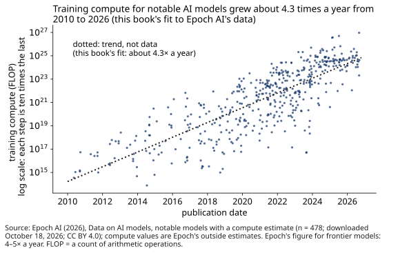{#fig-22-12 fig-alt="Log-scale scatter of 478 notable models' training compute 2010–2026 rising steeply; dotted trend labeled trend, not data, about 4.3 times a year."}

**The scaling debate.** In late 2024, Reuters reported that researchers at several AI developers saw smaller gains than expected from simply scaling up pretraining; a co-founder of one AI company told Reuters that results from scaling pretraining had plateaued (Reuters, 2024). Developers then reported gains from spending more computation at answer time instead (section 22.2). People who expect scaling to keep paying off point to benchmark gains that continue; people who expect it to slow point to limits of data, chips and power. Epoch AI, for example, estimated in 2024 that training runs of about 2 × 10^29^ FLOP, roughly 10,000 times Epoch's estimate for GPT-4 and a jump like the one from GPT-2 to GPT-4, would likely be feasible by 2030, with power the limit likely to bind first and chip manufacturing next (Sevilla et al., 2024). Another study projected that models would be trained on datasets about the size of the whole stock of public human-written text between 2026 and 2032 if trends continued (Villalobos et al., 2024). These are **forecasts**. What would move them is measured: outside tests of the next systems, on tasks not seen in training (@fig-22-13). Debates about general AI, long-term risk and the International AI Safety Report are treated in Chapter 23.

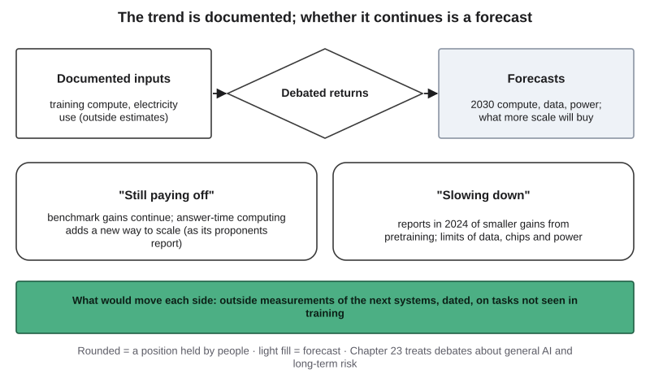{#fig-22-13 fig-alt="Measured inputs, debated returns, forecasts; two positions, still paying off and slowing down; what would move each: outside tests of new systems."}

**Electricity.** Computation runs in a **data center**, a building full of servers with its own cooling and power systems. The IEA estimates the world's data centers used about 1.5% of global electricity in 2024 (@fig-22-14). AI is one part of that total, and the fastest-growing part, according to the IEA.

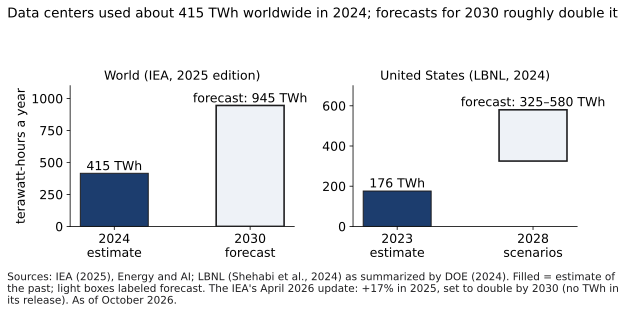{#fig-22-14 fig-alt="Bars: world 415 TWh in 2024 and forecast 945 TWh in 2030 (IEA 2025); U.S. 176 TWh in 2023 and 325–580 TWh forecast for 2028 (LBNL)."}

**Per prompt.** Totals are large; single questions are small. Both can be true at once. A per-prompt figure depends on its **system boundary**: which parts of the system an energy estimate counts. Google, for example, published two figures for the same median text prompt: one counting only the active AI chips, and a larger one adding the host computer, idle capacity kept ready and the building's cooling and power systems (@fig-22-15). Neither is wrong; they answer different questions. When two energy figures disagree, compare their boundaries, their year and their model before you compare their numbers.

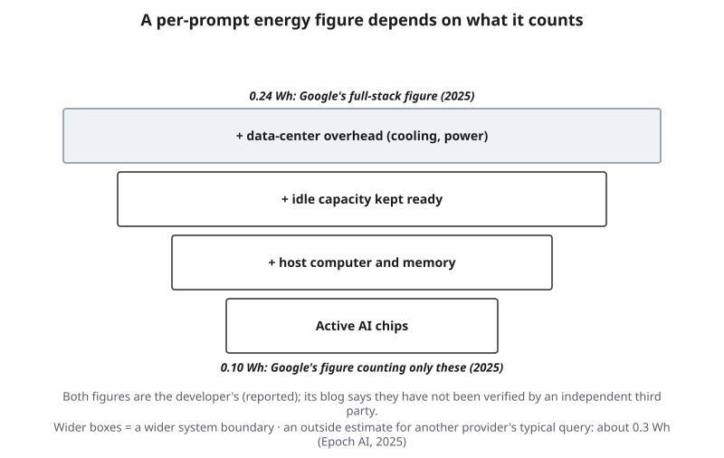{#fig-22-15 fig-alt="Stacked boxes widening from active AI chips (0.10 Wh) through host, idle capacity and data-center overhead (0.24 Wh), Google's 2025 figures."}

::: {.callout-note title="As of October 2026: scale and its costs"}
- Training compute of notable models: about 4.3 times a year, 2010–2026 (this book's fit to 478 models in Epoch AI's data, downloaded October 18, 2026; Epoch AI, 2026). *Measured.*
- World data centers: about 415 terawatt-hours (TWh; a terawatt-hour is a billion kilowatt-hours) in 2024, about 1.5% of world electricity; base case about 945 TWh by 2030, with "large uncertainties." *Measured estimate and forecast: International Energy Agency (IEA), 2025 edition* (International Energy Agency, 2025).
- The IEA's April 16, 2026 update: data-center electricity use rose 17% in 2025 and is set to double by 2030; use by AI-focused data centers is expected to triple. *Measured estimate and forecast: IEA, 2026 edition* (International Energy Agency, 2026).
- U.S. data centers: about 4.4% of U.S. electricity (176 TWh) in 2023; 6.7%–12% by 2028 in the report's scenarios. *Measured estimate and forecast: Lawrence Berkeley National Laboratory (LBNL), as summarized by the U.S. Department of Energy (DOE), December 2024* (Shehabi et al., 2024; U.S. Department of Energy, 2024).
- Per median text prompt: 0.24 watt-hours (Wh) counting the full serving system, 0.10 Wh counting active chips only. *Reported: Google, August 2025; its blog says the data and claims have not been verified by an independent third party* (Elsworth et al., 2025; Google Cloud, 2025). A typical query to another provider's model: about 0.3 Wh. *Measured estimate: Epoch AI, February 2025* (You, 2025). A commonly cited figure of about 3 Wh came from early-2023 hardware and model assumptions, in Epoch AI's account.
:::

::: {.callout-note title="Worked Example: This Book's Calculation"}
*This book's calculation (figures/scripts/ch22_calc.py; an illustration, not anyone's measured footprint).* Assume a heavy student user sends 30 text prompts a day, and a laptop in use draws 50 watts (the book's round numbers).

At Google's full-stack figure (0.24 Wh), 30 prompts use 7.2 Wh a day, about the energy of 9 minutes of that laptop. At the active-chips figure (0.10 Wh), 3.0 Wh: about 4 minutes. At Epoch's estimate (0.3 Wh), 9.0 Wh: about 11 minutes. If long reasoning answers used ten times the full-stack figure (an assumption; no source in this chapter measures it), the day would use 72 Wh: about 86 minutes. **Conclusion:** for one person's text prompts, the boundary and the kind of answer change the result more than the number of prompts; the grid-level totals in the box come from billions of uses and from training.
:::

::: {.callout-note title="Faded Example: The Council Meeting"}
*Constructed.* At a city council meeting, a speaker says a proposed AI data center "will use as much power as 100,000 homes."

**Done for you:** *Source of the figure:* the IEA wrote in 2025 that a typical AI-focused data center uses as much electricity as 100,000 households (International Energy Agency [IEA], 2025). *Boundary question:* is the speaker describing this proposal or a typical one?

**Your turn:** Tag the claim's status and date, and write the question you would ask the developer at the meeting. _______________
:::

::: {.callout-important title="Your Turn"}
Find one claim about AI's energy or water use. Write down its boundary (what it counts), its year and its status.
:::

::: {.callout-tip title="Check Yourself 22.6"}
1. Which parts of the scaling question are measured, and which are forecast?
2. Why can two honest per-prompt energy figures for the same system differ?
:::

## 22.7 AI and Science {#sec-22-7 .unnumbered}

[Deep]{.path}

Claims that an AI system has made a discovery are among the most consequential capability claims, and among the slowest to settle. The reason is how science checks itself. A discovery claim moves through stages: an announcement, a paper, the paper's data, and then the field's own checks: peer review, replication by other groups, critique by specialists and, in mathematics, proof checking. Chapter 8's funnel applies, with the field's specialists as the last stage (@fig-22-16).

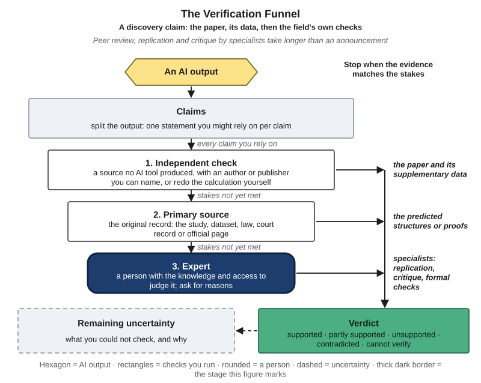{#fig-22-16 fig-alt="Verification funnel: AI output, claims, independent check (paper, data), primary source (structures, proofs), expert (replication) highlighted."}

**A claim that the field accepted.** AlphaFold, a protein-structure system from Google DeepMind, did well in a blind community test of structure prediction in 2020, the Critical Assessment of protein Structure Prediction (CASP), in which predictions are compared with structures that experimenters have measured but not yet published (Jumper et al., 2021). Years of use by other laboratories followed. The 2024 Nobel Prize in Chemistry was shared by two of AlphaFold's developers, for protein structure prediction, and by a researcher in computational protein design (Nobel Prize Outreach, 2024). The recognition came after the outside checks, not with the announcement.

**A claim that the field disputed.** In 2023, Google DeepMind researchers reported in *Nature* that a system called GNoME had found 2.2 million new crystal structures, an "order-of-magnitude expansion" in stable materials (Merchant et al., 2023). Two materials chemists reviewed a sample and reported "scant evidence" of compounds that were at once new, credible and useful, while calling the approach promising (Cheetham & Seshadri, 2024). The dispute is about what counts as a discovery. Chapter 19's A-Lab case showed the same field correcting an automated claim through a published correction.

**Mathematics as a special case.** In mathematics, a proof can be written for a *proof assistant*, a program such as Lean that checks every step of a formal proof. That makes some claims checkable quickly and by anyone. A machine check confirms that the formal proof is valid; it does not confirm that the formal statement says what the original problem meant, which specialists still judge.

::: {.callout-note title="As of October 2026: AI and science"}
- 2024 Nobel Prize in Chemistry: half for computational protein design, half for protein structure prediction (AlphaFold). *Measured: the Nobel committee, after years of outside use.*
- GNoME (2023): 2.2 million structures reported, of which 736 had already been made independently in laboratories (*reported: the developers' paper*); critique of novelty and usefulness (*measured: Cheetham & Seshadri, 2024*).
- January 2026: an AI-assisted solution to Erdős problem #728 was checked in Lean and written up publicly (Sothanaphan, 2026). *Measured: proof checker and write-up.*
- May 20, 2026: OpenAI reported that an internal reasoning model disproved a 1946 conjecture of Paul Erdős in geometry, with a companion paper by outside mathematicians. *Reported: the developer; status to re-check.*
:::

::: {.callout-note title="Worked Example: Hana's Headline"}
*Constructed headline.* A reader sends Hana a post: "First AI-discovered pigment will change painting." As a history minor, Hana goes to the source. **1. Announcement:** a company post, dated, linking to a preprint (a paper posted before peer review). **2. Paper:** the preprint reports a predicted compound and one lab synthesis. **3. Field:** no replication found; one chemist's blog questions whether the compound is new. **Hana's verdict on "AI-discovered pigment" as a description of today:** partly supported (a predicted and once-made compound; novelty disputed). **Next check:** the journal version.
:::

::: {.callout-note title="Faded Example: The Chemistry Newsletter"}
*Constructed.* A student chemistry club newsletter says: "AI found two million new materials in 2023."

**Done for you:** *Stage 1, the paper:* Merchant et al. (2023) reported 2.2 million structures below the stability line of earlier work; 736 already made by others.

**Your turn:** *Stage 3, the field:* what did the 2024 critique say? Rewrite the newsletter sentence with a date and a status. _______________
:::

::: {.callout-important title="Your Turn"}
Pick one AI-and-science headline. How far through the stages has it gone: announcement, paper, data, field?
:::

::: {.callout-tip title="Check Yourself 22.7"}
1. Why does the field's check take longer than the announcement?
2. What does a machine-checked proof confirm, and what does it not?
:::

## 22.8 What Has Already Aged? {#sec-22-8 .unnumbered}

[Studio]{.path}

::: {.callout-note title="Recap for the fast route"}
- **Three tags** (22.1): as-of date; evidence status (measured by an outside source, reported by the developer, forecast, the book's inference); who could check it.
- **Reasoning models** (22.2): more computation at answer time; gains largest where answers can be checked; errors remain.
- **Agents** (22.3): time horizons at 50% and 80%; "half the time" is not "reliably"; trend lines are not data.
- **Modalities** (22.4): realism is a reported quality; Chapter 13's checks matter more.
- **Open and closed** (22.5): the measured gap is months; access and inspection differ more than scores.
- **Scale and costs** (22.6): growth is measured, its future is forecast; energy figures depend on their boundary.
- **Science** (22.7): the field's own checks settle a discovery.
:::

Every box in this chapter will age. An **aging check** is a check of a dated claim against the best current source: what does that source say today, what is your verdict on the old claim as a description of today (Chapter 8's five-point scale), and what changed? Three things can change: **the facts** (a number moved), **the status** (a reported claim was measured, or a measurement was withdrawn) or **only the names** (the products are new, the pattern is the same). The last step is to decide when to check again (@fig-22-18).

**The book's own example.** In 2014, the author of this book wrote an encyclopedia entry on digital innovation, drawing on a table by Fichman, Dos Santos and Zheng (2014). One of its twelve rows described a shift to real-time question-and-answer systems: machines that can talk with users, with Siri and IBM Watson as the examples (Şeker, 2014; From the Field has more). Read in October 2026, the row's direction held: machines that converse are now ordinary. Its examples aged: today's systems are built differently and are named differently. Verdict on the row as a description of today: *partly supported*; what changed: the names and the technology, not the direction. Next check: not needed for the direction; never again for the examples.

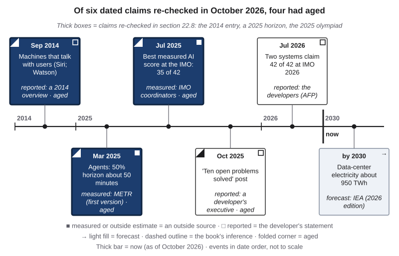{#fig-22-17 fig-alt="Timeline 2014–2030: six claims; three marked aged (2014 Q&A machines, March 2025 METR horizon, October 2025 post); thick boxes re-checked in 22.8."}

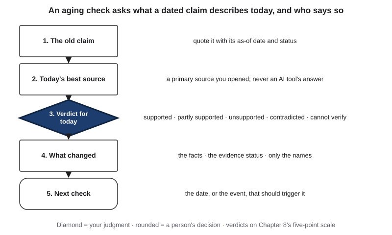{#fig-22-18 fig-alt="Five steps: old claim, today's best source, verdict for today (diamond), what changed, next check (rounded)."}

::: {.callout-note title="Worked Example: Hana Re-Checks the Column"}
*Constructed.* Hana's zine column quoted two agent claims. In October 2026, they re-check both (@fig-22-17).

**Claim 1:** "Agents complete about 50-minute tasks half the time" (METR, first version, March 2025). **Today's source:** METR's raw data (downloaded October 2026). **Verdict as a description of today:** contradicted for the strongest agents, whose 50% horizons are now hours. **What changed:** the facts. **Claim 2:** "METR updates its chart as new models come out." **Today's source:** METR's page, which now says it is no longer actively updated (last update September 8, 2026). **Verdict:** contradicted. **What changed:** the source itself. **Next check:** find which outside group now measures horizons, before the next issue.
:::

::: {.callout-note title="Faded Example: The Energy Row"}
*Constructed.* From the 22.6 box: "base case about 945 TWh by 2030 (IEA, 2025 edition)."

**Done for you:** *Column 1, today's source:* the IEA's April 2026 update, which says data-center use is set to double by 2030 and gives no TWh figure in its news release.

**Your turn:** Verdict as a description of today, what changed (facts, status or names) and the next check. _______________
:::

::: {.callout-important title="Your Turn"}
The optional essay at the end of this chapter asks you to run three aging checks on one section's box. Choose your section now.
:::

::: {.callout-tip title="Check Yourself 22.8"}
1. Name the three things that can change when a dated claim ages.
2. Why does an aging check end with a date or event for the next check?
:::

## Hands-on Labs {.unnumbered}

All four labs are optional and can be done at home. The labs say what to do, not which buttons to press; In Compass (optional): tool steps. **Rules for every lab:** provided materials are printed and dated, so no account is needed; where you use an AI tool, use a university-provided tool such as Microsoft Copilot Chat (as of October 2026) or a free tier, and never let a tool's answer stand in for a source you opened.

### Lab 22.1: Tag a Launch Post (Check It · about 25 minutes · optional) {.unnumbered}

A constructed, dated launch post for a fictional model makes eight claims; one page from a fictional outside evaluation tests three of them. Tag each claim's date, status and who could check it, then rewrite two claims so that a reader sees their status. Full sheet: labs/ch22-lab1.md.

### Lab 22.2: Trace an Energy Number (Check It · about 30 minutes · optional) {.unnumbered}

Three per-prompt energy figures with their sources (section 22.6). Fill a boundary table (active chips, host computer, idle capacity, cooling and power) and explain in three sentences why the figures differ. Full sheet: labs/ch22-lab2.md.

### Lab 22.3: Read a Log Chart (Studio · about 20 minutes · optional) {.unnumbered}

A printed horizon chart and the same data as a table. Read two points, compute a doubling time, and mark where measurement ends and the trend begins. Full sheet: labs/ch22-lab3.md.

### Lab 22.4: What Has Aged? (Compare · about 25 minutes · optional) {.unnumbered}

Five rows from this chapter's boxes. Run one aging check on each and record what changed. The results can feed the optional essay. Full sheet: labs/ch22-lab4.md.

## Case Study: Two Gold Medals, Revisited {.unnumbered}

*Case C31. Case file: cases/C31-olympiad-claims.md.* This case is about how a capability claim is checked, not about a harm.

**The three kinds of check.** The 2025 olympiad produced the same score, 35 of 42, under two kinds of grading, and a lower certified score under a third. **The competition's own coordinators** graded Gemini Deep Think's proofs by the criteria used for students (measured, as DeepMind's post states). **Graders chosen by the developer**, three former medalists, graded OpenAI's experimental model (reported, Reuters, 2025). **A proof program** checked the proofs of two systems that wrote in Lean: ByteDance's Seed Prover, whose 30 of 42 the IMO certified after the problems had been translated into Lean by hand, and Harmonic's Aristotle, whose developers reported gold-medal-level performance with formally verified proofs (ByteDance Seed, 2025; Achim et al., 2025). Each check leaves something out. The coordinators judged the answers, not the system; the developer's graders were chosen by the developer; a proof checker confirms a formal proof, not the translation of the problem into Lean. None of them, the IMO's president said, could check the computing used or whether people helped (AFP, 2025).

**Labels.** Failure Taxonomy Tree: **none**, because no output was shown to be wrong. Failure-to-harm chain: not applicable. The lesson is the evidence status of each claim, and the honest sentence each one supports (section 22.1).

::: {.callout-note title="Since then (as of October 2026)"}
At the 2026 olympiad in Shanghai, AFP reported that two Chinese companies, Huawei and Xiaohongshu, said their systems scored 100%, a perfect 42. Xiaohongshu said its answers were submitted to the IMO's organizers for grading and that human intervention was prohibited; the firms received the problems after the students had sat the exam. Seven of 666 students scored full marks, according to the official scoreboard. A venture investor said four other models he tested also scored 42 of 42, a test of his own, not an official one (AFP, 2026). The report contained no statement from the IMO. **Status:** reported. **This book reads** these reports as a sign that by 2026 the olympiad no longer separates the strongest systems, which is why such benchmarks age; this is the book's inference.
:::

### Short case 1: "Ten open problems solved" (2025) {.unnumbered}

On October 17–18, 2025, a senior OpenAI executive posted that a model had found solutions to ten previously open problems posed by the mathematician Paul Erdős. The maintainer of the website that lists the problems replied that "open" on his site meant only that he did not know of a solution; the model had found existing papers that solved them. The posts were deleted (The Decoder, 2025). The model's output, a literature search, was useful. The failure was in the claim about it, published before anyone checked what "open" meant: on the chain, link 2, "checked before use?", failed (reported) (@fig-22-19).

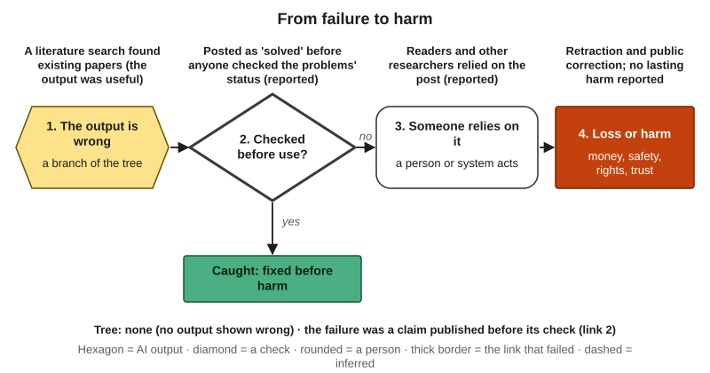{#fig-22-19 fig-alt="Failure-to-harm chain with link 2 highlighted: a useful literature search posted as 'solved' before checking; reliance; public correction."}

What has aged since: in January 2026, an AI-assisted solution to one listed problem, #728, was checked in Lean and written up for others to read (Sothanaphan, 2026), and on May 20, 2026 the same developer reported a new result in geometry with a companion paper by outside mathematicians (status: reported; to re-check). The pattern moved from a post to a checked proof.

### Short case 2: Two million materials? (2023–2024) {.unnumbered}

In November 2023, Google DeepMind researchers reported in *Nature* that their system had found 2.2 million new crystal structures (Merchant et al., 2023). In April 2024, two materials chemists published a critique: in a sample they examined, they found "scant evidence" of compounds that were new, credible and useful at once, though they called the methods promising (Cheetham & Seshadri, 2024). Tree: none; this is a dispute about what counts as a discovery, settled, if at all, by the field (section 22.7).

## Ethics Lens: Who Pays for the Frontier, and Who Checks It? {.unnumbered}

**Who pays.** The electricity, water and land for data centers are local costs; the benefits of the models trained and run in them spread far wider. The IEA notes that data centers cluster in particular places, where their demand can strain local grids (IEA, 2025). This book reads that as a question of fairness as well as of engineering: who is asked before a large data center is built, and who bears the cost if it raises local prices?

**Who checks.** Every overclaim shifts work to whoever must check it: a journalist, a mathematician, a student, a procurement officer. Outside evaluators such as the ones in this chapter are few, and their work is unpaid by the companies they test, or paid by them, which raises its own questions. The AI Index 2026 reports that evaluations of responsible-AI properties lag behind capability tests, and that documented AI incidents rose to 362 in 2025 from 233 the year before (Stanford HAI, 2026). Chapter 16 explains why tests of bias need their own data.

**Who builds.** The same report says industry produced over 90% of notable frontier models in 2025 (Stanford HAI, 2026). When a few organizations can afford the frontier, their release choices (open or closed, when, with which tests) shape what everyone else can study. Chapter 18 covers the rules that apply; Chapter 23 the debates about long-term risk.

## Career Connection {.unnumbered}

| Occupation | How the chapter's method is used | A question to ask |
|---|---|---|
| Technology journalist or analyst | Writes "as of" sentences with status and source | Who checked this, and when? |
| Sustainability or energy analyst | Compares energy figures by system boundary and year | What does this number count? |
| Procurement officer | Separates a vendor's reported claims from outside tests in a bid | Which claim was tested on our task? |
| Research scientist | Treats a model's output as a lead until the field's checks are done | Has anyone outside the team replicated it? |
| Policy staffer | Labels forecasts as forecasts in briefings | What would make this forecast wrong? |
| Product manager | Dates release notes and re-tests claims after updates | When do we check this again? |

People's expectations differ too: in the AI Index 2026, 73% of experts but 23% of the public expected AI to have a positive effect on how people do their jobs (Stanford HAI, 2026). A gap in opinion is itself a dated, measured fact.

## From the Field {.unnumbered}

In 2014, I wrote a short encyclopedia entry, in Turkish, on how three ideas relate to innovation: Moore's law, network effects and digitalization (Şeker, 2014). It drew on a table by Fichman, Dos Santos and Zheng (2014) and set out twelve examples, each with its effects, its results and examples from industry. The entry does not define Moore's law; this book adds that it is the observation, first made in 1965 and revised in 1975, that the number of components on a chip doubled at a regular interval (Moore, 1965, 1975).

Two of the entry's rows matter here. One described a shift to real-time question-and-answer systems: advances in natural language processing were being built into everyday interfaces, giving machines that can talk with users in ways similar to how people talk to each other, with Siri and IBM Watson as the examples. Another described how technologies spread: network effects, path dependence, winner-take-all markets and lock-in, with standards wars such as VHS against Beta.

*Present-day connections (this book's reading, not claims of the entry).* Read in October 2026, the question-and-answer row is a dated claim like the ones in this chapter. Its direction held; its examples aged (section 22.8). The standards row is a useful lens on two of this chapter's topics: which tool protocols agents will share (section 22.3) and whether open or closed models prevail (section 22.5). Which standard wins is a forecast, not a measurement. Moore's law itself is an example of a measured trend that people turned into a forecast and then into a plan; the scaling debate in section 22.6 has the same shape. The entry was written before large language models and makes no claim about them.

## Chapter Summary {.unnumbered}

**The question of this chapter** was how to tell what was measured, what was only claimed and what is a guess about the future, and how long the answer stays true. This chapter's answer is a habit more than a fact: give every capability claim a date, a status and the name of who could check it; separate data from trend lines; compare figures only when they count the same things; and re-check what you rely on, because claims age.

- **22.1** A capability claim needs three tags: as-of date, evidence status (measured, reported, forecast, the book's inference) and who could check it.
- **22.2** Reasoning models spend more computation at answer time; outside tests show large gains where answers can be checked; errors remain.
- **22.3** Agents' time horizons grew fast; 80% horizons stay several times shorter than 50% ones; trend lines are not data.
- **22.4** Generators now produce sound with video; realism is a reported quality, so Chapter 13's checks matter more.
- **22.5** The measured open–closed gap is months; access, inspection and data terms differ more than scores.
- **22.6** Compute and electricity growth are measured; whether scale keeps paying off is a forecast; energy figures depend on their boundary.
- **22.7** The field's own checks, not the announcement, settle a discovery.
- **22.8** An aging check asks what a dated claim describes today and what changed: the facts, the status or only the names.

**Back to the Warm-up.** (1) Before repeating "matches PhD experts," ask for the date, the status (reported unless an outside source tested it) and the test. (2) No: written-out steps help most where answers can be checked, and one developer's test found a newer reasoning model inventing more facts than an older one. (3) Published estimates for a typical text question are a fraction of a watt-hour, less than one minute of a laptop in use; long answers and the system boundary change the figure, and totals across billions of uses are large.

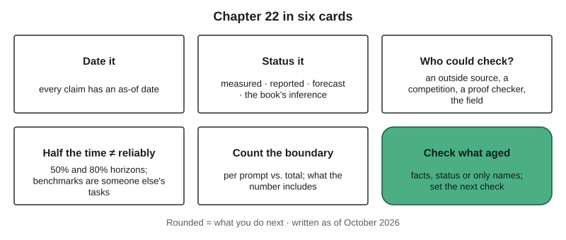{#fig-22-20 fig-alt="Six cards: date it, status it, who could check, half the time is not reliably, count the boundary, check what aged."}

### Key Terms {.unnumbered}

aging check · as-of date · capability claim · computer-use agent · evidence status · FLOP · forecast · measured (claim) · outside evaluation · reasoning model · reported (claim) · scaling (of AI models) · system boundary (of an energy estimate) · test-time compute · time horizon (of an agent) · tool protocol · training compute

## End-of-Chapter Package {.unnumbered}

<!-- Each item: objective · LO · revised Bloom level. Odd-numbered answers and all Check Yourself and faded-example keys → Appendix E (docs/production/handoff/ch22.md); even-numbered → private/ch22-answers-even.md. Multiple-choice keys rotated: A2 b, A4 d, A6 a, A8 c, A10 a, A12 c; distractors from M1–M6 (blueprint v0.2), named in the keys; the key is the longest option only in A4 and A10. Keys depend only on facts printed in the chapter (aging rule X9). Deep chapter: practice only, not examinable (D20). -->

This chapter is optional and not examinable. The questions below follow the exam's format, so they are good practice for the reasoning the exams do test. They depend only on what this chapter prints, so their answers stay valid even after the facts in the boxes have aged.

### Review Questions A: Terms and Concepts {.unnumbered}

1. *(O1 · LO1 · Understand)* Define *as-of date* and *evidence status* in one sentence each.
2. *(O1 · LO1, LO3 · Understand)* A developer's launch post reports a benchmark score with no outside test. What is the claim's status?\
   (a) Measured, because the post names the benchmark and gives an exact score.\
   (b) Reported, because the developer stated it and no outside source checked it.\
   (c) Forecast, because launch posts mostly describe what a model will do later.\
   (d) Unsupported, because a developer's statement is usually unreliable.
3. *(O1 · LO1 · Understand)* Explain the difference between a case tier and an evidence status, using the DeepMind blog post as the example.
4. *(O2 · LO1 · Understand)* What does "test-time compute" refer to?\
   (a) The computation spent testing a model on benchmarks before it is released to the public.\
   (b) The computation used in training, measured in FLOP over the whole training run.\
   (c) The time a person spends checking a model's answers after the model has produced them.\
   (d) Computation spent at the moment of answering, such as producing many reasoning tokens first.
5. *(O2 · LO1 · Understand)* According to section 22.2, where are reasoning models' measured gains largest, and why might that be?
6. *(O2 · LO1 · Understand)* In the developer's 2025 PersonQA test printed in section 22.2, what happened?\
   (a) The newer reasoning model invented facts about people more often than the older one.\
   (b) The reasoning models stopped inventing facts once they wrote out their steps.\
   (c) All three models invented facts at about the same rate.\
   (d) The test was run by an outside evaluator, so its results count as measured.
7. *(O3 · LO1 · Understand)* What is a 50% time horizon, and why does the 80% horizon matter for someone who wants to rely on an agent?
8. *(O3 · LO1 · Understand)* On a chart with a logarithmic vertical axis, a dotted line continues past the last data point. What is the dotted part?\
   (a) Measured data that METR has not yet published in its table.\
   (b) A confidence range showing where most measurements fall.\
   (c) An extrapolation: a forecast drawn in the shape of the data.\
   (d) The book's inference about the results, drawn as it draws every inferred label.
9. *(O4 · LO1 · Understand)* Name two things that open weights let an institution do and one thing they do not reveal.
10. *(O5 · LO1 · Understand)* Two published figures for the same chat tool's median prompt are 0.10 Wh and 0.24 Wh. What is the most likely reason, by section 22.6?\
    (a) They count different parts of the system: only active chips, or the full serving system with its overhead.\
    (b) One of them is false, because one honest measurement of one system gives one number.\
    (c) The smaller one is a forecast, so it should be ignored.\
    (d) The larger one includes training, which makes every prompt's figure larger.
11. *(O5 · LO1, LO3 · Understand)* What does a machine-checked proof confirm, and what does a specialist still have to judge?
12. *(O6 · LO1 · Understand)* In an aging check, a reported claim from 2025 is now confirmed by an outside test, with the same numbers. What changed?\
    (a) The facts, since the numbers were confirmed.\
    (b) Only the names, since the products were renamed.\
    (c) The status, since an outside source has now checked it.\
    (d) Nothing, since aging checks look only at numbers.

### Review Questions B: Case Questions {.unnumbered}

1. *(O1 · LO1, LO3 · Apply)* *Constructed.* A university newsletter writes: "AI now writes publishable research papers." Its link goes to a company's announcement about one paper accepted at a workshop. Give the claim's three tags and rewrite the sentence.
2. *(O2 · LO1 · Analyze)* *Constructed.* A teaching assistant plans to use a reasoning model to answer students' questions about historical dates, "because it shows its reasoning." Using sections 22.2 and 17.6, explain the risk and propose a check.
3. *(O3 · LO1 · Apply)* *Constructed.* A chart shows agents' 50% horizons of 1, 2 and 4 hours for models released in January, June and November of one year, and a dotted line reaching 64 hours two years later. What is the doubling time in the data, and what is the status of the 64-hour point?
4. *(O5 · LO1, LO3 · Evaluate)* *Constructed.* A company proposing a data center near a town says it will use "less electricity than 5,000 homes," while a local group says "as much as 100,000 homes." List three questions about boundaries and dates that would let a council compare the two numbers.

### Review Questions C: Interpretive Questions {.unnumbered}

1. *(O4 · LO1 · Evaluate)* "Since open-weight models are only months behind, organizations should never pay for closed models." Take a position, using section 22.5.
2. *(O6 · LO1 · Evaluate)* "A chapter that will be out of date in a year is not worth reading." Take a position, using sections 22.1 and 22.8.

### Spaced Review {.unnumbered}

Come back to these a few days after reading. Items 1 to 3 come from Core chapters; items 4 and 5 are for readers who have reached Chapters 19 and 21.

1. *(Chapter 8 · LO3 · Understand)* Why is an AI tool's own "yes" never a source?
2. *(Chapter 12 · LO2 · Understand)* What is the difference between an open-weight model and a local model?
3. *(Chapter 14 · LO1 · Apply)* An agent gets each step right 95 times in 100. Why is a 20-step run less reliable than one step?
4. *(Chapter 19, if you have read it · LO6 · Understand)* Who had the authority to settle the A-Lab claim, and through which channel?
5. *(Chapter 21, if you have read it · LO7 · Apply)* Name one review trigger for a personal code of practice that this chapter's developments could set off.

### Discussion Questions {.unnumbered}

1. *(Ethics · O5 · LO1 · Evaluate)* Who should be asked before a large data center is built near a town, and what evidence should they see?
2. *(Career · O1 · LO1 · Apply)* In your intended field, which kind of AI claim would you most often need to tag, and who would check it?
3. *(Interdisciplinary · O5 · LO1 · Analyze)* How does a field you know (medicine, law, history, engineering) decide that a new finding is settled? Bring one cited example.
4. *(O6 · LO1 · Evaluate)* Which box in this chapter do you expect to age first, and why?
5. *(O3 · LO1 · Evaluate)* Is it ever reasonable to plan on a trend line? When, and with what safeguards?

### Application Assignment (optional): What Has Already Aged? {.unnumbered}

*(O1, O5, O6 · LO1, LO3 · Evaluate)* Optional and ungraded unless your instructor chooses to give feedback; it is not one of the course's graded weekly assignments. **Time:** about 80 minutes (65–95): about 4 minutes to read this brief and rubric, 6 to choose three claims, 24 to check them (about 8 each), 6 for the status table, 30 for the essay, 6 for the revision and 4 for the declaration. It can serve as portfolio evidence (Chapter 20).

**What to submit:**

1. **Three dated claims** from one section's "As of October 2026" box, quoted with the section and the as-of date.
2. **Status table:** for each claim, its status in October 2026 and its status today, with the source you opened today. An AI tool may help you find a source; the source you open is the evidence.
3. **Aging verdicts:** each old claim as a description of today, on the five-point scale, with what changed (the facts, the status or only the names).
4. **Essay (500–700 words):** what has aged, what has held, and what that means for one named task in your field; judge at least one forecast against what happened, or say it is too early and give the date you would check again.
5. **Revision:** reread the essay as a skeptical reader; record one change and why.
6. **AI Use Declaration:** tools, purpose, what you accepted, rejected or revised, how you verified it, and where your own judgment shaped the work (or "no AI tools used").

A valid result that can earn full marks: "nothing has aged yet; I will check again on [date]."

**Rubric (10 points).** When a submission fits parts of two levels, give the lower level whose description fully applies.

| Criterion (points) | Exemplary | Proficient | Developing | Beginning |
|---|---|---|---|---|
| **Task: the essay (3)** | 3: 500–700 words; says what aged and what held, with a reason for each; applies it to one named task in your field; judges a forecast or dates the next check | 2: all of these, but the field task is general or one reason is missing | 1: describes changes without saying what they mean, or no field task | 0: no essay, or off topic |
| **Process: status table (1.5)** | 1.5: three claims, each with then-status, now-status and the source opened | 1: three claims; one status or source missing | 0.5: one or two claims complete | 0: no table |
| **Process: revision (1.5)** | 1.5: a change after a skeptical reread, with what changed and why, tied to a claim or verdict | 1: a change with what and why | 0.5: a change without a reason | 0: no revision |
| **Verification: aging verdicts (2)** | 2: three verdicts on the book's scale, each resting on a primary source opened today, each saying what changed | 1.5: three verdicts; one rests on a secondary source or does not say what changed | 1: one or two verdicts supported | 0: no verdicts, or verdicts resting only on an AI tool's answer |
| **Declaration (2)** | 2: all five elements, each specific | 1.5: all five elements; one general | 1: two to four elements | 0: zero or one element |

**Alternative assignment** (for students who prefer not to use AI tools, or without reliable internet; about 70 minutes): a provided "then and now" packet (under 1,200 words) gives three claims from this chapter, each with two later dated sources. Fill the same table and verdicts from the packet, then write a 400–600-word essay, a revision and a declaration. Same rubric; *Verification* means verdicts resting on the packet's sources; a declaration that says "no AI tools used" and states the other four elements as "none" is complete.

### Mini-Project (optional): A Four-Week Dated Log {.unnumbered}

*(O1, O6 · LO1 · Evaluate)* For four weeks, follow one development (an agent benchmark, an energy forecast, a science claim). Each week, log one new claim with its three tags. End with half a page: did any claim change status during the month, and who changed it?

### Case Study Questions {.unnumbered}

1. *(O1 · LO1 · Analyze)* For each of the three kinds of check in the 2025 olympiad, say what it checked and what it left out.
2. *(O1 · LO1, LO3 · Apply)* Write one honest sentence each about Gemini Deep Think's and OpenAI's 2025 results, with date, status and source.
3. *(O5 · LO1 · Evaluate)* Why does the Case Study label the olympiad "none" on the tree, while Short case 1 has a chain label?
4. *(O6 · LO1 · Evaluate)* What has aged in the case since July 2025, and what kind of change is it: facts, status or names?
5. *(O5 · LO1 · Analyze)* Compare Short case 1 with Short case 2. Which claim was settled quickly, and what made it quick?

## Further Reading and Compass Links {.unnumbered}

- Stanford HAI (2026), *AI Index Report 2026*: the annual outside summary; read the top takeaways first.
- METR (2026), *Time horizons* page and raw data: how one outside group measures agents, with its caveats.
- Epoch AI (2026), *Data on AI models*: open data on training compute and models (CC BY 4.0).
- IEA (2025), *Energy and AI*, executive summary; and its April 2026 update.
- Google DeepMind (2025), the IMO 2025 announcement, read with AFP's report of the IMO president's caution.
- Cheetham & Seshadri (2024): how a field checks a discovery claim, in six pages.
- In Compass (optional): an interactive Capability Timeline you can update, and the aging-check template.

## References {.unnumbered}

Achim, T., Thomm, J., et al. (2025). *Aristotle: IMO-level automated theorem proving* (arXiv:2510.01346). https://arxiv.org/abs/2510.01346

Agence France-Presse. (2025, July 22). Humans beat AI gold-level score at top maths contest. *Citizen Digital* (AFP wire). https://citizen.digital/article/humans-beat-ai-gold-level-score-at-top-maths-contest

Agence France-Presse. (2026, July 23). AI catches up with humans to score 100pc at top maths contest. *The Standard* (AFP wire). https://www.standardmedia.co.ke/sci-tech/article/2001553533/ai-catches-up-with-humans-to-score-100pc-at-top-maths-contest

ByteDance Seed. (2025, July 23). *ByteDance Seed Prover achieves silver medal score in IMO 2025* [Blog post]. https://seed.bytedance.com/en/blog/bytedance-seed-prover-achieves-silver-medal-score-in-imo-2025

Cheetham, A. K., & Seshadri, R. (2024). Artificial intelligence driving materials discovery? Perspective on the article: Scaling deep learning for materials discovery. *Chemistry of Materials, 36*(8), 3490–3495. https://doi.org/10.1021/acs.chemmater.4c00643

Dakan, R., & Feller, J. (2025, December). *The AI Fluency Framework: A descriptive and normative model of human-AI interaction for higher education* (Version 1.1). Higher Education Authority. https://hub.teachingandlearning.ie/wp-content/uploads/2025/12/hea-genai-fluency-framework.pdf

Edwards, J., & Emberson, L. (2026, May 29). *Open models lag state-of-the-art closed models by 4 months* [Data insight]. Epoch AI. https://epoch.ai/data-insights/open-closed-eci-gap

Elsworth, C., et al. (2025). *Measuring the environmental impact of delivering AI at Google scale* (arXiv:2508.15734). https://arxiv.org/abs/2508.15734

Epoch AI. (2025, October 30). *Open-weight models lag state-of-the-art by around 3 months on average* [Data insight]. https://epoch.ai/data-insights/open-weights-vs-closed-weights-models

Epoch AI. (2026). *Data on AI models* [Data set; updated October 16, 2026; retrieved October 18, 2026]. https://epoch.ai/data/ai-models

Fichman, R. G., Dos Santos, B. L., & Zheng, Z. (2014). Digital innovation as a fundamental and powerful concept in the information systems curriculum. *MIS Quarterly, 38*(2), 329–354. https://doi.org/10.25300/MISQ/2014/38.2.01

Google. (2025, May 20). *Fuel your creativity with new generative media models and tools* [Blog post]. https://blog.google/technology/ai/generative-media-models-io-2025/

Google Cloud. (2025, August 21). *Measuring the environmental impact of AI inference* [Blog post]. https://cloud.google.com/blog/products/infrastructure/measuring-the-environmental-impact-of-ai-inference

Google DeepMind. (2025, July 21). *Advanced version of Gemini with Deep Think officially achieves gold-medal standard at the International Mathematical Olympiad* [Blog post]. https://deepmind.google/discover/blog/advanced-version-of-gemini-with-deep-think-officially-achieves-gold-medal-standard-at-the-international-mathematical-olympiad/

Guo, D., et al. (2025). DeepSeek-R1 incentivizes reasoning in LLMs through reinforcement learning. *Nature, 645*(8081), 633–638. https://doi.org/10.1038/s41586-025-09422-z

International Energy Agency. (2025). *Energy and AI*. IEA. https://www.iea.org/reports/energy-and-ai

International Energy Agency. (2026, April 16). *Data centre electricity use surged in 2025, even with tightening bottlenecks driving a scramble for solutions* [News release]. https://www.iea.org/news/data-centre-electricity-use-surged-in-2025-even-with-tightening-bottlenecks-driving-a-scramble-for-solutions

Jumper, J., et al. (2021). Highly accurate protein structure prediction with AlphaFold. *Nature, 596*(7873), 583–589. https://doi.org/10.1038/s41586-021-03819-2

Lawsen, A. (2025). *Comment on The illusion of thinking: Understanding the strengths and limitations of reasoning models via the lens of problem complexity* (arXiv:2506.09250). https://arxiv.org/abs/2506.09250

Linux Foundation. (2025, December 9). *Linux Foundation announces the formation of the Agentic AI Foundation* [Press release]. https://www.linuxfoundation.org/press/linux-foundation-announces-the-formation-of-the-agentic-ai-foundation

Merchant, A., et al. (2023). Scaling deep learning for materials discovery. *Nature, 624*, 80–85. https://doi.org/10.1038/s41586-023-06735-9

METR. (2026). *Time horizons* [Web page and raw data, Time Horizon 1.1; last updated September 8, 2026; retrieved October 18, 2026]. https://metr.org/time-horizons/

Moore, G. E. (1965). Cramming more components onto integrated circuits. *Electronics, 38*(8), 114–117.

Moore, G. E. (1975). Progress in digital integrated electronics. In *Technical Digest, International Electron Devices Meeting* (pp. 11–13). IEEE.

Nobel Prize Outreach. (2024). *The Nobel Prize in Chemistry 2024* [Summary]. https://www.nobelprize.org/prizes/chemistry/2024/summary/

OpenAI. (2025, April 16). *OpenAI o3 and o4-mini system card*. https://cdn.openai.com/pdf/2221c875-02dc-4789-800b-e7758f3722c1/o3-and-o4-mini-system-card.pdf

Reuters. (2024, November). OpenAI and others seek new path to smarter AI as current methods hit limitations. *Reuters*.

Reuters. (2025, July 21). Google and OpenAI's AI models win milestone gold at global math competition. *CP24* (Reuters wire). https://www.cp24.com/news/world/2025/07/21/google-and-openais-ai-models-win-milestone-gold-at-global-math-competition/

Şeker, Ş. E. (2014). Ağ etkisi, Moore yasası ve dijitalleşmenin yenilik ile ilişkisi [The relation of network effects, Moore's law and digitalization to innovation]. *YBS Ansiklopedi, 1*(1).

Sevilla, J., et al. (2024, August 20). *Can AI scaling continue through 2030?* Epoch AI. https://epoch.ai/blog/can-ai-scaling-continue-through-2030

Shehabi, A., et al. (2024). *2024 United States data center energy usage report* (LBNL-2001637). Lawrence Berkeley National Laboratory.

Shojaee, P., Mirzadeh, I., Alizadeh, K., Horton, M., Bengio, S., & Farajtabar, M. (2025). The illusion of thinking: Understanding the strengths and limitations of reasoning models via the lens of problem complexity. In *Advances in Neural Information Processing Systems 38 (NeurIPS 2025)*.

Sothanaphan, N. (2026). *Resolution of Erdős problem #728: A writeup of Aristotle's Lean proof* (arXiv:2601.07421). https://arxiv.org/abs/2601.07421

Stanford HAI. (2025). *AI Index Report 2025*. Stanford Institute for Human-Centered Artificial Intelligence. https://hai.stanford.edu/ai-index/2025-ai-index-report

Stanford HAI. (2026). *AI Index Report 2026*. Stanford Institute for Human-Centered Artificial Intelligence. https://hai.stanford.edu/ai-index/2026-ai-index-report

The Decoder. (2025, October). Leading OpenAI researcher announced a GPT-5 math breakthrough that never happened. https://the-decoder.com/leading-openai-researcher-announced-a-gpt-5-math-breakthrough-that-never-happened/

Touretzky, D., Gardner-McCune, C., Martin, F., & Seehorn, D. (2019). Envisioning AI for K-12: What should every child know about AI? *Proceedings of the AAAI Conference on Artificial Intelligence, 33*(1), 9795–9799.

U.S. Department of Energy. (2024, December 20). *DOE releases new report evaluating increase in electricity demand from data centers*. https://www.energy.gov/articles/doe-releases-new-report-evaluating-increase-electricity-demand-data-centers

UNESCO. (2024). *AI competency framework for students*. https://doi.org/10.54675/JKJB9835

Villalobos, P., Ho, A., Sevilla, J., Besiroglu, T., Heim, L., & Hobbhahn, M. (2024). *Will we run out of data? Limits of LLM scaling based on human-generated data* (arXiv:2211.04325; ICML 2024 version). https://arxiv.org/abs/2211.04325

Xie, T., et al. (2024). OSWorld: Benchmarking multimodal agents for open-ended tasks in real computer environments. In *Advances in Neural Information Processing Systems 37 (NeurIPS 2024)*. https://arxiv.org/abs/2404.07972

You, J. (2025, February 7). *How much energy does ChatGPT use?* Epoch AI (Gradient Updates). https://epoch.ai/gradient-updates/how-much-energy-does-chatgpt-use
