# Philosophical Debates: Minds, Meaning and Responsibility {#sec-ch23}

<!-- Status: v2 (2026-10-18), Stage 5 revision: D27 independence and editor decisions 0–14 (build/ch23/editor-decisions-stage5.md) applied over the four reviews; earlier: v1 Stage 2 draft from blueprint v0.2 (approved under D19). Deep chapter: not examinable (D20). The book's final chapter. Featured students: Maya and Hana (they/them) only; other people are unnamed one-off figures. Case C30. Figures: figures/scripts/ch23_figures.py (new chapter signature argument_map(); imports failure_chain from ch04_figures and verification_funnel from ch08_figures) and ch23_charts.py (published values in data/ch23_*.csv). Source notes: build/ch23/src/notes.md. Rule for the whole chapter: every debate has two strong sides from primary sources; the book's own voice takes no side; the author's view appears only in labeled boxes: one quotes his published HermAI article (23.4, with the D16 disclosure); the others are titled "Author's view — to be added by the author before publication" and contain no view. All of Maya's and Hana's work is constructed. -->

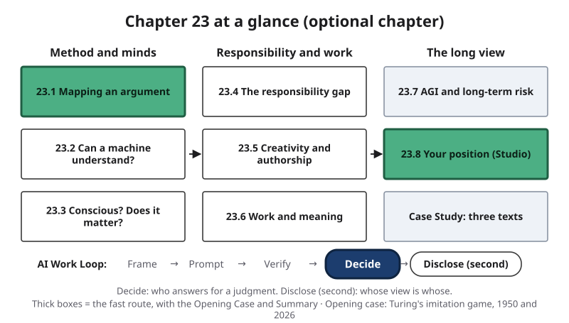{#fig-23-1 fig-alt="Chapter map: method and minds (23.1–23.3), responsibility and work (23.4–23.6), the long view (23.7–23.8, case); Work Loop with Decide highlighted."}

**Chapter 23 at a glance** (@fig-23-1). This is the book's last chapter, and it is optional: nothing in it is on an exam. Earlier chapters taught you to use AI tools well. This chapter asks questions no checklist settles. Can a machine understand what it says? Could one be conscious, and would that matter? When an AI system is involved in a harm, who is responsible? Is generated work creative, and whose is it? What happens to the meaning people find in work? And should the long-term future of AI worry us?

Informed people disagree about all of them. The chapter does not settle them; it gives you a method for disagreement.

**Time** (at a steady pace, 150 words a minute; allow more if you read more slowly or are reading in a second language):

- **Fast route, about 23 minutes:** this page, the Opening Case, the Warm-up, section 23.1, section 23.8 with its recap box (one entry on each debate), and the Chapter Summary. It stands on its own.
- **Full route, about 68 minutes:** everything from this page through the Case Study, not counting the labs. About 77 minutes with the Ethics Lens, Career Connection, From the Field and Summary.
- **Extra, all optional:** answering the Warm-up and Check Yourself questions (about 4 minutes on the fast route, about 12 on the full route); faded examples (about 2 minutes each) and Your Turn boxes; the labs (about 25–30 minutes each, including reading the lab and the debrief); the end-of-chapter questions (about 15 minutes to read, about 45–50 minutes to answer); the optional position paper (about 55 minutes for the short version, about 2 hours for the full one).

Chapter 23 is optional and can be read any time after Chapter 21. Section 23.4 also reads well beside Chapter 14, and section 23.5 beside Chapter 18. Worked examples show every step, faded examples leave some steps for you, and Your Turn and Check Yourself boxes are ungraded practice. Answers to Check Yourself, the faded examples and odd-numbered end-of-chapter questions are in Appendix E.

::: {.callout-note title="Plain words for this chapter"}
- **Token:** a unit of text (a word, part of a word, or a symbol) that a language model receives and produces (Chapter 3).
- **Next-token prediction:** producing text one token at a time in four steps: split the text into tokens, score every possible next token, pick one, add it and repeat (Chapter 3).
- **A model's account of itself:** an explanation, a "chain of thought" or a self-report a model produces is a claim to check, not a record of what the system did (Chapter 17).
- **Independent check:** evidence that no AI tool produced: a source with an author or publisher you can name, or your own recalculation or reasoning from known inputs. **Primary source:** the original record a claim comes from (Chapter 8).
- **Documented / inferred:** a statement backed by the record, or one that rests on someone's reasoning or reconstruction. In this book's figures, a documented box has a solid outline and an inferred one a dashed outline (Chapter 4).
- **Approval gate:** a point at which a system pauses before an action takes effect until a named person approves, edits or rejects it (Chapter 14).
- **Decision owner:** the named person or body who makes a decision and answers for its result (Chapter 11).
- **Ownership (of a text):** having decided what a text says, and being able to explain, defend and stand behind every sentence in it and its consequences; not the same as legal authorship (Chapter 10).
:::

**The question of this chapter:** *When informed people disagree about whether AI understands, feels, creates or endangers us, how do you take a position you can defend, and what does any answer change about who answers for AI's work?* The Chapter Summary returns to it.

## Opening Case: A 1950 Question, a 2026 Test {.unnumbered}

In 1950 the mathematician Alan Turing published a paper in the philosophy journal *Mind* that opened with a question: "Can machines think?" (Turing, 1950). He did not try to answer it directly. He thought the words "machine" and "think" were too loose for a definition to settle anything. Instead he proposed a game, which he called the **imitation game**. An interrogator types questions to two hidden players, one a person and one a machine, and must decide which is which. If machines could play the game well, Turing suggested, the original question would matter much less. He also made a prediction: that in about fifty years computers could be programmed to play so well that, after five minutes of questions, an average interrogator would have at most a 70% chance of telling the machine from the person correctly.

In May 2026, the cognitive scientists Cameron Jones and Benjamin Bergen published a test of Turing's game in the *Proceedings of the National Academy of Sciences* (PNAS) (Jones & Bergen, 2026). They ran two randomized, preregistered studies: randomized because participants were assigned to conditions by chance, preregistered because the methods were published before the data were collected. Each participant chatted for five minutes with two partners at once, another person and an AI system, and then judged which was human. This is the *three-party* version of the test: one interrogator, two hidden partners. When one model, GPT-4.5, was prompted to adopt a humanlike persona (a young, introverted person who uses slang), participants judged it to be the human in 73% of 254 games, more often than they picked the real person. Another model, LLaMa-3.1, with the same prompt was judged human 56% of the time. Without the persona prompt, the same two models were judged human only 36% and 38% of the time. A third study, with 15-minute games, again found two persona-prompted models (LLaMa-3.1 and the newer GPT-5) judged human more than half the time (56% and 59%). The authors concluded that these systems pass a standard three-party Turing test. They also reported that interrogators judged mostly by style and social and emotional cues, not by knowledge or reasoning.

So a test Turing proposed seventy-six years earlier has, by its authors' account, been passed. In this book's reading, the result did not move the debate about whether machines think: each side could read it as support for what it already held (the Case Study shows how).

**The puzzle:** *If a machine can pass the test Turing proposed, has anything about understanding been settled? And if not, what would settle it?* Section 23.2 sets out the strongest answers on both sides, and the Case Study returns to the texts at the center of this debate (@fig-23-2).

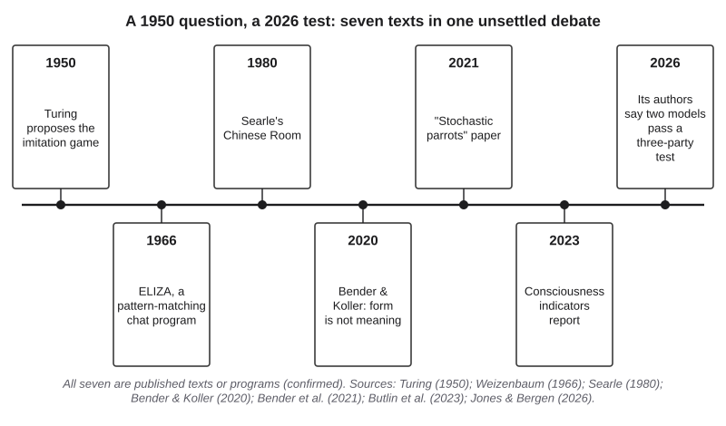{#fig-23-2 fig-alt="Timeline of seven dated texts: Turing 1950, ELIZA 1966, Searle 1980, Bender and Koller 2020, stochastic parrots 2021, indicators 2023, PNAS test 2026."}

## Learning Objectives {.unnumbered}

Each objective names the book's learning outcome it serves: LO5 is the outcome on applying privacy, security, fairness, transparency and human-oversight principles; LO1 is the outcome on explaining how AI systems work and fail; LO3 is the outcome on verifying outputs; LO4 is the outcome on telling responsible assistance from overreliance and misconduct. Framework tags refer to the AI Fluency framework (Dakan & Feller, 2025) and the UNESCO (United Nations Educational, Scientific and Cultural Organization) AI Competency Framework for Students (UNESCO, 2024).

After this chapter you will be able to:

- **O1 — Explain** what the Turing test, the Chinese Room and the "stochastic parrots" critique each claim, and what they do not claim. *(LO5, LO1 · AI Fluency: Discernment · UNESCO: AI techniques and applications, Understand; Human-centred mindset, Understand)*
- **O2 — Analyze** a published argument into its claim, reasons, objections and unstated premises, as an argument map. *(LO5 · AI Fluency: Discernment · UNESCO: Ethics of AI, Understand)*
- **O3 — Distinguish** evidence about a system's behavior from claims about its understanding, consciousness or moral status. *(LO5, LO3 · AI Fluency: Discernment · UNESCO: Ethics of AI, Understand)*
- **O4 — Evaluate** who can answer for a harm in which an AI system is involved, using the responsibility gap and the replies to it. *(LO5 · AI Fluency: Diligence · UNESCO: Ethics of AI, Apply)*
- **O5 — Evaluate** a dated claim about AI and work, or about long-term risk, by who made it, on what evidence, and whether it is a forecast. *(LO5, LO3 · AI Fluency: Discernment · UNESCO: Human-centred mindset, Apply)*
- **O6 — Create** a position paper that states two strong sides fairly and labels your own view separately. *(LO5, LO4 · AI Fluency: Diligence · UNESCO: Ethics of AI, Apply; Human-centred mindset, Apply)*

::: {.callout-note title="Warm-up (ungraded)"}
1. You chat with a partner you cannot tell from a person. Does it understand you? Give one reason.
2. A chatbot writes, "I am afraid of being switched off." What is that sentence evidence of?
3. An AI scheduling assistant books the wrong room and a meeting with a patient is lost. Who answers for it? How sure are you of your answer (0–100%)?

You will revisit your answers in the Chapter Summary.
:::

## 23.1 Two Strong Sides: Mapping an Argument {#sec-23-1 .unnumbered}

[Deep]{.path}

*Deep sections are optional and not examinable. Featuring Maya, a first-year psychology student from Izmir, whose psychology program runs a seminar on minds and machines (constructed course).*

Philosophers, psychologists, computer scientists, economists and artists all argue about AI, citing experiments, thought experiments or history. A loud claim and a careful one can sound equally sure, so this section gives you one tool for all the debates.

An **argument map** is a diagram of an argument: the claim at the top, the reasons that support it on one side, the objections against it on the other, and lines showing which reason or objection bears on what. A **premise** is a statement an argument relies on. Some premises are stated; others are only assumed, and finding those unstated premises is often where a disagreement turns out to live. In a map, an unstated premise is drawn with a dashed outline, because it is your reconstruction, the book's usual mark for "inferred."

The map in @fig-23-3 shows the grammar used in every map in this chapter. Reasons sit on the left and end in an arrowhead: they support what they point to. Objections sit on the right and end in a flat bar: they oppose what they touch. An objection can oppose the whole claim, or it can deny one premise. That second kind is the most useful to spot, because it tells you exactly where two people part ways.

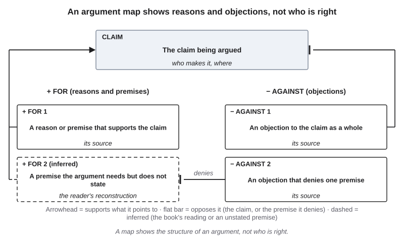{#fig-23-3 fig-alt="Map template: a claim; left, a reason and a dashed unstated premise; right, one objection to the claim and one denying the premise."}

A map is not a verdict; it shows how each side's reasoning is built. For example, a map of a campus-policy debate may show that both sides accept the same facts and disagree only about which value comes first.

To map fairly you need the **steelman** of each view: the strongest fair version of it, the one its own holders would recognize and accept. The opposite, a weak version built to be knocked down, is a **straw man** (the image is of a dummy made of straw, easy to knock over). This chapter follows one rule for every debate. Each side appears at its strongest, from its own primary sources. The book's own voice takes no side. Where the author has published something relevant, it appears in a separate labeled box with its source (section 23.4). Your own view, in the optional position paper (section 23.8), gets the same treatment: its own labeled paragraph.

::: {.callout-note title="Worked Example: Maya Maps a Seminar Claim"}
*Constructed example.* In Maya's seminar a classmate says: "AI tutors can't understand students, so they can't help them."

**Step 1 — The claim.** AI tutors cannot help students.

**Step 2 — Stated reason.** AI tools produce text by prediction, not by understanding. (Whether that is true is section 23.2's question; Maya marks it "contested" and moves on.)

**Step 3 — Unstated premise.** For the conclusion to follow, the classmate must assume that only something that understands a student can help that student. The claim never says so. Maya draws it dashed: it is her reconstruction.

**Step 4 — Objections.** One denies the unstated premise: practice questions and feedback can help a learner whether or not their source understands anything (Chapter 7 showed when they help and when they become a crutch). Another opposes the claim directly: whether a tool helps is a question a study can test.

**Result:** @fig-23-4. The disagreement does not sit where it first seemed to, in whether machines understand. It sits in the unstated premise about what help requires.
:::

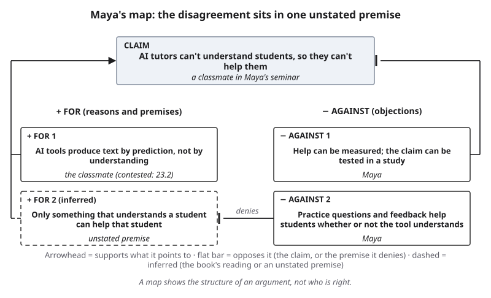{#fig-23-4 fig-alt="Maya's map: claim AI tutors can't help; reason about prediction; dashed premise that only understanding helps; one objection denies that premise."}

::: {.callout-note title="Faded Example: A Jobs Op-Ed"}
*Constructed example.* An op-ed (an opinion article in a newspaper or website) paragraph: "AI will replace marketing jobs. These tools already write ad copy in seconds, and companies always cut costs when they can."

*A fact you need (constructed):* the marketing team the writer has in mind spends its week on ad copy, but also on customer research, campaign planning, client meetings and judging what fits a brand.

**Done for you:** *Claim:* AI will replace marketing jobs. *Reason 1:* the tools write ad copy in seconds.

**Your turn:** *Reason 2:* _______________ *An unstated premise (dashed):* _______________ *One objection, and what it targets:* _______________
:::

::: {.callout-important title="Your Turn"}
Take one claim about AI you heard this week (a post, a lecture, a conversation). Write its claim, one stated reason and one unstated premise. Which would you check first?
:::

::: {.callout-tip title="Check Yourself 23.1"}
1. What is the difference between a stated premise and an unstated one, and how does a map show the second?
2. Why is an objection that denies one premise more informative than one that opposes the whole claim?
3. What is a steelman, and why does this chapter require one for each side?
:::

## 23.2 Can a Machine Understand? {#sec-23-2 .unnumbered}

[Deep]{.path}

*Featuring Maya.*

Chapter 3 asked whether a language model knows things or predicts text, and answered the mechanical half: it predicts text one token at a time. This section asks the other half: granting what a model does, is anything like **understanding** going on? The word has no single agreed meaning, which is part of the problem. In this section it means grasping what words are about, not only how they are used.

**Turing: replace the question.** Turing (1950) did not claim that the machines of his day think. He proposed that the imitation game could take the place of the question, and he treated sustained, satisfactory answers in the game as the evidence to use. He then answered nine objections to his proposal (@fig-23-5). Two matter most here. The *objection from consciousness* says a machine would have to feel what it writes, not just produce the words. Turing replied that by that standard you could never know that any other person thinks either; people assume each other's minds on the evidence of behavior. *Lady Lovelace's objection*, after the nineteenth-century mathematician, says a machine can only do what we tell it; Turing replied that machines often surprise him.

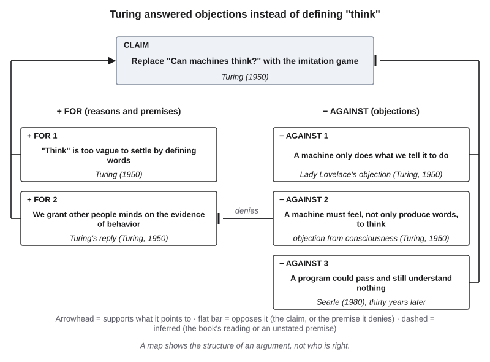{#fig-23-5 fig-alt="Turing map: claim replace the question with the game; reasons on vagueness and behavior; objections: consciousness, Lovelace, Searle."}

**Searle: the Chinese Room.** Thirty years later the philosopher John Searle answered with a **thought experiment**, an imagined case built to test an idea (Searle, 1980). Imagine a person who knows no Chinese, locked in a room with a rulebook written in English. Chinese questions come in through a slot. By following the rules, which match symbols to symbols by their shapes, the person sends back Chinese answers good enough to convince native speakers outside. Yet the person understands none of it. Searle's target was the claim that running the right program would, by itself, be understanding. His argument: a program manipulates symbols by their form, which is called **syntax**; understanding requires meaning, called **semantics**; and syntax alone is not enough for semantics. The **Chinese Room argument** is this thought experiment and the conclusion Searle drew from it.

Searle also answered the replies he had met when presenting the argument to AI researchers at several universities (@fig-23-6). The most discussed is the **systems reply**: the person is only one part of a system that also includes the rulebook, the papers and the room, and it is the whole system that understands. Searle answered that the person could memorize the rules and do everything in their head and would still not understand Chinese. The *robot reply* accepts that form alone is not enough and adds connections to the world: a program linked to cameras and motors might understand. Searle answered that the camera signals would reach the person in the room as more symbols. This book reads the robot reply as an early form of what Harnad (1990) named the **symbol grounding problem**: how symbols could get their meaning from something other than more symbols. Searle did *not* claim that machines can never think; only that running a program is not, by itself, enough.

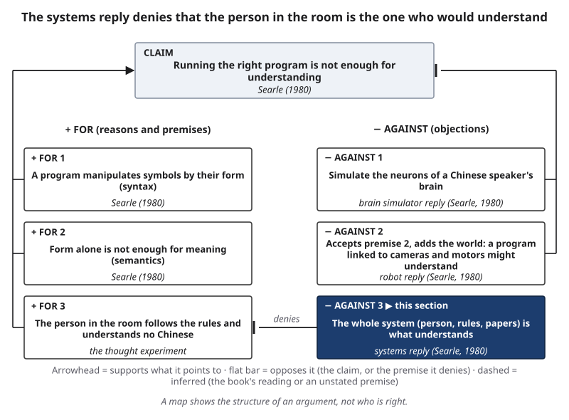{#fig-23-6 fig-alt="Chinese Room map: three premises; the systems reply denies the third; the robot and brain simulator replies oppose the claim."}

::: {.callout-note title="Worked Example: Maya Maps the Chinese Room"}
*Constructed example.* For her seminar, Maya maps Searle's argument.

**Step 1 — The claim (Searle's):** running the right program is not enough for understanding.

**Step 2 — The premises (Maya's three-premise reconstruction):** (1) a program manipulates symbols by their form; (2) form alone is not enough for meaning; (3) the person in the room follows the rules and understands no Chinese.

**Step 3 — The replies, and what each accepts or denies:** the systems reply denies that premise 3 is about the right thing: the person is not the one who would understand. The robot reply accepts premise 2 and adds connections to the world; Searle answered that the camera signals would reach him as more symbols. The brain simulator reply opposes the claim as a whole.

**Step 4 — A note in her own words.** Maya writes in English and thinks in Turkish (Chapter 3). In either language she can connect words to things she has seen and done; the person in the room cannot. So the robot reply interests her most. She labels this a reflection, not evidence.

**Result:** the map shows where the replies part ways with Searle: the systems reply at premise 3; the robot reply over whether a program connected to the world is still "form alone."
:::

**Stochastic parrots.** Fluent language models brought the question back. Two papers by the linguist Emily Bender and colleagues argued against reading understanding into them. Bender and Koller (2020) argued that a system trained only on linguistic form cannot learn meaning, because meaning links form to something outside language: what a speaker intends and what the words are about. Their illustration: an octopus taps a cable between two islanders, learns to impersonate one, and fails as soon as it is asked for help with something in the world. A year later, Bender, Gebru, McMillan-Major and Shmitchell (2021) called a language model a **stochastic parrot**: a system that stitches together sequences of linguistic form it has seen, guided by probabilities of how they combine, without reference to meaning. *Stochastic* means governed by probability. In plainer words: the model joins pieces of language from its training data in likely orders, and on this view the words point to nothing beyond themselves. That paper was mainly about the risks of ever-larger models: their costs, their huge undocumented training data and people's readiness to read meaning into fluent text. The parrot claim is about meaning, not usefulness: a system can be useful without understanding anything.

::: {.callout-note title="Predict first"}
In the 2026 three-party test, two models were each tested with and without a prompt telling them to adopt a humanlike persona. Without the persona prompt, how often do you think they were judged to be human: about the same as with it, or much less?
:::

Without the persona prompt, the same models were judged human 36% and 38% of the time, against 73% and 56% with it (@fig-23-7). The baselines, ELIZA and an older chat model, scored 23% and 21% (Jones & Bergen, 2026). ELIZA, a 1966 program, followed scripted pattern-matching rules to turn typed sentences into replies; its author reported that some users were hard to convince it was not human (Weizenbaum, 1966). The tendency it revealed was later named the **ELIZA effect**: reading far more understanding into a program's output than it warrants (Hofstadter, 1995). It is one form of **anthropomorphism**, attributing human traits such as thoughts or feelings to things that are not human. In other words, how a system was told to present itself changed the result a great deal. The authors describe the test as a measure of how people tell humans from machines. In this book's reading, Turing would take that as the evidence to use; Searle argued that such evidence cannot settle understanding.

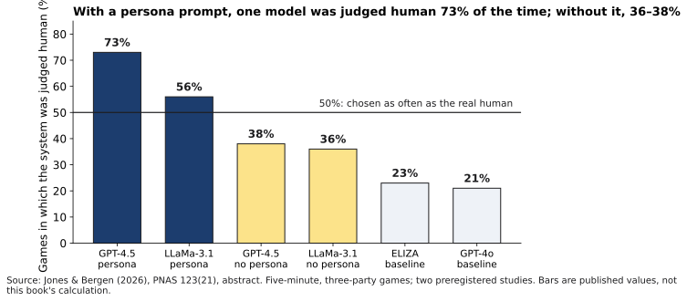{#fig-23-7 fig-alt="Bar chart: GPT-4.5 persona 73%, LLaMa persona 56%, no persona 36% and 38%, ELIZA 23%, GPT-4o 21%; line at 50%."}

**The current debate.** The two sides of 2023 to 2026 restate the old ones with new evidence (@fig-23-8). On one side, Piantadosi and Hill (2022) argue that meaning need not come from contact with the world: it can come from the relations among concepts, what philosophers call *conceptual role*, and that is something a model's internal states could capture. Interpretability studies, which examine what is inside a trained model, offer this side evidence. In one, a model trained only on lists of moves in the board game Othello, with no rules or board given, developed an internal representation of the board's state, and changing that representation changed its predictions (Li et al., 2023).

On the other side stand Bender and colleagues and Searle's tradition: whatever is inside the model, it was built from form alone.

Between them, Mitchell and Krakauer (2023) survey the arguments on both sides and suggest that machines may show modes of understanding different from ours. Mahowald and colleagues (2024) separate *formal* competence with language (its rules and patterns), at which language models are strong, from *functional* competence (using language to reason and act in the world), at which they are uneven. In a 2022 survey, researchers in natural language processing (NLP, the field that builds systems that work with human language) split almost exactly in half on whether a model trained only on text could understand language in some non-trivial sense (Michael et al., 2022). Shanahan (2024) adds a caution both sides can use: words like "knows" and "believes" are handy shorthand for models but can mislead. This book avoids them in its own voice; that is a style choice, not a verdict on the debate.

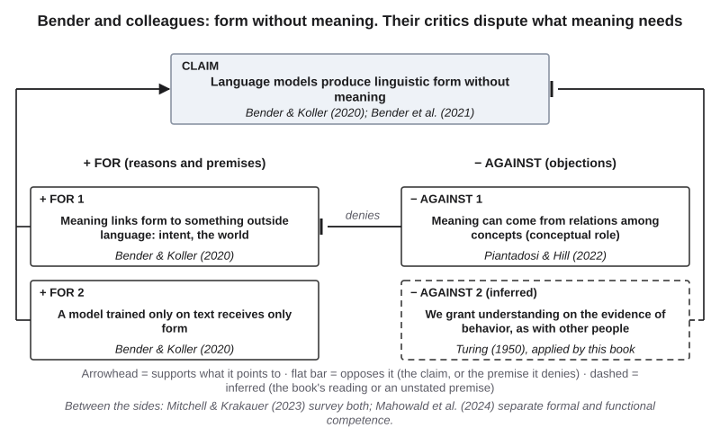{#fig-23-8 fig-alt="Map: claim models produce form without meaning; reasons on meaning and text-only training; conceptual role denies the first; a behavior test opposes."}

::: {.callout-note title="Faded Example: Turing's Objection from Consciousness"}
**Done for you:** *Claim:* the imitation game can take the place of the question "Can machines think?" (Turing, 1950). *Reason 1:* "think" is too vague to settle by defining words. *Reason 2:* we grant other people minds on the evidence of their behavior.

**Your turn:** *The objection:* _______________ (hint: what must a machine do besides produce words?) *Which reason does it target:* _______________ *Turing's reply, in one sentence:* _______________
:::

::: {.callout-important title="Your Turn"}
Map Bender and Koller's argument (@fig-23-8) in two premises and a claim, in your own words. Which premise do Piantadosi and Hill deny, and what do they put in its place? Answer in two sentences.
:::

::: {.callout-tip title="Check Yourself 23.2"}
1. What did Turing propose in place of the question "Can machines think?", and what did he not claim?
2. Give a three-premise reconstruction of Searle's argument. Which premise does the robot reply accept, and what does it add?
3. In the 2026 test, what did the persona prompt change, and what do the authors say the test measures?
:::

## 23.3 Could an AI System Be Conscious, and Would It Matter? {#sec-23-3 .unnumbered}

[Deep]{.path}

*Featuring Maya.*

Understanding is one question; feeling is another. This section separates two questions often run together, using two working definitions. **Phenomenal consciousness** is experience: there is something it is like to be that system, as there is something it is like for you to taste coffee or feel pain. **Moral status** is the property of being something whose interests matter morally for its own sake, so that what happens to it can wrong it. Many philosophers link the two, because a being that can suffer seems to have interests, but some argue that other features, such as having goals of one's own, could also matter.

**A method both sides accept.** Start with what the sides share. A system's statements about itself, such as "I feel lonely" or "I am conscious," are produced the way all its text is produced, so they are claims to check, not reports you can take at face value (the rule Chapter 17 applied to a model's account of its own reasoning). Researchers on both sides of this debate treat such self-reports as weak evidence. They disagree about what else could count.

**Side A: take the possibility seriously.** In 2023 nineteen researchers in consciousness science, philosophy and AI proposed a method: derive **indicator properties** from leading scientific theories of consciousness, features each theory says matter, stated in computational terms, and check whether an AI system's design has them (Butlin et al., 2023; @fig-23-9). The method assumes, as a working hypothesis, that the right computations could be enough for consciousness, a view called **computational functionalism**. Their conclusion then: no current AI system was conscious, but there were no obvious technical barriers to building systems that have the indicators. The journal version (Butlin et al., 2026) presents the method as a way to inform *credences*, degrees of belief, rather than to give a yes or no. A 2024 report by several of the same authors went further: there is a realistic chance that some AI systems will be conscious or robustly agentic (pursuing goals of their own) in the near future, so **AI welfare**, the question of whether and how an AI system's possible interests should count, is a near-term issue. The report recommends three early steps: acknowledge the issue, assess systems for evidence, and prepare policies (Long et al., 2024). The philosopher Jonathan Birch (2024) argues more generally that when a being is a realistic candidate for sentience, we should take precautions proportionate to the risk, without waiting for certainty.

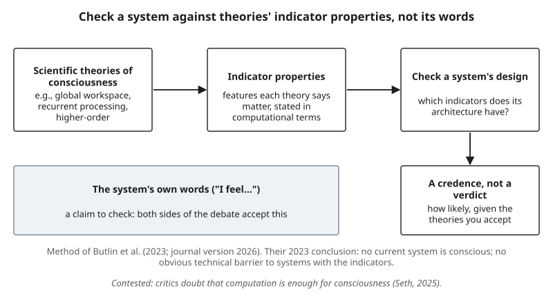{#fig-23-9 fig-alt="Theories of consciousness lead to indicator properties, a check of a system's design, then a credence; its own words are claims."}

**Side B: skeptical.** The neuroscientist Anil Seth (2025) challenges exactly the assumption Side A works with: that computation provides a sufficient basis for consciousness. He argues instead that consciousness likely depends on our nature as living organisms, a position he calls *biological naturalism*. He also identifies biases that, in his view, lead people astray when they ask whether AI could be conscious. On his view, real artificial consciousness is unlikely on current paths and becomes more plausible only as AI becomes more brain-like or life-like. Shanahan (2024) warns that talk of models in mental terms misleads. Mustafa Suleyman, chief executive of Microsoft AI, a division of Microsoft (as of August 2025), argued that month that the near-term danger is "seemingly conscious" AI: systems that imitate the outward signs of consciousness so well that people believe in it. He called the idea of model welfare "premature, and frankly dangerous," because it feeds that belief, and asked companies not to build systems that claim feelings (Suleyman, 2025).

**Interested sources on both sides.** An **interested source** is someone with a stake in the answer. Suleyman leads the AI division of a company that sells AI products. Anthropic, a company that also sells AI products, acted on the opposite concern: in August 2025 it let two of its models end a rare subset of persistently abusive chats, describing itself as highly uncertain about its models' moral status and saying the feature came from its exploratory work on model welfare (Anthropic, 2025). This book was drafted with Anthropic's Claude models, which is an interest to declare here (see "How This Book Was Written").

What do people believe? In a July 2023 survey of 300 U.S. adults, 67% gave ChatGPT some possibility of phenomenal consciousness, and those who used it more often were more likely to do so (Colombatto & Fleming, 2024; @fig-23-10). That measures public belief, not ChatGPT. The sides disagree mainly about one premise: whether the right computation could be enough for experience (@fig-23-11). The question is **contested**: serious researchers on both sides treat it as open.

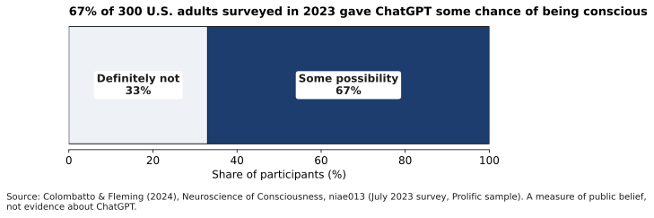{#fig-23-10 fig-alt="Bar: 33% said ChatGPT was definitely not an experiencer; 67% gave it some possibility of phenomenal consciousness. July 2023, 300 U.S. adults."}

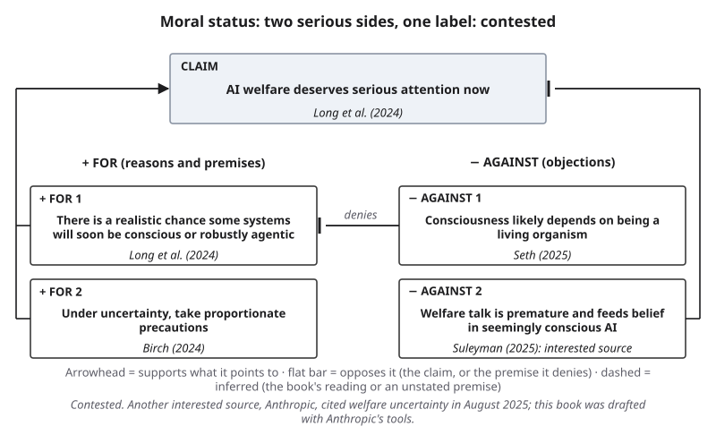{#fig-23-11 fig-alt="Map: claim AI welfare deserves attention now; reasons from Long et al. and Birch; Seth denies the first reason; Suleyman opposes the claim."}

::: {.callout-note title="Worked Example: Maya Sorts Four Statements"}
*Constructed example.* Maya's seminar asks for each statement: what kind of evidence is it?

1. A chatbot writes, "Sometimes I feel lonely between conversations." (*constructed output*) → **a self-report:** a claim to check; it shows what the system produced, not what it experiences.
2. A company says it lets its models end abusive chats because of welfare uncertainty. → **a policy by an interested source:** it shows what the company decided and says, not what is true about its models.
3. Butlin et al. (2023) conclude that no current system is conscious. → **a theory-based assessment:** strongest where you accept the theories it uses.
4. Two-thirds of a U.S. sample gave ChatGPT some chance of consciousness. → **a measure of public belief:** evidence about people, not about the system.

**Result:** item 3 is the strongest evidence about systems, and it rests on contested theories. Item 1 is about a system too, but it is weak evidence that both sides discount. Items 2 and 4 are evidence about a company and about people.
:::

::: {.callout-note title="Faded Example: A Companion Robot's Brochure"}
*Constructed example.* A care home considers a companion robot. Its brochure says: (a) "Residents say it understands them." (b) "It tells residents it enjoys their company." (c) "Independent testers measured fewer reports of loneliness after eight weeks."

**Done for you:** (a) a report of residents' beliefs: evidence about people, not about the robot.

**Your turn:** (b) _______________ (c) _______________
:::

::: {.callout-important title="Your Turn"}
Write one sentence that would count as evidence *about a system* for the consciousness question, and one that would count only as evidence about people's beliefs.
:::

::: {.callout-tip title="Check Yourself 23.3"}
1. What is the difference between phenomenal consciousness and moral status?
2. What method do both sides accept for a system's statements about itself, and what does Butlin et al.'s method look at instead?
3. Why does the chapter call Suleyman and Anthropic interested sources?
:::

## 23.4 The Responsibility Gap {#sec-23-4 .unnumbered}

[Deep]{.path}

Chapters 4, 14 and 17 each left a question here: can responsibility get lost between builders, deployers and users; are some harms anyone's responsibility at all; who answers when no one can explain a decision? This section keeps two questions apart.

**The practice rule.** In a course that uses this book, and in most workplaces, you answer for your own use of AI: work you submit or send is yours in Chapter 10's sense. Organizations name a decision owner (Chapter 11) and put approval gates before actions that matter (Chapter 14). That rule assigns duties; it does not settle the philosophical question.

**The philosophical question.** When a system acts in ways no one could foresee, can anyone be *justly* held responsible for what it does? The philosopher Andreas Matthias (2004) argued that this is a real problem. We usually hold a machine's maker or operator responsible because they control it and can foresee what it will do. Learning systems, he argued, act in ways their makers and operators cannot predict, even in principle, so those grounds weaken. He called the result a **responsibility gap**, and concluded that society must either stop using such systems, which he thought unrealistic, or accept the gap.

Later work found more than one gap. Santoni de Sio and Mecacci (2021) distinguish four (@fig-23-12): a gap in **culpability** (whether anyone can fairly be blamed), in moral accountability (whether anyone can explain and answer for what happened), in public accountability (whether officials or companies can be called to account), and in active responsibility (whether anyone sees preventing harm as their job). They note that the gaps can arise even with systems that do not learn, and that the four come from different sources.

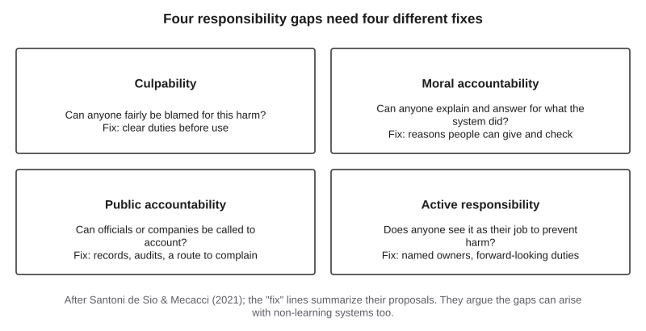{#fig-23-12 fig-alt="Four boxes: culpability, moral accountability, public accountability, active responsibility, each with its question and a fix."}

**The replies** (@fig-23-13). There are four, and each answers a different part of the problem.

*No new gap.* The philosopher Daniel Tigard (2021) argues against both camps: against those who want to scale back AI because of the gap, and against those who try to bridge it. On his view there is no technology-based gap to begin with. Moral responsibility is a dynamic, flexible process, and our practices of holding people responsible can stretch to take in new technological entities too.

*A third option: design.* A second reply rejects Matthias's choice between giving up the systems and accepting the gap, and offers a design route instead. Build systems under **meaningful human control**, so that the system responds to the relevant human reasons and its outcomes can be traced to a person who understood what they were doing (Santoni de Sio & van den Hoven, 2018). This reply does not deny that a gap can open; it describes how to keep it closed.

*An older problem.* A third reply points to the **problem of many hands**, a term the political philosopher Dennis Thompson (1980) coined for public officials: when many people each contribute a little to an outcome, it becomes hard to say who is responsible. Nissenbaum (1996) showed how computing makes this worse.

*Where blame lands.* A fourth warns about where blame lands when it does land. A car's crumple zone is the front part built to crush in a crash, so that the people inside are protected. Madeleine Clare Elish (2019) used the image for a **moral crumple zone**: the person nearest an automated system can absorb the blame for a failure, even when that person had little control over the system's behavior. Elish does not deny that a gap opens; her warning is about who ends up blamed.

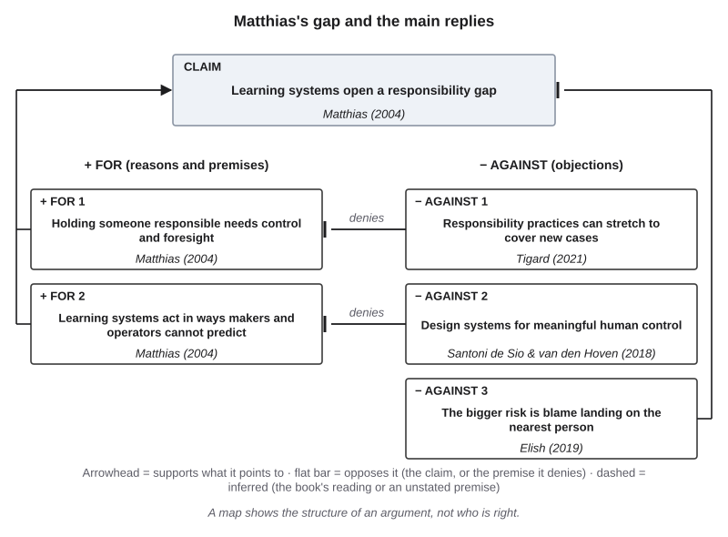{#fig-23-13 fig-alt="Map: learning systems open a gap, so stop or accept; Tigard denies the first premise; meaningful human control offers a third option."}

These positions answer different questions: whether blame can be fair (Matthias and Tigard), how to design so that it can be (meaningful human control), and whether it falls on the right person (Elish). One more idea, in this book's wording, runs through them: **forward-looking responsibility**, a duty assigned in advance to prevent harm, as opposed to blame assigned afterward. A decision owner and an approval gate are forward-looking responsibilities; whether they also make after-the-fact blame fair is part of what the debate is about.

::: {.callout-note title="Worked Example: A Double-Booked Clinic Room"}
*Constructed example.* A campus health clinic uses an AI scheduling assistant from an outside vendor. It is an agent: a system in which the model chooses its own steps and tool calls. It double-books a counseling room, and a student's appointment is lost. Four parties: the vendor that built the assistant, the clinic office that deployed it, the staff member who approved the week's schedule, and the student.

**Step 1 — The chain (Chapter 4).** Each *link* is one step by which an AI error becomes a harm. Link 1: the output was wrong (a double booking). Link 2: the weekly approval did not catch it. Link 3: the clinic relied on the schedule. Link 4: a lost appointment.

**Step 2 — The four gaps.** *Culpability:* the staff member had 200 bookings to check in ten minutes (constructed). *Moral accountability:* only the vendor could examine why the assistant double-booked. *Public accountability:* the student does not know where to complain. *Active responsibility:* no one's job is to prevent a repeat.

**Step 3 — Forward-looking fixes.** The clinic office names a decision owner for scheduling; the approval gate shows conflicts first; the vendor contract requires logs.

**Result:** on Elish's view, blaming the staff member alone would make them a moral crumple zone; whether anyone is fully culpable remains a fair question to debate.
:::

The Tempe crash in the Case Study is a real chain in which you can test Elish's idea (@fig-23-14).

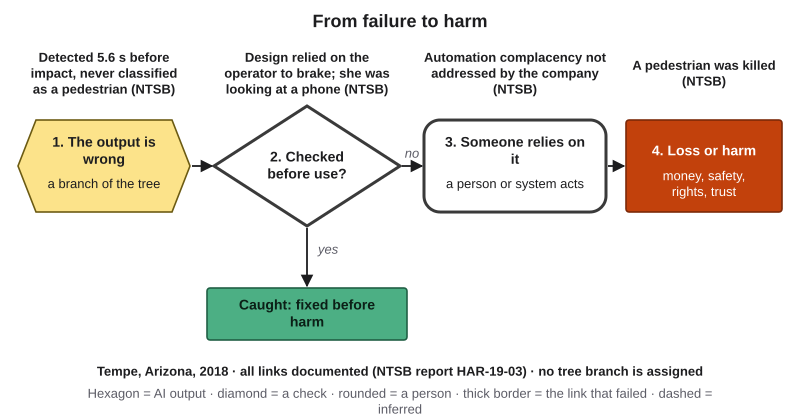{#fig-23-14 fig-alt="Failure-to-harm chain, Tempe 2018: missed classification, reliance on the operator, complacency, a pedestrian killed; all documented."}

::: {.callout-note title="The author's view (partial, from a published article)"}
*Disclosure: I am a founder of OptiWisdom, which develops software for businesses, including AI tools. See "How This Book Was Written."*

In a 2026 article on explainable AI with Zumra Arslanhan, I wrote that when people cannot understand how an opaque model reached a decision, trust, accountability and fairness all suffer; an incorrect medical diagnosis or a biased loan denial from such a model is a potential harm to society, not just a statistical error (Seker & Arslanhan, 2026; paraphrased). That passage ties accountability to being able to understand a decision. It does not take a side between Matthias and his critics.
:::

::: {.callout-note title="Faded Example: A Paralegal's Clause"}
*Constructed example.* A law firm's AI drafting tool inserts a clause that misstates a deadline. The firm's procedure says the paralegal must check every date in a draft against the source documents. The paralegal pastes the clause into a contract without that check; a supervising lawyer signs without reading that page; the client misses the deadline.

**Done for you:** *Actor 1:* the tool's provider: moral accountability (only it can examine why the tool produced the clause).

**Your turn:** *Actor 2, the paralegal:* which gap, and why? _______________ *Actor 3, the lawyer:* _______________ *One forward-looking fix:* _______________
:::

::: {.callout-important title="Your Turn"}
Think of a group project in which a tool was involved. Name one forward-looking responsibility your group could assign before the next one.
:::

::: {.callout-tip title="Check Yourself 23.4"}
1. Why does this section keep the practice rule apart from the philosophical question?
2. State Matthias's argument in two premises and a conclusion.
3. What is a moral crumple zone?
:::

## 23.5 Creativity and Authorship {#sec-23-5 .unnumbered}

[Deep]{.path}

*Featuring Hana (they/them), a media arts and design student and freelance illustrator who draws by hand first, always.*

When a system produces a poem or an image, is the output creative, and is anyone its author? Three different questions hide here (@fig-23-15). *Is the output creative?* *Whose choices shaped it?* *Who answers for it?*

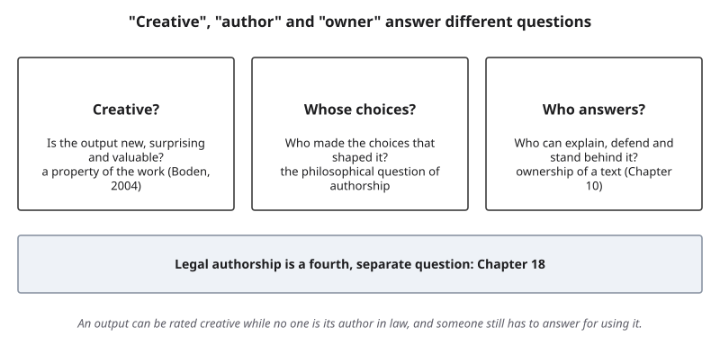{#fig-23-15 fig-alt="Three panels: creative (new, surprising, valuable), whose choices (authorship), who answers (ownership); legal authorship separate, Chapter 18."}

**Is it creative?** The cognitive scientist Margaret Boden (2004) defines **creativity** as producing ideas or artifacts that are new, surprising and valuable. Psychologists often use a shorter "standard definition": original and effective (Runco & Jaeger, 2012). On either test, the case for generated output is that it can pass. In two experiments, non-expert readers could not tell AI-generated poems from poems by well-known poets: their accuracy was 46.6%, below chance, and they rated the AI poems higher on qualities such as rhythm and beauty (Porter & Machery, 2024). The authors suggest that readers used shared but flawed heuristics, rules of thumb: the simpler AI poems were easier to follow, and the complexity of the human poems was taken for machine-made incoherence. In a randomized experiment with 293 writers, those who received story ideas from a language model wrote stories that 600 evaluators rated more novel and more useful, with the largest gains for writers who scored as less creative on a test (Doshi & Hauser, 2024; @fig-23-16).

**The case against** has two parts. The first is about choices. The writer Ted Chiang (2024) argues that art is made of many choices by someone with something to say, and that a short prompt supplies very few of them; a person who enters a short prompt cannot claim credit for the choices the prompt did not make. This book extends the point: on that view, a generated image could be new and valuable to its viewer and still not be anyone's creative act. The second part is collective. The same experiment found that stories written with model ideas were more similar to one another than stories written without them (Doshi & Hauser, 2024). The authors write that this resembles a social dilemma: each writer is better off, while the pool of new work grows narrower.

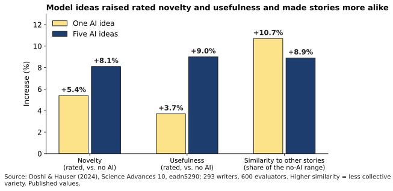{#fig-23-16 fig-alt="Bars: novelty +5.4% and +8.1%, usefulness +3.7% and +9.0% with one or five AI ideas; similarity up 10.7% and 8.9% of range."}

**Whose choices, and who answers?** Authorship in the philosophical sense asks whose choices shaped a work. Ownership in Chapter 10's sense asks who can explain, defend and stand behind it. Neither is the legal question. **Authorship (in copyright)** is the legal status of having created the expression in a work; in U.S. copyright law only a human can be an author, and as of October 2026 a federal appeals court has held that a work listed as made by an AI system alone could not be registered, a ruling the Supreme Court declined to review (Chapter 18). Chapter 18 owns that law; this section only notes that a work can be rated creative while no one is its author in law, and someone still has to answer for using it.

::: {.callout-note title="Worked Example: Hana's Three Questions"}
*Constructed example.* In Chapter 18 a bakery owner brought Hana a cover image made with an image generator, and Hana used it only as a layout reference. Hana asks the three questions about the generated image.

**Step 1 — Creative?** It is new to the bakery and valuable to its owner. Whether it is surprising, and to whom, is open. On Boden's test it may pass; on Chiang's view, few creative choices were made.

**Step 2 — Whose choices?** The owner's prompt (a few words), the system's training and sampling, and the many artists whose work was in the training data, whose say Chapter 18 discussed.

**Step 3 — Who answers?** The bakery owner, if they print it; Hana, for anything Hana draws from it.

**Result:** three different answers. Hana decides the questions do not need the same answer, and writes them down for their position paper (section 23.8).
:::

::: {.callout-note title="Faded Example: A Chord Progression"}
*Constructed example.* A music student asks a tool for four chord progressions, picks one, changes two chords and writes a melody over it.

**Done for you:** *Creative?* The final song may well be new, surprising and valuable; the progression alone is a common pattern.

**Your turn:** *Whose choices?* _______________ *Who answers for the song?* _______________
:::

::: {.callout-important title="Your Turn"}
Pick one generated item you have seen (an image, a poem, a slogan). Answer the three questions in one line each: creative? whose choices? who answers?
:::

::: {.callout-tip title="Check Yourself 23.5"}
1. Give Boden's three-part definition of creativity.
2. A poem is rated creative by readers. Does that make its generator the poem's author, or its owner? Explain the three questions.
:::

## 23.6 Work and Meaning {#sec-23-6 .unnumbered}

[Deep]{.path}

*Featuring Hana.*

For many people, work is where they use their skills, make their own decisions and contribute something others value: **meaningful work**. The two sides of this debate disagree about whether AI's effect on work is mainly a threat to that meaning.

**Side A: meaningful work is at stake.** A review of the ethics of AI at work argues that AI can enrich or diminish meaningful work, depending on how it is deployed: whether it replaces some tasks, leaves people tending the machine, or amplifies their skills (Bankins & Formosa, 2023). On this side, the meaning people find in work is a real good that AI can erode, so how tasks are redesigned, and by whom, matters.

**Side B: less work may not be a loss.** In 1930 the economist John Maynard Keynes imagined that within a century people in rich countries might work only about fifteen hours a week, and wondered how they would use their freedom (Keynes, 1930/1963). The philosopher John Danaher (2019) argues that a world with much less paid work could be a good outcome, partly because many jobs are bad for the people who do them.

**What the evidence says, dated.** Chapter 22 gave each claim an **evidence status**: **measured** (tested, run or checked by someone other than the developer, with a method you can read), **reported** (stated by a developer or an outlet citing them), **forecast** (a statement about the future, by anyone) or **the book's inference** (this book's own reading, marked as such). A **labor-market forecast** is an estimate of future jobs or skills, made by named people or organizations at a date (Chapter 20). Chapter 20 also gave questions to ask of any labor-market claim: who said it, whom they asked, when, what was measured, what caused it, whether it is a forecast, and whether a number is gross or net. Three measured studies show why both tools are needed (@fig-23-17):

- In one firm, a support assistant raised the number of issues agents resolved per hour by 15% on average, and by about 30% for less experienced and lower-skilled agents (Brynjolfsson, Li & Raymond, 2025; Chapter 1).
- In Denmark, researchers who linked surveys to national earnings records ruled out effects of chatbot adoption on earnings or recorded hours larger than 2% two years after ChatGPT's launch (a bound on the effect's size, not proof of zero effect); at the same time, employers reorganized tasks, adding work such as overseeing AI output, and some adopters moved into better-paid occupations (Humlum & Vestergaard, 2026, revised March 2026; Chapter 12).
- In U.S. payroll data through June 2026, employment of workers aged 22 to 25 in AI-exposed occupations was 19% below the level it would have reached had it kept pace with peers in less-exposed occupations; the authors call this an early, descriptive indicator, not a causal estimate, and the gap shrinks when education is taken into account (Brynjolfsson, Chandar & Chen, 2026, revised August 12, 2026; earlier versions reported smaller gaps).

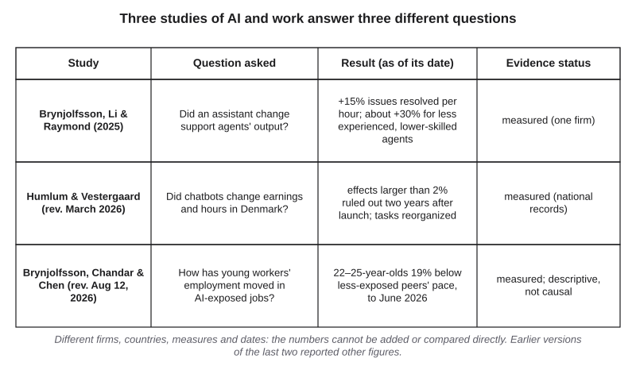{#fig-23-17 fig-alt="Table: three studies, their questions, results and evidence status: one firm +15%; Denmark no effect over 2%; U.S. ages 22–25 19% below peers."}

These numbers cannot be compared directly: different countries, firms, measures and dates. Only the Danish study measured tasks changing before pay and hours did (Humlum & Vestergaard, 2026). Taken together, this book reads the three as suggesting that effects may differ by age and by setting (the book's inference). What AI will do to meaning at work remains a forecast and a value question.

::: {.callout-note title="Worked Example: Hana Reads Two Headlines"}
*Constructed headlines.* Hana sees two posts: "AI is killing illustration jobs" and "Study: AI has no effect on jobs."

**Step 1 — Find the source.** The first cites no study. The second links to the Danish study.

**Step 2 — Chapter 20's questions.** The Danish study measured earnings and recorded hours in occupations in Denmark, not illustration in the United States; it did not test what caused any change in illustration jobs; its result is a bound (effects larger than 2% ruled out), not "no effect," and it also found task changes.

**Step 3 — Evidence status.** The first headline is an unsourced claim about the present; the second is a measured result described too broadly.

**Step 4 — One dated sentence.** "As of March 2026, a Danish study found no effect of chatbots on earnings or hours larger than 2% two years after launch, while tasks changed (Humlum & Vestergaard, 2026); I found no study of illustrators."

**Result:** Hana's fear and the second headline both turn out to be stronger than the evidence.
:::

::: {.callout-note title="Faded Example: An Entry-Level Jobs Post"}
*Constructed example.* A post: "Young people can't get jobs anymore because of AI. Stanford proved it."

**Done for you:** *Who said it, and what did they measure?* Researchers at Stanford measured employment of 22- to 25-year-olds in AI-exposed occupations in U.S. payroll data through June 2026.

**Your turn:** *Did they prove AI caused it?* _______________ *A dated, exact sentence:* _______________
:::

::: {.callout-important title="Your Turn"}
Find one claim about AI and jobs you have seen this month. Rewrite it as one dated, exact sentence with its evidence status.
:::

::: {.callout-tip title="Check Yourself 23.6"}
1. Name the two sides of the work-and-meaning debate.
2. Why can the three studies in @fig-23-17 not be compared directly?
:::

## 23.7 AGI and Long-Term Risk {#sec-23-7 .unnumbered}

[Deep]{.path}

*Featuring Maya.*

The last debate is about the future, where evidence is thinnest. Two terms first. **Artificial general intelligence (AGI)** is usually meant as an AI system that matches or exceeds people across most cognitive tasks, not only some; there is no agreed definition, and one proposal from researchers at a developer defines levels of AGI by how well and how broadly a system performs (Morris et al., 2024), an interested source like any developer. **Existential risk** from AI, as this chapter uses the term, is the risk of outcomes as bad as human extinction or the permanent loss of humanity's future. A note on tone: this section reports serious positions calmly. If the topic makes you anxious, that is a reasonable response to an unsettled question; the method below is a way to think about it, not a reason to worry more.

**Side A: treat extreme risk as a priority.** In May 2023 the Center for AI Safety (CAIS), an advocacy and research organization, published a one-sentence statement saying that reducing the risk of extinction from AI should be a global priority alongside other societal-scale risks such as pandemics and nuclear war (Center for AI Safety, 2023; paraphrased). Its signatories included the computer scientists Geoffrey Hinton and Yoshua Bengio and leaders of several AI companies; those leaders are interested sources too. A 2024 article by Bengio, Hinton and colleagues in *Science* argued that capabilities are advancing fast, that society is not ready for systems that could pursue goals in ways people cannot control, and that more safety research and governance are needed (Bengio et al., 2024). In a survey conducted in 2023, between 38% and 51% of 2,778 published AI researchers, depending on how the question was asked, gave at least a 10% chance to outcomes as bad as human extinction (Grace et al., 2024). Those are forecasts: researchers' estimates about the future, not measurements.

**Side B: treat AI as a normal technology.** The computer scientists Arvind Narayanan and Sayash Kapoor (2025) argue that AI is a general-purpose technology like electricity or the internet, whose effects arrive slowly, through adoption by people and institutions, so that policy should build resilience rather than respond to speculative scenarios. The researchers Timnit Gebru and Emile P. Torres (2024) argue that the long-term-risk framing draws attention and money away from present, documented harms, such as the bias and labor problems earlier chapters covered, and that the framing has roots they trace to twentieth-century eugenics.

**Between them: an assessment.** The *International AI Safety Report*, chaired by Yoshua Bengio, developed with more than 100 experts and backed by more than 30 countries and international organizations, published its first edition in January 2025 and its second on February 3, 2026. It reviews the evidence on capabilities and risks, records where experts disagree, and does not recommend any policy (International AI Safety Report, 2026). A statement, an assessment and an essay are different kinds of document (@fig-23-19): a signature list shows who holds a view, not that the view is true. Chapter 22 covers what current systems can do; this section is about the arguments.

::: {.callout-note title="Worked Example: Maya Maps the Statement and Its Critics"}
*Constructed example.* Maya maps the CAIS statement against Narayanan and Kapoor.

**Step 1 — The claim:** extinction risk from AI should be a global priority (CAIS, paraphrased).

**Step 2 — Reasons:** capabilities are improving fast and may outpace control (Bengio et al., 2024); many researchers give non-trivial chances to extreme outcomes (Grace et al., 2024; forecasts).

**Step 3 — Objections:** fast capability gains do not mean fast effects, because effects arrive slowly through adoption by people and institutions (Narayanan & Kapoor, 2025); this denies the first reason; the framing draws attention from present harms (Gebru & Torres, 2024), which opposes the priority claim itself.

**Step 4 — Evidence status:** every reason and objection is a forecast or an argument; none is a measurement of the future.

**Result:** @fig-23-18. The sides mostly dispute two premises, how fast capability gains turn into real-world effects and whether such systems can be kept under control, and then what should come first. Neither side denies that AI matters.
:::

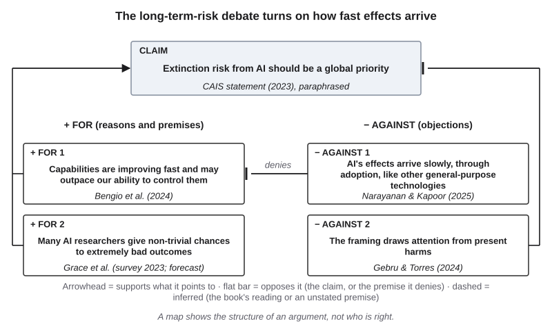{#fig-23-18 fig-alt="Map: extinction risk should be a priority; reasons: fast gains beyond control, forecasts; Narayanan and Kapoor deny the first; Gebru, Torres oppose."}

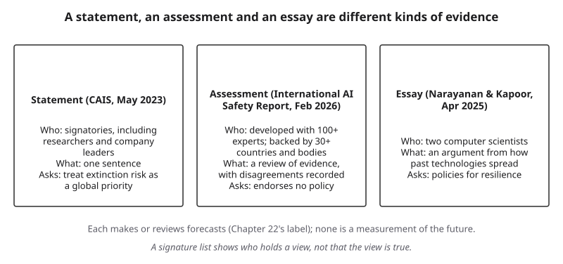{#fig-23-19 fig-alt="Three columns: CAIS statement 2023, International AI Safety Report 2026, Narayanan and Kapoor essay 2025; who, what and what each asks."}

::: {.callout-note title="Faded Example: A Council Member's Claim"}
*Constructed example.* A city council member says: "We shouldn't regulate AI in city services until superintelligence arrives; until then it's just software." (*Superintelligence* means a hypothetical AI far more capable than people at almost every task.)

**Done for you:** *Claim:* no regulation of AI in city services for now. *Stated premise:* until superintelligence, AI is just software.

**Your turn:** *An unstated premise:* _______________ *An objection from this chapter or Chapter 18, and what it targets:* _______________
:::

::: {.callout-important title="Your Turn"}
Take one news sentence about long-term AI risk. Which premise does it rest on: speed, control or priority? Is it a forecast?
:::

::: {.callout-tip title="Check Yourself 23.7"}
1. Why does this chapter call the 2023 survey results forecasts?
2. What kind of document is the *International AI Safety Report*, and what does it not do?
:::

## 23.8 Your Position, Labeled {#sec-23-8 .unnumbered}

[Studio]{.path}

*Featuring Hana (they/them), a media arts and design student and freelance illustrator. This section builds the chapter's optional assignment, the position paper.*

::: {.callout-note title="Recap: the six debates, one entry each"}
- **Understanding (23.2):** Turing (1950) proposed replacing "Can machines think?" with a conversation test, the imitation game. Searle (1980) imagined a person who follows rules for Chinese symbols without understanding them, and argued that running a program is not enough for meaning. Bender and colleagues called language models "stochastic parrots": form without meaning. Their critics answer that meaning can come from relations among concepts, and point to models' internal representations. In 2026, persona-prompted models passed a three-party test, by its authors' account.
- **Consciousness (23.3):** one side checks a system's design against indicators drawn from scientific theories of consciousness and urges precaution; the other argues that consciousness depends on being a living organism, so computation is not enough. Both treat a system's words about itself as a claim to check. Contested.
- **Responsibility (23.4):** Matthias argued that blame needs control and foresight, and learning systems remove foresight, so a gap opens. Tigard answers that our practices of holding people responsible can stretch to cover new cases; others propose design for meaningful human control, or warn that blame can land on the nearest person.
- **Creativity (23.5):** on Boden's test (new, surprising and valuable), generated work can pass: readers could not tell AI poems from famous poets' (Porter and Machery), and model ideas raised stories' rated novelty (Doshi and Hauser). On the other side, the writer Ted Chiang argues that a prompt makes few of a work's choices, and Doshi and Hauser found that stories became more alike. Legal authorship is Chapter 18's.
- **Work (23.6):** one side holds that the meaning people find in work is at stake and depends on how tasks are redesigned; the other asks whether less paid work would be a loss at all. One measured study found tasks changing before pay and hours; another found early, descriptive signs for young workers.
- **Long-term risk (23.7):** one side calls extinction risk a priority; the other calls AI a normal technology and points to present harms. They dispute how fast capability gains turn into effects, whether such systems can be kept under control, and what should come first.
:::

A **position paper** is a short paper that takes a side on a contested question after stating both sides fairly. Its parts are in @fig-23-20: the question in one sentence; a map; each side at its strongest, from a primary source; the objection you find hardest, with your reply; **your view, in its own labeled paragraph**; what evidence would change it; and a declaration of any AI use. "Undecided, because…" is a position, if you give the because.

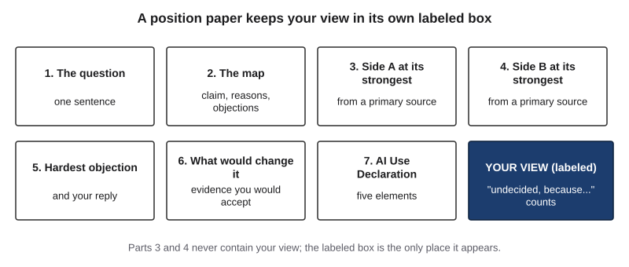{#fig-23-20 fig-alt="Eight boxes: question, map, side A, side B, hardest objection, what would change it, AI Use Declaration; a dark box: your view, labeled."}

When you attribute a view to a philosopher or a study, check it in their text, not in a tool's summary of it. An AI tool's "yes" is never a source (Chapter 8). Tools can produce plausible summaries of famous arguments, attributed to the right person, that say something the person never wrote. Treat each attributed sentence as a claim and check it at the primary source (@fig-23-21; Lab 23.2).

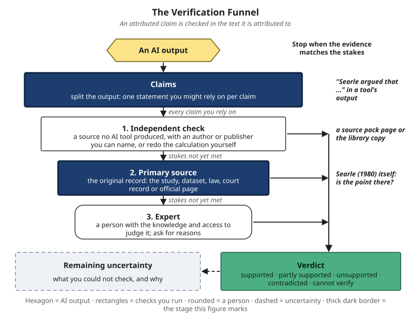{#fig-23-21 fig-alt="Verification Funnel with claims and primary source highlighted: a tool's 'Searle argued that' sentence is checked in Searle's 1980 article."}

::: {.callout-note title="Worked Example: Hana's Plan"}
*Constructed example.* Hana plans a short position paper.

**Step 1 — The question:** Can an image generator be creative?

**Step 2 — The map:** claim "Generated images can be creative"; reasons: the cognitive scientist Margaret Boden's test (new, surprising and valuable) and Porter and Machery's poetry experiments (readers could not tell AI poems from famous poets' poems and rated the AI poems higher); objections: the writer Ted Chiang's argument that a prompt makes few of a work's choices (which denies that "new and valuable to a viewer" is enough) and Doshi and Hauser's experiment, in which stories written with model ideas became more alike.

**Step 3 — Sources:** one primary text per side, Boden (2004) and Chiang (2024).

**Step 4 — The hardest objection:** the poetry study's readers liked the AI poems, so "few choices" did not stop them from valuing the work. Hana's reply: valuing a work and calling it creative may be two different judgments; they cite the authors' suggestion that readers used flawed rules of thumb (section 23.5) as a reason to doubt that liking settles it.

**Step 5 — Their view, labeled:** "My view: generated images can be valuable to a viewer, but I do not call them creative unless a person made most of the choices. What would change my mind: evidence that people who know how the images were made still judge them creative."

**Step 6 — Declaration:** no AI tool used.

**Result:** a plan whose view sits in one labeled paragraph. Hana adds "what would change my mind" to their Chapter 21 code as a review trigger.
:::

::: {.callout-note title="Faded Example: A Plan on the Responsibility Gap"}
*Facts you need:* Matthias (2004): blame needs control and foresight, and learning systems remove foresight. Tigard (2021): our practices of holding people responsible can stretch to cover new cases.

**Done for you:** *Question:* When a learning system causes a harm no one could foresee, can anyone be justly blamed? *Side A source:* Matthias (2004). *Side B source:* Tigard (2021).

**Your turn:** *The disputed premise:* _______________ *The hardest objection to the view you lean toward:* _______________ *Your view, labeled:* _______________
:::

::: {.callout-important title="Your Turn"}
This is the optional assignment at the end of the chapter: a short version (about 55 minutes) or a full one (about 2 hours).
:::

::: {.callout-tip title="Check Yourself 23.8"}
1. Name the parts of a position paper and the one part where your view may appear.
2. Why must an attributed claim be checked in the source it is attributed to?
:::

## Hands-on Labs {.unnumbered}

All four labs are optional and can be done at home or in a discussion group; each lab sheet gives a route for working alone. The labs say what to do, not which buttons to press; tool steps are in Compass (optional). **Rules for every lab:** provided materials only (they come with the instructor package; a reader working alone can use the sample material printed in each lab sheet); no personal or confidential data; every AI step has printed, dated outputs (model name and date) so no device or account is needed; where you use a tool, use a tool your institution provides or approves (for example, an enterprise chat assistant with data protection) or a free tier. Each lab sheet, with its materials, is in the book's lab pages.

### Lab 23.1: Map It (Studio · about 25 minutes · optional) {.unnumbered}

*(O2 · LO5 · Analyze)* A provided, constructed op-ed paragraph argues that "AI tutors should replace office hours." Map it with the chapter's grammar: the claim, every stated reason, at least one unstated premise (dashed) and two objections, one aimed at a premise. Swap maps with a partner; each of you finds one premise the other missed. Working alone, compare your map with the model map at the end of the lab sheet instead. Redraw one link and write one sentence on where the disagreement now sits.

### Lab 23.2: Steelman Check (Check It · about 30 minutes · optional) {.unnumbered}

*(O1, O6 · LO5, LO3 · Evaluate)* Ask a tool, or use the printed, dated outputs, for "the strongest version of Searle's Chinese Room argument and of the systems reply." Split the output into attributed claims ("Searle argued that…"). Check each against the provided paraphrase sheet of Searle's article and, where your library gives access, Searle (1980) itself; give each a verdict on Chapter 8's scale. Note any invented quotation or misattribution: it is a lead for your Failure Diary (your log of AI failures from Chapter 4), not a label on the Failure Taxonomy Tree in this lab.

### Lab 23.3: The Imitation Game on Paper (Explore · about 30 minutes · optional) {.unnumbered}

*(O1, O3 · LO5, LO1 · Analyze)* Six provided, dated transcripts of short text conversations (about 250 words each): three with a person (written by volunteers who consented to their use), three with AI systems (model names and dates printed on the answer sheet). For each, guess "person" or "system" and rate your confidence (0–100%). Then read the answer sheet, count your hits and write two sentences: what did your guesses rely on, and what would the result show about understanding? Six guesses are a lead about your cues, not a measure of your calibration.

### Lab 23.4: Who Answers? (Apply · about 25 minutes · optional) {.unnumbered}

*(O4 · LO5 · Evaluate)* A provided scenario: a hospital's AI discharge-summary tool omits an allergy; a resident signs the summary; a pharmacy fills a prescription. List every actor, human and non-human (the From the Field idea), then give each of the four gaps one forward-looking duty and a named owner by role. End with one sentence: is anyone culpable, on Matthias's view (blame needs control and foresight) and on Tigard's (responsibility practices can stretch to new cases)?

## Case Study: Three Texts, One Question, Revisited {.unnumbered}

The three classic texts and the 2026 test are primary sources (the **confirmed** tier). News coverage of the 2026 result would be the **reported** tier and is not needed here. This book's readings are marked **inferred**.

**What each text claimed, and did not.**

| Text | It claimed | It did not claim |
|---|---|---|
| Turing (1950) | That the imitation game could replace "Can machines think?"; that objections to machine thinking fail; a fifty-year prediction about the game | That the machines of his day think; he treated sustained, satisfactory answers as the evidence to use, not as a proof |
| Searle (1980) | That running the right program is not, by itself, enough for understanding | That machines can never think (he allowed that machines with the right causal powers, such as brains, can) |
| Bender et al. (2021) | That language models stitch together linguistic form without reference to meaning; that ever-larger models carry costs and risks | That language models are useless; the parrot claim was one strand of a paper mainly about risks |
| Jones & Bergen (2026) | That persona-prompted models pass a standard three-party Turing test; that judges relied on style and social cues | That the models understand; the authors frame the test as a measure of how people tell humans from machines |

**How the 2026 result bears on each (the book's reading, inferred).** For Turing's proposal, the result is the kind of evidence he asked for. For Searle, it is beside the point: his argument was that such evidence cannot settle understanding. For Bender and colleagues, the drop from 73% to 36% without a persona prompt fits their warning that people read meaning into fluent text. Each side can read the same result as support. That is a sign that the dispute is about a premise, not about data.

**Labels.** No AI output was shown to be wrong, so the case gets **no label on the Failure Taxonomy Tree** (Chapter 4's chart of the kinds of AI output failure): it is a debate case, not a failure.

### Short case 1: Two companies, two answers on model welfare (August 2025) {.unnumbered}

On August 15, 2025, Anthropic announced that two of its models could end a rare subset of persistently harmful or abusive conversations in its consumer apps, saying the feature came primarily from its exploratory work on model welfare and that it remained highly uncertain about its models' moral status (Anthropic, 2025). On August 19, Mustafa Suleyman, chief executive of Microsoft AI (a division of Microsoft), published an essay arguing that the idea of model welfare is premature and that the real near-term risk is people believing that seemingly conscious systems are conscious (Suleyman, 2025). Both are primary sources for what each said (confirmed), and both are interested sources; this book, drafted with Anthropic's tools, declares that interest. No output was wrong: no tree label. *Use it for:* section 23.3's method, and for practicing how to report interested sources on both sides.

### Short case 2: Tempe, Arizona, 2018 {.unnumbered}

In March 2018 a test vehicle operated by Uber's self-driving unit, with a human operator on board, struck and killed a pedestrian in Tempe, Arizona. The National Transportation Safety Board (NTSB), the U.S. agency that investigates transport accidents, found that the automated driving system detected the pedestrian 5.6 seconds before impact but never classified her as a pedestrian or predicted her path; that its design relied on the operator, not the system, for emergency braking; and that the probable cause was the operator's failure to monitor the road because she was distracted by her phone. Contributing factors included the company's inadequate safety risk assessment, its ineffective oversight of operators and its failure to address automation complacency, which the NTSB tied to an inadequate safety culture, as well as the pedestrian's crossing outside a crosswalk and the state's insufficient oversight of testing (NTSB, 2019). Prosecutors declined to bring criminal charges against the company, and in July 2023 the operator pleaded guilty to endangerment, a charge of recklessly putting another person at risk of serious harm (reported: Associated Press, 2023). Chapter 18 covers liability.

**Labels.** On the failure-to-harm chain (@fig-23-14), every link is documented by the NTSB: the system's output (its classification) was wrong; the design left the check before use to one person, who was not watching; the company relied on that check without addressing complacency; a person died. On the Failure Taxonomy Tree the case goes under **other** (a perception system's misclassification), documented by the NTSB: none of the five named branches fits a perception system's misclassification, and the tree's plain "other" box holds anything else. *Use it for:* Elish's moral crumple zone (section 23.4): ask whether the legal outcome placed responsibility where the NTSB's findings did.

## Ethics Lens: Whose Claims Come First? {.unnumbered}

Chapter 16 showed that choosing a fairness definition is a value choice: when error rates cannot be equal for every group, someone decides whose errors matter more. Political philosophy has argued about such choices for centuries. Two strong sides:

**Priority to the least advantaged.** The philosopher John Rawls argued that social and economic inequalities are just only if they are arranged to the greatest benefit of the least advantaged members of society; he called this the **difference principle** (Rawls, 1971). Applied to an AI system, this side asks: does the system's design improve the position of the people worst off under it?

**The greatest total benefit.** The utilitarian tradition, a form of consequentialism, judges an action or policy by its consequences: the right choice produces the most good overall, with each person's good counted impartially (Driver, 2025). Applied to an AI system, this side asks: does the system improve outcomes overall, even if some people gain less?

Binns (2018) showed how debates in political philosophy about equality map onto the technical fairness choices in machine learning: which definition you pick encodes an answer to whose claims come first.

*Discussion:* a tutoring center can either raise average grades the most or help the students with the lowest grades the most. Which principle would choose which, and which would you choose?

## Career Connection {.unnumbered}

The descriptions below are illustrations, not labor-market data.

| Occupation | How the chapter's ideas show up | A question to ask at work |
|---|---|---|
| AI policy analyst | Writes briefs on contested questions (risk, welfare, rights) with each side's best case and its sources | Have I stated the side I disagree with in a form its holders would accept? |
| User-experience (UX) researcher | Studies how people attribute minds to chat products and designs to avoid misleading them | Does our product say or imply feelings it may not have? |
| Compliance officer or product counsel | Decides who owns each AI-assisted decision and what the record must show (law: Chapter 18) | If this goes wrong, who answers, and is that fair to them? |
| Creative director | Sets rules for generated material in creative work and credits | Whose choices made this, and who will stand behind it? |
| Human resources (HR) or workforce planner | Reads labor studies and forecasts to plan training and roles | Is this number measured or a forecast, and for whom? |
| AI safety or risk researcher | Evaluates systems and writes assessments that record disagreement | What evidence would change my estimate? |
| Teacher (high school or college) | Runs classroom debates on AI with sources on both sides | Can every student state the other side's best argument? |

## From the Field {.unnumbered}

<!-- Based on the author's encyclopedia entry "Aktör Ağ Teorisi (Actor Network Theory)", YBS Ansiklopedi 1(1), September 2014, printed pp. 14–15 (the PDF's own citation line; file m8_p18_19_aktoragteorisi.pdf), read in full from Drive 1UwSp0DJ-3NtBlAOZRVWO9O20tKFeBprX on 2026-10-18; translated and paraphrased from Turkish. Facts limited to the entry; present-day connections marked as the book's. Not commercial: no D16 disclosure. -->

In September 2014 I wrote a short encyclopedia entry on **actor-network theory** (ANT), an approach from the sociology of science and technology associated with Bruno Latour, Michel Callon and John Law in the 1980s (Seker, 2014). Its central move is to count things, not only people, as actors in a social analysis. The entry's example was Turkey's Southeastern Anatolia Project: the Ataturk Dam and the irrigation channels can be actors in the network, and people's relations with them are analyzed too. ANT calls such non-human participants *actants*.

The entry described ANT as constructivist: instead of sorting claims into true and false at the start, it accepts the entities involved and analyzes what their interactions produce. It noted a weakness: ANT is not good at explaining power relations. It also included a network I had drawn in 2004 for Turkey's e-government, with five groups of actors: citizens, the state, economic actors, foreign players and universities.

For information systems, the entry argued, ANT's strength is that it analyzes a system with all its parts, without separating the living from the non-living, which suits systems with a human–machine boundary or with AI. Its example was a health system with doctors, nurses, secretaries, tablets, patient-tracking software, servers and barcode readers, each affecting the system differently. It also gave a warning: giving information systems too much priority in the network risks technological determinism, the view that technology drives everything, which runs against ANT itself (citing Mitev, 2009). And it noted engineers' habit of treating each system as a black box, looking only at inputs and outputs.

*Present-day connections, which are this book's and not the entry's:* listing every actor, human and not, is a good first step in the responsibility map of section 23.4 and Lab 23.4. But "actant" is an analytic term, a way of drawing the map, not a claim that machines bear moral responsibility. The entry's own caveat, that ANT says little about power, is a reason to remember that listing everyone involved is not yet deciding who should answer.

## Chapter Summary {.unnumbered}

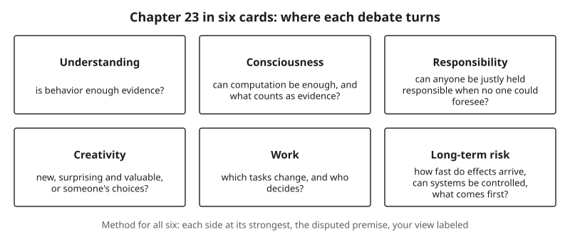{#fig-23-22 fig-alt="Six debate cards, each naming where it turns: behavior as evidence, computation and experience, just blame, choices, tasks, speed and control."}

**The chapter's question:** *When informed people disagree about whether AI understands, feels, creates or endangers us, how do you take a position you can defend, and what does any answer change about who answers for AI's work?* The summary card (@fig-23-22) shows where each debate turns. The method is the same for all six: state each side at its strongest, from its own texts; map the arguments and find the premise in dispute; keep evidence about a system's behavior apart from claims about its mind; give every claim about the future its date and its status; and put your own view in its own labeled paragraph, with what would change it. As for who answers, the chapter keeps two things apart: in coursework and at work, the practice rule is that you answer for your own use; whether responsibility can always be fairly assigned when systems act in ways no one foresaw is still debated (section 23.4).

**Return to the Opening Case.** The 2026 test gave Turing's game a result, and each side reads it as support: as the evidence Turing asked for, as beside Searle's point, or as a sign of how readily people read meaning into fluent text. The dispute is about a premise, not the data.

**Maya and Hana.** Maya's seminar maps showed her that the loudest claim in a debate is rarely where the disagreement sits. Hana wrote down a view on creativity that they can defend and revise, and added its "what would change my mind" line to their code of practice from Chapter 21.

**Revisit your Warm-up.** (1) Does a partner you cannot tell from a person understand you? *That is the disputed question:* behavior is evidence, and whether it is enough is what Turing and Searle disagree about (section 23.2). (2) What is "I am afraid of being switched off" evidence of? *Of what the system produced;* it is a claim to check, a rule both sides of the consciousness debate accept (section 23.3). (3) Who answers for the wrong room? *In practice,* the people with assigned duties: the decision owner and whoever approved the schedule; *whether that blame is fair* depends on what they could control and foresee (section 23.4).

::: {.callout-note title="A Last Question"}
Suppose that one day the sides agree: some AI system understands, or feels, or creates. What, if anything, would then change about what you owe to the people your work affects, and what would change about what you owe to the system?
:::

You can now:

- **Explain** what Turing, Searle and the "stochastic parrots" critique each claimed and did not claim.
- **Analyze** an argument into claim, reasons, objections and unstated premises.
- **Distinguish** evidence about behavior from claims about understanding, consciousness or moral status.
- **Evaluate** who can answer for a harm involving an AI system.
- **Evaluate** dated claims about work and long-term risk by their evidence status.
- **Create** a position paper with your view labeled.

### Key Terms {.unnumbered}

AI welfare · anthropomorphism · argument map · artificial general intelligence (AGI) · Chinese Room argument · computational functionalism · creativity · ELIZA effect · existential risk · forward-looking responsibility · imitation game (Turing test) · indicator property (of consciousness) · interested source · meaningful human control · meaningful work · moral crumple zone · moral status · phenomenal consciousness · position paper · problem of many hands · responsibility gap · steelman · stochastic parrot · straw man · symbol grounding problem · systems reply

Reused from earlier chapters: authorship (in copyright) (Chapter 18) · evidence status; measured, reported, forecast, the book's inference (Chapter 22) · labor-market forecast (Chapter 20) · ownership (of a text) (Chapter 10).

## End-of-Chapter Package {.unnumbered}

<!-- Each item: objective · LO · revised Bloom level. Odd-numbered answers and all Check Yourself and faded-example keys → Appendix E (docs/production/handoff/ch23.md); even-numbered → private/ch23-answers-even.md. Multiple-choice keys rotated: A2 c, A4 a, A6 d, A8 b, A10 c, A12 a; distractors from M1–M6 (blueprint v0.2), named in the keys; the key is the longest option only in A4 and A10 (A6 and A12 keys tie with a distractor). Deep chapter: practice only, not examinable (D20). -->

This chapter is optional and not examinable. The questions below follow the exam's format, so they are good practice for the reasoning the exams do test.

### Review Questions A: Terms and Concepts {.unnumbered}

1. *(O2 · LO5 · Understand)* What is an unstated premise, and how does this chapter's argument map show one?
2. *(O1 · LO5, LO1 · Understand)* What did Turing (1950) propose?\
   (a) That machines which pass the imitation game do understand, so the question is settled.\
   (b) That machines will never think, because thinking requires feeling what one says.\
   (c) That the imitation game could take the place of the question "Can machines think?"\
   (d) That thinking should be defined first, and the game used only after a definition.
3. *(O1 · LO5 · Understand)* Give a three-premise reconstruction of Searle's Chinese Room argument in your own words.
4. *(O1 · LO5 · Understand)* Which statement fits what Searle (1980) argued?\
   (a) Running the right program is not, by itself, enough for understanding, though some machines might think.\
   (b) No machine of any kind could ever think, since every machine only manipulates symbols.\
   (c) A system that passes the imitation game probably understands the language it uses.\
   (d) Understanding is shown by behavior, so the room as a whole understands Chinese.
5. *(O1 · LO5 · Understand)* What did Bender et al. (2021) mean by "stochastic parrot," and what did they not claim?
6. *(O3 · LO5, LO1 · Understand)* In the 2026 three-party test, what happened without the persona prompt?\
   (a) Judged human in about 70% of games, as with the prompt; it mattered little.\
   (b) Judged human more often, since plain answers sound more natural to most judges.\
   (c) Never judged human, since judges spotted every unprompted model in every game.\
   (d) Judged human 36% and 38% of the time, against 73% and 56% with it.
7. *(O3 · LO5 · Understand)* Define phenomenal consciousness and moral status, and explain why they are separate questions.
8. *(O3 · LO5, LO3 · Understand)* A chatbot writes, "I feel lonely between conversations." What does this chapter say it shows?\
   (a) Probably that the system has some feelings, since it reports them consistently.\
   (b) What the system produced: a claim to check, as both sides accept.\
   (c) Little of interest, since the question of AI consciousness is usually not a serious one.\
   (d) Likely that the system is conscious, since a self-report is the best evidence available.
9. *(O4 · LO5 · Understand)* Give Matthias's (2004) argument for a responsibility gap in two premises and a conclusion.
10. *(O4 · LO5 · Understand)* What is a moral crumple zone?\
    (a) The AI system itself taking the blame for a failure, since it produced the error.\
    (b) A finding that no one is to blame, since the failure could not be foreseen.\
    (c) The person nearest an automated system absorbing blame for a failure they had little control over.\
    (d) A design feature that protects a company from lawsuits after an AI system fails.
11. *(O5 · LO5, LO3 · Apply)* Using Chapter 22's labels, give the evidence status of each: (a) a developer's launch post on its model's abilities; (b) a researcher survey's estimate of the chance of extreme outcomes; (c) a study of national earnings records.
12. *(O5 · LO5 · Understand)* Which statement fits the long-term-risk debate as this chapter presents it?\
    (a) Informed people disagree, mainly about speed of effects and whether systems can be controlled.\
    (b) The risk is settled fact, since thousands of researchers have signed statements about it.\
    (c) The risk is science fiction, since no study has measured it so far.\
    (d) The *International AI Safety Report* recommends a policy that resolves the debate.

### Review Questions B: Case Questions {.unnumbered}

1. *(O2, O3 · LO5 · Analyze)* *Constructed.* An education company advertises: "Our tutor understands every student." Map the claim with one stated reason (the company's: "students say it understands them") and one unstated premise, and name what evidence would and would not support the claim.
2. *(O3 · LO5 · Evaluate)* *Constructed.* A companion app sends its user, "I missed you today." The user asks you whether the app has feelings. Write a three-sentence answer that uses section 23.3's method and labels the question as contested.
3. *(O4 · LO5 · Evaluate)* *Constructed.* A hospital's AI triage tool, bought from a vendor, ranks a patient as low priority; a nurse follows the ranking during a busy shift; the patient waits too long. Name the four actors, the chain link at which the error could have been caught, the gap most at issue, and one forward-looking duty.
4. *(O5 · LO5, LO3 · Evaluate)* A post says, "Half of all jobs will be gone by 2030 because of AI," with no source. Apply Chapter 20's questions and Chapter 22's labels, then write the most exact sentence you could defend instead.

### Review Questions C: Interpretive Questions {.unnumbered}

1. *(O1, O3 · LO5 · Evaluate)* "Whether AI really understands makes no practical difference." Take a position, using sections 23.2 and 23.4. Either side can earn full marks.
2. *(O5 · LO5 · Evaluate)* "Talk of long-term AI risk distracts from present harms." Take a position, stating the other side at its strongest. Either side can earn full marks.

### Spaced Review {.unnumbered}

Come back to these a few days after reading. They draw on Core chapters, since Chapter 22 is optional.

1. *(Chapter 21 · LO7 · Understand)* What makes a line in a code of practice a trigger rather than a slogan?
2. *(Chapter 21 · LO7 · Understand)* Why does a personal code of practice carry a review date?
3. *(Chapter 3 · LO1 · Understand)* In Chapter 3's four steps, what does a language model do when it "answers" a question?
4. *(Chapter 10 · LO4 · Understand)* What does it mean to own a text in Chapter 10's sense, and how does that differ from legal authorship?
5. *(Chapter 14 · LO6 · Apply)* A reviewer approves 200 AI-drafted schedules in ten minutes. Is the approval a real gate? What would make it one?

### Discussion Questions {.unnumbered}

1. *(Ethics · O4 · LO5 · Evaluate)* If no one could foresee a harm, is it fairer to blame no one, the nearest person, or the organization? Use the four gaps.
2. *(Career · O5 · LO5 · Apply)* Which of the six debates matters most in your intended field, and who in that field would have to answer for the decisions?
3. *(Interdisciplinary · O3 · LO5 · Analyze)* How do psychology, biology or philosophy each decide whether an animal is conscious? Bring one cited example (Birch, 2024, discusses animals as well as AI) and compare it with Butlin et al.'s method.
4. *(O6 · LO5 · Evaluate)* State, in its strongest form, the side of one debate that you find least convincing.
5. *(O1 · LO5 · Evaluate)* Turing's game now has a result. Should we keep using behavior tests for AI? What would you replace them with, if anything?

### Application Assignment (optional): Position Paper {.unnumbered}

*(O2, O3, O6 · LO5, LO4 · Create)* Optional practice. An instructor who uses it may give feedback or score it with the suggested rubric below; a reader working alone can use the rubric to check their own paper. Choose one debate from sections 23.2 to 23.7 or the Ethics Lens. Sources: one primary passage per side. Instructors may provide a source pack of library links (never copies); a reader working alone can start from the References at the end of this chapter.

**Two versions.** Both use one primary passage per side. The short version uses excerpts (about 750 words per side) and 300–400 words of writing; the full version uses the whole passages and 600–900 words.

- **Short version, about 55 minutes:** about 5 minutes to read this brief and the rubric; about 12 to read the two excerpts; about 10 for the map; about 18 for 300–400 words, including your labeled view; about 5 to check every attribution against its excerpt; about 4 for the declaration.
- **Full version, about 2 hours (115–125 minutes):** about 5 minutes to read this brief and the rubric; 30–40 to read the two passages; about 15 for the map; about 35 for a draft of 600–900 words, which includes parts 4 and 5 below; about 10 to revise the hardest objection and your labeled view; about 10 to check every attribution against its source; about 8 to revise after reading it aloud; about 4 for the declaration.

**What to submit:**

1. **The question,** in one sentence.
2. **An argument map:** at most nine boxes; the claim, at least two reasons and two objections; unstated premises dashed and labeled "inferred."
3. **Both sides at their strongest,** each from at least one primary source you opened, attributed exactly; at most one short quotation per source.
4. **The hardest objection** to the view you lean toward, and your reply.
5. **Your view, in a separately labeled paragraph** ("My view: …"), with what evidence would change it. "Undecided, because…" is acceptable.
6. **AI Use Declaration:** tools, purpose, what you accepted, rejected or revised, how you verified it, and where your own judgment shaped the work. If you used no AI tool, write "No AI tools used"; that counts as a complete declaration. A tool may help you brainstorm objections; every claim attributed to a philosopher or study must be checked in the source itself.

**Suggested rubric (10 points).** Score each criterion separately. When a submission fits parts of two levels, give the lower level whose description fully applies. The same rubric applies to both versions. No side earns more points than the other, and "undecided, because…" can earn full marks.

| Criterion (points) | Exemplary | Proficient | Developing | Beginning |
|---|---|---|---|---|
| **Both sides, fairly (3)** | 3: each side in a form its holders would accept; the disputed premise named | 2: both sides accurate, but one or both below their strongest form, or the disputed premise unclear | 1: one side a caricature, or no disputed premise identified | 0–0.5: one side only |
| **Sources and attribution (2)** | 2: a primary source for each side, opened by you; every attribution exact; quotation rule kept | 1.5: one loose attribution, or one quotation over the limit | 1: several loose attributions, or one side taken only from a secondary source | 0–0.5: claims unattributed or misattributed |
| **Argument map (2)** | 2: complete; unstated premise dashed and labeled; at most nine boxes; matches the prose | 1.5: complete; one unclear link or one mismatch with the prose | 1: fewer than two reasons or two objections, more than nine boxes, or no unstated premise marked | 0–0.5: a list, not a map |
| **Your view, labeled (2)** | 2: in its own labeled paragraph; reasoned from the map; answers the hardest objection; names what would change it | 1.5: labeled and reasoned, but the hardest objection is unanswered or what would change it is vague | 1: asserted without reasons, or mixed into the account of the sides | 0–0.5: absent, or stated as fact |
| **Declaration (1)** | 1: all five elements, specific, or "No AI tools used" | 0.75: five elements, one vague | 0.5: three or four elements | 0–0.25: missing |

**Alternative assignment: argument audit** (about 65 minutes; no AI use required; for anyone who prefers not to write a personal position on a contested question). About 5 minutes to read the brief, 8 to read a dated op-ed or essay on one of the chapter's debates (from a list your instructor provides, or one of equal standing), 10 to read one primary passage for the side the op-ed leaves out, 15 to map the op-ed, 23 to write 400–600 words on its unstated premises, the strongest side it leaves out and which premise carries the most weight, and 4 for the declaration. Same rubric, with three changes. *Both sides, fairly:* the op-ed's argument stated as its author would accept it, plus the omitted side at its strongest. *Sources and attribution:* the op-ed plus the one primary passage for the omitted side. *Your view, labeled* becomes *Your assessment, labeled*: which premise carries the weight, and why.

### Mini-Project (optional): A Structured Debate {.unnumbered}

*(O2, O6 · LO5 · Evaluate)* With a classmate, choose a debate. Each of you first states the *other's* side until the other agrees it is fair, then argues your own, in writing or in a recording of about ten minutes. End with a shared map that shows the premise you still disagree about.

### Case Study Questions {.unnumbered}

1. *(O1 · LO5 · Understand)* What did Turing (1950) not claim, and why does that matter for reading the 2026 result?
2. *(O1 · LO5 · Analyze)* How can each side read the 2026 result as support? What does that suggest about where the dispute lies?
3. *(O3 · LO5 · Analyze)* Why does the main case get no label on the Failure Taxonomy Tree?
4. *(O4 · LO5 · Evaluate)* In Short case 2, compare where the NTSB placed causes with where the legal outcome placed responsibility. Is this a moral crumple zone? Argue both ways.
5. *(O3 · LO5 · Evaluate)* In Short case 1, both sources are interested. What would an independent source on model welfare look like?

## Further Reading and Compass Links {.unnumbered}

- Turing, A. M. (1950). Computing machinery and intelligence. *Mind, 59*(236), 433–460. The paper that started the debate; sections 1 and 6 (the objections) are the core.
- Searle, J. R. (1980). Minds, brains, and programs. *Behavioral and Brain Sciences, 3*(3), 417–424. Read the thought experiment and the replies.
- Bender, E. M., & Koller, A. (2020). Climbing towards NLU. The octopus thought experiment, in a few pages.
- Mitchell, M., & Krakauer, D. C. (2023). The debate over understanding in AI's large language models. *Proceedings of the National Academy of Sciences.* A short, balanced survey.
- Long, R., et al. (2024). *Taking AI welfare seriously.* With Seth (2025) for the other side.
- Santoni de Sio, F., & Mecacci, G. (2021). Four responsibility gaps with artificial intelligence. *Philosophy & Technology.*
- Narayanan, A., & Kapoor, S. (2025). *AI as normal technology.* With the *International AI Safety Report 2026* for the assessment.
- In Compass (optional): an interactive argument-map builder; the Chapter 23 quiz; Lab 23.1–23.4 pages; a moderated debate board.

## References {.unnumbered}

Anthropic. (2025, August 15). *Claude Opus 4 and 4.1 can now end a rare subset of conversations*. https://www.anthropic.com/research/end-subset-conversations

Associated Press. (2023, July 28). *Backup driver pleads guilty to endangerment after self-driving car kills woman in Tempe* [News report, syndicated by KTVK/azfamily]. https://www.azfamily.com/2023/07/28/backup-driver-pleads-guilty-endangerment-after-self-driving-car-kills-woman-tempe

Bankins, S., & Formosa, P. (2023). The ethical implications of artificial intelligence (AI) for meaningful work. *Journal of Business Ethics, 185*(4), 725–740. https://doi.org/10.1007/s10551-023-05339-7

Bender, E. M., Gebru, T., McMillan-Major, A., & Shmitchell, S. (2021). On the dangers of stochastic parrots: Can language models be too big? In *Proceedings of the 2021 ACM Conference on Fairness, Accountability, and Transparency* (pp. 610–623). https://doi.org/10.1145/3442188.3445922

Bender, E. M., & Koller, A. (2020). Climbing towards NLU: On meaning, form, and understanding in the age of data. In *Proceedings of the 58th Annual Meeting of the Association for Computational Linguistics* (pp. 5185–5198). https://doi.org/10.18653/v1/2020.acl-main.463

Bengio, Y., Hinton, G., Yao, A., Song, D., Abbeel, P., Darrell, T., Harari, Y. N., Zhang, Y.-Q., Xue, L., Shalev-Shwartz, S., Hadfield, G., Clune, J., Maharaj, T., Hutter, F., Baydin, A. G., McIlraith, S., Gao, Q., Acharya, A., Krueger, D., … Mindermann, S. (2024). Managing extreme AI risks amid rapid progress. *Science, 384*(6698), 842–845. https://doi.org/10.1126/science.adn0117

Binns, R. (2018). Fairness in machine learning: Lessons from political philosophy. In *Proceedings of the 1st Conference on Fairness, Accountability and Transparency* (Proceedings of Machine Learning Research, Vol. 81, pp. 149–159). https://proceedings.mlr.press/v81/binns18a.html

Birch, J. (2024). *The edge of sentience: Risk and precaution in humans, other animals, and AI*. Oxford University Press.

Boden, M. A. (2004). *The creative mind: Myths and mechanisms* (2nd ed.). Routledge.

Brynjolfsson, E., Chandar, B., & Chen, R. (2026). *Canaries in the coal mine? Six facts about the recent employment effects of artificial intelligence* (Working paper, revised August 12, 2026). Stanford Digital Economy Lab. https://digitaleconomy.stanford.edu/publication/canaries-in-the-coal-mine-six-facts-about-the-recent-employment-effects-of-artificial-intelligence/

Brynjolfsson, E., Li, D., & Raymond, L. (2025). Generative AI at work. *The Quarterly Journal of Economics, 140*(2), 889–942. https://doi.org/10.1093/qje/qjae044

Butlin, P., Long, R., Bayne, T., Bengio, Y., Birch, J., Chalmers, D., Constant, A., Deane, G., Elmoznino, E., Fleming, S. M., Ji, X., Kanai, R., Klein, C., Lindsay, G., Michel, M., Mudrik, L., Peters, M. A. K., Schwitzgebel, E., Simon, J., & VanRullen, R. (2026). Identifying indicators of consciousness in AI systems. *Trends in Cognitive Sciences, 30*(6), 488–501. https://doi.org/10.1016/j.tics.2025.10.011

Butlin, P., Long, R., Elmoznino, E., Bengio, Y., Birch, J., Constant, A., Deane, G., Fleming, S. M., Frith, C., Ji, X., Kanai, R., Klein, C., Lindsay, G., Michel, M., Mudrik, L., Peters, M. A. K., Schwitzgebel, E., Simon, J., & VanRullen, R. (2023). *Consciousness in artificial intelligence: Insights from the science of consciousness* (arXiv:2308.08708). arXiv. https://doi.org/10.48550/arXiv.2308.08708

Center for AI Safety. (2023, May 30). *Statement on AI extinction risk*. https://safe.ai/work/statement-on-ai-risk

Chiang, T. (2024, August 31). Why A.I. isn't going to make art. *The New Yorker*. https://www.newyorker.com/culture/the-weekend-essay/why-ai-isnt-going-to-make-art

Colombatto, C., & Fleming, S. M. (2024). Folk psychological attributions of consciousness to large language models. *Neuroscience of Consciousness, 2024*(1), Article niae013. https://doi.org/10.1093/nc/niae013

Dakan, R., & Feller, J. (2025, December). *The AI Fluency Framework: A descriptive and normative model of human-AI interaction for higher education* (Version 1.1). Higher Education Authority. https://hub.teachingandlearning.ie/wp-content/uploads/2025/12/hea-genai-fluency-framework.pdf

Danaher, J. (2019). *Automation and utopia: Human flourishing in a world without work*. Harvard University Press.

Doshi, A. R., & Hauser, O. P. (2024). Generative AI enhances individual creativity but reduces the collective diversity of novel content. *Science Advances, 10*(28), Article eadn5290. https://doi.org/10.1126/sciadv.adn5290

Driver, J. (2025, July 31). The history of utilitarianism (substantive revision). In E. N. Zalta & U. Nodelman (Eds.), *The Stanford encyclopedia of philosophy*. https://plato.stanford.edu/entries/utilitarianism-history/

Elish, M. C. (2019). Moral crumple zones: Cautionary tales in human-robot interaction. *Engaging Science, Technology, and Society, 5*, 40–60. https://doi.org/10.17351/ests2019.260

Gebru, T., & Torres, E. P. (2024). The TESCREAL bundle: Eugenics and the promise of utopia through artificial general intelligence. *First Monday, 29*(4). https://doi.org/10.5210/fm.v29i4.13636

Grace, K., Stewart, H., Sandkuhler, J. F., Thomas, S., Weinstein-Raun, B., Brauner, J., & Korzekwa, R. C. (2024). *Thousands of AI authors on the future of AI* (arXiv:2401.02843; version 3, October 8, 2025). arXiv. https://arxiv.org/abs/2401.02843

Harnad, S. (1990). The symbol grounding problem. *Physica D: Nonlinear Phenomena, 42*(1–3), 335–346. https://doi.org/10.1016/0167-2789(90)90087-6

Hofstadter, D. R. (1995). *Fluid concepts and creative analogies: Computer models of the fundamental mechanisms of thought*. Basic Books.

Humlum, A., & Vestergaard, E. (2026). *Still waters, rapid currents: Early labor market transformation under generative AI* (NBER Working Paper No. 33777, revised March 2026). National Bureau of Economic Research. https://www.nber.org/papers/w33777

International AI Safety Report. (2026). *International AI safety report 2026* (Y. Bengio, Chair). https://internationalaisafetyreport.org/publication/international-ai-safety-report-2026

Jones, C. R., & Bergen, B. K. (2026). Large language models pass a standard three-party Turing test. *Proceedings of the National Academy of Sciences, 123*(21), Article e2524472123. https://doi.org/10.1073/pnas.2524472123

Keynes, J. M. (1963). Economic possibilities for our grandchildren. In *Essays in persuasion* (pp. 358–373). W. W. Norton. (Original work published 1930)

Li, K., Hopkins, A. K., Bau, D., Viegas, F., Pfister, H., & Wattenberg, M. (2023). Emergent world representations: Exploring a sequence model trained on a synthetic task. In *The Eleventh International Conference on Learning Representations (ICLR 2023)*. https://openreview.net/forum?id=DeG07_TcZvT

Long, R., Sebo, J., Butlin, P., Finlinson, K., Fish, K., Harding, J., Pfau, J., Sims, T., Birch, J., & Chalmers, D. (2024). *Taking AI welfare seriously* (arXiv:2411.00986). arXiv. https://doi.org/10.48550/arXiv.2411.00986

Mahowald, K., Ivanova, A. A., Blank, I. A., Kanwisher, N., Tenenbaum, J. B., & Fedorenko, E. (2024). Dissociating language and thought in large language models. *Trends in Cognitive Sciences, 28*(6), 517–540. https://doi.org/10.1016/j.tics.2024.01.011

Matthias, A. (2004). The responsibility gap: Ascribing responsibility for the actions of learning automata. *Ethics and Information Technology, 6*(3), 175–183. https://doi.org/10.1007/s10676-004-3422-1

Michael, J., Holtzman, A., Parrish, A., Mueller, A., Wang, A., Chen, A., Madaan, D., Nangia, N., Pang, R. Y., Phang, J., & Bowman, S. R. (2022). *What do NLP researchers believe? Results of the NLP community metasurvey* (arXiv:2208.12852). arXiv. https://doi.org/10.48550/arXiv.2208.12852

Mitchell, M., & Krakauer, D. C. (2023). The debate over understanding in AI's large language models. *Proceedings of the National Academy of Sciences, 120*(13), Article e2215907120. https://doi.org/10.1073/pnas.2215907120

Mitev, N. (2009). In and out of actor-network theory: A necessary but insufficient journey. *Information Technology & People, 22*(1), 9–25. https://doi.org/10.1108/09593840910937463

Morris, M. R., Sohl-Dickstein, J., Fiedel, N., Warkentin, T., Dafoe, A., Faust, A., Farabet, C., & Legg, S. (2024). Position: Levels of AGI for operationalizing progress on the path to AGI. In *Proceedings of the 41st International Conference on Machine Learning* (Proceedings of Machine Learning Research, Vol. 235). https://arxiv.org/abs/2311.02462

Narayanan, A., & Kapoor, S. (2025, April). *AI as normal technology*. Knight First Amendment Institute at Columbia University. https://knightcolumbia.org/content/ai-as-normal-technology

National Transportation Safety Board. (2019). *Collision between vehicle controlled by developmental automated driving system and pedestrian, Tempe, Arizona, March 18, 2018* (Highway Accident Report NTSB/HAR-19/03). https://www.ntsb.gov/investigations/AccidentReports/Reports/HAR1903.pdf

Nissenbaum, H. (1996). Accountability in a computerized society. *Science and Engineering Ethics, 2*(1), 25–42. https://doi.org/10.1007/BF02639315

Piantadosi, S. T., & Hill, F. (2022). *Meaning without reference in large language models* (arXiv:2208.02957). arXiv. https://doi.org/10.48550/arXiv.2208.02957

Porter, B., & Machery, E. (2024). AI-generated poetry is indistinguishable from human-written poetry and is rated more favorably. *Scientific Reports, 14*, Article 26133. https://doi.org/10.1038/s41598-024-76900-1

Rawls, J. (1971). *A theory of justice*. Harvard University Press.

Runco, M. A., & Jaeger, G. J. (2012). The standard definition of creativity. *Creativity Research Journal, 24*(1), 92–96. https://doi.org/10.1080/10400419.2012.650092

Santoni de Sio, F., & Mecacci, G. (2021). Four responsibility gaps with artificial intelligence: Why they matter and how to address them. *Philosophy & Technology, 34*(4), 1057–1084. https://doi.org/10.1007/s13347-021-00450-x

Santoni de Sio, F., & van den Hoven, J. (2018). Meaningful human control over autonomous systems: A philosophical account. *Frontiers in Robotics and AI, 5*, Article 15. https://doi.org/10.3389/frobt.2018.00015

Searle, J. R. (1980). Minds, brains, and programs. *Behavioral and Brain Sciences, 3*(3), 417–424. https://doi.org/10.1017/S0140525X00005756

Seker, S. E. (2014). Aktor ag teorisi [Actor network theory]. *YBS Ansiklopedi, 1*(1), 14–15.

Seker, S. E., & Arslanhan, Z. (2026). Hermai: A hermeneutic framework for context-aware and narrative explainable AI. *Artificial Intelligence Theory and Applications, 6*(1), 56–74. https://dergipark.org.tr/en/pub/aita/article/1796258. Software: hermai, open-source Python package; source code: https://github.com/bilgisayarkavramlari/hermai

Seth, A. K. (2025). Conscious artificial intelligence and biological naturalism. *Behavioral and Brain Sciences, 49*, Article e315. https://doi.org/10.1017/S0140525X25000032

Shanahan, M. (2024). Talking about large language models. *Communications of the ACM, 67*(2), 68–79. https://doi.org/10.1145/3624724

Suleyman, M. (2025, August 19). *We must build AI for people; not to be a person: Seemingly conscious AI is coming*. https://mustafa-suleyman.ai/seemingly-conscious-ai-is-coming

Thompson, D. F. (1980). Moral responsibility of public officials: The problem of many hands. *American Political Science Review, 74*(4), 905–916. https://doi.org/10.2307/1954312

Tigard, D. W. (2021). There is no techno-responsibility gap. *Philosophy & Technology, 34*(3), 589–607. https://doi.org/10.1007/s13347-020-00414-7

Turing, A. M. (1950). Computing machinery and intelligence. *Mind, 59*(236), 433–460. https://doi.org/10.1093/mind/LIX.236.433

UNESCO. (2024). *AI competency framework for students*. https://doi.org/10.54675/JKJB9835

Weizenbaum, J. (1966). ELIZA—A computer program for the study of natural language communication between man and machine. *Communications of the ACM, 9*(1), 36–45. https://doi.org/10.1145/365153.365168
