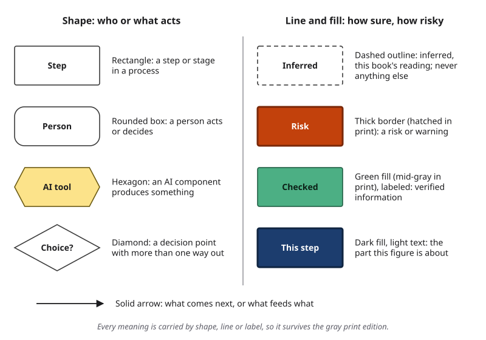

# A Visual Guide to This Book {#sec-visual-guide .unnumbered}

<!-- Status: FIRST DRAFT (2026-10-18), front-matter agent, under the editor's delegation (D19). Grammar from docs/visual-guide.md, figures/scripts/figlib.py and the book-wide rules in docs/production/chapter-brief.md; signature list from figures/index.csv. Figure: figures/scripts/front_figures.py (F0.1). Pending the author's voice edit. -->

This book has hundreds of diagrams about artificial intelligence (AI), and they are part of the text, not decoration. Every one of them uses the same small visual language. Learn it here once, and you can read any figure in the book.

## Shapes, Lines and Fills {.unnumbered}

{#fig-legend fig-alt="Legend. Shapes: rectangle step, rounded box person, hexagon AI, diamond decision. Dashed inferred, thick risk, filled verified or highlighted."}

**Shape tells you who or what acts.**

- A **rectangle** is a step or a stage in a process: collect the data, draft the reply, send the email.
- A **rounded box** is a person who acts or decides. In the AI Work Loop, all five steps are rounded, because all five decisions are yours.
- A **hexagon** is an AI component: a model, a tool or an automated system that produces something.
- A **diamond** is a decision point with more than one way out, such as "Approve or send back?"

For example, in a diagram of an agent at work (Chapter 14), the hexagon plans the next action, a diamond marks the approval gate, and rounded boxes mark where a person sets the goal, checks a result or takes the work back.

**Line and fill tell you how sure, how risky and where to look.**

- A **dashed outline or line** means *inferred*: this book's reading of the evidence, not something the record states. It never means anything else. When a case is labeled on the Failure Taxonomy Tree, a solid border means the label is documented and a dashed border means it is inferred. In a chapter that uses the three attribution tiers (confirmed, reported, inferred), the legend may say that dashes mark reported facts too.
- A **thick border** marks a risk or a warning. In the color edition, the box is also filled orange; in print, it is hatched with fine diagonal lines.
- A **green fill** (mid-gray in print), always with a label, marks verified information.
- A **dark fill with light text** highlights the part of a diagram the figure is about, such as the one step of the AI Work Loop a chapter strengthens.
- A **solid arrow** shows what comes next, or what feeds into what.

Other states, such as missing or partial, use a labeled shape, fill or pattern, never a dash.

## Rules Every Figure Follows {.unnumbered}

- **Meaning never depends on color alone.** Every color is backed by a shape, a line style, a pattern or a label. This helps readers with color-vision differences and makes the print edition work.
- **Two editions, one drawing.** The ebook is in color; the printed book is in grayscale. Every figure is drawn twice from the same source file and checked in gray before it is used.
- **At most nine boxes.** A diagram that needs more is split into two.
- **The title states the finding.** A caption does not say "Verification funnel"; it says "Take each claim only as far as its stakes require."
- **Accessible.** Every figure has alternative text of no more than 150 characters, and complex figures have a long description in the accessible edition.
- **Generated images are never used** in diagrams or data charts. Data charts are produced by code from data files, so their numbers can be checked.

## The Signature Diagrams {.unnumbered}

Twelve diagrams carry the book's main ideas. Each is built in the chapter that introduces it and then reused in later chapters with the same drawing, highlighting only the part that matters there. When you meet one again, you already know how to read it.

| # | Signature diagram | What it shows | Introduced in |
|---|---|---|---|
| 1 | AI Work Loop | Five human decisions: Frame, Prompt, Verify, Decide, Disclose | Chapter 1 |
| 2 | Jagged Frontier Map | AI is uneven across tasks that look equally hard | Chapter 1 |
| 3 | Data-to-Prediction Pipeline | Every prediction inherits the choices made in collecting and labeling its data | Chapter 2 |
| 4 | Anatomy of an LLM Response | In a large language model (LLM), a response is built one token at a time from scores over possible next tokens | Chapter 3 |
| 5 | Failure Taxonomy Tree | Most failures fall on one of five branches: hallucination, bias, context loss, overconfidence, security vulnerability | Chapter 4 |
| 6 | Anatomy of a Prompt | Six parts of a prompt; the task is the only one you always need | Chapter 5 |
| 7 | Delegation Ladder | The higher the rung, the harder it is to check what the AI contributed before it takes effect | Chapter 5 |
| 8 | Verification Funnel | Take each claim only as far as its stakes require | Chapter 8 |
| 9 | Agent Loop with Approval Gates | An agent plans, calls tools and observes; the approval gate sits before an action takes effect | Chapter 14 |
| 10 | Risk Heat Map | Rate each risk by likelihood and impact, and mark what the rating rests on | Chapter 15 |
| 11 | Bias Lifecycle | Bias can enter at four phases, and each phase needs its own check | Chapter 16 |
| 12 | Portfolio Anatomy | A portfolio is an argument: a narrative backed by entries, each with its own evidence | Chapter 20 |

Several other diagrams recur across chapters and follow the same rules:

| Diagram | Introduced in |
|---|---|
| Failure-to-harm chain | Chapter 4 |
| Context layers | Chapter 6 (Deep) |
| Source reliability ladder | Chapter 9 |
| Voice and ownership spectrum | Chapter 10 |
| Data-flow map | Chapter 15 |
| Explanation layers | Chapter 17 (Deep) |
| Regulation Map | Chapter 18 |
| Discipline × Use Map | Chapter 19 |
| Personal principles card | Chapter 21 |
