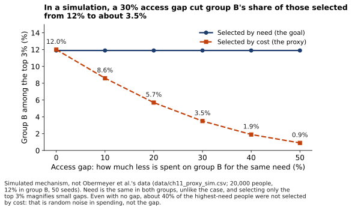

# Lab 11.4 — Rerun the Demonstrations (Deep)

| Field | Value |
|---|---|
| Type | Build (optional, Deep; not examinable) |
| Objectives | O2, O3 (LO3, LO5) · tags 4D:DISC |
| Time | 25 minutes, in a browser notebook |
| Materials | figures/scripts/ch11_experiments.py (Python 3.10, NumPy 1.26; seeds and parameters in data/ch11_experiments_meta.txt) loaded in a browser notebook (in Compass, optional); no installation needed |

## Steps
1. Run the script unchanged and confirm the event-log table (section 11.2) and the simulation shares (F11.6).
2. In `SHIFTS`, change which book-swap shifts are unlogged (the last value of each row: `False` = unlogged). Try shifts 1 and 4 instead of 3 and 5. Rerun. When does the best event change, and when do the five choices disagree?
3. In the simulation, change `MISSING_SHARE` (for example, to 0.10 or 0.40). How do the shares move?
4. In the proxy simulation, look at `GAPS` and the output (F11.10): group B's share of those selected falls as the access gap grows.
5. Write three sentences on what the code made visible that the chapter's tables did not.

{fig-alt="Lines: group B's share of the top 3% stays near 12% when selecting by need and falls toward 1% when selecting by cost as the gap grows."}

## Expected observations
With the chapter's two long shifts unlogged, all five choices pick the book swap. If the two short shifts 1 and 4 go unlogged instead (or one long and one short), the choices disagree: blank as zero still picks the book swap, the other four pick the car wash (checked 2026-10-18). Raising the missing share lowers every choice's success rate. In the proxy simulation, even with no gap about 40% of the highest-need people are not selected by cost, because spending varies randomly around need; that share is noise, not the gap.

## Debrief
1. Which change made the shortcuts disagree, and what does that tell you about reading agreement as evidence? (analyze)
2. Why is the proxy simulation a mechanism and not evidence about real hospitals? (evaluate)

## Deliverable and rubric
Ungraded.

## Accessibility and alternatives
A printed version of the code with sample outputs; the chapter's tables carry the same results.

## Safety and privacy
Simulated data only.
